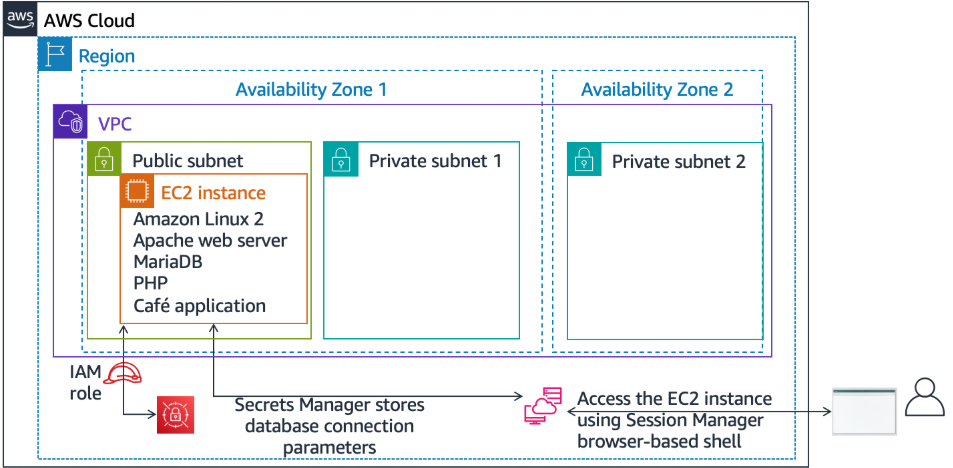
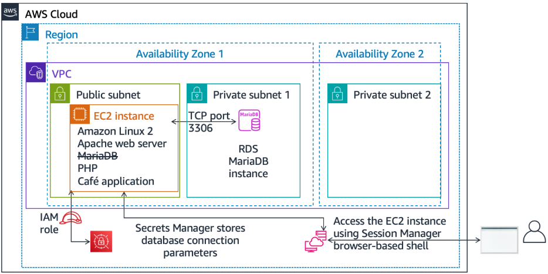
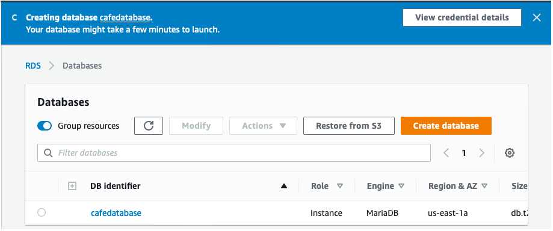
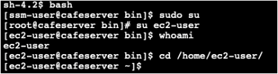
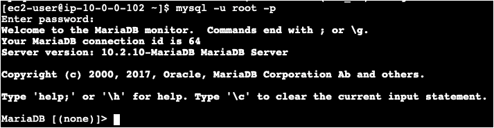
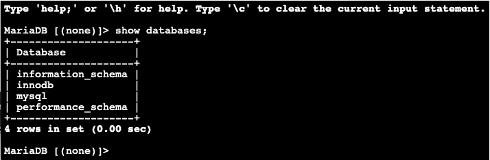

# Challenge Lab: Migrating a Database to Amazon RDS

## Scenario

The café currently uses a single Amazon Elastic Compute Cloud (Amazon EC2) instance to host its web server, database, and application code.

Meanwhile, the café business has grown. The order history that is stored in the database provides valuable business information that the café staff doesn't want to lose. Martha uses the data for accounting, and Frank looks at it occasionally to plan how many of each dessert type he should bake.

Sofía has additional concerns. The database must be consistently upgraded and patched, and she doesn’t always have time to do these tasks. Also, administering the database is a specialized skill. Training others to do database administration isn’t something that she wants to spend time on. Meanwhile, Sofía is also concerned that the café isn’t doing data backups as often as they should.

Finally, Martha also wants to reduce labor costs that are associated with the technical learning investment that's needed to manage the database.

## Lab overview and objectives

In this lab, you migrate data from a database on an EC2 instance to Amazon Relational Database Service (Amazon RDS). Specifically, you migrate a MariaDB database that runs on an EC2 instance to a MariaDB database that runs on Amazon RDS. You also update the café web application to use the new database to store data for all future orders.

After completing this lab, you should be able to do the following:

- Create an RDS database instance.

- Export data from a MariaDB database by using mysqldump.

- Connect a SQL client to an RDS database.

- Migrate data from a MariaDB database that runs on an EC2 instance to an RDS database instance.

- Configure a web application to use the new RDS database instance for data storage.

When you start the lab, the following resources are already created for you in the AWS account:



<details>
<summary>Diagram text</summary>

AWS Cloud

Region

Availability Zone 1

Availability Zone 2

VPC

Public subnet

Private subnet 1

Private subnet 2

EC2 instance

Amazon Linux 2

Apache web server

MariaDB

PHP

Café application

IAM role

Secrets Manager stores database connection parameters

Access the EC2 instance using Session Manager browser-based shell

</details>

At the end of this lab, your architecture will look like the following example:



<details>
<summary>Diagram text</summary>

AWS Cloud

Region

Availability Zone 1

Availability Zone 2

VPC

Public subnet

Private subnet 1

Private subnet 2

EC2 instance

Amazon Linux 2

Apache web server

~~MariaDB~~

PHP

Café application

TCP port 3306

RDS MariaDB instance

IAM role

Secrets Manager stores database connection parameters

Access the EC2 instance using Session Manager browser-based shell

</details>

## Duration

This lab requires approximately **80 minutes** to complete.

## AWS service restrictions

In this lab environment, access to AWS services and service actions might be restricted to the ones that are needed to complete the lab instructions. You might encounter errors if you attempt to access other services or perform actions beyond the ones that are described in this lab.

## Accessing the AWS Management Console

1.  At the top of these instructions, choose **Start Lab**.

    - The lab session starts.

    - A timer displays at the top of the page and shows the time remaining in the session.

**Tip:** To refresh the session length at any time, choose **Start Lab** again before the timer reaches 0:00.

- Before you continue, wait until the circle icon to the right of the AWS link in the upper-left corner turns green. When the lab environment is ready, the **AWS Details** panel displays.

2.  To connect to the AWS Management Console, choose the **AWS** link in the upper-left corner above the terminal window.

    - A new browser tab opens and connects you to the console.

**Tip:** If a new browser tab does not open, a banner or icon is usually at the top of your browser with a message that your browser is preventing the site from opening pop-up windows. Choose the banner or icon, and then choose **Allow pop-ups**.

3.  Arrange the AWS Management Console tab so that it displays alongside these instructions. Ideally, you have both browser tabs open at the same time so that you can follow the lab steps.

**Do not change the Region unless specifically instructed to do so**.

**Tip**: To hide the terminal, clear the **Terminal** checkbox at the top of the screen.

## A business request: Creating an RDS instance for the café application (challenge 1)

After a conversation with Olivia—the AWS solutions architect who often comes in for coffee—Sofía decided that the café needs a database solution that is easier to maintain. In addition, the database should provide essential features such as durability, scalability, and high performance.

In the first part of this lab, you take on the role of Sofía. You create an RDS instance that the café can use as the data storage layer for the café website. You also connect to the EC2 instance and analyze the details of the cafe web application.

## Task 1: Creating an RDS instance

Your first challenge in this lab is to create an RDS instance.

4.  Go to the Amazon RDS console, and create an RDS instance with the following specifications.

When you submit your work at the end of this lab, it will check for many of these settings. To get full credit, follow these guidelines.

- In the **Engine options** section, for **Engine type**, choose **MariaDB**.

- **Engine version : 10.6.25** (*Do not use default or any other version*)

- For **Templates**, choose **Dev/Test**.

- In the **Settings** section, configure the following options:

  - **DB instance identifier**: Enter CafeDatabase.

  - **Master username**: Enter admin.

  - **Master password** and **Confirm master password**: Enter Caf3DbPassw0rd!.

    - You must use this precise password.

    - **Tip**: Copy and paste the password to set it.

- In the **Instance configuration** section, for **DB instance class**, choose **Burstable classes (includes t classes)**, and then choose **db.t3.micro**.

- In the **Storage** section, configure the following options:

  - **Storage type**: Choose **General Purpose SSD(gp2)**.

  - **Allocated storage**: Enter 20 GiB.

- For **Availability & durability**, choose **Do not create a standby instance**.

- In the **Connectivity** section, configure the following options:

  - **Virtual private cloud (VPC)**: Choose **Lab VPC**.

  - **DB subnet group**: Choose **lab-db-subnet-group**.

  - **Public access**: Choose **No**.

  - **Existing VPC security group**: Choose **dbSG**, and clear the **default** security group.

  - **Availability Zone**: Choose the first Availability Zone in the list, which ends in **a**. For example, if the Region is us-east-1, choose **us-east-1a**.

  - **Database port**: Keep the default TCP port of **3306**.

- In the **Monitoring** section, clear **Enable Enhanced Monitoring**. Enhanced monitoring is not supported in the lab environment.

- Choose **Create database**.



<details>
<summary>Diagram text</summary>

Creating database cafedatabase.

Your database might take a few minutes to launch.

View credential details

RDS > Databases

Databases

Group resources

Modify

Actions

Restore from S3

Create database

Filter databases

DB identifier

Role

Engine

Region & AZ

Size

cafedatabase

Instance

MariaDB

us-east-1a

db.t…

</details>

**Note**: You don't have to wait for the database to finish the creation process. Instead, after you have successfully started the database creation process, continue to the next step.

## Task 2: Analyzing the existing café application deployment

In this task, you connect to the existing EC2 instance that runs the current café application.

5.  Browse to the Amazon EC2 console, and choose **Instances**.

Notice the running instance named **CafeServer**. This EC2 instance was created when you started the lab.

6.  To test the café application, in the following URL, replace with the actual IPv4 public IP address of the **CafeServer** instance:

```text
http://<public-ip-address>/cafe
```

7.  Open a browser tab and enter your revised URL.

8.  To test placing an order, go to the **Menu** page.

9.  Change the quantity for at least one menu item to at least **1**, and choose **Submit Order**.

An **Order Confirmation** page should display, which indicates that the café website is working as intended.

10. Choose **Order History**.

The page shows that many orders were placed. The current database contains past customer orders that you will migrate to a database that is hosted on Amazon RDS.

Next, you connect to the EC2 instance by using AWS Systems Manager to access a terminal session in the browser.

11. In the Amazon EC2 console, in the left navigation pane, choose **Instances**, and then choose the **CafeServer** EC2 instance.

12. To open the **Connect to instance** menu, choose **Connect**.

13. Choose **Session Manager**.

14. Choose **Connect**.

You should now have a new browser tab open with a terminal session that is connected to the EC2 instance.

15. At the prompt, enter the following commands:

```bash
bash
sudo su
su ec2-user
whoami
cd /home/ec2-user/
```

**Analysis**: The first command gives you a bash shell. The second command switches your session to use the root user account on the EC2 instance. The third command switches you to use the ec2-user account. The fourth command should return output that confirms that you are connected as the ec2-user. The last command switches your terminal to the home directory of the ec2-user.



<details>
<summary>Diagram text</summary>

```text
sh-4.2$ bash
[ssm-user@cafeserver bin]$ sudo su
[root@cafeserver bin]# su ec2-user
[ec2-user@cafeserver bin]$ whoami
ec2-user
[ec2-user@cafeserver bin]$ cd /home/ec2-user/
[ec2-user@cafeserver ~]$
```

</details> 

**Note**: The Systems Manager agent (ssm agent) is installed by default on all Amazon Linux 2 instances (and some other operating system types). When you started the lab and the EC2 instance was created, the user data specified that the ssm agent service should be started on the instance. Also, an AWS Identity and Access Management (IAM) role that includes an IAM policy named AmazonSSMManagedInstanceCore was attached to the EC2 instance. These two actions made the instance accessible through the Systems Manager Session Manager.

## New business requirement: Exporting data from the old database and establishing a connection to the new database (challenge 2)

Now that you have created a new RDS instance, you can move on to the next step in the café's database migration plan. Next, you export the data from the database that the café application currently uses. You also establish a network connection from the EC2 instance (where the application runs) to the new RDS database instance.

In this challenge, you continue as Sofía to complete these tasks.

## Task 3: Working with the database on the EC2 instance

In this task, you observe details about the MariaDB database that runs on the EC2 instance. You then export the existing order history data from the database by using the mysqldump utility.

16. To observe details of the database that runs on the EC2 instance, in the terminal, run the following commands:

```bash
service mariadb status
mysql --version
```

The output should show that the locally installed MariaDB database on this EC2 instance is running. It should also show the version number of the database.

Leave this browser tab open. You use it throughout this lab.

17. On the AWS Management Console, in the search box, enter and choose Secrets Manager to open the AWS Secrets Manager console.

18. In the left navigation pane, choose **Secrets**.

There are seven secrets stored here. The café application PHP code references these values (for example, to retrieve the connection information for the database).

19. Choose the **/cafe/dbPassword** secret.

20. In the **Secret value** section, choose **Retrieve secret value**, and copy the **Value** to your clipboard.

You use this value in a moment.

21. To connect to the database that is running on the EC2 instance, in the browser tab with the bash terminal, run the following command:

```bash
mysql -u root -p
```

22. When prompted for the database password, paste the **dbPassword** parameter value that you copied a moment ago.

You should now see a **MariaDB\>** prompt. This prompt indicates that you are now connected to the MariaDB database that runs on this EC2 instance.



<details>
<summary>Diagram text</summary>

```text
[ec2-user@ip-10-0-0-102 ~]$ mysql -u root -p
Enter password:
Welcome to the MariaDB monitor.  Commands end with ; or \g.
Your MariaDB connection id is 64
Server version: 10.2.10-MariaDB MariaDB Server

Copyright (c) 2000, 2017, Oracle, MariaDB Corporation Ab and others.

Type 'help;' or '\h' for help. Type '\c' to clear the current input statement.

MariaDB [(none)]>
```

</details>

23. To observe the data in the existing database, run the following commands:

```sql
show databases;
use cafe_db;
show tables;
select * from `order`;
```

In particular, you should review the tables that support the café web application.

These commands show all the orders that were placed, including the order that you placed a moment ago.

24. To show the order line items, run the following command:

```sql
select * from `order_item`;
```

Each order number has a row for each type of item that was ordered, with details about the quantity of each item and the price.

All this data must be migrated to the new database.

25. To exit the SQL client, enter the following command:

```sql
exit;
```

26. To capture existing data in a file by using the mysqldump utility, run the following command:

```bash
mysqldump --databases cafe_db -u root -p > CafeDbDump.sql
```

27. When prompted for the database password, paste the **dbPassword** value from the Secrets Manager secrets.

28. To confirm that mysqldump succeeded, run the ls command in the terminal.

The output should show that the CafeDbDump.sql file was created.

29. To see the contents of the file, run the cat CafeDbDump.sql command.

In the next section of the lab, you import this data into the new RDS database.

## Task 4: Working with the RDS database

In this task, you first answer a few questions about the RDS instance that you created. Then, you confirm that you can connect to the RDS instance.

30. In the AWS Management Console, return to the Amazon RDS console and confirm that the **cafedatabase** RDS instance that you created is now available.

### Answering questions about the RDS instance

Your answers are recorded when you choose **Submit** at the end of the lab.

31. To access the questions in this lab, at the top of these instructions, choose **AWS Details**.

32. Choose the **Access the multiple choice questions** link.

33. In the page you loaded, answer the four questions:

    - Question 1: Where is the RDS instance running?

    - Question 2: Does the RDS instance have an IPv4 public IP address assigned to it?

    - Question 3: What is the Name tag applied to the subnet in which the RDS instance is running?

    - Question 4: How many security group rules are defined for the RDS instance?

34. Establish a network connection from the terminal running on the EC2 instance to the new RDS instance.

Here are some tips to help you get started. Expand each tip for help solving the challenge.

<details>
<summary>Tip 1</summary>

Here is the syntax that you can use to connect: `mysql -u admin -p --host <rds-endpoint>`

Replace *\<rds-endpoint\>* with the actual RDS endpoint for your RDS instance.

After you run the command, it prompts you to enter the password for the RDS instance. You defined this password when you created the RDS instance.

</details>

<details>
<summary>Tip 2</summary>

Even if you enter the RDS endpoint and database password correctly, you still won't be able to connect. You must update the inbound rules of the security group that the RDS instance runs in. The MySQL client software tries to connect to the database on TCP port 3306.

</details>

<details>
<summary>Tip 3</summary>

Avoid opening port 3306 to all source IP addresses. That would not be secure. Instead, open it to only servers in the security group that is used by the EC2 instance that you're connecting from. Try entering sg- into the source field to see options.

</details>

<details>
<summary>Tip 4</summary>

You can confirm that the security group settings allow traffic on TCP port 3306 from the EC2 instance to the database. Try running these commands in the Systems Manager Session Manager terminal. In the following command, replace *\<rds-endpoint\>* with the actual Amazon RDS endpoint:

`nmap -Pn <rds-endpoint>`

If the output of the command shows that port 3306 is open for the MySQL service, then it confirms that the security group settings allow the traffic.

If nmap shows that the port is open, then the `mysql -u admin -p --host <rds-endpoint>` command should also work. However, you must enter the database password correctly. This password is the one that you set when you created the instance.

</details>

**Note**: If you still can't solve the issue, you might find it helpful to submit your work, as documented in the **Submitting your work** section at the end of these lab instructions. The **Submission Report** can provide additional tips for parts of the lab that you didn't complete successfully. You can submit your work as many times as you like. Only the score you achieve on the last submission is retained.

It's important to confirm that you can connect to the RDS MariaDB instance before you go to the next step. If you already managed to connect, congratulations!

35. Run the show databases; command.

It should show the following output:



<details>
<summary>Diagram text</summary>

```text
Type 'help;' or '\h' for help. Type '\c' to clear the current input statement.

MariaDB [(none)]> show databases;
+--------------------+
| Database           |
+--------------------+
| information_schema |
| innodb             |
| mysql              |
| performance_schema |
+--------------------+
4 rows in set (0.00 sec)

MariaDB [(none)]>
```

</details>

  
Notice that **cafe_db** database is not in the list yet. This situation is expected because you haven't imported any data.

36. To disconnect, run the exit; command.

## New business requirement: Importing data and connecting the application to the new database (challenge 3)

In the previous challenge, you exported the data from the database that the café application currently uses. You also established a network connection from the EC2 instance to the RDS instance. You can now work on the next business requirement.

In this challenge, you continue to take on the role of Sofía to import the cafe data into the RDS database instance. After you complete the import, you configure the application to use the new database.

## Task 5: Importing the data into the RDS database instance

37. To import the data that you exported in task 3 to the RDS database instance, in the following command, replace with the actual endpoint, and run your adjusted command.

```bash
mysql -u admin -p --host <rds-endpoint> < CafeDbDump.sql
```

38. At the password prompt, enter the password for the RDS instance.

If you don't see any errors, the command likely succeeded.

39. To confirm that the data was imported and connect to the RDS database, run the following command:

```bash
mysql -u admin -p --host <rds-endpoint>
```

40. At the password prompt, enter the password for the RDS instance.

41. To confirm that the data was imported, run the following commands:

```sql
show databases;
use cafe_db;
show tables;
select * from `order`;
```

The output of the **select** statement should show at least 24 orders in the database.

42. To exit the SQL client, run the following command:

```sql
exit;
```

## Task 6: Connecting the café application to the new database

In this last task in the lab, you connect the café application to the new database. You also stop the database that runs locally on the EC2 instance.

43. Return to the Secrets Manager console browser tab.

44. In the left navigation pane, choose **Secrets**.

Recall from an earlier challenge lab that the café application's PHP code references these values. For example, it uses the values to retrieve the connection information for the database.

45. Connect the café application to the RDS instance.

Because the database connection information has changed, you must update these values to connect the application to the new RDS database instance instead of to the database running on the EC2 instance.

<details>
<summary>Tip 5</summary>

After you update which database the application is connected to, use the http://\<public-ip\>/cafe/menu.php page to test whether you have successfully updated the connection.

</details>

<details>
<summary>Tip 6</summary>

The PHP code doesn't need any updates. Also, if you successfully completed the previous challenge in this lab, the network configuration doesn't need additional changes. The only updates that you must make will be to some values in the Secrets Manager secrets.

</details>

<details>
<summary>Tip 7</summary>

The **currency**, **dbName**, **timeZone**, and **showServerInfo** values don't need to be updated.

</details>

<details>
<summary>Tip 8</summary>

The **dbUrl** should be the RDS endpoint value.

</details>

46. To confirm that your web application now uses the new database and to stop the database that's still running on the EC2 instance, in the terminal, run the following command:

```bash
sudo service mariadb stop
```

47. Load the http://\<public-ip\>/cafe/menu.php page, and confirm that the application still works by placing an order.

48. Choose **Order History**.

Your latest order and all the other previous orders should be there. These orders are the data that you migrated to the new database.

## Update from the café

Everyone at the café is happy with the results of the database migration. Sofía and Nikhil now have more free time on weekends, which means that Frank and Martha are saving money on labor costs.

Sofía takes a minute to relax with her friends. However, she's already thinking about improvements. A good next step would be to reduce the size of the Amazon Elastic Block Store (Amazon EBS) volume that the EC2 instance uses. They could also save on expenses by changing the EC2 instance type to a smaller size. Because the database no longer runs on the EC2 instance, the instance now has extra hard drive space, and it might also not need as many CPU and memory resources.

## Conclusion

Congratulations! you have successfully completed the following:

- Created an RDS database instance

- Exported data from a MariaDB database by using mysqldump

- Connected a SQL client to an RDS database.

- Migrated data from a MariaDB database that runs on an EC2 instance to an RDS database instance

- Configured a web application to use the new RDS database instance for data storage

## Submitting your work

49. At the top of these instructions, choose **Submit** to record your progress, and when prompted, choose **Yes**.

50. If the results don't display after a couple of minutes, return to the top of these instructions and choose **Grades**.

**Tip**: You can submit your work multiple times. After you change your work, choose **Submit** again. Your last submission is what will be recorded for this lab.

51. To find detailed feedback on your work, choose **Submission Report**.

## Lab complete

Congratulations! You have completed the lab.

52. To confirm that you want to end the lab, at the top of this page, choose **End Lab**, and then choose **Yes**.

A message appears: *Ended AWS Lab Successfully*

