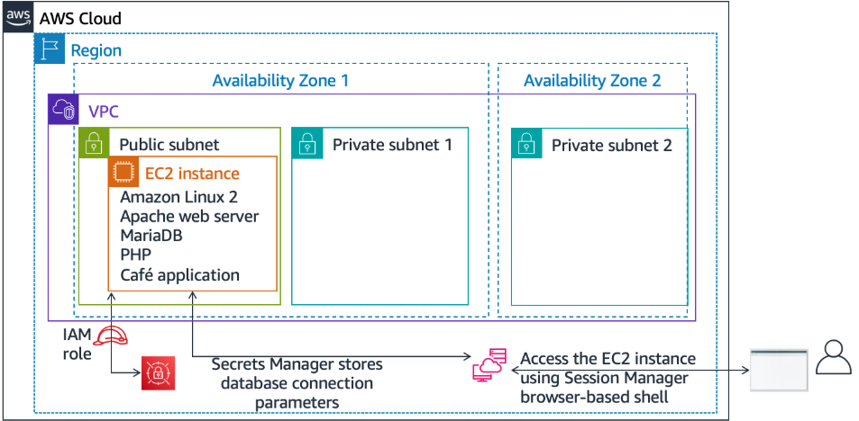
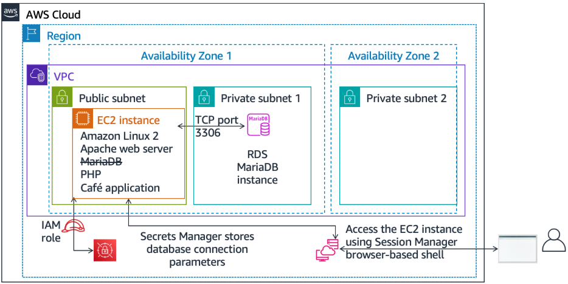
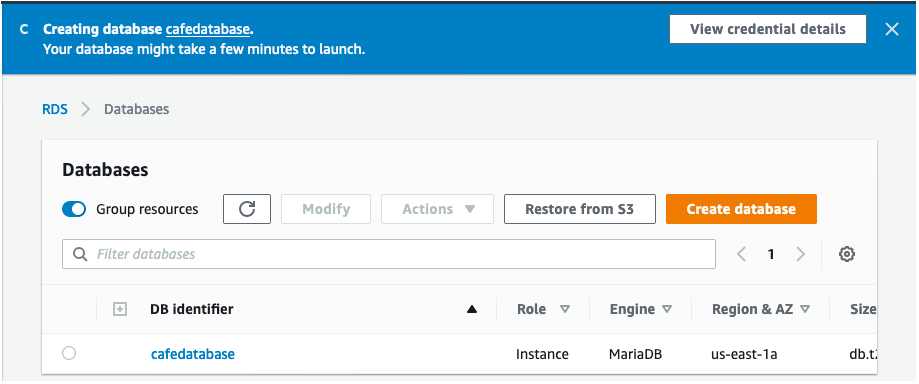
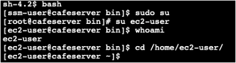
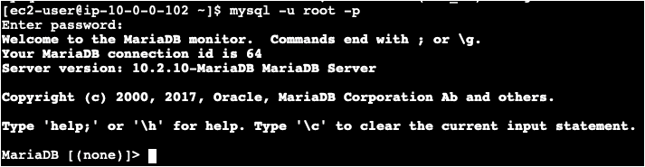
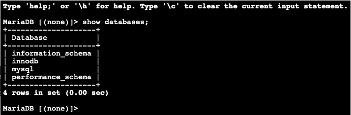

# Лабораторна робота-виклик: міграція бази даних в Amazon RDS (Challenge Lab: Migrating a Database to Amazon RDS)

## Сценарій

Наразі кафе використовує єдиний екземпляр Amazon Elastic Compute Cloud (Amazon EC2) для розміщення свого вебсервера, бази даних і коду застосунку.

Тим часом бізнес кафе виріс. Історія замовлень, що зберігається в базі даних, містить цінну бізнес-інформацію, яку працівники кафе не хочуть втратити. Марта (Martha) використовує дані для бухгалтерії, а Френк (Frank) іноді дивиться на них, щоб спланувати, скільки десертів кожного типу йому слід випікати.

У Софії (Sofía) є додаткові занепокоєння. Базу даних потрібно постійно оновлювати та виправляти, а в неї не завжди є час на ці завдання. Крім того, адміністрування бази даних — це спеціалізована навичка. Навчати інших адмініструванню баз даних — не те, на що вона хоче витрачати час. Тим часом Софія також турбується, що кафе робить резервні копії даних рідше, ніж слід.

Нарешті, Марта також хоче зменшити витрати на працю, пов’язані з технічним навчанням, потрібним для керування базою даних.

## Огляд і цілі лабораторної роботи

У цій лабораторній роботі ви мігруєте дані з бази даних на екземплярі EC2 до Amazon Relational Database Service (Amazon RDS). Зокрема, ви мігруєте базу даних MariaDB, що працює на екземплярі EC2, до бази даних MariaDB, що працює в Amazon RDS. Ви також оновите вебзастосунок кафе так, щоб він використовував нову базу даних для зберігання даних усіх майбутніх замовлень.

Після завершення цієї лабораторної роботи ви зможете:

- Створювати екземпляр бази даних RDS.

- Експортувати дані з бази даних MariaDB за допомогою mysqldump.

- Підключати клієнт SQL до бази даних RDS.

- Мігрувати дані з бази даних MariaDB, що працює на екземплярі EC2, до екземпляра бази даних RDS.

- Налаштовувати вебзастосунок на використання нового екземпляра бази даних RDS для зберігання даних.

Коли ви розпочнете лабораторну роботу, в акаунті AWS уже створено такі ресурси:



<details>
<summary>Текст зі схеми</summary>

AWS Cloud

Region (Регіон)

Availability Zone 1 (Зона доступності 1)

Availability Zone 2 (Зона доступності 2)

VPC

Public subnet (Публічна підмережа)

Private subnet 1 (Приватна підмережа 1)

Private subnet 2 (Приватна підмережа 2)

EC2 instance (Екземпляр EC2)

Amazon Linux 2

Apache web server

MariaDB

PHP

Café application (Застосунок кафе)

IAM role (Роль IAM)

Secrets Manager stores database connection parameters (Secrets Manager зберігає параметри підключення до бази даних)

Access the EC2 instance using Session Manager browser-based shell (Доступ до екземпляра EC2 за допомогою браузерної оболонки Session Manager)

</details>

Наприкінці цієї лабораторної роботи ваша архітектура виглядатиме як у наведеному нижче прикладі:



<details>
<summary>Текст зі схеми</summary>

AWS Cloud

Region (Регіон)

Availability Zone 1 (Зона доступності 1)

Availability Zone 2 (Зона доступності 2)

VPC

Public subnet (Публічна підмережа)

Private subnet 1 (Приватна підмережа 1)

Private subnet 2 (Приватна підмережа 2)

EC2 instance (Екземпляр EC2)

Amazon Linux 2

Apache web server

~~MariaDB~~

PHP

Café application (Застосунок кафе)

TCP port 3306 (порт TCP 3306)

RDS MariaDB instance (екземпляр RDS MariaDB)

IAM role (Роль IAM)

Secrets Manager stores database connection parameters (Secrets Manager зберігає параметри підключення до бази даних)

Access the EC2 instance using Session Manager browser-based shell (Доступ до екземпляра EC2 за допомогою браузерної оболонки Session Manager)

</details>

## Тривалість

Для виконання цієї лабораторної роботи потрібно приблизно **80 хвилин**.

## Обмеження сервісів AWS

У цьому лабораторному середовищі доступ до сервісів AWS і дій сервісів може бути обмежений тими, що потрібні для виконання інструкцій лабораторної роботи. Ви можете стикнутися з помилками, якщо спробуєте отримати доступ до інших сервісів чи виконати дії, окрім описаних у цій лабораторній роботі.

## Доступ до AWS Management Console

1.  У верхній частині цих інструкцій оберіть **Start Lab**.

    - Розпочнеться лабораторний сеанс.

    - Угорі сторінки відображається таймер, що показує час, який залишився в сеансі.

**Порада:** щоб у будь-який момент продовжити тривалість сеансу, знову оберіть **Start Lab**, перш ніж таймер досягне 0:00.

- Перш ніж продовжити, зачекайте, доки значок-коло праворуч від посилання AWS у верхньому лівому куті стане зеленим. Коли лабораторне середовище буде готове, відобразиться панель **AWS Details**.

2.  Щоб підключитися до AWS Management Console, оберіть посилання **AWS** у верхньому лівому куті над вікном терміналу.

    - Відкриється нова вкладка браузера й підключить вас до консолі.

**Порада:** якщо нова вкладка браузера не відкривається, угорі браузера зазвичай з’являється банер чи значок із повідомленням, що ваш браузер перешкоджає сайту відкривати спливні вікна. Оберіть банер чи значок, а потім оберіть **Allow pop-ups**.

3.  Розташуйте вкладку AWS Management Console так, щоб вона відображалася поруч із цими інструкціями. Ідеально, якщо ви зможете бачити обидві вкладки браузера одночасно, щоб легше виконувати кроки лабораторної роботи.

**Не змінюйте регіон, якщо не отримано спеціальної вказівки це зробити**.

**Порада**: щоб приховати термінал, зніміть прапорець **Terminal** угорі екрана.

## Бізнес-запит: створення екземпляра RDS для застосунку кафе (виклик 1)

Після розмови з Олівією (Olivia) — архітекторкою рішень AWS, що часто заходить випити кави — Софія вирішила, що кафе потрібне рішення для бази даних, яке легше підтримувати. Крім того, база даних має надавати основні можливості, як-от довговічність, масштабованість і висока продуктивність.

У першій частині цієї лабораторної роботи ви берете на себе роль Софії. Ви створюєте екземпляр RDS, який кафе може використовувати як рівень зберігання даних для вебсайту кафе. Ви також підключаєтеся до екземпляра EC2 і аналізуєте подробиці вебзастосунку кафе.

## Завдання 1: створення екземпляра RDS

Ваш перший виклик у цій лабораторній роботі — створити екземпляр RDS.

4.  Перейдіть до консолі Amazon RDS і створіть екземпляр RDS із такими специфікаціями.

Коли наприкінці лабораторної роботи ви надішлете свою роботу, вона перевірить багато з цих налаштувань. Щоб отримати повну оцінку, дотримуйтеся цих настанов.

- У розділі **Engine options** для **Engine type** оберіть **MariaDB**.

- **Engine version : 10.6.25** (*не використовуйте типову чи будь-яку іншу версію*)

- Для **Templates** оберіть **Dev/Test**.

- У розділі **Settings** налаштуйте такі параметри:

  - **DB instance identifier**: введіть CafeDatabase.

  - **Master username**: введіть admin.

  - **Master password** і **Confirm master password**: введіть Caf3DbPassw0rd!.

    - Ви маєте використати саме цей пароль.

    - **Порада**: скопіюйте й вставте пароль, щоб його встановити.

- У розділі **Instance configuration** для **DB instance class** оберіть **Burstable classes (includes t classes)**, а потім оберіть **db.t3.micro**.

- У розділі **Storage** налаштуйте такі параметри:

  - **Storage type**: оберіть **General Purpose SSD(gp2)**.

  - **Allocated storage**: введіть 20 GiB.

- Для **Availability & durability** оберіть **Do not create a standby instance**.

- У розділі **Connectivity** налаштуйте такі параметри:

  - **Virtual private cloud (VPC)**: оберіть **Lab VPC**.

  - **DB subnet group**: оберіть **lab-db-subnet-group**.

  - **Public access**: оберіть **No**.

  - **Existing VPC security group**: оберіть **dbSG** і зніміть вибір із групи безпеки **default**.

  - **Availability Zone**: оберіть першу зону доступності у списку, що закінчується на **a**. Наприклад, якщо регіон — us-east-1, оберіть **us-east-1a**.

  - **Database port**: залиште типовий порт TCP **3306**.

- У розділі **Monitoring** зніміть прапорець **Enable Enhanced Monitoring**. Розширений моніторинг (Enhanced Monitoring) не підтримується в лабораторному середовищі.

- Оберіть **Create database**.



<details>
<summary>Текст зі схеми</summary>

Creating database cafedatabase. (Створення бази даних cafedatabase.)

Your database might take a few minutes to launch. (Запуск бази даних може тривати кілька хвилин.)

View credential details (Переглянути облікові дані)

RDS > Databases

Databases (Бази даних)

Group resources (Групувати ресурси)

Modify (Змінити)

Actions (Дії)

Restore from S3 (Відновити з S3)

Create database (Створити базу даних)

Filter databases (Фільтр баз даних)

DB identifier (Ідентифікатор БД)

Role (Роль)

Engine (Рушій)

Region & AZ (Регіон і зона доступності)

Size (Розмір)

cafedatabase

Instance (Екземпляр)

MariaDB

us-east-1a

db.t…

</details>

**Примітка**: вам не потрібно чекати, доки база даних завершить процес створення. Натомість, після того як ви успішно запустили процес створення бази даних, переходьте до наступного кроку.

## Завдання 2: аналіз наявного розгортання застосунку кафе

У цьому завданні ви підключаєтеся до наявного екземпляра EC2, на якому працює поточний застосунок кафе.

5.  Перейдіть до консолі Amazon EC2 і оберіть **Instances**.

Зверніть увагу на запущений екземпляр з назвою **CafeServer**. Цей екземпляр EC2 було створено, коли ви розпочали лабораторну роботу.

6.  Щоб протестувати застосунок кафе, у наведеній нижче URL-адресі замініть на фактичну публічну IP-адресу IPv4 екземпляра **CafeServer**:

```text
http://<public-ip-address>/cafe
```

7.  Відкрийте вкладку браузера й введіть вашу виправлену URL-адресу.

8.  Щоб протестувати розміщення замовлення, перейдіть на сторінку **Menu**.

9.  Змініть кількість принаймні для однієї позиції меню принаймні на **1** і оберіть **Submit Order**.

Має відобразитися сторінка **Order Confirmation**, що вказує, що вебсайт кафе працює як задумано.

10. Оберіть **Order History**.

Сторінка показує, що було розміщено багато замовлень. Поточна база даних містить минулі замовлення клієнтів, які ви мігруєте до бази даних, розміщеної в Amazon RDS.

Далі ви підключаєтеся до екземпляра EC2 за допомогою AWS Systems Manager, щоб отримати доступ до сеансу терміналу в браузері.

11. У консолі Amazon EC2 в лівій панелі навігації оберіть **Instances**, а потім оберіть екземпляр EC2 **CafeServer**.

12. Щоб відкрити меню **Connect to instance**, оберіть **Connect**.

13. Оберіть **Session Manager**.

14. Оберіть **Connect**.

Тепер у вас має бути відкрита нова вкладка браузера із сеансом терміналу, підключеним до екземпляра EC2.

15. У командному рядку введіть такі команди:

```bash
bash
sudo su
su ec2-user
whoami
cd /home/ec2-user/
```

**Аналіз**: перша команда дає вам оболонку bash. Друга команда перемикає ваш сеанс на використання облікового запису користувача root на екземплярі EC2. Третя команда перемикає вас на використання облікового запису ec2-user. Четверта команда має повернути вивід, що підтверджує, що ви підключені як ec2-user. Остання команда перемикає ваш термінал у домашній каталог користувача ec2-user.



<details>
<summary>Текст зі схеми</summary>

```text
sh-4.2$ bash
[ssm-user@cafeserver bin]$ sudo su
[root@cafeserver bin]# su ec2-user
[ec2-user@cafeserver bin]$ whoami
ec2-user
[ec2-user@cafeserver bin]$ cd /home/ec2-user/
[ec2-user@cafeserver ~]$
```

</details>

**Примітка**: агент Systems Manager (ssm agent) за замовчуванням встановлено на всіх екземплярах Amazon Linux 2 (і деяких інших типах операційних систем). Коли ви розпочали лабораторну роботу й було створено екземпляр EC2, у даних користувача (user data) було вказано, що сервіс ssm agent слід запустити на екземплярі. Також до екземпляра EC2 було прикріплено роль AWS Identity and Access Management (IAM), що включає політику IAM з назвою AmazonSSMManagedInstanceCore. Ці дві дії зробили екземпляр доступним через Systems Manager Session Manager.

## Нова бізнес-вимога: експорт даних зі старої бази даних і встановлення з’єднання з новою базою даних (виклик 2)

Тепер, коли ви створили новий екземпляр RDS, можна переходити до наступного кроку плану міграції бази даних кафе. Далі ви експортуєте дані з бази даних, яку наразі використовує застосунок кафе. Ви також встановлюєте мережеве з’єднання з екземпляра EC2 (де працює застосунок) до нового екземпляра бази даних RDS.

У цьому виклику ви продовжуєте діяти як Софія, щоб виконати ці завдання.

## Завдання 3: робота з базою даних на екземплярі EC2

У цьому завданні ви переглядаєте подробиці бази даних MariaDB, що працює на екземплярі EC2. Потім ви експортуєте наявні дані історії замовлень із бази даних за допомогою утиліти mysqldump.

16. Щоб переглянути подробиці бази даних, що працює на екземплярі EC2, у терміналі виконайте такі команди:

```bash
service mariadb status
mysql --version
```

Вивід має показати, що локально встановлена база даних MariaDB на цьому екземплярі EC2 працює. Він також має показати номер версії бази даних.

Залиште цю вкладку браузера відкритою. Ви використовуватимете її протягом усієї цієї лабораторної роботи.

17. В AWS Management Console у полі пошуку введіть і оберіть Secrets Manager, щоб відкрити консоль AWS Secrets Manager.

18. У лівій панелі навігації оберіть **Secrets**.

Тут зберігається сім секретів. PHP-код застосунку кафе посилається на ці значення (наприклад, щоб отримати інформацію про підключення до бази даних).

19. Оберіть секрет **/cafe/dbPassword**.

20. У розділі **Secret value** оберіть **Retrieve secret value** і скопіюйте **Value** у буфер обміну.

Ви використаєте це значення за мить.

21. Щоб підключитися до бази даних, що працює на екземплярі EC2, у вкладці браузера з терміналом bash виконайте таку команду:

```bash
mysql -u root -p
```

22. Коли з’явиться запит пароля бази даних, вставте значення параметра **dbPassword**, яке ви скопіювали щойно.

Тепер ви маєте побачити запрошення **MariaDB\>**. Це запрошення вказує, що ви тепер підключені до бази даних MariaDB, що працює на цьому екземплярі EC2.



<details>
<summary>Текст зі схеми</summary>

```text
[ec2-user@ip-10-0-0-102 ~]$ mysql -u root -p
Enter password:
Welcome to the MariaDB monitor.  Commands end with ; or \g.
Your MariaDB connection id is 64
Server version: 10.2.10-MariaDB MariaDB Server

Copyright (c) 2000, 2017, Oracle, MariaDB Corporation Ab and others.

Type 'help;' or '\h' for help. Type '\c' to clear the current input statement.

MariaDB [(none)]>
```

</details>

23. Щоб переглянути дані в наявній базі даних, виконайте такі команди:

```sql
show databases;
use cafe_db;
show tables;
select * from `order`;
```

Зокрема, слід переглянути таблиці, що підтримують вебзастосунок кафе.

Ці команди показують усі замовлення, що були розміщені, включно із замовленням, яке ви розмістили щойно.

24. Щоб показати позиції замовлень (order line items), виконайте таку команду:

```sql
select * from `order_item`;
```

Кожен номер замовлення має рядок для кожного типу замовленої позиції з подробицями про кількість кожної позиції та ціну.

Усі ці дані потрібно мігрувати до нової бази даних.

25. Щоб вийти з клієнта SQL, введіть таку команду:

```sql
exit;
```

26. Щоб захопити наявні дані у файл за допомогою утиліти mysqldump, виконайте таку команду:

```bash
mysqldump --databases cafe_db -u root -p > CafeDbDump.sql
```

27. Коли з’явиться запит пароля бази даних, вставте значення **dbPassword** із секретів Secrets Manager.

28. Щоб підтвердити, що mysqldump завершився успішно, виконайте команду ls у терміналі.

Вивід має показати, що файл CafeDbDump.sql було створено.

29. Щоб переглянути вміст файлу, виконайте команду cat CafeDbDump.sql.

У наступному розділі лабораторної роботи ви імпортуєте ці дані в нову базу даних RDS.

## Завдання 4: робота з базою даних RDS

У цьому завданні ви спершу відповідаєте на кілька запитань про екземпляр RDS, який ви створили. Потім ви підтверджуєте, що можете підключитися до екземпляра RDS.

30. В AWS Management Console поверніться до консолі Amazon RDS і підтвердьте, що екземпляр RDS **cafedatabase**, який ви створили, тепер доступний.

### Відповіді на запитання про екземпляр RDS

Ваші відповіді записуються, коли наприкінці лабораторної роботи ви обираєте **Submit**.

31. Щоб отримати доступ до запитань у цій лабораторній роботі, угорі цих інструкцій оберіть **AWS Details**.

32. Оберіть посилання **Access the multiple choice questions**.

33. На сторінці, що завантажилася, дайте відповіді на чотири запитання:

    - Запитання 1: де працює екземпляр RDS?

    - Запитання 2: чи призначено екземпляру RDS публічну IP-адресу IPv4?

    - Запитання 3: який тег Name застосовано до підмережі, у якій працює екземпляр RDS?

    - Запитання 4: скільки правил групи безпеки визначено для екземпляра RDS?

34. Встановіть мережеве з’єднання з терміналу, що працює на екземплярі EC2, до нового екземпляра RDS.

Ось кілька підказок, які допоможуть вам розпочати. Розгорніть кожну підказку, щоб отримати допомогу в розв’язанні виклику.

<details>
<summary>Підказка 1 (Tip 1)</summary>

Ось синтаксис, який можна використати для підключення: `mysql -u admin -p --host <rds-endpoint>`

Замініть *\<rds-endpoint\>* фактичною кінцевою точкою RDS вашого екземпляра RDS.

Після виконання команди вона запропонує ввести пароль екземпляра RDS. Ви визначили цей пароль, коли створювали екземпляр RDS.

</details>

<details>
<summary>Підказка 2 (Tip 2)</summary>

Навіть якщо ви правильно введете кінцеву точку RDS і пароль бази даних, ви все одно не зможете підключитися. Потрібно оновити вхідні правила групи безпеки, у якій працює екземпляр RDS. Програмне забезпечення клієнта MySQL намагається підключитися до бази даних на порту TCP 3306.

</details>

<details>
<summary>Підказка 3 (Tip 3)</summary>

Уникайте відкриття порту 3306 для всіх вихідних IP-адрес. Це було б небезпечно. Натомість відкрийте його лише для серверів у групі безпеки, що використовується екземпляром EC2, з якого ви підключаєтеся. Спробуйте ввести sg- у поле джерела, щоб побачити варіанти.

</details>

<details>
<summary>Підказка 4 (Tip 4)</summary>

Ви можете підтвердити, що налаштування групи безпеки дозволяють трафік на порту TCP 3306 з екземпляра EC2 до бази даних. Спробуйте виконати ці команди в терміналі Systems Manager Session Manager. У наведеній нижче команді замініть *\<rds-endpoint\>* фактичною кінцевою точкою Amazon RDS:

`nmap -Pn <rds-endpoint>`

Якщо вивід команди показує, що порт 3306 відкрито для сервісу MySQL, це підтверджує, що налаштування групи безпеки дозволяють трафік.

Якщо nmap показує, що порт відкрито, то команда `mysql -u admin -p --host <rds-endpoint>` також має працювати. Однак ви повинні правильно ввести пароль бази даних. Це пароль, який ви встановили під час створення екземпляра.

</details>

**Примітка**: якщо ви все ще не можете розв’язати проблему, вам може бути корисно надіслати свою роботу, як описано в розділі **Submitting your work** наприкінці цих інструкцій лабораторної роботи. **Submission Report** може надати додаткові підказки щодо частин лабораторної роботи, які ви не виконали успішно. Ви можете надсилати свою роботу стільки разів, скільки захочете. Зберігається лише оцінка, яку ви досягли під час останнього надсилання.

Важливо підтвердити, що ви можете підключитися до екземпляра RDS MariaDB, перш ніж переходити до наступного кроку. Якщо вам уже вдалося підключитися, вітаємо!

35. Виконайте команду show databases;.

Вона має показати такий вивід:



<details>
<summary>Текст зі схеми</summary>

```text
Type 'help;' or '\h' for help. Type '\c' to clear the current input statement.

MariaDB [(none)]> show databases;
+--------------------+
| Database           |
+--------------------+
| information_schema |
| innodb             |
| mysql              |
| performance_schema |
+--------------------+
4 rows in set (0.00 sec)

MariaDB [(none)]>
```

</details>

Зверніть увагу, що бази даних **cafe_db** у списку ще немає. Така ситуація очікувана, тому що ви ще не імпортували жодних даних.

36. Щоб відключитися, виконайте команду exit;.

## Нова бізнес-вимога: імпорт даних і підключення застосунку до нової бази даних (виклик 3)

У попередньому виклику ви експортували дані з бази даних, яку наразі використовує застосунок кафе. Ви також встановили мережеве з’єднання з екземпляра EC2 до екземпляра RDS. Тепер можна працювати над наступною бізнес-вимогою.

У цьому виклику ви продовжуєте виконувати роль Софії, щоб імпортувати дані кафе в екземпляр бази даних RDS. Після завершення імпорту ви налаштовуєте застосунок на використання нової бази даних.

## Завдання 5: імпорт даних в екземпляр бази даних RDS

37. Щоб імпортувати дані, які ви експортували в завданні 3, до екземпляра бази даних RDS, у наведеній нижче команді замініть на фактичну кінцеву точку й виконайте вашу скориговану команду.

```bash
mysql -u admin -p --host <rds-endpoint> < CafeDbDump.sql
```

38. На запрошенні пароля введіть пароль екземпляра RDS.

Якщо ви не бачите жодних помилок, команда, імовірно, виконалася успішно.

39. Щоб підтвердити, що дані було імпортовано, і підключитися до бази даних RDS, виконайте таку команду:

```bash
mysql -u admin -p --host <rds-endpoint>
```

40. На запрошенні пароля введіть пароль екземпляра RDS.

41. Щоб підтвердити, що дані було імпортовано, виконайте такі команди:

```sql
show databases;
use cafe_db;
show tables;
select * from `order`;
```

Вивід оператора **select** має показати в базі даних щонайменше 24 замовлення.

42. Щоб вийти з клієнта SQL, виконайте таку команду:

```sql
exit;
```

## Завдання 6: підключення застосунку кафе до нової бази даних

У цьому останньому завданні лабораторної роботи ви підключаєте застосунок кафе до нової бази даних. Ви також зупиняєте базу даних, що працює локально на екземплярі EC2.

43. Поверніться до вкладки браузера з консоллю Secrets Manager.

44. У лівій панелі навігації оберіть **Secrets**.

Пригадайте з попередньої лабораторної роботи-виклику, що PHP-код застосунку кафе посилається на ці значення. Наприклад, він використовує значення для отримання інформації про підключення до бази даних.

45. Підключіть застосунок кафе до екземпляра RDS.

Оскільки інформація про підключення до бази даних змінилася, потрібно оновити ці значення, щоб підключити застосунок до нового екземпляра бази даних RDS замість бази даних, що працює на екземплярі EC2.

<details>
<summary>Підказка 5 (Tip 5)</summary>

Після того як ви оновите, до якої бази даних підключено застосунок, скористайтеся сторінкою http://\<public-ip\>/cafe/menu.php, щоб перевірити, чи успішно ви оновили підключення.

</details>

<details>
<summary>Підказка 6 (Tip 6)</summary>

PHP-код не потребує жодних оновлень. Також, якщо ви успішно виконали попередній виклик у цій лабораторній роботі, мережева конфігурація не потребує додаткових змін. Єдині оновлення, які потрібно зробити, стосуватимуться деяких значень у секретах Secrets Manager.

</details>

<details>
<summary>Підказка 7 (Tip 7)</summary>

Значення **currency**, **dbName**, **timeZone** і **showServerInfo** не потребують оновлення.

</details>

<details>
<summary>Підказка 8 (Tip 8)</summary>

Значенням **dbUrl** має бути значення кінцевої точки RDS.

</details>

46. Щоб підтвердити, що ваш вебзастосунок тепер використовує нову базу даних, і зупинити базу даних, що все ще працює на екземплярі EC2, у терміналі виконайте таку команду:

```bash
sudo service mariadb stop
```

47. Завантажте сторінку http://\<public-ip\>/cafe/menu.php і підтвердьте, що застосунок усе ще працює, розмістивши замовлення.

48. Оберіть **Order History**.

Ваше останнє замовлення й усі інші попередні замовлення мають бути там. Ці замовлення — дані, які ви мігрували до нової бази даних.

## Новини з кафе

Усі в кафе задоволені результатами міграції бази даних. У Софії та Нікіла (Nikhil) тепер більше вільного часу на вихідних, а це означає, що Френк і Марта економлять на витратах на працю.

Софія знаходить хвилинку, щоб розслабитися з друзями. Однак вона вже думає про покращення. Хорошим наступним кроком було б зменшити розмір тому Amazon Elastic Block Store (Amazon EBS), який використовує екземпляр EC2. Також можна заощадити, змінивши тип екземпляра EC2 на менший розмір. Оскільки база даних більше не працює на екземплярі EC2, екземпляр тепер має зайвий простір на жорсткому диску, і йому також може не знадобитися стільки ресурсів ЦП і пам’яті.

## Висновок

Вітаємо! Ви успішно виконали таке:

- Створили екземпляр бази даних RDS

- Експортували дані з бази даних MariaDB за допомогою mysqldump

- Підключили клієнт SQL до бази даних RDS.

- Мігрували дані з бази даних MariaDB, що працює на екземплярі EC2, до екземпляра бази даних RDS

- Налаштували вебзастосунок на використання нового екземпляра бази даних RDS для зберігання даних

## Надсилання вашої роботи

49. Угорі цих інструкцій оберіть **Submit**, щоб записати ваш прогрес, а коли з’явиться запит, оберіть **Yes**.

50. Якщо результати не відображаються через пару хвилин, поверніться на початок цих інструкцій і оберіть **Grades**.

**Порада**: ви можете надсилати свою роботу кілька разів. Після того як ви змінили свою роботу, знову оберіть **Submit**. Для цієї лабораторної роботи записується ваше останнє надсилання.

51. Щоб знайти детальний відгук про вашу роботу, оберіть **Submission Report**.

## Лабораторну роботу завершено

Вітаємо! Ви завершили лабораторну роботу.

52. Щоб підтвердити, що ви хочете завершити лабораторну роботу, угорі цієї сторінки оберіть **End Lab**, а потім оберіть **Yes**.

З’являється повідомлення: *Ended AWS Lab Successfully* (Лабораторну роботу AWS успішно завершено)

