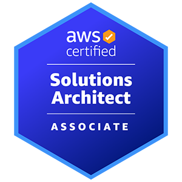

## Слайд 1: Вітаємо в AWS Academy Cloud Architecting

AWS Academy Cloud Architecting

> **Нотатки:**
>
> |Нотатки для інструктора  
> |  
> |Нотатки для студента  
> Вітаємо в AWS Academy Cloud Architecting. Цей модуль надає огляд курсу.

---

## Слайд 2: Цілі модуля

Цей модуль готує вас до такого:

- Розпізнавати базові елементи бізнес-кейсу кафе (café).
- Описувати роль хмарного архітектора (cloud architect).

> **Нотатки:**
>
> |Номер слайда 2  
> |Нотатки для інструктора  
> |  
> |Нотатки для студента

---

## Слайд 3: Огляд модуля

**Розділи презентації**

- Огляд курсу
- Вступ до бізнес-кейсу кафе
- Ролі в хмарних обчисленнях

> **Нотатки:**
>
> |Номер слайда 3  
> |Нотатки для інструктора  
> |Перебіг цього модуля подібний до наступних модулів: вступ, набір розділів презентації, описаних в огляді, і підсумковий розділ для завершення модуля.  
> |  
> |Нотатки для студента  
> Цілі цього модуля розкриваються в розділах, перелічених на цьому слайді.

---

## Слайд 4: Огляд курсу

Вітаємо в AWS Academy Cloud Architecting

> **Нотатки:**
>
> |Номер слайда 4  
> |Нотатки для інструктора  
> |  
> |Нотатки для студента

---

## Слайд 5: Цілі курсу

- Застосовувати архітектурні принципи та найкращі практики Amazon Web Services (AWS) для ухвалення архітектурних рішень.
- Використовувати відповідні сервіси та функції AWS, щоб зробити інфраструктуру масштабованою, надійною та високодоступною.
- Обирати керовані сервіси AWS, щоб забезпечити більшу гнучкість і стійкість інфраструктури.
- Підвищувати продуктивність і знижувати вартість хмарної інфраструктури, побудованої в AWS.
- Використовувати сервіси та функції AWS для захисту доступу користувачів, застосунків і даних.
- Застосовувати найкращі практики AWS Well-Architected Framework для вдосконалення архітектур, що використовують рішення AWS.

> **Нотатки:**
>
> |Номер слайда 5  
> |Нотатки для інструктора  
> |Це загальні цілі курсу, що розкриваються в усіх модулях курсу та через лабораторні роботи. Кожен модуль має власні цілі, що підтримують цілі курсу.  
> |  
> |Нотатки для студента  
> Протягом курсу ви дізнаєтеся про архітектурні рівні, принципи проєктування та сервіси Amazon Web Services (AWS), що використовуються в трьох загальних архітектурних шаблонах:  
> Триярусні архітектури (three-tier)  
> Безсерверні архітектури (serverless)  
> Потокові архітектури (streaming)  
>
> Цілі цього курсу узгоджені зі знаннями та навичками, описаними для складання сертифікаційного іспиту AWS Certified Solutions Architect – Associate.

---

## Слайд 6: Відповідність сертифікації AWS

Концепції цього курсу відповідають знанням і навичкам, описаним у посібнику до іспиту AWS Certified Solutions Architect – Associate (SAA-C03).

Наведені знання та навички перевіряються на іспиті AWS Certified Solutions Architect:

- Здатність проєктувати рішення на основі AWS Well-Architected Framework
- Здатність виконувати такі завдання:
  - Проєктувати рішення, що включають сервіси AWS для задоволення поточних бізнес-вимог і прогнозованих майбутніх потреб.
  - Проєктувати архітектури, що є безпечними, стійкими, високопродуктивними та економічно оптимізованими.
  - Переглядати наявні рішення та визначати покращення.

> **Нотатки:**
>
> |Номер слайда 6  
> |Нотатки для інструктора  
> |В останньому модулі курсу ви докладніше проведете студентів через ресурси для підготовки до іспиту й обговорите сертифікацію AWS Certified Solutions Architect – Associate. Мета — підкреслити відповідність цього курсу сертифікації та ключові можливості, яких очікують від кандидатів на іспит AWS Certified Solutions Architect – Associate (SAA-C03).  
> |  
> |Нотатки для студента  
> Цей курс не є курсом підготовки до іспиту. Однак лекції та лабораторні роботи розроблено так, щоб вони відповідали знанням і навичкам, описаним у посібнику до іспиту AWS Certified Solutions Architect – Associate (SAA-C03).  
>
> Цей слайд підсумовує очікуваний досвід і знання кандидата на іспит SAA-C03. Додаткові подробиці наведено в модулі «Перехід до сертифікації» (Bridging to Certification), а також є посилання на ресурси для іспиту в розділі ресурсів вмісту вашого курсу.

---

## Слайд 7: План курсу за модулями

1. Вітаємо в AWS Academy Cloud Architecting
2. Вступ до хмарної архітектури (Introducing Cloud Architecting)
3. Захист доступу (Securing Access)
4. Додавання рівня сховища за допомогою Amazon S3 (Adding a Storage Layer with Amazon S3)
5. Додавання обчислювального рівня за допомогою Amazon EC2 (Adding a Compute Layer Using Amazon EC2)
6. Додавання рівня бази даних (Adding a Database Layer)
7. Створення мережевого середовища (Creating a Networking Environment)
8. З’єднання мереж (Connecting Networks)
9. Захист доступу користувачів, застосунків і даних (Securing User, Application, and Data Access)

10. Впровадження моніторингу, еластичності та високої доступності (Implementing Monitoring, Elasticity, and High Availability)
11. Автоматизація вашої архітектури (Automating Your Architecture)
12. Кешування контенту (Caching Content)
13. Побудова розділених архітектур (Building Decoupled Architectures)
14. Побудова безсерверних архітектур і мікросервісів (Building Serverless Architectures and Microservices)
15. Шаблони інженерії даних (Data Engineering Patterns)
16. Планування аварійного відновлення (Planning for Disaster)
17. Перехід до сертифікації (Bridging to Certification)

> **Нотатки:**
>
> |Номер слайда 7  
> |Нотатки для інструктора  
> |  
> |Нотатки для студента  
> Курс подано в 17 модулях. Модулі 2 і 3 є оглядом фундаментальних хмарних концепцій. Модулі 4–8 зосереджені на окремих архітектурних рівнях. Модулі 9–16 зосереджені на принципах проєктування та найкращих практиках, що застосовуються до всіх рівнів для побудови безпечних, високопродуктивних, стійких і економічно ефективних хмарних архітектур. Останній модуль подає інформацію про те, як підготуватися до іспиту AWS Certified Solutions Architect – Associate.

---

## Слайд 8: Рекомендована відправна точка для цього курсу

- Ви будете найуспішнішими на цьому курсі, якщо маєте таке:
  - Знання хмарних тем AWS на рівні проходження курсу AWS Academy Cloud Foundations або подібного курсу
  - Практичні знання розподілених систем
  - Практичні знання багаторівневих архітектур
  - Знайомство із загальними концепціями мереж
- Посилання на навчальні матеріали для самостійного вивчення цих тем знайдіть на сторінці ресурсів вмісту (content resources) вашого курсу.

> **Нотатки:**
>
> |Номер слайда 8  
> |Нотатки для інструктора  
> |Цей курс призначений для студентів, які мають навички роботи з хмарою AWS. Ви можете порадити студентам, що не впевнені у своїй готовності, скористатися матеріалами для самостійного вивчення, щоб підвищити шанси на успіх на цьому курсі. Навіть студентам, які пройшли запропоновані матеріали, може бути корисним повторення перед тим, як глибоко зануритися в курс.  
> |  
> |Нотатки для студента  
> Як зазначено в нотатках до попереднього слайда, модулі 2 і 3 — «Вступ до хмарної архітектури» та «Захист доступу» — мають бути оглядом концепцій, які ви вивчали раніше. Ви могли дізнатися про ці концепції на курсі AWS Academy Cloud Foundations або через власний досвід вивчення хмари AWS. Тому ці модулі не заглиблюються в деталі.  
>
> Цей курс прагне побудувати знання про архітектуру хмарних обчислень на основі ваших загальних знань про вебархітектуру. У курсі немає модулів чи розділів, зосереджених на загальних концепціях вебархітектури, як-от побудова розподілених систем, багаторівневі архітектури та інтернет-мережі.  
>
> Якщо ви вважаєте, що вам потрібне повторення або ви хочете приділити цим темам більше часу, спробуйте один із варіантів самостійного навчання, перелічених на сторінці ресурсів вмісту вашого курсу. Ці варіанти включають курси AWS Educate, що існує поза межами цього курсу.  
>
> Щоб отримати доступ до AWS Educate, потрібно зареєструвати акаунт AWS Educate. Перевірка вашого акаунта може тривати до доби. За AWS Educate плата не стягується, і зареєструватися можуть учні віком від 13 років. Потрібна лише адреса електронної пошти; кредитна картка не потрібна. З AWS Educate слухачі можуть обирати навчальний вміст на основі своїх знань, цілей та інтересів. Вони можуть знайти різноманітну інформацію з фундаментальних тем.  
>
> Інструкції щодо реєстрації акаунта AWS Educate див. у PDF-файлі «Accessing AWS Educate ructions», що входить до ресурсів вашого курсу.

---

## Слайд 9: Матеріали курсу

Навчальні матеріали

Перевірки знань

- Посібники для студентів і відео на основі презентацій інструктора для кожного модуля
- Практичні лабораторні роботи включають таке:
  - Покрокові лабораторні роботи (guided labs; інструкції крок за кроком)
  - Лабораторні роботи-виклики (challenge labs; на основі бізнес-кейсу)
  - Підсумковий проєкт AWS Academy Cloud Architecting Capstone
- Записані демонстрації
- Заняття під керівництвом інструктора

- 10-запитальна перевірка знань для кожного модуля — з модуля 2 по 16
- Зразок запитання сертифікаційного іспиту в посібнику студента для кожного модуля — з модуля 2 по 16
- 25-запитальне оцінювання курсу на основі слайдів і посібників студента з усіх модулів

> **Нотатки:**
>
> |Номер слайда 9  
> |Нотатки для інструктора  
> |Це добра нагода показати студентам, де в системі керування навчанням (learning management system, LMS) доступні матеріали кожного з цих типів.  
> |  
> |Нотатки для студента  
> Кожен модуль починається зі вступу до ключових запитань і рішень, які має враховувати архітектор під час побудови відповідного рівня своєї хмарної архітектури для цих поширених шаблонів. Для кожного лекційного модуля є посібник студента та відео, що закріплюють ключові концепції кожного модуля.  
>
> Лабораторні роботи курсу дадуть вам змогу застосувати отримані знання в кожному модулі на практиці в середовищі AWS. Покрокові лабораторні роботи надають інструкції крок за кроком, щоб допомогти набути досвіду створення та налаштування ресурсів AWS у різних галузях сервісів AWS. Лабораторні роботи-виклики (кафе) містять розділи без повного покрокового керівництва на рівні кліків чи докладних інструкцій. Натомість ви маєте застосувати навички, отримані з покрокових лабораторних робіт, і концепції, подані в лекціях.  
>
> AWS Academy Cloud Architecting Capstone — це додаткова лабораторна робота, у якій ви можете застосувати отримані знання без докладного керівництва. Підсумковий проєкт виконується в тому самому лабораторному середовищі, що й інші лабораторні роботи, але середовище підсумкового проєкту довготривале. Це означає, що ви можете працювати над ним кілька днів і продовжувати з того місця, де зупинилися.  
>
> Записані демонстрації включено до курсу для ілюстрації деяких тем. Ці відео входять до ваших матеріалів модуля, а ваш посібник студента містить вступні слайди, що вказують, де демонстрації вписуються в лекцію.  
>
> Ваш інструктор може включити заняття під керівництвом інструктора, що доповнюють лекцію. Вступні слайди містяться у вашому посібнику студента. Додаткова інформація та матеріали для кожного заняття надаватимуться за потреби залежно від заняття.  
>
> Протягом курсу ви матимете можливості перевірити своє розуміння поданих матеріалів. Кожен модуль, окрім першого й останнього, містить 10-запитальну перевірку знань і зразок запитання іспиту для обговорення. Курс також містить 25-запитальне оцінювання, що включає вміст з усього курсу. Ви можете повторювати і перевірки знань, і оцінювання курсу стільки разів, скільки потрібно.

---

## Слайд 10: Вступ до бізнес-кейсу кафе

Вітаємо в AWS Academy Cloud Architecting

> **Нотатки:**
>
> |Номер слайда 10  
> |Нотатки для інструктора  
> |Сценарій із кафе обрано як бізнес, знайомий більшості студентів. Ви можете використати цей сценарій, щоб розпочати обговорення зі студентами про типи викликів, з якими цей бізнес може зіткнутися. Також можна обговорити, як хмарні обчислення можуть допомогти бізнесу зростати.  
> |  
> |Нотатки для студента  
> Лабораторні роботи-виклики в цьому курсі побудовано навколо вигаданого бізнес-кейсу. Бізнес-кейс дає змогу розглядати теми хмарних обчислень у контексті зрозумілих бізнес-потреб. Цей сценарій має на меті надати приклад застосовності технічних концепцій, які ви вивчатимете, у реальному світі. Цей розділ знайомить із бізнес-кейсом.

---

## Слайд 11: Бізнес-сценарій кафе

- Френк (Frank) і Марта (Martha) відкрили кафе та пекарню на пенсії.
- Їхній персонал і кілька консультантів AWS, які також є клієнтами, допомагають їм використовувати хмару для задоволення потреб їхнього зростаючого бізнесу.

> **Нотатки:**
>
> |Номер слайда 11  
> |Нотатки для інструктора  
> |  
> |Нотатки для студента  
> Френк і Марта мріяли відкрити кафе та пекарню на пенсії. Вони не були готові повністю припинити працювати. Вони хотіли займатися чимось, що поєднує їхню любов до випікання й доповнює їхній дохід.  
>
> Щоб утілити мрію в життя, Френк і Марта нещодавно відкрили кафе та пекарню біля підніжжя свого будинку. З моменту відкриття кафе й пекарні їм подобається спілкуватися з людьми зі свого району. Вони також підтримують громадські заходи своєю випічкою та кавою.  
>
> Френк і Марта відчули зростання місцевого бізнесу. Іноді вони також отримують запити на продукцію від бізнес-мандрівників і туристів, що проїжджають повз. Разом зі своїм персоналом і відвідувачами кафе (дехто з яких — консультанти AWS) вони з’ясовують, як хмарні обчислення можуть допомогти їхньому бізнесу зростати.  
>
> У кожній лабораторній роботі-виклику (кафе) ви берете на себе роль персоналу кафе й отримуєте поради та допомогу від консультантів AWS, які іноді заходять до кафе. Ви проєктуватимете хмарні рішення, що допомагають задовольнити бізнес-потреби кафе. Наступні слайди знайомлять із персонажами (personas), задіяними в бізнес-сценарії кафе.

---

## Слайд 12: Власники та персонал кафе

Френк (Frank)

Марта (Martha)

Софія (Sofía)

Нікіл (Nikhil)

- Співвласник кафе
- Вийшов у відставку з флоту
- Любить випікати
- Нетехнічний

- Співвласниця кафе
- Колишня бухгалтерка
- Вміє користуватися електронними таблицями, але в іншому нетехнічна

- Дочка Френка й Марти
- Менеджерка з ланцюга постачання кафе
- Майбутня студентка спеціальності «бізнес-адміністрування»
- Має технічні навички, зокрема програмування

- Працівник кафе з навичками візуального дизайну
- Зацікавлений у вивченні хмарних обчислень
- Може взяти на себе більше обов’язків у кафе, коли Софія почне університетські студії

> **Нотатки:**
>
> |Номер слайда 12  
> |Нотатки для інструктора  
> |  
> |Нотатки для студента  
> Френк чудовий пекар, але, окрім селфі зі своїми виробами, він не дуже технічний. Його партнерка Марта — колишня бухгалтерка, знайома з користуванням електронними таблицями, але в іншому не має технічного бекграунду. Софія — дочка Френка й Марти. Вона керує щоденною діяльністю кафе, що включає керування ланцюгом постачання для закупівлі інгредієнтів і відстеження запасів. Вона відвідувала кілька занять з програмування в середній школі й планує цього року розпочати навчання за ступенем бакалавра з бізнес-адміністрування в університеті.  
>
> Нікіл працює в кафе неповний робочий день. Він працює за стійкою, обслуговуючи клієнтів і виконуючи інші завдання під наглядом Софії. Він закінчив середню школу й має певний досвід візуального дизайну. Він хоче дізнатися більше про веброзробку та хмарні обчислення. Він планує здобути університетську освіту, що спиратиметься на його наявні навички дизайну й навчить його навичок хмарних обчислень.  
>   
> Софія нещодавно дізналася про AWS. Вона поговорила з батьками про те, як вони могли б використати сервіси AWS для автоматизації деяких аспектів бізнесу кафе. Вона пояснила, як сервіси AWS можуть допомогти скоротити ручну адміністративну роботу та покращити досвід клієнтів.

---

## Слайд 13: Відвідувачі кафе, які є консультантами AWS

Олівія (Olivia)

Фейт (Faythe)

Матео (Mateo)

- Архітектор рішень AWS (AWS solutions architect)
- Має технічні навички, зокрема спеціалізацію з баз даних і мережевих технологій

- Розробниця
- Має досвід роботи з програмними інтерфейсами AWS
- Добре обізнана в безпеці хмари

- Системний адміністратор та інженер
- Любить знаходити способи автоматизації та створювати відтворювані рішення
- Знає, наскільки важливі резервні копії та аварійне відновлення під час проєктування рішення

> **Нотатки:**
>
> |Номер слайда 13  
> |Нотатки для інструктора  
> |  
> |Нотатки для студента  
> Троє частих відвідувачів кафе, які є друзями Софії та Нікіла, — консультанти AWS. Вони часто розмовляють про свої інтереси в галузі технологій і хмари.  
>
> Олівія — архітекторка рішень AWS (SA), яка нещодавно переїхала до центру міста. З розмов Софія дізналася, що Олівія — експертка з AWS і хмарних технологій. Раніше Олівія працювала мережевою інженеркою, а також має сильний бекграунд у технологіях баз даних.  
>
> Фейт — розробниця AWS, яка нещодавно завершила програму стажування AWS. Вона любить використовувати свої навички програмування, щоб застосувати відповідну технологію до бізнес-проблеми. Нещодавно вона здобула сертифікацію AWS Certified Security – Specialty і зацікавлена в розробці рішень для великих даних. Вона часто заходить до кафе по випічку Френка.  
>   
> Матео зазвичай бере каву в кафе по дорозі на роботу. Він досвідчений інженер AWS SysOps. Він майстерний у запровадженні автоматизації та відмовостійкості в рішення, які створює. Матео також любить проєктувати з урахуванням резервного копіювання та аварійного відновлення. Раніше він працював розробником і наставляє Фейт відтоді, як вона почала стажування в AWS. Матео із задоволенням допомагає всім, хто зацікавлений у навчанні.

---

## Слайд 14: Еволюція архітектури кафе

| Версія (Version) | Бізнес-причина оновлення (Business Reason for Update) | Технічні вимоги та оновлення архітектури (Technical Requirements and Architecture Update) |
|---|---|---|
| V1 | Створити статичний вебсайт для малого бізнесу. | Розмістити вебсайт в Amazon S3. |
| V2 | Оновити вебсайт для підтримки динамічного контенту та онлайн-замовлень. | Розгорнути вебзастосунок і базу даних на Amazon EC2. |
| V3 | Зменшити зусилля на обслуговування бази даних і захист її даних. | Розділити рівні вебу та бази даних. Перенести базу даних в Amazon RDS у приватній підмережі. |
| V4 | Підвищити безпеку вебзастосунку. | Використати функції Amazon VPC для налаштування та захисту публічних і приватних підмереж. |
| V5 | Забезпечити, щоб вебсайт міг витримати очікуване зростання трафіку та залишатися високодоступним і стійким до збоїв. | Додати балансувальник навантаження, впровадити автоматичне масштабування екземплярів EC2 і розподілити екземпляри обчислень і баз даних між двома зонами доступності. |
| V6 | Автоматизувати розгортання, щоб кафе могло послідовно розгортати, обслуговувати й оновлювати ресурси кафе в різних регіонах. | Побудувати шаблон CloudFormation під контролем версій для розгортання мережевого та прикладного рівнів. Розгорнути стек CloudFormation в іншому регіоні. |
| V7 | Додати можливості звітування, одночасно зменшивши операційне навантаження та навантаження на обслуговування, підвищивши продуктивність і знизивши витрати. | Розгорнути функції Lambda, що підключаються до бази даних Amazon RDS і генерують звіт за розкладом. |

> **Нотатки:**
>
> |Нотатки для інструктора  
> |Файл CafeLabDiagrams.svg містить схему для кожної версії архітектури, що еволюціонує. Ви можете роздати svg-файл зараз і сказати студентам, що вони звертатимуться до нього, працюючи над кожною лабораторною роботою-викликом.  
> |  
> |Для кожної лабораторної роботи-виклику ця таблиця буде знову представлена з виділенням відповідної версії для цієї лабораторної роботи.  
> |  
> |Нотатки для студента  
> У лабораторних роботах-викликах курсу ви допомагаєте Френку й Марті розвивати їхню хмарну архітектуру. Ви ведете її від простого статичного вебсайту в хмарі до безпечного, масштабованого та стійкого хмарного застосунку, що допомагає їм оптимізувати витрати. Ця таблиця підсумовує оновлення, які ви вносите в кожній лабораторній роботі-виклику.

---

## Слайд 15: Ролі в хмарних обчисленнях

Вітаємо в AWS Academy Cloud Architecting

> **Нотатки:**
>
> |Номер слайда 15  
> |Нотатки для інструктора  
> |Ролі, описані в цьому розділі, — це не повний перелік. Ви можете наголосити студентам, що ролі можуть перекриватися, розподілятися інакше або називатися по-різному залежно від місця роботи. Мета — щоб вони розпізнали різні типи навичок і напрямів, які можуть їх зацікавити, коли вони формують свій вибір професії. Також можна підкреслити, як ці ролі загалом відповідають різним сертифікаціям AWS, яких студенти можуть захотіти здобути.  
> |  
> |Нотатки для студента  
> Цей розділ знайомить із кількома ролями в хмарних обчисленнях і описує типи роботи, які зазвичай виконує кожна роль.  
>
> Ви можете захотіти розпочати кар’єру в хмарних обчисленнях або перейти на роль у хмарних обчисленнях. Можливо, ви хочете працювати в організації, де деякі співробітники мають обов’язки, пов’язані з хмарними обчисленнями. З будь-якої з цих причин корисно розуміти поширені назви посад чи ролі, які виконують окремі особи, команди або відділи.

---

## Слайд 16: ІТ-фахівець (IT professional)

Поширені навички та обов’язки включають таке:

- Виступає як універсал і може керувати застосунком
- Часто керує продуктивним середовищем
- Високий технічний рівень
- Може мати значний або обмежений досвід у хмарних технологіях
- Може спеціалізуватися в одній галузі (наприклад, безпека чи сховище)

Назви посад включають такі:

- ІТ-адміністратор
- Системний адміністратор
- Мережевий адміністратор

> **Нотатки:**
>
> |Номер слайда 16  
> |Нотатки для інструктора  
> |  
> |Нотатки для студента  
> ІТ-фахівці — універсали. Вони зазвичай мають широкий набір навичок. Наприклад, вони можуть керувати інфраструктурою цілого застосунку й добре розуміти компоненти, з яких складається рішення. Однак вони не завжди мають докладні знання про будь-який окремий сервіс, що є частиною застосунку. ІТ-фахівці зазвичай мають високий технічний рівень.

---

## Слайд 17: ІТ-керівник (IT leader)

Поширені навички та обов’язки включають таке:

- Очолює команду ІТ-фахівців
- Відповідає за щоденні операції
- Керує бюджетом, стежить за технологіями та обирає нові технології
- Безпосередньо залучений на ранніх етапах проєкту, а потім делегує команді перебирання на себе

Назви посад включають такі:

- ІТ-менеджер
- ІТ-директор
- ІТ-супервайзер

> **Нотатки:**
>
> |Номер слайда 17  
> |Нотатки для інструктора  
> |  
> |Нотатки для студента  
> ІТ-керівники — це менеджери. Вони зазвичай очолюють команду ІТ-фахівців і вирішують, який тип технології використовувати для проєкту. Вони можуть бути значною мірою залучені до деталей реалізації на ранніх етапах життєвого циклу проєкту. Потім вони делегують команді опрацювання деталей, коли проєкт наближається до завершення.

---

## Слайд 18: Розробник (developer)

Поширені навички та обов’язки включають таке:

- Пише, тестує та виправляє код
- Мислить проєктами на рівні застосунку
- Працює з API та SDK
- Може використовувати приклади коду
- Може спеціалізуватися в одній галузі (наприклад, безпека чи сховище)

Назви посад включають такі:

- Розробник програмного забезпечення
- Системний архітектор
- Керівник розробки програмного забезпечення

> **Нотатки:**
>
> |Номер слайда 18  
> |Нотатки для інструктора  
> |  
> |Нотатки для студента  
> Ще одна поширена роль у хмарних обчисленнях — розробник. Розробники працюють з кодом. Вони опрацьовують деталі — пишуть, тестують і виправляють код, що забезпечує роботу застосунку. Розробники створюють і використовують документацію та репозиторії коду для прискорення проєктів. Вони працюють з API та SDK.

---

## Слайд 19: Інженер DevOps (DevOps engineer)

Поширені навички та обов’язки включають таке:

- Будує інфраструктуру, на якій працюють застосунки, часто в хмарі
- Дотримується настанов хмарного архітектора
- Експериментує для покращення розгортань

Назви посад включають такі:

- Інженер DevOps
- Інженер зі збирання (build engineer)
- Інженер з надійності (reliability engineer)

> **Нотатки:**
>
> |Номер слайда 19  
> |Нотатки для інструктора  
> |  
> |Нотатки для студента  
> Інженери розробки й експлуатації (Development Operations, DevOps) будують інфраструктуру, на якій працюють застосунки. Вони часто створюють або вдосконалюють код, що встановлює й налаштовує сервери та розгортання застосунків. Фахівці DevOps часто експериментують з інфраструктурою та кодом. Іноді вони навчаються на практиці. Вони створюють відтворювані рішення для розгортання та працюють над застосуванням інженерних навичок до бізнес-потреб команд експлуатації.

---

## Слайд 20: Хмарний архітектор (cloud architect)

Поширені навички та обов’язки включають таке:

- Стежить за новими технологіями та допомагає вирішувати, які з них використовувати
- Надає розробникам документацію, процеси та інструментарій
- Дає розробникам свободу для інновацій
- Розв’язує проблеми, використовуючи найкращі практики оптимізації витрат, продуктивності, надійності та безпеки

Назви посад включають такі:

- Хмарний архітектор
- Системний інженер
- Системний аналітик

> **Нотатки:**
>
> |Номер слайда 20  
> |Нотатки для інструктора  
> |  
> |Нотатки для студента  
> Хмарні архітектори проводять час за читанням і стежать за останніми подіями та трендами в хмарних обчисленнях. Вони відповідають за проєктну архітектуру застосунків і за вибір технологій для задоволення потреб технічної бізнес-цілі. Вони повинні знати про можливості багатьох доступних варіантів хмарних сервісів. Це допоможе їм вирішити, які з них прийняти за певного набору бізнес-вимог.  
>
> Хмарні архітектори надають настанови розробникам через архітектурні схеми та документацію. Вони також надають інструментарій, але залишають команді розробки простір для інновацій, якщо це потрібно для досягнення критеріїв успіху.  
>
> Поширені виклики для ролі хмарного архітектора включають керування ресурсами, оптимізацію витрат і визначення найкращих практик продуктивності, надійності та безпеки.  
>
> Обов’язки хмарних архітекторів тісно узгоджені з опорами (pillars) AWS Well-Architected Framework, які докладно розглядаються в цьому курсі. Роль хмарного архітектора — це перспектива, яку ви прийматимете, просуваючись цим курсом.

---

## Слайд 21: Підсумки модуля

Вітаємо в AWS Academy Cloud Architecting

> **Нотатки:**
>
> |Номер слайда 21  
> |Нотатки для інструктора  
> |Підсумки більшості модулів включають слайд із пропозицією студентам пройти перевірку знань і розібрати зразок запитання іспиту. У цьому вступному модулі немає перевірок знань чи зразків запитань іспиту.  
> |  
> |Нотатки для студента  
> Цей розділ підсумовує теми, розглянуті в цьому модулі.

---

## Слайд 22: Резюме модуля

Цей модуль підготував вас до такого:

- Розпізнавати базові елементи бізнес-кейсу кафе.
- Описувати роль хмарного архітектора.

> **Нотатки:**
>
> |Номер слайда 22  
> |Нотатки для інструктора  
> |  
> |Нотатки для студента

---

## Слайд 23: Дякуємо

Виправлення, відгуки чи інші запитання?

Зв’яжіться з нами за адресою [https://support.aws.amazon.com/#/contacts/aws-academy](https://support.aws.amazon.com/#/contacts/aws-academy).

> **Нотатки:**
>
> |Номер слайда 23  
> |Нотатки для інструктора  
> | Усі модулі завершуються цим слайдом, що спрямовує студентів на сторінку ресурсів вмісту. Подумайте про демонстрацію студентам того, як користуватися цією сторінкою в курсі, щоб вони з нею познайомилися.  
> |  
> |Нотатки для студента  
> На цьому цей модуль завершено. Сторінка ресурсів вмісту вашого курсу містить посилання на додаткові ресурси, пов’язані з цим модулем.
