## Слайд 1: Introducing Cloud Architecting

AWS Academy Cloud Architecting

> **Нотатки:**
>
> |Instructor notes  
> |  
> |Student notes  
> Welcome to the Introducing Cloud Architecting module. This module introduces you to the best practices for cloud architectures and how to design and evaluate architectures using the AWS Well-Architected Framework.

---

## Слайд 2: Introduction

Introducing Cloud Architecting

> **Нотатки:**
>
> |Instructor notes  
> |  
> |Student notes  
> This introduction section describes the content of this module.

---

## Слайд 3: Module objectives

This module prepares you to do the following:

- Define cloud architecture.
- Describe how to design and evaluate architectures using the AWS Well-Architected Framework.
- Explain best practices for building solutions on Amazon Web Services (AWS).
- Describe how to make informed decisions about where to place AWS resources.

> **Нотатки:**
>
> |Slide number 3  
> |Instructor notes  
> |This module is an introduction to cloud architecting. Over the course of the module, students learn about cloud architecting. The module includes a discussion of design trade-offs and best practices for cloud architecting. These trade-offs and best practices should be considered with every design decision and should be the foundation for the remaining modules.  
> |  
> |The discussion in this module includes best practices for building solutions on Amazon Web Services (AWS). There is a section on the AWS Global Infrastructure to help students make informed decisions about the AWS Regions and Availability Zones they can choose when deploying resources. Understanding these concepts will be important in the following modules.  
> |  
> |A cloud architect is responsible for understanding the AWS Well-Architected Framework and applying it to designs and implementations. Focus on introducing the AWS Well-Architected Framework as the application of best practices because each pillar will be discussed in the following modules.  
> |  
> |Student notes

---

## Слайд 4: Module overview

**Presentation sections**

- Cloud Architecting
- AWS Well-Architected Framework
- Best practices for building solutions on AWS
- AWS Global Infrastructure

**Knowledge checks**

- 10-question knowledge check

> **Нотатки:**
>
> |Slide number 4  
> |Instructor notes  
> |This module has an introduction, content sections, and a wrap-up.  
> |  
> |Student notes  
> The objectives of this module are presented across multiple sections. The module wraps up with a 10-question knowledge check delivered in the online course.

---

## Слайд 5: As a cloud architect designing AWS architectures:

- I need to understand the practice of applying cloud best practices to a solution that uses cloud services and features to meet an organization’s technical needs and business use cases.
- I need to evaluate an architecture with the AWS Well-Architected Framework.
- I need to apply best practices to building solutions on AWS.

> **Нотатки:**
>
> |Slide number 5  
> |Instructor notes  
> |This slide presents key overarching design considerations that are foundational to cloud architects. Emphasize how a cloud architect must always start with the business case and work backward to choose the best components for that use case. Also, remind students that design decisions will probably evolve over time to optimize cost and performance as needs change or are better understood.  
> |  
> |Student notes  
> This slide asks you to take the perspective of a cloud architect. Review these considerations as you progress through this module, remembering that the cloud architect should work backward from the business need to design the best architecture for a specific use case.

---

## Слайд 6: Cloud Architecting

Introducing Cloud Architecting

> **Нотатки:**
>
> |Slide number 6  
> |Instructor notes  
> |  
> |Student notes  
> This section introduces cloud architecting.

---

## Слайд 7: Cloud computing and AWS

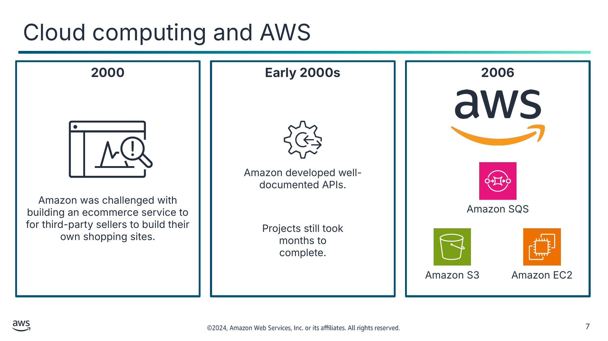

Текст зі схеми

**2000**

**Early 2000s**

**2006**

Amazon developed well-documented APIs.

Amazon was challenged with building an ecommerce service to for third-party sellers to build their own shopping sites.

Amazon SQS

Projects still took months to complete.

Amazon S3

Amazon EC2

> **Нотатки:**
>
> |Slide number 7  
> |Instructor notes  
> |This slide describes the history of how AWS came to be. Focus on how the solutions were internal services that were highly available, scalable, and reliable. These concepts will be discussed in subsequent modules.  
> |  
> |This slide introduces some terms that should be reviewed from the AWS Academy Cloud Foundations course. If necessary, review the terms highly available, scalable, and reliable.  
> |  
> |Student notes  
> To understand what cloud architecting is and why it’s important, first consider an example of what software development is like in its absence. Around 2000, when Amazon was trying to solve a problem, they looked to cloud computing as a solution. Amazon was trying to build an ecommerce service for third-party sellers to build their own online shopping sites on top of the Amazon ecommerce engine.  
>
> The company was struggling to make its new shopping website highly available and scalable. In the beginning, the Amazon ecommerce tools, applications, and architectures were built without proper planning. The various services were difficult to separate to make a centralized development platform. Development time was long, and projects were complicated.  
>
> The solution to this problem was to create a set of well-documented APIs to organize the development environment.  
>
> However, Amazon still struggled to build applications quickly. As the company grew and more software engineers were hired, the following complications happened:  
> It took 3 months to build just the database, compute, and storage components when the entire project that was expected to take 3 months.  
> Each team built their own resources without planning for scalability or reusability.  
>
> The solution was to build internal services to create highly available, scalable, and reliable architectures on top of the Amazon infrastructure. In 2006, Amazon started selling these services as Amazon Web Services (AWS). They started with Amazon Simple Queue Service (Amazon SQS), and then Amazon Simple Storage Service (Amazon S3) and Amazon Elastic Compute Cloud (Amazon EC2).

---

## Слайд 8: Cloud architecture

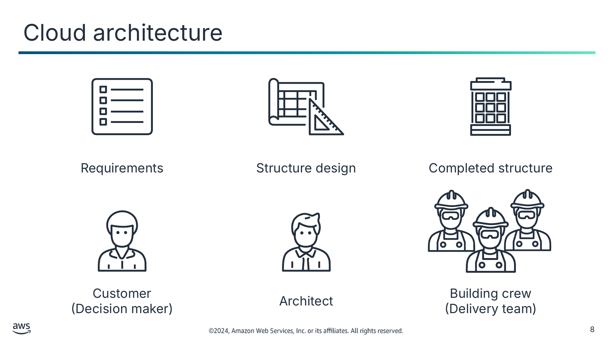

Requirements

Structure design

Completed structure

Customer  
(Decision maker)

Architect

Building crew  
(Delivery team)

> **Нотатки:**
>
> |Slide number 8  
> |Instructor notes  
> |This slide tells a story about how cloud architecture development is like building a house. Focus on the comparisons between the process for constructing a physical building and the cloud architecting process. The students should come away with an understanding that the architecture design is critical to building solutions that support current and future needs.  
> |  
> |Student notes  
> What is cloud architecture? Cloud architecture is the practice of applying cloud characteristics to a solution that uses cloud services and features to meet an organization’s technical needs and business use cases.  
>
> Creating technology solutions is a lot like constructing a physical building. If the foundation is not solid, it can cause structural problems that undermine the integrity and function of the building. To create a solid building, the customer outlines the building needs and requirements. The architect creates a design and blueprints to meet the requirements. Then, the building crew turns the blueprints into a physical structure.  
>
> In cloud architecture, the customer or decision maker also outlines business goals and requirements. The cloud architect designs a solution that is like a blueprint for a building. Then, the delivery team works to implement the solution.  
>
> Having well-architected systems increases the likelihood that the technology deliverables will help meet business goals.

---

## Слайд 9: Role of a cloud architect

Plan

Research

Build

- Set technical cloud strategy with business leads.
- Analyze solutions for business needs and requirements.

- Investigate cloud services specifications and workload requirements.
- Review existing workload architectures.
- Design prototype solutions.

- Design the transformation roadmap with milestones, work streams, and owners.
- Manage the adoption and migration.

> **Нотатки:**
>
> |Slide number 9  
> |Instructor notes  
> |The discussion for this slide should help students understand their role as a cloud architect. Consider continuing the analogy of constructing a physical building that was presented on the previous slide.  
> |  
> |Student notes  
> The role of a cloud architect is as follows:  
> Engage with decision makers to identify the business goals and the capabilities that need improvement.  
> Ensure alignment between the technology deliverables of a solution and the business goals.  
> Work with the delivery teams that are implementing the solution to ensure that the technology features are appropriate.  
>
> Cloud architects are responsible for managing an organization’s cloud computing architecture. They have in-depth knowledge of the architectural principles and services used to do the following:  
> Develop the technical cloud strategy based on business needs.  
> Assist with cloud migration efforts.  
> Review workload requirements.  
> Provide guidance about how to address high-risk issues.  
>
> Cloud architects work to implement the AWS Well-Architected Framework.

---

## Слайд 10: Key takeaways: What is cloud architecting?

- Cloud architecture is the practice of applying cloud characteristics to a solution that uses cloud services and features to meet an organization’s technical needs and business use cases.
- You can use AWS services to create highly available, scalable, and reliable architectures.
- Cloud architects are responsible for managing an organization’s cloud computing architecture.

> **Нотатки:**
>
> |Slide number 10  
> |Instructor notes  
> |The student version doesn't have any notes for this slide.  
> |  
> |Student notes

---

## Слайд 11: AWS Well-Architected Framework

Introducing Cloud Architecture

> **Нотатки:**
>
> |Slide number 11  
> |Instructor notes  
> |  
> |Student notes  
> This section introduces the AWS Well-Architected Framework.

---

## Слайд 12: Pillars of the AWS Well-Architected Framework

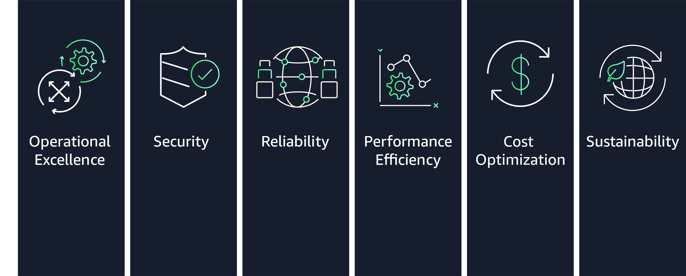

> **Нотатки:**
>
> |Slide number 12 of module 2:  
> |Instructor notes  
> |This section reviews the six pillars of the AWS Well-Architected Framework. Each pillar has its own whitepaper that details design principles and best practices related to that pillar.  
> |  
> |Most modules in this course include a section that highlights best practices from selected pillars of the AWS Well-Architected Framework as they relate to the material presented in that module. There are two exceptions. The module on security focuses on content related to the Security pillar. The Building Decoupled Architectures module focuses on the Reliability pillar best practices for workload architectures.  
> |  
> |You can use the sections of each module that focus on the pillars of the AWS Well-Architected Framework for reinforcement of the content presented in each module. Students can also use these sections to practice using the framework when selecting services and features for their architectures.  
> |  
> |Consider reviewing each of the pillar whitepapers during this section. For more information, see the AWS Well-Architected Framework on the content resources page of your online course.  
> |  
> |Student notes  
> The AWS Well-Architected Framework is a guide that provides a consistent approach to evaluate cloud architectures. It also provides guidance to help implement designs. It documents a set of foundational questions and best practices you can use to understand if a specific architecture aligns well with cloud best practices. AWS developed this framework after reviewing thousands of customer architectures on AWS.  
>
> The AWS Well-Architected Framework is organized into six pillars: Operational Excellence, Security, Reliability, Performance Efficiency, Cost Optimization, and Sustainability.  
>
> You revisit the pillars of the AWS Well-Architected Framework in each of the modules of this course. For more information, see the AWS Well-Architected Framework on the content resources page of your online course.

---

## Слайд 13: Operational Excellence pillar

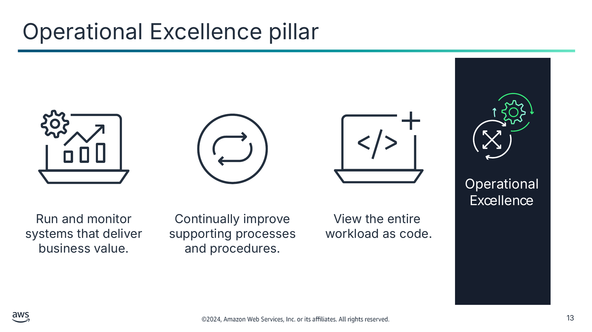

Run and monitor systems that deliver business value.

Continually improve supporting processes and procedures.

View the entire  
workload as code.

> **Нотатки:**
>
> |Slide number 13  
> |Instructor notes  
> |  
> |Student notes  
> The Operational Excellence pillar addresses the ability to run systems and gain insight into their operations to deliver business value. It also addresses the ability to continuously improve supporting processes and procedures.  
>
> When you design a workload for operations, you must be aware of how it will be deployed, updated, and operated. Implement engineering practices that align with defect reductions and quick, safe fixes. Make observation possible with logging, instrumentation, and business and technical metrics so you can gain insight into what is happening inside your architecture.  
>
> In AWS, you can view your entire workload (applications, infrastructure, policies, governance, and operations) as code. You can define and update all part of your workload using code. This means you can apply the same engineering discipline that you use for application code to every element of your stack. It is recommended that you invest in implementing operations activities as code to maximize productivity, minimize error rates, and set up automated responses.  
>
> For more information, see the Operational Excellence pillar on the content resources page of your online course.

---

## Слайд 14: Security pillar

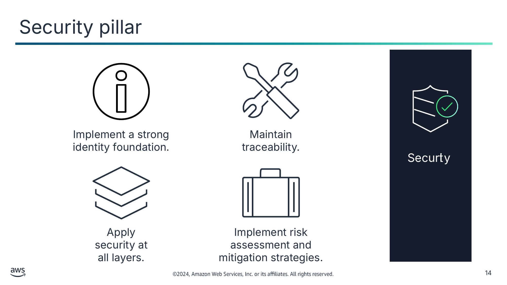

Implement a strong identity foundation.

Maintain traceability.

Apply security at all layers.

Implement risk assessment and mitigation strategies.

> **Нотатки:**
>
> |Slide number 14  
> |Instructor notes  
> |  
> |Student notes  
> The Security pillar addresses the ability to protect information, systems, and assets while delivering business value through risk assessments and mitigation strategies.  
>
> Your architecture will present a much stronger security presence if you implement a strong identity foundation, use and maintain traceability, apply security at all layers, automate security best practices, and protect data in transit and at rest. Implementing these security principles helps you prepare for security events.  
>
> For more information, see the Security pillar on the content resources page of your online course.

---

## Слайд 15: Reliability pillar

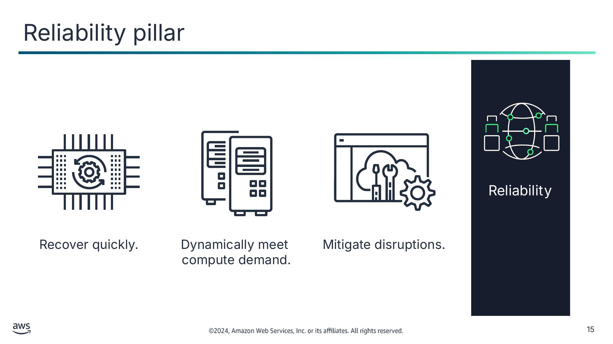

Recover quickly.

Dynamically meet  
compute demand.

Mitigate disruptions.

> **Нотатки:**
>
> |Slide number 15  
> |Instructor notes  
> |  
> |Student notes  
> The Reliability pillar addresses the ability of a system to recover from infrastructure or service disruptions and dynamically acquire computing resources to meet demand. It also addresses the ability of a system to mitigate disruptions, such as misconfigurations or transient network issues.  
>
> It can be difficult to ensure reliability in a traditional environment. Issues arise from single points of failure, lack of automation, and lack of elasticity. By applying the best practices outlined in the Reliability pillar, you can prevent many of these issues. The Reliability pillar helps you and your customers have a properly designed architecture with respect to high availability, fault tolerance, and overall redundancy.  
>
> For more information, see the Reliability pillar on the content resources page of your online course.

---

## Слайд 16: Performance Efficiency pillar

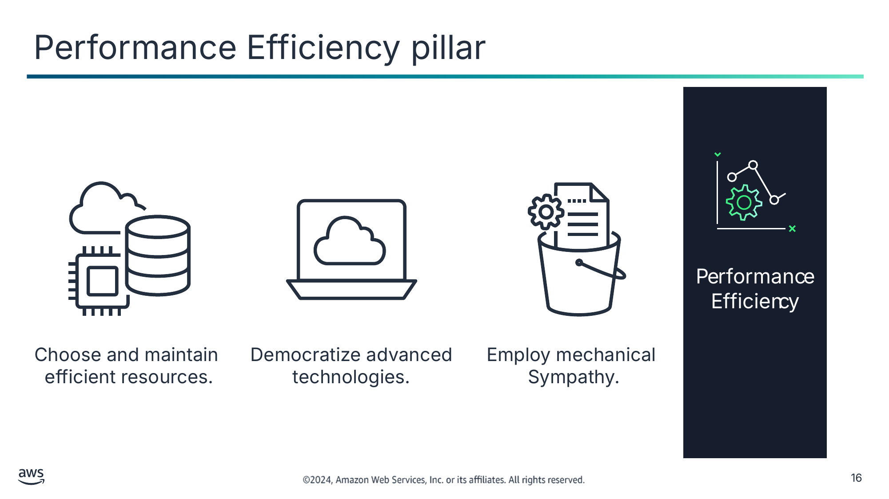

Choose and maintain  
efficient resources.

Democratize advanced technologies.

Employ mechanical

Sympathy.

> **Нотатки:**
>
> |Slide number 16  
> |Instructor notes  
> |  
> |Student notes  
> When you consider performance, you want to maximize your performance by using computation resources efficiently. You also want to maintain that efficiency as the demand changes.  
>
> It is also important to democratize advanced technologies. In situations where technology is difficult to implement yourself, consider using a vendor. By implementing the technology for you, the vendor handles the complexity and the knowledge, freeing your team to focus on more value-added work.  
>
> Mechanical sympathy is when you use a tool or system with an understanding of how it operates best. Use the technology approach that aligns best to what you are trying to achieve. For example, consider data access patterns when you select database or storage approaches.  
>
> For more information, see the Performance Efficiency pillar on the content resources page of your online course.

---

## Слайд 17: Cost Optimization pillar

Measure efficiency.

Eliminate unneeded expense.

Adopt the right  
consumption model.

Consider using  
managed services.

> **Нотатки:**
>
> |Slide number 17  
> |Instructor notes  
> |  
> |Student notes  
> Cost optimization is an ongoing requirement of any good architectural design. The process is iterative, and it should be refined and improved throughout your production lifetime. Understanding how efficient your current architecture is in relation to your goals can remove unneeded expense.  
>
> Adopt the right consumption model for your use case. You might want to adopt a model where you pay only for the resources you use. Consider using managed services because they operate at cloud scale, and they can offer a lower cost per transaction or service.  
>
> For more information, see the Cost Optimization pillar on the content resources page of your online course.

---

## Слайд 18: Sustainability pillar

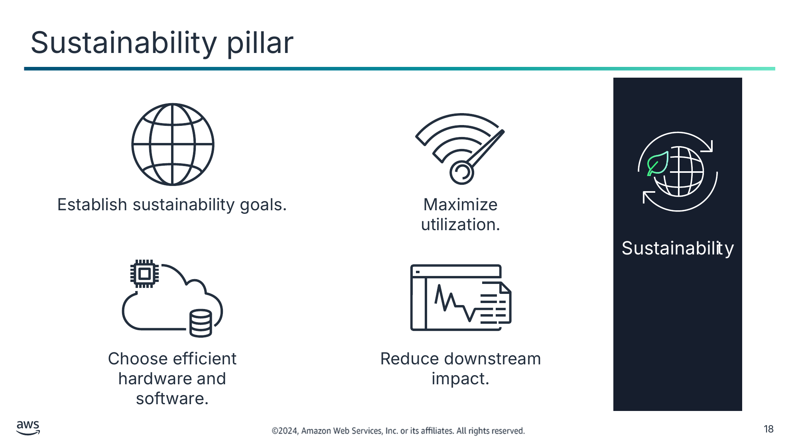

Establish sustainability goals.

Maximize utilization.

Choose efficient hardware and software.

Reduce downstream impact.

> **Нотатки:**
>
> |Slide number 18  
> |Instructor notes  
> |  
> |Student notes  
> The Sustainability pillar addresses the ability to build architectures that maximize efficiency and reduce waste. The discipline of sustainability addresses the long-term environmental, economic, and societal impact of your business activities. You should understand the impact of your workloads and work to reduce the downstream impact.  
>   
> Sustainability in the cloud is a continuous effort. It focuses primarily on energy reduction and efficiency across all components of a workload by achieving the maximum benefit from the resources provisioned and minimizing the total resources required. This effort can include the initial selection of an efficient programming language, adoption of modern algorithms, and use of efficient data storage techniques. It can also include deploying to correctly sized and efficient compute infrastructure and minimizing requirements for high-powered end-user hardware.  
>
> For more information, see the Sustainability pillar on the content resources page of your online course.

---

## Слайд 19: Using the AWS WA Tool

- Helps you review the state of your workloads and compares them to the latest AWS architectural best practices
- Gives you access to knowledge and best practices used by AWS architects when you need it
- Delivers an action plan with step-by-step guidance on how to build better workloads for the cloud
- Provides a consistent process for you to review and measure your cloud architectures

AWS Well-Architected Tool

> **Нотатки:**
>
> |Instructor notes  
> |The AWS Well-Architected Tool is accessible through the AWS Management Console. This tool helps you apply best practices from the AWS Well-Architected Framework in a consistent way. It is intended for those involved in technical product development, such as chief technology officers (CTOs), architects, developers, and operations team members.  
> |  
> |Consider completing a brief demo of the AWS WA Tool. The user guide includes a step-by-step tutorial you can use to demo the tool. For more information, see the AWS Well-Architected Tool User Guide on the content resources page of your online course.  
> |  
> |Student notes  
> If you want help designing a well-architected solution, you can use the AWS Well-Architected Tool. The AWS WA Tool is a self-service tool that provides you with on-demand access to current AWS best practices. These best practices can help you build secure, high-performing, resilient, and efficient application infrastructure on AWS.  
>
> The AWS WA Tool helps you review the state of your workloads and compare them to the latest AWS architectural best practices. It gives you access to knowledge and best practices used by AWS architects when you need it.  
>
> The AWS WA Tool is available in the AWS Management Console. You define your workload and answer a series of questions in the areas of operational excellence, security, reliability, performance efficiency, and cost optimization. The AWS WA Tool then delivers an action plan with step-by-step guidance on how to improve your workload for the cloud.  
>
> The AWS WA Tool provides a consistent process for you to review and measure your cloud architectures. With the tool, you can gather data and get recommendations to do the following:  
> Minimize system failures and operational costs.  
> Dive deep into business and infrastructure processes.  
> Provide best practice guidance.  
> Deliver on the cloud computing value proposition.  
>
> You can use the results the tool provides to identify next steps for improvement, drive architectural decisions, and bring architecture considerations into your corporate governance process.  
>
> For more information, see the AWS Well-Architected Tool User Guide on the content resources page of your online course.

---

## Слайд 20: Key takeaways: AWS Well-Architected Framework

- The AWS Well-Architected Framework provides a consistent approach to evaluate cloud architectures and guidance to help implement designs.
- The AWS Well-Architected Framework is organized into six pillars.
- Each pillar documents a set of foundational questions you can use to understand if a specific architecture aligns well with cloud best practices.
- The AWS WA Tool helps you review the state of your workloads and compares them to the latest AWS architectural best practices.

> **Нотатки:**
>
> |Slide number 20  
> |Instructor notes  
> |The student version doesn't have any notes for this slide.  
> |  
> |Student notes

---

## Слайд 21: Best practices for building solutions on AWS

Introducing Cloud Architecting

> **Нотатки:**
>
> |Slide number 21  
> |Instructor notes  
> |  
> |Student notes  
> This section introduces the best practices for building solutions on AWS.

---

## Слайд 22: Design trade-offs

As you design a solution, think carefully about trade-offs so you can select an optimal approach.

- Evaluate trade-offs so you can select an optimal approach.
- Examples of trade-offs include the following:
  - Trade consistency, durability, and space for time and latency to deliver higher performance.
  - For new features, prioritize speed to market over cost.
- Base design decisions on empirical data.

> **Нотатки:**
>
> |Slide number 22  
> |Instructor notes  
> |This section focuses on the best practices for designing and building cloud architectures. Use the design trade-offs as a talking point for each of the best practices to follow.  
> |  
> |Student notes  
> As you design a solution, think carefully about trade-offs so you can select an optimal approach. For example, you might trade consistency, durability, and space for time and latency to deliver higher performance. Or you might prioritize speed to market over cost.  
>
> Trade-offs can increase the cost and complexity of your architecture, so your design decisions should be based on empirical data. For example, you might need to perform load testing to ensure that a measurable benefit is obtained in performance. Or you might need to perform benchmarking to achieve the most cost-optimal workload over time. When you evaluate performance-related improvements, consider how your architecture design choices will impact customers and workload efficiencies.  
>
> In this section, you learn about best practices for designing solutions on AWS. You also learn about anti-patterns (or bad solution designs) to avoid.

---

## Слайд 23: Implementing scalability

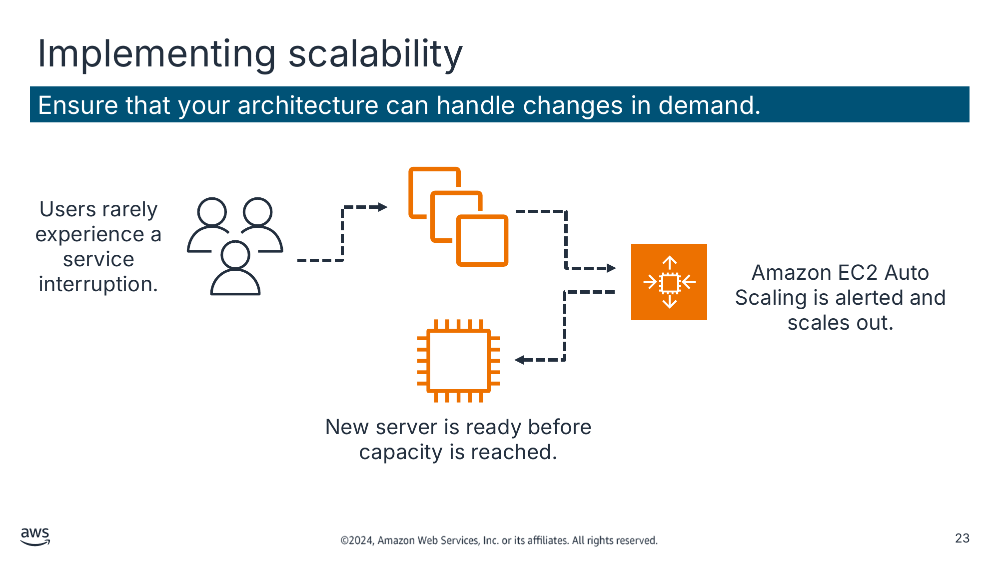

Ensure that your architecture can handle changes in demand.

Текст зі схеми

Users rarely experience a service interruption.

Amazon EC2 Auto Scaling is alerted and scales out.

New server is ready before capacity is reached.

> **Нотатки:**
>
> |Slide number 23  
> |Instructor notes  
> |Cloud solutions architects should build with consideration of the future. This means that solutions need to cater to current scale requirements and the anticipated growth of the solution. When a solution scales, many architects experience added complexity to the overall architecture in terms of its manageability, performance, security, and so on. By architecting your solution or application to scale reliably, you can avoid the introduction of additional complexity, degraded performance, or reduced security because of scaling.  
> |  
> |This architecture is a good example of Amazon EC2 Auto Scaling. When you use Amazon EC2 Auto Scaling, your applications gain better fault tolerance, availability, and cost management.  
> |  
> |Student notes  
> When you run your workloads on the AWS Cloud, you can scale your infrastructure quickly and proactively. Make sure that you implement scalability at every layer of your infrastructure. By implementing scalability, you can improve your design to anticipate the need for more capacity and deliver it before it's too late.  
>
> For example, you can use a monitoring solution like Amazon CloudWatch to detect whether the total load across your fleet of servers has reached a specified threshold. You can define this threshold to be Stayed above 60% CPU utilization for longer than 5 minutes or anything related to the use of resources. With CloudWatch, you can also design custom metrics based on specific applications that can invoke the resource scaling that is required.  
>   
> When an alarm is invoked, Amazon EC2 Auto Scaling immediately launches a new instance. That instance is then ready before capacity is reached, which provides a seamless experience for users.  
>
> Ideally, you should also design your system to be elastic. When demand drops off, you're not running (and paying for) instances that you no longer need.  
>
> To understand the importance of scalability, consider where scaling is done reactively and manually. When application servers reach full capacity, users are prevented from accessing the application. Administrators then manually launch one or more new instances to manage the load. Unfortunately, it takes a few minutes for an instance to become available for use after it’s launched. That increases the time users can’t access the application.

---

## Слайд 24: Automating your environment

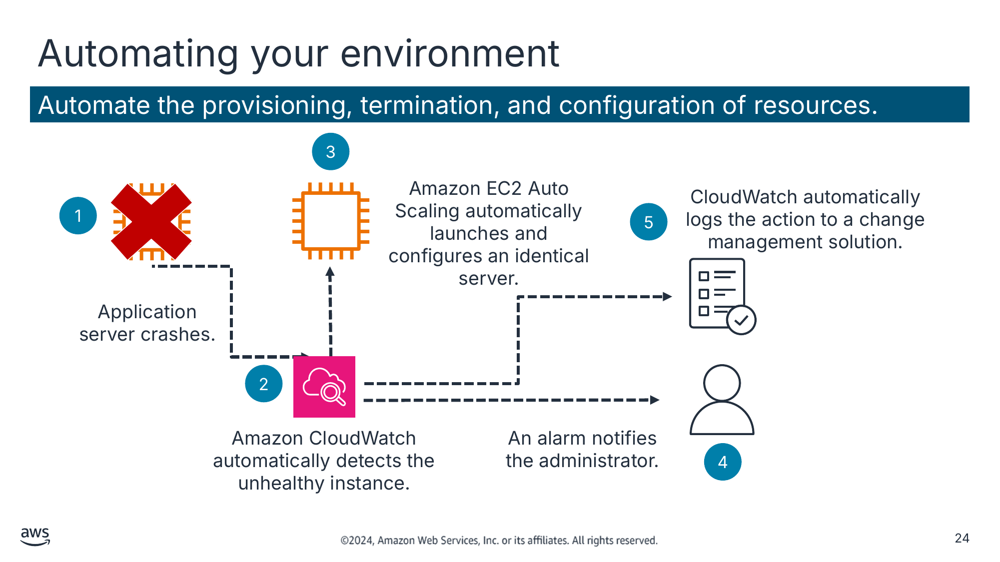

Automate the provisioning, termination, and configuration of resources.

Текст зі схеми

3

Amazon EC2 Auto Scaling automatically launches and configures an identical server.

CloudWatch automatically logs the action to a change management solution.

Application server crashes.

Amazon CloudWatch automatically detects the unhealthy instance.

An alarm notifies the administrator.

1

5

2

4

> **Нотатки:**
>
> |Slide number 24  
> |Instructor notes  
> |Automation is a best practice for provisioning, stopping, and configuring cloud resources. This diagram shows how automation can be used to respond to a server failure. The diagram reads from left to right as follows:  
> |Application server crashes.  
> |Amazon CloudWatch automatically detects the unhealthy instance.  
> |Amazon EC2 Auto Scaling automatically launches and configures an identical server.  
> |An alarm notifies the administrator.  
> |CloudWatch automatically logs the action to a change management solution.  
> |  
> |Student notes  
> AWS offers built-in monitoring and automation tools at virtually every layer of your infrastructure. Take advantage of these tools to ensure that your infrastructure can respond quickly to changes.  
>
> Without built-in monitoring and automation tools, you must manually detect and respond to any failures. If an application server fails, you must detect it and manually notify the administrator. The administrator must manually launch and configure the new server.  
>
> Tools like CloudWatch and Amazon EC2 Auto Scaling can detect unhealthy resources and automate the launch of replacement resources. You can also be notified when resource allocations change.  
>
> In this example, when the application server crashes, CloudWatch automatically detects the failure. CloudWatch automatically launches and configures a new servers and notifies the administrator. The change is logged to a change management solution for tracking.

---

## Слайд 25: Using IaC

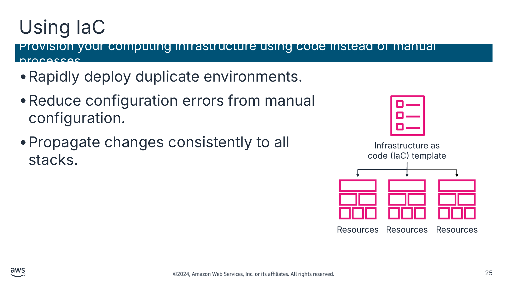

Provision your computing infrastructure using code instead of manual processes.

- Rapidly deploy duplicate environments.
- Reduce configuration errors from manual configuration.
- Propagate changes consistently to all stacks.

Текст зі схеми

Infrastructure as code (IaC) template

Resources

Resources

Resources

> **Нотатки:**
>
> |Slide number 25  
> |Instructor notes  
> |Discuss that, traditionally, system administrators used a combination of scripts and manual processes to set up infrastructure environments. This process was complex and time-consuming. You can use infrastructure as code (IaC) to automatically set up your environment in minutes and manage it more efficiently.  
>
> |For more information, review What Is Infrastructure as Code? on the content resources page of your online course.  
> |  
> |Student notes  
> Automation is a key goal across any computing environment. Infrastructure as code (IaC) is used for infrastructure automation to create environments. The most common use of IaC is in software development to build, test, and deploy applications.  
>
> Rapidly deploy duplicate environments. Using a single template, identical environments can be deployed. IaC removes the repetitive manual steps and checklists that were needed in the past.  
>
> Reduce configuration errors from manual configuration. Manual configuration is error-prone because of human involvement. IaC reduces errors and streamlines error checking. If there are errors because of IaC code updates, you can quickly fix the situation by rolling the codebase to the last known stable configuration files. It’s also possible to roll back environments using previous versions of IaC configuration files for other reasons, such as the deployment of older application versions.  
>
> Propagate changes consistently to all stacks with IaC. Make a change to the template and push those changes to all stacks. This makes it possible for a change to be deployed consistently.  
>
> For more information, review What Is Infrastructure as Code? on the content resources page of your online course.

---

## Слайд 26: Treating resources as disposable

Take advantage of the dynamically provisioned nature of cloud computing.

- Automate deployment of new resources with identical configurations.
- Stop resources that are not in use.
- Test updates on new resources, and then replace old resources with updated ones.

> **Нотатки:**
>
> |Slide number 26  
> |Instructor notes:  
> |Ask students what happens when they don’t treat resources as disposable. This is considered the anti-pattern.  
>
> |Some examples include:  
> |Over time, different servers end up with different configurations.  
> |Resources run when they’re not needed.  
> |Hardcoded IP addresses prevent flexibility.  
> |It can be difficult or inconvenient to test new updates on hardware that’s in use.  
> |  
> |Student notes  
> The best practice of treating resources as disposable refers to the idea of thinking about your infrastructure as software instead of hardware.  
>
> With hardware, you can buy more components than you need so that you are prepared for spikes in usage. However, doing this is expensive and inflexible—it’s difficult to upgrade because of the sunk cost.  
>
> Instead, when you treat your resources as disposable, migrating between instances or other discrete resources is fairly straightforward. You can quickly respond to changes in capacity needs, upgrade applications, and manage the underlying software.

---

## Слайд 27: Using loosely coupled components

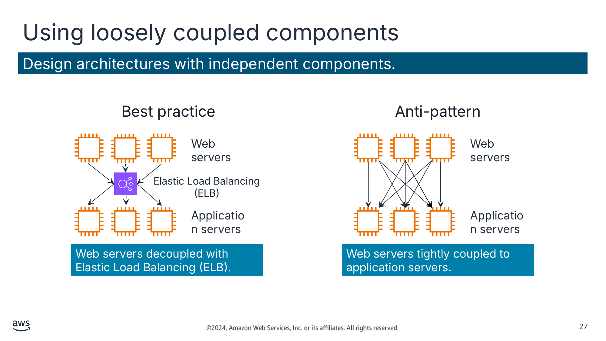

Design architectures with independent components.

Текст зі схеми

Best practice

Web servers

Elastic Load Balancing (ELB)

Application servers

Web servers decoupled with Elastic Load Balancing (ELB).

Anti-pattern

Web servers

Application servers

Web servers tightly coupled to application servers.

> **Нотатки:**
>
> |Slide number 27  
> |Instructor notes  
> |  
> |Student notes  
> Traditional infrastructures have chains of tightly integrated servers, each with a specific purpose. The problem is that when one of those components or layers goes down, the disruption to the system can be fatal. It also impedes scaling. If you add or remove servers at one layer, you must also connect every server on each connecting layer.  
>
> With loose coupling, you use managed solutions as intermediaries between the layers of your system. With this design, the intermediary automatically handles both failures and the scaling of components or layers.  
>
> The example on the left shows a load balancer. Here, it’s an Elastic Load Balancing (ELB) load balancer that routes requests between the web servers and the application servers. If one application server goes down, the load balancer will automatically start directing all traffic to the two healthy servers.  
>
> Two primary solutions for decoupling your components are load balancers and message queues.  
>
> The example on the right illustrates a collection of web and application servers that are tightly coupled. If one application server goes down, it will cause an error because the web servers try and fail to connect to it.

---

## Слайд 28: Designing services, not servers

Use the breadth of AWS services. Don't limit your infrastructure to servers.

- When appropriate, consider using containers or a serverless solution.
- Message queues can handle communication between applications.
- Static web assets can be stored off server, such as on Amazon Simple Storage Service (Amazon S3).
- User authentication and user state storage can be handled by managed AWS services.

> **Нотатки:**
>
> |Slide number 28  
> |Instructor notes  
> |Ask the students what might happen if they design only for servers.  
> |  
> |Some example of possible anti-patterns include:  
> |Simple applications run on persistent servers.  
> |Applications communicate directly with one another.  
> |Static web assets are stored locally on instances.  
> |Backend servers handle user authentication and user state storage.  
> |  
> |Student notes  
> The next best practice is to design services, not servers. Although Amazon EC2 offers tremendous flexibility for designing and setting up your solution, it shouldn’t always be the first (or only) solution you use for every need. Sometimes, containers or a serverless solution might be more appropriate. Therefore, it’s important to consider what your needs are and which solution is appropriate.  
>
> With AWS serverless solutions and managed services, you don’t need to provision, configure, and manage an entire EC2 instance.  
>
> Managed solutions that have a lower profile and are more performant can replace server-based solutions at a lower cost. A few examples are AWS Lambda, Amazon SQS, Amazon DynamoDB, ELB, Amazon Simple Email Service (Amazon SES), and Amazon Cognito.

---

## Слайд 29: Choosing the right database solution

Match technology to the workload, not the other way around.

- Read and write needs
- Total storage requirements
- Typical object size and nature of access to these objects
- Durability requirements
- Latency requirements
- Maximum concurrent users to support
- Nature of queries
- Required strength of integrity controls

> **Нотатки:**
>
> |Slide number 29  
> |Instructor notes  
> |AWS has a large collection of purpose-built database options for diverse data models. It can be difficult to know which database solution will be best for your workload.  
> |  
> |For more information, see Choosing an AWS Database Service on the content resources page of your online course.  
> |  
> |Student notes  
> It is important that you choose the right database solution. In traditional data centers and on-premises environments, limits on available hardware and licenses can constrain your choice of a data store solution. AWS recommends that you choose a data store based on your needs for your application environment.  
>
> For more information, see Choosing an AWS Database Service on the content resources page of your online course.

---

## Слайд 30: Avoiding single points of failure

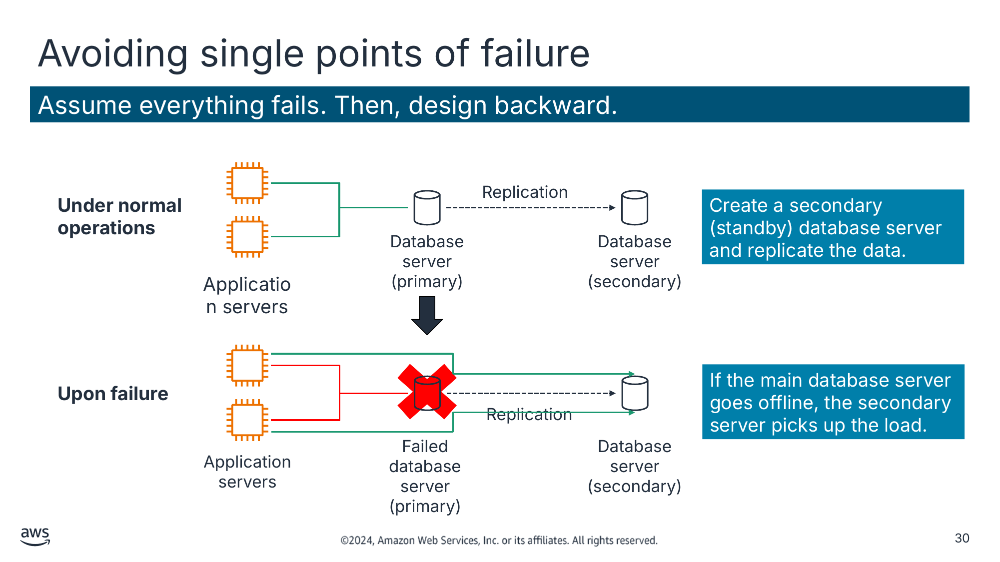

Assume everything fails. Then, design backward.

Create a secondary (standby) database server and replicate the data.

If the main database server goes offline, the secondary server picks up the load.

Текст зі схеми

Replication

Database server (primary)

Database server (secondary)

Application servers

Replication

Failed database server (primary)

Database server (secondary)

Application servers

**Under normal operations**

**Upon failure**

> **Нотатки:**
>
> |Slide number 30  
> |Instructor notes  
> |Show or describe the anti-pattern of a simple system with two application servers connected to a single database server. The database server represents a single point of failure and should be avoided. When it goes down, the application servers also go down.  
> |  
> |Student notes  
> Where possible, eliminate single points of failure from your architecture. This doesn't mean you must always duplicate every component. Depending on your downtime service-level agreements (SLAs), you can use automated solutions that only launch components when needed. You can also use a managed service, so AWS automatically replaces malfunctioning underlying hardware for you.  
>
> If two application servers are connected to a single database server, the database server represents a single point of failure and should be avoided. When it goes down, the application servers also go down. Application servers should continue to function even if the underlying physical hardware fails, is removed, or is replaced.  
>
> A common way to avoid single points of failure is to create a secondary (standby) database server and replicate the data. This way, if the main database server goes offline, the secondary server can pick up the load.  
>
> In this example, when the main database goes offline, the application servers automatically send their requests to the secondary database. This example also exemplifies the best practice to treat resources as disposable, and design your applications to support changes in hardware.

---

## Слайд 31: Optimizing for cost

Take advantage of the flexibility of AWS to increase your cost efficiency.

- Are my resources the right size and type for the job?
- Which metrics should I monitor?
- How do I turn off resources that are not in use?
- How often will I need to use this resource?
- Can I replace any of my servers with managed services?

> **Нотатки:**
>
> |Slide number 31  
> |Instructor notes  
> |Ask the students to define fixed expense and variable expense.  
> |  
> |Student notes  
> With cloud computing, you can trade fixed expenses for variable expense. Fixed expenses are funds a company uses to acquire, upgrade, and maintain physical assets, such as property, industrial buildings, or equipment. Under this model, you pay for the servers in the data center, whether they are active or not.  
>
> By contrast, AWS services use a variable expense cost model, which means you pay only for the individual services you need for as long as you use them. In each service, you can optimize for cost. Many services offer different pricing tiers, models, or configurations.  
>
> Remember, it can be very expensive to replicate an on-premises data center setup of servers running 24/7 in the cloud. Therefore, the best way to build a cost effective infrastructure is to only provision the resources you need and stop services when they are not in use.

---

## Слайд 32: Using caching

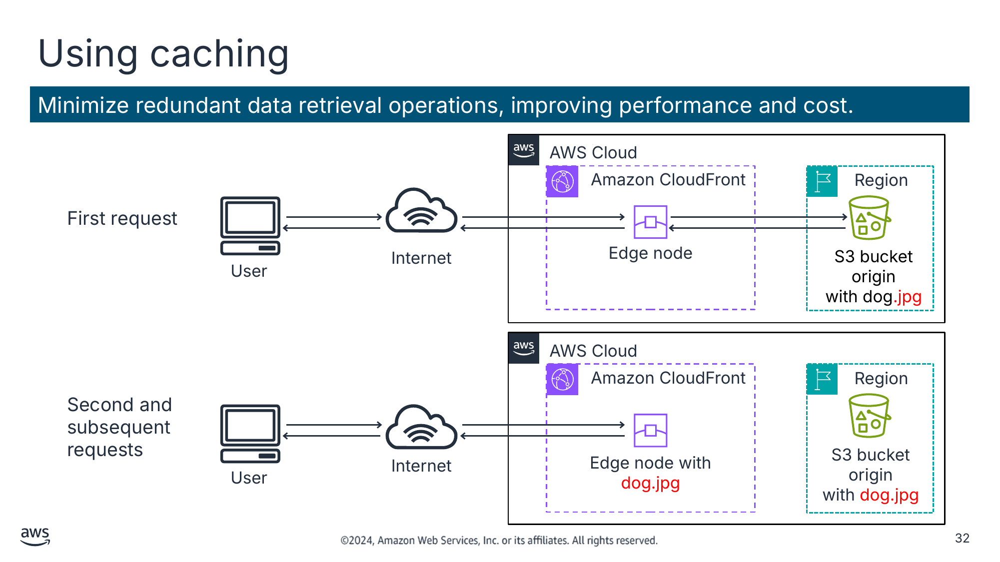

Minimize redundant data retrieval operations, improving performance and cost.

Текст зі схеми

AWS Cloud

Amazon CloudFront

Region

First request

Edge node

S3 bucket origin

with dog.jpg

User

Internet

AWS Cloud

Amazon CloudFront

Region

Second and subsequent requests

Edge node with dog.jpg

S3 bucket origin

with dog.jpg

User

Internet

> **Нотатки:**
>
> |Slide number 32  
> |Instructor notes  
> |Ask students to define caching. Discuss the anti-pattern when no caching service is used.  
> |  
> |Anti-pattern: When no caching service is used, each user request goes directly to the Amazon Simple Storage Service (Amazon S3) bucket. This creates requests that each take the same amount of time to complete and cost the same amount.  
> |  
> |Student notes  
> Caching is a technique to make future requests faster and reduce network throughput by temporarily storing data in an intermediary location between the requester and the permanent storage. The primary purpose of a cache is to increase the performance of data retrieval by reducing the need to access the underlying slower storage layer. Future requests for cached data are served faster than requests that access the data’s primary storage location. With caching, you can efficiently reuse previously retrieved or computed data.  
>
> In the example, the infrastructure uses Amazon CloudFront in front of Amazon S3 to provide caching. In this scenario, the initial request checks for the file in CloudFront. If it is not found, CloudFront requests the file from Amazon S3. CloudFront then stores a copy of the file at an edge location close to the user and sends a copy to the user who made the request.  
>
> Subsequent requests for the file are retrieved from the (now closer) edge location in CloudFront instead of Amazon S3. The second, third, and nth requests are at a lower latency and cost. After the first request, you no longer pay to transfer the file out of Amazon S3.

---

## Слайд 33: Securing your entire infrastructure

Build security into every layer of your infrastructure.

- Use managed services.
- Log access of resources.
- Isolate parts of your infrastructure.
- Encrypt data in transit and at rest.
- Enforce access control granularly, using the principle of least privilege.
- Use multi-factor authentication (MFA).
- Automate your deployments to keep security consistent.

> **Нотатки:**
>
> |Slide number 33  
> |Instructor notes  
> |Security is the top priority at AWS. AWS is architected to be the most secure global cloud infrastructure on which to build, migrate, and manage applications and workloads. It is important that students understand how to build security into every layer of the infrastructure.  
> |  
> |For more information, see AWS Cloud Security on the content resources page of your online course.  
> |  
> |Student notes  
> Security isn’t only about getting through the outer boundary of your infrastructure. It also involves ensuring that your individual environments and their components are secured from each other.  
>
> For example, in Amazon EC2, you can create security groups that you can use to determine which ports on your instances can send and receive traffic. Security groups can also determine where that traffic can come from or go to.  
>
> You can use security groups to reduce the probability that a security threat on one instance will spread to every other instance in your environment. You should take similar precautions with other services. Specific ways to implement this best practice are discussed throughout the course.  
>
> For more information, see AWS Cloud Security on the content resources page of your online course.

---

## Слайд 34: Key takeaways: Best practices for building solutions on AWS

- As you design solutions, evaluate trade-offs and base your decisions on empirical data.
- Follow these best practices when building solutions on AWS:
  - Implement scalability.
  - Automate your environment.
  - Treat resources as disposable.
  - Use loosely-coupled components.
  - Design services, not servers.
  - Choose the right database solution.
  - Avoid single points of failure.
  - Optimize for cost.
  - Use caching.
  - Secure your entire infrastructure.

> **Нотатки:**
>
> |Slide number 34  
> |Instructor notes  
> |The student version doesn't have any notes for this slide.  
> |  
> |Student notes

---

## Слайд 35: AWS Global Infrastructure

Introducing Cloud Architecting

> **Нотатки:**
>
> |Slide number 35  
> |Instructor notes  
> |  
> |Student notes  
> This section introduces the AWS Global Infrastructure.

---

## Слайд 36: AWS infrastructure topics

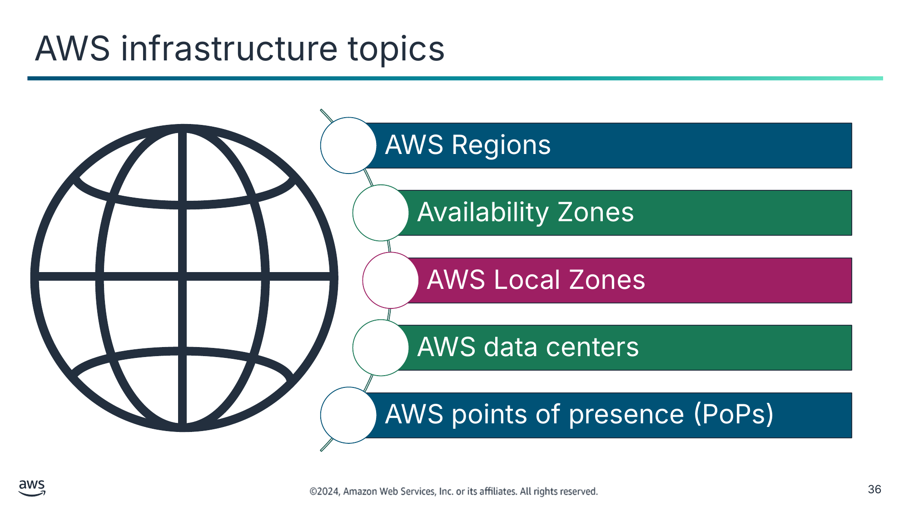

AWS Regions

Availability Zones

AWS Local Zones

AWS data centers

AWS points of presence (PoPs)

> **Нотатки:**
>
> |Slide number 36  
> |Instructor notes  
> |AWS has the largest global infrastructure footprint of any provider, and this footprint is constantly increasing at a significant rate. Review the AWS Global Infrastructure page for updated figures for Regions, Availability Zones, and points of presence (PoPs). For more information, see AWS Global Infrastructure on the content resources page of your online course.  
> |  
> |Student notes  
> The AWS Global Cloud Infrastructure is a secure, extensive, and reliable cloud platform, offering more than 200 fully featured services from data centers globally. The AWS Cloud infrastructure spans 102 Availability Zones in 32 geographic regions around the world. This gives you the ability to launch highly available, scalable, and flexible architectures near your customers for lower latency and increased performance.  
>
> As you design and build architectures, you need to consider which region to deploy them. An AWS Region is a physical geographical location with two or more Availability Zones. Availability Zones, in turn, consist of one or more data centers. Your decisions should be based on the business requirements and the needs of the workload.  
>
> For example, if low latency is a requirement for your workload, you should consider using AWS points of presence (PoPs) or regional edge caches. The AWS PoP network sits at the edge of the network to reduce latency. Using these edge locations keeps your popular data close to your customers.  
>
> In this section, you learn about the AWS infrastructure, including Regions, availability zones, AWS Local Zones, AWS data centers, and AWS PoPs.  
>
> For more information about infrastructure on AWS, see AWS Global Infrastructure on the content resources page of your online course.

---

## Слайд 37: Selecting Regions

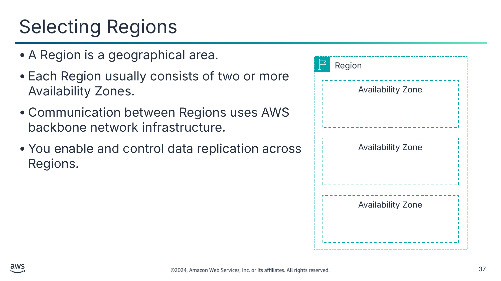

- A Region is a geographical area.
- Each Region usually consists of two or more Availability Zones.
- Communication between Regions uses AWS backbone network infrastructure.
- You enable and control data replication across Regions.

Текст зі схеми

Region

Availability Zone

Availability Zone

Availability Zone

> **Нотатки:**
>
> |Slide number 37  
> |Instructor notes  
> |  
> |Student notes  
> A Region is a physical geographical location with two or more Availability Zones. Availability Zones, in turn, consist of one or more data centers.  
>
> Regions are connected to multiple internet service providers (ISPs). Regions are also connected to a private global network backbone, which provides lower cost and more consistent cross-Region network latency when compared with the public internet.  
>
> Regions that were introduced before March 20, 2019, are enabled by default. Regions that were introduced after March 20, 2019—such as Asia Pacific (Hong Kong) and Middle East (Bahrain)—are disabled by default. You must enable these Regions before you can use them. You can use the AWS Management Console to enable or disable a Region.  
>
> Some Regions have restricted access. The isolated AWS GovCloud (US) Regions are designed to make it possible for US government agencies and customers to move sensitive workloads into the cloud by addressing their specific regulatory and compliance requirements.  
>
> To achieve fault tolerance and stability, Regions are isolated from one another. Resources in one Region are not automatically replicated to other Regions. When you store data in a specific Region, it is not replicated outside that Region. It is your responsibility to replicate data across Regions if your business needs require it. AWS provides information about the country and—where applicable—the state where each Region resides. You are responsible for selecting the Region where you should store data based on your compliance and network latency requirements.  
>
> AWS products and services are available by Region, so you might not have access to all Regions available for a given service.

---

## Слайд 38: Selecting Availability Zones

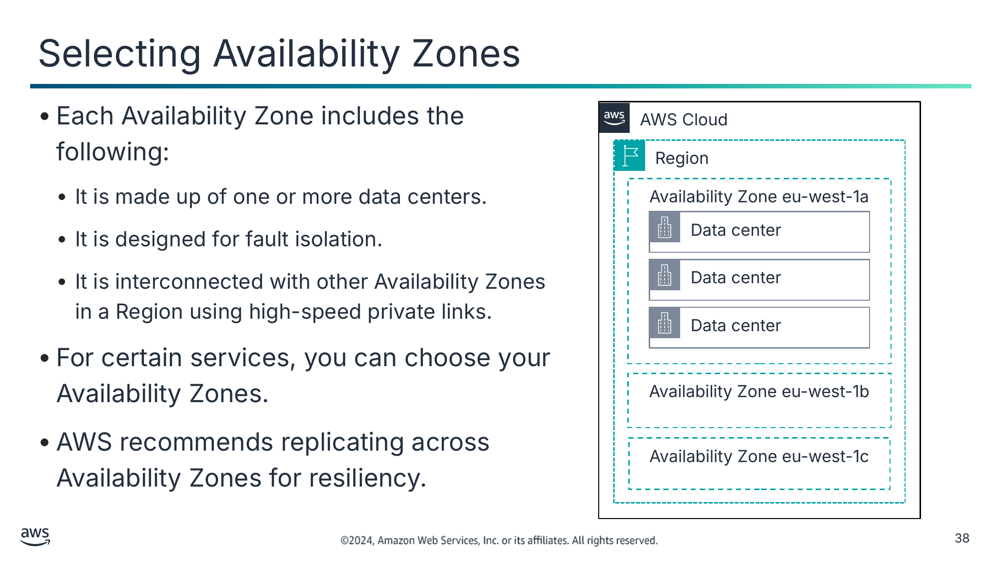

- Each Availability Zone includes the following:
  - It is made up of one or more data centers.
  - It is designed for fault isolation.
  - It is interconnected with other Availability Zones in a Region using high-speed private links.
- For certain services, you can choose your Availability Zones.
- AWS recommends replicating across Availability Zones for resiliency.

Текст зі схеми

AWS Cloud

Region

Availability Zone eu-west-1a

Data center

Data center

Data center

Availability Zone eu-west-1b

Availability Zone eu-west-1c

> **Нотатки:**
>
> |Slide number 38  
> |Instructor notes  
> |  
> |Student notes  
> Each Region consists of two or more isolated locations that called Availability Zones. Each Availability Zone comprises one or more data centers, with some Availability Zones having as many as six data centers. However, no data center can be a part of two Availability Zones.  
>
> Each Availability Zone is designed as an independent failure zone. This means that Availability Zones are physically separated in a typical metropolitan Region. They are also located in lower-risk floodplains (specific flood-zone categorization varies by Region). Availability Zones have a discrete, uninterruptible power supply and on-site backup generation facilities. In addition, they are each fed by different grids from independent utilities to further reduce single points of failure. Availability Zones are all redundantly connected to multiple tier-1 transit providers.  
>
> An Availability Zone is the most granular level of specification that you can make for certain services, such as Amazon EC2.  
>
> You are responsible for selecting the Availability Zones where your systems will reside. Systems can span multiple Availability Zones. You should design your systems to survive temporary or prolonged failure of an Availability Zone if a disaster occurs. Distributing applications across multiple Availability Zones means they can remain resilient in most failure situations, including natural disasters or system failures.

---

## Слайд 39: Using Local Zones

- Local Zones make it possible for you to run latency-sensitive portions of applications closer to end users and resources in a specific geography.
- They are an extension of a Region.
- With Local Zones, you can place AWS compute, storage, database, and other select services closer to large population, industry, and IT centers where no Regions exist today.
- Local Zones are managed and supported by AWS.

> **Нотатки:**
>
> |Slide number 39  
> |Instructor notes  
> |For more information, see AWS Local Zones on the content resources page of your online course.  
> |  
> |Student notes  
> Local Zones are a type of AWS infrastructure deployment. They place AWS compute, storage, database, and other select services closer to large population, industry, and IT centers where no Regions exist today. With Local Zones, you can run latency-sensitive portions of applications closer to end users and resources in a specific geography. You can use Local Zones to deliver single-digit millisecond latency for use cases such as media and entertainment content creation, real-time gaming, reservoir simulations, electronic design automation, and machine learning (ML).  
>
> Each Local Zone location is an extension of a Region. You can run latency-sensitive applications in a Local Zone by using AWS services such as Amazon EC2, Amazon Virtual Private Cloud (Amazon VPC), Amazon Elastic Block Store (Amazon EBS), Amazon FSx, and ELB in geographic proximity to end users. Local Zones provide a high-bandwidth, secure connection between local workloads and workloads that run in the Region. With Local Zones you can seamlessly connect back to your other workloads that are running in AWS. You can connect to the full range of in-Region services through the same APIs and toolsets.  
>
> Local Zones are managed and supported by AWS, and they provide you with all the elasticity, scalability, and security benefits of the cloud. With Local Zones, you can build and deploy latency-sensitive applications closer to your end users by using a consistent set of AWS services. You can also scale up or scale down, and you pay only for the resources you use.  
>
> For more information, see AWS Local Zones on the content resources page of your online course.

---

## Слайд 40: Role of AWS data centers

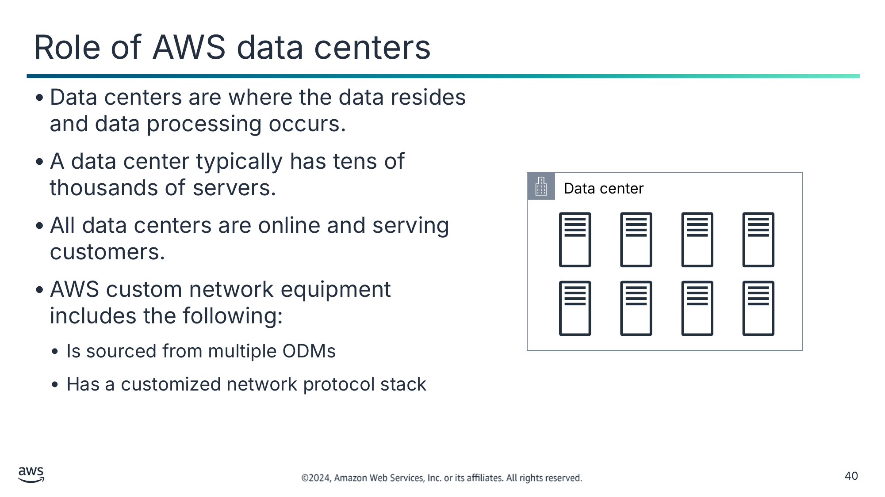

- Data centers are where the data resides and data processing occurs.
- A data center typically has tens of thousands of servers.
- All data centers are online and serving customers.
- AWS custom network equipment includes the following:
  - Is sourced from multiple ODMs
  - Has a customized network protocol stack

Текст зі схеми

Data center

> **Нотатки:**
>
> |Slide number 40  
> |Instructor notes  
> |  
> |Student notes  
> The foundation for the AWS infrastructure is the data centers. You do not specify a data center for the deployment of resources. However, a data center is the location where the actual data resides. Amazon operates state-of-the-art, highly available data centers. Though rare, failures that affect the availability of instances in the same location can occur. If you host all your instances in a single location that is affected by such a failure, none of your instances will be available.  
>
> All data centers are online and serving customers. In case of failure, automated processes move customer data traffic away from the affected area. Core applications are deployed in an N+1 configuration. In the event of a data center failure, there is sufficient capacity for traffic to be load balanced to the remaining sites.  
>
> AWS uses custom network equipment sourced from multiple original device manufacturers (ODMs). ODMs design and manufacture products based on specifications from another company. The other company then rebrands the products for sale.

---

## Слайд 41: AWS PoPs

Edge location

Regional edge cache

AWS data centers and servers located close to customers and designed to deliver services with the lowest latency possible

AWS data centers between the origin server and the edge location that have a longer cache

> **Нотатки:**
>
> |Slide number 41  
> |Instructor notes  
> |Compare and contrast the types of AWS PoPs. For more information, see Points of Presence on the content resources page of your online course.  
> |  
> |Student notes  
> To deliver content to end users with lower latency, CloudFront uses a global network that includes more than 410 PoPs. The PoPs are comprised of 400 edge locations and 13 regional mid-tier caches. These PoPs are the initial destination for a CloudFront request.  
>
> The edge locations make sure that popular content can be served quickly to customers. Regional edge caches bring more of your content closer to customers even if it is not popular enough to stay at an edge location. This helps reduce latency for customers. Regional edge caches increase efficiency and are transparent to the end user.  
>   
> Edge locations are located in North America, Europe, Asia, Australia, South America, the Middle East, Africa, and China. Edge locations support AWS services like Amazon Route 53, AWS Global Accelerator, and CloudFront.  
>
> Regional edge caches are used by default with CloudFront. They are used when you have content that is not accessed frequently enough to remain in an edge location. Regional edge caches absorb this content and provide an alternative to fetching the content from the origin server.  
>
> For more information, see Points of Presence on the content resources page of your online course.

---

## Слайд 42: Key takeaways: AWS Global Infrastructure

- The AWS Global Infrastructure consists of Regions, Availability Zones, and edge locations.
- Your choice of a Region is typically based on compliance requirements or to reduce latency.
- Each Availability Zone is physically separate from other Availability Zones and has redundant power, networking, and connectivity.
- Edge locations and regional edge caches improve performance by caching content closer to users.

> **Нотатки:**
>
> |Slide number 42  
> |Instructor notes  
> |The student version doesn't have any notes for this slide.  
> |  
> |Student notes

---

## Слайд 43: Module wrap-up

Introducing Cloud Architecting

> **Нотатки:**
>
> |Slide number 43  
> |Instructor notes  
> |  
> |Student notes  
> It’s now time to review the module and wrap up with a knowledge check.

---

## Слайд 44: Module summary

This module prepared you to do the following:

- Define cloud architecture.
- Describe how to design and evaluate architectures using the AWS Well-Architected Framework.
- Explain best practices for building solutions on AWS.
- Describe how to make informed decisions about where to place AWS resources.

> **Нотатки:**
>
> |Slide number 44  
> |Instructor notes  
> |The student version doesn't have any notes for this slide.  
> |  
> |Student notes

---

## Слайд 45: Module knowledge check

- The knowledge check is delivered online in your course.
- The knowledge check includes 10 questions based on material presented on the slides and in the slide notes.
- You can retake the knowledge check as many times as you like.

> **Нотатки:**
>
> |Slide number 45  
> |Instructor notes  
> |  
> |Student notes  
> Use your online course to access the knowledge check for this module.

---

## Слайд 46: Thank you

Corrections, feedback, or other questions?

Contact us at [https://support.aws.amazon.com/#/contacts/aws-academy](https://support.aws.amazon.com/#/contacts/aws-academy).

> **Нотатки:**
>
> |Slide number 46  
> |Instructor notes  
> |  
> |Student notes  
> That concludes this module. The content resources page of your course includes links to additional resources that are related to this module.
