## Слайд 1: Вступ до хмарної архітектури (Introducing Cloud Architecting)

AWS Academy Cloud Architecting

> **Нотатки:**
>
> |Нотатки для інструктора  
> |  
> |Нотатки для студента  
> Вітаємо в модулі «Вступ до хмарної архітектури». Цей модуль знайомить вас із найкращими практиками для хмарних архітектур і з тим, як проєктувати та оцінювати архітектури за допомогою AWS Well-Architected Framework.

---

## Слайд 2: Вступ

Вступ до хмарної архітектури

> **Нотатки:**
>
> |Нотатки для інструктора  
> |  
> |Нотатки для студента  
> Цей вступний розділ описує вміст модуля.

---

## Слайд 3: Цілі модуля

Цей модуль готує вас до такого:

- Визначати хмарну архітектуру.
- Описувати, як проєктувати та оцінювати архітектури за допомогою AWS Well-Architected Framework.
- Пояснювати найкращі практики побудови рішень в Amazon Web Services (AWS).
- Описувати, як ухвалювати обґрунтовані рішення щодо розміщення ресурсів AWS.

> **Нотатки:**
>
> |Номер слайда 3  
> |Нотатки для інструктора  
> |Цей модуль є вступом до хмарної архітектури. Протягом модуля студенти вивчають хмарну архітектуру. Модуль включає обговорення компромісів проєктування (design trade-offs) і найкращих практик хмарної архітектури. Ці компроміси й найкращі практики слід враховувати під час кожного проєктного рішення, і вони мають стати основою для решти модулів.  
> |  
> |Обговорення в цьому модулі включає найкращі практики побудови рішень в Amazon Web Services (AWS). Є розділ про глобальну інфраструктуру AWS, що допомагає студентам ухвалювати обґрунтовані рішення щодо регіонів AWS і зон доступності, які вони можуть обирати під час розгортання ресурсів. Розуміння цих концепцій буде важливим у наступних модулях.  
> |  
> |Хмарний архітектор відповідає за розуміння AWS Well-Architected Framework і його застосування до проєктів і реалізацій. Зосередьтеся на поданні AWS Well-Architected Framework як застосування найкращих практик, оскільки кожну опору буде обговорено в наступних модулях.  
> |  
> |Нотатки для студента

---

## Слайд 4: Огляд модуля

**Розділи презентації**

- Хмарна архітектура
- AWS Well-Architected Framework
- Найкращі практики побудови рішень в AWS
- Глобальна інфраструктура AWS

**Перевірки знань**

- 10-запитальна перевірка знань

> **Нотатки:**
>
> |Номер слайда 4  
> |Нотатки для інструктора  
> |Цей модуль має вступ, розділи з вмістом і підсумок.  
> |  
> |Нотатки для студента  
> Цілі цього модуля розкриваються в кількох розділах. Модуль завершується 10-запитальною перевіркою знань, яку подано в онлайн-курсі.

---

## Слайд 5: Як хмарний архітектор, що проєктує архітектури AWS:

- Мені потрібно розуміти практику застосування найкращих практик хмари до рішення, що використовує хмарні сервіси та функції для задоволення технічних потреб організації та її бізнес-сценаріїв використання.
- Мені потрібно оцінювати архітектуру за допомогою AWS Well-Architected Framework.
- Мені потрібно застосовувати найкращі практики до побудови рішень в AWS.

> **Нотатки:**
>
> |Номер слайда 5  
> |Нотатки для інструктора  
> |Цей слайд подає ключові наскрізні міркування проєктування, що є основою для хмарних архітекторів. Підкресліть, що хмарний архітектор завжди має починати з бізнес-кейсу й рухатися у зворотному напрямку, щоб обрати найкращі компоненти для цього сценарію використання. Також нагадайте студентам, що проєктні рішення, імовірно, еволюціонуватимуть з часом для оптимізації вартості та продуктивності в міру зміни чи кращого розуміння потреб.  
> |  
> |Нотатки для студента  
> Цей слайд просить вас прийняти перспективу хмарного архітектора. Переглядайте ці міркування, просуваючись цим модулем, пам’ятаючи, що хмарний архітектор має працювати у зворотному напрямку від бізнес-потреби, щоб спроєктувати найкращу архітектуру для конкретного сценарію використання.

---

## Слайд 6: Хмарна архітектура

Вступ до хмарної архітектури

> **Нотатки:**
>
> |Номер слайда 6  
> |Нотатки для інструктора  
> |  
> |Нотатки для студента  
> Цей розділ знайомить із хмарною архітектурою.

---

## Слайд 7: Хмарні обчислення та AWS

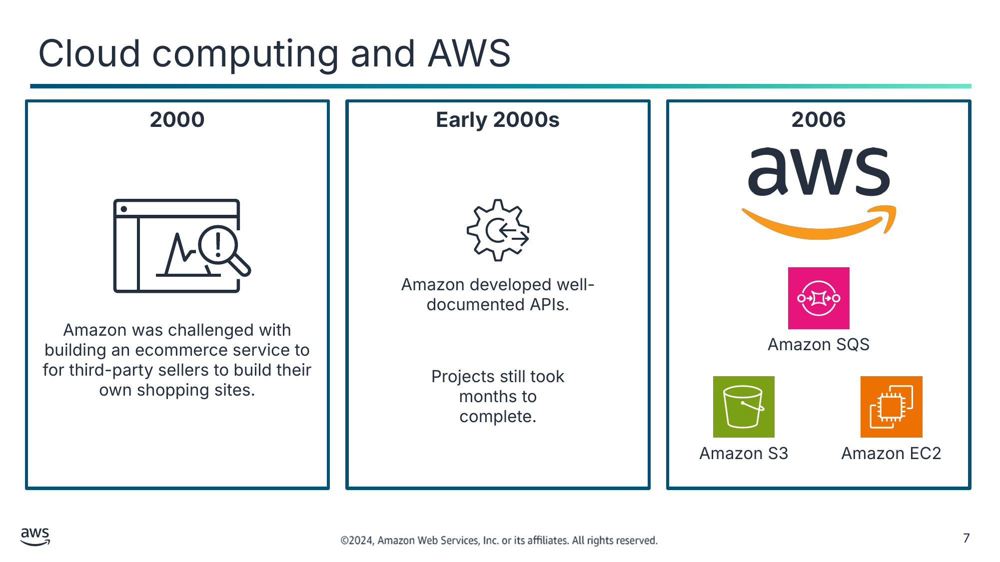

Текст зі схеми

**2000**

**Early 2000s (Початок 2000-х)**

**2006**

Amazon developed well-documented APIs. (Amazon розробила добре задокументовані API.)

Amazon was challenged with building an ecommerce service to for third-party sellers to build their own shopping sites. (Перед Amazon постало завдання побудувати сервіс електронної комерції, щоб сторонні продавці могли створювати власні торговельні сайти.)

Amazon SQS

Projects still took months to complete. (Проєкти все ще тривали місяцями.)

Amazon S3

Amazon EC2

> **Нотатки:**
>
> |Номер слайда 7  
> |Нотатки для інструктора  
> |Цей слайд описує історію того, як з’явилася AWS. Зосередьтеся на тому, що рішення були внутрішніми сервісами, які були високодоступними, масштабованими та надійними. Ці концепції буде обговорено в наступних модулях.  
> |  
> |Цей слайд вводить деякі терміни, які слід повторити з курсу AWS Academy Cloud Foundations. За потреби повторіть терміни «високодоступний», «масштабований» і «надійний».  
> |  
> |Нотатки для студента  
> Щоб зрозуміти, що таке хмарна архітектура та чому вона важлива, спершу розгляньмо приклад того, якою є розробка програмного забезпечення за її відсутності. Близько 2000 року, коли Amazon намагалася розв’язати проблему, компанія звернулася до хмарних обчислень як до рішення. Amazon намагалася побудувати сервіс електронної комерції, щоб сторонні продавці могли створювати власні онлайн-магазини на основі рушія електронної комерції Amazon.  
>
> Компанії було важко зробити свій новий торговельний вебсайт високодоступним і масштабованим. На початку інструменти, застосунки та архітектури електронної комерції Amazon будувалися без належного планування. Різні сервіси було важко розділити, щоб створити централізовану платформу розробки. Час розробки був тривалим, а проєкти — складними.  
>
> Рішенням цієї проблеми було створити набір добре задокументованих API для впорядкування середовища розробки.  
>
> Однак Amazon усе одно мала труднощі зі швидкою побудовою застосунків. У міру зростання компанії та найму більшої кількості програмних інженерів виникли такі ускладнення:  
> Побудова лише компонентів бази даних, обчислень і сховища забирала 3 місяці, тоді як очікувалося, що весь проєкт займе 3 місяці.  
> Кожна команда будувала власні ресурси без планування масштабованості чи повторного використання.  
>
> Рішенням було побудувати внутрішні сервіси для створення високодоступних, масштабованих і надійних архітектур поверх інфраструктури Amazon. У 2006 році Amazon почала продавати ці сервіси як Amazon Web Services (AWS). Вони почали з Amazon Simple Queue Service (Amazon SQS), а потім з’явилися Amazon Simple Storage Service (Amazon S3) і Amazon Elastic Compute Cloud (Amazon EC2).

---

## Слайд 8: Хмарна архітектура

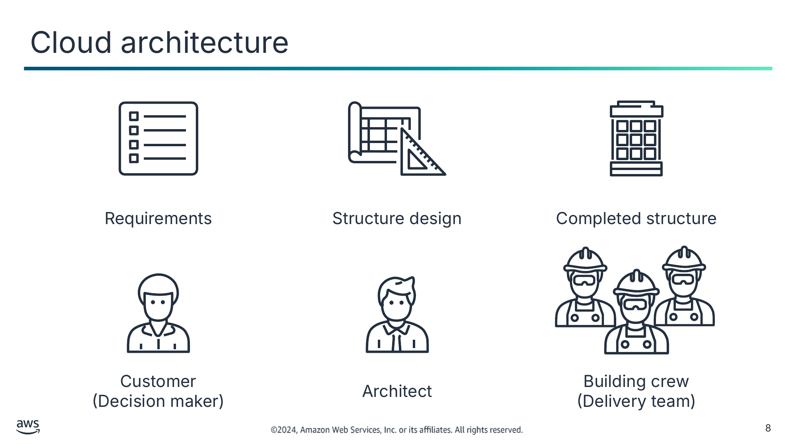

Requirements (Вимоги)

Structure design (Проєкт споруди)

Completed structure (Готова споруда)

Customer  
(Decision maker) (Клієнт (особа, що ухвалює рішення))

Architect (Архітектор)

Building crew  
(Delivery team) (Будівельна бригада (команда виконавців))

> **Нотатки:**
>
> |Номер слайда 8  
> |Нотатки для інструктора  
> |Цей слайд розповідає історію про те, що розробка хмарної архітектури подібна до будівництва будинку. Зосередьтеся на порівнянні процесу будівництва фізичної споруди з процесом хмарної архітектури. Студенти мають винести розуміння того, що проєкт архітектури є критично важливим для побудови рішень, що підтримують поточні та майбутні потреби.  
> |  
> |Нотатки для студента  
> Що таке хмарна архітектура? Хмарна архітектура — це практика застосування хмарних характеристик до рішення, що використовує хмарні сервіси та функції для задоволення технічних потреб організації та її бізнес-сценаріїв використання.  
>
> Створення технологічних рішень дуже схоже на будівництво фізичної споруди. Якщо фундамент не є міцним, це може спричинити структурні проблеми, що підривають цілісність і функцію споруди. Щоб створити міцну споруду, клієнт окреслює потреби та вимоги до неї. Архітектор створює проєкт і креслення, що відповідають вимогам. Потім будівельна бригада перетворює креслення на фізичну споруду.  
>
> У хмарній архітектурі клієнт або особа, що ухвалює рішення, також окреслює бізнес-цілі та вимоги. Хмарний архітектор проєктує рішення, подібне до креслення споруди. Потім команда виконавців працює над реалізацією рішення.  
>
> Наявність добре спроєктованих систем (well-architected systems) підвищує ймовірність того, що технологічні результати допоможуть досягти бізнес-цілей.

---

## Слайд 9: Роль хмарного архітектора

Планування (Plan)

Дослідження (Research)

Побудова (Build)

- Визначення технічної хмарної стратегії разом із бізнес-керівниками.
- Аналіз рішень для бізнес-потреб і вимог.

- Дослідження специфікацій хмарних сервісів і вимог робочих навантажень.
- Перегляд архітектур наявних робочих навантажень.
- Проєктування прототипів рішень.

- Проєктування дорожньої карти трансформації з віхами, потоками робіт і відповідальними.
- Керування впровадженням і міграцією.

> **Нотатки:**
>
> |Номер слайда 9  
> |Нотатки для інструктора  
> |Обговорення цього слайда має допомогти студентам зрозуміти їхню роль хмарного архітектора. Подумайте про продовження аналогії з будівництвом фізичної споруди, що була подана на попередньому слайді.  
> |  
> |Нотатки для студента  
> Роль хмарного архітектора така:  
> Взаємодіяти з особами, що ухвалюють рішення, щоб визначити бізнес-цілі та можливості, які потребують покращення.  
> Забезпечувати відповідність між технологічними результатами рішення та бізнес-цілями.  
> Працювати з командами виконавців, що впроваджують рішення, щоб переконатися, що технологічні функції є доречними.  
>
> Хмарні архітектори відповідають за керування хмарною обчислювальною архітектурою організації. Вони мають глибокі знання архітектурних принципів і сервісів, що використовуються для такого:  
> Розробка технічної хмарної стратегії на основі бізнес-потреб.  
> Допомога зусиллям із міграції в хмару.  
> Перегляд вимог до робочих навантажень.  
> Надання настанов щодо розв’язання проблем із високим ризиком.  
>
> Хмарні архітектори працюють над впровадженням AWS Well-Architected Framework.

---

## Слайд 10: Ключові висновки: що таке хмарна архітектура?

- Хмарна архітектура — це практика застосування хмарних характеристик до рішення, що використовує хмарні сервіси та функції для задоволення технічних потреб організації та її бізнес-сценаріїв використання.
- Ви можете використовувати сервіси AWS для створення високодоступних, масштабованих і надійних архітектур.
- Хмарні архітектори відповідають за керування хмарною обчислювальною архітектурою організації.

> **Нотатки:**
>
> |Номер слайда 10  
> |Нотатки для інструктора  
> |Версія для студентів не містить нотаток до цього слайда.  
> |  
> |Нотатки для студента

---

## Слайд 11: AWS Well-Architected Framework

Вступ до хмарної архітектури

> **Нотатки:**
>
> |Номер слайда 11  
> |Нотатки для інструктора  
> |  
> |Нотатки для студента  
> Цей розділ знайомить з AWS Well-Architected Framework.

---

## Слайд 12: Опори AWS Well-Architected Framework

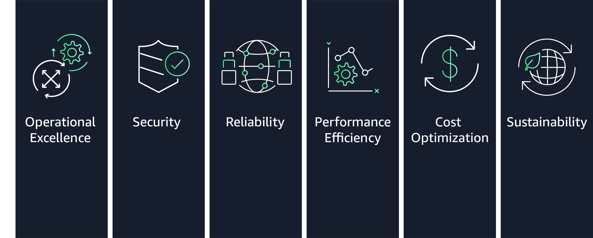

> **Нотатки:**
>
> |Слайд 12 модуля 2:  
> |Нотатки для інструктора  
> |Цей розділ розглядає шість опор (pillars) AWS Well-Architected Framework. Кожна опора має власний технічний документ (whitepaper), що докладно описує принципи проєктування та найкращі практики, пов’язані з цією опорою.  
> |  
> |Більшість модулів цього курсу містять розділ, що виділяє найкращі практики з вибраних опор AWS Well-Architected Framework у зв’язку з матеріалом, поданим у цьому модулі. Є два винятки. Модуль про безпеку зосереджений на вмісті, що стосується опори безпеки. Модуль «Побудова розділених архітектур» зосереджений на найкращих практиках опори надійності для архітектур робочих навантажень.  
> |  
> |Ви можете використовувати розділи кожного модуля, зосереджені на опорах AWS Well-Architected Framework, для закріплення вмісту, поданого в кожному модулі. Студенти також можуть використовувати ці розділи, щоб потренуватися в застосуванні фреймворку під час вибору сервісів і функцій для своїх архітектур.  
> |  
> |Розгляньте перегляд кожного з технічних документів опор під час цього розділу. Докладніше див. AWS Well-Architected Framework на сторінці ресурсів вмісту вашого онлайн-курсу.  
> |  
> |Нотатки для студента  
> AWS Well-Architected Framework — це посібник, що надає послідовний підхід до оцінювання хмарних архітектур. Він також надає настанови, що допомагають впроваджувати проєкти. Він документує набір основоположних запитань і найкращих практик, які можна використати, щоб зрозуміти, чи конкретна архітектура добре узгоджується з найкращими практиками хмари. AWS розробила цей фреймворк після аналізу тисяч клієнтських архітектур в AWS.  
>
> AWS Well-Architected Framework організовано в шість опор: операційна досконалість (Operational Excellence), безпека (Security), надійність (Reliability), ефективність продуктивності (Performance Efficiency), оптимізація витрат (Cost Optimization) і сталість (Sustainability).  
>
> Ви повертаєтеся до опор AWS Well-Architected Framework у кожному з модулів цього курсу. Докладніше див. AWS Well-Architected Framework на сторінці ресурсів вмісту вашого онлайн-курсу.

---

## Слайд 13: Опора «Операційна досконалість» (Operational Excellence)

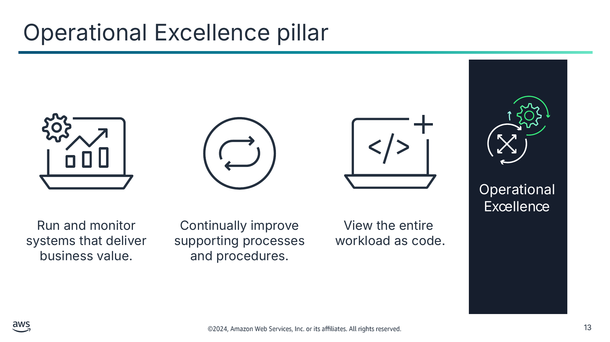

Run and monitor systems that deliver business value. (Експлуатуйте та відстежуйте системи, що забезпечують бізнес-цінність.)

Continually improve supporting processes and procedures. (Постійно вдосконалюйте допоміжні процеси та процедури.)

View the entire  
workload as code. (Розглядайте все робоче навантаження як код.)

> **Нотатки:**
>
> |Номер слайда 13  
> |Нотатки для інструктора  
> |  
> |Нотатки для студента  
> Опора «Операційна досконалість» стосується здатності експлуатувати системи та отримувати розуміння їхньої роботи для забезпечення бізнес-цінності. Вона також стосується здатності постійно вдосконалювати допоміжні процеси та процедури.  
>
> Коли ви проєктуєте робоче навантаження для експлуатації, ви повинні знати, як воно буде розгортатися, оновлюватися та експлуатуватися. Запровадьте інженерні практики, що узгоджуються зі зменшенням дефектів і швидкими, безпечними виправленнями. Зробіть можливим спостереження за допомогою журналювання, інструментування та бізнес- і технічних метрик, щоб ви могли отримати розуміння того, що відбувається всередині вашої архітектури.  
>
> В AWS ви можете розглядати все своє робоче навантаження (застосунки, інфраструктуру, політики, управління та операції) як код. Ви можете визначати й оновлювати всі частини свого робочого навантаження за допомогою коду. Це означає, що ви можете застосовувати ту саму інженерну дисципліну, яку ви використовуєте для коду застосунків, до кожного елемента вашого стека. Рекомендується інвестувати в реалізацію операційних дій як коду, щоб максимізувати продуктивність, мінімізувати кількість помилок і налаштувати автоматизовані відповіді.  
>
> Докладніше див. опору «Операційна досконалість» на сторінці ресурсів вмісту вашого онлайн-курсу.

---

## Слайд 14: Опора «Безпека» (Security)

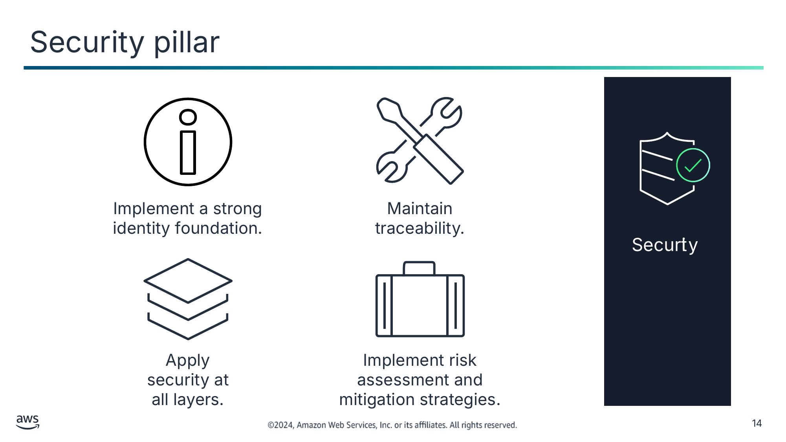

Implement a strong identity foundation. (Запровадьте сильну основу ідентичності.)

Maintain traceability. (Забезпечте відстежуваність.)

Apply security at all layers. (Застосовуйте безпеку на всіх рівнях.)

Implement risk assessment and mitigation strategies. (Запровадьте оцінювання ризиків і стратегії їх пом’якшення.)

> **Нотатки:**
>
> |Номер слайда 14  
> |Нотатки для інструктора  
> |  
> |Нотатки для студента  
> Опора «Безпека» стосується здатності захищати інформацію, системи та активи, забезпечуючи бізнес-цінність за допомогою оцінювання ризиків і стратегій їх пом’якшення.  
>
> Ваша архітектура матиме значно сильнішу присутність безпеки, якщо ви запровадите сильну основу ідентичності, використовуватимете й підтримуватимете відстежуваність, застосовуватимете безпеку на всіх рівнях, автоматизуватимете найкращі практики безпеки та захищатимете дані під час передавання та в стані спокою. Упровадження цих принципів безпеки допомагає підготуватися до подій безпеки.  
>
> Докладніше див. опору «Безпека» на сторінці ресурсів вмісту вашого онлайн-курсу.

---

## Слайд 15: Опора «Надійність» (Reliability)

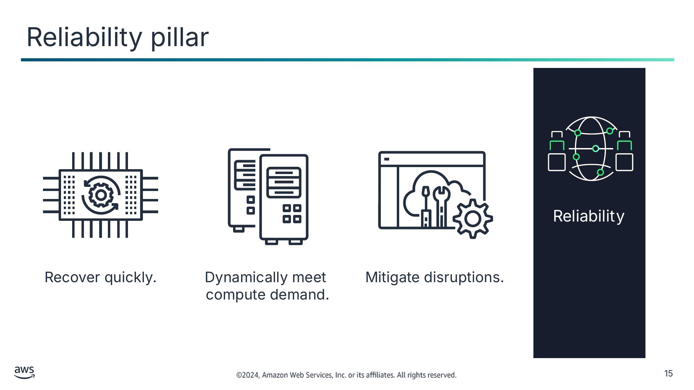

Recover quickly. (Швидко відновлюйтеся.)

Dynamically meet  
compute demand. (Динамічно задовольняйте попит на обчислення.)

Mitigate disruptions. (Пом’якшуйте перебої.)

> **Нотатки:**
>
> |Номер слайда 15  
> |Нотатки для інструктора  
> |  
> |Нотатки для студента  
> Опора «Надійність» стосується здатності системи відновлюватися після перебоїв в інфраструктурі чи сервісах і динамічно отримувати обчислювальні ресурси для задоволення попиту. Вона також стосується здатності системи пом’якшувати перебої, як-от неправильні конфігурації чи тимчасові мережеві проблеми.  
>
> У традиційному середовищі забезпечити надійність може бути складно. Проблеми виникають через єдині точки відмови (single points of failure), брак автоматизації та брак еластичності. Застосовуючи найкращі практики, окреслені в опорі «Надійність», ви можете запобігти багатьом із цих проблем. Опора «Надійність» допомагає вам і вашим клієнтам мати правильно спроєктовану архітектуру з погляду високої доступності, відмовостійкості та загальної надлишковості.  
>
> Докладніше див. опору «Надійність» на сторінці ресурсів вмісту вашого онлайн-курсу.

---

## Слайд 16: Опора «Ефективність продуктивності» (Performance Efficiency)

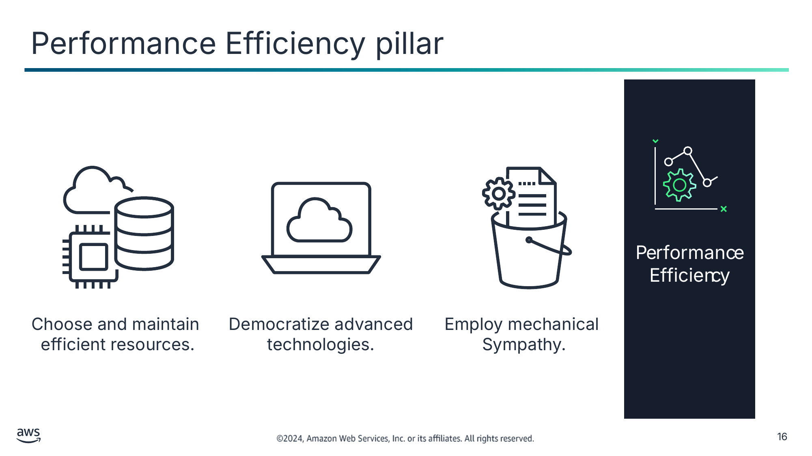

Choose and maintain  
efficient resources. (Обирайте та підтримуйте ефективні ресурси.)

Democratize advanced technologies. (Демократизуйте передові технології.)

Employ mechanical

Sympathy. (Враховуйте «механічну симпатію».)

> **Нотатки:**
>
> |Номер слайда 16  
> |Нотатки для інструктора  
> |  
> |Нотатки для студента  
> Розглядаючи продуктивність, ви хочете максимізувати її за рахунок ефективного використання обчислювальних ресурсів. Також ви хочете підтримувати цю ефективність у міру зміни попиту.  
>
> Також важливо демократизувати передові технології. У ситуаціях, коли технологію складно впровадити самостійно, розгляньте використання постачальника. Впроваджуючи технологію для вас, постачальник бере на себе складність і знання, звільняючи вашу команду для зосередження на роботі з більшою доданою цінністю.  
>
> «Механічна симпатія» (mechanical sympathy) — це коли ви використовуєте інструмент чи систему, розуміючи, як вони працюють найкраще. Використовуйте технологічний підхід, що найкраще відповідає тому, чого ви намагаєтеся досягти. Наприклад, враховуйте шаблони доступу до даних під час вибору підходів до баз даних чи сховищ.  
>
> Докладніше див. опору «Ефективність продуктивності» на сторінці ресурсів вмісту вашого онлайн-курсу.

---

## Слайд 17: Опора «Оптимізація витрат» (Cost Optimization)

Measure efficiency. (Вимірюйте ефективність.)

Eliminate unneeded expense. (Усувайте непотрібні витрати.)

Adopt the right  
consumption model. (Прийміть правильну модель споживання.)

Consider using  
managed services. (Розгляньте використання керованих сервісів.)

> **Нотатки:**
>
> |Номер слайда 17  
> |Нотатки для інструктора  
> |  
> |Нотатки для студента  
> Оптимізація витрат — це постійна вимога будь-якого хорошого архітектурного проєкту. Процес ітеративний, і його слід уточнювати та вдосконалювати протягом усього продуктивного життя. Розуміння того, наскільки ефективною є ваша поточна архітектура щодо ваших цілей, може усунути непотрібні витрати.  
>
> Прийміть правильну модель споживання для вашого сценарію використання. Ви можете захотіти прийняти модель, за якої ви платите лише за ресурси, які використовуєте. Розгляньте використання керованих сервісів, оскільки вони працюють у хмарному масштабі та можуть пропонувати нижчу вартість за транзакцію чи сервіс.  
>
> Докладніше див. опору «Оптимізація витрат» на сторінці ресурсів вмісту вашого онлайн-курсу.

---

## Слайд 18: Опора «Сталість» (Sustainability)

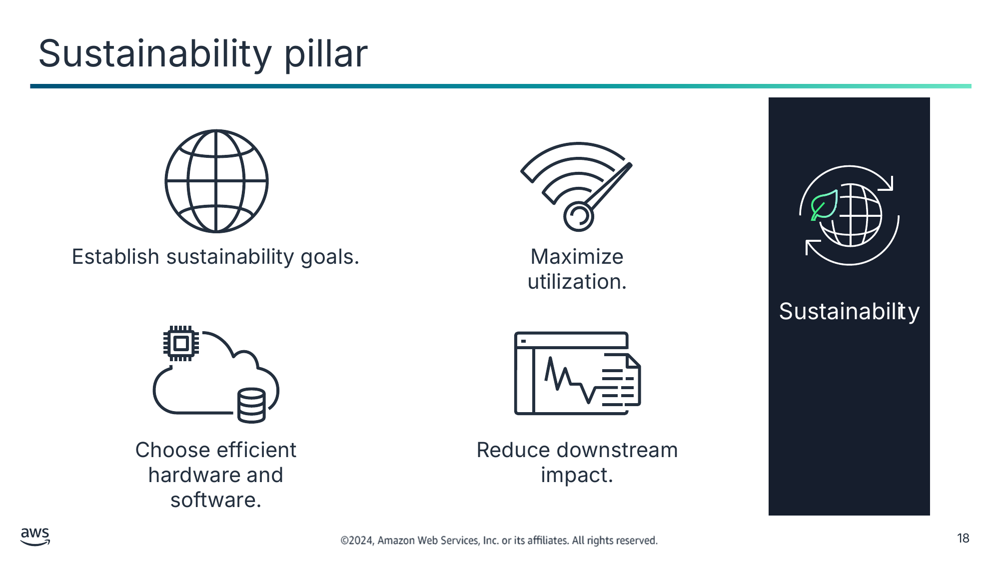

Establish sustainability goals. (Визначте цілі сталості.)

Maximize utilization. (Максимізуйте використання.)

Choose efficient hardware and software. (Обирайте ефективне апаратне та програмне забезпечення.)

Reduce downstream impact. (Зменшуйте наступний вплив.)

> **Нотатки:**
>
> |Номер слайда 18  
> |Нотатки для інструктора  
> |  
> |Нотатки для студента  
> Опора «Сталість» стосується здатності будувати архітектури, що максимізують ефективність і зменшують відходи. Дисципліна сталості стосується довгострокового екологічного, економічного та суспільного впливу вашої бізнес-діяльності. Ви повинні розуміти вплив ваших робочих навантажень і працювати над зменшенням наступного впливу.  
>   
> Сталість у хмарі — це безперервне зусилля. Воно зосереджене насамперед на зменшенні споживання енергії та ефективності всіх компонентів робочого навантаження шляхом отримання максимальної вигоди від розгорнутих ресурсів і мінімізації загальної кількості потрібних ресурсів. Це зусилля може включати початковий вибір ефективної мови програмування, впровадження сучасних алгоритмів і використання ефективних методів зберігання даних. Воно також може включати розгортання на правильно підібраній за розміром і ефективній обчислювальній інфраструктурі та мінімізацію вимог до потужного апаратного забезпечення кінцевих користувачів.  
>
> Докладніше див. опору «Сталість» на сторінці ресурсів вмісту вашого онлайн-курсу.

---

## Слайд 19: Використання AWS WA Tool

- Допомагає переглядати стан ваших робочих навантажень і порівнює їх із найновішими архітектурними найкращими практиками AWS
- Дає вам доступ до знань і найкращих практик, які використовують архітектори AWS, коли вони вам потрібні
- Надає план дій із покроковими вказівками щодо побудови кращих робочих навантажень для хмари
- Забезпечує послідовний процес для перегляду та вимірювання ваших хмарних архітектур

AWS Well-Architected Tool

> **Нотатки:**
>
> |Нотатки для інструктора  
> |AWS Well-Architected Tool доступний через AWS Management Console. Цей інструмент допомагає застосовувати найкращі практики з AWS Well-Architected Framework послідовним чином. Він призначений для тих, хто залучений до розробки технічних продуктів, як-от технічні директори (CTO), архітектори, розробники та члени команд експлуатації.  
> |  
> |Подумайте про проведення короткої демонстрації AWS WA Tool. Посібник користувача містить покроковий навчальний посібник, який можна використати для демонстрації інструмента. Докладніше див. посібник користувача AWS Well-Architected Tool на сторінці ресурсів вмісту вашого онлайн-курсу.  
> |  
> |Нотатки для студента  
> Якщо вам потрібна допомога в проєктуванні добре спроєктованого (well-architected) рішення, ви можете використати AWS Well-Architected Tool. AWS WA Tool — це інструмент самообслуговування, що надає вам доступ за запитом до поточних найкращих практик AWS. Ці найкращі практики можуть допомогти вам побудувати безпечну, високопродуктивну, стійку та ефективну інфраструктуру застосунків в AWS.  
>
> AWS WA Tool допомагає переглядати стан ваших робочих навантажень і порівнювати їх із найновішими архітектурними найкращими практиками AWS. Він дає вам доступ до знань і найкращих практик, які використовують архітектори AWS, коли вони вам потрібні.  
>
> AWS WA Tool доступний в AWS Management Console. Ви визначаєте своє робоче навантаження та відповідаєте на низку запитань у сферах операційної досконалості, безпеки, надійності, ефективності продуктивності та оптимізації витрат. Потім AWS WA Tool надає план дій із покроковими вказівками щодо покращення вашого робочого навантаження для хмари.  
>
> AWS WA Tool забезпечує послідовний процес для перегляду та вимірювання ваших хмарних архітектур. За допомогою цього інструмента ви можете збирати дані та отримувати рекомендації для такого:  
> Мінімізація збоїв системи та операційних витрат.  
> Глибоке занурення в бізнес-процеси та процеси інфраструктури.  
> Надання настанов щодо найкращих практик.  
> Реалізація ціннісної пропозиції хмарних обчислень.  
>
> Ви можете використовувати результати, які надає інструмент, щоб визначати наступні кроки покращення, спрямовувати архітектурні рішення та включати архітектурні міркування до процесу корпоративного управління (governance).  
>
> Докладніше див. посібник користувача AWS Well-Architected Tool на сторінці ресурсів вмісту вашого онлайн-курсу.

---

## Слайд 20: Ключові висновки: AWS Well-Architected Framework

- AWS Well-Architected Framework надає послідовний підхід до оцінювання хмарних архітектур і настанови, що допомагають впроваджувати проєкти.
- AWS Well-Architected Framework організовано в шість опор.
- Кожна опора документує набір основоположних запитань, які можна використати, щоб зрозуміти, чи конкретна архітектура добре узгоджується з найкращими практиками хмари.
- AWS WA Tool допомагає переглядати стан ваших робочих навантажень і порівнює їх із найновішими архітектурними найкращими практиками AWS.

> **Нотатки:**
>
> |Номер слайда 20  
> |Нотатки для інструктора  
> |Версія для студентів не містить нотаток до цього слайда.  
> |  
> |Нотатки для студента

---

## Слайд 21: Найкращі практики побудови рішень в AWS

Вступ до хмарної архітектури

> **Нотатки:**
>
> |Номер слайда 21  
> |Нотатки для інструктора  
> |  
> |Нотатки для студента  
> Цей розділ знайомить із найкращими практиками побудови рішень в AWS.

---

## Слайд 22: Компроміси проєктування (design trade-offs)

Проєктуючи рішення, ретельно обмірковуйте компроміси, щоб обрати оптимальний підхід.

- Оцінюйте компроміси, щоб обрати оптимальний підхід.
- Приклади компромісів включають таке:
  - Жертвуйте узгодженістю, довговічністю та простором заради часу й затримки, щоб забезпечити вищу продуктивність.
  - Для нових функцій надавайте пріоритет швидкості виходу на ринок над вартістю.
- Базуйте проєктні рішення на емпіричних даних.

> **Нотатки:**
>
> |Номер слайда 22  
> |Нотатки для інструктора  
> |Цей розділ зосереджений на найкращих практиках проєктування та побудови хмарних архітектур. Використовуйте компроміси проєктування як тему для обговорення для кожної з найкращих практик, яких слід дотримуватися.  
> |  
> |Нотатки для студента  
> Проєктуючи рішення, ретельно обмірковуйте компроміси, щоб обрати оптимальний підхід. Наприклад, ви можете пожертвувати узгодженістю, довговічністю та простором заради часу й затримки, щоб забезпечити вищу продуктивність. Або ви можете надати пріоритет швидкості виходу на ринок над вартістю.  
>
> Компроміси можуть збільшити вартість і складність вашої архітектури, тому ваші проєктні рішення мають ґрунтуватися на емпіричних даних. Наприклад, вам може знадобитися провести навантажувальне тестування, щоб переконатися, що отримано вимірювану користь у продуктивності. Або вам може знадобитися провести еталонне тестування (benchmarking), щоб з часом досягти найекономічнішого робочого навантаження. Оцінюючи покращення, пов’язані з продуктивністю, враховуйте, як вибір проєкту вашої архітектури вплине на клієнтів і ефективність робочого навантаження.  
>
> У цьому розділі ви дізнаєтеся про найкращі практики проєктування рішень в AWS. Ви також дізнаєтеся про антишаблони (anti-patterns; або погані проєкти рішень), яких слід уникати.

---

## Слайд 23: Впровадження масштабованості (implementing scalability)

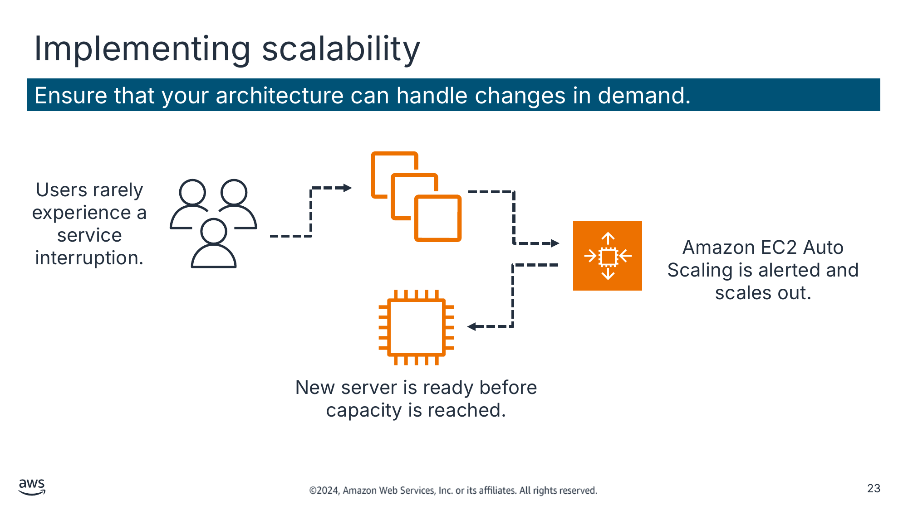

Ensure that your architecture can handle changes in demand. (Переконайтеся, що ваша архітектура може впоратися зі змінами попиту.)

Текст зі схеми

Users rarely experience a service interruption. (Користувачі рідко стикаються з перебоями в роботі сервісу.)

Amazon EC2 Auto Scaling is alerted and scales out. (Amazon EC2 Auto Scaling отримує сповіщення та масштабується назовні.)

New server is ready before capacity is reached. (Новий сервер готовий до вичерпання потужностей.)

> **Нотатки:**
>
> |Номер слайда 23  
> |Нотатки для інструктора  
> |Хмарні архітектори рішень мають будувати з огляду на майбутнє. Це означає, що рішення повинні задовольняти поточні вимоги до масштабу та прогнозоване зростання рішення. Коли рішення масштабується, багато архітекторів стикаються з додатковою складністю загальної архітектури щодо її керованості, продуктивності, безпеки тощо. Проєктуючи своє рішення чи застосунок для надійного масштабування, ви можете уникнути додаткової складності, погіршення продуктивності чи зниження безпеки через масштабування.  
> |  
> |Ця архітектура є хорошим прикладом Amazon EC2 Auto Scaling. Коли ви використовуєте Amazon EC2 Auto Scaling, ваші застосунки отримують кращу відмовостійкість, доступність і керування витратами.  
> |  
> |Нотатки для студента  
> Коли ви запускаєте свої робочі навантаження в хмарі AWS, ви можете швидко та проактивно масштабувати свою інфраструктуру. Переконайтеся, що ви впроваджуєте масштабованість на кожному рівні вашої інфраструктури. Упроваджуючи масштабованість, ви можете вдосконалити свій проєкт, щоб передбачити потребу в більших потужностях і забезпечити їх до того, як стане надто пізно.  
>
> Наприклад, можна використати рішення для моніторингу, як-от Amazon CloudWatch, щоб виявляти, чи загальне навантаження на ваш парк серверів досягло вказаного порогового значення. Ви можете визначити цей поріг як «понад 60 відсотків використання ЦП протягом понад 5 хвилин» або будь-що, пов’язане з використанням ресурсів. З CloudWatch можна також створювати власні метрики на основі конкретних застосунків, що можуть викликати потрібне масштабування ресурсів.  
>   
> Коли сигнал (alarm) спрацьовує, Amazon EC2 Auto Scaling негайно запускає новий екземпляр. Цей екземпляр потім готовий до вичерпання потужностей, що забезпечує безперебійний досвід для користувачів.  
>
> В ідеалі слід також проєктувати свою систему так, щоб вона була еластичною. Коли попит падає, ви не запускаєте (і не платите за) екземпляри, які вам більше не потрібні.  
>
> Щоб зрозуміти важливість масштабованості, розгляньте випадок, коли масштабування виконується реактивно й вручну. Коли сервери застосунків досягають повної потужності, користувачі не можуть отримати доступ до застосунку. Тоді адміністратори вручну запускають один чи кілька нових екземплярів, щоб упоратися з навантаженням. На жаль, потрібно кілька хвилин, щоб екземпляр став доступним для використання після запуску. Це збільшує час, протягом якого користувачі не можуть отримати доступ до застосунку.

---

## Слайд 24: Автоматизація вашого середовища (automating your environment)

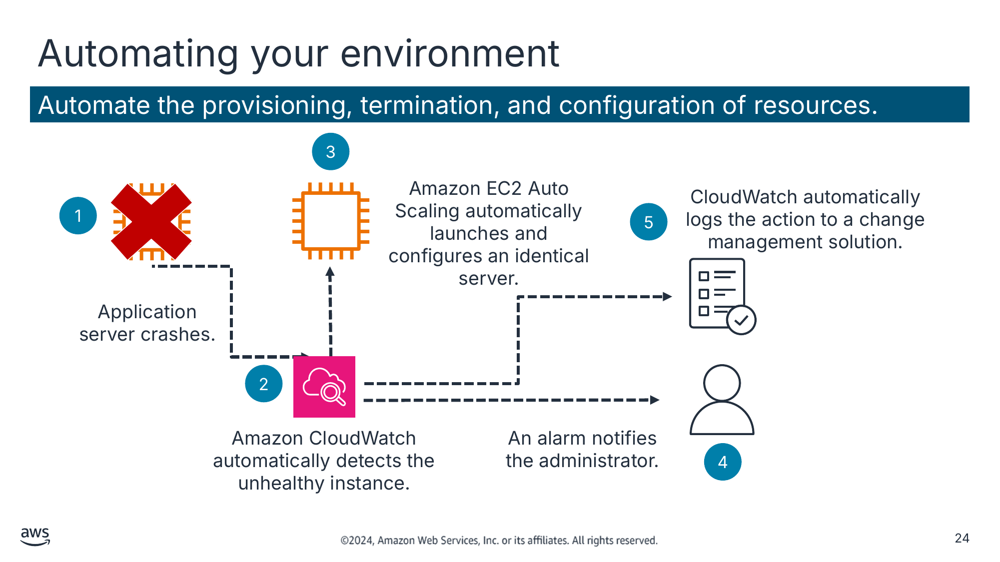

Automate the provisioning, termination, and configuration of resources. (Автоматизуйте розгортання, завершення роботи та налаштування ресурсів.)

Текст зі схеми

3

Amazon EC2 Auto Scaling automatically launches and configures an identical server. (Amazon EC2 Auto Scaling автоматично запускає та налаштовує ідентичний сервер.)

CloudWatch automatically logs the action to a change management solution. (CloudWatch автоматично журналює дію в рішенні для керування змінами.)

Application server crashes. (Сервер застосунків виходить з ладу.)

Amazon CloudWatch automatically detects the unhealthy instance. (Amazon CloudWatch автоматично виявляє несправний екземпляр.)

An alarm notifies the administrator. (Сигнал сповіщає адміністратора.)

1

5

2

4

> **Нотатки:**
>
> |Номер слайда 24  
> |Нотатки для інструктора  
> |Автоматизація — це найкраща практика для розгортання, зупинки та налаштування хмарних ресурсів. Ця схема показує, як автоматизацію можна використати для реагування на збій сервера. Схема читається зліва направо так:  
> |Сервер застосунків виходить з ладу.  
> |Amazon CloudWatch автоматично виявляє несправний екземпляр.  
> |Amazon EC2 Auto Scaling автоматично запускає та налаштовує ідентичний сервер.  
> |Сигнал сповіщає адміністратора.  
> |CloudWatch автоматично журналює дію в рішенні для керування змінами.  
> |  
> |Нотатки для студента  
> AWS пропонує вбудовані інструменти моніторингу та автоматизації практично на кожному рівні вашої інфраструктури. Скористайтеся цими інструментами, щоб ваша інфраструктура могла швидко реагувати на зміни.  
>
> Без вбудованих інструментів моніторингу та автоматизації вам доводиться вручну виявляти будь-які збої й реагувати на них. Якщо сервер застосунків виходить з ладу, ви повинні виявити це й вручну повідомити адміністратора. Адміністратор має вручну запустити й налаштувати новий сервер.  
>
> Такі інструменти, як CloudWatch та Amazon EC2 Auto Scaling, можуть виявляти несправні ресурси й автоматизувати запуск замінних ресурсів. Також можна отримувати сповіщення, коли змінюється розподіл ресурсів.  
>
> У цьому прикладі, коли сервер застосунків виходить з ладу, CloudWatch автоматично виявляє збій. CloudWatch автоматично запускає та налаштовує новий сервер і повідомляє адміністратора. Зміну журналюють у рішенні для керування змінами для відстеження.

---

## Слайд 25: Використання IaC

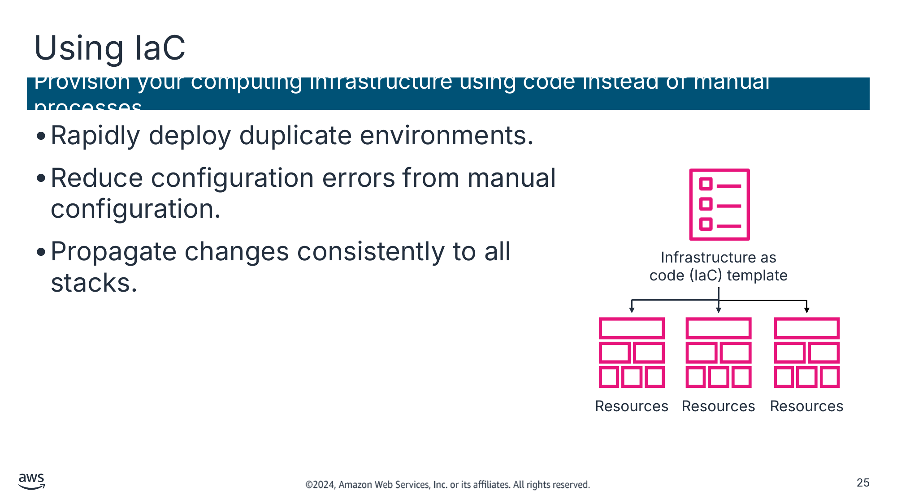

Provision your computing infrastructure using code instead of manual processes. (Розгортайте обчислювальну інфраструктуру за допомогою коду замість ручних процесів.)

- Rapidly deploy duplicate environments. (Швидко розгортайте дублікати середовищ.)
- Reduce configuration errors from manual configuration. (Зменшуйте кількість помилок конфігурації від ручного налаштування.)
- Propagate changes consistently to all stacks. (Послідовно поширюйте зміни на всі стеки.)

Текст зі схеми

Infrastructure as code (IaC) template (Шаблон «інфраструктура як код» (IaC))

Resources (Ресурси)

Resources

Resources

> **Нотатки:**
>
> |Номер слайда 25  
> |Нотатки для інструктора  
> |Обговоріть, що традиційно системні адміністратори використовували комбінацію скриптів і ручних процесів для налаштування інфраструктурних середовищ. Цей процес був складним і трудомістким. Ви можете використовувати інфраструктуру як код (infrastructure as code, IaC), щоб автоматично налаштувати своє середовище за лічені хвилини та ефективніше ним керувати.  
>
> |Докладніше див. «Що таке інфраструктура як код?» (What Is Infrastructure as Code?) на сторінці ресурсів вмісту вашого онлайн-курсу.  
> |  
> |Нотатки для студента  
> Автоматизація — ключова мета в будь-якому обчислювальному середовищі. Інфраструктура як код (IaC) використовується для автоматизації інфраструктури для створення середовищ. Найпоширеніше використання IaC — у розробці програмного забезпечення для побудови, тестування та розгортання застосунків.  
>
> Швидко розгортайте дублікати середовищ. За допомогою одного шаблона можна розгортати ідентичні середовища. IaC усуває повторювані ручні кроки та контрольні списки, які були потрібні раніше.  
>
> Зменшуйте кількість помилок конфігурації від ручного налаштування. Ручне налаштування схильне до помилок через участь людини. IaC зменшує кількість помилок і спрощує перевірку помилок. Якщо виникають помилки через оновлення коду IaC, ви можете швидко виправити ситуацію, відкотивши кодову базу до останніх відомих стабільних конфігураційних файлів. Також можна відкочувати середовища за допомогою попередніх версій конфігураційних файлів IaC з інших причин, наприклад розгортання старіших версій застосунків.  
>
> Послідовно поширюйте зміни на всі стеки за допомогою IaC. Внесіть зміну до шаблона та передайте ці зміни на всі стеки. Це робить можливим послідовне розгортання зміни.  
>
> Докладніше див. «Що таке інфраструктура як код?» на сторінці ресурсів вмісту вашого онлайн-курсу.

---

## Слайд 26: Ставлення до ресурсів як до таких, що можна замінити (treating resources as disposable)

Скористайтеся перевагами динамічно розгортуваної природи хмарних обчислень.

- Автоматизуйте розгортання нових ресурсів з ідентичними конфігураціями.
- Зупиняйте ресурси, що не використовуються.
- Тестуйте оновлення на нових ресурсах, а потім замінюйте старі ресурси оновленими.

> **Нотатки:**
>
> |Номер слайда 26  
> |Нотатки для інструктора:  
> |Запитайте студентів, що станеться, якщо вони не ставляться до ресурсів як до таких, що можна замінити. Це вважається антишаблоном.  
>
> |Деякі приклади включають:  
> |З часом різні сервери опиняються з різними конфігураціями.  
> |Ресурси працюють, коли вони не потрібні.  
> |Жорстко закодовані IP-адреси перешкоджають гнучкості.  
> |Може бути складно або незручно тестувати нові оновлення на апаратному забезпеченні, що використовується.  
> |  
> |Нотатки для студента  
> Найкраща практика ставлення до ресурсів як до таких, що можна замінити, означає думати про свою інфраструктуру як про програмне, а не апаратне забезпечення.  
>
> З апаратним забезпеченням ви можете купувати більше компонентів, ніж потрібно, щоб бути готовими до сплесків використання. Однак це дорого й негнучко — важко оновлювати через безповоротні витрати (sunk cost).  
>
> Натомість, коли ви ставитеся до своїх ресурсів як до таких, що можна замінити, міграція між екземплярами чи іншими окремими ресурсами є досить простою. Ви можете швидко реагувати на зміни потреб у потужностях, оновлювати застосунки та керувати базовим програмним забезпеченням.

---

## Слайд 27: Використання слабко зв’язаних компонентів (loosely coupled components)

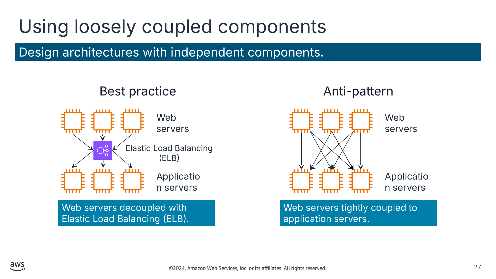

Design architectures with independent components. (Проєктуйте архітектури з незалежними компонентами.)

Текст зі схеми

Best practice (Найкраща практика)

Web servers (Вебсервери)

Elastic Load Balancing (ELB)

Application servers (Сервери застосунків)

Web servers decoupled with Elastic Load Balancing (ELB). (Вебсервери розділені за допомогою Elastic Load Balancing (ELB).)

Anti-pattern (Антишаблон)

Web servers

Application servers

Web servers tightly coupled to application servers. (Вебсервери жорстко зв’язані із серверами застосунків.)

> **Нотатки:**
>
> |Номер слайда 27  
> |Нотатки для інструктора  
> |  
> |Нотатки для студента  
> Традиційні інфраструктури мають ланцюги тісно інтегрованих серверів, кожен з яких має певне призначення. Проблема в тому, що коли один із цих компонентів чи рівнів виходить з ладу, порушення в системі може бути фатальним. Це також перешкоджає масштабуванню. Якщо ви додаєте чи видаляєте сервери на одному рівні, потрібно також підключити кожен сервер на кожному з’єднаному рівні.  
>
> Зі слабким зв’язуванням (loose coupling) ви використовуєте керовані рішення як посередників між рівнями вашої системи. За такого проєкту посередник автоматично обробляє як збої, так і масштабування компонентів чи рівнів.  
>
> Приклад ліворуч показує балансувальник навантаження. Тут це балансувальник навантаження Elastic Load Balancing (ELB), що маршрутизує запити між вебсерверами та серверами застосунків. Якщо один сервер застосунків виходить з ладу, балансувальник навантаження автоматично почне спрямовувати весь трафік до двох справних серверів.  
>
> Два основні рішення для розділення ваших компонентів — це балансувальники навантаження та черги повідомлень.  
>
> Приклад праворуч ілюструє набір вебсерверів і серверів застосунків, що тісно зв’язані. Якщо один сервер застосунків виходить з ладу, це спричинить помилку, оскільки вебсервери намагаються підключитися до нього й зазнають невдачі.

---

## Слайд 28: Проєктування сервісів, а не серверів (designing services, not servers)

Використовуйте всю широту сервісів AWS. Не обмежуйте свою інфраструктуру серверами.

- За потреби розгляньте використання контейнерів або безсерверного рішення.
- Черги повідомлень можуть обробляти обмін даними між застосунками.
- Статичні вебресурси можна зберігати поза сервером, наприклад в Amazon Simple Storage Service (Amazon S3).
- Автентифікацією користувачів і зберіганням стану користувачів можуть керувати керовані сервіси AWS.

> **Нотатки:**
>
> |Номер слайда 28  
> |Нотатки для інструктора  
> |Запитайте студентів, що може статися, якщо вони проєктують лише для серверів.  
> |  
> |Деякі приклади можливих антишаблонів включають:  
> |Прості застосунки працюють на постійних серверах.  
> |Застосунки обмінюються даними безпосередньо один з одним.  
> |Статичні вебресурси зберігаються локально на екземплярах.  
> |Бекенд-сервери обробляють автентифікацію користувачів і зберігання стану користувачів.  
> |  
> |Нотатки для студента  
> Наступна найкраща практика — проєктувати сервіси, а не сервери. Хоча Amazon EC2 пропонує величезну гнучкість для проєктування й налаштування вашого рішення, він не завжди має бути першим (чи єдиним) рішенням, яке ви використовуєте для кожної потреби. Іноді контейнери або безсерверне рішення можуть бути доречнішими. Тому важливо враховувати, які у вас потреби і яке рішення є доречним.  
>
> З безсерверними рішеннями AWS і керованими сервісами вам не потрібно розгортати, налаштовувати й керувати цілим екземпляром EC2.  
>
> Керовані рішення, що мають нижчий профіль і є продуктивнішими, можуть замінити серверні рішення за нижчою вартістю. Кілька прикладів: AWS Lambda, Amazon SQS, Amazon DynamoDB, ELB, Amazon Simple Email Service (Amazon SES) та Amazon Cognito.

---

## Слайд 29: Вибір правильного рішення для бази даних

Підбирайте технологію під робоче навантаження, а не навпаки.

- Потреби читання та запису
- Загальні вимоги до сховища
- Типовий розмір об’єкта та характер доступу до цих об’єктів
- Вимоги до довговічності
- Вимоги до затримки
- Максимальна кількість одночасних користувачів, яких потрібно підтримувати
- Характер запитів
- Необхідна сила засобів контролю цілісності

> **Нотатки:**
>
> |Номер слайда 29  
> |Нотатки для інструктора  
> |AWS має велику колекцію спеціалізованих (purpose-built) варіантів баз даних для різноманітних моделей даних. Може бути складно знати, яке рішення для бази даних найкраще підійде для вашого робочого навантаження.  
> |  
> |Докладніше див. «Вибір сервісу баз даних AWS» (Choosing an AWS Database Service) на сторінці ресурсів вмісту вашого онлайн-курсу.  
> |  
> |Нотатки для студента  
> Важливо обрати правильне рішення для бази даних. У традиційних центрах обробки даних і локальних (on-premises) середовищах обмеження наявного апаратного забезпечення та ліцензій можуть обмежувати ваш вибір рішення для сховища даних. AWS рекомендує обирати сховище даних на основі ваших потреб для середовища вашого застосунку.  
>
> Докладніше див. «Вибір сервісу баз даних AWS» на сторінці ресурсів вмісту вашого онлайн-курсу.

---

## Слайд 30: Уникнення єдиних точок відмови (single points of failure)

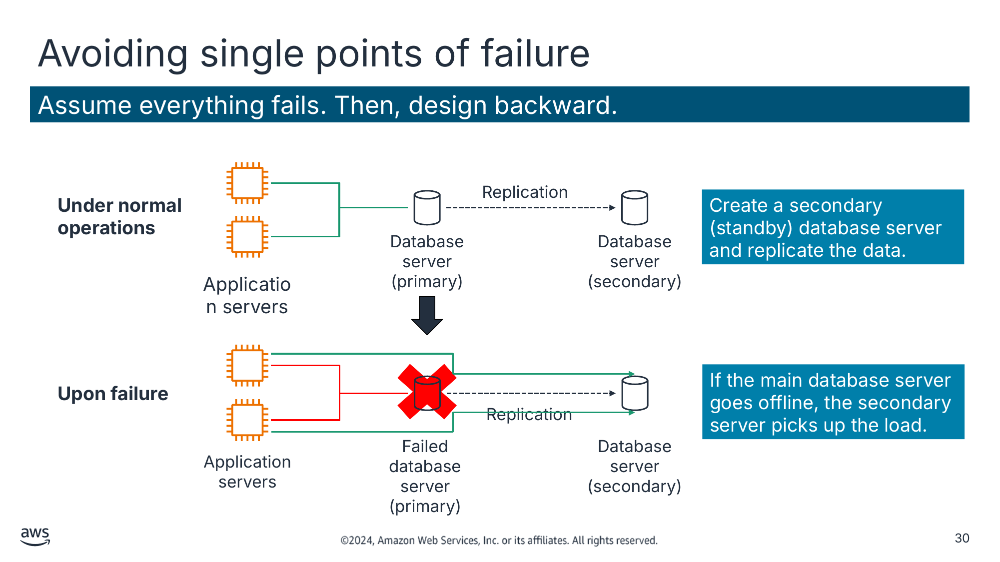

Assume everything fails. Then, design backward. (Виходьте з того, що все виходить з ладу. Потім проєктуйте у зворотному напрямку.)

Create a secondary (standby) database server and replicate the data. (Створіть вторинний (резервний, standby) сервер бази даних і реплікуйте дані.)

If the main database server goes offline, the secondary server picks up the load. (Якщо основний сервер бази даних виходить з ладу, вторинний сервер бере навантаження на себе.)

Текст зі схеми

Replication (Реплікація)

Database server (primary) (Сервер бази даних (основний))

Database server (secondary) (Сервер бази даних (вторинний))

Application servers (Сервери застосунків)

Replication

Failed database server (primary) (Несправний сервер бази даних (основний))

Database server (secondary)

Application servers

**Under normal operations (За нормальної роботи)**

**Upon failure (У разі збою)**

> **Нотатки:**
>
> |Номер слайда 30  
> |Нотатки для інструктора  
> |Покажіть або опишіть антишаблон простої системи з двома серверами застосунків, підключеними до одного сервера бази даних. Сервер бази даних є єдиною точкою відмови, і цього слід уникати. Коли він виходить з ладу, сервери застосунків також виходять з ладу.  
> |  
> |Нотатки для студента  
> Де можливо, усувайте єдині точки відмови зі своєї архітектури. Це не означає, що потрібно завжди дублювати кожен компонент. Залежно від ваших угод про рівень обслуговування (SLA) щодо простою, ви можете використовувати автоматизовані рішення, що запускають компоненти лише за потреби. Також можна використати кероване обслуговування, тож AWS автоматично замінює несправне базове апаратне забезпечення за вас.  
>
> Якщо два сервери застосунків підключені до одного сервера бази даних, сервер бази даних є єдиною точкою відмови, і цього слід уникати. Коли він виходить з ладу, сервери застосунків також виходять з ладу. Сервери застосунків мають продовжувати працювати, навіть якщо базове фізичне апаратне забезпечення виходить з ладу, його вилучають чи замінюють.  
>
> Поширений спосіб уникнути єдиних точок відмови — створити вторинний (резервний) сервер бази даних і реплікувати дані. Таким чином, якщо основний сервер бази даних виходить з ладу, вторинний сервер може взяти на себе навантаження.  
>
> У цьому прикладі, коли основна база даних виходить з ладу, сервери застосунків автоматично надсилають свої запити до вторинної бази даних. Цей приклад також ілюструє найкращу практику ставлення до ресурсів як до таких, що можна замінити, і проєктування ваших застосунків для підтримки змін в апаратному забезпеченні.

---

## Слайд 31: Оптимізація витрат

Скористайтеся гнучкістю AWS, щоб підвищити економічну ефективність.

- Чи мої ресурси мають правильний розмір і тип для завдання?
- Які метрики мені слід відстежувати?
- Як вимкнути ресурси, що не використовуються?
- Як часто мені потрібно буде використовувати цей ресурс?
- Чи можу я замінити будь-які свої сервери керованими сервісами?

> **Нотатки:**
>
> |Номер слайда 31  
> |Нотатки для інструктора  
> |Попросіть студентів визначити фіксовані та змінні витрати.  
> |  
> |Нотатки для студента  
> З хмарними обчисленнями можна обміняти фіксовані витрати на змінні. Фіксовані витрати — це кошти, які компанія використовує для придбання, оновлення та обслуговування фізичних активів, як-от нерухомість, промислові будівлі чи обладнання. За цією моделлю ви платите за сервери в центрі обробки даних незалежно від того, активні вони чи ні.  
>
> Натомість сервіси AWS використовують модель змінних витрат, що означає, що ви платите лише за окремі сервіси, які вам потрібні, і лише доти, доки ви їх використовуєте. У кожному сервісі можна оптимізувати витрати. Багато сервісів пропонують різні цінові рівні, моделі чи конфігурації.  
>
> Пам’ятайте: відтворити в хмарі налаштування локального центру обробки даних із серверами, що працюють 24/7, може бути дуже дорого. Тому найкращий спосіб побудувати економічно ефективну інфраструктуру — розгортати лише ті ресурси, які вам потрібні, і зупиняти сервіси, коли вони не використовуються.

---

## Слайд 32: Використання кешування (using caching)

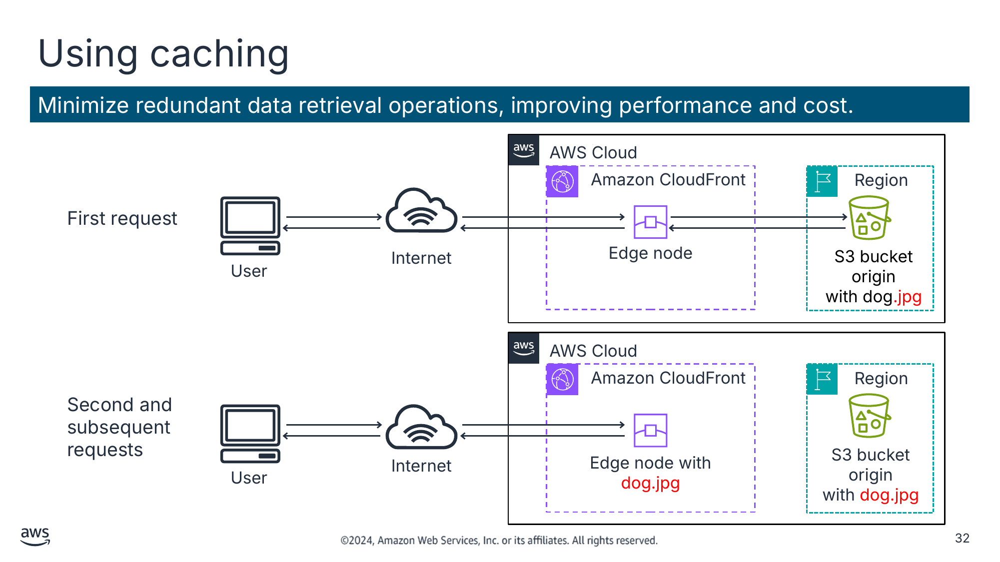

Minimize redundant data retrieval operations, improving performance and cost. (Мінімізуйте зайві операції отримання даних, покращуючи продуктивність і вартість.)

Текст зі схеми

AWS Cloud

Amazon CloudFront

Region (Регіон)

First request (Перший запит)

Edge node (Периферійний вузол)

S3 bucket origin

with dog.jpg (Початковий бакет S3 з dog.jpg)

User (Користувач)

Internet (Інтернет)

AWS Cloud

Amazon CloudFront

Region

Second and subsequent requests (Другий і наступні запити)

Edge node with dog.jpg (Периферійний вузол з dog.jpg)

S3 bucket origin

with dog.jpg

User

Internet

> **Нотатки:**
>
> |Номер слайда 32  
> |Нотатки для інструктора  
> |Попросіть студентів визначити кешування. Обговоріть антишаблон, коли сервіс кешування не використовується.  
> |  
> |Антишаблон: коли сервіс кешування не використовується, кожен запит користувача йде безпосередньо до бакета Amazon Simple Storage Service (Amazon S3). Це створює запити, кожен з яких потребує однакового часу на виконання й коштує однаково.  
> |  
> |Нотатки для студента  
> Кешування — це методика, що пришвидшує майбутні запити та зменшує мережеву пропускну здатність шляхом тимчасового зберігання даних у проміжному розташуванні між запитувачем і постійним сховищем. Основна мета кешу — підвищити продуктивність отримання даних, зменшивши потребу звертатися до базового повільнішого рівня зберігання. Майбутні запити даних із кешу обслуговуються швидше, ніж запити, що звертаються до основного розташування зберігання даних. Із кешуванням можна ефективно повторно використовувати раніше отримані або обчислені дані.  
>
> У прикладі інфраструктура використовує Amazon CloudFront перед Amazon S3 для кешування. У цьому сценарії початковий запит перевіряє наявність файлу в CloudFront. Якщо його не знайдено, CloudFront запитує файл в Amazon S3. Потім CloudFront зберігає копію файлу в периферійній локації поблизу користувача та надсилає копію користувачеві, який зробив запит.  
>
> Наступні запити файлу отримуються з (тепер ближчої) периферійної локації в CloudFront замість Amazon S3. Другий, третій і n-й запити мають нижчу затримку та вартість. Після першого запиту ви більше не платите за передавання файлу з Amazon S3.

---

## Слайд 33: Захист усієї вашої інфраструктури

Вбудовуйте безпеку на кожному рівні вашої інфраструктури.

- Використовуйте керовані сервіси.
- Журналюйте доступ до ресурсів.
- Ізолюйте частини вашої інфраструктури.
- Шифруйте дані під час передавання та в стані спокою.
- Забезпечуйте детальний контроль доступу, дотримуючись принципу найменших привілеїв.
- Використовуйте багатофакторну автентифікацію (MFA).
- Автоматизуйте свої розгортання, щоб безпека залишалася узгодженою.

> **Нотатки:**
>
> |Номер слайда 33  
> |Нотатки для інструктора  
> |Безпека — найвищий пріоритет в AWS. AWS спроєктовано як найбезпечнішу глобальну хмарну інфраструктуру для побудови, міграції та керування застосунками й робочими навантаженнями. Важливо, щоб студенти розуміли, як вбудовувати безпеку на кожному рівні інфраструктури.  
> |  
> |Докладніше див. «Безпека хмари AWS» (AWS Cloud Security) на сторінці ресурсів вмісту вашого онлайн-курсу.  
> |  
> |Нотатки для студента  
> Безпека — це не лише проходження зовнішньої межі вашої інфраструктури. Вона також включає забезпечення того, щоб ваші окремі середовища та їхні компоненти були захищені одне від одного.  
>
> Наприклад, в Amazon EC2 можна створювати групи безпеки, які можна використовувати, щоб визначити, які порти ваших екземплярів можуть надсилати й отримувати трафік. Групи безпеки також можуть визначати, звідки цей трафік може надходити чи куди він може йти.  
>
> Групи безпеки можна використовувати, щоб зменшити ймовірність того, що загроза безпеці на одному екземплярі поширюється на кожен інший екземпляр у вашому середовищі. Подібних заходів слід вживати й в інших сервісах. Конкретні способи впровадження цієї найкращої практики обговорюються протягом курсу.  
>
> Докладніше див. «Безпека хмари AWS» на сторінці ресурсів вмісту вашого онлайн-курсу.

---

## Слайд 34: Ключові висновки: найкращі практики побудови рішень в AWS

- Проєктуючи рішення, оцінюйте компроміси й базуйте свої рішення на емпіричних даних.
- Дотримуйтеся таких найкращих практик під час побудови рішень в AWS:
  - Упроваджуйте масштабованість.
  - Автоматизуйте своє середовище.
  - Ставтеся до ресурсів як до таких, що можна замінити.
  - Використовуйте слабко зв’язані компоненти.
  - Проєктуйте сервіси, а не сервери.
  - Обирайте правильне рішення для бази даних.
  - Уникайте єдиних точок відмови.
  - Оптимізуйте витрати.
  - Використовуйте кешування.
  - Захищайте всю свою інфраструктуру.

> **Нотатки:**
>
> |Номер слайда 34  
> |Нотатки для інструктора  
> |Версія для студентів не містить нотаток до цього слайда.  
> |  
> |Нотатки для студента

---

## Слайд 35: Глобальна інфраструктура AWS

Вступ до хмарної архітектури

> **Нотатки:**
>
> |Номер слайда 35  
> |Нотатки для інструктора  
> |  
> |Нотатки для студента  
> Цей розділ знайомить із глобальною інфраструктурою AWS.

---

## Слайд 36: Теми інфраструктури AWS

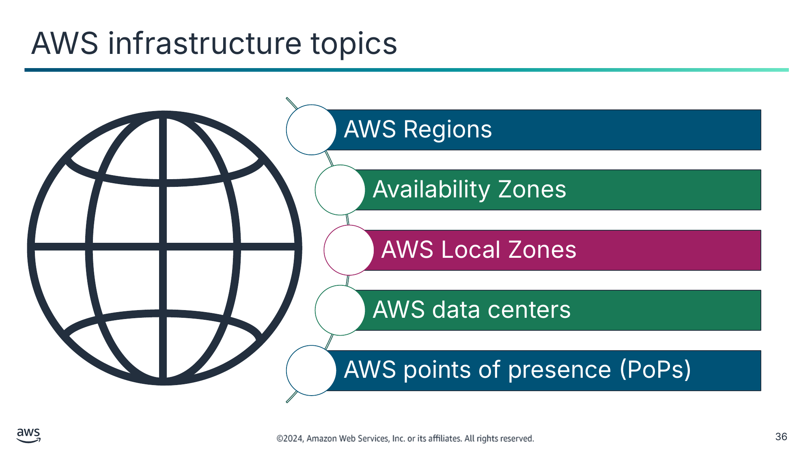

AWS Regions (Регіони AWS)

Availability Zones (Зони доступності)

AWS Local Zones (Локальні зони AWS)

AWS data centers (Центри обробки даних AWS)

AWS points of presence (PoPs) (Точки присутності AWS (PoP))

> **Нотатки:**
>
> |Номер слайда 36  
> |Нотатки для інструктора  
> |AWS має найбільший глобальний інфраструктурний слід серед усіх постачальників, і цей слід постійно зростає значними темпами. Перегляньте сторінку глобальної інфраструктури AWS (AWS Global Infrastructure) для актуальних даних про регіони, зони доступності та точки присутності (PoP). Докладніше див. «Глобальна інфраструктура AWS» на сторінці ресурсів вмісту вашого онлайн-курсу.  
> |  
> |Нотатки для студента  
> Глобальна хмарна інфраструктура AWS — це безпечна, розгалужена та надійна хмарна платформа, що пропонує понад 200 повнофункціональних сервісів із центрів обробки даних по всьому світу. Хмарна інфраструктура AWS охоплює 102 зони доступності в 32 географічних регіонах світу. Це дає вам змогу запускати високодоступні, масштабовані та гнучкі архітектури поблизу ваших клієнтів для нижчої затримки та підвищеної продуктивності.  
>
> Проєктуючи та будуючи архітектури, потрібно враховувати, у якому регіоні їх розгортати. Регіон AWS — це фізичне географічне розташування з двома або більше зонами доступності. Зони доступності, своєю чергою, складаються з одного чи кількох центрів обробки даних. Ваші рішення мають ґрунтуватися на бізнес-вимогах і потребах робочого навантаження.  
>
> Наприклад, якщо низька затримка є вимогою для вашого робочого навантаження, слід розглянути використання точок присутності AWS (PoP) або регіональних периферійних кешів. Мережа PoP AWS розташована на межі мережі для зменшення затримки. Використання цих периферійних локацій тримає ваші популярні дані поблизу ваших клієнтів.  
>
> У цьому розділі ви дізнаєтеся про інфраструктуру AWS, зокрема про регіони, зони доступності, локальні зони AWS (Local Zones), центри обробки даних AWS і PoP AWS.  
>
> Докладніше про інфраструктуру в AWS див. «Глобальна інфраструктура AWS» на сторінці ресурсів вмісту вашого онлайн-курсу.

---

## Слайд 37: Вибір регіонів (selecting Regions)

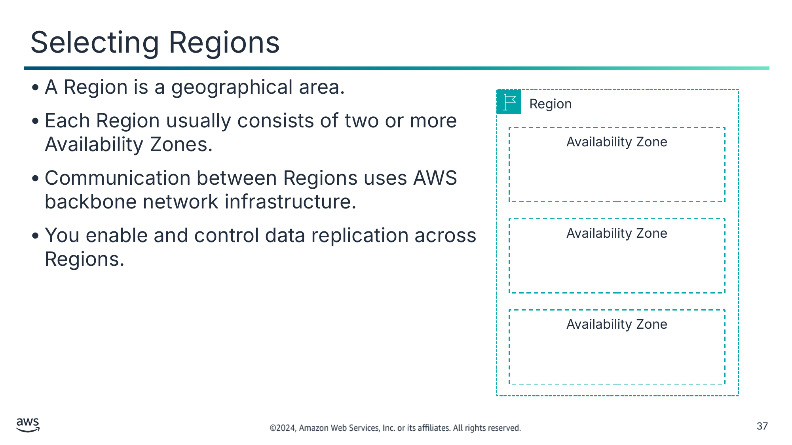

- Регіон — це географічна територія.
- Кожен регіон зазвичай складається з двох або більше зон доступності.
- Обмін даними між регіонами використовує магістральну мережеву інфраструктуру AWS (AWS backbone network).
- Ви вмикаєте та контролюєте реплікацію даних між регіонами.

Текст зі схеми

Region (Регіон)

Availability Zone (Зона доступності)

Availability Zone

Availability Zone

> **Нотатки:**
>
> |Номер слайда 37  
> |Нотатки для інструктора  
> |  
> |Нотатки для студента  
> Регіон — це фізичне географічне розташування з двома або більше зонами доступності. Зони доступності, своєю чергою, складаються з одного чи кількох центрів обробки даних.  
>
> Регіони підключені до кількох інтернет-провайдерів (ISP). Регіони також підключені до приватної глобальної мережевої магістралі, що забезпечує нижчу вартість і стабільнішу міжрегіональну мережеву затримку порівняно з публічним інтернетом.  
>
> Регіони, запроваджені до 20 березня 2019 року, увімкнено за замовчуванням. Регіони, запроваджені після 20 березня 2019 року — як-от Азійсько-Тихоокеанський (Гонконг) і Близький Схід (Бахрейн), — вимкнено за замовчуванням. Ці регіони потрібно ввімкнути, перш ніж ними можна користуватися. Для ввімкнення чи вимкнення регіону можна використовувати AWS Management Console.  
>
> Деякі регіони мають обмежений доступ. Ізольовані регіони AWS GovCloud (US) розроблено, щоб дозволити урядовим установам і клієнтам США переносити чутливі робочі навантаження в хмару, враховуючи їхні специфічні регуляторні вимоги та вимоги відповідності.  
>
> Щоб досягти відмовостійкості та стабільності, регіони ізольовані один від одного. Ресурси в одному регіоні не реплікуються автоматично в інші регіони. Коли ви зберігаєте дані в конкретному регіоні, вони не реплікуються за межі цього регіону. Ви самі відповідаєте за реплікацію даних між регіонами, якщо цього потребують ваші бізнес-потреби. AWS надає інформацію про країну та — де застосовно — штат, де розташований кожен регіон. Ви самі відповідаєте за вибір регіону, де слід зберігати дані, на основі ваших вимог відповідності та мережевої затримки.  
>
> Продукти й сервіси AWS доступні за регіонами, тож у вас може не бути доступу до всіх регіонів, наявних для певного сервісу.

---

## Слайд 38: Вибір зон доступності (selecting Availability Zones)

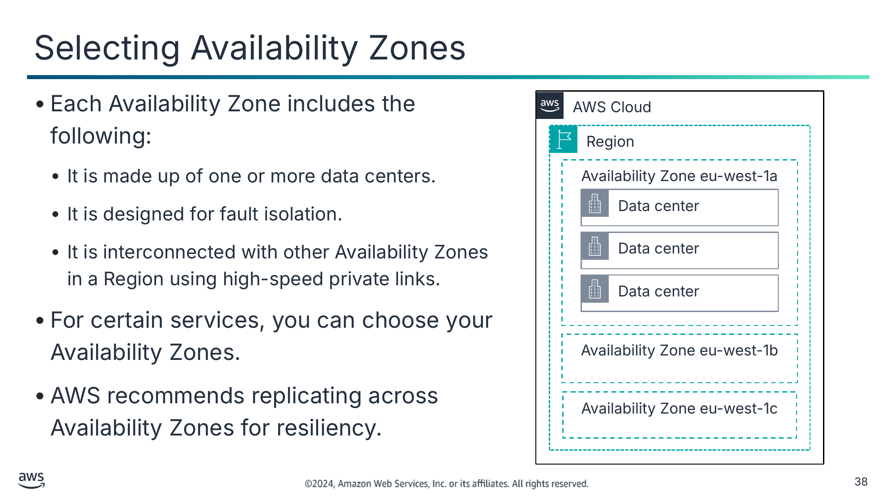

- Кожна зона доступності включає таке:
  - Складається з одного або кількох центрів обробки даних.
  - Розроблена для ізоляції збоїв.
  - З’єднана з іншими зонами доступності в регіоні за допомогою високошвидкісних приватних ліній.
- Для певних сервісів ви можете обирати свої зони доступності.
- AWS рекомендує реплікацію між зонами доступності для забезпечення стійкості.

Текст зі схеми

AWS Cloud

Region (Регіон)

Availability Zone eu-west-1a (Зона доступності eu-west-1a)

Data center (Центр обробки даних)

Data center

Data center

Availability Zone eu-west-1b

Availability Zone eu-west-1c

> **Нотатки:**
>
> |Номер слайда 38  
> |Нотатки для інструктора  
> |  
> |Нотатки для студента  
> Кожен регіон складається з двох або більше ізольованих розташувань, що називаються зонами доступності. Кожна зона доступності включає один чи кілька центрів обробки даних, причому деякі зони доступності мають до шести центрів обробки даних. Однак жоден центр обробки даних не може бути частиною двох зон доступності.  
>
> Кожну зону доступності спроєктовано як незалежну зону збоїв. Це означає, що зони доступності фізично розділені в типовому мегаполісному регіоні. Вони також розташовані в заплавах із нижчим ризиком (конкретна категоризація зон затоплення залежить від регіону). Зони доступності мають окреме безперебійне джерело живлення та резервні генератори на місці. Крім того, кожну з них живлять різні мережі від незалежних постачальників комунальних послуг, щоб ще більше зменшити єдині точки відмови. Усі зони доступності надлишково підключені до кількох транзитних провайдерів першого рівня (tier-1).  
>
> Зона доступності — це найдетальніший рівень специфікації, який можна зробити для певних сервісів, як-от Amazon EC2.  
>
> Ви самі відповідаєте за вибір зон доступності, де розміщуватимуться ваші системи. Системи можуть охоплювати кілька зон доступності. Слід проєктувати свої системи так, щоб вони витримували тимчасову чи тривалу відмову зони доступності в разі катастрофи. Розподіл застосунків між кількома зонами доступності означає, що вони можуть залишатися стійкими в більшості ситуацій збоїв, зокрема стихійних лих чи системних збоїв.

---

## Слайд 39: Використання локальних зон (Local Zones)

- Локальні зони дають вам змогу запускати чутливі до затримки частини застосунків ближче до кінцевих користувачів і ресурсів у певній географії.
- Вони є розширенням регіону.
- З локальними зонами ви можете розміщувати обчислення, сховища, бази даних та інші вибрані сервіси AWS ближче до великих центрів населення, промисловості та ІТ, де сьогодні немає регіонів.
- Локальними зонами керує та підтримує їх AWS.

> **Нотатки:**
>
> |Номер слайда 39  
> |Нотатки для інструктора  
> |Докладніше див. «Локальні зони AWS» (AWS Local Zones) на сторінці ресурсів вмісту вашого онлайн-курсу.  
> |  
> |Нотатки для студента  
> Локальні зони — це тип розгортання інфраструктури AWS. Вони розміщують обчислення, сховища, бази даних та інші вибрані сервіси AWS ближче до великих центрів населення, промисловості та ІТ, де сьогодні немає регіонів. З локальними зонами ви можете запускати чутливі до затримки частини застосунків ближче до кінцевих користувачів і ресурсів у певній географії. Локальні зони можна використовувати для забезпечення затримки в одиниці мілісекунд для таких сценаріїв, як створення медійного й розважального контенту, ігри в реальному часі, симуляції родовищ, автоматизація проєктування електроніки та машинне навчання (ML).  
>
> Кожна локація локальної зони є розширенням регіону. Ви можете запускати чутливі до затримки застосунки в локальній зоні за допомогою сервісів AWS, як-от Amazon EC2, Amazon Virtual Private Cloud (Amazon VPC), Amazon Elastic Block Store (Amazon EBS), Amazon FSx і ELB, у географічній близькості до кінцевих користувачів. Локальні зони забезпечують високошвидкісне захищене з’єднання між локальними робочими навантаженнями та робочими навантаженнями, що працюють у регіоні. З локальними зонами ви можете безперебійно підключатися назад до своїх інших робочих навантажень, що працюють в AWS. Ви можете підключатися до повного спектра сервісів у регіоні через ті самі API та набори інструментів.  
>
> Локальними зонами керує та підтримує їх AWS, і вони надають вам усі переваги хмари щодо еластичності, масштабованості та безпеки. З локальними зонами ви можете будувати й розгортати чутливі до затримки застосунки ближче до ваших кінцевих користувачів за допомогою узгодженого набору сервісів AWS. Ви також можете масштабувати вгору чи вниз і платите лише за ресурси, які використовуєте.  
>
> Докладніше див. «Локальні зони AWS» на сторінці ресурсів вмісту вашого онлайн-курсу.

---

## Слайд 40: Роль центрів обробки даних AWS

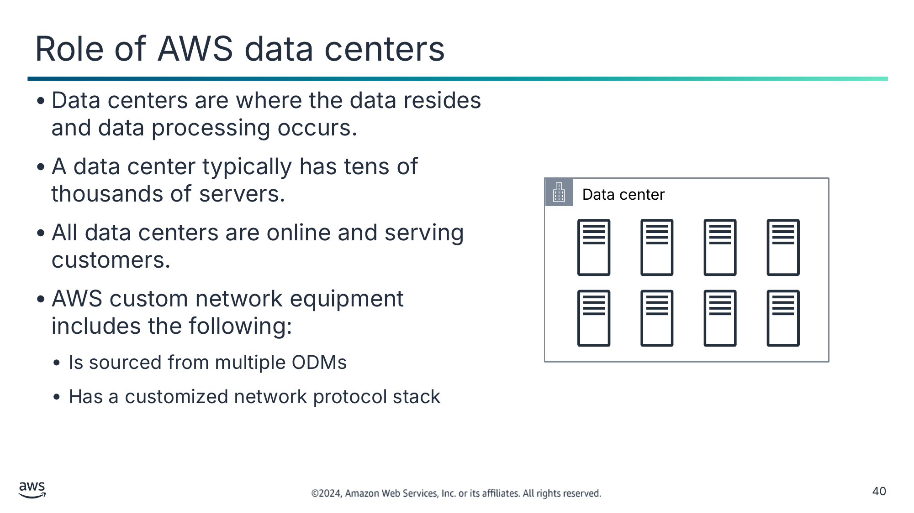

- Центри обробки даних — це місце, де розташовані дані та відбувається їх обробка.
- Центр обробки даних зазвичай має десятки тисяч серверів.
- Усі центри обробки даних працюють онлайн та обслуговують клієнтів.
- Власне мережеве обладнання AWS включає таке:
  - Закуповується в кількох ODM
  - Має налаштований стек мережевих протоколів

Текст зі схеми

Data center (Центр обробки даних)

> **Нотатки:**
>
> |Номер слайда 40  
> |Нотатки для інструктора  
> |  
> |Нотатки для студента  
> Основою інфраструктури AWS є центри обробки даних. Ви не вказуєте центр обробки даних для розгортання ресурсів. Однак центр обробки даних — це місце, де фактично розташовані дані. Amazon експлуатує найсучасніші, високодоступні центри обробки даних. Хоча це трапляється рідко, можуть виникати збої, що впливають на доступність екземплярів в одному розташуванні. Якщо ви розміщуєте всі свої екземпляри в одному розташуванні, на яке впливає такий збій, жоден із ваших екземплярів не буде доступним.  
>
> Усі центри обробки даних працюють онлайн і обслуговують клієнтів. У разі збою автоматизовані процеси переміщують трафік даних клієнтів подалі від постраждалої області. Основні застосунки розгортаються в конфігурації N+1. У разі збою центру обробки даних є достатньо потужностей, щоб трафік міг бути збалансований на решту майданчиків.  
>
> AWS використовує спеціальне мережеве обладнання, закуплене в кількох виробників оригінальних пристроїв за контрактом (original device manufacturers, ODM). ODM проєктують і виготовляють продукти на основі специфікацій другої компанії. Друга компанія потім змінює бренд продуктів для продажу.

---

## Слайд 41: PoP AWS

Edge location (Периферійна локація)

Regional edge cache (Регіональний периферійний кеш)

AWS data centers and servers located close to customers and designed to deliver services with the lowest latency possible (Центри обробки даних і сервери AWS, розташовані поблизу клієнтів і призначені для надання сервісів із найнижчою можливою затримкою)

AWS data centers between the origin server and the edge location that have a longer cache (Центри обробки даних AWS між початковим сервером і периферійною локацією, що мають довший кеш)

> **Нотатки:**
>
> |Номер слайда 41  
> |Нотатки для інструктора  
> |Порівняйте та протиставте типи PoP AWS. Докладніше див. «Точки присутності» (Points of Presence) на сторінці ресурсів вмісту вашого онлайн-курсу.  
> |  
> |Нотатки для студента  
> Щоб доставляти контент кінцевим користувачам із нижчою затримкою, CloudFront використовує глобальну мережу, що включає понад 410 PoP. PoP складаються з 400 периферійних локацій і 13 регіональних кешів середнього рівня (regional mid-tier caches). Ці PoP є початковим пунктом призначення запиту CloudFront.  
>
> Периферійні локації гарантують, що популярний контент можна швидко подавати клієнтам. Регіональні периферійні кеші наближають більше вашого контенту до клієнтів, навіть якщо він недостатньо популярний, щоб залишатися в периферійній локації. Це допомагає зменшити затримку для клієнтів. Регіональні периферійні кеші підвищують ефективність і прозорі для кінцевого користувача.  
>   
> Периферійні локації розташовані в Північній Америці, Європі, Азії, Австралії, Південній Америці, на Близькому Сході, в Африці та Китаї. Периферійні локації підтримують сервіси AWS, як-от Amazon Route 53, AWS Global Accelerator і CloudFront.  
>
> Регіональні периферійні кеші використовуються за замовчуванням з CloudFront. Вони використовуються, коли у вас є контент, до якого звертаються недостатньо часто, щоб він залишався в периферійній локації. Регіональні периферійні кеші приймають цей контент і надають альтернативу тому, щоб цей контент доводилось отримувати з початкового сервера (origin server).  
>
> Докладніше див. «Точки присутності» на сторінці ресурсів вмісту вашого онлайн-курсу.

---

## Слайд 42: Ключові висновки: глобальна інфраструктура AWS

- Глобальна інфраструктура AWS складається з регіонів, зон доступності та периферійних локацій.
- Ваш вибір регіону зазвичай ґрунтується на вимогах відповідності або на потребі зменшити затримку.
- Кожна зона доступності фізично відокремлена від інших зон доступності та має резервне живлення, мережу й підключення.
- Периферійні локації та регіональні периферійні кеші покращують продуктивність, кешуючи контент ближче до користувачів.

> **Нотатки:**
>
> |Номер слайда 42  
> |Нотатки для інструктора  
> |Версія для студентів не містить нотаток до цього слайда.  
> |  
> |Нотатки для студента

---

## Слайд 43: Підсумки модуля

Вступ до хмарної архітектури

> **Нотатки:**
>
> |Номер слайда 43  
> |Нотатки для інструктора  
> |  
> |Нотатки для студента  
> Настав час повторити матеріал модуля й завершити його перевіркою знань.

---

## Слайд 44: Резюме модуля

Цей модуль підготував вас до такого:

- Визначати хмарну архітектуру.
- Описувати, як проєктувати та оцінювати архітектури за допомогою AWS Well-Architected Framework.
- Пояснювати найкращі практики побудови рішень в AWS.
- Описувати, як ухвалювати обґрунтовані рішення щодо розміщення ресурсів AWS.

> **Нотатки:**
>
> |Номер слайда 44  
> |Нотатки для інструктора  
> |Версія для студентів не містить нотаток до цього слайда.  
> |  
> |Нотатки для студента

---

## Слайд 45: Перевірка знань модуля

- Перевірка знань проводиться онлайн у вашому курсі.
- Перевірка знань включає 10 запитань на основі матеріалу, поданого на слайдах і в нотатках до слайдів.
- Ви можете повторно проходити перевірку знань стільки разів, скільки захочете.

> **Нотатки:**
>
> |Номер слайда 45  
> |Нотатки для інструктора  
> |  
> |Нотатки для студента  
> Скористайтеся своїм онлайн-курсом, щоб отримати доступ до перевірки знань для цього модуля.

---

## Слайд 46: Дякуємо

Виправлення, відгуки чи інші запитання?

Зв’яжіться з нами за адресою [https://support.aws.amazon.com/#/contacts/aws-academy](https://support.aws.amazon.com/#/contacts/aws-academy).

> **Нотатки:**
>
> |Номер слайда 46  
> |Нотатки для інструктора  
> |  
> |Нотатки для студента  
> На цьому цей модуль завершено. Сторінка ресурсів вмісту вашого курсу містить посилання на додаткові ресурси, пов’язані з цим модулем.
