## Слайд 1: Захист доступу (Securing Access)

AWS Academy Cloud Architecting

> **Нотатки:**
>
> |Номер слайда 1  
> |Нотатки для інструктора  
> |Вміст цього модуля розглядається в курсі AWS Academy Cloud Foundations і має бути повторенням для студентів цього курсу. Ви можете розглядати цей модуль як необов’язковий або попросити студентів повторити його самостійно у вільний час залежно від потреб конкретного класу.  
> |  
> |Нотатки для студента  
> Вітаємо в модулі «Захист доступу». Цей модуль повторює ключові принципи та концепції безпеки для захисту доступу до ваших хмарних ресурсів.

---

## Слайд 2: Вступ

Захист доступу

> **Нотатки:**
>
> |Номер слайда 2  
> |Нотатки для інструктора  
> |  
> |Нотатки для студента  
> Цей вступний розділ описує вміст модуля.

---

## Слайд 3: Цілі модуля

Цей модуль готує вас до такого:

- Описувати принципи безпеки в хмарі AWS.
- Пояснювати призначення користувачів, груп і ролей AWS Identity and Access Management (IAM).
- Пояснювати, як політики IAM визначають дозволи в акаунті AWS.

> **Нотатки:**
>
> |Номер слайда 3  
> |Нотатки для інструктора  
> |  
> |Нотатки для студента  
> Цей модуль повторює ключові концепції, пов’язані з безпекою в хмарі Amazon Web Services (AWS). Це включає принципи безпеки хмари та використання користувачів, груп, ролей і політик AWS Identity and Access Management (IAM) для захисту доступу до хмарних ресурсів.

---

## Слайд 4: Огляд модуля

**Розділи презентації**

- Принципи безпеки
- Автентифікація та захист доступу
- Авторизація користувачів
- Частини політики IAM

**Практична вправа**

- Вивчення політик IAM (Examining IAM Policies)

**Перевірки знань**

- Перевірка знань
- Зразок запитання іспиту

> **Нотатки:**
>
> |Номер слайда 4  
> |Нотатки для інструктора  
> |Кожен модуль має вступ, розділи з вмістом і підсумок. Підсумок цього модуля містить зразок запитання іспиту для розбору зі студентами.  
> |  
> |Нотатки для студента  
> Цілі цього модуля розкриваються в кількох розділах.  
>
> Ви також візьмете участь у практичній вправі з вивчення політик IAM та відповідатимете на запитання про доступ, який надають ці політики.  
>
> Модуль завершується зразком запитання іспиту та онлайн-перевіркою знань, що охоплює подані матеріали.  
> Лабораторну роботу цього модуля описано на наступному слайді.

---

## Слайд 5: Практичні лабораторні роботи в цьому модулі

Покрокова лабораторна робота (Guided lab)

- Вивчення AWS Identity and Access Management (IAM) (Exploring AWS Identity and Access Management)

> **Нотатки:**
>
> |Номер слайда 5  
> |Нотатки для інструктора  
> |Цей модуль містить покрокові лабораторні роботи (guided labs). Ці лабораторні роботи надають інструкції крок за кроком і є самодостатніми. Вони не залежать від сценарію з кафе чи пов’язаної архітектури. Вступи до кожної лабораторної роботи містяться в розділах лабораторних робіт у межах модуля.  
> |  
> |Нотатки для студента  
> Цей модуль містить зазначену покрокову лабораторну роботу. Додаткова інформація про цю лабораторну роботу міститься в посібнику студента там, де вона виконується, а докладні інструкції надаються в лабораторному середовищі.

---

## Слайд 6: Як хмарний архітектор:

- Мені потрібно застосовувати найкращі практики безпеки, коли я надаю доступ до хмарних ресурсів, щоб мінімізувати ризик небажаного доступу на кожному рівні архітектури.


> **Нотатки:**
>
> |  
> |Нотатки для інструктора: цей слайд подає ключові наскрізні міркування проєктування, що мають спрямовувати ухвалення рішень для цього рівня хмарної архітектури. Підкресліть, що хмарний архітектор завжди має починати з бізнес-кейсу й рухатися у зворотному напрямку, щоб обрати найкращі компоненти для цього сценарію використання. Також нагадайте студентам, що рішення, імовірно, еволюціонуватимуть з часом для оптимізації вартості та продуктивності в міру зміни чи кращого розуміння потреб. Наприкінці модуля в підсумковому розділі включено необов’язкове обговорення, що спонукає студентів розглянути ці чинники в контексті сценарію з кафе.  
> |  
> |Нотатки для студента  
> Цей слайд просить вас прийняти перспективу хмарного архітектора, коли ви думаєте про те, як захистити доступ до ваших хмарних ресурсів. Тримайте ці міркування в голові, просуваючись цим модулем. Пам’ятайте, що хмарний архітектор має працювати у зворотному напрямку від бізнес-потреби, щоб спроєктувати найкращу архітектуру для конкретного сценарію використання. Просуваючись модулем, розглядайте сценарій з кафе в курсі як приклад бізнес-потреби й думайте про те, як би ви відповіли на ці потреби.

---

## Слайд 7: Принципи безпеки

Захист доступу

> **Нотатки:**
>
> |Номер слайда 7  
> |Нотатки для інструктора  
> |Цей матеріал розглядається коротко й має бути повторенням концепцій курсу Cloud Foundations. Ви можете заглибитися в ці теми глибше залежно від того, коли ваші студенти проходили той курс.  
> |  
> |Нотатки для студента  
> Цей розділ повторює такі принципи, що є важливими для захисту ваших архітектур AWS:  
> Враховуйте модель спільної відповідальності AWS (AWS shared responsibility model), визначаючи, як потрібно застосовувати безпеку до ваших хмарних архітектур.  
> Використовуйте опору безпеки (security pillar) AWS Well-Architected Framework, щоб визначити принципи проєктування, що застосовуються до ваших архітектур.  
> Завжди застосовуйте принцип найменших привілеїв (principle of least privilege) під час захисту ваших ресурсів AWS.

---

## Слайд 8: Модель спільної відповідальності AWS

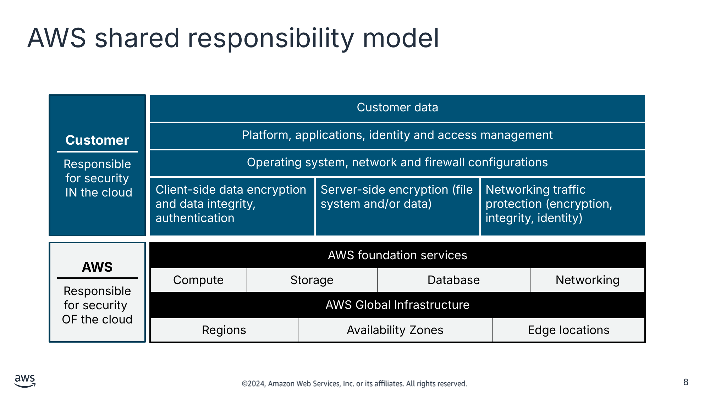

**Customer (Клієнт)**

Responsible for security  
 IN the cloud (Відповідає за безпеку В хмарі)

**Customer data (Дані клієнта)**

| Platform, applications, identity and access management: Operating system, network and firewall configurations (Платформа, застосунки, керування ідентичністю та доступом: конфігурації операційної системи, мережі та брандмауера) | Platform, applications, identity and access management (Платформа, застосунки, керування ідентичністю та доступом) | Platform, applications, identity and access management (Платформа, застосунки, керування ідентичністю та доступом) |
|---|---|---|
| Client-side data encryption and data integrity, authentication (Шифрування даних на стороні клієнта та цілісність даних, автентифікація) | Server-side encryption (file system and/or data) (Серверне шифрування (файлова система та/або дані)) | Networking traffic protection (encryption, integrity, identity) (Захист мережевого трафіку (шифрування, цілісність, ідентичність)) |

**AWS**

Responsible for security  
OF the cloud (Відповідає за безпеку САМОЇ хмари)

**AWS foundation services (Базові сервіси AWS)**

| Compute: AWS Global Infrastructure (Обчислення: глобальна інфраструктура AWS) | Storage (Сховище) | Storage | Database (Бази даних) | Database | Networking (Мережі) |
|---|---|---|---|---|---|
| Regions (Регіони) |  | Availability Zones (Зони доступності) |  | Edge locations (Периферійні локації) |  |

> **Нотатки:**
>
> |Номер слайда 8  
> |Нотатки для інструктора  
> |  
> |Нотатки для студента  
> Опис зображення: модель спільної відповідальності з обов’язками клієнта й AWS. Клієнт відповідає за безпеку в хмарі. Це включає дані клієнта. Платформу, застосунки, керування ідентичністю та доступом. Конфігурації операційної системи, мережі та брандмауера. Шифрування даних на стороні клієнта та цілісність даних, автентифікацію. Серверне шифрування файлової системи та даних. Захист мережевого трафіку, що включає шифрування, цілісність та ідентичність. AWS відповідає за безпеку самої хмари. Це включає базові сервіси AWS для обчислень, зберігання, баз даних і мереж, а також глобальну інфраструктуру AWS, що включає регіони, зони доступності та периферійні локації. Кінець опису.  
>
> Безпека та відповідність вимогам — це спільні обов’язки AWS і наших клієнтів. AWS експлуатує, обслуговує та контролює безпеку самої хмари. Ця відповідальність включає захист компонентів — від хостової операційної системи та рівня віртуалізації до фізичної безпеки приміщень, у яких працюють сервіси. AWS відповідає за захист глобальної інфраструктури, на якій працюють усі сервіси, що пропонуються в хмарі AWS. Ця інфраструктура складається з апаратного забезпечення, програмного забезпечення, мереж і приміщень, на яких працюють хмарні сервіси AWS.  
>
> Ви берете на себе відповідальність і керування в хмарі. Кроки безпеки, які потрібно виконати, залежать від сервісів, що ви використовуєте, і складності вашої системи. Обов’язки клієнта включають вибір і захист операційних систем, що працюють на екземплярах Amazon Elastic Compute Cloud (Amazon EC2), та захист застосунків, запущених на ресурсах AWS. Клієнти також мають вибирати й виконувати конфігурацію груп безпеки, брандмауерів і мереж. Клієнти також відповідають за керування акаунтами та їхніми даними, зокрема варіантами шифрування.

---

## Слайд 9: Безпека — це опора Well-Architected Framework

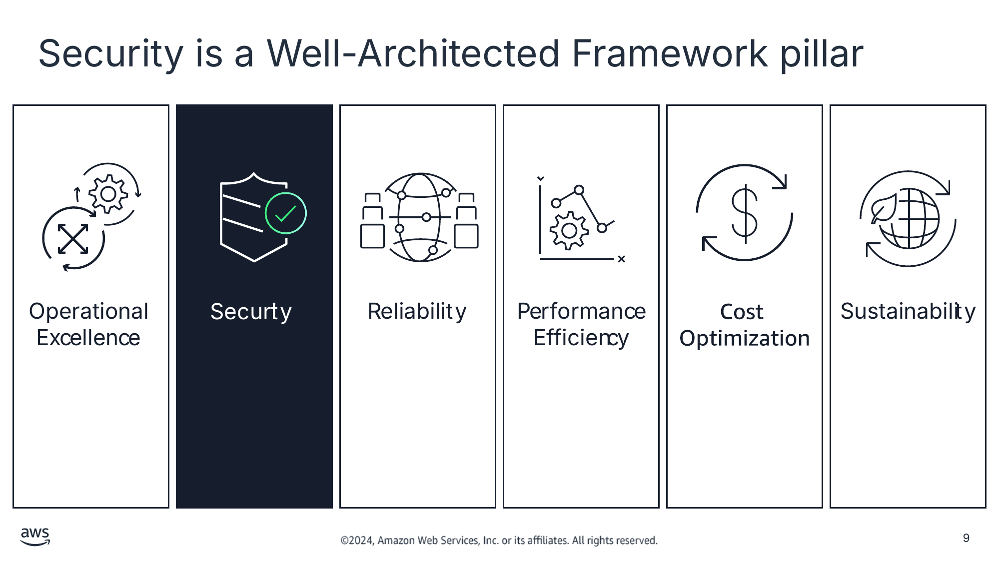

> **Нотатки:**
>
> |Номер слайда 9  
> |Нотатки для інструктора  
> |Пропозиція: покажіть студентам, де знайти інформацію про безпеку для AWS Well-Architected Framework та додаток із запитаннями й найкращими практиками. Прямі посилання надано на сторінці ресурсів вмісту онлайн-курсу.  
> |  
> |Нотатки для студента  
> Курс AWS Academy Cloud Foundations знайомив із Well-Architected Framework. Вам може бути корисно відкрити вебсайт зараз, щоб подивитися, як організовано опори.  
>
> Безпека — одна з шести опор фреймворку. Інші опори — операційна досконалість, надійність, ефективність продуктивності, оптимізація витрат і сталість. Фреймворк надає найкращі практики та настанови з проєктування для кожної опори, щоб допомогти вам робити вибір і переглядати наявні архітектури.  
>
> Ви можете використовувати AWS Well-Architected Tool, щоб допомогти впровадити найкращі практики, що є частиною Well-Architected Framework. AWS WA Tool — це інструмент самообслуговування, що надає вам доступ за запитом до поточних найкращих практик AWS. Ці найкращі практики можуть допомогти вам побудувати рішення, що відповідають принципам проєктування безпеки well-architected, а також принципам проєктування, пов’язаним з іншими опорами.  
>
> Посилання на сайт AWS Well-Architected Framework і на додаток із запитаннями та найкращими практиками, що можуть допомогти дотримуватися фреймворку, надано на сторінці ресурсів вмісту вашого онлайн-курсу.

---

## Слайд 10: Принципи проєктування для опори безпеки

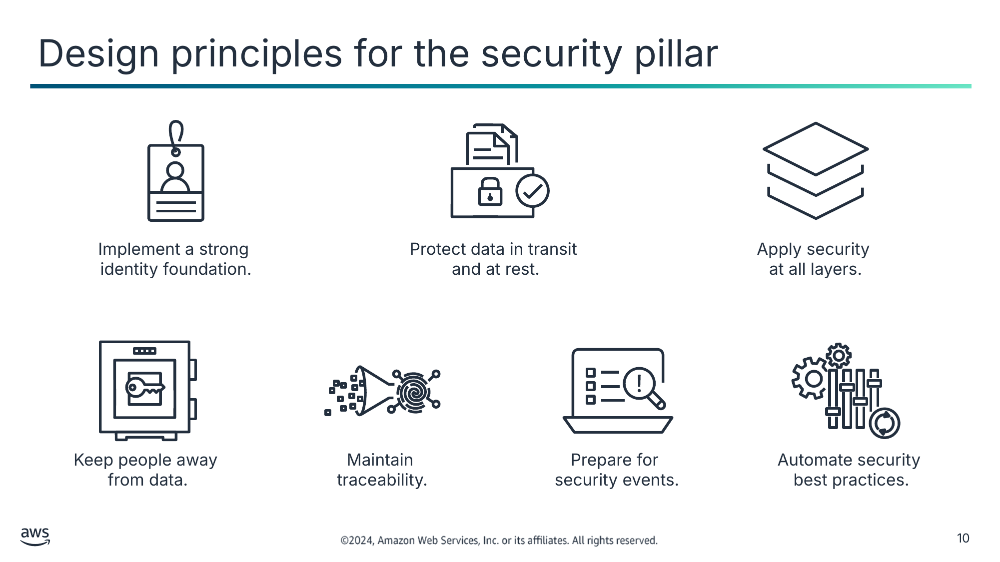

Implement a strong  
identity foundation. (Запровадьте сильну основу ідентичності.)

Protect data in transit  
and at rest. (Захищайте дані під час передавання та в стані спокою.)

Apply security  
at all layers. (Застосовуйте безпеку на всіх рівнях.)

Keep people away  
from data. (Тримайте людей подалі від даних.)

Maintain  
traceability. (Забезпечте відстежуваність.)

Prepare for  
security events. (Готуйтеся до подій безпеки.)

Automate security  
best practices. (Автоматизуйте найкращі практики безпеки.)

> **Нотатки:**
>
> |Номер слайда 10  
> |Нотатки для інструктора  
> |Опора безпеки стосується здатності захищати інформацію, системи та активи, забезпечуючи бізнес-цінність за допомогою оцінювання ризиків і стратегій їх пом’якшення. Цей модуль не охоплює всіх цих принципів проєктування, але виділяє ключові аспекти обмеження доступу до ресурсів, зокрема розглядає надання доступу та захист даних у стані спокою та під час передавання.  
> |  
> |Нотатки для студента  
> Ваша архітектура матиме значно сильнішу присутність безпеки, якщо ви дотримуватиметеся цих принципів проєктування з опори безпеки Well-Architected Framework:  
> Запровадьте сильну основу ідентичності: впровадьте принцип найменших привілеїв і забезпечте розподіл обов’язків із відповідною авторизацією для кожної взаємодії з вашими ресурсами AWS. Централізуйте керування ідентичністю та прагніть усунути залежність від довгострокових статичних облікових даних.  
> Захищайте дані під час передавання та в стані спокою: класифікуйте свої дані за рівнями чутливості й використовуйте механізми, як-от шифрування, токенізація та контроль доступу, де це доречно.  
> Застосовуйте безпеку на всіх рівнях: застосовуйте підхід глибокоешелонованого захисту (defense in depth) з кількома засобами контролю безпеки та застосовуйте його до всіх рівнів (наприклад, периферія мережі, віртуальна приватна хмара [VPC], балансування навантаження, кожен екземпляр і обчислювальний сервіс, операційна система, застосунок і код).  
> Тримайте людей подалі від даних: використовуйте механізми та інструменти, щоб зменшити або усунути потребу в прямому доступі чи ручній обробці даних. Це зменшує ризик неправильного поводження, зміни та людської помилки під час роботи з чутливими даними.  
> Забезпечте відстежуваність: відстежуйте, сповіщайте й перевіряйте (audit) дії та зміни у вашому середовищі в реальному часі. Інтегруйте збирання журналів і метрик із системами, щоб автоматично розслідувати та вживати заходів.  
> Готуйтеся до подій безпеки: підготуйтеся до інциденту, маючи політики та процеси керування інцидентами й розслідування, що відповідають вимогам вашої організації. Проводьте симуляції реагування на інциденти та використовуйте інструменти з автоматизацією, щоб збільшити швидкість виявлення, розслідування та відновлення.  
> Автоматизуйте найкращі практики безпеки: автоматизовані програмні механізми безпеки покращують вашу здатність безпечно масштабуватися швидше та економічніше. Створюйте безпечні архітектури, що включає впровадження засобів контролю, визначених і керованих як код у шаблонах під контролем версій.  
>
> Опора безпеки Well-Architected Framework описує, як скористатися хмарними технологіями для захисту даних, систем і активів способом, що може покращити ваш стан безпеки (security posture). Докладніше див. посилання «Security Pillar of the AWS Well-Architected Framework» на сторінці ресурсів вмісту вашого онлайн-курсу.  
>
> Наступні кілька слайдів повторюють ключові аспекти перших двох принципів проєктування.

---

## Слайд 11: Дозволи користувачів на доступ до ресурсів

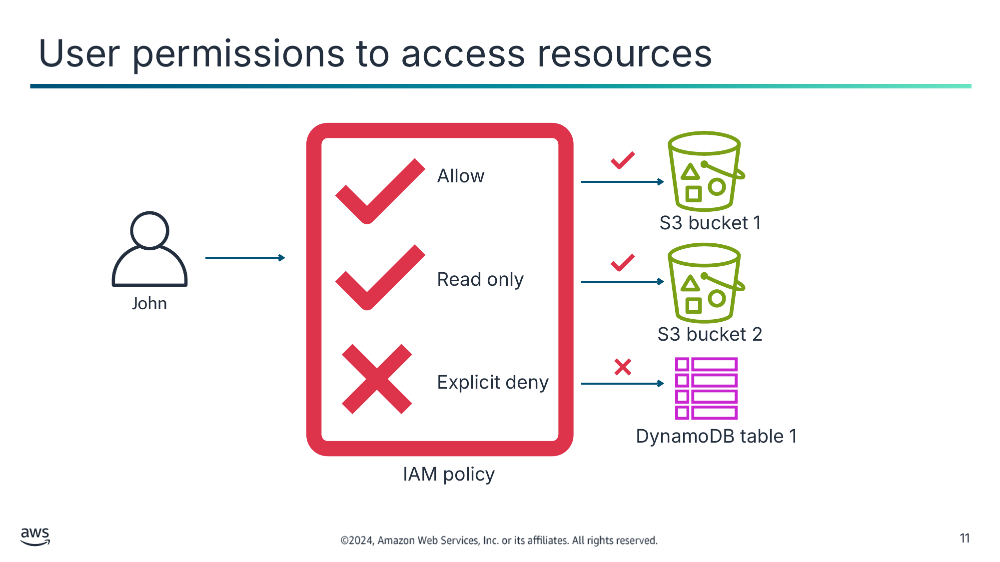

<details>
<summary>Текст зі схеми</summary>

Allow (Дозволити)

S3 bucket 1 (Бакет S3 1)

Read only (Лише читання)

John (Джон)

S3 bucket 2

Explicit deny (Явна заборона)

DynamoDB table 1 (Таблиця DynamoDB 1)

IAM policy (Політика IAM)

</details>

> **Нотатки:**
>
> |Номер слайда 11  
> |Нотатки для інструктора  
> |  
> |Нотатки для студента  
> Частина впровадження сильної основи ідентичності — використання політик для надання чи заборони доступу до ваших ресурсів AWS, як-от бакети Amazon Simple Storage Service (Amazon S3). У цьому прикладі Джон може читати, записувати та видаляти об’єкти в бакеті S3 1. Однак в бакеті S3 2 він може лише читати об’єкти, а доступ до конкретної таблиці Amazon DynamoDB йому явно заборонено.

---

## Слайд 12: Принцип найменших привілеїв (principle of least privilege)

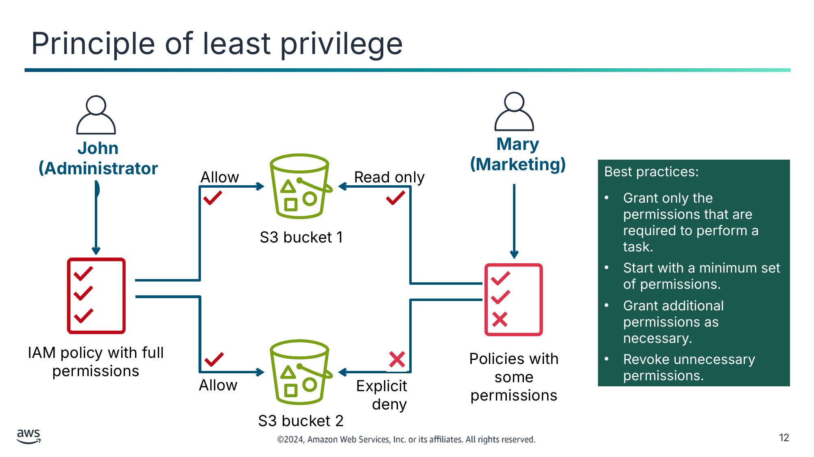

Best practices: (Найкращі практики:)

- Grant only the permissions that are required to perform a task. (Надавайте лише ті дозволи, що потрібні для виконання завдання.)
- Start with a minimum set of permissions. (Починайте з мінімального набору дозволів.)
- Grant additional permissions as necessary. (Надавайте додаткові дозволи за потреби.)
- Revoke unnecessary permissions. (Скасовуйте непотрібні дозволи.)

<details>
<summary>Текст зі схеми</summary>

**John (Джон)**

**(Administrator) (Адміністратор)**

**Mary (Марія)**

**(Marketing) (Маркетинг)**

Allow (Дозволити)

Read only (Лише читання)

S3 bucket 1 (Бакет S3 1)

IAM policy with full permissions (Політика IAM з повними дозволами)

Policies with some permissions (Політики з частиною дозволів)

Allow

Explicit deny (Явна заборона)

S3 bucket 2

</details>

> **Нотатки:**
>
> |Номер слайда 12  
> |Нотатки для інструктора  
> |У цьому прикладі Джон (користувач-адміністратор) і Марія (користувачка з маркетингу) мають доступ до тих самих бакетів S3 через різні політики та дозволи. Підкресліть, що найкраща практика — надавати лише ті дозволи, що потрібні для виконання завдання. Починайте з мінімального набору дозволів, надавайте додаткові дозволи за потреби та скасовуйте непотрібні дозволи.  
> |  
> |Нотатки для студента  
> Опис зображення: схема Джона, користувача-адміністратора, що отримує дозволи від політики. Політика дозволяє повний доступ до бакетів S3 1 і 2. Марія, користувачка з маркетингу, отримує доступ лише на читання до бакета S3 1, а доступ до бакета S3 2 їй явно заборонено через політики. Кінець опису.  
>
> Ще один ключовий аспект упровадження сильної основи ідентичності — застосування принципу найменших привілеїв до дозволів, які ви встановлюєте. Це означає надання лише тих дозволів, що потрібні для виконання завдання.  
>
> Безпечніше починати з мінімального набору дозволів і надавати додаткові дозволи за потреби. Це забезпечує кращу безпеку, ніж почати з надто дозвільних дозволів, а потім намагатися їх обмежити. Щоб визначити правильний набір дозволів, потрібно дослідити, який доступ потрібен для виконання конкретного завдання.  
>
> Коли ви створюєте політики доступу, визначте, що користувачі мають робити, а потім складіть політики, що дозволяють їм виконувати лише ці завдання. Так само створюйте політики для окремих ресурсів, що точно визначають, кому дозволено доступ до ресурсу, і дозволяйте лише мінімальні дозволи для цих користувачів. Наприклад, можливо, розробникам слід дозволити створювати екземпляри EC2 у продуктивних середовищах, але не зупиняти чи завершувати роботу екземплярів.  
>
> Докладніше див. посилання «Apply Least-Privilege Permissions» на сторінці ресурсів вмісту вашого онлайн-курсу.

---

## Слайд 13: Використання шифрування

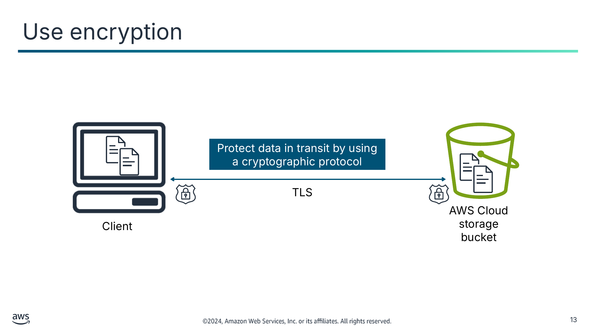

Protect data in transit by using a cryptographic protocol (Захищайте дані під час передавання за допомогою криптографічного протоколу)

<details>
<summary>Текст зі схеми</summary>

TLS

AWS Cloud storage

bucket (Бакет хмарного сховища AWS)

Client (Клієнт)

</details>

> **Нотатки:**
>
> |Номер слайда 13  
> |Нотатки для інструктора  
> |  
> |Нотатки для студента  
> Опис зображення: схема захисту даних під час передавання за допомогою криптографічного протоколу. TLS захищає дані, поки вони рухаються до клієнта й хмарного сховища та від них. Кінець опису.  
>
> На додачу до обмеження кола тих, хто має дозволи на доступ до даних, слід запобігати доступу до даних за допомогою шифрування. Ця практика пов’язана з принципом проєктування захисту даних під час передавання та в стані спокою.  
>
> Дані під час передавання (data in transit) — це дані, що активно переміщуються з одного місця в інше, наприклад через інтернет або приватну мережу. Щоб захистити дані під час передавання, ви захищаєте дані, поки вони рухаються від мережі до мережі або передаються з локального пристрою зберігання на пристрій хмарного зберігання. Де б не рухалися дані, заходи захисту критично важливі, оскільки дані часто вважаються менш захищеними під час руху.  
>
> Приклад захисту даних під час передавання — шифрування зображень під час їх завантаження до хмарного сервісу. Зображення не потрібно шифрувати; однак за допомогою TLS ви можете забезпечити конфіденційність передавання.

---

## Слайд 14: Захист даних у стані спокою за допомогою шифрування на стороні клієнта

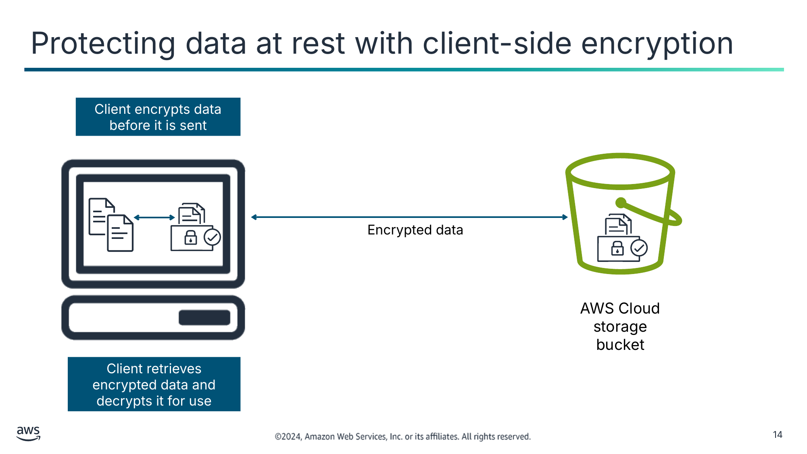

Client encrypts data before it is sent (Клієнт шифрує дані перед надсиланням)

Client retrieves encrypted data and decrypts it for use (Клієнт отримує зашифровані дані й розшифровує їх для використання)

<details>
<summary>Текст зі схеми</summary>

Encrypted data (Зашифровані дані)

AWS Cloud storage bucket (Бакет хмарного сховища AWS)

</details>

> **Нотатки:**
>
> |Номер слайда 14  
> |Нотатки для інструктора  
> |  
> |Нотатки для студента  
> Опис зображення: схема шифрування на стороні клієнта. Клієнт шифрує дані перед надсиланням. Зашифровані дані надсилаються захищеним каналом від клієнта до хмарного сховища. Клієнт отримує зашифровані дані з хмарного сховища й розшифровує їх для використання. Кінець опису.  
>
> Захист даних у стані спокою означає використання шифрування для захисту даних, що зберігаються будь-де у вашому хмарному рішенні. Шифрування на стороні клієнта забезпечує наскрізний захист вашого об’єкта, під час передавання та в стані спокою, від джерела до сховища.  
>
> Приклад — шифрування даних на мобільному пристрої. Оскільки мобільні пристрої можна легко втратити чи викрасти, шифрування гарантує, що дані перемішано й вони недоступні для небажаних користувачів.

---

## Слайд 15: Захист даних у стані спокою за допомогою серверного шифрування

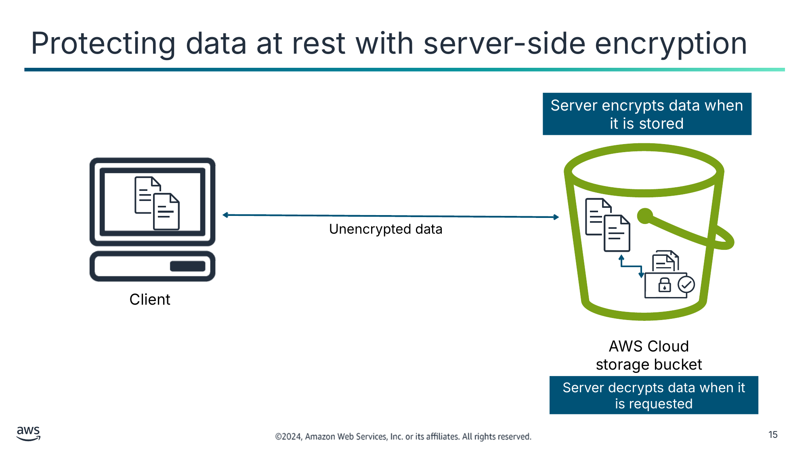

Server encrypts data when it is stored (Сервер шифрує дані під час їх збереження)

Server decrypts data when it is requested (Сервер розшифровує дані, коли їх запитують)

<details>
<summary>Текст зі схеми</summary>

Unencrypted data (Незашифровані дані)

Client (Клієнт)

AWS Cloud storage bucket (Бакет хмарного сховища AWS)

</details>

> **Нотатки:**
>
> |Номер слайда 15  
> |Нотатки для інструктора  
> |  
> |Нотатки для студента  
> Опис зображення: схема серверного шифрування. Незашифровані дані надсилаються захищеним каналом. Сервер шифрує дані під час їх збереження та розшифровує дані, коли ви їх запитуєте. Дані повертаються клієнту захищеним каналом. Кінець опису.  
>
> З серверним шифруванням дані шифруються перед збереженням.  
>
> Amazon S3 надає серверне шифрування. Сервіс шифрує ваші дані на рівні об’єктів під час запису даних на диски в центрах обробки даних AWS і розшифровує дані, коли ви до них звертаєтеся.  
>
> Приклад — шифрування персональних даних користувача, як-от номер соціального страхування, що зберігаються в хмарній базі даних.

---

## Слайд 16: Ключові висновки: принципи безпеки

- Безпека та відповідність вимогам — це спільні обов’язки AWS і клієнтів.
- Опора безпеки Well-Architected Framework надає принципи проєктування для побудови безпечних рішень.
- Принцип найменших привілеїв — ключова частина впровадження сильної основи ідентичності.
- Ще один ключовий принцип проєктування безпеки — захист даних у стані спокою та під час передавання. Шифрування — один із важливих механізмів захисту даних.

> **Нотатки:**
>
> |Номер слайда 16  
> |Нотатки для інструктора  
> |  
> |Нотатки для студента  
> Ці ключові висновки підсумовують цей розділ.

---

## Слайд 17: Автентифікація та захист доступу

Захист доступу

> **Нотатки:**
>
> |Номер слайда 17  
> |Нотатки для інструктора  
> |Цей матеріал розглядається коротко й має бути повторенням концепцій курсу Cloud Foundations. Ви можете заглибитися в ці теми глибше залежно від того, коли ваші студенти проходили той курс.  
> |  
> |Нотатки для студента  
> Цей розділ охоплює автентифікацію та важливість захисту доступу.

---

## Слайд 18: Автентифікація та авторизація

Автентифікація (Authentication)

Авторизація (Authorization)

Хто запитує доступ до акаунта AWS і ресурсів у ньому?

- Важливо встановити ідентичність запитувача за допомогою облікових даних.
- Запитувачем може бути людина або застосунок.

Після того як запитувача автентифіковано, що йому має бути дозволено робити?

- Визначити, чи дозволити, чи відхилити запит.

> **Нотатки:**
>
> |Номер слайда 18  
> |Нотатки для інструктора  
> |Цей слайд призначений для швидкого повторення концепцій автентифікації та авторизації.  
> |  
> |Нотатки для студента  
> З автентифікацією ви можете використовувати ідентичність запитувачів, щоб контролювати, хто може використовувати ваші ресурси AWS. З авторизацією ви також можете використовувати керування доступом, щоб контролювати, які ресурси можуть використовувати запитувачі та яким чином.  
>
> Щоб зрозуміти фундаментальні аспекти автентифікації та авторизації, розгляньте банківську аналогію. Уявіть банк, що дозволяє своїм клієнтам (користувачам) отримувати доступ до їхніх рахунків онлайн. Припустімо, ви — клієнт банку. У вас є гроші на поточному рахунку в цьому банку, і ви хочете оплатити рахунок онлайн. Чи може будь-яка випадкова людина увійти у ваш банківський рахунок і оплатити свої рахунки грошима з вашого рахунку? Ні, звісно!  
>
> Перш ніж банк дозволить вам доступ до вашого поточного рахунку, банк має переконатися, що людина, яка отримує доступ до рахунку, — це ви. Банк хоче автентифікувати, що ви — той, за кого себе видаєте. Зазвичай банк досягає цієї автентифікації, вимагаючи від вас ввести ім’я користувача та пароль, які мають бути відомі лише вам. Для додаткової безпеки вони можуть налаштувати багатофакторну автентифікацію (MFA). Тоді, окрім введення пароля, ви також маєте отримати код на телефон і ввести цей код на вебсайті банку.  
>
> Тепер припустімо, що ви успішно увійшли на вебсайт банку (автентифіковані). Чи можете ви оплатити свій рахунок, використовуючи гроші з рахунку іншого клієнта? Ні, звісно! Ви не маєте авторизації для доступу до рахунків, що вам не належать. Однак ви авторизовані для доступу до грошей на своєму рахунку й авторизовані оплачувати рахунки, використовуючи свої гроші.

---

## Слайд 19: AWS Identity and Access Management (IAM)

- Контролює доступ окремих осіб і груп до ваших ресурсів AWS
- Інтегрується з іншими сервісами AWS
- Забезпечує керування федеративною ідентичністю (federated identity)
- Підтримує багатофакторну автентифікацію (MFA)
- Дозволяє налаштовувати детальні дозволи


IAM

> **Нотатки:**
>
> |Номер слайда 19  
> |Нотатки для інструктора  
> |  
> |Нотатки для студента  
> AWS Identity and Access Management також відомий як IAM. За допомогою цього сервісу можна налаштувати детальний контроль доступу до ресурсів AWS. Ви можете використовувати IAM, щоб дотримуватися найкращих практик безпеки, надаючи унікальні облікові дані безпеки користувачам і групам. Ці облікові дані вказують, до яких API сервісів AWS і ресурсів користувачі та групи можуть отримати доступ. IAM безпечний за замовчуванням — користувачі не мають доступу до ресурсів AWS, доки дозволи не будуть явно надані.  
>
> IAM інтегровано в більшість сервісів AWS. Ви можете визначати засоби контролю доступу в одному місці в AWS Management Console, і вони діятимуть у всьому вашому середовищі AWS.  
>
> Ви можете використовувати IAM, щоб надавати своїм співробітникам і застосункам доступ до консолі та API сервісів AWS за допомогою ваших наявних систем ідентичності. AWS підтримує федерацію з корпоративних систем, як-от Microsoft Active Directory, і постачальників ідентичності на основі стандартів.  
>
> IAM також підтримує багатофакторну автентифікацію (MFA). Якщо MFA ввімкнено й користувач IAM намагається увійти, його попросять ввести код автентифікації. Код автентифікації доставляється на пристрій MFA, як-от апаратний чи віртуальний пристрій. Наприклад, Google Authenticator — це віртуальний пристрій MFA, що працює як застосунок на смартфоні користувача.  
>
> Ви можете створювати акаунти з дозволами, подібними до кореневого акаунта AWS (root user). Однак найкраща практика — створювати адміністративні акаунти, що надають акаунту лише потрібні дозволи. Дотримуйтеся принципу найменших привілеїв. Наприклад, запитайте себе, чи має ваш адміністратор баз даних (DBA) мати змогу розгортати екземпляри EC2. Якщо відповідь «ні», розгортайте акаунти відповідно.

---

## Слайд 20: Термінологія IAM

| Термін (Term) | Визначення (Definition) |
|---|---|
| Ресурс IAM (IAM resource) | Об’єкти користувачів, груп, ролей, політик і постачальників ідентичності, що зберігаються в IAM |
| Сутність IAM (IAM entity) | Об’єкти ресурсів IAM, які AWS використовує для автентифікації (користувачі та ролі) |
| Ідентичність IAM (IAM identity) | Об’єкти ресурсів IAM, яким можна надавати авторизацію в політиках для виконання дій і доступу до ресурсів (користувач, група або роль) |
| Принципал (Principal) | Людина або застосунок, що може увійти та робити запити до AWS |

> **Нотатки:**
>
> |Номер слайда 20  
> |Нотатки для інструктора  
> |  
> |Нотатки для студента  
> Наведені терміни специфічні для IAM, і ви використовуватимете їх протягом цього курсу:  
> Ресурс IAM — це об’єкт користувача, групи, ролі, політики або постачальника ідентичності, що зберігається в IAM. Як і з іншими сервісами AWS, ви можете додавати, редагувати та видаляти ресурси з IAM.  
> Сутність IAM — це об’єкт ресурсу IAM, який AWS використовує для автентифікації. Сутності включають користувачів і ролі IAM. Через сутність IAM вам може бути надано можливість входити в консоль і виконувати програмні запити до сервісів AWS за допомогою API чи AWS Command Line Interface (AWS CLI).  
> Ідентичність IAM — це об’єкт ресурсу IAM, що використовується для ідентифікації та групування. До ідентичності IAM можна прикріпити політику. Ідентичності включають користувачів, групи та ролі.  
> Принципал — це людина або застосунок, що використовує кореневий акаунт AWS, користувача IAM або роль IAM для автентифікації та виконання запитів до AWS. Принципали включають прийняті ролі (assumed roles) і федеративних користувачів — зовнішні ідентичності, що не мають акаунта AWS.

---

## Слайд 21: Використання IAM для контролю доступу до ресурсів AWS

Користувач IAM (IAM user)

Група IAM (IAM group)

Роль IAM (IAM  role)

Політика IAM (IAM policy)

Людина або застосунок, що може автентифікуватися в акаунті AWS

Набір користувачів IAM, яким надано однакову авторизацію

Ідентичність, що використовується для надання тимчасового набору дозволів на виконання запитів до сервісів AWS

Документ, що визначає, до яких ресурсів можна отримати доступ і рівень доступу до кожного ресурсу

> **Нотатки:**
>
> |Номер слайда 21  
> |Нотатки для інструктора  
> |  
> |Нотатки для студента  
> Ви можете використовувати IAM для контролю доступу до ваших ресурсів AWS. Цей контроль доступу досягається створенням користувачів, груп і ролей. Також можна забезпечувати контроль доступу, прикріплюючи політики до сутностей IAM.  
>
> Для IAM ці терміни визначаються так:  
> Користувач IAM — це сутність, яку ви створюєте в AWS, щоб представляти людину чи застосунок, що взаємодіє із сервісами та ресурсами акаунта AWS. Користувачеві надається постійний набір облікових даних, що залишаються з ним, доки не відбудеться примусова ротація.  
> Група IAM — це набір користувачів IAM. Групи можна використовувати для надання однакового набору дозволів кільком користувачам.  
> Роль IAM подібна до користувача. Це ідентичність AWS, до якої можна прикріплювати політики дозволів. Ці політики визначають, що ідентичність може й не може робити в AWS. Однак роль не має пов’язаних із нею довгострокових облікових даних (як-от пароль чи ключі доступу). Натомість, коли людина або застосунок приймає роль, їм надаються тимчасові облікові дані безпеки для сеансу ролі.  
> Політика IAM — це документ, що явно перелічує дозволи. Політику можна прикріпити до користувача IAM, групи, ролі або будь-якої комбінації цих ресурсів.

---

## Слайд 22: Облікові дані IAM для автентифікації

| Дія (Action) | Потрібні облікові дані (Credentials needed) |
|---|---|
| Вхід в AWS Management Console | Ім’я користувача та пароль |
| Виконання команд з AWS Command Line Interface (AWS CLI) | Ключ доступу AWS (AWS access key)* |
| Програмні виклики до AWS | Ключ доступу AWS* |

*Ключ доступу AWS — це комбінація ідентифікатора ключа доступу та секретного ключа.

> **Нотатки:**
>
> |Номер слайда 22  
> |Нотатки для інструктора  
> |  
> |Нотатки для студента  
> Коли ви взаємодієте з AWS, ви повинні надати облікові дані AWS. Для автентифікації використовуються два основні типи облікових даних, і який тип ви використовуєте, залежить від того, як ви отримуєте доступ до AWS:  
> Щоб автентифікуватися з консолі, потрібно увійти за допомогою імені користувача та пароля.  
> Щоб автентифікуватися через AWS CLI, SDK чи прямі виклики API, потрібно надати ключ доступу AWS. Ключ доступу AWS — це комбінація ідентифікатора ключа доступу та секретного ключа доступу. Ви не можете використовувати ім’я користувача та пароль для автентифікації цими методами.  
>
> Це дуже спрощений вступ до використання облікових даних безпеки. Докладніше див. посилання «AWS Security Credentials» на сторінці ресурсів вмісту вашого онлайн-курсу.

---

## Слайд 23: Найкращі практики захисту доступу

- Дотримуйтеся принципу найменших привілеїв.
- Увімкніть багатофакторну автентифікацію (MFA).
- Вимагайте від людей-користувачів доступу до AWS із використанням тимчасових облікових даних.
- Змінюйте (ротація) ключі доступу для сценаріїв використання, що вимагають довгострокових облікових даних.
- Використовуйте надійні, складні паролі.
- Захищайте локальні облікові дані.
- Використовуйте AWS Organizations.
- Увімкніть AWS CloudTrail.
- Захищайте кореневий акаунт (root user).

> **Нотатки:**
>
> |Номер слайда 23  
> |Нотатки для інструктора  
> |  
> |Нотатки для студента  
> Ось деякі найкращі практики захисту доступу:  
> Дотримуйтеся принципу найменших привілеїв: призначайте користувачам, групам і ролям мінімально необхідні дозволи для виконання їхніх завдань і уникайте надання непотрібних дозволів.  
> Увімкніть MFA: MFA додає додатковий рівень безпеки для вашого кореневого акаунта, вимагаючи код, що генерується апаратним чи програмним токеном під час входу.  
> Вимагайте від людей-користувачів доступу до AWS із використанням тимчасових облікових даних: замість надання користувачам довгострокових облікових даних використовуйте ідентичність для надання федеративного доступу до акаунтів AWS шляхом прийняття ролей IAM, що надають тимчасові облікові дані. Для централізованого керування доступом використовуйте AWS IAM Identity Center для керування доступом до ваших акаунтів і дозволами в цих акаунтах.  
> Змінюйте ключі доступу: для сценаріїв, у яких вам потрібні користувачі IAM із програмним доступом і довгостроковими обліковими даними, використовуйте інформацію про останнє використання ключа доступу, щоб регулярно змінювати й видаляти ключі доступу.  
> Використовуйте надійні, складні паролі: переконайтеся, що кореневий акаунт і користувачі IAM мають надійні, унікальні паролі, що відповідають настановам політики паролів AWS.  
> Захищайте локальні облікові дані: захищайте ключі доступу, паролі й токени MFA, зберігаючи їх у безпечному менеджері паролів або апаратних токенах.  
> Використовуйте AWS Organizations: використовуйте Organizations, щоб консолідувати кілька акаунтів AWS для централізованого керування виставленням рахунків, контролем доступу та ресурсами.  
> Увімкніть AWS CloudTrail: увімкнувши CloudTrail, ви можете мати запис усіх дій, виконаних в акаунті, що полегшує виявлення можливих ризиків безпеки та дотримання вимог аудиту.  
> Захищайте кореневий акаунт: коли ви вперше створюєте акаунт AWS, ви маєте єдину ідентичність для входу з повним доступом до всіх сервісів і ресурсів AWS в акаунті. Це кореневий акаунт, і важливо мінімізувати ризик доступу через цей акаунт з огляду на його силу. Обмежуйте використання кореневого акаунта та відстежуйте активність за допомогою журналів CloudTrail, рекомендацій AWS Trusted Advisor і подій входу в консоль на предмет будь-якої підозрілої активності, пов’язаної з вашим кореневим акаунтом.  
>
> Дотримуючись цих найкращих практик, ви можете підвищити безпеку налаштування вашого акаунта. Докладніше та повний список актуальних найкращих практик див. посилання «Security best practices in IAM» на сторінці ресурсів вмісту вашого онлайн-курсу.

---

## Слайд 24: Захист кореневого акаунта (protecting the root user)

- Для щоденних завдань створіть адміністративного користувача в AWS IAM Identity Center (наступнику AWS Single Sign-On).
- Використовуйте кореневий акаунт лише для завдань, які інші користувачі не можуть виконати.

> **Нотатки:**
>
> |Номер слайда 24  
> |Нотатки для інструктора  
> |Спрямуйте студентів на посилання на сторінці ресурсів вмісту онлайн-курсу для отримання інформації про завдання, які може виконувати лише кореневий акаунт.  
> |  
> |Нотатки для студента  
> Захищайте облікові дані кореневого акаунта так, як ви захищали б номер своєї кредитної картки чи будь-які інші чутливі або секретні дані.  
>
> Замість використання кореневого акаунта для щоденних адміністративних завдань створіть адміністративного користувача з дозволами на виконання більшості адміністративних завдань. Якщо ви використовуєте AWS IAM Identity Center (наступник AWS Single Sign-On) для створення адміністративного користувача, використовуються тимчасові, а не довгострокові облікові дані. Інструкції див. посилання «AWS IAM Identity Center User Guide» на сторінці ресурсів вмісту вашого онлайн-курсу.  
>
> Використовуйте кореневий акаунт лише для виконання тих завдань, які не може виконати жоден інший користувач. Докладніше див. посилання «Tasks That Require Root User Credentials» на сторінці ресурсів вмісту вашого онлайн-курсу.

---

## Слайд 25: Кроки налаштування адміністративного користувача

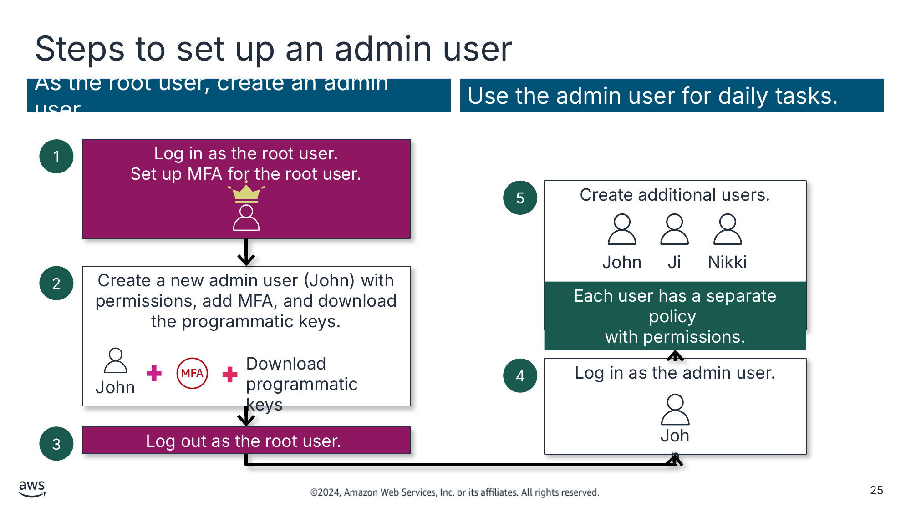

As the root user, create an admin user. (Від імені кореневого акаунта створіть адміністративного користувача.)

Use the admin user for daily tasks. (Використовуйте адміністративного користувача для щоденних завдань.)

<details>
<summary>Текст зі схеми</summary>

1

Log in as the root user. (Увійдіть як кореневий акаунт.)

Set up MFA for the root user. (Налаштуйте MFA для кореневого акаунта.)

5

Create additional users. (Створіть додаткових користувачів.)

John (Джон)

Ji

Nikki (Нікі)

2

Create a new admin user (John) with permissions, add MFA, and download the programmatic keys. (Створіть нового адміністративного користувача (John) з дозволами, додайте MFA й завантажте програмні ключі.)

Each user has a separate policy (Кожен користувач має окрему політику)

with permissions. (з дозволами.)

John

Download

programmatic keys (Завантажте програмні ключі)

4

Log in as the admin user. (Увійдіть як адміністративний користувач.)

John

3

Log out as the root user. (Вийдіть з кореневого акаунта.)

</details>

> **Нотатки:**
>
> |Номер слайда 25  
> |Нотатки для інструктора  
> |Розгляньте кожен крок. Повідомте, що AWS категорично рекомендує не використовувати кореневий акаунт для щоденної взаємодії з AWS. Увімкніть MFA для додаткового рівня захисту. Після цього сховайте облікові дані кореневого акаунта в безпечному місці, щоб захистити свій акаунт. Створіть новий акаунт адміністративного користувача з MFA й завантажте програмні ключі — але не використовуйте їх і не зберігайте у вашій системі. Увійдіть як адміністративний користувач, щоб створювати нових користувачів чи групи. Використовуйте адміністративного користувача для вашої щоденної взаємодії.  
> |  
> |Нотатки для студента  
> Замість використання кореневого акаунта для виконання адміністративних завдань виконайте такі кроки, щоб створити адміністративного користувача (admin):  
> Увійдіть як кореневий акаунт і налаштуйте MFA для кореневого акаунта.  
> Створіть нового адміністративного користувача, додайте MFA й завантажте програмні ключі. У прикладі на слайді Джон — це адміністративний користувач.  
> Вийдіть з кореневого акаунта.  
> Увійдіть як адміністративний користувач (у цьому прикладі Джон).  
> Створіть облікові записи користувачів. Кожен користувач має окрему політику з дозволами. У прикладі на слайді облікові записи створюються для Джона, Ji та Нікі.  
>
> Докладніше див. посилання «Security Best Practices in IAM» на сторінці ресурсів вмісту вашого онлайн-курсу.

---

## Слайд 26: Найкращі практики: користувачі та групи IAM

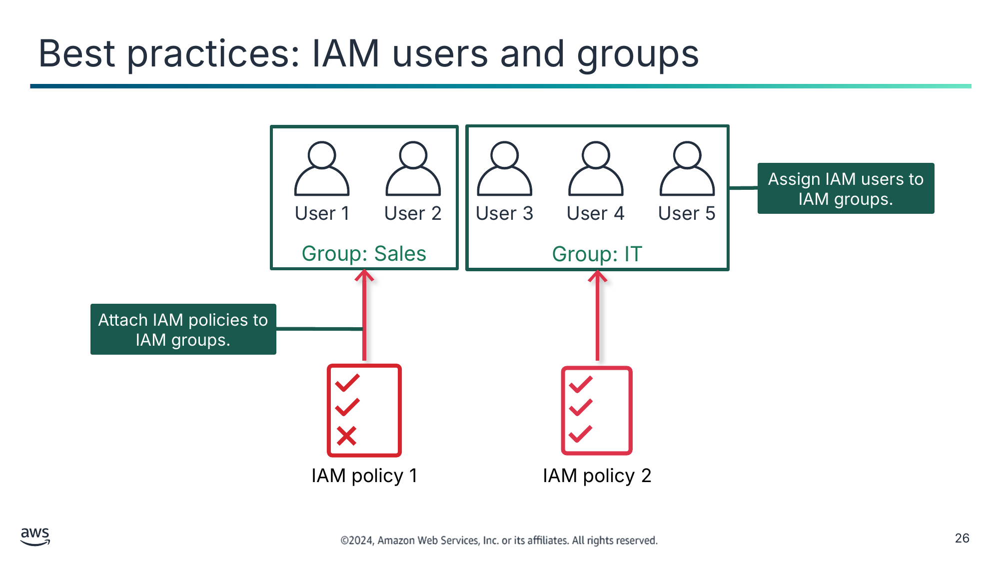

Assign IAM users to IAM groups. (Призначайте користувачів IAM групам IAM.)

Attach IAM policies to IAM groups. (Прикріплюйте політики IAM до груп IAM.)

<details>
<summary>Текст зі схеми</summary>

Group: Sales (Група: Sales)

User 1 (Користувач 1)

User 2

Group: IT (Група: IT)

User 3

User 4

User 5

IAM policy 1 (Політика IAM 1)

IAM policy 2

</details>

> **Нотатки:**
>
> |Номер слайда 26  
> |Нотатки для інструктора  
> |Підкресліть, що найкраща практика — прикріплювати політики IAM до груп IAM, а потім призначати користувачів IAM цим групам IAM. Схема показує, як користувачів поміщають у різні групи з різними прикріпленими політиками IAM залежно від вимог до доступу.  
> |  
> |Нотатки для студента  
> Опис зображення: схема політики IAM 1, прикріпленої до групи IAM користувачів відділу продажів, і політики IAM 2, прикріпленої до групи ІТ-користувачів. Користувачі IAM 1 і 2 є членами групи IAM відділу продажів і отримують дозволи від політики, прикріпленої до цієї групи. Користувачів IAM 3, 4 і 5 призначено до групи IAM для ІТ, і вони отримують інші дозволи через політику, прикріплену до цієї групи. Кінець опису.  
>
> Ви можете прикріпити політику IAM до користувача IAM, групи, ролі або будь-якої комбінації цих ресурсів.  
>
> Щоб налаштувати довгостроковий доступ, найкраща практика — прикріпити політики IAM до груп IAM, а потім призначити користувачів IAM цим групам IAM. Користувач IAM, що є членом групи IAM, успадковує дозволи, прикріплені до цієї групи. Також можна прикріплювати політики IAM безпосередньо до користувача IAM, щоб далі налаштувати доступ, наданий через групу.

---

## Слайд 27: Ролі IAM (IAM roles)

Характеристики

Поширені сценарії використання

- Надає тимчасові облікові дані безпеки
- Не прив’язана виключно до однієї людини
- Може бути прийнята людиною, застосунком або сервісом
- Часто використовується для делегування доступу

- Застосунок, що працює на Amazon  
Elastic Compute Cloud (Amazon EC2)
- Міжакаунтний доступ для користувача IAM
- Мобільні застосунки

> **Нотатки:**
>
> |Номер слайда 27  
> |Нотатки для інструктора  
> |Підкресліть, що ролі IAM надають тимчасовий доступ. Це чудово підходить для користувачів поза організацією.  
> |  
> |Нотатки для студента  
> Використовуючи роль IAM, ви можете визначити набір дозволів для ресурсів, до яких має отримати доступ користувач чи сервіс. Однак дозволи не прикріплюються до користувача чи групи IAM. Натомість дозволи прикріплюються до ролі, а користувач або сервіс приймає роль. Коли користувач приймає роль, його попередні дозволи тимчасово «забуваються». AWS повертає тимчасові облікові дані безпеки, які користувач може використовувати для виконання програмних запитів до AWS. Коли ви використовуєте ролі IAM, вам не потрібно надавати довгострокові облікові дані безпеки кожній сутності, якій потрібен доступ до ресурсу.  
>
> Наведені приклади описують ситуації, коли вам може знадобитися використати тимчасові облікові дані безпеки:  
> Користувачу IAM в одному акаунті AWS потрібен тимчасовий доступ до ресурсів в іншому акаунті AWS.  
> Ідентичності користувачів, автентифіковані системою поза AWS (федеративні користувачі), мають виконувати завдання AWS і отримувати доступ до ваших ресурсів AWS. Ви не хочете створювати й підтримувати користувачів IAM для людей поза вашою організацією.  
> Мобільному застосунку потрібен доступ до ваших ресурсів AWS. Ви не хочете зберігати облікові дані AWS у застосунку, де їх складно змінювати (ротація), а користувачі потенційно можуть їх витягти.  
> Застосунку, що працює на екземплярі EC2, потрібен доступ до ресурсів AWS. Ви не хочете зберігати довгострокові облікові дані локально.  
>
> Коли вам потрібно надати користувачу IAM в іншому акаунті чи федеративному користувачу доступ до ваших ресурсів AWS, створіть роль IAM з тимчасовими обліковими даними замість створення користувача IAM у вашому акаунті. Так само для застосунку, що працює на екземплярі EC2 і потребує доступу до ресурсів AWS, створіть роль IAM, додайте роль до профілю екземпляра (instance profile) і прикріпіть профіль до екземпляра. Тоді застосунок може програмно прийняти роль під час виконання.

---

## Слайд 28: Три приклади використання ролі IAM

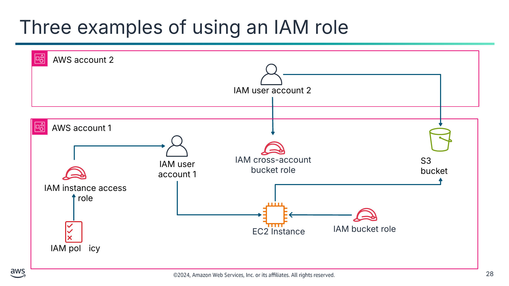

<details>
<summary>Текст зі схеми</summary>

AWS account 2 (Акаунт AWS 2)

IAM user account 2 (Користувач IAM акаунта 2)

AWS account 1 (Акаунт AWS 1)

IAM cross-account bucket role (Міжакаунтна роль IAM для бакета)

IAM user account 1 (Користувач IAM акаунта 1)

S3 bucket (Бакет S3)

IAM instance access role (Роль IAM для доступу екземпляра)

EC2 Instance (Екземпляр EC2)

IAM bucket role (Роль IAM для бакета)

IAM pol	icy

</details>

> **Нотатки:**
>
> |Номер слайда 28  
> |Нотатки для інструктора  
> |  
> |Нотатки для студента  
> Схема на цьому слайді ілюструє три сценарії використання ролі IAM:  
> У першому сценарії користувач IAM в акаунті AWS 1 потребує тимчасового доступу до застосунку, що працює на екземплярі EC2. Спершу ви створюєте політику IAM з потрібними дозволами. Потім ви створюєте роль IAM і прикріплюєте політику до ролі. Користувач IAM тепер може прийняти роль і отримати доступ до екземпляра EC2.  
> У другому сценарії застосунок, що працює на екземплярі EC2, потребує доступу до бакета S3. Після створення ролі IAM з потрібними дозволами ви додаєте роль до профілю екземпляра й прикріплюєте профіль до екземпляра. Тоді застосунок може отримати доступ до бакета S3.  
> У третьому сценарії користувач IAM в акаунті AWS 2 має отримати доступ до бакета S3 в акаунті AWS 1. Ви створюєте міжакаунтну роль IAM в акаунті 1, що визначає акаунт 2 як довірену сутність (trusted entity). Користувач IAM в акаунті 2 може тоді перемкнутися на міжакаунтну роль і отримати доступ до бакета S3 в акаунті 1.

---

## Слайд 29: Ключові висновки: автентифікація та захист доступу

- Використовуйте сервіс IAM для налаштування детального контролю доступу до ресурсів AWS.
- Кореневий акаунт має повний доступ до всіх ресурсів акаунта AWS. Не використовуйте кореневий акаунт для щоденної взаємодії.
- Найкраща практика — прикріплювати політики IAM до груп IAM, а потім призначати користувачів IAM цим групам IAM.
- Роль IAM надає тимчасові облікові дані безпеки. За допомогою ролі можна визначити набір дозволів для доступу до ресурсів, які потрібні користувачу чи сервісу.

> **Нотатки:**
>
> |Номер слайда 29  
> |Нотатки для інструктора  
> |  
> |Нотатки для студента  
> Ці ключові висновки підсумовують цей розділ.

---

## Слайд 30: Авторизація користувачів

Захист доступу

> **Нотатки:**
>
> |Номер слайда 30  
> |Нотатки для інструктора  
> |Цей матеріал розглядається коротко й має бути повторенням концепцій курсу Cloud Foundations. Ви можете заглибитися в ці теми глибше залежно від того, коли ваші студенти проходили той курс.  
> |  
> |Нотатки для студента  
> Цей розділ охоплює авторизацію користувачів.

---

## Слайд 31: Політики та дозволи IAM

Використовуйте політики для точного налаштування дозволів, наданих принципалам.

Визначайте дозволи в документах політик IAM.

Два типи політик:

- **На основі ідентичності (Identity-based):** прикріплюються до користувача, групи чи ролі IAM.
- **На основі ресурсу (Resource-based):** прикріплюються до ресурсу AWS.

- Документ має формат JSON.
- Політика визначає, які ресурси та операції дозволено чи заборонено.
- Дотримуйтеся принципу найменших привілеїв.

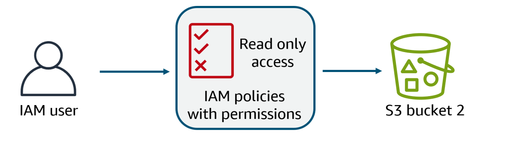

> **Нотатки:**
>
> |Номер слайда 31  
> |Нотатки для інструктора  
> |Обговоріть, що політики важливі, оскільки саме їх використовують для надання конкретного доступу. Без політик принципал не мав би доступу до ресурсів.  
> |  
> |Нотатки для студента  
> Політика — це об’єкт, що визначає дозволи для ідентичності чи ресурсу, з якими він пов’язаний. За допомогою політик можна точно налаштовувати дозволи, надані принципалам. Приклади принципалів включають користувачів IAM, ролі IAM та сервіси AWS.  
>
> Існують два типи політик: політики на основі ідентичності та політики на основі ресурсів. Найбільша різниця — у тому, де вони застосовуються. Політики на основі ідентичності прикріплюються до користувача, групи чи ролі IAM і вказують, що користувачеві дозволено робити. Політики на основі ресурсів прикріплюються до ресурсу й вказують, що вказаному користувачеві (або групі користувачів) дозволено робити з ресурсом.  
>
> Більшість політик зберігаються в AWS як документи JSON. AWS оцінює ці політики, коли принципал IAM робить запит. Дозволи в політиках визначають, чи буде запит дозволено або відхилено.  
>   
> Найкраща практика — дотримуватися принципу найменших привілеїв, який розглядався раніше в модулі.

---

## Слайд 32: Визначення дозволів у момент запиту

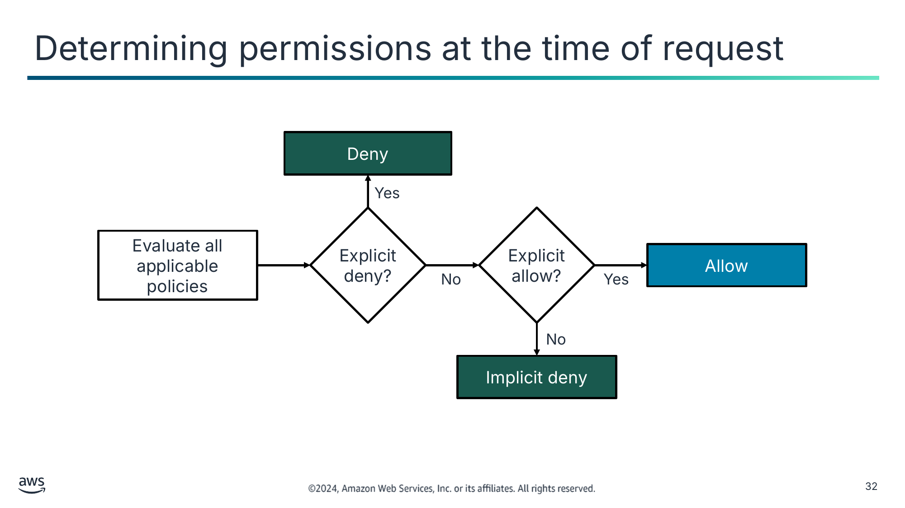

<details>
<summary>Текст зі схеми</summary>

Deny (Заборонити)

Yes (Так)

Explicit deny? (Явна заборона?)

Explicit allow? (Явний дозвіл?)

Evaluate all applicable policies (Оцінити всі застосовні політики)

Allow (Дозволити)

No (Ні)

Yes

No

Implicit deny (Неявна заборона)

</details>

> **Нотатки:**
>
> |Номер слайда 32  
> |Нотатки для інструктора  
> |Пройдіться блок-схемою, щоб допомогти студентам краще зрозуміти, як оцінюються політики. Вкажіть на дві ключові точки ухвалення рішення: явну заборону та явний дозвіл.  
> |  
> |Нотатки для студента  
> Коли IAM визначає, чи дозволено дію, сервіс спершу перевіряє наявність будь-якої застосовної політики явної заборони. Якщо явної заборони немає, IAM перевіряє наявність будь-якої застосовної політики явного дозволу. Якщо немає ні політики явної заборони, ні політики явного дозволу, IAM повертається до типового значення й забороняє доступ. Цей процес називається неявною забороною (implicit deny). Користувачеві буде дозволено виконати дію, лише якщо запитану дію явно не заборонено й явно дозволено.  
>
> Схема на слайді показує логіку, яку AWS використовує для оцінювання політик IAM. AWS оцінює всі застосовні політики та використовує таку логіку оцінювання:  
> За замовчуванням усі запити відхиляються.  
> Явний дозвіл перевизначає типову заборону.  
> Явна заборона перевизначає будь-який явний дозвіл.  
>
> Порядок, у якому оцінюються політики, не впливає на результат оцінювання. Оцінюються всі політики, і результатом ​завжди​ є те, що запит або дозволено, або відхилено. Припустімо, виникає конфлікт (одна політика дозволяє ​дію​, а інша забороняє ​дію​). Тоді застосовується найсуворіша політика (тобто політика, що забороняє ​дію​).  
>
> Під час розробки політик IAM може бути складно визначити, чи буде надано сутності IAM доступ до ресурсу. IAM policy simulator — корисний інструмент для тестування та усунення проблем із політиками IAM. Докладніше див. посилання «Testing IAM Policies with the IAM Policy Simulator» на сторінці ресурсів вмісту вашого онлайн-курсу.

---

## Слайд 33: Політики на основі ідентичності та на основі ресурсів

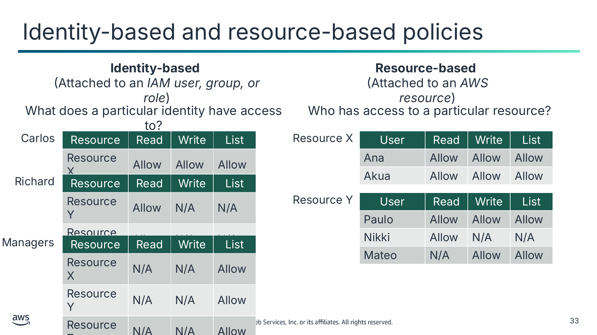

**Identity-based (На основі ідентичності)**

(Прикріплюється до *користувача, групи чи ролі IAM*)

**Resource-based (На основі ресурсу)**

(Прикріплюється до *ресурсу AWS*)

До чого має доступ певна ідентичність?

Хто має доступ до певного ресурсу?

Карлос (Carlos)

| Resource (Ресурс) | Read (Читання) | Write (Запис) | List (Список) |
|---|---|---|---|
| Resource X | Allow | Allow | Allow |

Resource X

| User (Користувач) | Read | Write | List |
|---|---|---|---|
| Ана (Ana) | Allow | Allow | Allow |
| Акуа (Akua) | Allow | Allow | Allow |

Річард (Richard)

| Resource | Read | Write | List |
|---|---|---|---|
| Resource Y | Allow | N/A | N/A |
| Resource Z | Allow | N/A | N/A |

Resource Y

| User | Read | Write | List |
|---|---|---|---|
| Паулу (Paulo) | Allow | Allow | Allow |
| Нікі (Nikki) | Allow | N/A | N/A |
| Матео (Mateo) | N/A | Allow | Allow |

Managers (Менеджери)

| Resource | Read | Write | List |
|---|---|---|---|
| Resource X | N/A | N/A | Allow |
| Resource Y | N/A | N/A | Allow |
| Resource Z | N/A | N/A | Allow |

> **Нотатки:**
>
> |Номер слайда 33  
> |Нотатки для інструктора  
> |Примітка: у таблицях на слайді N/A означає «не застосовується» (not applicable), оскільки політика не вказує дозволів для цієї конкретної дії.  
> |  
> |Розгляньте відмінності між політиками на основі ідентичності та політиками на основі ресурсів:  
> |Політики на основі ідентичності прикріплюються до користувача, групи чи ролі IAM. Вони вказують, що ця ідентичність може робити. Наприклад, ви можете надати користувачу змогу отримувати доступ до таблиці Amazon DynamoDB.  
> |Політики на основі ресурсів прикріплюються до ресурсу. Вони вказують, що вказаному користувачеві (або групі користувачів) дозволено робити з ресурсом. Наприклад, ви можете надати доступ до бакета S3 або надати міжакаунтний доступ між двома довіреними акаунтами AWS.  
> |  
> |Розгляньте таблиці політик зі студентами. Повторіть, що за замовчуванням усі запити відхиляються. Явний дозвіл перевизначає типову заборону; явна заборона перевизначає будь-який явний дозвіл.  
> |  
> |Нотатки для студента  
> Примітка: у таблицях на слайді N/A означає «не застосовується», оскільки політика не вказує дозволів для цієї конкретної дії.  
>
> Нагадаємо, що дозволи можуть надавати два типи політик IAM: політики на основі ідентичності та політики на основі ресурсів. Різниця між двома типами — у тому, де вони застосовуються, що залежить від типу доступу, який ви авторизуєте чи обмежуєте.  
>
> Політики на основі ідентичності прикріплюються до користувача, групи чи ролі IAM. Вони вказують, що ця ідентичність може робити. Наприклад, ви можете надати користувачу змогу отримувати доступ до таблиці DynamoDB.  
>
> Політики на основі ресурсів прикріплюються до ресурсу. Вони вказують, що вказаному користувачеві (або групі користувачів) дозволено робити з ресурсом. Наприклад, ви можете використати політику на основі ресурсу, щоб надати доступ до бакета S3 або надати міжакаунтний доступ між двома довіреними акаунтами AWS.  
>
> Докладніше див. посилання «Identity-Based Policies and Resource-Based Policies» на сторінці ресурсів вмісту вашого онлайн-курсу.

---

## Слайд 34: Політики: приклад 1

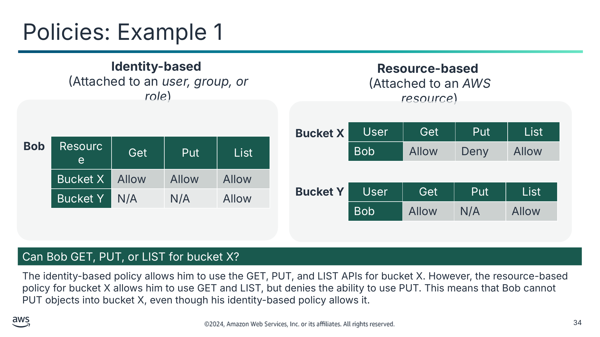

**Identity-based (На основі ідентичності)**

(Прикріплюється до *користувача, групи чи ролі*)

**Resource-based (На основі ресурсу)**

(Прикріплюється до *ресурсу AWS*)

| User (Користувач) | Get | Put | List |
|---|---|---|---|
| Боб (Bob) | Allow | Deny | Allow |

**Bucket X (Бакет X)**

**Боб (Bob)**

| Resource (Ресурс) | Get | Put | List |
|---|---|---|---|
| Bucket X | Allow | Allow | Allow |
| Bucket Y | N/A | N/A | Allow |

**Bucket Y (Бакет Y)**

| User | Get | Put | List |
|---|---|---|---|
| Боб (Bob) | Allow | N/A | Allow |

Чи може Боб виконувати GET, PUT або LIST для бакета X?

Політика на основі ідентичності дозволяє йому використовувати API GET, PUT і LIST для бакета X. Однак політика на основі ресурсу для бакета X дозволяє йому використовувати GET і LIST, але забороняє використовувати PUT. Це означає, що Боб не може виконувати PUT об’єктів у бакет X, хоча його політика на основі ідентичності це дозволяє.

> **Нотатки:**
>
> |Номер слайда 34  
> |Нотатки для інструктора  
> |Примітка: у таблицях на слайді N/A означає «не застосовується», оскільки політика не вказує дозволів для цієї конкретної дії.  
> |  
> |Розгляньте запитання зі студентами. Дайте їм час обговорити, чи може Боб виконувати GET, PUT або LIST для бакета X.  
> |  
> |Нотатки для студента  
> Примітка: у таблицях на слайді N/A означає «не застосовується», оскільки політика не вказує дозволів для цієї конкретної дії.  
>
> Amazon S3 підтримує два типи механізмів контролю доступу: на основі ідентичності (або на основі користувача) і на основі ресурсу.  
>
> У прикладі на слайді користувач IAM на ім’я Боб має прикріплену політику на основі ідентичності. Політика дозволяє йому використовувати API GET, PUT і LIST для бакета S3 X. Однак політика на основі ресурсу для бакета X дозволяє йому використовувати GET і LIST, але забороняє використовувати PUT. Це означає, що Боб не може виконувати PUT об’єктів у бакет X, хоча його політика на основі ідентичності це дозволяє.

---

## Слайд 35: Політики: приклад 2


**Identity-based (На основі ідентичності)**

(Прикріплюється до *користувача, групи чи ролі*)

**Resource-based (На основі ресурсу)**

(Прикріплюється до *ресурсу AWS*)

| User (Користувач) | Get | Put | List |
|---|---|---|---|
| Боб (Bob) | Allow | Deny | Allow |

**Bucket X (Бакет X)**

**Боб (Bob)**

| Resource (Ресурс) | Get | Put | List |
|---|---|---|---|
| Bucket X | Allow | Allow | Allow |
| Bucket Y | N/A | N/A | Allow |

**Bucket Y (Бакет Y)**

| User | Get | Put | List |
|---|---|---|---|
| Боб (Bob) | Allow | N/A | Allow |

Чи може Боб виконувати GET або LIST для бакета Y?

Політика на основі ідентичності дозволяє дію LIST, але явно не дозволяє й не забороняє дії GET і PUT для бакета Y. Політика на основі ресурсу для бакета Y дозволяє Бобу використовувати GET і LIST, але не вказує дію PUT. Тому Боб може читати об’єкти з бакета, хоча його політика на основі ідентичності цього явно не дозволяє.

> **Нотатки:**
>
> |Номер слайда 35  
> |Нотатки для інструктора  
> |Примітка: у таблицях на слайді N/A означає «не застосовується», оскільки політика не вказує дозволів для цієї конкретної дії.  
> |  
> |Розгляньте запитання зі студентами. Дайте їм час обговорити, чи може Боб виконувати GET або LIST для бакета Y.  
> |  
> |Нотатки для студента  
> Примітка: у таблицях на слайді N/A означає «не застосовується», оскільки політика не вказує дозволів для цієї конкретної дії.  
>
> Приклад на цьому слайді зосереджений на дозволах Боба для бакета Y. Політика Боба на основі ідентичності дозволяє дію LIST. Політика явно не дозволяє й не забороняє дії GET і PUT для бакета Y. Політика на основі ресурсу для бакета Y дозволяє Бобу використовувати GET і LIST, але не вказує дію PUT. Тому Боб може читати об’єкти з бакета, хоча його політика на основі ідентичності цього явно не дозволяє.

---

## Слайд 36: Ключові висновки: авторизація користувачів

- Політика визначає дозволи для ідентичності чи ресурсу, з якими вона пов’язана.
- IAM надає два типи політик: на основі ідентичності, що прикріплюється до принципала IAM, і на основі ресурсу, що прикріплюється до ресурсу AWS.
- Дозволи в політиках визначають, чи буде запит дозволено або відхилено.
- За замовчуванням усі запити відхиляються. Явний дозвіл перевизначає типову заборону; явна заборона перевизначає будь-який явний дозвіл.

> **Нотатки:**
>
> |Номер слайда 36  
> |Нотатки для інструктора  
> |  
> |Нотатки для студента  
> Ці ключові висновки підсумовують цей розділ.

---

## Слайд 37: Частини політики IAM

Захист доступу

> **Нотатки:**
>
> |Номер слайда 37  
> |Нотатки для інструктора  
> |  
> |Нотатки для студента  
> Цей розділ зосереджений на структурі та елементах політики IAM.

---

## Слайд 38: Структура документа політики IAM

| Елемент (Element) | Інформація (Information) |
|---|---|
| Version | Версія мови політики, яку ви хочете використовувати |
| Statement | Визначає, що дозволено чи заборонено на основі умов |
| Effect | Дозвіл (Allow) або заборона (Deny) |
| Principal | • Для політики на основі ресурсу — акаунт, користувач, роль або федеративний користувач, якому слід дозволити чи заборонити доступ.<br>• Для політики на основі ідентичності принципал мається на увазі як користувач або роль, до яких прикріплено політику. |
| Action | • Дія, що дозволена або заборонена<br>• Приклад: "Action": "s3:GetObject" |
| Resource | • Ресурс або ресурси, до яких застосовується дія<br>• Приклад: "Resource": "arn:aws:sqs:us-west-2:123456789012:queue1"<br>• (ARN = назва ресурсу AWS) |
| Condition | Умови, які мають бути виконані, щоб правило застосовувалося |

> **Нотатки:**
>
> |Номер слайда 38  
> |Нотатки для інструктора  
> |  
> |Нотатки для студента  
> Політики IAM зберігаються в AWS як документи JSON. Кожна інструкція (statement) містить інформацію про один дозвіл. Якщо політика містить кілька інструкцій, AWS застосовує логічне АБО (OR) між інструкціями під час їх оцінювання.  
>
> Ось поширені елементи, що трапляються в документі політики IAM:  
> Version: вкажіть версію мови політики, яку ви хочете використовувати.  
> Statement: використовуйте цей основний елемент політики як контейнер для наведених нижче елементів. У політику можна включити більше однієї інструкції:  
> Effect: використовуйте Allow або Deny, щоб вказати, чи дозволяє політика доступ, чи забороняє його.  
> Principal: якщо ви створюєте політику на основі ресурсу, потрібно вказати акаунт, користувача, роль або федеративного користувача, якому ви хочете дозволити чи заборонити доступ. Якщо ви створюєте політику IAM для прикріплення до користувача чи ролі, ви не можете включити цей елемент. Принципал мається на увазі як користувач або роль, до яких прикріплено політику.  
> Action: включіть перелік дій, які політика дозволяє чи забороняє.  
> Resource: якщо ви створюєте політику IAM для прикріплення до користувача чи ролі, потрібно вказати перелік ресурсів, до яких застосовуються дії. Якщо ви створюєте політику на основі ресурсу, цей елемент необов’язковий.  
> Condition (необов’язково): вкажіть обставини, за яких політика надає дозволи.

---

## Слайд 39: Приклад: політика на основі ресурсу

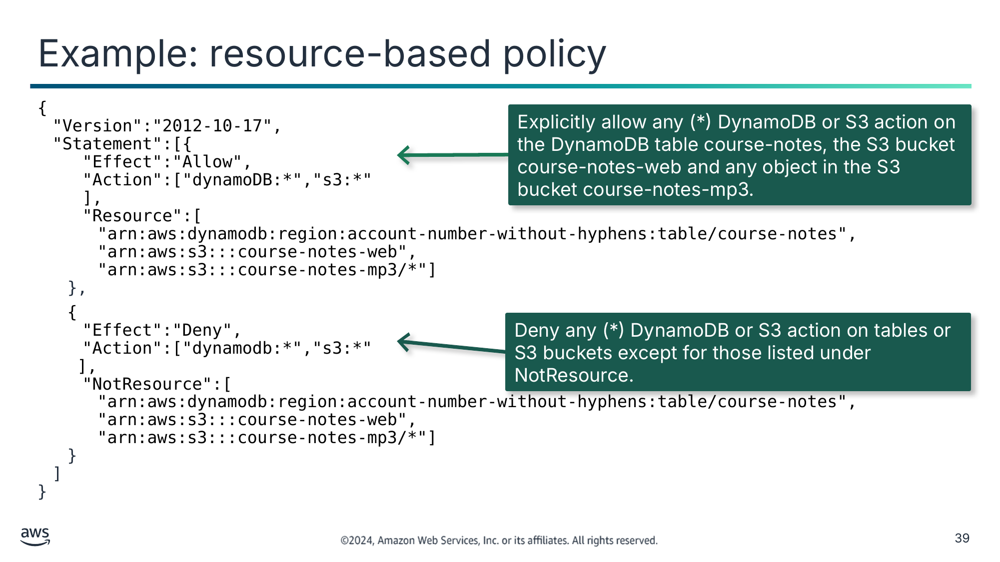

```
{
  "Version":"2012-10-17",
  "Statement":[{
      "Effect":"Allow",
      "Action":["dynamoDB:*","s3:*"
      ],
      "Resource":[
        "arn:aws:dynamodb:region:account-number-without-hyphens:table/course-notes",
        "arn:aws:s3:::course-notes-web",
        "arn:aws:s3:::course-notes-mp3/*"]
    },
```

```
    {
      "Effect":"Deny",
      "Action":["dynamodb:*","s3:*"
    ],
      "NotResource":[
        "arn:aws:dynamodb:region:account-number-without-hyphens:table/course-notes",
        "arn:aws:s3:::course-notes-web",
        "arn:aws:s3:::course-notes-mp3/*"]
    }
  ]
}
```

<details>
<summary>Текст зі схеми</summary>

Explicitly allow any (*) DynamoDB or S3 action on the DynamoDB table course-notes, the S3 bucket course-notes-web and any object in the S3 bucket course-notes-mp3. (Явно дозволити будь-яку (*) дію DynamoDB чи S3 для таблиці DynamoDB course-notes, бакета S3 course-notes-web і будь-якого об’єкта в бакеті S3 course-notes-mp3.)

Deny any (*) DynamoDB or S3 action on tables or S3 buckets except for those listed under NotResource. (Заборонити будь-яку (*) дію DynamoDB чи S3 для таблиць або бакетів S3, окрім перелічених у NotResource.)

</details>

> **Нотатки:**
>
> |Номер слайда 39  
> |Нотатки для інструктора  
> |  
> |Нотатки для студента  
> Політика використовує комбінацію явного дозволу та явної заборони для обмеження доступу в межах акаунта AWS.  
> Приклад політики IAM на цьому слайді дозволяє доступ лише до таких ресурсів:  
> Таблиця DynamoDB course-notes.  
> Бакети S3 course-notes-web і course-notes-mp3.  
> Елемент явної заборони ("Effect":"Deny") використовує елемент NotResource, щоб гарантувати, що користувачі не можуть використовувати жодних інших дій чи ресурсів DynamoDB або S3, окрім указаних у політиці. Це так, навіть якщо дозволи надано в іншій політиці. Явна інструкція deny має пріоритет над інструкцією allow.  
>
> У цілому ця політика IAM дозволяє доступ до конкретних ресурсів DynamoDB та Amazon S3. Потім вона явно забороняє доступ до будь-яких інших ресурсів DynamoDB чи Amazon S3 в акаунті.

---

## Слайд 40: Приклад: політика на основі ідентичності

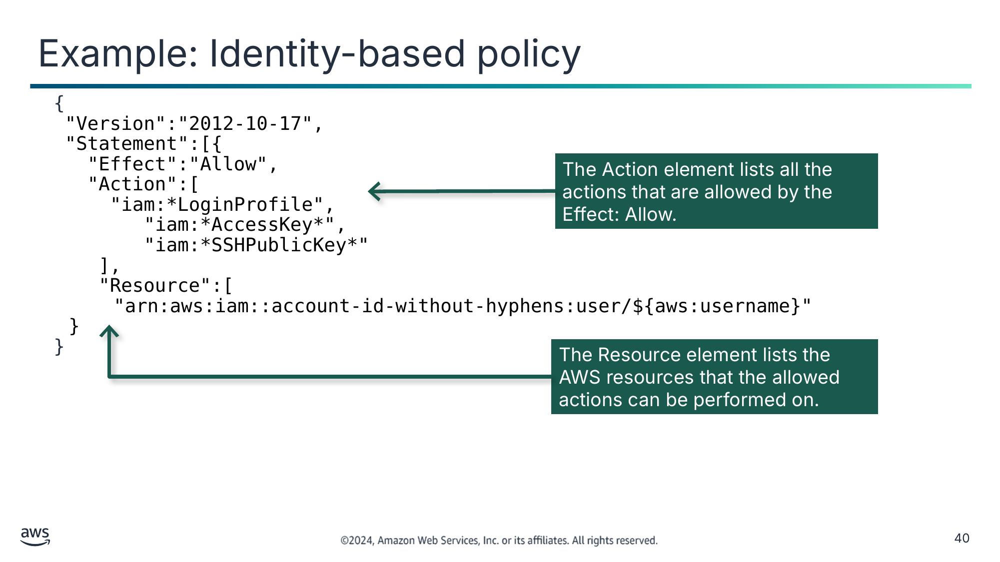

```
{
 "Version":"2012-10-17",
 "Statement":[{
   "Effect":"Allow",
   "Action":[
     "iam:*LoginProfile",
        "iam:*AccessKey*",
        "iam:*SSHPublicKey*"
      ],
      "Resource":[
        "arn:aws:iam::account-id-without-hyphens:user/${aws:username}"
  }
}
```

<details>
<summary>Текст зі схеми</summary>

The Action element lists all the actions that are allowed by the Effect: Allow. (Елемент Action перелічує всі дії, дозволені елементом Effect: Allow.)

The Resource element lists the AWS resources that the allowed actions can be performed on. (Елемент Resource перелічує ресурси AWS, над якими можна виконувати дозволені дії.)

</details>

> **Нотатки:**
>
> |Номер слайда 40  
> |Нотатки для інструктора  
> |  
> |Нотатки для студента  
> Після застосування політики на основі ідентичності до користувача, групи чи ролі політика дозволяє або забороняє сутності виконувати певні дії.  
>
> Слайд показує приклад політики на основі ідентичності. Якби цю політику було прикріплено до користувача IAM, користувач міг би виконувати такі дії:  
> Створювати, видаляти, отримувати чи оновлювати власний пароль за допомогою дій IAM LoginProfile.  
> Створювати, видаляти, переглядати списком чи оновлювати власний ключ доступу за допомогою дій IAM AccessKey.  
> Створювати, видаляти, отримувати, переглядати списком чи оновлювати власні ключі Secure Shell (SSH) за допомогою дій IAM SSHPublicKey.  
>
> Дії в політиці містять символи підстановки (wildcards), що позначаються зірочкою (*). Цей формат надає зручний спосіб включити набір пов’язаних дій. Зверніть увагу, що політика динамічно отримує ім’я користувача AWS, як визначено в ключі Resource.

---

## Слайд 41: Приклад: міжакаунтна політика на основі ресурсу

Політика, створена акаунтом A

```
{
    "Version": "2012-10-17",
    "Statement": {
      "Sid": "AccountBAccess1",
        "Principal": {"AWS": "111122223333"},
```

Номер акаунта Account B

```
        "Effect": "Allow",
        "Action": "s3:*",
        "Resource": [ 
            "arn:aws:s3:::DOC-EXAMPLE-BUCKET, 
        "arn:aws:s3:::DOC-EXAMPLE-BUCKET/*
        ]
    }
}
```

Дозволити акаунту B виконувати будь-яку дію S3 для DOC-EXAMPLE-BUCKET.

> **Нотатки:**
>
> |Номер слайда 41  
> |Нотатки для інструктора  
> |  
> |Нотатки для студента  
> Слайд надає приклад політики на основі ресурсу, що дозволяє міжакаунтний доступ. У цьому сценарії акаунт A створив політику на основі ресурсу. Політика надає акаунту B доступ до виконання будь-якої операції API Amazon S3 — що позначено зірочкою (*) — для бакета S3 з назвою DOC-EXAMPLE-BUCKET в акаунті A.  
>
> Ця політика бакета S3 не вказує жодних користувачів, груп чи ролей IAM. Натомість вона вказує акаунт B (номер акаунта AWS 111122223333). Акаунт B має створити політику користувача IAM, щоб дозволити користувачу в акаунті B доступ до бакета акаунта A.

---

## Слайд 42: Практична вправа: вивчення політик IAM (Examining IAM Policies)

- Інструкції політик IAM подано на наступних 3 слайдах.
- Відповідайте на запитання, що стосуються кожної політики IAM.


> **Нотатки:**
>
> |Номер слайда 42  
> |Нотатки для інструктора  
> |  
> |Нотатки для студента  
> У цій вправі під керівництвом викладача ви розглянете кілька прикладів політик IAM. Для кожної політики вам поставлять запитання про те, що ця політика дозволяє вам робити. Ваш викладач проведе обговорення кожного запитання й розкриватиме правильні відповіді по одній.

---

## Слайд 43: Практична вправа: аналіз політики IAM (1 із 3)

Розгляньте цю політику IAM, а потім відповідайте на запитання в міру їх подання.

```json
{
  "Version":"2012-10-17",
  "Statement":{
    "Effect":"Allow",
    "Action":[
      "iam:Get*",
      "iam:List*"
    ],
    "Resource":"*"
  }
}
```

1. До якого сервісу AWS ця політика надає доступ?

Відповідь**:** сервіс IAM.

2. Чи дозволяє політика користувачу створювати користувача, групу, політику чи роль IAM?

Відповідь**:** ні. Доступ обмежено запитами *get* і *list*. Політика фактично надає дозволи лише на читання.

3. Які щонайменше три конкретні дії дозволяє дія iam:Get*?

Відповідь**:** iam:Get* дозволяє такі дії, як GetGroup, GetPolicy і GetRole.

> **Нотатки:**
>
> |Номер слайда 43  
> |Нотатки для інструктора  
> |Зверніть увагу, що посібник студента, наданий студентам, містить розкриті відповіді.  
> |Пряме посилання на ресурс для запитання 3 — це довідник авторизації сервісів «Actions, resources, and condition keys for AWS Identity and Access Management (IAM)», що наведений на сторінці ресурсів вмісту вашого онлайн-курсу.  
> |  
> |Попросіть студентів переглянути політику IAM. Клацніть, щоб розкрити запитання 1, і дайте студентам переглянути та обговорити в групі. Після обговорення клацніть, щоб розкрити відповідь. Продовжте в тому самому форматі для запитання 2.  
> |  
> |Клацніть, щоб розкрити запитання 3. Попросіть студентів виконати кроки на слайді, щоб відкрити AWS Identity and Access Management User Guide й переглянути дії, доступні для сервісу IAM. Попросіть студентів визначити конкретні дії, які дозволяє дія iam:Get*. Після обговорення розкрийте відповідь.  
> |  
> |Нотатки для студента  
> Подивіться на приклад політики IAM. Ваш викладач поставить низку запитань, щоб оцінити, чи розумієте ви, які дії ця політика дозволятиме й забороняти. Скористайтеся посиланням, наданим на сторінці ресурсів вмісту вашого онлайн-курсу, щоб відповісти на запитання.

---

## Слайд 44: Практична вправа: аналіз політики IAM (2 із 3)

Розгляньте цю політику IAM, а потім відповідайте на запитання в міру їх подання.

```
{
  "Version":"2012-10-17",
  "Statement":[{
      "Effect":"Allow", "Action":"ec2:TerminateInstances",
      "Resource":"*"
    },
    {
      "Effect":"Deny",
    "Action":"ec2:TerminateInstances",
      "Condition":{
        "NotIpAddress":{
          "aws:SourceIp":[
            "192.0.2.0/24",
            "203.0.113.0/24"
          ]
        }
      },
      "Resource":"*"
...
```

1. Чи дозволяє політика користувачу завершити роботу будь-якого екземпляра EC2 у будь-який час без умов?

Відповідь**:** ні. Політика дозволяє дію, але застосовує умову.

2. Чи дозволяє політика користувачу завершити роботу екземпляра EC2 звідусіль?

Відповідь**:** ні. Виклик має надходити з одного з двох діапазонів IP-адрес, указаних у *aws:SourceIp*.

3. Якщо IP-адреса користувача — 192.0.2.243, чи зможе він завершити роботу екземпляра EC2 згідно з цією політикою?

Відповідь**:** так, оскільки діапазон IP-адрес 192.0.2.0/24 включає адреси від 192.0.2.0 до 192.0.2.255.

> **Нотатки:**
>
> |Номер слайда 44  
> |Нотатки для інструктора  
> |Попросіть студентів переглянути політику IAM. Клацніть, щоб розкрити запитання 1, і дайте студентам переглянути та обговорити в групі. Після обговорення клацніть, щоб розкрити відповідь. Продовжте в тому самому форматі для запитань 2 і 3.  
> |  
> |Нотатки для студента  
> Проаналізуйте цей другий приклад політики IAM. Ваш викладач поставить низку запитань, щоб оцінити, чи розумієте ви, які дії ця політика дозволятиме й забороняти.  
>
> Для запитання 3, щоб обчислити діапазон блока CIDR, можна скористатися ресурсом «CIDR to IPv4 Conversion tool» зі сторінки ресурсів вмісту вашого онлайн-курсу.

---

## Слайд 45: Практична вправа: аналіз політики IAM (3 із 3)

Розгляньте цю політику IAM, а потім відповідайте на запитання в міру їх подання.

```json
{
  "Version":"2012-10-17",
  "Statement":[{
      "Condition":{
        "StringNotEquals":{
          "ec2:InstanceType":[
            "t2.micro",
            "t2.small"]
        }
      },
  "Resource":"arn:aws:ec2:*:*:instance/*",
      "Action":[
        "ec2:RunInstances",
        "ec2:StartInstances"
      ],
      "Effect":"Deny"
    }
  ]
}
```

1. Які дії дозволяє політика?

Відповідь**:** вона не дозволяє жодних дій. Ефект — *заборона (deny)*.

2. Якби політика також включала таку інструкцію, який був би вплив?

	{

		"Effect": "Allow",

 		"Action": "ec2:*"

	}

Відповідь**:** політика дозволяла б повний доступ до Amazon EC2. Однак політика дозволяла б користувачу запускати лише екземпляри EC2 типів t2.micro або t2.small. Дозвіл був би незалежним від інструкції заборони з її умовами.

3. Якби політика включала інструкцію із запитання 2, чи міг би користувач завершити роботу екземпляра m3.xlarge в акаунті?

Відповідь**:** так. Політика забороняла б лише запуск чи старт, якщо тип екземпляра не є t2.micro або t2.small.

> **Нотатки:**
>
> |Номер слайда 45  
> |Нотатки для інструктора  
> |Попросіть студентів переглянути політику IAM. Клацніть, щоб розкрити запитання 1, і дайте студентам переглянути та обговорити в групі. Після обговорення клацніть, щоб розкрити відповідь. Продовжте в тому самому форматі для запитань 2 і 3.  
> |Примітка для запитання 3: заданий у запитанні тип екземпляра — m3.xlarge, а бажана дія — завершення роботи.  
> |  
> |Нотатки для студента  
> Розгляньте цей приклад політики IAM. Ваш викладач поставить низку запитань, щоб оцінити, чи розумієте ви, які дії ця політика дозволятиме й забороняти.

---

## Слайд 46: Ключові висновки: частини політики IAM

- Політики IAM зберігаються як документи JSON. Кожна інструкція містить інформацію про один дозвіл.
- Ключові елементи інструкції політики IAM включають ефект (effect), дію (action) і ресурси (resources). Разом ці елементи визначають дозволи політики.

> **Нотатки:**
>
> |Номер слайда 46  
> |Нотатки для інструктора  
> |  
> |Нотатки для студента  
> Ці ключові висновки підсумовують цей розділ.

---

## Слайд 47: Покрокова лабораторна робота: вивчення AWS Identity and Access Management (IAM) (Exploring IAM lab)

> **Нотатки:**
>
> |Номер слайда 47  
> |Нотатки для інструктора  
> |  
> |Нотатки для студента  
> Зараз ви виконаєте лабораторну роботу. Наступні слайди підсумовують, що ви робитимете в лабораторній роботі, а докладні інструкції ви знайдете в лабораторному середовищі.

---

## Слайд 48: Завдання лабораторної роботи «Вивчення IAM»:

- У цій лабораторній роботі ви виконаєте такі основні завдання:
  - Експериментування з політиками IAM
  - Додавання користувачів до груп IAM
  - Використання URL для входу IAM

> **Нотатки:**
>
> |Номер слайда 48  
> |Нотатки для інструктора  
> |<Add directions to find the lab guide information.>  
> |  
> |Нотатки для студента  
> Отримайте доступ до лабораторного середовища через ваш онлайн-курс, щоб дізнатися додаткові подробиці та виконати лабораторну роботу.

---

## Слайд 49: Підсумки лабораторної роботи: вивчення IAM

- Де ви отримуєте доступ до сервісу AWS Identity and Access Management (IAM)?
- Що відбувається, коли керовану політику оновлюють?

> **Нотатки:**
>
> |Номер слайда 49  
> |Нотатки для інструктора  
> |Відповідні архітектурні схеми «до» та «після» включено до інструкцій кожної лабораторної роботи. Вам може бути корисно відкрити схеми лабораторної роботи під час підбиття підсумків цієї лабораторної роботи.  
> |Запропоновані відповіді на запитання 1: де ви отримуєте доступ до сервісу AWS Identity and Access Management (IAM)?  
> |  
> |Оберіть меню Services, оберіть Security, Identity, & Compliance, а потім оберіть IAM.  
> |  
> |Запропоновані відповіді на запитання 2: що таке керована політика (managed policy) і що відбувається, коли її оновлюють?  
> |  
> |Керовані політики — це попередньо створені політики (створені або AWS, або вашими адміністраторами), які можна прикріплювати до користувачів і груп IAM. Коли політику оновлюють, зміни політики негайно застосовуються до всіх користувачів і груп, до яких прикріплено політику.  
> |  
> |У цій лабораторній роботі ви вивчали групу з керованою політикою AmazonEC2ReadOnlyAccess.  
> |  
> |Нотатки для студента  
> Ваш інструктор може розглянути ці запитання з вами, або ви можете розглянути їх самостійно. Скористайтеся цією нагодою, щоб поглибити своє мислення щодо завдань, які ви виконували під час лабораторної роботи.

---

## Слайд 50: Підсумки модуля

Захист доступу

> **Нотатки:**
>
> |Номер слайда 50  
> |Нотатки для інструктора  
> |  
> |Нотатки для студента  
> Цей розділ підсумовує те, що ви дізналися, і завершує модуль.

---

## Слайд 51: Резюме модуля

Цей модуль підготував вас до такого:

- Описувати принципи безпеки в хмарі AWS.
- Пояснювати призначення користувачів, груп і ролей IAM.
- Пояснювати, як політики IAM визначають дозволи в акаунті AWS.

> **Нотатки:**
>
> |Номер слайда 51  
> |Нотатки для інструктора  
> |  
> |Нотатки для студента  
> Цей модуль повторив ключові концепції безпеки, що застосовуються до всіх частин ваших хмарних рішень.

---

## Слайд 52: Міркування щодо кафе

- Обговоріть, як ви, як хмарний архітектор, могли б порадити кафе на основі ключового занепокоєння хмарного архітектора, поданого на початку цього модуля.


> **Нотатки:**
>
> Використайте бізнес кафе як приклад, щоб застосувати те, що ви дізналися в цьому модулі, до побудови хмарної архітектури. Які типи міркувань щодо доступу можуть знадобитися для персоналу кафе?  
>

---

## Слайд 53: Перевірка знань модуля

- Перевірка знань проводиться онлайн у вашому курсі.
- Перевірка знань включає 10 запитань на основі матеріалу, поданого на слайдах і в нотатках до слайдів.
- Ви можете повторно проходити перевірку знань стільки разів, скільки захочете.

> **Нотатки:**
>
> |Номер слайда 53  
> |Нотатки для інструктора  
> |  
> |Нотатки для студента  
> Скористайтеся своїм онлайн-курсом, щоб отримати доступ до перевірки знань для цього модуля.

---

## Слайд 54: Зразок запитання іспиту

Команді розробників потрібен доступ до кількох сервісів і ресурсів у віртуальній приватній хмарі (VPC) протягом 9 місяців. Члени команди, імовірно, змінюватимуться під час проєкту. Який варіант задовольняє цю вимогу та відповідає ключовим принципам безпеки?

Визначте ключові слова та фрази, перш ніж продовжувати.

Ось ключові слова та фрази:

- Команда розробників, що, імовірно, змінюватиметься
- Потрібен доступ на 9 місяців
- Відповідає ключовим принципам безпеки

> **Нотатки:**
>
> |Номер слайда 54  
> |Нотатки для інструктора  
> |Розділ із ключовими словами налаштовано з анімацією для розкриття за клацанням.  
> |  
> |Нотатки для студента  
> Запитання визначає потребу команди розробників мати доступ до ресурсів протягом певного часу. Те, що це команда розробників, означає, що розробникам знадобиться подібний доступ до ресурсів. Указана тривалість наводить на думку, що цим користувачам не потрібен буде доступ після завершення цього періоду. Запитання також вимагає мислити категоріями ключових принципів безпеки

---

## Слайд 55: Зразок запитання іспиту: варіанти відповідей

**Команді розробників** потрібен доступ до кількох сервісів і ресурсів у віртуальній приватній хмарі (VPC) протягом **9 місяців**. Який варіант задовольняє цю вимогу та **відповідає ключовим принципам безпеки**?

**Варіант**

**Відповідь**

**A**

Створити єдиного користувача IAM для команди розробників і прикріпити до користувача потрібні політики IAM.

**B**

Створити користувача IAM для кожного розробника й прикріпити до кожного користувача потрібні політики IAM.

**C**

Створити користувача IAM для кожного розробника, помістити їх усіх у групу IAM і прикріпити до групи потрібні політики IAM.

**D**

Створити єдиного користувача IAM для команди розробників, помістити його в групу IAM і прикріпити до групи потрібні політики IAM.

> **Нотатки:**
>
> |Номер слайда 55  
> |Нотатки для інструктора  
> |  
> |Нотатки для студента  
> Використайте ключові слова, які ви визначили на попередньому слайді, і розгляньте кожен із можливих варіантів відповіді, щоб визначити, який із них найкраще відповідає запитанню.

---

## Слайд 56: Зразок запитання іспиту: відповідь

Правильна відповідь — C.

**Варіант**

**Відповідь**

**C**

Створити користувача IAM для кожного розробника, помістити їх усіх у групу IAM і прикріпити до групи потрібні політики IAM.

> **Нотатки:**
>
> |Номер слайда 56  
> |Нотатки для інструктора  
> |  
> |Нотатки для студента  
> Варіанти A і D (створення єдиного спільного користувача IAM для команди) не слід впроваджувати. Спільне використання кількома користувачами одного облікового запису користувача — загалом погана практика безпеки. Пароль спільний для всіх користувачів, і ви втрачаєте індивідуальну відповідальність за дії, виконані обліковим записом користувача.  
>
> Варіант B (користувачі IAM для кожного розробника та політики IAM, прикріплені до кожного користувача) працюватиме, але це не найефективніший варіант керування командою, особливо коли ймовірно, що розробників додаватимуть чи вилучатимуть під час проєкту.  
>
> Варіант C (розміщення користувачів у групі та прикріплення політики до групи) — найкращий вибір. Прикріплення політики до групи застосовує однакові правила доступу до всіх членів групи. Цей метод також автоматично застосовує правила доступу до нових користувачів, доданих до групи, і вилучає ці правила доступу в користувачів, вилучених із групи.

---

## Слайд 57: Дякуємо

Виправлення, відгуки чи інші запитання?

Зв’яжіться з нами за адресою [https://support.aws.amazon.com/#/contacts/aws-academy](https://support.aws.amazon.com/#/contacts/aws-academy).

> **Нотатки:**
>
> |Номер слайда 57  
> |Нотатки для інструктора  
> |  
> |Нотатки для студента  
> На цьому цей модуль завершено. Сторінка ресурсів вмісту вашого курсу містить посилання на додаткові ресурси, пов’язані з цим модулем.
