## Слайд 1: Додавання рівня сховища за допомогою Amazon S3 (Adding a Storage Layer with Amazon S3)

AWS Academy Cloud Architecting

> **Нотатки:**
>
> |Номер слайда 1  
> |Нотатки для інструктора  
> |  
> |Нотатки для студента

---

## Слайд 2: Вступ

Додавання рівня сховища за допомогою Amazon S3

> **Нотатки:**
>
> |Номер слайда 2  
> |Нотатки для інструктора  
> |  
> |Нотатки для студента  
> Цей вступний розділ описує вміст модуля.

---

## Слайд 3: Цілі модуля

Цей модуль готує вас до такого:

- Визначати Amazon Simple Storage Service (Amazon S3) і як він працює.
- Розпізнавати проблеми, які може розв’язати Amazon S3.
- Описувати, як переміщувати дані до Amazon S3 і з нього.
- Ефективно керувати зберіганням контенту за допомогою Amazon S3.
- Рекомендувати доречне використання Amazon S3 на основі вимог.
- Налаштовувати статичний вебсайт на Amazon S3.
- Використовувати принципи AWS Well-Architected Framework під час проєктування рівня сховища з Amazon S3.

> **Нотатки:**
>
> |Номер слайда 3  
> |Нотатки для інструктора  
> |  
> |Нотатки для студента

---

## Слайд 4: Огляд модуля

**Розділи презентації**

- Визначення Amazon S3
- Використання Amazon S3
- Переміщення даних до Amazon S3 і з нього
- Зберігання контенту за допомогою Amazon S3
- Проєктування з Amazon S3
- Застосування принципів AWS Well-Architected Framework до сховища

**Демонстрації**

- Amazon S3 Transfer Acceleration
- Керування життєвими циклами в Amazon S3 (Managing Lifecycles in Amazon S3)
- Керування версіями Amazon S3 (Amazon S3 Versioning)

**Практична вправа**

- Проєктування з Amazon S3 (Designing with Amazon S3)

**Перевірки знань**

- 10-запитальна перевірка знань
- Зразок запитання іспиту

> **Нотатки:**
>
> |Номер слайда 4  
> |Нотатки для інструктора  
> |Кожен модуль має вступ, розділи з вмістом і підсумок. Підсумок цього модуля містить зразок запитання іспиту для розбору зі студентами.  
> |  
> |Нотатки для студента  
> Цілі цього модуля розкриваються в кількох розділах.  
>
> Ви також візьмете участь у практичній вправі про те, як налаштувати Amazon S3 для певного сценарію використання.  
>
> Ваш інструктор також може продемонструвати перелічені функції. Модуль завершується 10-запитальною перевіркою знань, що проводиться в онлайн-курсі, та зразком запитання іспиту для обговорення в класі.  
>
> Наступний слайд описує лабораторну роботу цього модуля.

---

## Слайд 5: Практична лабораторна робота в цьому модулі

Лабораторна робота-виклик (кафе) (Challenge (Café) lab)

- Створення статичного вебсайту для кафе (Creating a Static Website for the Café)

> **Нотатки:**
>
> |Номер слайда 5  
> |Нотатки для інструктора  
> |Цей модуль містить лабораторну роботу-виклик (кафе). Лабораторні роботи кафе доповнюють архітектуру кафе, що еволюціонує, і розроблені як лабораторні роботи-виклики, де студентів просять виконати трохи більше роботи без покрокових інструкцій. Розділи лабораторних робіт у межах модуля включають вступи до кожної лабораторної роботи та сценарію кафе.  
> |  
> |Нотатки для студента  
> Цей модуль містить зазначену лабораторну роботу кафе. Додаткова інформація про цю лабораторну роботу міститься в посібнику студента там, де вона виконується, а лабораторне середовище надає докладні інструкції.

---

## Слайд 6: Як хмарний архітектор, що працює з Amazon S3:

- Мені потрібно враховувати шаблони доступу та сценарії використання бізнесу, щоб я міг обрати варіанти конфігурації Amazon S3, що оптимізують витрати, водночас підтримуючи вимоги до продуктивності та відповідності.
- Мені потрібно застосовувати найкращі практики безпеки, щоб рівень сховища був захищений від небажаного доступу та випадкової втрати даних.


> **Нотатки:**
>
> |Номер слайда 6  
> |Нотатки для інструктора: цей слайд подає ключові наскрізні міркування проєктування, що мають спрямовувати ухвалення рішень для цього рівня хмарної архітектури. Підкресліть, що хмарний архітектор завжди має починати з бізнес-кейсу й рухатися у зворотному напрямку, щоб обрати найкращі компоненти для цього сценарію використання. Також нагадайте студентам, що рішення, імовірно, еволюціонуватимуть з часом, у міру зміни чи кращого розуміння потреб, для оптимізації вартості та продуктивності. Наприкінці модуля в підсумковому розділі включено необов’язкове обговорення, що спонукає студентів розглянути ці чинники в контексті сценарію з кафе.  
> |  
> |Нотатки для студента  
> Цей слайд просить вас прийняти перспективу хмарного архітектора, коли ви думаєте про те, як підходити до проєктування хмарної мережі. Тримайте ці міркування в голові, просуваючись цим модулем. Також пам’ятайте, що хмарний архітектор має працювати у зворотному напрямку від бізнес-потреби, щоб спроєктувати найкращу архітектуру для конкретного сценарію використання. Просуваючись модулем, розглядайте сценарій з кафе, поданий у курсі, як приклад бізнес-потреби й думайте про те, як би ви використали сховище Amazon Simple Storage Service (Amazon S3) для кафе.

---

## Слайд 7: Визначення Amazon S3

Додавання рівня сховища за допомогою Amazon S3

> **Нотатки:**
>
> |Номер слайда 7  
> |Нотатки для інструктора  
> |Цей розділ зосереджений на типах сховищ, подробицях про Amazon S3 та перевагах, які Amazon S3 надає клієнтам.  
> |Нотатки для студента  
> Цей розділ описує Amazon S3.

---

## Слайд 8: Типи сховищ

Блочне сховище (Block storage)

Файлове сховище (File storage)

Об’єктне сховище (Object storage)

Дані зберігаються на пристрої у блоках фіксованого розміру.

Дані зберігаються в ієрархічній структурі.

Дані зберігаються як об’єкти на основі атрибутів і метаданих.

> **Нотатки:**
>
> |Номер слайда 8  
> |Нотатки для інструктора  
> |  
> |Нотатки для студента  
> Сховища бувають трьох основних типів: блочне, файлове та об’єктне. Кожен із цих типів сховищ має певне призначення, і ви, імовірно, працюватимете з усіма трьома типами.  
>
> Дані блочного сховища (block storage) зберігаються на пристрої у блоках фіксованого розміру. Застосунки та файлові системи регулюють, як блоки доступні, поєднуються й змінюються. Блочне сховище розбиває дані на блоки, а потім зберігає ці блоки як окремі частини, кожна з унікальним ідентифікатором. Ці блоки зберігаються там, де це найефективніше. Таким чином, блоки можуть зберігатися в різних системах, і кожен блок можна налаштувати для роботи з різними операційними системами.  
>
> Файлове сховище (file storage) — це методологія, що допомагає користувачам, застосункам і сервісам отримувати доступ до даних у спільній файловій системі. Дані зберігаються в ієрархічній структурі. Ця структура подібна до централізованого спільного мережевого диска в компанії, де працівники зберігають файли й отримують до них доступ.  
>
> Файли об’єктного сховища (object storage) зберігаються як об’єкти на основі атрибутів і метаданих. Кожен об’єкт складається з даних, метаданих і ключа об’єкта. Метадані містять інформацію про дані (розмір об’єкта, призначення об’єкта тощо), а ключ об’єкта — це унікальний ідентифікатор об’єкта. Коли ви оновлюєте файли в об’єктному сховищі, оновлюється весь об’єкт-файл, а не частина файлу, як у блочному сховищі.

---

## Слайд 9: Amazon S3

- Amazon S3 зберігає величезні (необмежені) обсяги неструктурованих даних.
- Amazon S3 зберігає файли даних як об’єкти в бакеті, який ви визначаєте.
- П’ять ТБ — максимальний розмір файлу одного об’єкта.
- Об’єкти мають глобально унікальну URL-адресу (універсальний простір імен).
- Об’єкти мають ключ, ідентифікатор версії, значення, метадані та підресурси.


Amazon S3

> **Нотатки:**
>
> |Номер слайда 9  
> |Нотатки для інструктора  
> |  
> |Нотатки для студента  
> Amazon S3 — це сервіс об’єктного сховища. Ви можете використовувати його для зберігання практично необмежених обсягів даних.  
> Файли даних зберігаються як об’єкти. Ви розміщуєте об’єкти в бакеті, який визначаєте. Кожен бакет повинен мати назву, глобально унікальну для всіх регіонів, що означає, що назва бакета має бути унікальною серед усіх акаунтів клієнтів AWS.  
> Об’єкти, які ви зберігаєте, можуть мати розмір від 0 байтів до 5 ТБ. Хоча окремі об’єкти не можуть бути більшими за 5 ТБ, ви можете зберігати стільки загальних даних, скільки потрібно.  
> Об’єкти мають глобально унікальну URL-адресу (універсальний простір імен).  
>
> Кожен об’єкт має п’ять постійних характеристик:  
> По-перше, він має ключ (key) — це назва, яку ви призначаєте об’єкту. Ви використовуєте ключ об’єкта для його отримання. В AWS Management Console можна створити каталог усередині бакета й завантажити об’єкт до цього каталогу. Однак насправді Amazon S3 не знає про каталоги, тож значення ключа включає повний шлях відносно кореня бакета.  
> Об’єкти також містять ідентифікатор версії (version ID). У бакеті ключ і ідентифікатор версії однозначно ідентифікують об’єкт. Докладніше про керування версіями ви дізнаєтеся пізніше в цьому модулі.  
> Значення (value) об’єкта — це фактичний вміст, який ви зберігаєте. Це може бути будь-яка послідовність байтів. Значення об’єктів незмінні (immutable), що означає, що після завантаження об’єкта ви не можете змінити значення. Якщо потрібно змінити об’єкт, ви маєте внести зміну поза Amazon S3, а потім повторно завантажити об’єкт.  
> Об’єкти також містять метадані (metadata) — набір пар «ім’я-значення», які можна використовувати для зберігання інформації про об’єкт. Ви можете призначати метадані (так звані користувацькі метадані) своїм об’єктам в Amazon S3. Amazon S3 також призначає цим об’єктам системні метадані, які використовує для керування об’єктами.  
> Нарешті, Amazon S3 також використовує підресурси (sub-resources) для зберігання додаткової інформації, специфічної для об’єкта.  
>
> Докладніше про Amazon S3 див. посилання, наведене на сторінці ресурсів курсу.

---

## Слайд 10: Компоненти Amazon S3

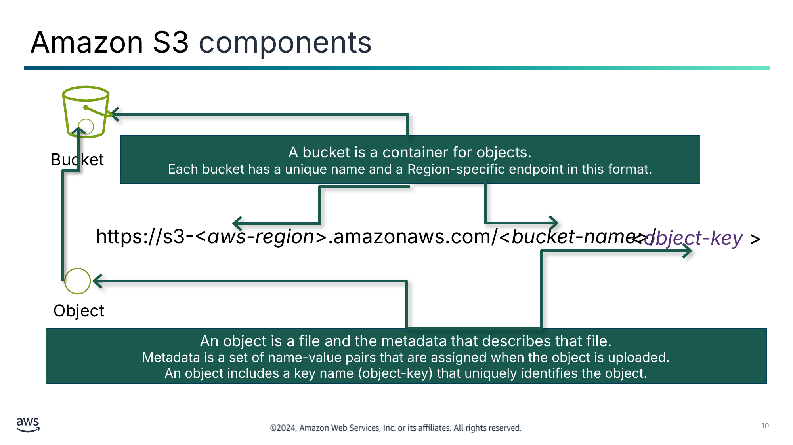

A bucket is a container for objects. (Бакет — це контейнер для об’єктів.)

Each bucket has a unique name and a Region-specific endpoint in this format. (Кожен бакет має унікальну назву та регіональну кінцеву точку в такому форматі.)

https://s3-<*aws-region*>.amazonaws.com/<*bucket-name*>/

<*object-key* >

An object is a file and the metadata that describes that file. (Об’єкт — це файл і метадані, що описують цей файл.)

Metadata is a set of name-value pairs that are assigned when the object is uploaded. (Метадані — це набір пар «ім’я-значення», що призначаються під час завантаження об’єкта.)

An object includes a key name (object-key) that uniquely identifies the object. (Об’єкт включає назву ключа (object-key), що однозначно ідентифікує об’єкт.)

<details>
<summary>Текст зі схеми</summary>

Bucket (Бакет)

Object (Об’єкт)

</details>

> **Нотатки:**
>
> |Номер слайда 10  
> |Нотатки для інструктора  
> |  
> |Нотатки для студента  
> Пам’ятайте, що об’єкти розміщуються в бакетах. Ось деяка високорівнева інформація про основні компоненти Amazon S3:  
> Бакет (bucket) — це контейнер для об’єктів, що зберігаються в Amazon S3. Бакети виконують кілька функцій. Вони впорядковують простір імен Amazon S3 на найвищому рівні й ідентифікують акаунт, відповідальний за плату за сховище та передавання даних. Вони також відіграють роль у контролі доступу й слугують одиницею агрегації для звітів про використання.  
> Об’єкт (object) — це фундаментальна сутність, що зберігається в Amazon S3. Об’єкт може бути будь-яким типом файлу, як-от текст, відео, фото чи інший двійковий формат. Об’єкти складаються з даних об’єкта та метаданих. Метадані — це набір пар «ім’я-значення», що описують об’єкт.  Наприклад, метадані включають тип контенту (як-от зображення чи відео), що включається в заголовок відповіді на запит браузера, щоб браузер знав, як відображати файл.  
> Ключ об’єкта (object key) однозначно ідентифікує об’єкт у бакеті. Кожен об’єкт у бакеті має рівно один ключ.  
>
> Кожен бакет регіональний. Ви можете обрати регіон AWS, де Amazon S3 зберігатиме створені вами бакети. Об’єкти, збережені в регіоні AWS, ніколи не залишають регіону, якщо ви явно не передасте їх до іншого регіону. Код регіону вказує на регіон. Наприклад, код регіону для бакета, створеного в регіоні US Oregon, — us-west-2.  
>
> Докладніше про концепції Amazon S3 і те, як він працює, див. посилання, наведене на сторінці ресурсів курсу.

---

## Слайд 11: Використання префіксів для імітації структури папок у бакеті S3

Наведені об’єкти розташовані в бакеті з назвою `graphics-bucket`.

```
photos/2022/catpiano.jpg
photos/2022/catonphone.jpg
photos/2022/ninepuppies.png
photos/2021/lakefront.png
photos/2021/coveredbridge.png
photos/2021/openairmarket.jpg
video-source/9984.mp4
video-source/9918.mp4
video-source/18446.mp4
```

Запит `GET` з префіксом  `photos/2022` повертає такі об’єкти:

```
graphics-bucket/photos/2022/catpiano.jpg
graphics-bucket/photos/2022/catonphone.jpg
graphics-bucket/photos/2022/ninepuppies.png
```

> **Нотатки:**
>
> |Номер слайда 11  
> |Нотатки для інструктора  
> |Префікси працюють як папки, але ви можете підкреслити студентам відмінність.  
> |Нотатки для студента  
> В Amazon S3 бакети та об’єкти є основними ресурсами, а об’єкти зберігаються в бакетах. Для організаційної простоти Amazon S3 підтримує концепцію папок для групування об’єктів. Amazon S3 використовує спільний префікс імені для об’єктів (тобто об’єктів, імена яких починаються зі спільного рядка). Коли ви створюєте папку, консоль Amazon S3 створює об’єкт із назвою, за якою йде скісна риска (/). Потім консоль Amazon S3 відображає цей об’єкт як папку.  
>
> Коли виконується запит до бакета S3, префікс обмежує результати лише тими об’єктами, що починаються з цього префікса. У прикладі бакет містить об’єкти-фотографії, упорядковані за роками. Щоб отримати фото за 2022 рік, вкажіть префікс photos/2022.  
>
> Докладніше див. посилання «Organizing Objects Using Prefixes» у ресурсах вашого курсу.

---

## Слайд 12: Переваги Amazon S3

| Перевага (Benefit) | Опис (Description) |
|---|---|
| Довговічність (Durability) | • Допомагає гарантувати, що дані не втрачаються<br>• Забезпечує сховище S3 Standard із 11 дев’ятками (або 99,999999999 відсотка) довговічності |
| Доступність (Availability) | • Забезпечує доступ до даних за потреби<br>• Включає необмежену потужність для зберігання даних<br>• Забезпечує сховище S3 Standard із 4 дев’ятками (або 99,99 відсотка) доступності |
| Висока продуктивність (High performance) | • Досягає тисяч транзакцій щосекунди під час завантаження та отримання даних зі сховища<br>• Автоматично масштабується до високих темпів запитів |

> **Нотатки:**
>
> |Номер слайда 12  
> |Нотатки для інструктора  
> |  
> |Нотатки для студента  
> Цей слайд описує три ключові переваги Amazon S3 для хмарного сховища.  
>
> По-перше, він забезпечує довговічність (durability), що описує середньорічну очікувану втрату об’єктів. Термін «11 дев’яток довговічності» означає, що щороку існує 0,000000001-відсотковий шанс втратити об’єкт. Наприклад, якщо ви зберігаєте 10 000 об’єктів в Amazon S3, ви можете очікувати втрату одного об’єкта в середньому раз на 10 000 000 років. Amazon S3 надлишково зберігає ваші об’єкти на кількох пристроях у кількох об’єктах інфраструктури в регіоні Amazon S3, який ви визначите. Amazon S3 розроблено, щоб витримувати одночасні відмови пристроїв, швидко виявляючи та відновлюючи будь-яку втрачену надлишковість. Amazon S3 також регулярно перевіряє цілісність ваших даних за допомогою контрольних сум.  
>
> Amazon S3 також забезпечує 4 дев’ятки (або 99,99 відсотка) доступності (availability). Доступність означає вашу здатність швидко отримувати доступ до даних, коли вам це потрібно. Він також забезпечує практично необмежену потужність для зберігання ваших даних, тож він масштабований. Amazon S3 має надійні налаштування безпеки. Він надає багато способів контролю доступу до даних, які ви зберігаєте, а також дає змогу шифрувати дані.  
>
> Нарешті, Amazon S3 високопродуктивний (high performing). Ваші застосунки можуть досягати тисяч транзакцій на секунду під час завантаження та отримання даних зі сховища Amazon S3. Amazon S3 автоматично масштабується до високих темпів запитів.

---

## Слайд 13: Ключові висновки: визначення Amazon S3

- Сховища бувають трьох основних типів: блочне, файлове та об’єктне.
- Amazon S3 — це сервіс об’єктного сховища.
- Amazon S3 зберігає величезні обсяги неструктурованих даних.
- Бакет — це контейнер для об’єктів, що зберігаються в Amazon S3.
- Об’єкт — це фундаментальна сутність, що зберігається в Amazon S3.
- Ключові переваги Amazon S3 включають довговічність, доступність і високу продуктивність.

> **Нотатки:**
>
> |Номер слайда 13  
> |Нотатки для інструктора  
> |  
> |Нотатки для студента  
> Ось кілька ключових моментів, що підсумовують цей розділ.

---

## Слайд 14: Використання Amazon S3

Додавання рівня сховища за допомогою Amazon S3

> **Нотатки:**
>
> |Номер слайда 14  
> |Нотатки для інструктора  
> |Цей розділ зосереджений на тому, як клієнти можуть використовувати Amazon S3 для підтримки свого бізнесу. Він також включає чотири бізнес-сценарії використання Amazon S3.  
> |Нотатки для студента  
> Цей розділ описує різні сценарії використання, які Amazon S3 підтримує для рішень клієнтів.

---

## Слайд 15: Як клієнти використовують Amazon S3

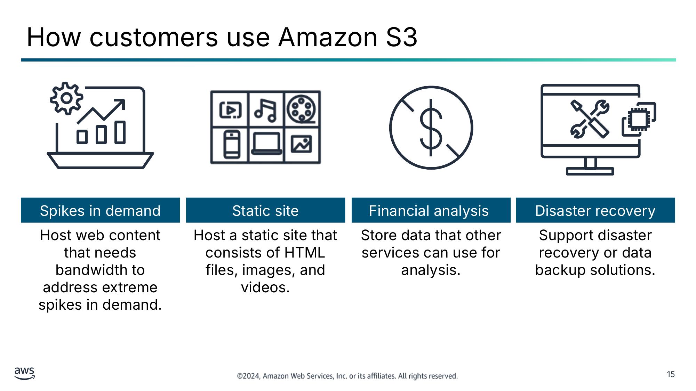

Spikes in demand (Сплески попиту)

Static site (Статичний сайт)

Financial analysis (Фінансовий аналіз)

Disaster recovery (Аварійне відновлення)

Host web content that needs bandwidth to address extreme spikes in demand. (Розміщення вебконтенту, якому потрібна пропускна здатність для обробки екстремальних сплесків попиту.)

Host a static site that consists of HTML files, images, and videos. (Розміщення статичного сайту, що складається з файлів HTML, зображень і відео.)

Store data that other services can use for analysis. (Зберігання даних, які інші сервіси можуть використовувати для аналізу.)

Support disaster recovery or data backup solutions. (Підтримка рішень для аварійного відновлення чи резервного копіювання даних.)

> **Нотатки:**
>
> |Номер слайда 15  
> |Нотатки для інструктора  
> |  
> |Нотатки для студента  
> Тепер, коли ви знаєте про функції Amazon S3, як клієнти можуть використовувати ці функції для задоволення своїх потреб?  
>
> У цьому розділі модуля ви дізнаєтеся про поширені сценарії використання та побачите, як вони пов’язані з проблемами, розглянутими на цьому слайді.  
>
> Ці сценарії використання застосовують Amazon S3 як важливу частину надійного архітектурного рішення.

---

## Слайд 16: Сценарій використання: розміщення медіа (media hosting)

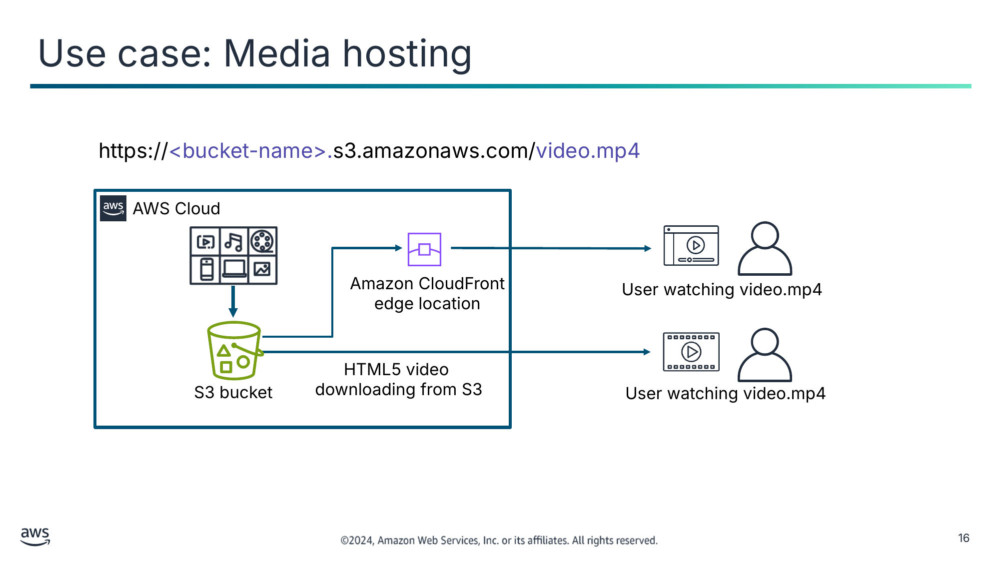

https://<bucket-name>.s3.amazonaws.com/video.mp4

<details>
<summary>Текст зі схеми</summary>

AWS Cloud

Amazon CloudFront  
edge location (Периферійна локація Amazon CloudFront)

User watching video.mp4 (Користувач переглядає video.mp4)

HTML5 video

downloading from S3 (Відео HTML5, що завантажується з S3)

S3 bucket (Бакет S3)

User watching video.mp4

</details>

> **Нотатки:**
>
> |Номер слайда 16  
> |Нотатки для інструктора  
> |  
> |Нотатки для студента  
> Опис зображення: схема бакета S3 із відеоконтентом і двох користувачів, що транслюють контент із нього. Один користувач отримує потік безпосередньо, а інший — через периферійну локацію CloudFront. Кінець опису.  
>
> Один із поширених сценаріїв використання Amazon S3 — розміщення медіа. У цьому сценарії Amazon S3 використовується для зберігання та розповсюдження відео, фотографій, музичних файлів та іншого медіаконтенту. Цей контент можна доставляти безпосередньо з Amazon S3, оскільки кожен об’єкт в Amazon S3 має унікальну HTTP-адресу URL.  
>
> Як варіант, Amazon S3 може слугувати початковим сховищем (origin store) для мережі доставки контенту (CDN), як-от Amazon CloudFront. Еластичність Amazon S3 робить його добре придатним для розміщення вебконтенту, якому потрібна пропускна здатність для обробки екстремальних сплесків попиту. Також, оскільки для Amazon S3 не потрібно розгортати сховище, він добре підходить для сайтів, що швидко зростають і розміщують великі обсяги користувацького контенту, як-от сайти обміну відео та фото.

---

## Слайд 17: Сценарій використання: розміщення статичних вебсайтів

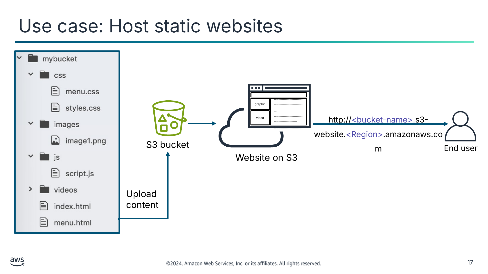

<details>
<summary>Текст зі схеми</summary>

graphic

---------------------------------

---------------------------------

----------------------------------

----------------------------------

----------------------------------

---------------------------------

-------------------------

--------------------------------

------------------------------

video

http://<bucket-name>.s3-website.<Region>.amazonaws.com

S3 bucket (Бакет S3)

End user (Кінцевий користувач)

Website on S3 (Вебсайт на S3)

Upload  
content (Завантаження контенту)

</details>

> **Нотатки:**
>
> |Номер слайда 17  
> |Нотатки для інструктора  
> |  
> |Нотатки для студента  
> Опис зображення: схема показує приклади об’єктів, що зберігаються в бакеті S3, налаштованому для розміщення статичного вебсайту. Вміст бакета включає файли HTML, .js і .css, а кінцевий користувач може переглядати вебсайт за URL-адресою у вигляді http://bucket-name.s3-website.Region.amazonaws.com. Кінець опису.  
>
> Другий сценарій використання Amazon S3 — використання сервісу для розміщення статичного вебсайту. На статичному вебсайті окремі вебсторінки містять статичний контент. Вони також можуть містити клієнтські скрипти.  
>
> Натомість динамічний вебсайт спирається на серверну обробку, що може включати запити до бази даних, які виконуються у відповідь на серверні скрипти, як-от PHP, JSP чи ASP.NET. Amazon S3 не підтримує серверних скриптів. Однак AWS пропонує інші сервіси, які можна використовувати для розміщення динамічних вебсайтів.  
>
> Щоб розмістити статичний вебсайт, налаштуйте бакет S3 для розміщення вебсайту та прикріпіть політику бакета, що дозволяє доступ до об’єктів. Потім завантажте вміст вашого вебсайту до бакета.  
>
> Приклад показує, що статичний сайт може складатися з файлів HTML, зображень, відео та клієнтських скриптів у форматах, як-от JavaScript.  
>
> За такого підходу вам не потрібно запускати віртуальну машину, що розміщує вебсервер. Фактично вам не потрібно запускати сервер. Однак ви все одно можете розміщувати вебсайт. Amazon S3 надає недороге рішення для вебхостингу, що включає високу продуктивність, масштабованість і доступність.

---

## Слайд 18: Сценарій використання: сховище даних для обчислень і аналітики

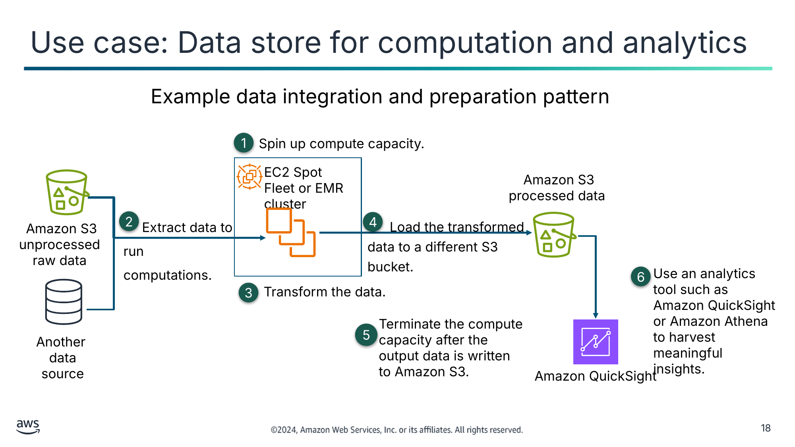

Example data integration and preparation pattern (Приклад шаблону інтеграції та підготовки даних)

<details>
<summary>Текст зі схеми</summary>

1

Spin up compute capacity. (Розгорніть обчислювальні потужності.)

EC2 Spot Fleet or EMR cluster (Парк EC2 Spot Fleet або кластер EMR)

Amazon S3

processed data (Оброблені дані Amazon S3)

     Extract data to run computations. (Витягніть дані для виконання обчислень.)

Amazon S3

unprocessed  
raw data (Необроблені сирі дані Amazon S3)

2

      Load the transformed data to a different S3 bucket. (Завантажте перетворені дані до іншого бакета S3.)

4

6

Use an analytics tool such as Amazon QuickSight or Amazon Athena to harvest meaningful insights. (Використайте аналітичний інструмент, як-от Amazon QuickSight чи Amazon Athena, щоб отримати значущі висновки.)

3

Transform the data. (Перетворіть дані.)

Terminate the compute capacity after the output data is written to Amazon S3. (Завершіть роботу обчислювальних потужностей після запису вихідних даних в Amazon S3.)

5

Another  
data source (Інше джерело даних)

Amazon QuickSight

</details>

> **Нотатки:**
>
> |Номер слайда 18  
> |Нотатки для інструктора  
> |  
> |Нотатки для студента  
> Опис зображення: графіка показує обчислювальний кластер, що тимчасово розгортається. Він витягує дані з бакета S3 та іншого невизначеного джерела, перетворює дані, а потім завантажує перетворені дані до бакета S3 з обробленими даними, де Amazon QuickSight чи інший аналітичний інструмент може отримати доступ до перетворених даних. Кінець опису  
>
> Ви також можете використовувати Amazon S3 як сховище даних для обчислень чи великомасштабної аналітики, як-от аналіз фінансових транзакцій, аналітика кліків (clickstream) і транскодування медіа. Amazon S3 може підтримувати ці робочі навантаження завдяки своїй здатності до горизонтального масштабування, що забезпечує кілька одночасних транзакцій.  
>
> Наведені кроки описують цей приклад:  
> Парк Amazon Elastic Compute Cloud (Amazon EC2) Spot Fleet розгортається, коли ціна ставки для спотових екземплярів низька, або коли розгортається кластер Amazon EMR.  
> Незалежно від цього, після того як обчислювальні потужності доступні, необроблені сирі дані витягуються з Amazon S3, а також з іншого джерела даних.  
> Дані проходять через обчислювальні алгоритми, що інтегрують і перетворюють їх.  
> Отримані оброблені дані завантажуються до іншого бакета S3.  
> Тепер, коли дані оброблено, обчислювальні потужності завершують роботу для економії витрат.  
> Нарешті, аналітичний інструмент, як-от Amazon QuickSight, може використовуватися для отримання значущих висновків з оброблених даних. Це лише один приклад сценарію того, як Amazon S3 може відігравати важливу роль у зберіганні даних в архітектурі рішень для великомасштабної аналітики.

---

## Слайд 19: Сценарій використання: резервне копіювання та архівування критичних даних

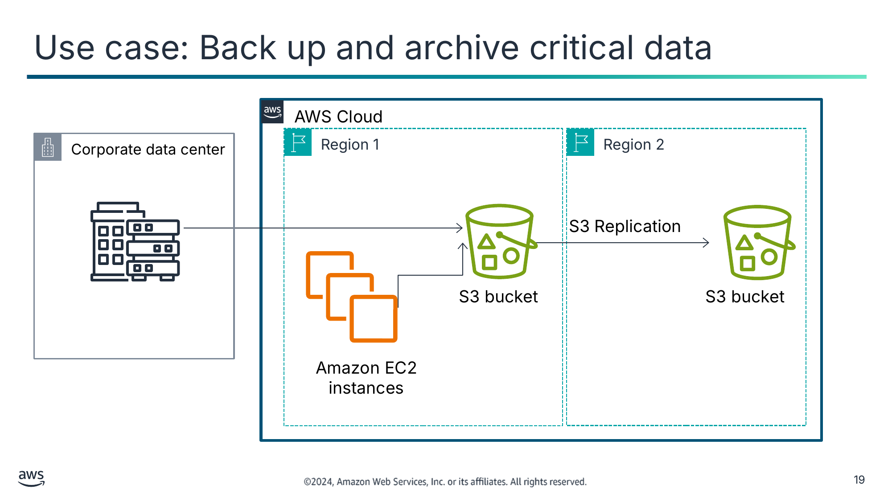

<details>
<summary>Текст зі схеми</summary>

AWS Cloud

Corporate data center (Корпоративний центр обробки даних)

Region 1 (Регіон 1)

Region 2 (Регіон 2)

S3 Replication (Реплікація S3)

S3 bucket (Бакет S3)

S3 bucket

Amazon EC2 instances (Екземпляри Amazon EC2)

</details>

> **Нотатки:**
>
> |Номер слайда 19  
> |Нотатки для інструктора  
> |  
> |Нотатки для студента  
> Опис зображення: графіка показує дані з корпоративного центру обробки даних, що завантажуються до бакета S3. Інші дані з екземплярів Amazon EC2 також показано як такі, що резервно копіюються до того самого бакета. Кінець опису.  
>
> У четвертому й останньому сценарії використання, що розглядається в цьому модулі, Amazon S3 використовується як рішення для резервного копіювання даних. Завдяки своїй високій довговічності та масштабованості Amazon S3 добре працює як інструмент резервного копіювання та архівування даних.  
>
> У цьому сценарії дані резервно копіюються з локального (on-premises) корпоративного центру обробки даних, а також із великої кількості екземплярів Amazon EC2. Ці екземпляри запускають застосунки, що генерують дані.  
>
> Ще один варіант Amazon S3, який можна налаштувати для ваших бакетів — для досягнення ще вищих рівнів довговічності — міжрегіональна реплікація (cross-Region replication). У міжрегіональній реплікації об’єкти, завантажені до бакета в одному регіоні, автоматично копіюються до інших бакетів S3 в інших регіонах. Зверніть увагу, що це асинхронний процес.  
>
> Крім того, довгострокові дані можна переміщувати зі стандартного сховища Amazon S3 до Amazon Simple Storage Service Glacier (Amazon S3 Glacier). Цей процес докладніше розглядається пізніше в цьому модулі.

---

## Слайд 20: Ключові висновки: використання Amazon S3

Amazon S3 часто використовується для такого:

- Зберігання та розповсюдження відео, фотографій, музичних файлів та іншого медіаконтенту.
- Підтримка статичного контенту, зокрема файлів HTML, зображень, відео.
- Зберігання даних для обчислень і великомасштабної аналітики.
- Надання рішення для резервного копіювання даних.

> **Нотатки:**
>
> |Номер слайда 20  
> |Нотатки для інструктора  
> |  
> |Нотатки для студента  
> Ось кілька ключових моментів, що підсумовують цей розділ.

---

## Слайд 21: Переміщення даних до Amazon S3 і з нього

Додавання рівня сховища за допомогою Amazon S3

> **Нотатки:**
>
> |Номер слайда 21  
> |Нотатки для інструктора  
> |Цей розділ описує методи завантаження файлів до Amazon S3 та варіанти покращення продуктивності завантаження, зокрема багаточастинне завантаження (multipart upload) і S3 Transfer Acceleration.  
> |Нотатки для студента  
> Цей розділ описує, як переміщувати дані до Amazon S3 і з нього.

---

## Слайд 22: Зберігання об’єктів в Amazon S3

- Кількість об’єктів у бакеті не обмежена.
- Завантаження об’єкта вимагає дозволу на запис до бакета.
- Об’єкти шифруються за замовчуванням.
  - Під час завантаження об’єкти автоматично шифруються за допомогою серверного шифрування.
  - Під час скачування об’єкти розшифровуються.

> **Нотатки:**
>
> |Номер слайда 22  
> |Нотатки для інструктора  
> |  
> |Нотатки для студента  
> Коли ви завантажуєте файл до Amazon S3, він зберігається як об’єкт S3. У бакеті може бути необмежена кількість об’єктів. Перш ніж завантажувати файли до бакета S3, вам потрібні дозволи на запис до бакета.  
>
> Ви можете завантажувати до бакета S3 файли будь-якого типу, зокрема зображення, резервні копії, дані та фільми. Коли ви завантажуєте об’єкт, він автоматично шифрується за допомогою серверного шифрування з ключами, керованими Amazon S3 (SSE-S3), за замовчуванням. Коли ви скачуєте об’єкт, він розшифровується.

---

## Слайд 23: Варіанти завантаження об’єктів до Amazon S3

| Завантаження до Amazon S3 (Uploading Amazon S3) | Опис (Description) |
|---|---|
| AWS Management Console | Використовуйте підхід на основі майстра для переміщення даних до Amazon S3 чи з нього, зокрема з можливістю перетягування файлів. (Максимальний розмір — 160 ГБ.) |
| AWS Command Line Interface (AWS CLI) | Завантаження чи скачування з командного рядка терміналу або у виклику зі скрипта. |
| AWS SDKs | Використовуйте AWS SDK для програмного завантаження об’єктів. |
| Amazon S3 REST API | Надішліть запит PUT, щоб завантажити дані в одній операції. |

> **Нотатки:**
>
> |Номер слайда 23  
> |Нотатки для інструктора  
> |  
> |Нотатки для студента  
> AWS Management Console пропонує спосіб переміщення даних до Amazon S3 або з нього. Вона пропонує підхід на основі майстра, зокрема можливість перетягування файлів, які ви хочете скопіювати до бакета. Максимальний розмір файлу, який можна завантажити за допомогою консолі Amazon S3 Management Console, — 160 ГБ.  
>
> Щоб завантажити файл розміром понад 160 ГБ, використовуйте AWS Command Line Interface (AWS CLI), AWS SDK або Amazon S3 REST API. За допомогою цих трьох методів ви можете завантажити об’єкт частинами, використовуючи операцію API багаточастинного завантаження (multipart upload). Ви можете завантажити один великий об’єкт розміром до 5 ТБ. Наступний слайд розглядає багаточастинні завантаження докладніше.  
>
> Ви можете використовувати AWS CLI для завантаження чи скачування з командного рядка терміналу або у виклику зі скрипта.  
>
> Використовуйте AWS SDK для завантаження об’єктів в Amazon S3. SDK надають бібліотеки-обгортки для завантаження даних. Список підтримуваних SDK див. за посиланням, наведеним на сторінці ресурсів курсу..  
>
> Надсилайте запити Amazon S3 REST API для завантаження об’єкта. Ви можете надіслати запит PUT, щоб завантажити дані в одній операції. Запит PUT додає об’єкт до бакета. Щоб додати об’єкт до бакета, потрібні дозволи на запис до нього. Докладніше про PUT-об’єкти див. за посиланням, наведеним на сторінці ресурсів курсу.  
>
> Докладніше про довідник команд S3 AWS CLI див. за посиланням, наведеним на сторінці ресурсів курсу.

---

## Слайд 24: Функція Amazon S3: багаточастинне завантаження (multipart upload)

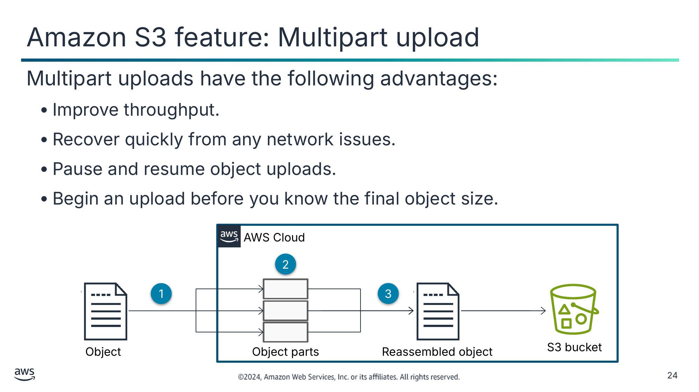

Багаточастинні завантаження мають такі переваги:

- Покращують пропускну здатність.
- Швидко відновлюються після будь-яких мережевих проблем.
- Дають змогу призупиняти та відновлювати завантаження об’єктів.
- Дають змогу розпочати завантаження до того, як стане відомий остаточний розмір об’єкта.

<details>
<summary>Текст зі схеми</summary>

AWS Cloud

2

1

3

S3 bucket (Бакет S3)

Object (Об’єкт)

Object parts (Частини об’єкта)

Reassembled object (Зібраний наново об’єкт)

</details>

> **Нотатки:**
>
> |Номер слайда 24  
> |Нотатки для інструктора: повідомте студентам, що це не дія, яку їм потрібно виконувати, і що коли ви використовуєте консоль чи AWS SDK, Amazon S3 зробить це за вас. Однак можна отримати детальніший контроль над тим, як частини розбиваються, за допомогою низькорівневих опцій API.  
> |  
> |Нотатки для студента  
> Ви можете використовувати багаточастинне завантаження, щоб завантажити один об’єкт як набір частин. Кожна частина — це неперервна порція даних об’єкта. Ви можете завантажувати ці частини об’єкта незалежно й у будь-якому порядку. Якщо передавання будь-якої частини зазнає невдачі, ви можете повторно передати цю частину, не впливаючи на інші частини. Після завантаження всіх частин вашого об’єкта Amazon S3 збирає ці частини та створює об’єкт. Amazon S3 виконує цей процес «за лаштунками» щоразу, коли ви завантажуєте файли.  
>
> Ось переваги багаточастинних завантажень:  
> Покращена пропускна здатність: частини завантажуються паралельно для покращення пропускної здатності.  
> Швидке відновлення після будь-яких мережевих проблем: менший розмір частини мінімізує вплив перезапуску невдалого завантаження через мережеву помилку.  
> Призупинення та відновлення завантажень об’єктів: ви можете завантажувати частини об’єкта протягом часу. Після ініціювання багаточастинного завантаження немає терміну дії; ви повинні явно завершити або зупинити багаточастинне завантаження.  
> Початок завантаження до того, як стане відомий остаточний розмір об’єкта: ви можете завантажувати об’єкт, поки створюєте його.  
>
> Докладніше про багаточастинне завантаження див. за посиланням, наведеним на сторінці ресурсів курсу.

---

## Слайд 25: S3 Transfer Acceleration

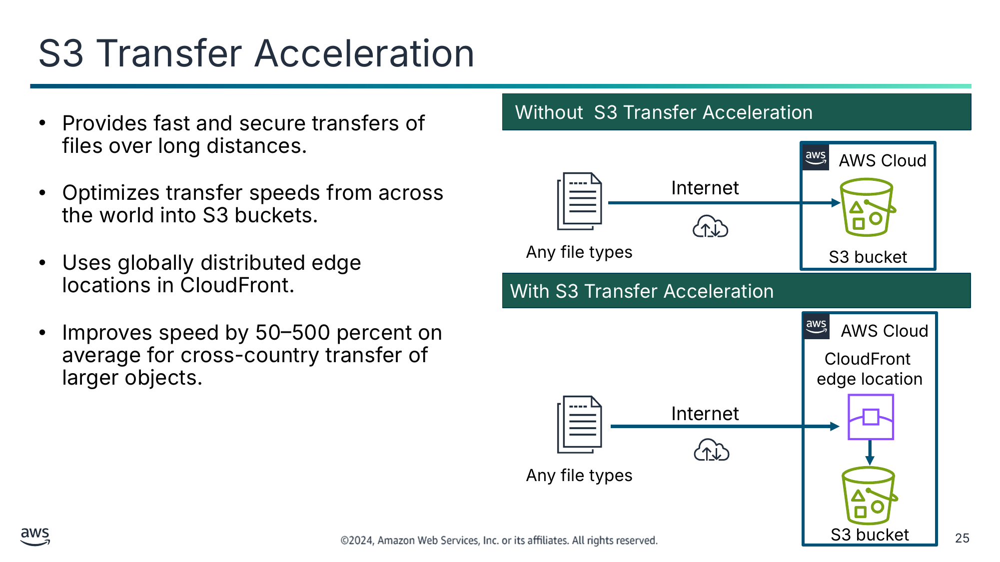

- Забезпечує швидке й безпечне передавання файлів на великі відстані.
- Оптимізує швидкість передавання з усього світу в бакети S3.
- Використовує глобально розподілені периферійні локації CloudFront.
- Підвищує швидкість у середньому на 50–500 відсотків під час міжконтинентального передавання великих об’єктів.

<details>
<summary>Текст зі схеми</summary>

 Without  S3 Transfer Acceleration (Без S3 Transfer Acceleration)

AWS Cloud

Internet (Інтернет)

Any file types (Файли будь-яких типів)

S3 bucket (Бакет S3)

With S3 Transfer Acceleration (З S3 Transfer Acceleration)

AWS Cloud

CloudFront  
edge location (Периферійна локація CloudFront)

Internet

Any file types

S3 bucket

</details>

> **Нотатки:**
>
> |Номер слайда 25  
> |Нотатки для інструктора  
> |Після знайомства з S3 Transfer Acceleration покажіть студентам посилання на інструмент порівняння швидкостей S3 Transfer Acceleration (S3 Transfer Acceleration Speed Comparison Tool). Порівняйте швидкості завантаження з прискоренням і без нього між регіонами Amazon S3.  
> |Нотатки для студента  
> Опис зображення: схема порівнює стандартне завантаження Amazon S3, що завантажується безпосередньо до бакета S3, із завантаженням S3 Transfer Acceleration, що завантажується до периферійної локації CloudFront, перш ніж потім передається до бакета S3. Кінець опису  
>
> Тепер, коли ви дізналися про переваги багаточастинного завантаження, розгляньмо, як можна покращити швидкість передавання під час завантаження файлів.  
>
> S3 Transfer Acceleration — це функція на рівні бакета, що забезпечує швидке й безпечне передавання файлів на великі відстані між вашим клієнтом і бакетом S3. Transfer Acceleration розроблено для оптимізації швидкості передавання з усього світу в бакети S3. Transfer Acceleration використовує глобально розподілені периферійні локації CloudFront. Коли дані надходять до периферійної локації, вони маршрутизуються в Amazon S3 оптимізованим мережевим шляхом.  
>
> Ви можете захотіти використовувати Transfer Acceleration для бакета з різних причин:  
> Ваші клієнти завантажують дані до централізованого бакета з усього світу.  
> Ви регулярно передаєте гігабайти й терабайти даних між континентами.  
> Ви не можете використовувати всю наявну пропускну здатність інтернету під час завантаження до Amazon S3.  
>
> Посилання для порівняння швидкостей завантаження з прискоренням і без нього між регіонами Amazon S3 див. на сторінці ресурсів курсу.

---

## Слайд 26: Демонстрація: Amazon S3 Transfer Acceleration

- Ця демонстрація використовує Amazon S3 Transfer Acceleration.
- У цій демонстрації ви побачите, як увімкнути прискорення передавання для бакета S3 та отримати доступ до прискореного передавання даних.


> **Нотатки:**
>
> |Номер слайда 26  
> |Нотатки для інструктора  
> |Ця демонстрація записана як файл .MP4 із субтитрами. Студенти отримують до неї доступ через онлайн-курс. Тривалість кожної демонстрації вказано в посібнику інструктора.  
> |  
> |Нотатки для студента  
> Знайдіть цю записану демонстрацію у вашому курсі як частину цього модуля.

---

## Слайд 27: AWS Transfer Family

- Є повністю керованим сервісом AWS
- Використовується для передавання файлів до сховища Amazon S3 чи файлових систем Amazon Elastic File System (Amazon EFS) і з них за такими протоколами:
  - Secure Shell (SSH) File Transfer Protocol (SFTP) версії 3
  - File Transfer Protocol Secure (FTPS)
  - File Transfer Protocol (FTP)
  - Applicability Statement 2 (AS2)


AWS Transfer Family

> **Нотатки:**
>
> |Номер слайда 27  
> |Нотатки для інструктора  
> |  
> |Нотатки для студента  
> AWS Transfer Family — це захищений сервіс передавання, який можна використовувати для передавання файлів до сервісів зберігання AWS і з них. Transfer Family є частиною хмарної платформи AWS.  
>
> Transfer Family підтримує передавання даних із таких сервісів зберігання AWS або до них.  
> Сховище Amazon S3  
> Файлові системи Network File System (NFS) Amazon Elastic File System (Amazon EFS)  
>
> Transfer Family підтримує передавання даних за такими протоколами:  
> Secure Shell (SSH) File Transfer Protocol (SFTP) версії 3  
> File Transfer Protocol Secure (FTPS)  
> File Transfer Protocol (FTP)  
> Applicability Statement 2 (AS2)  
>
> Докладніше про Transfer Family див. посібник користувача AWS Transfer Family, посилання на який наведено в ресурсах вашого курсу.

---

## Слайд 28: Переваги Transfer Family

- Transfer Family — це кероване обслуговування, що масштабується в реальному часі відповідно до ваших потреб.
- Вам не потрібно змінювати свої застосунки чи запускати будь-яку інфраструктуру протоколів передавання файлів.
- З Transfer Family ви використовуєте нативні сервіси AWS для функцій обробки, аналітики, звітування, аудиту й архівування з вашими даними в довговічному сховищі Amazon S3.
- Transfer Family — це керована еластична файлова система (з Amazon EFS) для використання із хмарними сервісами AWS і локальними ресурсами.
- Transfer Family — це кероване безсерверне обслуговування робочих процесів передавання файлів, яке можна використовувати для налаштування, запуску, автоматизації та моніторингу завантажень файлів.
- Ви платите лише за використання сервісу, і немає авансових витрат.

> **Нотатки:**
>
> |Номер слайда 28  
> |Нотатки для інструктора  
> |  
> |Нотатки для студента  
> Transfer Family надає такі переваги:  
> Це повністю кероване обслуговування, що масштабується в реальному часі відповідно до ваших потреб.  
> Вам не потрібно змінювати свої застосунки чи запускати будь-яку інфраструктуру протоколів передавання файлів.  
> Маючи дані в довговічному сховищі Amazon S3, ви можете використовувати нативні сервіси AWS для функцій обробки, аналітики, звітування, аудиту й архівування.  
> З Amazon EFS як сховищем даних ви отримуєте повністю керовану еластичну файлову систему для використання із хмарними сервісами AWS і локальними ресурсами. Amazon EFS побудовано для масштабування за запитом до петабайтів без переривання роботи застосунків. Вона автоматично зростає й зменшується, коли ви додаєте та видаляєте файли, що допомагає усунути потребу розгортати та керувати потужностями для задоволення зростання.  
> Це повністю кероване безсерверне обслуговування робочих процесів передавання файлів, яке можна використовувати для налаштування, запуску, автоматизації та моніторингу завантажень файлів.  
> Немає авансових витрат, і ви платите лише за використання сервісу.

---

## Слайд 29: Сценарії використання Transfer Family

Amazon S3

- Озера даних (data lakes) в AWS для завантажень від третіх сторін
- Розповсюдження даних за підпискою з клієнтами
- Внутрішні передавання в межах вашої організації

Amazon EFS

- Розповсюдження даних
- Ланцюг постачання
- Керування контентом
- Вебзастосунки

> **Нотатки:**
>
> |Номер слайда 29  
> |Нотатки для інструктора  
> |  
> |Нотатки для студента  
> Ось деякі поширені сценарії використання Transfer Family з Amazon S3:  
> Озера даних в AWS для завантажень від третіх сторін, як-от постачальники та партнери  
> Розповсюдження даних за підпискою з вашими клієнтами  
> Внутрішні передавання в межах вашої організації  
>
> Ось деякі поширені сценарії використання Transfer Family з Amazon EFS:  
> Розповсюдження даних  
> Ланцюг постачання  
> Керування контентом  
> Вебзастосунки  
>
> Докладніше про AWS Transfer Family див. посилання, наведене на сторінці ресурсів курсу.

---

## Слайд 30: Ключові висновки: переміщення даних до Amazon S3 і з нього

- Завантажуйте об’єкти до Amazon S3 за допомогою AWS Management Console, AWS CLI, AWS SDK або Amazon S3 REST API.
- Використовуйте багаточастинне завантаження, щоб завантажити один об’єкт як набір частин, коли розмір об’єкта сягає 100 МБ або більше.
- Використовуйте S3 Transfer Acceleration для бакета S3, щоб забезпечити швидке й безпечне передавання файлів на великі відстані між вашим клієнтом і бакетом S3.
- Використовуйте Transfer Family, щоб забезпечити безпечне передавання файлів до сервісів зберігання AWS і з них.

> **Нотатки:**
>
> |Номер слайда 30  
> |Нотатки для інструктора  
> |  
> |Нотатки для студента  
> Ось кілька ключових моментів, що підсумовують цей розділ.

---

## Слайд 31: Зберігання контенту за допомогою Amazon S3

Додавання рівня сховища за допомогою Amazon S3

> **Нотатки:**
>
> |Номер слайда 31  
> |Нотатки для інструктора  
> |Цей розділ зосереджений на класах зберігання, керуванні версіями, спільному використанні ресурсів між походженнями (cross-origin resource sharing), моделі узгодженості даних Amazon S3 і політиках життєвого циклу Amazon S3.  
> |  
> |Нотатки для студента  
> Цей розділ описує зберігання контенту за допомогою Amazon S3.

---

## Слайд 32: Класи зберігання об’єктів (object storage classes)

General purpose (Загального призначення)

Intelligent tiering (Інтелектуальне розподілення за рівнями)

Infrequent access (Нечастий доступ)

Archive (Архів)

S3 Standard

S3 Intelligent- Tiering

S3 Standard-IA

S3 Glacier Instant Retrieval

S3 Glacier Flexible Retrieval

S3 One Zone-IA

S3 Glacier Deep Archive

S3 on Outposts

> **Нотатки:**
>
> |Номер слайда 32  
> |Нотатки для інструктора  
> |Ви можете запропонувати студентам переглянути сторінку цін Amazon S3. Ця інформація допомагає архітекторам оцінити різні варіанти сховищ і компроміс між затримкою отримання, довговічністю та вартістю. Посилання включено до ресурсів курсу.  
> |  
> |Нотатки для студента  
> Amazon S3 надає різні класи зберігання, узгоджені з різними вимогами клієнтів. Ось перелік кожного типу сховища з описом:  
> Загального призначення (General purpose)  
> S3 Standard пропонує високу довговічність, доступність і високопродуктивне об’єктне сховище для даних, до яких звертаються часто. Оскільки він забезпечує низьку затримку та високу пропускну здатність, S3 Standard підходить для різноманітних сценаріїв використання, зокрема хмарних застосунків, динамічних вебсайтів, розповсюдження контенту, мобільних і ігрових застосунків та аналітики великих даних. Він забезпечує довговічність щонайменше в трьох зонах доступності.  
> Інтелектуальне розподілення за рівнями (Intelligent tiering)  
> S3 Intelligent-Tiering — це перше хмарне сховище, що автоматично зменшує витрати на зберігання на детальному рівні об’єктів, автоматично переміщуючи дані до найекономічнішого рівня доступу залежно від частоти доступу, без впливу на продуктивність, плати за отримання чи операційних накладних витрат. S3 Intelligent-Tiering забезпечує затримку в мілісекундах і високу пропускну здатність для даних із частим, нечастим і рідкісним доступом на рівнях Frequent, Infrequent та Archive Instant Access. Ви можете використовувати S3 Intelligent-Tiering як клас зберігання за замовчуванням практично для будь-якого робочого навантаження, особливо для озер даних, аналітики даних, нових застосунків і користувацького контенту.  
> Нечастий доступ (Infrequent access)  
> S3 Standard-IA (Infrequent Access) пропонує всі переваги Amazon S3 Standard, але працює за іншою моделлю вартості для зберігання даних, до яких звертаються нечасто, як-от старіші цифрові зображення чи старіші файли журналів. До будь-яких даних, розміщених у ньому, застосовується мінімальна плата за зберігання 30 днів, а вартість отримання даних із S3 Standard-IA вища, ніж зі сховища S3 Standard.  
> S3 One Zone-IA зберігає дані в одній зоні доступності. Він ідеальний для клієнтів, які хочуть дешевший варіант і не потребують доступності та стійкості S3 Standard чи S3 Standard-IA. Це хороший вибір для зберігання вторинних резервних копій локальних даних або даних, які можна відтворити. Його також можна використовувати як економічно ефективне сховище для даних, що реплікуються з іншого регіону AWS.  
> Архів (Archive)  
> S3 Glacier Instant Retrieval — це клас зберігання для архівів, що забезпечує сховище найнижчої вартості для довгоживучих даних, до яких звертаються рідко й які потребують отримання за мілісекунди. S3 Glacier Instant Retrieval ідеально підходить для архівних даних, що потребують негайного доступу, як-от медичні зображення, медіаресурси новин чи архіви користувацького контенту. Ви можете завантажувати об’єкти безпосередньо в S3 Glacier Instant Retrieval або використовувати політики життєвого циклу S3 для передавання даних із класів зберігання Amazon S3.  
> S3 Glacier Flexible Retrieval (раніше S3 Glacier) призначений для даних, що не потребують негайного доступу, але потребують гнучкості для отримання великих наборів даних 1–2 рази на рік; отримання відбувається асинхронно без плати. Це ідеальне рішення для резервного копіювання, аварійного відновлення та потреб зберігання даних поза майданчиком. Це також хороше рішення, коли деякі дані іноді потрібно отримувати за хвилини, а ви не хочете турбуватися про витрати.  
> S3 Glacier Deep Archive — це клас зберігання з найнижчою вартістю в Amazon S3. Цей клас зберігання підтримує довгострокове збереження та цифрову консервацію даних, до яких можуть звертатися один-два рази на рік. Він розроблений для клієнтів — зокрема з високорегульованих галузей, як-от фінансові послуги, охорона здоров’я та державний сектор, — які зберігають набори даних 7–10 років або довше для виконання вимог регуляторної відповідності.  
> S3 on Outposts надає об’єктне сховище вашому локальному середовищу AWS Outposts і використовує API та функції S3, доступні сьогодні в регіонах AWS. Ви можете використовувати S3 on Outposts для зберігання й отримання даних на вашому Outpost, а також для захисту даних, контролю доступу, тегування даних і звітування про дані. S3 on Outposts надає єдиний клас зберігання Amazon S3 з назвою OUTPOSTS, що використовує API Amazon S3 і розроблений для довговічного та надлишкового зберігання даних на кількох пристроях і серверах вашого Outposts. Клас зберігання S3 on Outposts ідеально підходить для робочих навантажень із вимогами до локального розташування даних (local data residency) і задовольняє високі вимоги до продуктивності, тримаючи дані близько до локальних застосунків. Цей модуль включає інформацію про цей клас зберігання для вашого ознайомлення, але це навчання не розглядає цей клас зберігання далі.  
>
> Докладніше див. посилання «Amazon S3 Storage Classes» на сторінці ресурсів курсу.

---

## Слайд 33: Розбивка класів зберігання S3

|  | S3 Standard | S3 Intelligent-Tiering | S3 Standard-IA | S3 One Zone-IA | S3 Glacier Instant Retrieval | S3 Glacier Flexible Retrieval | S3 Glacier Deep Archive |
|---|---|---|---|---|---|---|---|
| Зони доступності (Availability Zones) | ≥3 | ≥3 | ≥3 | 1 | ≥3 | ≥3 | ≥3 |
| Мінімальна плата за потужність для кожного об’єкта | N/A | N/A | 128 КБ | 128 КБ | 128 КБ | N/A | N/A |
| Плата за мінімальну тривалість зберігання | N/A | N/A | 30 днів | 30 днів | 90 днів | 90 днів | 180 днів |
| Плата за отримання | N/A | N/A | • За<br>• ГБ отриманих даних | • За<br>• ГБ отриманих даних | • За<br>• ГБ отриманих даних | • За<br>• ГБ отриманих даних | За ГБ отриманих даних |

> **Нотатки:**
>
> |Номер слайда 33  
> |Нотатки для інструктора  
> |Цей слайд допомагає визначити деякі ключові відмінності між класами зберігання.  
> |  
> |Нотатки для студента  
> Усі класи зберігання розроблено для такого:  
> Довговічність 99,999999999 відсотка (11 дев’яток)  
> Доступність 99,9 відсотка, а для S3 One Zone-IA — 99,5 відсотка  
> Доступна угода про рівень обслуговування (SLA) на рівні 99 відсотків  
> Затримка в мілісекундах для першого байта даних  
> Тип об’єктного сховища  
> Переходи життєвого циклу  
>
> Деякі ключові відмінності включають таке:  
> Кількість зон доступності більша або дорівнює трьом для всіх класів зберігання, окрім S3 One Zone-IA, що має одну зону доступності.  
> Мінімальна плата за потужність для кожного об’єкта становить 128 КБ для S3 Standard-IA, S3 One Zone-IA та S3 Glacier Instant Retrieval.  
> Ось мінімальні тривалості зберігання, за які стягується плата:  
> 30 днів: S3 Standard-IA та S3 One Zone-IA  
> 90 днів: S3 Glacier Instant Retrieval та S3 Glacier Flexible Retrieval  
> 180 днів: S3 Glacier Deep Archive  
> Плата за отримання стягується за кожен отриманий гігабайт для всіх класів зберігання, окрім S3 Standard та S3 Intelligent-Tiering, що не мають плати за отримання.  
>
> Може бути причина зберігати об’єкт в іншому класі з різних причин, що веде до політики життєвого циклу.

---

## Слайд 34: Налаштування життєвого циклу Amazon S3 (lifecycle)

Конфігурації життєвого циклу Amazon S3 — це набір правил, що визначають дії, які Amazon S3 застосовує до групи об’єктів.

- Дії переходу (transition actions) переміщують до іншого класу зберігання.
- Дії завершення терміну дії (expiration actions) визначають, коли об’єкти втрачають чинність.

Установіть політику

життєвого циклу S3.

Дані автоматично переміщуватимуться до іншого класу зберігання без жодних змін у вашому застосунку.

> **Нотатки:**
>
> |Номер слайда 34  
> |Нотатки для інструктора  
> |  
> |Нотатки для студента  
> Конфігурація життєвого циклу S3 — це набір правил, що визначає дії, які Amazon S3 застосовує до групи об’єктів. Існують два типи дій:  
> Дії переходу: ці дії визначають, коли об’єкти переходять до іншого класу зберігання. Наприклад, ви можете вирішити переміщувати об’єкти до класу зберігання S3 Standard-IA через 30 днів після їх створення або архівувати об’єкти в клас зберігання S3 Glacier Flexible Retrieval через 1 рік після створення. Із запитами переходу життєвого циклу пов’язані витрати. Докладніше про ціни Amazon S3 див. сторінку цін Amazon S3, на яку є посилання в ресурсах курсу.  
> Дії завершення терміну дії: ці дії визначають, коли об’єкти втрачають чинність. Amazon S3 видаляє об’єкти, термін дії яких завершився, від вашого імені. Витрати на завершення терміну дії життєвого циклу залежать від того, коли ви обираєте завершення терміну дії об’єктів. Докладніше див. сторінку «Expiring Objects» у посібнику користувача Amazon S3. Ваші ресурси курсу включають пряме посилання.  
>
> Після встановлення політики життєвого циклу S3 ваші дані автоматично переміщуватимуться до іншого класу зберігання без жодних змін у вашому застосунку.  
>
> Використовуючи політики життєвого циклу, ви можете через регулярні інтервали переміщувати дані між різними типами сховищ Amazon S3. Це циклічне переміщення зменшує ваші загальні витрати, оскільки ви платите менше за дані, коли вони з часом стають менш важливими. Окрім можливості встановлювати правила життєвого циклу для кожного об’єкта, можна також встановлювати правила життєвого циклу для кожного бакета.

---

## Слайд 35: Приклади життєвого циклу Amazon S3

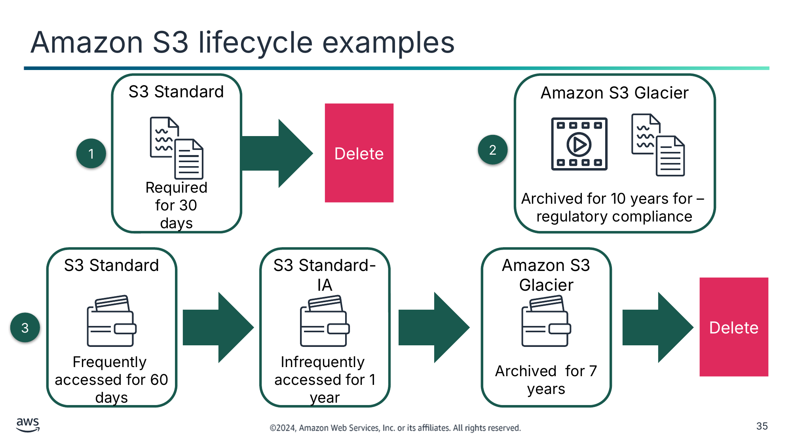

<details>
<summary>Текст зі схеми</summary>

S3 Standard

Amazon S3 Glacier

Delete (Видалити)

1

2

Required for 30 days (Потрібні протягом 30 днів)

Archived for 10 years for –

regulatory compliance (Архівуються 10 років для виконання регуляторних вимог)

S3 Standard

S3 Standard-IA

Amazon S3 Glacier

Delete

3

Frequently

accessed for 60 days (Частий доступ протягом 60 днів)

Infrequently

accessed for 1 year (Нечастий доступ протягом 1 року)

Archived  for 7 years (Архівуються 7 років)

</details>

> **Нотатки:**
>
> |Номер слайда 35  
> |Нотатки для інструктора  
> |  
> |Нотатки для студента  
> Визначайте правила конфігурації життєвого циклу S3 для об’єктів, що мають чітко визначений життєвий цикл. Ось приклади:  
> Якщо ви завантажуєте періодичні журнали до бакета, ваш застосунок може потребувати їх тиждень чи місяць. Після цього ви можете захотіти їх видалити.  
> Ви можете завантажувати деякі типи даних до Amazon S3 переважно для цілей архівування. Наприклад, ви можете архівувати цифрові медіа, фінансові та медичні записи, необроблені дані геномних послідовностей, довгострокові резервні копії баз даних і дані, що мають зберігатися для виконання регуляторних вимог.  
> Деякі документи часто використовуються протягом обмеженого періоду часу. Після цього до них звертаються нечасто. У певний момент вам може не знадобитися доступ до них у реальному часі, але ваша організація чи регуляції можуть вимагати архівувати їх протягом певного періоду. Після цього їх можна видалити.  
>
> За допомогою правил конфігурації життєвого циклу S3 можна вказати Amazon S3 переміщувати об’єкти до дешевших класів зберігання, архівувати об’єкти або видаляти об’єкти.

---

## Слайд 36: Демонстрація: керування життєвими циклами в Amazon S3

- Ця демонстрація використовує Amazon S3.
- У цій демонстрації ви побачите, як створити правило життєвого циклу для Amazon S3 і застосувати дії переходу до об’єктів.

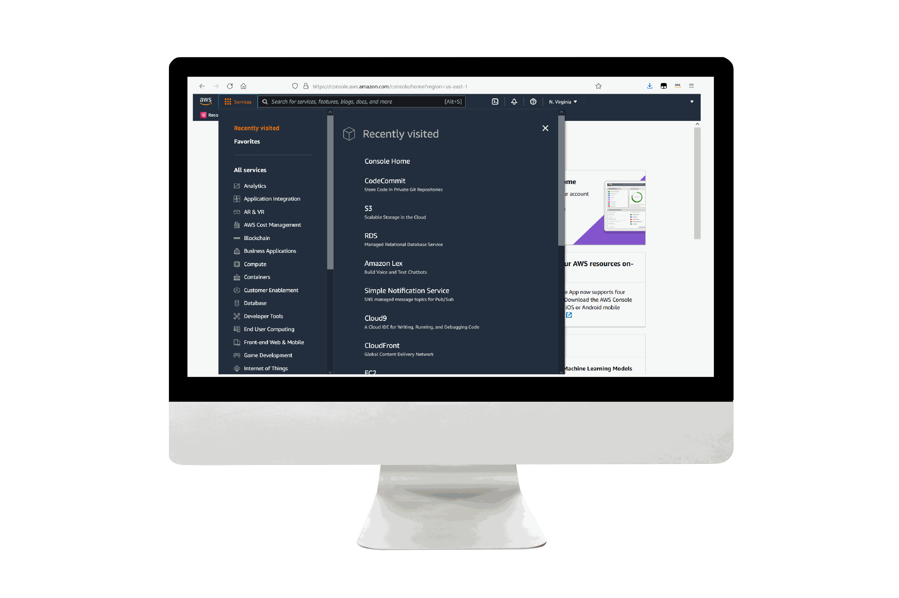

> **Нотатки:**
>
> |Номер слайда 36  
> |Нотатки для інструктора  
> |Ця демонстрація записана як файл .MP4 із субтитрами. Студенти отримують до неї доступ через онлайн-курс. Тривалість кожної демонстрації вказано в посібнику інструктора.  
> |  
> |Нотатки для студента  
> Знайдіть цю записану демонстрацію у вашому курсі як частину цього модуля.

---

## Слайд 37: Керування версіями Amazon S3 (Amazon S3 versioning)

Керування версіями Amazon S3 захищає об’єкти від випадкового перезапису та видалення.

| Дія (Action) | Керування версіями ввімкнено (Versioning Enabled) | Керування версіями вимкнено або призупинено (Versioning Disabled or Versioning Suspended) |
|---|---|---|
| Завантаження об’єкта з тим самим ключем | Створює новий об’єкт з іншим ідентифікатором версії, і обидва можна отримати за ідентифікатором версії. | Перезаписує оригінальний об’єкт, і попередній об’єкт більше не можна отримати. |
| Видалення (Delete) | Додає маркер видалення, але об’єкт усе ще можна отримати за ідентифікатором версії. | Видаляє об’єкт, і його більше не можна отримати. |

> **Нотатки:**
>
> |Номер слайда 37  
> |Нотатки для інструктора  
> |  
> |Нотатки для студента  
> Amazon S3 надає функцію керування версіями для захисту об’єктів від випадкового перезапису та видалення. Ви можете використовувати керування версіями для відновлення як після ненавмисних дій користувача, так і після збоїв застосунків.  
>
> Ви вмикаєте керування версіями на рівні бакета. Кожен об’єкт у бакеті має ідентифікатор версії, а коли керування версіями вимкнено, значення бакета встановлюється як null. Коли керування версіями ввімкнено, Amazon S3 створює новий об’єкт і призначає унікальне значення його ідентифікатору версії (збільшує його) щоразу, коли об’єкт завантажується.  
>
> За замовчуванням керування версіями S3 у бакетах вимкнено, і його потрібно явно ввімкнути. Коли керування версіями не ввімкнено, ідентифікатор об’єкта має значення null.  
>
> Бакет S3 може перебувати в одному з трьох станів керування версіями:  
> Керування версіями ввімкнено (Versioning enabled): якщо ви завантажуєте об’єкт із тим самим ключем, Amazon S3 зберігає старий об’єкт і створює новий об’єкт із новим ідентифікатором версії. Якщо ви видаляєте об’єкт, Amazon S3 логічно видаляє його та додає маркер, але стару версію можна отримати за її ідентифікатором версії.  
> Керування версіями вимкнено (Versioning disabled): це налаштування за замовчуванням. Якщо ви завантажуєте об’єкт до бакета з тим самим ключем, він перезаписує стару версію.  Якщо ви видаляєте об’єкт, його видалено остаточно.  
> Керування версіями призупинено (Versioning suspended): версії наявних об’єктів зберігаються, але бакет тимчасово поводиться так, ніби керування версіями вимкнено.  
>
> Після ввімкнення керування версіями для бакета його не можна вимкнути, а можна лише призупинити.  
>
> За використання керування версіями плата не стягується, але оскільки кожна версія є копією об’єкта, кожна версія додає до витрат на зберігання.  
>
> Докладніше про керування версіями в бакетах S3 див. сторінку «Using versioning in S3 buckets» у посібнику користувача Amazon S3. Ваші ресурси курсу включають пряме посилання.

---

## Слайд 38: Додавання об’єкта до бакета з увімкненим керуванням версіями

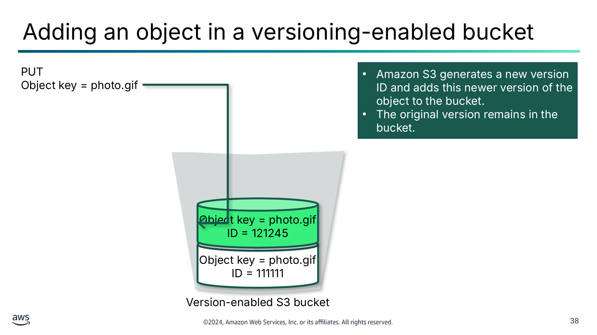

PUT

Object key = photo.gif

- Amazon S3 генерує новий ідентифікатор версії та додає цю новішу версію об’єкта до бакета.
- Оригінальна версія залишається в бакеті.

<details>
<summary>Текст зі схеми</summary>

Object key = photo.gif

ID = 121245

Object key = photo.gif

ID = 111111

Version-enabled S3 bucket (Бакет S3 з увімкненим керуванням версіями)

</details>

> **Нотатки:**
>
> |Номер слайда 38  
> |Нотатки для інструктора  
> |Наступні п’ять слайдів надають різні приклади керування версіями.  
> |  
> |Нотатки для студента  
> Тепер ви розглянете деякі приклади того, як працює керування версіями.  
>
> Коли ви використовуєте запит PUT, щоб додати об’єкт до бакета з увімкненим керуванням версіями, неактуальна (noncurrent) версія не перезаписується. Як показує схема, коли нову версію photo.gif додають (PUT) до бакета, що вже містить об’єкт з тією самою назвою, відбувається така поведінка:  
>
> Оригінальний об’єкт (ID = 111111) залишається в бакеті.  
>
> Amazon S3 генерує новий ідентифікатор версії (121212) і додає цю новішу версію об’єкта до бакета.

---

## Слайд 39: Видалення об’єкта в бакеті з увімкненим керуванням версіями

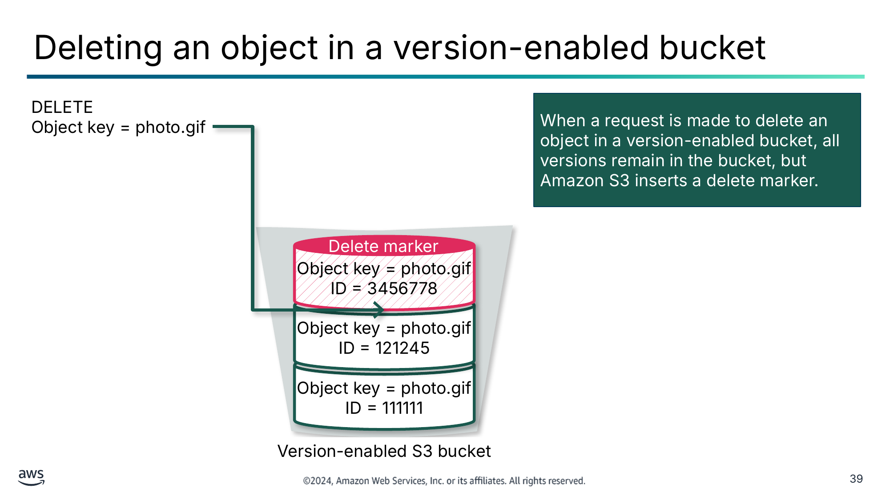

DELETE

Object key = photo.gif

Коли надходить запит на видалення об’єкта в бакеті з увімкненим керуванням версіями, усі версії залишаються в бакеті, але Amazon S3 вставляє маркер видалення (delete marker).

<details>
<summary>Текст зі схеми</summary>

Object key = photo.gif

ID = 3456778

Delete marker (Маркер видалення)

Object key = photo.gif

ID = 121245

Object key = photo.gif

ID = 111111

Version-enabled S3 bucket

</details>

> **Нотатки:**
>
> |Номер слайда 39  
> |Нотатки для інструктора  
> |  
> |Нотатки для студента  
> З увімкненим керуванням версіями ви можете отримати попередню версію об’єкта, якщо об’єкт було випадково перезаписано чи видалено.  
>
> Коли ви використовуєте команду DELETE для видалення об’єкта, усі версії залишаються в бакеті, а Amazon S3 вставляє маркер видалення, як показує схема.  
>
> У цьому прикладі ви все ще можете отримати попередні версії з ідентифікаторами 121212 або 111111.

---

## Слайд 40: Отримання найновішої збереженої версії

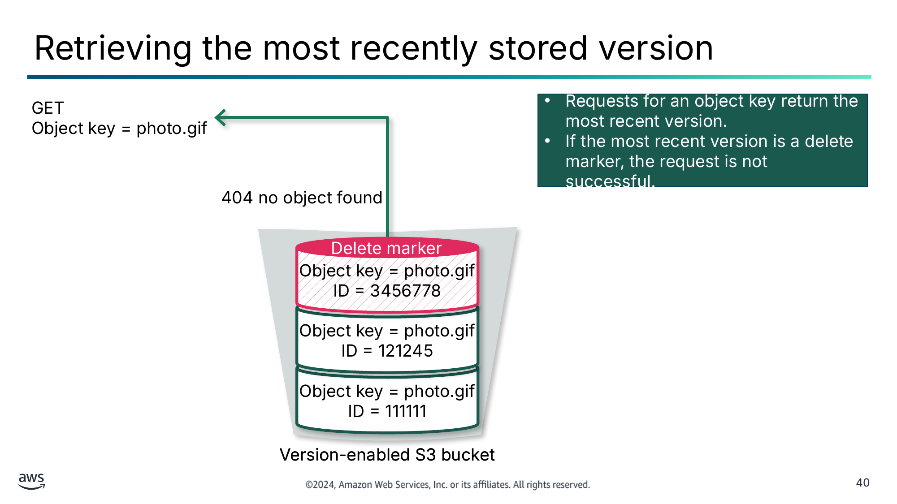

GET  
Object key = photo.gif

- Запити на ключ об’єкта повертають найновішу версію.
- Якщо найновіша версія є маркером видалення, запит не успішний.

404 no object found

<details>
<summary>Текст зі схеми</summary>

Object key = photo.gif

ID = 3456778

Delete marker

Object key = photo.gif

ID = 121245

Object key = photo.gif

ID = 111111

Version-enabled S3 bucket

Version-enabled S3 bucket

</details>

> **Нотатки:**
>
> |Номер слайда 40  
> |Нотатки для інструктора  
> |  
> |Нотатки для студента  
> Маркер видалення стає поточною версією об’єкта. За замовчуванням запити GET отримують найновішу збережену версію. Виконання запиту GET object, коли поточна версія є маркером видалення, повертає помилку 404 Not Found, як показує схема.

---

## Слайд 41: Отримання об’єкта за його конкретним ідентифікатором

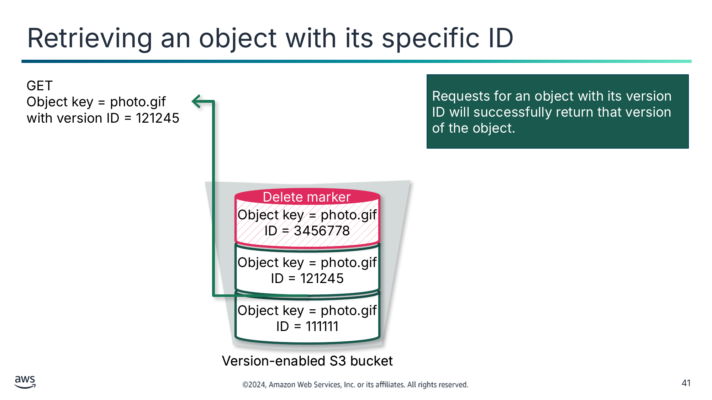

GET  
Object key = photo.gif with version ID = 121245

Запити на об’єкт з його ідентифікатором версії успішно повертають цю версію об’єкта.

<details>
<summary>Текст зі схеми</summary>

Object key = photo.gif

ID = 3456778

Delete marker

Object key = photo.gif

ID = 121245

Object key = photo.gif

ID = 111111

Version-enabled S3 bucket

Version-enabled S3 bucket

</details>

> **Нотатки:**
>
> |Номер слайда 41  
> |Нотатки для інструктора  
> |  
> |Нотатки для студента  
> Однак ви можете отримати (GET) неактуальну версію об’єкта, вказавши її ідентифікатор версії. На схемі ви використовуєте запит GET для конкретної версії об’єкта, 111111. Amazon S3 повертає цю версію об’єкта, навіть якщо вона не є поточною.

---

## Слайд 42: Остаточне видалення об’єкта

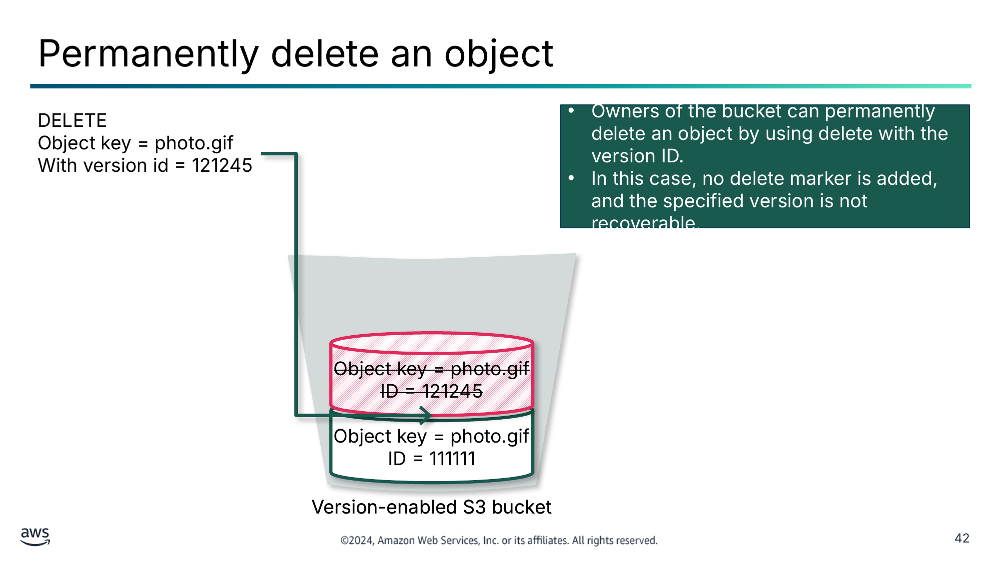

DELETE

Object key = photo.gif

With version id = 121245

- Власники бакета можуть остаточно видалити об’єкт, використовуючи видалення з ідентифікатором версії.
- У цьому випадку маркер видалення не додається, а вказану версію не можна відновити.

<details>
<summary>Текст зі схеми</summary>

Object key = photo.gif

ID = 121245

Object key = photo.gif

ID = 111111

Version-enabled S3 bucket

Version-enabled S3 bucket

</details>

> **Нотатки:**
>
> |Номер слайда 42  
> |Нотатки для інструктора  
> |  
> |Нотатки для студента  
> Нарешті, ви можете остаточно видалити об’єкт, вказавши версію, яку хочете видалити. Остаточно видалити версію може лише власник бакета S3.  
>
> Якщо ваша операція видалення вказує ідентифікатор версії, ця версія об’єкта видаляється остаточно, і Amazon S3 не вставляє маркер видалення.

---

## Слайд 43: Демонстрація: керування версіями Amazon S3 (Amazon S3 Versioning)

- Ця демонстрація використовує Amazon S3.
- У цій демонстрації ви побачите, як увімкнути керування версіями Amazon S3 для бакета S3.


> **Нотатки:**
>
> |Номер слайда 43  
> |Нотатки для інструктора  
> |Ця демонстрація записана як файл .MP4 із субтитрами. Студенти отримують до неї доступ через онлайн-курс. Тривалість кожної демонстрації вказано в посібнику інструктора.  
> |  
> |Нотатки для студента  
> Знайдіть цю записану демонстрацію у вашому курсі як частину цього модуля.

---

## Слайд 44: Підтримка спільного використання ресурсів між походженнями (cross-origin resource sharing, CORS)

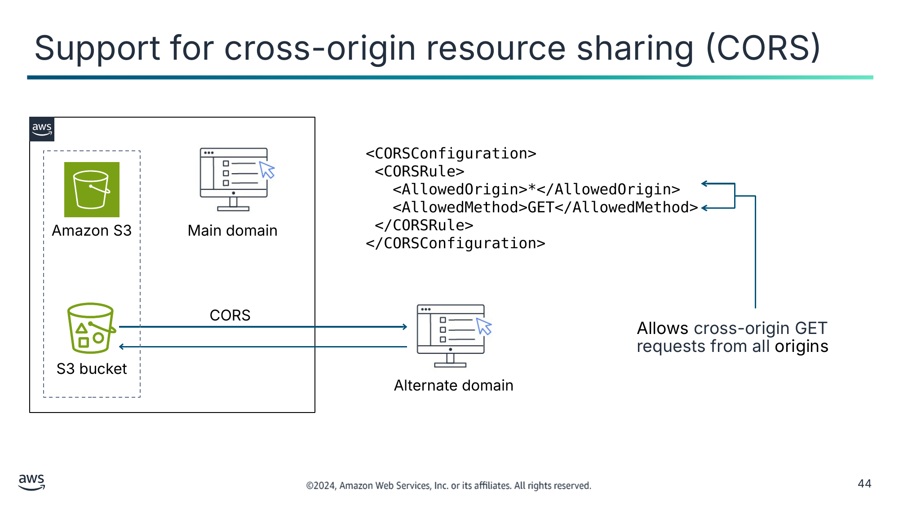

<details>
<summary>Текст зі схеми</summary>

```
<CORSConfiguration>
 <CORSRule>
   <AllowedOrigin>*</AllowedOrigin>
   <AllowedMethod>GET</AllowedMethod>
 </CORSRule>
</CORSConfiguration>
```

Amazon S3

Main domain (Основний домен)

CORS

Allows cross-origin GET requests from all origins (Дозволяє міждоменні запити GET з усіх походжень)

S3 bucket (Бакет S3)

Alternate domain (Альтернативний домен)

</details>

> **Нотатки:**
>
> |Номер слайда 44  
> |Нотатки для інструктора  
> |  
> |Нотатки для студента  
> Спільне використання ресурсів між походженнями (cross-origin resource sharing, CORS) визначає спосіб, у який клієнтські вебзастосунки, завантажені в одному домені, можуть взаємодіяти з ресурсами в іншому домені. З підтримкою CORS ви можете будувати багатофункціональні клієнтські вебзастосунки з Amazon S3 і вибірково дозволяти міждоменний доступ до ваших ресурсів Amazon S3.  
>
> Щоб налаштувати свій бакет на дозвіл міждоменних запитів, ви створюєте конфігурацію CORS. Конфігурація CORS — це документ XML з правилами, що визначають таке  
> Походження (origins), яким ви дозволите доступ до вашого бакета.  
> Операції (методи HTTP), що підтримуватимуться для кожного походження. У цьому прикладі запити GET дозволено з усіх походжень.  
> Іншу інформацію, специфічну для операцій.  
>
> Коли Amazon S3 отримує попередній запит (preflight request) від браузера, він оцінює конфігурацію CORS для бакета й використовує правило CORS, що відповідає вхідному запиту браузера, щоб дозволити міждоменний запит.  
>
> Цей слайд показує один приклад: ви хочете розмістити вебшрифт у вашому бакеті S3. Вебсторінка в альтернативному домені може спробувати використати цей вебшрифт. Перш ніж браузер завантажить цю вебсторінку, він виконує перевірку CORS, щоб переконатися, що домену, з якого завантажується сторінка, дозволено доступ до ресурсів бакета S3.  
>
> Докладніше про використання спільного використання ресурсів між походженнями (CORS) див. сторінку CORS у посібнику користувача Amazon S3.  Ваші ресурси курсу включають пряме посилання.

---

## Слайд 45: Модель узгодженості даних Amazon S3 (data consistency model)

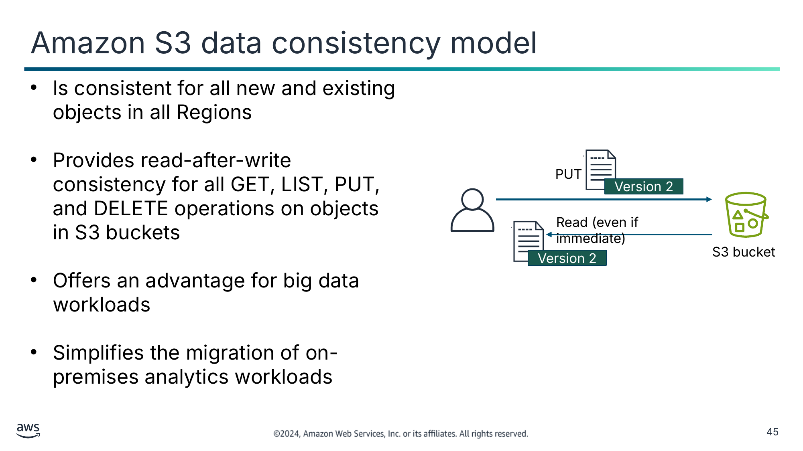

- Є узгодженою для всіх нових і наявних об’єктів у всіх регіонах
- Забезпечує узгодженість «читання після запису» (read-after-write) для всіх операцій GET, LIST, PUT і DELETE над об’єктами в бакетах S3
- Пропонує перевагу для робочих навантажень із великими даними
- Спрощує міграцію локальних аналітичних робочих навантажень

<details>
<summary>Текст зі схеми</summary>

PUT

Version 2 (Версія 2)

Read (even if immediate) (Читання (навіть негайне))

S3 bucket (Бакет S3)

Version 2

</details>

> **Нотатки:**
>
> |Номер слайда 45  
> |Нотатки для інструктора  
> |  
> |Нотатки для студента  
> Поряд із керуванням версіями важлива узгодженість даних. Тепер ви розглянете модель узгодженості Amazon S3.  
>
> Опис зображення: графіка показує новий об’єкт, завантажений до S3 (як версія 1). Будь-яке негайне зчитування цього об’єкта буде послідовно повертати v1 (що підтверджує узгодженість «читання після запису» для PUT нових об’єктів). Кінець опису.  
>
> Amazon S3 став піонером об’єктного сховища в хмарі з високою доступністю, продуктивністю та практично необмеженою масштабованістю, але з кінцевою узгодженістю (eventual consistency). Без сильної узгодженості вам довелося б вставляти власний код у ці застосунки або розгортати бази даних, щоб підтримувати узгодженість об’єктів із будь-якими змінами в Amazon S3 серед мільйонів чи мільярдів об’єктів.  
>
> Amazon S3 автоматично забезпечує сильну узгодженість «читання після запису» та узгодженість переліку (list consistency) для всіх застосунків. З сильною узгодженістю Amazon S3 спрощує міграцію локальних аналітичних робочих навантажень, усуваючи потребу вносити зміни до застосунків. Amazon S3 також зменшує витрати, усуваючи потребу в додатковій інфраструктурі для забезпечення сильної узгодженості.  
>
> Amazon S3 є сильно узгодженим для всіх нових і наявних об’єктів S3 у всіх регіонах AWS.  
>
> Amazon S3 досягає високої доступності, реплікуючи дані між кількома серверами в центрах обробки даних AWS. Якщо запит PUT успішний, дані безпечно збережено. Будь-яке зчитування (GET чи LIST), ініційоване після успішної відповіді PUT, поверне дані, записані PUT. Ця сильна узгодженість «читання після запису» існує автоматично для всіх застосунків без змін у продуктивності чи доступності.  
>
> Сильна узгодженість спрощує міграцію локальних аналітичних робочих навантажень, усуваючи потребу вносити зміни для підтримки застосунків. Вона також усуває потребу в додатковій інфраструктурі, як-от S3Guard, для забезпечення сильної узгодженості.  
>
> Хоча об’єкти є сильно узгодженими, конфігурації бакетів S3 мають модель кінцевої узгодженості. Наприклад, якщо ви видаляєте бакет і негайно переглядаєте список усіх бакетів, видалений бакет усе ще може з’явитися в списку. Однак через короткий проміжок часу, якщо ви знову виконаєте команду перегляду списку бакетів, видалений бакет більше не з’являтиметься в результатах.  
>
> Докладніше про сильну узгодженість Amazon S3 див. посилання, наведене на сторінці ресурсів курсу.

---

## Слайд 46: Ключові висновки: зберігання контенту за допомогою Amazon S3

- Сховище S3 Standard підходить для хмарних застосунків, динамічних вебсайтів, розповсюдження контенту, мобільних і ігрових застосунків та аналітики великих даних.
- Установіть політику життєвого циклу S3, і ваші дані автоматично переміщуватимуться до іншого класу зберігання без жодних змін у вашому застосунку.
- Відновлюйтеся як після ненавмисних дій користувача, так і після збоїв застосунків за допомогою керування версіями.
- CORS визначає спосіб, у який клієнтські вебзастосунки, завантажені в одному домені, можуть взаємодіяти з ресурсами в іншому домені.
- Модель узгодженості даних Amazon S3 спрощує міграцію локальних аналітичних робочих навантажень, усуваючи потребу вносити зміни для підтримки застосунків.

> **Нотатки:**
>
> |Номер слайда 46  
> |Нотатки для інструктора  
> |  
> |Нотатки для студента  
> Ось кілька ключових моментів, що підсумовують цей розділ.

---

## Слайд 47: Проєктування з Amazon S3

Додавання рівня сховища за допомогою Amazon S3

> **Нотатки:**
>
> |Номер слайда 47  
> |Нотатки для інструктора  
> |У цьому розділі ви дізнаєтеся про вибір проєктних рішень для захисту бакетів і об’єктів, налаштування доступу та розташування бакетів у регіонах AWS.  
> |Нотатки для студента  
> Цей розділ описує проєктування з Amazon S3.

---

## Слайд 48: Конфігурації безпеки Amazon S3 за замовчуванням

- Створені бакети та об’єкти S3 за замовчуванням приватні та захищені.
- Бакети S3 мають налаштоване за замовчуванням шифрування.
- Серверне шифрування з ключами, керованими Amazon S3 (SSE-S3), — це шифрування за замовчуванням.

Коли сценарії використання вимагають спільного доступу до даних Amazon S3, виконуйте таке:

- Керуйте доступом до даних і контролюйте його.
- Дотримуйтеся принципу найменших привілеїв.

> **Нотатки:**
>
> |Номер слайда 48  
> |Нотатки для інструктора  
> |  
> |Нотатки для студента  
> Коли ваша мета — захистити цифрові дані, шифрування даних — важливий інструмент. Шифрування даних бере дані, що читаються, і кодує їх. Зашифровані дані нечитабельні для будь-кого, хто не має доступу до секретного ключа, яким їх можна розкодувати. Таким чином, навіть якщо зловмисник отримає доступ до ваших даних, він не зможе їх розібрати. За бажанням використовуйте AWS Key Management Service (AWS KMS) для керування секретними ключами.  
>
> Захист даних дуже важливий. За замовчуванням усі бакети S3 приватні, і доступ до цих бакетів можуть отримати лише користувачі, яким явно надано доступ до бакетів S3. Важливо керувати доступом до даних Amazon S3 і контролювати його.  
>
> Докладніше див. «Data protection in Amazon S3» на сторінці ресурсів вмісту вашого онлайн-курсу.

---

## Слайд 49: Шифрування об’єктів в Amazon S3

Шифрування кодує дані секретним ключем, що робить їх нечитабельними без ключа.

- Серверне шифрування (server-side encryption)
  - Amazon S3 шифрує об’єкти перед їх збереженням на диск і розшифровує об’єкти, коли ви їх скачуєте.
  - Увімкніть цю функцію, обравши варіант шифрування за замовчуванням для бакета.
- Шифрування на стороні клієнта (client-side encryption)
  - Шифруйте дані на стороні клієнта та завантажуйте зашифровані дані до Amazon S3.
  - У цьому випадку ви керуєте процесом шифрування.

> **Нотатки:**
>
> |Номер слайда 49  
> |Нотатки для інструктора  
> |  
> |Нотатки для студента  
> Усі бакети S3 мають налаштоване за замовчуванням шифрування, а всі нові об’єкти, завантажені до бакета S3, автоматично шифруються в стані спокою. SSE-S3 — це конфігурація шифрування за замовчуванням для кожного бакета в Amazon S3. Щоб використати інший тип шифрування, ви можете або вказати тип серверного шифрування у ваших запитах S3 PUT, або встановити конфігурацію шифрування за замовчуванням у цільовому бакеті.  
>
> Якщо ви хочете вказати інший тип шифрування у ваших запитах PUT, можна використати серверне шифрування з ключами AWS Key Management Service (AWS KMS) (SSE-KMS), двошарове серверне шифрування з ключами AWS KMS (DSSE-KMS) або серверне шифрування з наданими клієнтом ключами (SSE-C).  
>
> Якщо ви хочете встановити іншу конфігурацію шифрування за замовчуванням у цільовому бакеті, можна використати SSE-KMS або DSSE-KMS.  
>
> Шифрування на стороні клієнта — це ще один варіант. Коли ви використовуєте цей підхід, ви шифруєте дані на стороні клієнта перед їх завантаженням до Amazon S3. У цьому випадку ви керуєте процесом шифрування, ключами шифрування та пов’язаними інструментами. Як і серверне шифрування, шифрування на стороні клієнта може зменшити ризик, шифруючи дані ключем, що зберігається в іншому механізмі, ніж механізм, який зберігає самі дані.  
>
> Докладніше див. «Protecting data with encryption» на сторінці ресурсів вмісту вашого онлайн-курсу.

---

## Слайд 50: Інструменти Amazon S3 для захисту бакетів і об’єктів

| Інструмент (Tool) | Опис (Description) |
|---|---|
| Функція Block Public Access | Робить бакети недоступними для публіки |
| Політики AWS Identity and Access Management (IAM) | Автентифікує користувачів за допомогою IAM |
| Політики бакетів (Bucket policies) | Визначає доступ на основі конкретних письмових правил |
| Списки контролю доступу (Access control lists, ACL) | Встановлює правила доступу до бакетів і об’єктів (для контролю доступу до бакетів бажаним методом є політики бакетів) |
| Точки доступу Amazon S3 (access points) | Налаштовує доступ з іменами й дозволами, специфічними для кожного застосунку |
| Попередньо призначені URL-адреси (Preassigned URLs) | Надає обмежений у часі доступ іншим за допомогою тимчасових URL-адрес |
| AWS Trusted Advisor | Надає перевірку дозволів бакета |

> **Нотатки:**
>
> |Номер слайда 50  
> |Нотатки для інструктора  
> |  
> |Нотатки для студента  
> AWS надає багато інструментів і варіантів контролю доступу до ваших бакетів чи об’єктів S3, зокрема такі:  
> Функція Amazon S3 Block Public Access перевизначає будь-які інші політики чи дозволи об’єктів. Увімкніть Block Public Access для всіх бакетів, які ви не хочете робити публічно доступними. Ця функція надає простий метод уникнення ненавмисного розкриття даних Amazon S3.  
> Пишіть політики AWS Identity and Access Management (IAM), що вказують користувачів чи ролі, які можуть отримувати доступ до конкретних бакетів і об’єктів.  
> Зазвичай ви використовуєте політики бакетів для визначення доступу до конкретних бакетів чи об’єктів, коли користувач чи система не можуть автентифікуватися за допомогою IAM. Ви можете налаштувати політики бакетів для надання доступу між акаунтами AWS або публічного чи анонімного доступу до даних Amazon S3. Якщо ви використовуєте політики бакетів, їх слід писати обережно й повністю тестувати. У політиці бакета можна вказати інструкцію deny, щоб обмежити доступ. Доступ буде обмежено, навіть якщо користувачі мають дозволи, надані в політиці на основі ідентичності, прикріпленій до користувачів.  
> Встановлюйте списки контролю доступу (ACL) для ваших бакетів і об’єктів, що використовуються рідше (ACL з’явилися раніше за IAM). Якщо ви використовуєте ACL, не встановлюйте надто відкритий чи надто дозвільний доступ.  
> Точки доступу S3 — це іменовані мережеві кінцеві точки, прикріплені до бакетів. Ви можете використовувати кінцеві точки доступу для виконання операцій з об’єктами S3. Клієнти зі спільними наборами даних можуть масштабувати доступ для багатьох застосунків, створюючи індивідуалізовані точки доступу з іменами та дозволами, налаштованими для кожного застосунку.  
> Попередньо призначені URL-адреси надають обмежений у часі доступ іншим за допомогою тимчасових URL-адрес.  
> AWS Trusted Advisor надає функцію перевірки дозволів бакета. Це корисний інструмент для виявлення того, чи мають будь-які бакети у вашому акаунті дозволи, що надають глобальний доступ.  
>
> Докладніше див. посилання «Data protection in Amazon S3» на сторінці ресурсів курсу.

---

## Слайд 51: Три загальні підходи до налаштування доступу

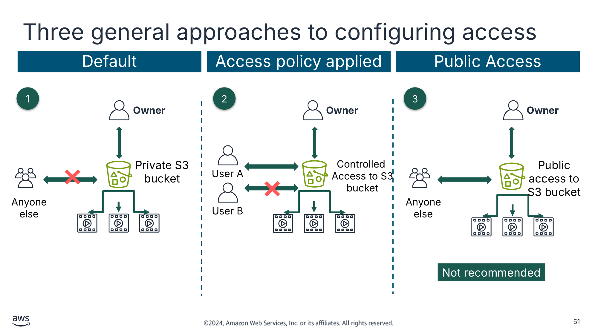

Default (За замовчуванням)

Access policy applied (Застосовано політику доступу)

Public Access (Публічний доступ)

<details>
<summary>Текст зі схеми</summary>

1

2

3

**Owner (Власник)**

**Owner**

**Owner**

Private S3 bucket (Приватний бакет S3)

Controlled

Access to S3 bucket (Контрольований доступ до бакета S3)

Public access to S3 bucket (Публічний доступ до бакета S3)

User A (Користувач A)

Anyone else (Будь-хто інший)

Anyone else

User B (Користувач B)

Not recommended (Не рекомендовано)

</details>

> **Нотатки:**
>
> |Номер слайда 51  
> |Нотатки для інструктора  
> |  
> |Нотатки для студента  
> Ось три різні загальні підходи до налаштування доступу до об’єктів у бакеті S3:  
> Варіант 1 показує налаштування безпеки за замовчуванням для Amazon S3. За замовчуванням усі бакети S3 і об’єкти, що зберігаються в них, приватні (захищені). Єдині сутності з доступом до новоствореного, незмінного бакета — це адміністратор акаунта та кореневий акаунт AWS (root user). Власник ресурсу може надавати певні дозволи на доступ іншим, але будь-хто без цих дозволів не матиме доступу.  
> Варіант 2 показує випадок, коли Amazon S3 було налаштовано на надання контрольованого доступу. Користувачу A надано доступ до об’єктів у бакеті, а користувачу B у доступі відмовлено. Сценарії контрольованого доступу поширені. Власник бакета може налаштовувати ці сценарії за допомогою одного чи кількох інструментів або варіантів контролю доступу до даних Amazon S3, розглянутих раніше.  
> Варіант 3 показує випадок, коли налаштування безпеки S3 було вимкнено й будь-хто може публічно отримати доступ до об’єктів, що зберігаються в бакеті.  
>
> Не рекомендовано  
> Використання бакета S3 для розміщення статичного вебсайту — це приклад швидкого налаштування архітектури AWS. Однак для більшості сценаріїв використання Amazon S3 ви не захочете надавати публічний доступ до Amazon S3. Більшість сценаріїв використання не потребують публічного доступу. Частіше ви використовуєте Amazon S3 для зберігання даних, що використовуються застосунком, який працює поза Amazon S3, або для резервного копіювання чутливих даних. Для цих поширених сценаріїв використання ви ніколи не повинні надавати публічний доступ до бакетів, що містять дані.

---

## Слайд 52: Міркування під час вибору регіону

| Міркування (Considerations) | Подробиці (Details) |
|---|---|
| Закони про конфіденційність даних і регуляторна відповідність | • Чи існують відповідні закони регіону про конфіденційність даних?<br>• Чи можна зберігати дані клієнтів за межами країни?<br>• Чи можете ви виконати свої зобов’язання щодо управління (governance)? |
| Близькість користувачів до даних | • Невеликі відмінності в затримці можуть впливати на досвід клієнтів.<br>• Оберіть регіон, найближчий до ваших користувачів. |
| Доступність сервісів і функцій | • Не всі сервіси AWS доступні в усіх регіонах.<br>• Сервіси регулярно розширюються на нові регіони.<br>• Використовуйте деякі сервіси між регіонами, але з підвищеною затримкою. |
| Економічна ефективність | • Витрати відрізняються за регіонами.<br>• Деякі сервіси, як-от Amazon S3, мають витрати на вихідне передавання даних.<br>• Розгляньте економічну ефективність реплікації всього середовища в іншому регіоні. |

> **Нотатки:**
>
> |Номер слайда 52  
> |Нотатки для інструктора  
> |  
> |Нотатки для студента  
> Тепер, коли ви дізналися про захист і шифрування ваших даних, є багато міркувань під час вирішення, у якому регіоні розміщувати ваші дані:  
> Слід враховувати закони про конфіденційність даних і ваші вимоги регуляторної відповідності. Дані, які ви зберігаєте в AWS, підпадають під закони країни та місцевості, де вони зберігаються. Крім того, деякі закони приписують, що якщо ви ведете свій бізнес у їхній юрисдикції, ви не можете зберігати ці дані деінде. Так само стандарти відповідності (як-от Закон США про переносимість і підзвітність медичного страхування, HIPAA) мають суворі настанови щодо того, як і де можна зберігати дані.  
> Близькість — важливий чинник під час вибору регіону, особливо коли затримка є критичним чинником. У більшості випадків різниця в затримці між використанням найближчого й найвіддаленішого регіону відносно невелика, але навіть невеликі відмінності в затримці можуть впливати на досвід клієнтів. Клієнти очікують швидкодіючих середовищ, і з плином часу, коли технології стають дедалі потужнішими, ці очікування також зростають.  
> Доступність сервісів і функцій AWS — важливе міркування. Хоча AWS прагне зробити сервіси та функції доступними всюди, ускладнення, що виникають через глобальне охоплення, ускладнюють досягнення цієї мети. Замість того щоб чекати, поки сервіс стане доступним усюди, перш ніж запускати його, сервіси випускаються, коли вони готові. Доступність сервісу потім розширюється якнайшвидше.  
> Вартість — важливе міркування під час вибору регіону. Вартість сервісів може відрізнятися залежно від того, у якому регіоні їх використовують. Наприклад, екземпляр EC2 у регіоні us-east-1 може коштувати не так само, як якби він працював у регіоні eu-west-1. Зазвичай різниця у вартості може бути недостатньою, щоб переважити три інші міркування. Однак у випадках, коли відмінності в затримці, відповідності та доступності сервісів між регіонами мінімальні, ви можете заощадити, використовуючи дешевший регіон для вашого середовища.  
> Нарешті, за обставин, коли ваші клієнти перебувають у різних частинах світу, розгляньте оптимізацію їхнього досвіду шляхом реплікації вашого середовища в кількох регіонах, ближчих до них. Оскільки ви тоді розподілятимете навантаження між кількома середовищами, ваші витрати на компоненти в кожному середовищі можуть зменшитися, навіть коли ви додаєте більше інфраструктури. Наприклад, додавши друге середовище застосунку, ви можете скоротити вдвічі свої вимоги до потужностей обробки та зберігання в кожному середовищі. Оскільки AWS розроблено для надання такої гнучкості, а ви платите лише за те, що використовуєте, ви можете зменшити своє наявне середовище як спосіб пом’якшити вартість додавання ще одного середовища. Недолік цього підходу в тому, що тепер у вас два середовища для керування. Також не всі ваші компоненти зменшаться достатньо, щоб пом’якшити всі витрати на нові компоненти. Крім того, вам може знадобитися підтримувати єдине джерело істини для сховища в одному регіоні, як-от основний екземпляр Amazon Relational Database Service (Amazon RDS). Ваш вторинний регіон мав би обмінюватися даними з екземпляром сховища, що може збільшити затримку та вартість для цих операцій.  
>
> Докладніше див. посилання «AWS Services by Region» на сторінці ресурсів курсу.

---

## Слайд 53: Amazon S3 Inventory

- Використовуйте Amazon S3 Inventory, щоб допомогти керувати вашим сховищем.
- Використовуйте його для аудиту та звітування про статус реплікації та шифрування ваших об’єктів для бізнес-потреб, потреб відповідності та регуляторних потреб.
- Пришвидшуйте бізнес-процеси й завдання з великими даними за допомогою Amazon S3 Inventory.
- Надає альтернативу за розкладом синхронним операціям API List в Amazon S3.

> **Нотатки:**
>
> |Номер слайда 53  
> |Нотатки для інструктора  
> |  
> |Нотатки для студента  
> Тепер, коли ви розумієте важливість шифрування об’єктів, налаштування доступу та вибору регіону, ця наступна функція, Amazon S3 Inventory, допомагає керувати вашим сховищем.  
>
> Наприклад, ви можете використовувати її для аудиту та звітування про статус реплікації та шифрування ваших об’єктів для бізнес-потреб, потреб відповідності та регуляторних потреб. Також можна спростити та пришвидшити бізнес-процеси й завдання з великими даними за допомогою Amazon S3 Inventory, що надає альтернативу за розкладом синхронним операціям API List в Amazon S3.  
>
> Amazon S3 Inventory надає вихідні файли у форматах значень, розділених комами (CSV), Apache optimized row columnar (ORC) або Apache Parquet, що перелічують ваші об’єкти та відповідні метадані щодня чи щотижня для бакета S3 або об’єктів зі спільним префіксом (тобто об’єктів, імена яких починаються зі спільного рядка). Якщо ви налаштуєте щотижневий інвентар, звіт генерується щонеділі (за часовим поясом UTC) після початкового звіту.  
>
> Налаштовуючи перелік інвентаря, ви можете вказати таке:  
> Які метадані об’єктів включати в інвентар  
> Чи перелічувати всі версії об’єктів, чи лише поточні версії  
> Де зберігати вихідний файл переліку інвентаря  
> Чи генерувати інвентар щодня, чи щотижня  
> Чи шифрувати файл переліку інвентаря  
>
> Ви можете виконувати запити до Amazon S3 Inventory за допомогою стандартних SQL-запитів, використовуючи Amazon Athena, Amazon Redshift Spectrum та інші інструменти, як-от Presto, Apache Hive і Apache Spark.  
>
> Бакет, для якого інвентар перелічує об’єкти, називається вихідним бакетом (source bucket). Бакет, де зберігається файл переліку інвентаря, називається цільовим бакетом (destination bucket).  
>
> Докладніше див. «Amazon S3 Inventory» на сторінці ресурсів вмісту вашого онлайн-курсу.

---

## Слайд 54: Витрати Amazon S3

Платіть лише за те, що використовуєте:

Плата за передавання даних не стягується:

- Гігабайти збережених об’єктів (на місяць) з різним ціноутворенням для кожного регіону та кожного класу зберігання
- PUT, COPY, POST, LIST або перехід життєвого циклу для переміщення даних у будь-який клас зберігання Amazon S3

- Вихідне передавання в інтернет за перші 100 ГБ на місяць
- Вхідне передавання з інтернету
- Між бакетами S3 або до будь-якого сервісу в тому самому регіоні AWS
- З бакета S3 до будь-якого сервісу чи сервісів AWS у тому самому регіоні AWS, що й бакет S3
- Вихідне передавання до CloudFront

> **Нотатки:**
>
> |Номер слайда 54  
> |Нотатки для інструктора  
> |  
> |Нотатки для студента  
> З Amazon S3 ви платите лише за те, що використовуєте. Мінімальної плати немає. Ви платите за зберігання об’єктів у ваших бакетах S3. Тариф залежить від розміру вашого об’єкта, часу, протягом якого ви зберігали об’єкти впродовж місяця, і класу зберігання. Ви платите щомісячну плату за моніторинг і автоматизацію за кожен об’єкт, що зберігається в класі зберігання S3 Intelligent-Tiering, для відстеження шаблонів доступу та переміщення об’єктів між рівнями доступу. В S3 Intelligent-Tiering немає плати за отримання, і додаткова плата за розподілення за рівнями не стягується, коли об’єкти переміщуються між рівнями доступу.  
>
> Докладніше див. «AWS Pricing Calculator» на сторінці ресурсів вмісту вашого онлайн-курсу.  
>
> Плата за надходження (ingest) стягується за кожен запит під час використання запитів PUT, COPY, POST чи LIST або під час використання правил життєвого циклу для переміщення даних у будь-який клас зберігання Amazon S3.  
>
> Докладніше див. «Requests & data retrievals» на сторінці ресурсів вмісту вашого онлайн-курсу.  
>
> Шифрування  
> Amazon S3 автоматично застосовує SSE-S3 як базовий рівень шифрування до всіх нових об’єктів, доданих до Amazon S3, без додаткової плати та без впливу на продуктивність. SSE-C також не спричиняє додаткової плати Amazon S3. За SSE-KMS ви платите за AWS KMS за генерування чи отримання ключа даних, що використовується для шифрування та розшифрування. За DSSE-KMS, на додачу до плати за AWS KMS, ви сплачуєте додаткову плату за шифрування за кожен гігабайт за другий рівень шифрування та розшифрування даних.  
>
> Докладніше див. «S3 encryption» на сторінці ресурсів вмісту вашого онлайн-курсу.  
>
> AWS Free Tier  
> У межах AWS Free Tier можна почати роботу з Amazon S3 безкоштовно. Під час реєстрації нові клієнти AWS отримують 5 ГБ сховища Amazon S3 у класі зберігання S3 Standard; 20 000 запитів GET; 2000 запитів PUT, COPY, POST або LIST; і 100 ГБ вихідного передавання даних щомісяця. Ваше використання безкоштовного рівня обчислюється щомісяця для всіх регіонів AWS, окрім регіону AWS GovCloud, і автоматично застосовується до вашого рахунку; невикористаний місячний обсяг не переноситься.

---

## Слайд 55: Практична вправа: проєктування з Amazon S3

- Власник кафе успішно створив статичний вебсайт, але тепер хоче зробити документи доступнішими для працівників. Він хотів би розмістити контент (інструкції з приготування, інформація про постачальників, нарахування зарплати та навчання з відповідності), доступний лише працівникам.
- Як це можна налаштувати, щоб задовольнити потреби власника?


> **Нотатки:**
>
> |Номер слайда 55  
> |Нотатки для інструктора  
> |Ця вправа розроблена, щоб розпочати обговорення можливого рішення. Попросіть студентів прочитати сценарій і обговорити. Наступний слайд надає рішення.  
> |  
> |Нотатки для студента  
> Прочитайте вправу та обговоріть, як ви могли б це налаштувати.

---

## Слайд 56: Розв’язання вправи: створено контрольований доступ для кожного користувача

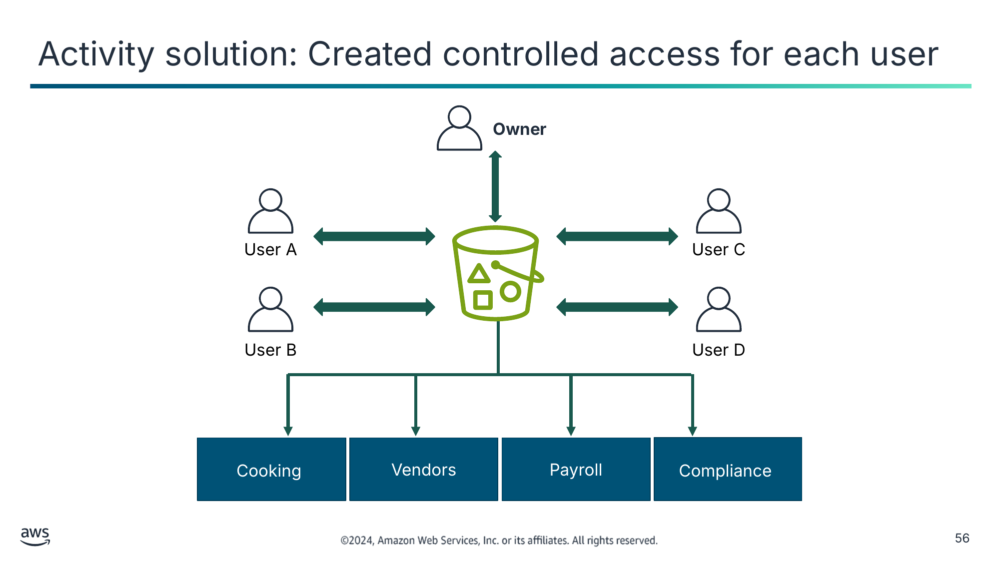

<details>
<summary>Текст зі схеми</summary>

**Owner (Власник)**

User A (Користувач A)

User C (Користувач C)

User B (Користувач B)

User D (Користувач D)

Cooking (Приготування)

Vendors (Постачальники)

Payroll (Зарплата)

Compliance (Відповідність)

</details>

> **Нотатки:**
>
> |Номер слайда 56  
> |Нотатки для інструктора  
> |  
> |Нотатки для студента  
> Оскільки ви не хочете налаштовувати публічний доступ, налаштування контрольованого доступу задовольняє потребу клієнта. Спершу створіть папку для кожного типу контенту (приготування, постачальники, зарплата та відповідність). Потім створіть політики IAM (групові чи індивідуальні), щоб дозволити чи заборонити користувачам доступ до певної інформації залежно від їхнього рівня працівника в кафе.

---

## Слайд 57: Ключові висновки: проєктування з Amazon S3

- Бакети S3 приватні, і доступ до них можуть отримати лише користувачі, яким явно надано доступ.
- SSE-S3 — це конфігурація шифрування за замовчуванням для кожного бакета в Amazon S3.
- Міркування під час вибору регіону включають закони про конфіденційність даних і регуляторну відповідність, близькість користувачів до даних, доступність сервісів і функцій та економічну ефективність.
- Витрати Amazon ґрунтуються на розмірі ваших об’єктів, часі, протягом якого ви зберігали об’єкти впродовж місяця, та класі зберігання.

> **Нотатки:**
>
> |Номер слайда 57  
> |Нотатки для інструктора  
> |  
> |Нотатки для студента  
> Ось кілька ключових моментів, що підсумовують цей розділ.

---

## Слайд 58: Лабораторна робота кафе: створення статичного вебсайту для кафе (Café Website Lab)

> **Нотатки:**
>
> |Номер слайда 58  
> |Нотатки для інструктора  
> |  
> |Нотатки для студента  
> Зараз ви виконаєте лабораторну роботу. Наступні слайди підсумовують, що ви робитимете в лабораторній роботі, а докладні інструкції ви знайдете в лабораторному середовищі.

---

## Слайд 59: Еволюція архітектури кафе: версія 1

| Версія архітектури (Architecture Version) | Бізнес-причина оновлення (Business Reason for the Update) | Технічні вимоги та оновлення архітектури (Technical Requirements and Architecture Update) |
|---|---|---|
| V1 | Створити статичний вебсайт для малого бізнесу. | Розмістити вебсайт на Amazon S3. |
| V2 | Додати онлайн-замовлення. | Розгорнути вебзастосунок і базу даних на Amazon EC2. |
| V3 | Зменшити зусилля на обслуговування бази даних і захист її даних. | Розділити рівні вебу та бази даних. Перенести базу даних в Amazon Relational Database Service (Amazon RDS) у приватній підмережі. |
| V4 | Підвищити безпеку вебзастосунку. | Використати функції Amazon Virtual Private Cloud (Amazon VPC) для налаштування та захисту публічних і приватних підмереж. |
| V5 | Створити окремі механізми доступу на основі ролі. | Додати групи IAM і прикріпити політики ресурсів до ресурсів застосунку. Додати користувачів IAM до груп на основі ролі. |
| V6 | Допомогти забезпечити, щоб вебсайт міг витримати очікуване зростання трафіку. | Додати балансувальник навантаження, впровадити автоматичне масштабування екземплярів EC2 і розподілити екземпляри обчислень і баз даних між двома зонами доступності. |

> **Нотатки:**
>
> |Нотатки для інструктора  
> |У цій лабораторній роботі кафе студенти створюють статичний вебсайт, розміщений на Amazon S3.  
> |Поділіться файлом architectures.svg або покажіть його й виділіть розділи архітектури, які буде змінено чи додано в цій лабораторній роботі.  
> |  
> |Нотатки для студента  
> Софія сказала Нікілу, що хотіла б, щоб у кафе був вебсайт, який візуально презентуватиме кафе за допомогою зображень. Вебсайт також має надавати клієнтам бізнес-інформацію, як-от розташування закладу, години роботи та номер телефону.  
>
> Нікілу приємно створити перший вебсайт для кафе. Під час цієї вправи ви візьмете на себе роль Нікіла й працюватимете над результатами, які сподіваються отримати від вас усі в кафе. Можливо, ви навіть перевершите їхні очікування!

---

## Слайд 60: Завдання лабораторної роботи «Вебсайт кафе» (Café Website Lab)

- У цій лабораторній роботі ви виконаєте таке:
  - Створите бакет S3 для розміщення вашого статичного вебсайту та завантажите контент до вашого бакета S3.
  - Створите політику бакета для надання публічного доступу на читання.
  - Увімкнете керування версіями для бакета S3.
  - Установите політики життєвого циклу.
  - Увімкнете міжрегіональну реплікацію (cross-Region replication).


> **Нотатки:**
>
> |Номер слайда 60  
> |Нотатки для інструктора  
> |  
> |Нотатки для студента  
> Отримайте доступ до лабораторного середовища через ваш онлайн-курс, щоб дізнатися додаткові подробиці та виконати лабораторну роботу.

---

## Слайд 61: Підсумки лабораторної роботи «Вебсайт кафе»

- Як ви захистили вебсайт кафе від випадкового перезапису та видалення?
- Яку стратегію ви використали, щоб допомогти заощадити кошти в міру зростання розміру вебсайту через використання керування версіями?

> **Нотатки:**
>
> |Номер слайда 61  
> |Нотатки для інструктора  
> |Архітектурну схему для цієї лабораторної роботи включено до файлу CafeLabDiagrams.svg, що входить до каталогу файлів викладача. Поділіться цим файлом зі студентами, щоб вони могли наближати й віддаляти кожну фазу архітектури для повнішої картини під час підбиття підсумків лабораторної роботи.  
> |Проведіть із класом розмову про ключові висновки з лабораторної роботи. Використайте подробиці з попереднього розділу, щоб допомогти підбити підсумки лабораторної роботи зі студентами після її завершення. Підбиття підсумків лабораторної роботи наполегливо рекомендується. Воно допомагає студентам встановити зв’язки між їхнім практичним досвідом і концепціями, які ви обговорювали в лекції перед цією лабораторною роботою.  
> |  
> |Запропоновані відповіді на запитання 1: як ви захистили вебсайт кафе від випадкового перезапису та видалення?  
> |У цій лабораторній роботі ви захистили файли вебсайту кафе від випадкового перезапису та видалення, увімкнувши керування версіями. З керуванням версіями ви можете перезаписувати та видаляти файли, зберігаючи при цьому попередні версії файлів. Якщо ви використовуєте керування версіями, ви можете отримати доступ до попередніх версій об’єкта. Коли ввімкнено керування версіями й ви перезаписуєте наявні файли новішими версіями, ваші витрати на зберігання збільшаться. Це збільшення відбувається тому, що тепер ви зберігаєте кілька версій файлу.  
> |  
> |Запропоновані відповіді на запитання 2: яку стратегію ви використали, щоб допомогти заощадити кошти в міру зростання розміру вебсайту через використання керування версіями?  
> |Коли ввімкнено керування версіями, витрати на зберігання можуть значно зрости, якщо у вас немає плану щодо версій, які більше не потрібні.  
> У цій лабораторній роботі ви налаштували дві політики життєвого циклу. Перше правило, яке ви налаштували, автоматично переміщуватиме попередні версії всіх об’єктів вихідного бакета до S3 Standard-IA через 30 днів. Цей варіант допомагає заощадити кошти, переміщуючи файл до дешевшого класу зберігання. Друге правило видалятиме попередні версії об’єктів через 365 днів. Цей варіант допомагає заощадити кошти, оскільки ви більше не платитимете за зберігання файлів, що були видалені.  
> |  
> |Нотатки для студента  
> Ваш інструктор може розглянути ці запитання з вами, або ви можете розглянути їх самостійно. Скористайтеся цією нагодою, щоб поглибити своє мислення щодо завдань, які ви виконували під час лабораторної роботи.

---

## Слайд 62: Застосування принципів AWS Well-Architected Framework до сховища

Додавання рівня сховища за допомогою Amazon S3

> **Нотатки:**
>
> |Номер слайда 62  
> |Нотатки для інструктора  
> |  
> |Нотатки для студента

---

## Слайд 63: Найкращі практики Well-Architected Framework для сховища


> **Нотатки:**
>
> |Нотатки для інструктора  
> |Решта слайдів у цьому розділі подають приклади, що підкреслюють, як матеріал цього модуля узгоджується з найкращими практиками AWS Well-Architected Framework. За бажанням ви можете попросити студентів відвідати вебсайт Well-Architected Framework і знайти найкращі практики, які, на їхню думку, пов’язані з матеріалом, поданим у цьому модулі. Вони можуть використати цей розділ як відправну точку. Докладніше див. «Appendix: Questions and best practices» на сторінці ресурсів вмісту вашого онлайн-курсу.  
> |  
> |Нотатки для студента  
> AWS Well-Architected Framework має шість опор, і кожна опора включає найкращі практики та набір запитань, які слід враховувати під час проєктування хмарних рішень. Цей розділ виділяє кілька найкращих практик з опор, найактуальніших для цього модуля.  Це включає безпеку (Security), надійність (Reliability), ефективність продуктивності (Performance Efficiency) і оптимізацію витрат (Cost Optimization).  
>
> Докладніше див. AWS Well-Architected Framework на сторінці ресурсів вмісту вашого онлайн-курсу.

---

## Слайд 64: Підхід найкращих практик: захист даних — захист даних у стані спокою


**Найкращі практики**

Забезпечуйте примусове шифрування в стані спокою.

Забезпечуйте примусовий контроль доступу.

> **Нотатки:**
>
> |Номер слайда 64  
> |Нотатки для інструктора  
> |  
> |Нотатки для студента  
> Захист даних — важлива найкраща практика в опорі безпеки. Перш ніж проєктувати будь-яке робоче навантаження, мають бути запроваджені основоположні практики, що впливають на безпеку. Методи захисту даних, описані тут, важливі, оскільки вони підтримують цілі, як-от запобігання неправильному поводженню або виконання регуляторних зобов’язань. Захист даних у стані спокою — важлива частина захисту даних. Дві важливі найкращі практики, пов’язані з проєктуванням з Amazon S3 як рівнем сховища, — примусове шифрування в стані спокою та примусовий контроль доступу.  
>
> Примусове шифрування в стані спокою: зберігайте конфіденційність чутливих даних у разі неавторизованого доступу чи випадкового розкриття. Приватні дані в стані спокою мають шифруватися за замовчуванням. Зашифровані дані не можна прочитати чи отримати до них доступ без попереднього розшифрування. Будь-які дані, що зберігаються незашифрованими, слід інвентаризувати та контролювати.  
>
> Примусовий контроль доступу: використовуйте механізми, як-от ізоляція та керування версіями, і застосовуйте принцип найменших привілеїв. Запобігайте наданню публічного доступу до ваших даних. Перевіряйте, що доступ до даних мають лише авторизовані користувачі за принципом «потрібно знати» (need-to-know). Захищайте свої дані регулярними резервними копіями та керуванням версіями, щоб запобігти навмисній чи ненавмисній зміні чи видаленню даних. Ізолюйте критично важливі дані від інших даних, щоб захистити їхню конфіденційність і цілісність.  
>
> У цьому модулі ви дізналися про низку функцій і варіантів конфігурації Amazon S3, що підтримують ці найкращі практики, зокрема такі:  
> Бакети та об’єкти S3 шифруються за замовчуванням, і у вас є варіанти того, як керувати ключами безпеки для цього шифрування.  
> Бакети та об’єкти приватні за замовчуванням, тож ви повинні явно надавати доступ. Слід надавати доступ лише тим особам і ресурсам, яким він потрібен. Ви можете використовувати політики IAM і політики бакетів, щоб обмежувати доступ до ваших ресурсів Amazon S3 як за користувачем, так і за ресурсом.  
> Ви можете використовувати керування версіями для захисту об’єктів у ваших бакетах S3 від втрати даних через випадкові видалення чи перезаписи.  
> Функція Block Public Access ускладнює вам ненавмисне залишення об’єктів чи бакетів відкритими для публічного доступу.  
>
> Докладніше див. технічний документ (whitepaper) опори безпеки, посилання на який наведено в ресурсах вашого курсу. Також див. «Data protection», посилання на який наведено в ресурсах вашого курсу.

---

## Слайд 65: Підхід найкращих практик: вибір архітектури


**Найкращі практики**

 Дізнавайтеся про наявні хмарні сервіси та функції й розумійте їх

Враховуйте вартість в архітектурних рішеннях

> **Нотатки:**
>
> |Номер слайда 65  
> |Нотатки для інструктора  
> |  
> |Нотатки для студента  
> Оптимальне рішення для конкретного робочого навантаження різниться, і рішення часто поєднують кілька підходів. Добре спроєктовані (Well-Architected) робочі навантаження використовують кілька рішень і дозволяють різним функціям покращувати продуктивність.  Важлива найкраща практика вибору архітектури — розуміти, що доступно.  Також важливо враховувати вартість під час вибору сховища.  
>
> Теми в цьому модулі, пов’язані з цими найкращими практиками, включають таке:  
> Amazon S3 — хороший вибір для об’єктного сховища й може зберігати величезні обсяги неструктурованих даних.  
> Доступні конфігурації, що допомагають із продуктивністю, включають S3 Transfer Acceleration для переміщення файлів на велику відстань між клієнтом і бакетом та багаточастинне завантаження, що покращує пропускну здатність під час завантаження дуже великих файлів.  
> Amazon S3 надає різні класи зберігання, які можна використовувати для зберігання об’єктів на основі очікуваних шаблонів доступу. S3 Intelligent-Tiering автоматично переміщує об’єкти на основі шаблонів доступу до рівня зберігання, що є найекономічнішим.  
>
> Докладніше див. технічний документ опори ефективності продуктивності, посилання на який наведено в ресурсах вашого курсу.

---

## Слайд 66: Підхід найкращих практик: економічно ефективні ресурси — оцінюйте вартість під час вибору сервісів


**Найкраща практика**

Виконуйте аналіз вартості для різного використання з часом

> **Нотатки:**
>
> |Номер слайда 66  
> |Нотатки для інструктора  
> |  
> |Нотатки для студента  
> Економічно ефективні ресурси — важлива найкраща практика в опорі оптимізації витрат. Використання відповідних сервісів, ресурсів і конфігурацій для ваших робочих навантажень — ключ до заощадження. Робочі навантаження можуть змінюватися з часом. Деякі сервіси чи функції економічно ефективніші на різних рівнях використання. Виконуючи аналіз кожного компонента з часом і за прогнозованого використання, робоче навантаження залишається економічно ефективним протягом усього свого життя.  
>
> Теми в цьому модулі, пов’язані з цими найкращими практиками, включають таке:  
> Amazon S3 надає різні класи зберігання, і ви можете створювати правила життєвого циклу для автоматичного переміщення даних до економічно ефективнішого класу. S3 Intelligent-Tiering автоматично переміщує об’єкти на основі шаблонів доступу до рівня зберігання, що є найекономічнішим. Зверніть увагу, як ці функції підтримують як найкращі практики продуктивності, так і оптимізації витрат.  
> Використовуйте Amazon S3 Inventory для аудиту того, як використовується Amazon S3, щоб допомогти робити економічно ефективний вибір щодо того, як ваша організація використовує Amazon S3.  
>
> Докладніше див. технічний документ опори оптимізації витрат, посилання на який наведено в ресурсах вашого курсу.

---

## Слайд 67: Підхід найкращих практик: керування збоями — використовуйте ізоляцію збоїв для захисту вашого робочого навантаження


**Найкраща практика**

Обирайте відповідні розташування для вашого розгортання у кількох локаціях

> **Нотатки:**
>
> |Номер слайда 67  
> |Нотатки для інструктора  
> |  
> |Нотатки для студента  
> Керування збоями — важлива найкраща практика в опорі надійності. Вернеру Фогелсу (Werner Vogels), технічному директору (CTO) Amazon.com, приписують цитату: «Збої — це даність, і з часом усе зрештою вийде з ладу». Для стійкості слід використовувати підхід, що будує рівні захисту. Для високої доступності завжди (коли можливо) розгортайте компоненти вашого робочого навантаження в кількох зонах доступності (AZ).  
>
> У цьому модулі ви дізналися, як Amazon S3 спроєктовано витримувати збої, тож вам як архітектору не потрібно думати про впровадження цих найкращих практик. Ось деякі характеристики Amazon S3, що підтримують цю найкращу практику:  
> Amazon S3 розроблено для 11 дев’яток довговічності, щоб допомогти гарантувати, що дані не втрачаються, і для 4 дев’яток доступності, щоб ви могли покладатися на те, що ваші дані доступні, коли потрібно.  
> Amazon S3 надлишково зберігає ваші об’єкти в кількох зонах доступності в регіоні Amazon S3, який ви визначите.  
> Amazon S3 регулярно перевіряє цілісність ваших даних за допомогою контрольних сум.  
>
> Докладніше див. технічний документ опори надійності, посилання на який наведено в ресурсах вашого курсу.

---

## Слайд 68: Ключові висновки: застосування принципів AWS Well-Architected Framework до сховища

- Захист даних — це найкраща практика безпеки, яку Amazon S3 підтримує через такі конфігурації за замовчуванням: шифрування об’єктів, приватність об’єктів, блокування публічного доступу.
- Ви можете захищати дані в Amazon S3, обмежуючи доступ через політики IAM і вмикаючи керування версіями.
- Вибір архітектури — це найкраща практика ефективності продуктивності, яку Amazon S3 підтримує через свою здатність зберігати величезні обсяги неструктурованих даних.
- Amazon S3 включає варіанти покращення продуктивності, як-от S3 Transfer Acceleration і багаточастинне завантаження.
- Вибір економічно ефективних ресурсів — це найкраща практика оптимізації витрат, яку Amazon S3 підтримує через такі функції, як політики життєвого циклу, інтелектуальне розподілення за рівнями та Amazon S3 Inventory.
- Керування збоями — це найкраща практика надійності, для якої Amazon S3 розроблено через свої функції довговічності та доступності.
- Ви можете використовувати Amazon S3 для резервного копіювання даних, щоб покращити керування збоями ваших застосунків і даних.

> **Нотатки:**
>
> |Номер слайда 68  
> |Нотатки для інструктора  
> |  
> |Нотатки для студента  
> Ось кілька ключових моментів, що підсумовують цей розділ.

---

## Слайд 69: Підсумки модуля

Додавання рівня сховища за допомогою Amazon S3

> **Нотатки:**
>
> |Номер слайда 69  
> |Нотатки для інструктора  
> |  
> |Нотатки для студента  
> Цей розділ підсумовує те, що ви дізналися, і завершує модуль.

---

## Слайд 70: Резюме модуля

Цей модуль підготував вас до такого:

- Визначати Amazon S3 і як він працює.
- Розпізнавати проблеми, які може розв’язати Amazon S3.
- Описувати, як переміщувати дані до Amazon S3 і з нього.
- Ефективно керувати зберіганням контенту за допомогою Amazon S3.
- Рекомендувати доречне використання Amazon S3 на основі вимог.
- Налаштовувати статичний вебсайт на Amazon S3.
- Використовувати принципи Well-Architected Framework під час проєктування рівня сховища з Amazon S3.

> **Нотатки:**
>
> |Номер слайда 70  
> |Нотатки для інструктора  
> |  
> |Нотатки для студента

---

## Слайд 71: Міркування щодо кафе

- Обговоріть, як лабораторна робота кафе в цьому модулі відповіла на ключові занепокоєння хмарного архітектора, подані на початку цього модуля.


---

## Слайд 72: Перевірка знань модуля

- Перевірка знань проводиться онлайн у вашому курсі.
- Перевірка знань включає 10 запитань на основі матеріалу, поданого на слайдах і в нотатках до слайдів.
- Ви можете повторно проходити перевірку знань стільки разів, скільки захочете.

> **Нотатки:**
>
> |Номер слайда 72  
> |Нотатки для інструктора  
> |  
> |Нотатки для студента  
> Скористайтеся своїм онлайн-курсом, щоб отримати доступ до перевірки знань для цього модуля.

---

## Слайд 73: Зразок запитання іспиту

Продавці компанії щодня завантажують свої показники продажів до Amazon S3, але їхній архітектор рішень занепокоєний тим, що користувачі можуть випадково видалити чи перезаписати важливі документи.

Яка дія захистить від ненавмисних дій користувачів?

Визначте ключові слова та фрази, перш ніж продовжувати.

Ось ключові слова та фрази:

- Amazon S3
- Випадково видалити чи перезаписати
- Захист від ненавмисних

> **Нотатки:**
>
> |Номер слайда 73  
> |Нотатки для інструктора  
> |Розділ із ключовими словами налаштовано з анімацією для розкриття за клацанням.  
> |  
> |Нотатки для студента

---

## Слайд 74: Зразок запитання іспиту: варіанти відповідей

Продавці компанії щодня завантажують свої показники продажів до **Amazon S3**, але їхній архітектор рішень занепокоєний тим, що користувачі можуть **випадково видалити чи перезаписати** важливі документи.

Яка дія **захистить від ненавмисних** дій користувачів?

**Варіант**

**Відповідь**

**A**

Зберігати дані у двох бакетах S3 у різних регіонах AWS.

**B**

Увімкнути керування версіями для бакета S3, де зберігаються файли.

**C**

Переміщувати завантажені дані до класу зберігання Amazon S3 Infrequent Access наприкінці кожного тижня.

**D**

Використовувати Amazon S3 Inventory для аудиту статусу об’єктів у бакеті S3, де зберігаються файли.

> **Нотатки:**
>
> |Номер слайда 74  
> |Нотатки для інструктора  
> |  
> |Нотатки для студента  
> Використайте ключові слова, які ви визначили на попередньому слайді, і розгляньте кожен із можливих варіантів відповіді, щоб визначити, який із них найкраще відповідає запитанню.

---

## Слайд 75: Зразок запитання іспиту: відповідь

Правильна відповідь — B.

**Варіант**

**Відповідь**

**A**

**B**

Увімкнути керування версіями для бакета S3, де зберігаються файли.

**C**

**D**

> **Нотатки:**
>
> |Номер слайда 75  
> |Нотатки для інструктора  
> |  
> |Нотатки для студента  
> Варіант A (зберігати дані у двох бакетах S3) забезпечив би певний обмежений захист від втрати даних через збій в одному з регіонів, але не розв’язав би проблему випадкового видалення чи перезапису файлу.  
>
> Варіант C (перемістити дані до Amazon S3 Infrequent Access) був би корисним, якби запитання стосувалося зменшення витрат на файли, до яких звертаються нечасто.  
>
> Варіант D (використовувати Amazon S3 Inventory) міг би допомогти продавцям зрозуміти активність щодо об’єктів у їхньому бакеті, але не запобіг би видаленню файлів.  
>
> Варіант B (увімкнути керування версіями) забезпечив би засіб захисту файлів від видалення чи перезапису. Коли керування версіями ввімкнено, попередня версія файлу все ще буде доступна.

---

## Слайд 76: Дякуємо

Виправлення, відгуки чи інші запитання?

Зв’яжіться з нами за адресою [https://support.aws.amazon.com/#/contacts/aws-academy](https://support.aws.amazon.com/#/contacts/aws-academy).

> **Нотатки:**
>
> |Номер слайда 76  
> |Нотатки для інструктора  
> |  
> |Нотатки для студента  
> На цьому цей модуль завершено. Сторінка ресурсів вмісту вашого курсу містить посилання на додаткові ресурси, пов’язані з цим модулем.
