## Слайд 1: Adding a Compute Layer Using Amazon EC2

AWS Academy Cloud Architecting

> **Нотатки:**
>
> |Slide number 1  
> |Instructor notes  
> |  
> |Student notes  
> Welcome to the Adding a Compute Layer Using Amazon EC2 module. This module introduces you to using and optimizing Amazon Elastic Cloud Compute (Amazon EC2) for your computing workloads.

---

## Слайд 2: Introduction

Adding a Compute Layer Using Amazon EC2

> **Нотатки:**
>
> |Slide number 2  
> |Instructor notes  
> |  
> |Student notes  
> This introduction section describes the content of this module.

---

## Слайд 3: Module objectives

This module prepares you to do the following:

- Identify how to use Amazon Elastic Compute Cloud (Amazon EC2) in an architecture.
- Explain the value of using Amazon Machine Images (AMIs) to accelerate the creation and repeatability of infrastructure.
- Recommend EC2 instance types based on requirements.
- Recommend storage solutions for Amazon EC2.
- Recognize how to configure Amazon EC2 instances with user data.
- Describe EC2 pricing options and make recommendations based on cost.
- Launch an Amazon EC2 instance.
- Use the AWS Well-Architected Framework principles when designing a compute layer with Amazon EC2.

> **Нотатки:**
>
> |Slide number 3  
> |Instructor notes  
> |  
> |Student notes

---

## Слайд 4: Module overview

**Presentation sections**

- Adding compute with Amazon EC2
- Choosing an AMI to launch an EC2 instance
- Selecting an EC2 instance type
- Adding storage to an Amazon EC2 instance
- Other EC2 configuration considerations
- Amazon EC2 pricing options
- Applying the AWS Well-Architected Framework principles to compute

**Demos**

- Configuring an EC2 Instance with User Data
- Reviewing the Spot Instance History Page

**Activity**

- Choosing Instance Types

**Knowledge checks**

- 10-question knowledge check
- Sample exam question

> **Нотатки:**
>
> |Slide number 4  
> |Instructor notes  
> |Each module has an introduction, content sections, and a wrap-up. The wrap-up for this module contains a sample exam question for you to review with the students.  
> |  
> |Student notes  
> The objectives of this module are presented across multiple sections.  
>
> You will also participate in an activity to choose instance types based on workload requirements.  
>
> You will also view two recorded demonstrations in  your online course in this module. These demonstrations are introduced in your student guide.  
>
> The module wraps up with a 10-question knowledge check delivered in the online course, and a sample exam question to discuss in class.  
> The labs in this module are described on the next slide.

---

## Слайд 5: Hands-on labs in this module

Guided lab

Challenge (Café) lab

Introducing Amazon EFS

Creating a Dynamic Website for the Café

> **Нотатки:**
>
> |Slide number 5  
> |Instructor notes  
> |This module includes both a stand-alone guided lab and a café labs that adds to the evolving architecture of the café. The café lab is a challenge lab where students are expected to complete tasks without every step being provided. Introductions to each lab are include in the lab sections within the module.  
> |  
> |Student notes  
> This module includes the hands-on labs listed. There is a guided lab where you are provided step-by-step instructions and a café (challenge) lab where you work on updating the architecture for the café. Additional information about each lab is included in the student guide where the lab takes place, and detailed instructions are provided in the lab environment.

---

## Слайд 6: As a cloud architect designing a computer layer using EC2:

- I need to analyze key characteristics of my workload so that I can choose the AMI, EC2 instance type, and attached storage options that optimize the performance and security of my EC2-based workloads.
- I need to choose an EC2 purchasing model that matches my compute use case so that I can optimize the costs of running my workloads.


> **Нотатки:**
>
> |Slide number 6  
> |Instructor notes: This slide presents key overarching design considerations that should guide decision making for this layer of a cloud architecture. Emphasize how a cloud architect must always start with the business case and work backwards to choose the best components for that use case. Also remind students that the decisions are likely to evolve over time as needs change or are better understood to optimize cost and performance. At the end of the module, there is an optional discussion included in the wrap-up section to prompt the students to consider these factors in the context of the café scenario.  
> |  
> |Student notes  
> This slide asks you to take the perspective of a cloud architect as you think about how to approach cloud network design. Keep these considerations in mind as you progress through this module, remembering that the cloud architect should work backwards from the business need to design the best architecture for a specific use case. As you progress through the module, consider the café scenario presented in the course as an example business need and think about how you would address these needs for the fictional café business.

---

## Слайд 7: Adding compute with Amazon EC2

Adding a Compute Layer Using Amazon EC2

> **Нотатки:**
>
> |Slide number 7  
> |Instructor notes  
> |  
> |Student notes  
> This section describes the main compute options in the AWS Cloud and introduces the Amazon Elastic Compute Cloud (Amazon EC2) service.

---

## Слайд 8: AWS runtime compute choices

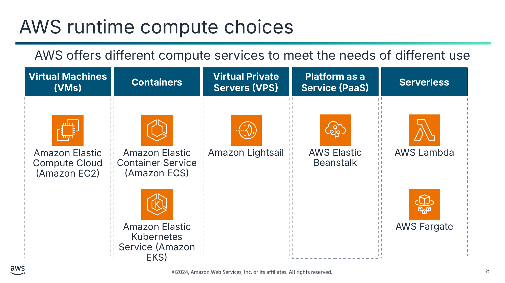

AWS offers different compute services to meet the needs of different use cases.

<details>
<summary>Текст зі схеми</summary>

**Virtual Machines (VMs)**

Amazon Elastic Compute Cloud (Amazon EC2)

**Containers**

Amazon Elastic Container Service (Amazon ECS)

Amazon Elastic Kubernetes Service (Amazon EKS)

**Virtual Private Servers (VPS)**

Amazon Lightsail

**Platform as a Service (PaaS)**

AWS Elastic Beanstalk

**Serverless**

AWS Lambda

AWS Fargate

</details>

> **Нотатки:**
>
> |Slide number 8  
> |Instructor notes  
> |Briefly explain the purpose of the section and why understanding AWS compute options is important for designing cloud architecture. Emphasize the need to choose the right compute option for different workloads to ensure optimal performance and cost efficiency. Present the five cloud compute model categories as the main topics for discussion.  
> |  
> |The following are definitions for students in case any are unfamiliar with the terms in the student notes:  
> |Virtual machines (VM): A virtual machine is a computer that provides the same functionality as on-premises computers but is accessed over the internet.  
> |Virtual private servers (VPS): A virtual private server, also known as an "instance," allows users to run websites and web applications in a highly secure and available environment while being cost effective.  
> |Platform as a service (PAAS): Platforms as a service remove the need for organizations to manage the underlying infrastructure (usually hardware and operating systems) and allow you to focus on the deployment and management of your applications.  
> |Serverless: An architecture or service that has no server management, pay-for-value services, continuous scaling, and built-in fault tolerance.  
> |  
> |Student notes  
> AWS offers several compute options to meet different needs. As you design the architecture to support a given type of workload, it’s important that you understand the available compute options. As the diagram shows, the main runtime compute choices can be grouped into five cloud compute model categories: virtual machines (VMs), containers, virtual private servers (VPS), platform as a service, which is also known as PaaS, and serverless.  
>
> In the VMs category, AWS offers the Amazon EC2 service. This service provides secure and resizable virtual servers in the cloud that can be used to run workloads of different sizes, from small scale to enterprise level.  
>
> In the containers category, AWS offers Amazon Elastic Container Service (Amazon ECS). It enables you to run Docker container applications on AWS. AWS also offers Amazon Elastic Kubernetes Service (Amazon EKS) which is a managed Kubernetes service that runs Kubernetes in the AWS cloud and on-premises data centers. You can use both services to run container applications in an highly available and scalable manner.  
>
> In the virtual private servers category, Amazon Lightsail provides developers with compute, storage, and networking capacity and capabilities to quickly deploy and manage websites and web applications in the cloud. Lightsail includes everything you need to launch your project quickly (VMs, containers, databases, content delivery networks (CDNs), load balancers, and DNS management) for a low, predictable monthly price. Lightsail is best suited for projects that require a few virtual private servers and users who prefer a simple management interface. Common use cases for Lightsail include running websites, web applications, blogs, e-commerce sites, simple software, and more.  
>
> The PaaS category includes AWS Elastic Beanstalk. It’s a solution that runs web applications and services that are developed in languages such as Java, .NET, PHP, Node.js, Python, Ruby, Go, and Docker. AWS Elastic Beanstalk is suitable for situations where you simply want to upload your code and have the service automatically handle the deployment for you.  
>
> The serverless category includes AWS Lambda, which is a serverless compute solution that runs Java, Go, PowerShell, Node.js, C#, Python, or Ruby code. This category also includes AWS Fargate, which provides a serverless compute platform for containers. Because they are serverless offerings, these services enable you to run workloads without having to provision, configure, or manage servers.  
>
> This module focuses on the Amazon EC2 service.

---

## Слайд 9: Compute service category differentiators

Each service category offers different levels of infrastructure control and application deployment speed.

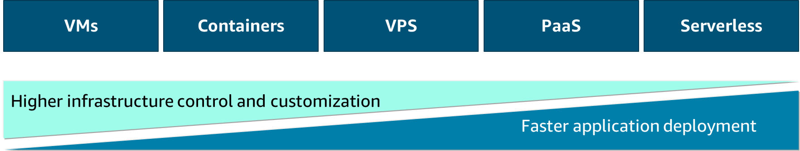

> **Нотатки:**
>
> |Slide number 9  
> |Instructor notes  
> Explain how each category differ in terms of management responsibilities, scalability, and suitability for different types of workloads.  
> |  
> |Student notes  
> When you choose an AWS compute runtime for your workload, consider that VMs, container-based services, and VPS provide more control over your infrastructure and enable higher degrees of customization. PaaS and serverless services enable you to focus more on your application and less on infrastructure. They also enable quick deployment.  
>
> The diagram shows the different service categories and illustrates how VMs, containers, and VSPs offer more infrastructure control and customization whereas Platform as a Service and serverless offer faster application deployments.

---

## Слайд 10: Amazon EC2

- Provides VMs (servers) in the cloud
- Provisions servers in minutes
- Can automatically scale capacity up or down as needed
- Enables you to pay only for the capacity that you use

Amazon EC2

> **Нотатки:**
>
> |Slide number 10  
> |Instructor notes  
> |  
> |Student notes  
> For the rest of this module, our focus will be on learning about Amazon EC2. It offers the broadest and deepest compute platform in the cloud. You can use Amazon EC2 to provision virtual servers, referred to as EC2 instances, and completely control the computing resources of those servers. You can obtain and start new server instances in minutes and quickly scale capacity both up and down as your computing requirements change. You can you can also increase or decrease the size of existing servers.  
> From a cost perspective, you pay only for the capacity that you use.  
>
> Amazon EC2 provides VMs in the cloud and supports a variety of operating systems including Microsoft Windows and many variants of Linux. The service also provides Mac instances, which natively support the macOS operating system.  
>
> It offers choices with the latest processor, storage, networking, operating system, and purchase model to help you best match the needs of your workload.

---

## Слайд 11: Amazon EC2 virtualization

An EC2 instance is a VM that runs on a physical host.

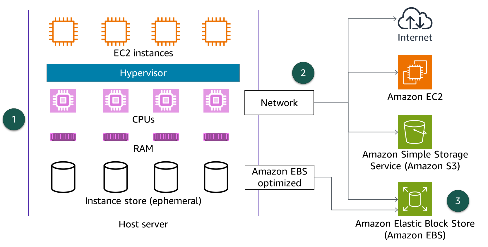

> **Нотатки:**
>
> |Slide number 11  
> |Instructor notes  
> Discuss the different components that make up an EC2 instance. Explain the role of the host computer, Availability Zones, VMs, operating systems, and the hypervisor layer. Highlight the importance of the hypervisor in managing the access of VMs to physical hardware resources.  
> |  
> |Student notes  
> Amazon EC2 instances run as virtual machines on host computers that are located in AWS Availability Zones. Each VM runs an operating system (OS), such as Amazon Linux or Microsoft Windows. You can install and run applications on the OS in each VM. You can even run enterprise applications that span multiple VMs.  
>
> The VMs run on top of a hypervisor layer that’s maintained by AWS. The hypervisor is the operating platform layer that provides an EC2 instance with access to the actual physical hardware resources that it needs to run, such as processors, memory, and storage.  
>
> Some EC2 instances use an instance store. The instance store is also known as ephemeral storage. It is storage that’s physically attached to the host computer and provides temporary block-level storage to an instance.  
>
> Many EC2 instances use Amazon Elastic Block Store (Amazon EBS) for the boot disk and other storage needs. Amazon EBS provides persistent block storage volumes, which means that the data will be persisted. For example, the data persists on an EC2 instance even when that EC2 instance is in a stopped state.  
>
> EBS-optimized instances provide faster access to an attached Amazon EBS volume by minimizing the I/O contention between the volume and other traffic from the instance.  
>
> EC2 instances can have network connectivity to other resources, such as other EC2 instances, AWS services, and the internet. You can configure the degree of network access to suit your needs and to balance accessibility needs with security requirements. In addition, different instance types provide different levels of network performance.  
>
> The diagram on the slide illustrates the following characteristics of an EC2 instance:  
> You can choose different configurations of CPU and memory capacity for an instance.  
> An instance provides network connectivity.  
> An instance supports different storage options including instance store and Amazon EBS volumes.

---

## Слайд 12: Amazon EC2 use cases

Use Amazon EC2 when you need the following:

- Complete control of your computing resources, including operating system and processor type.
- Options for optimizing your compute costs
  - On-Demand Instances, Reserved Instances, and Spot Instances
  - Savings Plans
- Ability to run any type of workload
  - Simple websites
  - Enterprise applications
  - Generative artificial intelligence (generative AI) applications

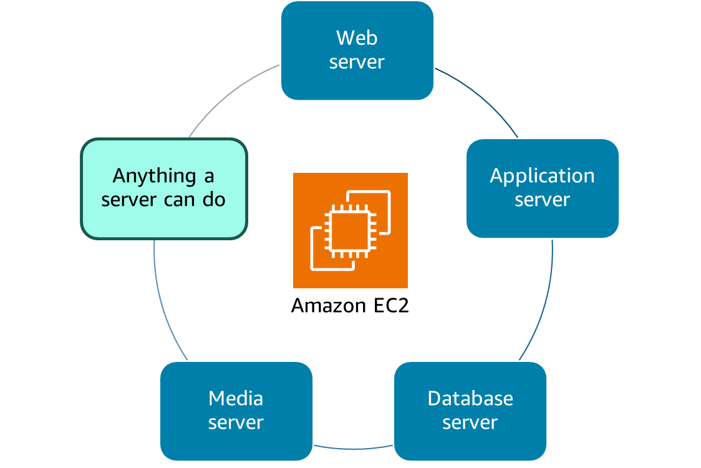

> **Нотатки:**
>
> |Slide number 12  
> |Instructor notes  
> |  
> |Student notes  
> Amazon EC2 provides virtual machines where you can host the same kinds of applications that you might run on a traditional on-premises server. Common uses for EC2 instances include web servers, application servers, database servers, and media servers.  
>
> In particular, consider Amazon EC2 as a compute choice in situations where you need the following:  
> Complete control of your computing resources: Amazon EC2 enables you to set up and configure everything about your instances, from your operating system to your applications. In addition, you can choose instances with either x86 or Advanced RISC Machine (ARM) processor architecture and instances with processor accelerators such as machine learning accelerators.  
> Options for optimizing your compute costs: Amazon EC2 offers several ways to pay for EC2 instances, including On-Demand Instances, Reserved Instances, Spot Instances, and Savings Plans. You can also pay for Dedicated Hosts, which provide you with EC2 instance capacity on physical servers that are dedicated for your use.  
> A virtual server to run any type of workload: From simple websites to generative artificial intelligence (generative AI) applications, Amazon EC2 provides a wide selection of instance types optimized to fit different use cases.  
>
> You will learn more details about Amazon EC2 configuration and pricing options in later sections of this module.

---

## Слайд 13: Steps for provisioning an EC2 instance

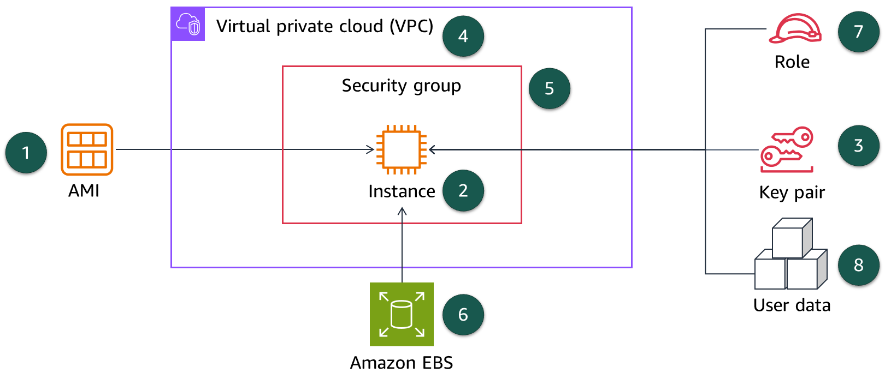

> **Нотатки:**
>
> |Slide number 13  
> |Instructor notes  
> Break down the diagram: Describe each component and its function. Remind students about the function of security groups. Discuss the key pair component, which allows secure SSH access to the instance and is essential for remote management. Highlight the importance of security, and emphasize the need for a secure instance by explaining the potential risks of not implementing proper security measures. Suggest additional security measures that can be implemented, such as regular updates and patches to the operating system and software.  
> |  
> |Student notes  
> This diagram illustrates the main steps and components for provisioning an instance. The components that are in the diagram are not an exhaustive list of the options that are available when you configure an instance. However, they are important items that you need for launching a secure instance.  
>
> The steps are as follows:  
> You start with an Amazon Machine Image (AMI), which is the template that Amazon EC2 uses to launch an instance. AWS provides some AMIs. Other AMIs come from third-party organizations and are available in the AWS Marketplace. You can also create your own AMI from an existing EC2 instance.  
> After you choose the AMI, select an instance type. Amazon EC2 provides a selection of instance types that are optimized to fit different use cases. Instance types comprise varying combinations of CPU, memory, storage, and networking capacity.  
> If you plan to connect to the instance using Secure Shell (SSH) or Remote Desktop Protocol (RDP), you must specify a key pair. A key pair is a set of security credentials that you use to prove your identity when connecting to an EC2 instance. A key pair consists of a public key and a private key.  
> When you launch an instance, you can specify network placement and addressing as appropriate to secure and provide access to the instance. All instances are deployed within a network in a virtual private cloud (VPC). You can also decide whether to assign a public IP address or a DNS address to the instance.  
> You must also assign a new or existing security group to the instance. A security group is a set of firewall rules that controls the traffic to and from your instance. The security group defines which ports network traffic can use.  
> Next, you specify the storage options for the instance. The storage type that the instance’s OS will boot from can be either an instance store (ephemeral storage) or an EBS volume. You can also attach additional block storage volumes to the instance.  
> If you intend to run an application on the instance that makes API calls to AWS services, you must attach an AWS Identity and Access Management (IAM) role to the instance. You use an instance profile to pass an IAM role to an EC2 instance.  
> Finally, you can optionally specify user data when you launch an instance. This data provides a powerful way to automate installations and configurations on the instance when it launches.

---

## Слайд 14: Key takeaways: Adding compute with Amazon EC2

- Amazon EC2 enables you to run VMs in the cloud and easily scale capacity up or down as needed.
- You can use an EC2 instance when you need complete control of your computing resources and want to run any type of workload.
- When you launch an EC2 instance, you must choose an AMI and an instance type. Launching an instance involves specifying configuration parameters including network, security, storage, and user data settings.

> **Нотатки:**
>
> |Slide number 14  
> |Instructor notes  
> |  
> |Student notes

---

## Слайд 15: Choosing an AMI to launch an EC2 instance

Adding a Compute Layer Using Amazon EC2

> **Нотатки:**
>
> |Slide number 15  
> |Instructor notes  
> |  
> |Student notes  
> This section defines an Amazon Machine Image (AMI) and discusses its main benefits. It also provides guidance about how to choose an AMI and how to create a new one.

---

## Слайд 16: Amazon Machine Image (AMI)

An AMI provides the information that is needed to launch an instance, including the following:

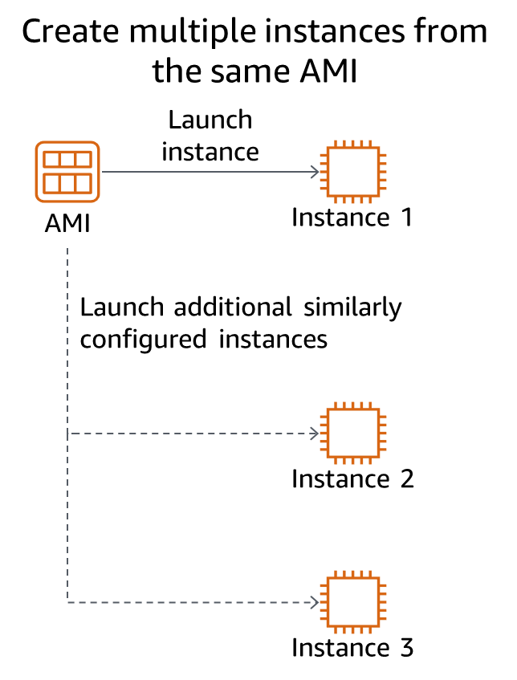

- A template for the root volume: Contains the guest operating system (OS) and perhaps other installed software
- Launch permissions: Controls who can access the AMI
- Block device mappings: Specifies any storage volumes to attach to the instance

> **Нотатки:**
>
> |Slide number 16  
> |Instructor notes  
> |  
> |Student notes  
> An AMI provides the information that is needed to launch an instance. You must specify a source AMI when you launch an instance. The AMI includes a template for the root volume of the instance, launch permissions, and block device mappings.  
>
> A root volume typically contains an operating system (OS) and everything that has been installed in that OS (applications, libraries, utilities, and others). Amazon Elastic Compute Cloud (Amazon EC2) copies the template to the root volume of the new instance and then starts it.  
>
> The launch permissions control which AWS accounts can use the AMI to launch instances. They also let you make the AMI available to the public.  
>
> The block device mappings specify additional storage volumes (if any) to attach to the instance when it’s launched.  
>
> You can launch multiple instances from a single AMI when you need multiple instances that have the same configuration.  
>
> You can also use different AMIs to launch instances when you need instances with different configurations. For example, you might have one AMI to implement web server instances in your architecture, and another to implement application server instances.

---

## Слайд 17: AMI benefits

Repeatability

Reusability

Recoverability

An AMI can be used repeatedly to launch instances with efficiency and precision.

Instances launched from the same AMI are identically configured.

You can create an AMI from a configured instance as a restorable backup.

You can replace a failed instance by launching a new instance from the same AMI.

> **Нотатки:**
>
> |Slide number 17  
> |Instructor notes  
> |  
> |Student notes  
> The benefits of using an AMI include repeatability, reusability, and recoverability.  
>
> AMIs provide repeatability because an AMI packages the full configuration and content of an EC2 instance. As such, it can be used repeatedly to launch multiple instances with efficiency and precision.  
>
> AMIs promote reusability because instances that are launched from the same AMI are exact replicas of each other. This design makes it easier to build clusters of similar instances or recreate compute environments.  
>
> AMIs also facilitate recoverability. If an instance fails, you can replace it by launching a new instance from the same AMI that you used to launch the original instance. In addition, AMIs provide a way to back up a complete EC2 instance configuration, which you can use to launch a replacement instance if there is a failure. If any additional software or changes to the base AMI configuration are made, it’s a best practice to save those changes by creating a new AMI. This gives you a copy of your most recently configured AMI to recover from a failure. Without it, those software additions or new configuration changes that aren’t saved before an instance failure won’t be recoverable.  
>
> For more information on AMIs, see the Amazon Machine Images (AMI) web page.

---

## Слайд 18: Choosing an AMI

Choose an AMI based on the following:

AMI source:

- Region
- Operating system
- Storage type of the root device
- Architecture
- Virtualization type: For best performance, use an AMI with a Hardware Virtual Machine (HVM) virtualization type.

- Quick Start: Linux and Microsoft Windows AMIs that are provided by AWS.
- My AMIs: Any AMIs that you create.
- AWS Marketplace: Pre-configured templates from third parties.
- Community AMIs: AMIs shared by others. Use at your own risk.

> **Нотатки:**
>
> |Slide number 18  
> |Instructor notes  
> Highlight the main points here.  
> |  
> |Student notes  
> When you choose an AMI to launch an instance, your decision should be based on five key characteristics:  
> Region: Each AMI exists in a specific Region. Therefore, you must select an AMI that’s in the Region where you want the instance to run. You can copy an AMI from one Region to another as needed.  
> Operating system: For an AMI that’s provided by AWS, you can choose between Microsoft Windows or a variant of Linux.  
> Storage for the root device: All AMIs are categorized as either Amazon EBS-backed or instance store-backed. The data on an instance store volume persists only during the lifetime of the instance, but the data on an EBS volume persists independently of the life of the instance.  
> Architecture: This characteristic determines the type of processor architecture that best fits your workload. The choices are 32-bit or 64-bit, and either an x86 or Advanced RISC Machine (ARM) instruction set.  
> Virtualization type: AMIs use one of two types of virtualization: paravirtual (PV) or Hardware Virtual Machine (HVM). The main differences between PV and HVM AMIs include how they boot and whether they can take advantage of special hardware extensions for better performance. For best performance, use an AMI with the HVM virtualization type.  
>
> For more about the differences between PV and HMV, see the Linux AMI virtualization types web page.  
>
> You can obtain an AMI from one of four sources:  
> Quick Starts are AMIs that are built by AWS. They offer the choice of either Microsoft Windows or variants of the Linux operating system. The Linux options include: Amazon Linux, Ubuntu, Red Hat Enterprise Linux, SUSE Linux Enterprise Server, Fedora, Debian, CentOS, Gentoo Linux, Oracle Linux, and FreeBSD.  
> AWS also lets you create your own AMIs (My AMIs). You can create an AMI from an EC2 instance.  
> You can also look for AMIs in the AWS Marketplace, which offers a digital catalog that lists thousands of software solutions. These solutions include AMIs from software vendors for specific use cases.  
> Community-built AMIs are created by people from around the world, and they can offer solutions to many different types of problems. However, they are not vetted by AWS. Therefore, use them at your own risk. In particular, avoid using them in any production or corporate environment.  
>
> For more information on choosing AMIs, see the AMI types web page.

---

## Слайд 19: Instance store-backed versus Amazon EBS-backed AMI

| Characteristic | Amazon EBS-Backed Instance | Instance Store-Backed Instance |
|---|---|---|
| Boot time for the instance | Boots faster | Takes longer to boot |
| Maximum size of root device | 16 TiB | 10 GiB |
| Ability to stop the instance | Can stop the instance | Cannot be in a stopped state; instances are running or terminated |
| Ability to change the instance type | Can change the instance type by stopping instance | Can’t change the instance type because the instance can’t be stopped |
| Instance charges | You are charged for instance usage, EBS volume usage, and storing your AMI as an EBS snapshot | You are charged for instance usage and storing your AMI in Amazon S3 |
| Use case | Persistent storage | Temporary storage |

> **Нотатки:**
>
> |Slide number 19  
> |Instructor notes  
> |  
> |Student notes  
> There are important behavior and performance differences when you launch an instance by using an instance store-backed AMI versus an Amazon EBS-backed AMI. They are as follows:  
> Amazon EC2 instances that use instance storage take longer to boot than Amazon EC2 instances that use Amazon EBS. This is because all the image parts have to be retrieved from Amazon Simple Storage Service (Amazon S3).  
> The maximum capacity of the root device of an instance that is backed by Amazon EBS is 16 tebibytes (TiB) and is greater than that of an instance store-backed instance, which is 10 gibibytes (GiB).  
> You can’t stop an instance store-backed instance, you can only reboot or terminate it.  
> You can’t change the instance type of an instance store-backed instance.  
> The cost for an Amazon EBS-backed instance includes EBS storage charges. The cost of an instance store-backed instance includes Amazon S3 storage charges. Amazon S3 storage costs are usually cheaper.  
> Use an Amazon EBS-backed instance if you need persistent data on the storage of the instance, such as a database or a web application. Use an instance store-backed instance if your data doesn’t need to be persistent on that volume.

---

## Слайд 20: Amazon EC2 instance lifecycle

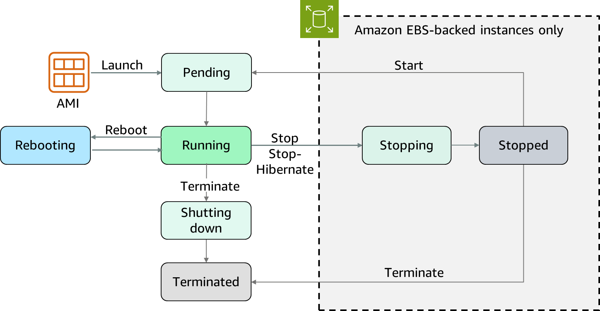

> **Нотатки:**
>
> |Slide number 20  
> |Instructor notes  
> |Explain the possible instance states and transitions. Also, highlight the additional states and transitions that are available only if the instance is Amazon EBS-backed. Share with the students that the information on this slide is very much in the scope of the AWS Certified Solutions Architect – Associate certification exam.  
> |  
> |Student notes  
> This diagram shows the lifecycle of an instance and highlights the extra actions and states that an Amazon EBS-backed instance allows. A launched instance becomes "pending" and then "running." Running instances can be rebooted, terminated, or stopped. A stopped instance can be started or terminated.  
>
> When an instance is first launched from an AMI, or when you start a stopped instance, it enters the pending state. This state indicates that the instance is being provisioned on a host computer and is booting. The instance type that is specified in the AMI, or for the original stopped instance, determines the hardware of the host computer for the new instance.  
>
> When the instance is fully booted and ready, it exits the pending state and enters the running state. At this point, you can connect to your running instance over the internet and start to use it.  
>
> As soon as an instance is in a running state, it can be rebooted by using the Amazon EC2 console, the AWS Command Line Interface (AWS CLI), or AWS SDKs. It then moves to a rebooting state. A rebooted instance stays on the same physical host, and it maintains the same public DNS name and public IP address. If the instance has instance store volumes, it retains the data on those volumes.  
>
> From the running state, you can also terminate an instance. Terminating an instance causes the instance to go into an intermediary shutting down state before it displays a terminated state. A terminated instance remains visible in the Amazon EC2 console for some time before the virtual machine (VM) is deleted. However, you can’t connect to or recover a terminated instance.  
>
> Instances that are backed by Amazon EBS can also be stopped from a running state. They enter the stopping state before they attain the fully stopped state. A stopped or terminated instance does not incur the same cost as a running instance. As soon as the state of an instance changes to stopping or shutting-down charges are no longer incurred for the instance. Starting a stopped instance puts it back into the pending state. When you start an instance, the instance is typically migrated to a new underlying host computer and assigned a new public IPv4 address.  
>
> You can also hibernate an EBS-backed instance from the running state. Doing so causes the in-memory storage, private IP address, and Elastic IP address to be saved. They remain the same when you start the instance again, so you can pick up where you left off. In most cases, when you start a hibernated instance, it’s moved to a new host computer. However, your instance might stay on the same host computer if the host computer has no problems. Similar to stopping an instance, you are not charged for your instance when it is in the hibernate state.

---

## Слайд 21: Creating a new AMI

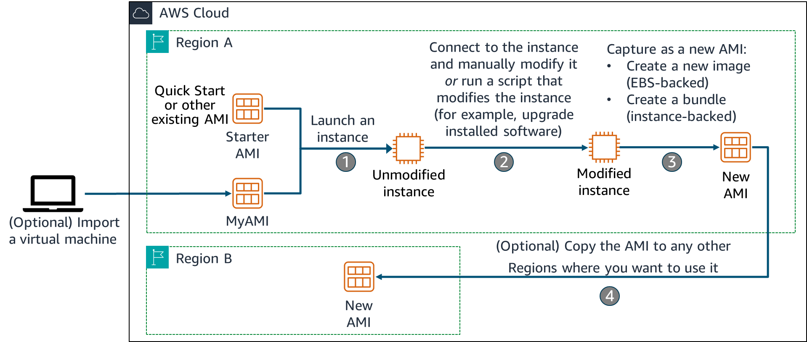

> **Нотатки:**
>
> |Slide number 21  
> |Instructor notes  
> |  
> |Student notes  
> This diagram shows an instance that is launched from a starter AMI. It’s then modified and captured as a new AMI that then itself becomes a new starter AMI. As a new starter AMI, it can be optionally copied to other Regions.  
>
> You create an AMI from an EC2 instance. You start with a source AMI, which can be an AMI that already exists, such as a Quick Start AMI that’s provided by AWS. Or, you can start with an AMI that you build from a VM that you import. AWS offers the VM Import/Export service that you can use to import virtual machine images from your existing environment to Amazon EC2 instances. You can also export them back to your on-premises environment. After your source AMI is ready, you can then launch an EC2 instance from this AMI (step 1).  
>
> Regardless of the option you choose (step 1), you will have what the diagram refers to as an unmodified instance. From that instance, you might then create a golden instance. In other words, create a VM that you configure with the specific OS and application settings that you want (step 2). Then, capture it as a new AMI (step 3).  
>
> For an EBS-backed AMI, you capture the new AMI by creating a new image, and AWS automatically registers it for you. For an instance-backed AMI, you capture the new AMI by using Amazon EC2 AMI tools to create a bundle for the instance root volume, and upload the bundle to an Amazon S3 bucket. You then must manually register the new AMI.  
>
> After an AMI is registered, the AMI can be used to launch new instances in the same AWS Region. You can now think of the new AMI as a new starter AMI. Optionally, you might want to also copy the AMI to other Regions (step 4), so that you can also launch new EC2 instances in those locations.

---

## Слайд 22: EC2 Image Builder

EC2 Image Builder automates the creation, management, and deployment of up-to-date and compliant golden VM images.

- Provides a graphical interface to create image-building pipelines
- Creates and maintains Amazon EC2 AMIs and on-premises VM images
- Produces secure, validated, and up-to-date images
- Enforces version control

EC2 Image Builder

> **Нотатки:**
>
> |Slide number 22  
> |Instructor notes  
> Present EC2 Image Builder, which is a service that was introduced in December, 2019. If the service is new to you, take the time to familiarize yourself with it.  
> |  
> |Student notes  
> Another way to create an AMI is to use EC2 Image Builder.  
>
> EC2 Image Builder is an AWS service that simplifies the creation, maintenance, validation, sharing, and deployment of Linux or Microsoft Windows images. It provides a graphical interface to produce AMIs for use on AWS and to generate VM images for use on premises.  
>
> One of the benefits of using EC2 Image Builder is that it lets you create images with only the essential components such as software, settings, and other configurations. This can reduce your exposure to security vulnerabilities. Before you use your images in production, you can use EC2 Image Builder to validate your images with tests that are provided by AWS or your own tests. Finally, it provides version control for revision management.

---

## Слайд 23: Key takeaways: Choosing an AMI to launch an EC2 instance

- An AMI provides the information that’s needed to launch an EC2 instance.
- Benefits of AMIs include repeatability, reusability, and recoverability.
- For best performance, use an AMI with the HVM virtualization type.
- There are multiple sources to get AMIs including Quick Start, Community AMIs, AWS Marketplace, and My AMIs (that store AMIs that you create).

> **Нотатки:**
>
> |Slide number 23  
> |Instructor notes  
> |  
> |Student notes

---

## Слайд 24: Selecting an Amazon EC2 instance type

Adding a Compute Layer Using Amazon EC2

> **Нотатки:**
>
> |Slide number 24  
> |Instructor notes  
> |  
> |Student notes  
> This section defines Amazon EC2 instance types. It also provides guidance about selecting the best instance types, based on the instance workload requirements.

---

## Слайд 25: EC2 instance type configuration

An EC2 instance type defines the configuration of CPU, memory, storage, and network performance.

| Instance type | vCPU | Memory | Storage | Network performance |
|---|---|---|---|---|
| m5d.large | 2 | 4 GiB | 1 x 50 NVMe SSD | Up to 10 Gbps |
| m5d.xlarge | 4 | 8 GiB | 1 x 100 NVMe SSD | Up to 10 Gbps |
| m5d.8xlarge | 32 | 128 GiB | 2 x 600 NVMe SSD | 10 Gbps |

All current generation instance types support enhanced networking, except for T2 instances.

> **Нотатки:**
>
> |Slide number 25  
> |Instructor notes  
> |  
> |Student notes  
> Before you launch an instance, you should know what kind of workload will run on it. This helps you choose the right instance type when you launch your instance. An EC2 instance type defines a configuration of CPU, memory, storage, and network performance characteristics. The instance type that you choose will depend on your workload’s performance and cost requirements.  
>
> This chart shows you the configuration for three instance types: m5d.large, m5d.xlarge, and m5d.8xlarge. As the size of the instance type increases, the amount of vCPU, memory, and storage also increases.  
>
> Notice that the network performance is more static between sizes than the vCPU, memory and storage. The m5d.large and the m5d.xlarge both offer a network performance that is up to 10 gigabytes per second. However, the m5d.8xlarge offers a consistent 10 gigabytes per second of network performance.  
>
> However, this doesn’t mean that the m5d.8xlarge instance type is the right choice. To make the right choice, you need to consider the instance’s workload performance needs and cost requirements. Then, choose the instance type with the configuration that best matches those parameters.  
>
> All current generation instance types support enhanced networking, except for T2 instances. These enhanced networking instance types ensure that the Session Initiation Protocol (SIP) workloads running on them have access to consistent bandwidth and comparatively lower aggregate latency.

---

## Слайд 26: EC2 instance type name

Instance types named components

- Family
- Generation
- Processor family
- Additional capabilities
- Size

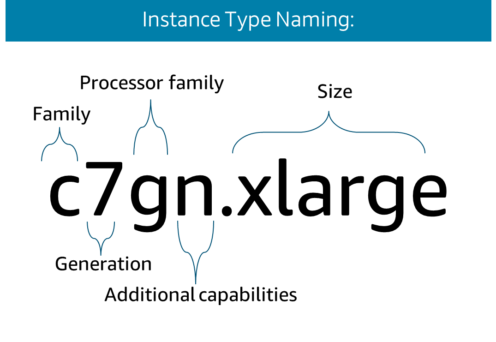

> **Нотатки:**
>
> |Slide number 26  
> |Instructor notes  
> |  
> |Student notes  
> Instance type names follow a standard convention. An instance type name consists of multiple parts that describe the different characteristics of the instance type.  
>
> In this example, c is the family name for instance type name c7gn.xlarge. It is followed by a number, which is 7 in this case. This represents the generation number of that type. So, a c7 instance is the seventh generation of the c family. In general, instances with a higher generation number are more powerful and provide a better value for the price than instances with a lower generation number.  
>
> Following the generation number, you find an optional part that indicates processor family and additional capabilities of the instance type. In the example, the g in the name indicates that the instance type uses AWS Graviton processor. The n in the name indicates that the instance type has additional capabilities that are Network and EBS optimized.  
>
> The next part of the name, which follows a period (.) separator, represents the size of the instance. The instance type size defines the performance specification of an instance across the CPU, memory, storage, and network performance categories. In the example, xlarge indicates that it is an extra-large instance.  
>
> Again, not all instance types include processor family and additional capabilities in the name. For example, the instance name, m5d.xlarge, does not include a processor family letter in the instance type name.  
>
> For more information on instance type naming convention, see the Instance types web page.

---

## Слайд 27: Suitability of instance types for workloads

| Type | Workload examples | Instance type examples |
|---|---|---|
| General purpose instance types | • Web or application servers<br>• Enterprise applications<br>• Gaming servers<br>• Development or test environments | M7, Mac, M6, M5, M4, T4, T3, T2 |
| Compute optimized instance types | • Batch processing<br>• Distributed analytics<br>• High performance computing (HPC) | C7, C6, C5, C4 |
| Storage optimized instance types | • High-performance databases<br>• Real-time analytics<br>• Transactional workloads | I4, Im4, Is4, I3, D2, D3, H1 |
| Memory optimized instance types | • In-memory caches<br>• High-performance databases<br>• Big data analytics | R7, R6, R5, R4, X2, X1, Z1 |
| Accelerated computing instance types | • Machine learning, artificial intelligence (AI)<br>• HPC | P5, P4, P3, P2, DL1, Trn1, Inf2, Inf1, G5, G4, G3, F1, VT1 |
| High performance computing (HPC) optimized instance types | • Deep learning workloads<br>• Compute-intensive HPC workloads | Hpc7, Hpc6 |

> **Нотатки:**
>
> |Slide number 27  
> |Instructor notes  
> |This slides that lists examples of workloads that suit each instance type category. These also list examples of instance types for a given category.  
> |The instructor should visit the Instance Type Detail page to review instance types with the class.  
> |  
> |Student notes  
> You will now learn about the suitability of different instance types for different workloads. Instance types can be categorized as general purpose, compute optimized, storage optimized, memory optimized, accelerated computing, or High Performance Computing (HPC) optimized. You will see each of the categories in this slide and the next slide.  
>
> General purpose instances provide a balance of compute, memory, and networking resources. They can be used for diverse workloads. These instances work well for applications that use these resources in equal proportions. Typical use cases for general purpose instances are web or application servers, enterprise applications, gaming servers, caching fleets, analytics applications, and development or test environments.  
>
> Examples of general purpose instance types include M5, T3, and A1 instances.  
>
> Compute optimized instances work well for compute-bound applications that benefit from high-performance processors. Instances that belong to this family are suited for workloads like batch processing, distributed analytics, high performance computing (HPC), ad server engines, multiplayer gaming, and video encoding.  
>
> Examples of compute optimized instance types include C5 and C5n instances.  
>
> Storage optimized instances are designed for workloads that require high, sequential read/write access to very large datasets on local storage. They are optimized to deliver tens of thousands of low-latency, random IOPS. They are suited for applications like high-performance databases, NoSQL databases, real-time analytics, transactional workloads, big data, data warehouses, and log processing.  
>
> Examples of storage optimized instance types include I3, D2, and H1 instances.  
>
> Memory optimized instances are designed to deliver fast performance for workloads that process large datasets in memory. They are suited for applications like in-memory caches, high-performance databases, and big data analytics.  
>
> Examples of memory-optimized instance types include R5, X1, and HMI instances.  
>
> Accelerated computing instances use hardware accelerators (or co-processors) to perform functions like floating-point-number calculations, graphics processing, and data-pattern matching. They do so more efficiently than performing those functions in software that runs on CPUs. Accelerated computing instances are suited for machine learning and artificial intelligence, HPC, and graphics workloads.  
>
> Examples of accelerated computing instance types include P3, G4, and F1 instances.  
>
> High performance computing (HPC) instances are purpose built to offer the best price performance for running HPC workloads at scale on AWS. HPC instances are ideal for applications that benefit from high-performance processors such as large, complex simulations and deep learning workloads.  
>
> Examples of HPC instance types include Hpc7g, Hpc7a and Hpc6id instances.  
>
> For more information, see Instance Type Details on your course resources page.

---

## Слайд 28: Choosing an instance type

- With over 270 available instance types, how do you choose the right type?
  - Consider both performance requirements and cost requirements.
  - Use available resources to get recommended options.

| Task | Solution |
|---|---|
| Creating a new instance | • In the EC2 console, use the Instance Types page to filter by characteristics that you choose.<br>• Recommendation: The latest generation in an instance family typically has a better price-to-performance ratio. |
| Optimizing an existing instance | • You can get recommendations for optimizing the instance type by using the AWS Compute Optimizer.<br>• You can evaluate recommendations and modify the instance accordingly. |

> **Нотатки:**
>
> |Slide number 28  
> |Instructor notes  
> |Ask the architectural question: What tools does AWS offer to help select the right instance type for a workload?  
> |Answer: The Instance Types page in the Amazon EC2 console and AWS Compute Optimizer service. The Instance Types page in the Amazon EC2 console and AWS Compute Optimizer service were introduced in November 2019 and December 2019, respectively.  
> |  
> |Emphasize that there’s no substitute for measuring and collecting metrics to help decide which instance type to use.  
> |  
> |Student notes  
> Given the combination of instance type categories, capabilities, and options that are associated with an instance type, it’s no surprise that there are quite a few of them. As of March 2020, there are more than 270 instance types available. This wide selection reflects the deep and broad richness of cloud compute offerings provided by AWS.  
>
> The high number of instance types make it challenging to answer the question: How do you choose the right instance type for your workload?  
>
> You want to choose an instance type that provides the level of performance that your workload needs while ensuring the efficient utilization of your instance’s resources to minimize cost. Start by analyzing or anticipating the workload needed in order to run optimally. During the development of your application, the instance type and size that’s best for the workload will present itself. It’s better to slightly under-spec and then resize/scale as needed. Starting out with an inordinately larger instance than needed isn’t cost effective and can possibly even obscure some performance issues.  
>
> AWS offers tools to help choose the right instance type for a workload: the Instance Types page in the Amazon EC2 console and the AWS Compute Optimizer service.  
>
> If you are creating a new instance, use the Instance Types page in the Amazon EC2 console to help you search and compare the choices. This page displays all the available instance types in a Region and provides search and filtering capabilities based on attribute values. As a recommendation, when choosing an instance type in a family, select the latest generation instance type because it typically has better price-to-performance ratio.  
>
> If you already have a running instance, you can use the AWS Compute Optimizer service to get recommendations on how to optimize the instance type. This service can analyze your instance’s runtime behavior and make recommendations on how to optimize it. You can then evaluate the recommendations and modify the instance accordingly.

---

## Слайд 29: AWS Compute Optimizer

AWS Compute Optimizer

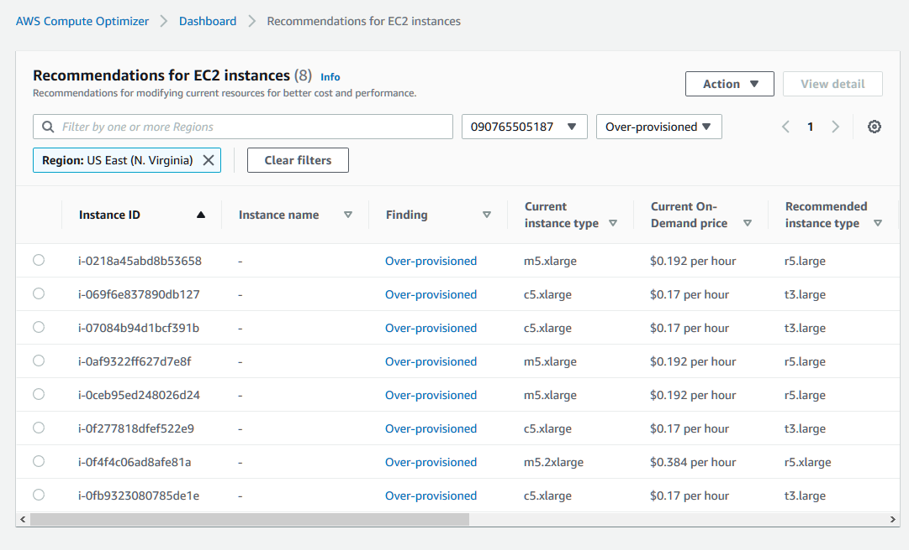

- Recommends optimal instance type, instance size, and Auto Scaling group configuration
- Analyzes workload patterns and makes recommendations
- Classifies instance findings as Under-provisioned, Over-provisioned, Optimized, or None

> **Нотатки:**
>
> |Slide number 29  
> |Instructor notes  
> |  
> |Student notes  
> AWS Compute Optimizer is a service that analyzes the configuration and utilization metrics of EC2 instances and Auto Scaling groups. It generates optimization recommendations to reduce the cost and improve the performance of your workloads. You can use these recommendations to decide whether to move to a new instance type.  
>
> Compute Optimizer uses Amazon Machine Learning (Amazon ML) to analyze your workloads. Currently, it generates EC2 instance type and size recommendations for M, C, R, T, and X instance families. When it’s activated, Compute Optimizer will analyze your running AWS compute resources and start to deliver recommendations.  
>
> Compute Optimizer classifies its findings for EC2 instances as Under-provisioned, Over-provisioned, Optimized, or None. The None classification might occur if you activated Compute Optimizer for less than 12 hours, when the instance has been running for less than 30 hours, or when the instance type is not supported by Compute Optimizer.  
>
> For more information, see the AWS Compute Optimizer User Guide on the content resources page of your online course.

---

## Слайд 30: Activity: Choosing Instance Types

- Match example use cases to the EC2 instance type suited to each.
- Use the information at https://aws.amazon.com/ec2/instance-types/

> **Нотатки:**
>
> |Slide number 30  
> |Instructor notes  
> |Optional: Divide the class into groups for a group activity or make it an individual activity.  
> |  
> |Instruct the learners to navigate to the Instance Type Details page  
> |Student notes  
> Navigate to the Instance Type Details page.

---

## Слайд 31: Activity: Choosing instance types

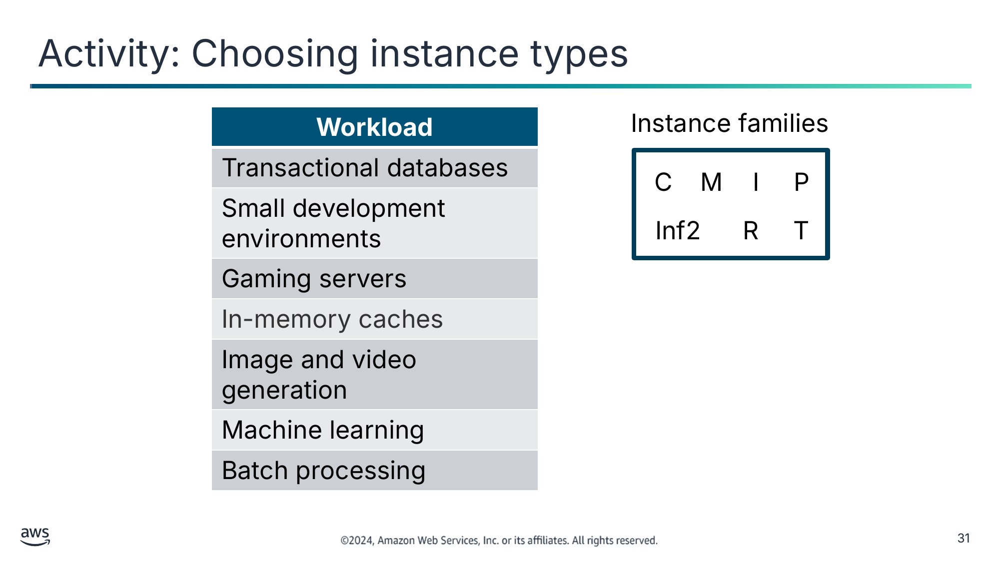

| Workload |
|---|
| Transactional databases |
| Small development environments |
| Gaming servers |
| In-memory caches |
| Image and video generation |
| Machine learning |
| Batch processing |

<details>
<summary>Текст зі схеми</summary>

Instance families

C

M

I

P

Inf2

R

T

</details>

> **Нотатки:**
>
> |Slide number 31  
> |Instructor notes  
> |Emphasize that the Instance Type Details page is a tool. AWS recommends for customers to frequently review it to keep up to date on new instance types that are released. New instance types might be released that might improve efficiency and cost to existing workloads.  
> |  
> |Student notes  
> Review each workload listed. Choose the instance family from the group of instance families that’s best suited for the workload.  
>
> AWS recommends for customers to frequently review the Instance Type Details page to stay up to date on new instance types that are released. New instance types might be released that improve efficiency and cost to existing workloads.

---

## Слайд 32: Activity: Choosing instance types (Answers)

| Workload | Instance type family |
|---|---|
| Transactional databases | I |
| Small development environments | T |
| Gaming servers | M |
| In-memory caches | R |
| Image and video generation | Inf2 |
| Machine learning | P |
| Batch processing | C |

> **Нотатки:**
>
> |Slide number 32  
> |Instructor notes  
> |The I family is recommended for transactional database use cases. Chose I3 and navigate to the use case section. Callout the use case for transactional databases.  
> |The T family is recommended for development environment use cases. Chose T3 and navigate to the use case section. Callout the use case for development environments.  
> |The M7g family is recommended for gaming server use cases. Chose M7g and navigate to the use case section. Callout the use case for gaming servers.  
> |The R family is recommended for in-memory caches use cases. Chose R5 and navigate to the use case section. Callout the use case for in-memory caches.  
> |The Inf2 family is recommended for image and video generation use cases. Chose Inf2 and navigate to the use case section. Callout the use case for image and video generation.  
> |The P family is recommended for machine learning use cases. Chose P3 and navigate to the use case section. Callout the use case for machine learning.  
> |The C family is recommended for batch processing use cases. Chose C5 and navigate to the use case section. Callout the use case for batch processing.  
> |  
> |Student notes  
> The I family is recommended for transactional database use cases.  
> The T family is recommended for development environment use cases.  
> The M family is recommended for gaming server use cases.  
> The R family is recommended for in-memory caches use cases.  
> The Inf2 family is recommended for image and video generation use cases.  
> The P family is recommended for machine learning use cases.  
> The C family is recommended for batch processing use cases.

---

## Слайд 33: Key takeaways: Selecting an EC2 instance type

- An EC2 instance type defines a configuration of CPU, memory, storage, and network performance characteristics.
- As a recommendation, choose new generation instance types in a family because they generally have better  
price-to-performance ratios.
- Use the Instance Types page in the Amazon EC2 console and AWS Compute Optimizer to find the right instance type for your workload.

> **Нотатки:**
>
> |Slide number 33  
> |Instructor notes  
> |  
> |Student notes

---

## Слайд 34: Adding storage to an Amazon EC2 instance

Adding a Compute Layer Using Amazon EC2

> **Нотатки:**
>
> |Slide number 34  
> |Instructor notes  
> |  
> |Student notes  
> This section describes the different storage options available for your EC2 instances. It covers the different options for your root volume and also data volumes.

---

## Слайд 35: Amazon EC2 storage overview

| AWS EC2 storage resource | Root Volume | Data volumes for a single instance | Data volumes for data that is accessible from multiple Linux instances | Data volumes for data that is accessible from multiple Windows instances |
|---|---|---|---|---|
| Amazon EBS (SSD-backed only) | Yes | Yes | No | No |
| Instance store | Yes | Yes | No | No |
| Amazon Elastic File System (Amazon EFS) [Linux] | No | No | Yes | No |
| Amazon FSx for Windows File Server | No | No | No | Yes |

An EC2 instance will *always* have a root volume, and can *optionally* have one or more data volumes.

> **Нотатки:**
>
> |Slide number 35  
> |Instructor notes  
> |Take the time to thoroughly explain slides concerning Instance store, Amazon Elastic Block Store (Amazon EBS), Amazon Elastic File System (Amazon EFS), and Amazon FSx for Windows File Server. Call out how they differ by use case. Start by differentiating the options based on whether the use case is for storing a root/boot volume or a data volume. Then, for a data volume, differentiate between a single instance use scenario and a shared instance use requirement.  
> |  
> |Student notes  
> EC2 instances have four main storage options:  
> Instance store  
> Amazon Elastic Block Store (Amazon EBS)  
> Amazon Elastic File System (Amazon EFS)  
> Amazon FSx for Windows File Server  
>
> Only an instance store or an SSD-backed EBS volume can be used to store a root volume. Use an instance store when you need faster compute time and data doesn’t need to be stored persistently on the volume. If instance store backed instances are stopped, all data on the volume will be deleted. Use an Amazon EBS volume if you need the data on the volume to be persistent. You can stop and restart an EBS volume without losing data on the volume.  
>
> In addition to being used as a root volume, an instance store or EBS volume can be used as a data volume. However, they must be used by a single instance at a time. EBS volumes can be detached and added to a different instance. In the case of an instance store volume, only the instance that the volume is launched with can use it.  
>
> If you want to share a data volume among multiple instances at the same time, you can use Amazon EFS or Amazon FSx for Windows File Server. Amazon EFS provides a shared file system for Linux instances, but Amazon FSx provides a shared file system for Microsoft Windows instances.  
>
> In this section, you review each of these options.

---

## Слайд 36: Instance store

An instance store provides non-persistent storage to an instance. The data volume is stored on the same physical server where the instance runs.

Characteristics

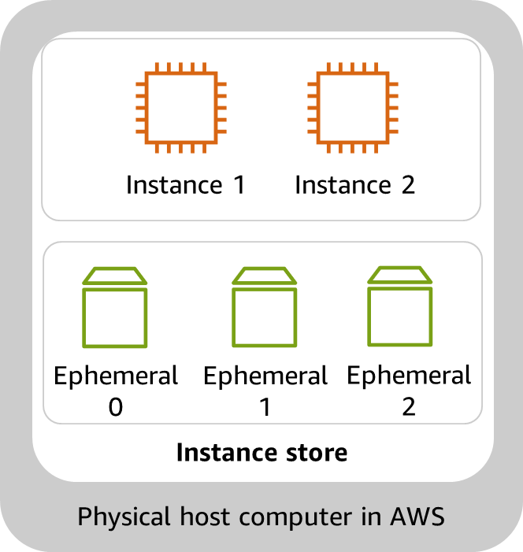

- Temporary block-level storage
- Uses HDD or SSD
- Instance store data is lost when the instance is stopped or terminated.

Example use cases

- Buffers
- Cache
- Scratch data

> **Нотатки:**
>
> |Slide number 36  
> |Instructor notes  
> |  
> |Student notes  
> An instance store volume provides temporary block-level storage for your instance. This storage is on disks that are physically attached to the computer that hosts the running instance. An instance store works well for the temporary storage of information that changes frequently, such as buffers, caches, scratch data, and other temporary content.  
>
> An instance store consists of one or more volumes that are exposed as block devices. The volumes reside on either HDDs or SSDs. SSDs can be Serial ATA SSDs or Non-Volatile Memory Express (NVMe) SSDs. Instance stores that use NVMe have higher I/O performance. An instance store is dedicated to a particular instance, but the disk subsystem is shared among instances on a host computer.  
>
> The instance type determines the available sizes for an instance store and the type of hardware that is used for the instance store volumes. Most instance types support instance stores, but not all.  
>
> The data in an instance store is preserved when the instance is rebooted, but not when it’s terminated. Instance store-backed instances can’t be stopped. They can only be rebooted or terminated. If an instance reboots, data in the instance store persists.  
>
> For more information, see the Amazon EC2 Instance Store topic in the Amazon EC2 online documentation.

---

## Слайд 37: Amazon EBS

Amazon EBS volumes provide network-attached persistent storage to an EC2 instance.

Characteristics

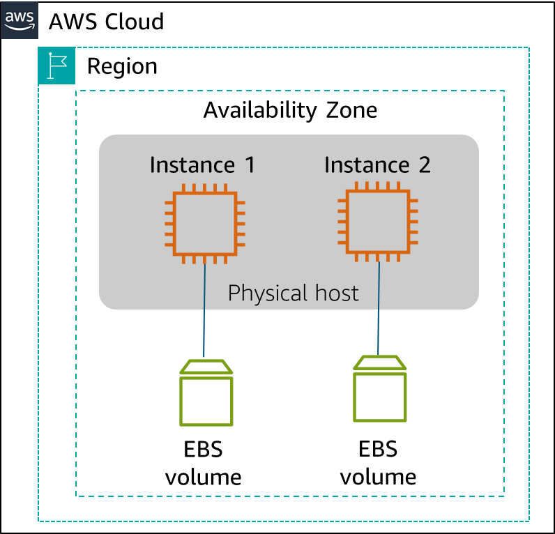

- Is persistent block-level storage
- Can attach to any instance in the same Availability Zone
- Uses HDD or SSD
- Can be encrypted
- Supports snapshots that are persisted to S3
- Data persists independently from the life of the instance

Example use cases

- Stand-alone database
- General application data storage

> **Нотатки:**
>
> |Slide number 37  
> |Instructor notes  
> |  
> |Student notes  
> Amazon EBS provides block-level storage volumes, similar to an external hard drive, for use with Amazon Elastic Compute Cloud (Amazon EC2) instances. Amazon EBS volumes are highly available and reliable and can be network-attached to running instances in the same Availability Zone.  
>
> Amazon EBS volumes persist independently from the life of the instance and can be encrypted. In addition, you can back up the data on an Amazon EBS volume to Amazon Simple Storage Service (Amazon S3) by taking a point-in-time snapshot.  
>
> Amazon EBS volumes reside on either HDDs or SSDs (Serial ATA SSD or NVMe SSD).  
>
> Because they are mounted on the instance, EBS volumes can provide extremely low access latency. For this reason, EBS volumes can be used to run a database on an EC2 instance, for example.

---

## Слайд 38: Amazon EBS SSD-backed volume types

Amazon EBS SSD-backed volumes are suited for use cases where the  
performance focus is on IOPS.

| Volume type | Description | Use Cases |
|---|---|---|
| General Purpose SSD (gp2) | Balances price and performance for a wide variety of workloads | • Recommended for most workloads<br>• Can be a boot volume |
| Provisioned IOPS SSD (io1) | • Highest-performance SSD volume<br>• Good for mission-critical, low-latency, or high-throughput workloads | • Critical business applications that  require sustained IOPS performance<br>• Large database workloads<br>• Transactional workloads<br>• Can be a boot volume |

> **Нотатки:**
>
> |Slide number 38  
> |Instructor notes  
> |  
> |Student notes  
> Amazon EBS provides volume types that differ in performance characteristics and price to tailor storage performance and cost to the needs of different applications. They fall into two categories: HDDs and SSDs.  
>
> SSD-backed volumes are optimized for transactional workloads that involve frequent read/write operations with small I/O size, where the dominant performance attribute is IOPS (Input/Output Operations Per Second).  
>
> The two types of Amazon SSD-backed volumes are:  
> General Purpose SSD (gp2) – This volume type is the default EBS volume type for EC2 instances. These volumes are suitable for a range of transactional workloads, including development or test environments, low-latency interactive applications, and boot volumes.  
> Provisioned IOPS SSD (io1) – This volume type is the highest-performance EBS storage option. It is designed for critical, I/O-intensive database and application workloads, and throughput-intensive database and data warehouse workloads.  
>
> Amazon EBS SSD-backed volumes are ideal for both IOPS-intensive and throughput-intensive workloads that require extremely low latency.

---

## Слайд 39: Amazon EBS HDD-backed volume types

Amazon EBS HDD-backed volumes work well when the focus is on throughput.

| Volume type | Description | Use Cases |
|---|---|---|
| • Throughput Optimized HDD (st1)<br>• Description | • Low-cost volume type<br>• Designed for frequently accessed, throughput-intensive workloads | • Streaming workloads<br>• Big data<br>• Data warehouses<br>• Log processing<br>• Can’t be a boot volume |
| Cold HDD (sc1) | • Lowest-cost HDD volume<br>• Designed for less frequently accessed workloads | • Throughput-oriented storage for large volumes of infrequently accessed data<br>• Use cases where the lowest storage cost is important<br>• Can’t be a boot volume |

> **Нотатки:**
>
> |Slide number 39  
> |Instructor notes  
> |  
> |Student notes  
> HDD-backed volumes are optimized for large streaming workloads where throughput (measured in MiB/s) is a better performance measure than IOPS.  
>
> Amazon HDD-backed volumes come in two types:  
> Throughput Optimized HDD (st1) – This volume type is ideal for frequently accessed, throughput-intensive workloads with large datasets and large I/O sizes.  
> Cold HDD (sc1) – This volume type provides the lowest cost per GB of all EBS volume types. It works well for less-frequently accessed workloads with large, cold datasets.  
>
> For more information, see the Amazon EBS Volume Types topic in the Amazon EC2 User Guide.

---

## Слайд 40: Amazon EBS-optimized instances

Certain EC2 instance types can be EBS-optimized

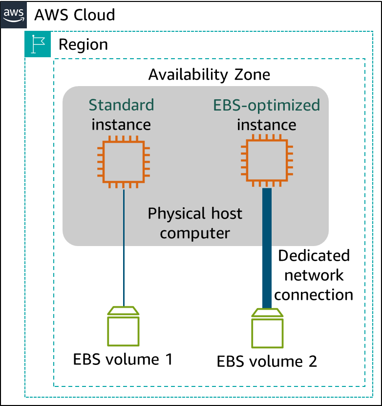

Benefits

- It provides a dedicated network connection to attached EBS volumes.
- It increases I/O performance.
- Additional performance is achieved if using an Amazon EC2 Nitro System-based instance type.

Usage

- For EBS-optimized instance types, optimization is enabled by default.
- For other instances types that support it, optimization must be manually enabled.

> **Нотатки:**
>
> |Slide number 40  
> |Instructor notes  
> |  
> |Student notes  
> Image description: Diagram of two instances exist on a single physical host, each attached to its own EBS volume. All four of these objects exist in a single Availability Zone. The second instance uses a dedicated network connection to connect to its EBS volume. End description.  
> Certain EC2 instance types can be optimized so that I/O access to an EBS volume is increased. These instances are called Amazon EBS-optimized instances.  
>
> An EBS-optimized instance has a dedicated network connection between itself and an EBS volume. This optimization provides the best performance for accessing EBS volumes by minimizing contention between Amazon EBS I/O and other network traffic from the instance. Specifically, it provides a dedicated bandwidth to Amazon EBS, with options between 425 Mbps and 14,000 Mbps (depending on the instance type that you use). This dedicated bandwidth provides performance consistency. For example, for a General Purpose SSD (gp2) volume that is attached to an EBS-optimized instance, it can translate to a 10 percent improvement over its baseline performance.  
>
> If an EC2 instance type supports EBS optimization, it’s automatically enabled when the instance type is categorized as EBS-optimized. Otherwise, you must manually enable the optimization when you launch the instance by setting its Amazon EBS-optimized attribute.  
>
> Furthermore, if an EBS-optimized instance type is built on the AWS Nitro System, it can benefit from additional performance increases. This system is a collection of AWS-built hardware and software components that provide high performance, high availability, high security, and bare metal capabilities to eliminate virtualization overhead.  
>
> For more information, see the Amazon EBS–Optimized Instances topic in the Amazon EC2 User Guide. A link is included in your course references.

---

## Слайд 41: Shared file systems for EC2 instances

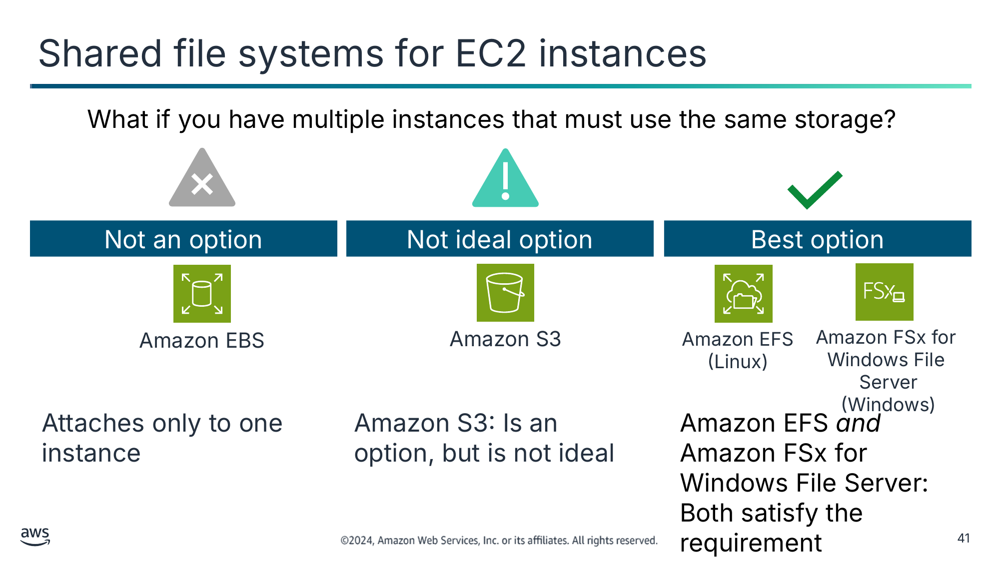

What if you have multiple instances that must use the same storage?

Not an option

Not ideal option

Best option

Amazon EBS

Amazon S3

Amazon EFS (Linux)

Amazon FSx for

Windows File  
Server (Windows)

Attaches only to one instance

Amazon S3: Is an option, but is not ideal

Amazon EFS *and* Amazon FSx for Windows File Server: Both satisfy the requirement

> **Нотатки:**
>
> |Slide number 41  
> |Instructor notes  
> |Highlight the fact that the available choices for file system storage depend on the instance’s operating system. For a Linux instance, the choice is Amazon EFS. For a Windows instance, choose Amazon FSx for Windows File Server.  
> |  
> |Student notes  
> Amazon EC2 instance store and Amazon EBS provide good choices for storing both root and data volume for a single instance. However, what if you need to share data among multiple instances simultaneously? How do you handle an application that runs on multiple instances that must use the same file system?  
>
> Earlier in this section, you learned that an EBS volume must be attached to only one instance at a time. Therefore, it can’t solve the stated problem. Amazon S3 is another option, but it’s an object store system, not a block store. Thus, changes in Amazon S3 overwrite entire files, not blocks of characters in files. For making high-throughput changes to files of various sizes, a file system works better than an object store system.  
>
> This requirement needs the performance and read/write consistency of a network file system. Amazon EFS and Amazon FSx for Windows File Server provide a shared file system for Linux instances and Windows instances. You learn about these two services next.

---

## Слайд 42: Amazon Elastic File System (Amazon EFS)

- Provides file system storage for Linux-based workloads.
- Fully managed elastic file system
- Scales automatically up or down as files are added and removed
- Petabytes of capacity
- Supports Network File System (NFS) protocols
- Mounts the file system to the EC2 instance
- Compatible with all Linux-based AMIs for Amazon EC2

Amazon EFS

> **Нотатки:**
>
> |Slide number 42  
> |Instructor notes  
> |  
> |Student notes  
> Amazon EFS is a fully managed service that provides file system storage for Linux-based workloads. Files are accessed through a file system interface (using standard operating system file I/O APIs). They support full file system access semantics, such as strong consistency and file locking. Amazon EFS uses the Network File System (NFS) version 4.x protocol. It can be used with any AMIs that support this protocol.  
>
> Multiple EC2 instances can access an EFS file system at the same time. Thus, Amazon EFS can provide a common data source for workloads and applications that run on more than one Amazon EC2 instance. In addition, EFS file systems can automatically scale from gigabytes to petabytes of data without needing to provision storage.

---

## Слайд 43: Amazon EFS use cases

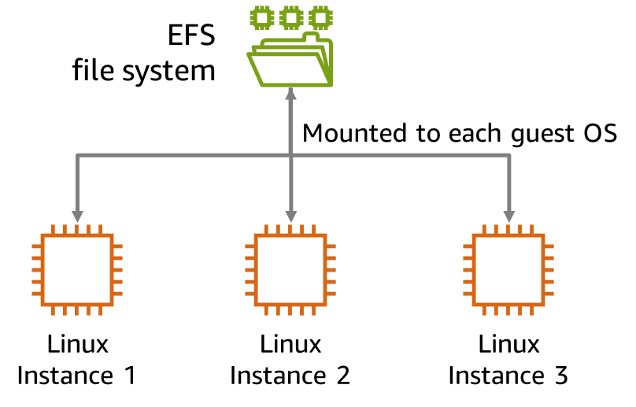

Common workloads and applications examples for Amazon EFS include the following:

- Home directories
- File system for enterprise applications
- Application testing and development
- Database backups
- Web serving and content management
- Media workflows
- Big data analytics

Example command to mount the file system to each guest OS:  
`$ sudo mount -t nfs4 mount-target-DNS:/ ~/efs-mount-point`

> **Нотатки:**
>
> |Slide number 43  
> |Instructor notes  
> |  
> |Student notes  
> You can access your Amazon EFS file system concurrently from multiple NFS clients, so applications that scale beyond a single connection can access a file system.  
>
> The main use cases for Amazon EFS include the following:  
> Home directories: Provides storage for organizations that have many users who must access and share common datasets  
> File system for enterprise applications: Provides the scalability, elasticity, availability, and durability to be the file store for enterprise applications and for applications that are delivered as a service  
> Application testing and development: Provides a common storage repository that helps you to share code and other files in a secure and organized way  
> Database backups: Can be mounted with NFSv4 from database servers  
> Web serving and content management: Provides a durable, high-throughput file system for content management systems that store and serve information for a range of applications (such as websites, online publications, and archives)  
> Big data analytics: Provides the scale and performance for big data applications that need high throughput to compute nodes, along with read-after-write consistency and low-latency file operations.  
> Media workflows: Provides the strong data consistency model, high throughput, and shared-file access that can reduce the time it takes to perform video editing, studio production, broadcast processing, sound design, and rendering jobs. At the same time, it consolidates multiple local file repositories into a single location for all users.  
>
> For more information, see the Amazon EFS User Guide on the content resources page of your online course.

---

## Слайд 44: Amazon EFS with Standard class storage

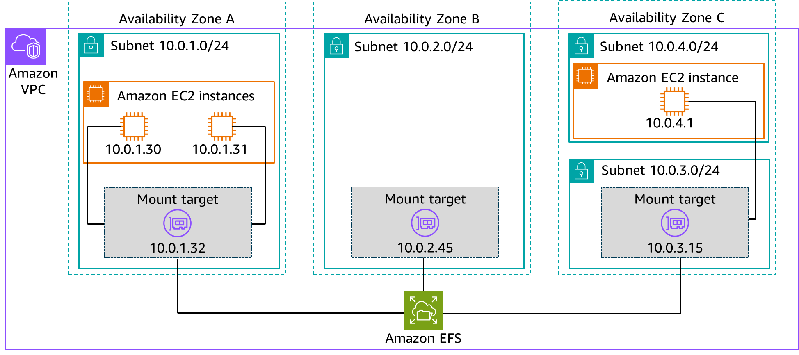

> **Нотатки:**
>
> |Slide number 44  
> |Instructor notes  
> |Describe the diagram as showing a highly available file system architecture with multiple Availability Zones supported. Explain that each Availability Zone has its own mount target, which is a network address that allows instances to connect to the file system. Highlight that the file system is replicated across multiple Availability Zones to provide data redundancy and high availability. Discuss the role of mount targets in enabling instances to connect to the file system within their respective Availability Zones. Explain that each mount target has an associated IP address and how is used.  
> |  
> |Student notes  
> Image description: Diagram of an Amazon EFS file system with standard class storage. Amazon EFS is supporting instances in multiple Availability Zones. Each Availability Zone has a mount with an IP address that the file system can connect to the instances through. End description.  
>
> Amazon EC2 and other AWS compute instances running in multiple Availability Zones within the same AWS Region can access the file system, so that many users can access and share a common data source.  
>
> To access your Amazon EFS file system in a virtual private cloud (VPC), you create one or more mount targets in the VPC.  
> For file systems using Standard storage classes, you can create a mount target in each Availability Zone in the AWS Region.  
> For file systems using One Zone storage classes, you can create only one mount target that is in the same Availability Zone as the file system.  
>
> Use Amazon EFS with a Standard storage class file system if your data is actively accessed and requires the highest durability and availability. For data that is less frequently accessed and doesn’t require the highest levels of durability and availability, use One Zone storage classes. For workloads that don’t require Multi-AZ resilience, One Zone storage file system can result in a 47 percent lower price compared to file systems using Standard storage classes.  
>
> For more information, see EFS storage classes on the content resources page of your online course.  
>
> A mount target provides an IP address for an NFSv4 endpoint that you use to mount an Amazon EFS file system. You mount your file system using its DNS name, which resolves to the IP address of the EFS mount target in the same Availability Zone as your EC2 instance. You can create one mount target in each Availability Zone in an AWS Region. If there are multiple subnets in an Availability Zone in your VPC, you create a mount target in one of the subnets. Then all EC2 instances in that Availability Zone share that mount target.  
>
> This example shows multiple EC2 instances accessing an Amazon EFS file system that is configured with Standard storage classes from multiple Availability Zones in an AWS Region.  
>   
> In this example, the VPC has three Availability Zones. Because the file system uses Standard storage classes, a mount target was created in each Availability Zone. We recommend that you access the file system from a mount target within the same Availability Zone for performance and cost reasons. One of the Availability Zones has two subnets. However, a mount target is created in only one of the subnets.  
>
> For more information, see Using the EFS mount helper to mount EFS file systems and Mounting on Amazon EC2 Linux instances using the EFS mount helper.

---

## Слайд 45: Amazon EFS with One Zone class storage

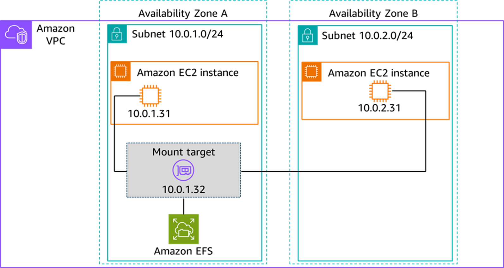

> **Нотатки:**
>
> |Slide number 45  
> |Instructor notes  
> |  
> |Student notes  
> Image description: Diagram of an Amazon EFS file system with One Zone storage class. Amazon EFS is supporting instances in multiple Availability Zones. Each Availability Zone uses the same mount in Availability Zone A. The mount has an IP address that the instances through. End description.  
>
> This example shows multiple EC2 instances accessing an Amazon EFS file system using One Zone storage from different Availability Zones in an AWS Region.  
>
> In this illustration, the VPC has two Availability Zones, each with one subnet. The file system uses One Zone storage classes, so it can only have a single mount target. For better performance and cost, we recommend that you access the file system from a mount target in the same Availability Zone as the EC2 instance that you're mounting it on.  
>
> In this example, the EC2 instance in the us-west-2c Availability Zone will pay EC2 data access charges for accessing a mount target in a different Availability Zone.  
>
> A typical use case for Amazon EFS with a One Zone storage class is for frequently accessed data that doesn’t require highest levels of durability and availability. An example might be a website that host blog pages.  
>
> For more information, see Using the EFS mount helper to mount EFS file systems and Mounting on Amazon EC2 Linux instances using the EFS mount helper.

---

## Слайд 46: Amazon FSx for Windows File Server

- Provides fully managed shared file system storage for Microsoft Windows EC2 instances.
- Native Microsoft Windows compatibility
- New Technology File System (NTFS)
- Uses Native Server Message Block (SMB) protocol version 2.0 to 3.1.1
- Distributed File System (DFS) Namespaces and DFS Replication
- Integrates with Microsoft Active Directory and supports Windows access control lists (ACLs)
- Backed by high-performance SSD storage

Amazon FSx for Windows File Server

> **Нотатки:**
>
> |Slide number 46  
> |Instructor notes  
> |  
> |Student notes  
> If you need file system-based storage for Microsoft Windows EC2 instances, Amazon FSx for Windows File Server provides fully managed Windows file servers, backed by a fully-native Windows file system. It’s built on Microsoft Windows Server and has native support for Windows file system features and protocols including the following:  
> New Technology File System (NTFS), the default file system of Windows servers  
> Server Message Block (SMB), the open standard protocol for accessing file storage over a network  
> Distributed File System (DFS), a service that helps the organization of multiple distributed SMB file shares into a distributed file system  
> Microsoft Active Directory, the Microsoft directory service that administers and organizes enterprise resources (including users, groups, and network resources)  
>
> Amazon FSx uses SSD storage to provide fast performance, high levels of throughput and IOPS, and low latencies. It also reduces the administrative overhead of setting up and provisioning file servers and storage volumes.

---

## Слайд 47: Amazon FSx for Windows File Server use cases

- Home directories
- Lift-and-shift application workloads
- Media and entertainment workflows
- Data analytics
- Web serving and content management
- Software development environments

> **Нотатки:**
>
> |Slide number 47  
> |Instructor notes  
> |  
> |Student notes  
> Use cases for Amazon FSx for Windows File Server (FSx) include the following Microsoft Windows workloads:  
> Home directories: Create a file system that hundreds of thousands of users can access, and establish permissions at the file or folder level.  
> Lift-and-shift applications: It provides fully managed native Windows file shares with features, like Microsoft Active Directory integration and automatic backups.  
> Media and entertainment workflows: Media workflows—like media transcoding, processing, and streaming—often depend on shared Windows file storage with consistent performance. FSx for Windows File Server provides you with a shared file system with the high throughput and low latencies that these Windows workloads need.  
> Data analytics: By providing scalable file systems with high throughput and low latencies, FSx for Windows File Server helps you to run data-intensive analytics workloads.  
> Web serving and content management: Multiple web or content servers typically need access to the same files. FSx for Windows File Server provides a file system that can be accessed across thousands of instances simultaneously.  
> Software development environments: FSx for Windows File Server lets you move to in-cloud development with no changes to your development workflows by providing shared file storage that your developers and their environments can access.  
>
> For more information, see Amazon FSx for Windows File Server User Guide.

---

## Слайд 48: Key takeaways: Adding storage to an Amazon EC2 instance

- Storage options for EC2 instances include instance store, Amazon EBS, Amazon EFS, and Amazon FSx for Windows File Server.
- For a root volume, use instance store or SSD-backed Amazon EBS.
- For a data volume that serves only one instance, use instance store or Amazon EBS storage.
- For a data volume that serves multiple Linux instances, use Amazon EFS.
- For a data volume that serves multiple Microsoft Windows instances, use Amazon FSx for Windows File Server.

> **Нотатки:**
>
> |Slide number 48  
> |Instructor notes  
> |  
> |Student notes

---

## Слайд 49: Guided lab: Introducing Amazon EFS (Amazon EFS lab)

> **Нотатки:**
>
> |Slide number 49  
> |Instructor notes  
> |  
> |Student notes  
> You will now complete a lab. The next slides summarize what you will do in the lab, and you will find the detailed instructions in the lab environment.

---

## Слайд 50: Amazon EFS lab tasks:

- In this lab, you perform the following main tasks:
  - Log in to the AWS Management Console
  - Create an Amazon EFS file system
  - Log in to an Amazon Elastic Compute Cloud (Amazon EC2) instance that runs Amazon Linux
  - Mount your file system to your EC2 instance
  - Examine and monitor the performance of your file system

> **Нотатки:**
>
> |Slide number 50  
> |Instructor notes  
> |<Add directions to find the lab guide information.>  
> |  
> |Student notes  
> Access the lab environment through your online course to get additional details and complete the lab.

---

## Слайд 51: Debrief: Amazon EFS lab

- For instances that connect to an EFS file system, where do they need to be in relation to the EFS file system?
- Which port did you add to the inbound rules of the mount target’s security group?

> **Нотатки:**
>
> |Slide number 51  
> |Instructor notes  
> |Relevant before and after architectural diagrams are included in the lab instructions for each lab. You might find it helpful to pull the lab diagrams up as part of debriefing this lab.  
> |Suggested responses for question 1: For instances that connect to an EFS file system, where do they need to be in relation to the EFS file system?  
> |  
> |EFS file systems can be mounted to multiple EC2 instances that run in different Availability Zones, but they must be in the same Region. Also, you can mount the file systems on instances in only one VPC at a time.  
> |  
> |Suggested responses for question 2: Which port did you add to the inbound rules of the mount target’s security group?  
> |  
> |The security group that you associate with a mount target must allow inbound access for TCP on port 2049 for the Network File System (NFS).  
> |  
> |Student notes  
> Your instructor might review these questions with you, or you might review them on your own. Use this opportunity to extend your thinking about the tasks that you performed during the lab.

---

## Слайд 52: Other EC2 configuration considerations

Adding a Compute Layer Using Amazon EC2

> **Нотатки:**
>
> |Slide number 52  
> |Instructor notes  
> |  
> |Student notes  
> This section covers other EC2 configuration options. It covers how to use user data to run initialization scripts. It also covers Amazon Machine Image (AMI) deployment strategies and placement groups at a high level.

---

## Слайд 53: EC2 instance user data

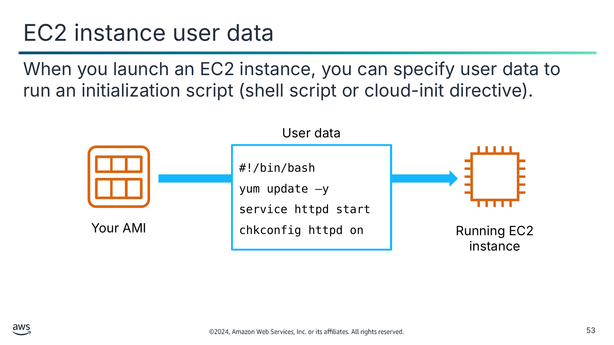

When you launch an EC2 instance, you can specify user data to run an initialization script (shell script or cloud-init directive).

<details>
<summary>Текст зі схеми</summary>

User data

```
#!/bin/bash
yum update –y
service httpd start
chkconfig httpd on
```

Your AMI

Running EC2 instance

</details>

> **Нотатки:**
>
> |Slide number 53  
> |Instructor notes  
> |Explain to learners how the script needs to be built and what happens if they don’t write the correct script.  
> |  
> |Student notes  
> When you launch an EC2 instance, you have the option of passing user data to the instance’s operating system. User data lets you provide a script that can be used to initialize it. For example, you can use user data to patch and update the software that’s installed on the instance from the AMI, fetch and install software license keys, or install additional software.  
>
> User data is implemented as a script, which contains shell commands or cloud-init directives. It runs with root or Administrator privileges after the instance starts, but before it’s accessible on the network. In the user data diagram, a user data script is provided to perform the following tasks when the instance is launched:  
> Update all packages that are installed on the instance.  
> Start the installed Apache HTTP web server.  
> Configure the HTTP web server to automatically start when the instance boots.  
>
> The cloud-init package is an open source application. It is used to bootstrap Linux instances in cloud computing environments, such as Amazon EC2. Amazon Linux and many other Linux variants (such as Ubuntu) contain a version of cloud-init. The cloud-init package configures specific aspects of a new Amazon Linux instance when it’s launched, even if you don’t specifically add them to the user data scripts. Most notably, it configures the .ssh/authorized_keys file for the ec2-user so that you can log in with your own private key. However, you can also specify your own cloud-init user directives by adding them as user data directives. Details, including sample cloud-init directives, can be found in the Running Commands on Your Linux Instance at Launch documentation.  
>
> When the user data script runs, it produces messages in a log file located at /var/log/cloud-init-output.log on a Linux instance. For a Microsoft Windows instance, the log file is located at C:\ProgramData\Amazon\EC2-Windows\Launch\Log\UserdataExecution.log.  
>
> On Microsoft Windows instances, user data is processed by the EC2Config or EC2Launch tools, which include Windows PowerShell scripts. Windows 2016 and more recent Windows versions include EC2Launch. Older versions of Windows include EC2Config.

---

## Слайд 54: Retrieving instance metadata

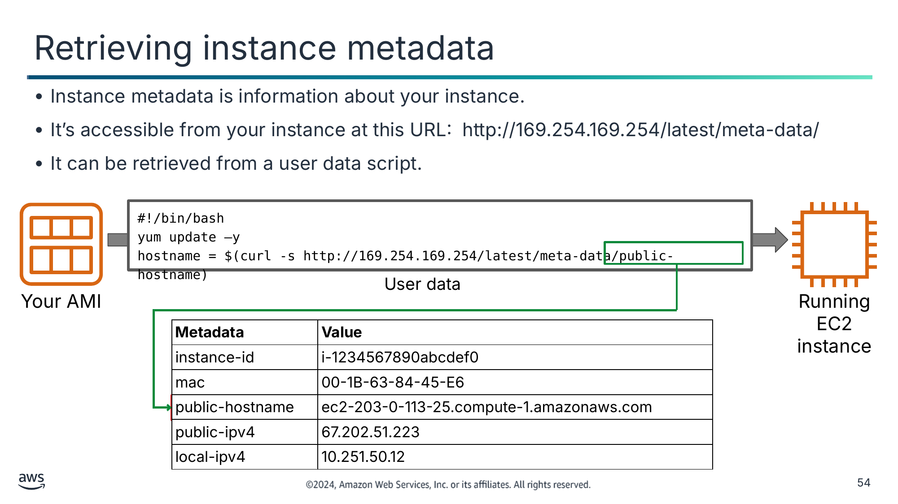

- Instance metadata is information about your instance.
- It’s accessible from your instance at this URL:  http://169.254.169.254/latest/meta-data/
- It can be retrieved from a user data script.

| Metadata | Value |
|---|---|
| instance-id | i-1234567890abcdef0 |
| mac | 00-1B-63-84-45-E6 |
| public-hostname | ec2-203-0-113-25.compute-1.amazonaws.com |
| public-ipv4 | 67.202.51.223 |
| local-ipv4 | 10.251.50.12 |

<details>
<summary>Текст зі схеми</summary>

```
#!/bin/bash
yum update –y
hostname = $(curl -s http://169.254.169.254/latest/meta-data/public-hostname)
```

Your AMI

Running EC2 instance

User data

</details>

> **Нотатки:**
>
> |Slide number 54  
> |Instructor notes  
> |Explain that one of the key benefits of the instance metadata is its simplicity. You can retrieve the metadata by simply making an HTTP request to a specific URL. The URL provides a standardized way to access the metadata.  
> |  
> |Student notes  
> For user data to complete the launch of a new EC2 instance, it might need to look up instance metadata. Instance metadata is data about your instance. For example, user data might need to learn and share the public IP address, hostname, or media access control (MAC) address of the new instance to complete the launch. The Instance Metadata Service can provide that information.  
>
> Specifically, you can retrieve metadata information from your running instance by accessing the following URL: http://169.254.169.254/latest/meta-data/. The IP address 169.254.169.254 is a link-local address, and it’s valid only from the instance.  
> Instance metadata provides much of the same information about the running instance that you can find in the AWS Management Console. For example, you can discover the public IP address, private IP address, public hostname, instance ID, security groups, Region, Availability Zone, and more. You can even access the user data specified at launch time for an instance by accessing the following URL: http://169.254.169.254/latest/user-data.

---

## Слайд 55: Working with user data on running instances

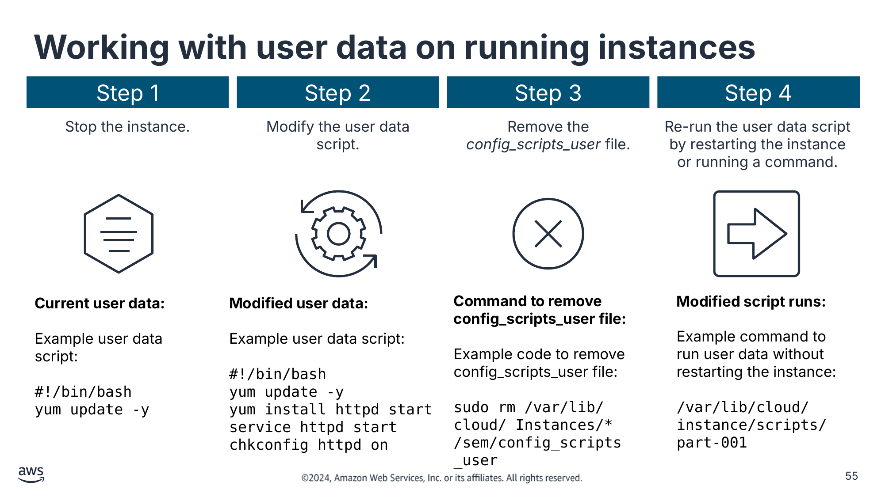

Step 1

Step 2

Step 3

Step 4

Stop the instance.

Modify the user data script.

Remove the *config_scripts_user* file.

Re-run the user data script by restarting the instance or running a command.

**Current user data:**

Example user data script:

`#!/bin/bash`

`yum update -y`

```
Modified user data: 

Example user data script:

#!/bin/bash
yum update -y
yum install httpd start
service httpd start
chkconfig httpd on
```

**Command to remove config_scripts_user file:**

Example code to remove config_scripts_user file:

`sudo rm /var/lib/`

`cloud/ Instances/* /sem/config_scripts`

`_user`

**Modified script runs:**

Example command to run user data without restarting the instance:

`/var/lib/cloud/`

`instance/scripts/`

`part-001`

> **Нотатки:**
>
> |Slide number 55  
> |Instructor notes  
> |  
> |Student notes  
> When you have a running instance, you might still need to work with the user data of the instance. For example, it might be the case that some of the user data script commands weren’t included when the instance was launched. Or, it might be that the use case for the instance has changed and additional commands need to be run to properly reconfigure the instance. In these kinds of situations, you can edit the user data script.  
>
> Therefore, it’s important to understand that the user data script only runs when the instance is first launched. To successfully modify the user data, so that the modified script runs again on your instance, you need to follow four steps.  
>
> Step 1: First, you need to stop the instance.  
> Step 2: Next, you can navigate to the edit user data page to modify the user data. (Navigation: Choose your instance > Actions > Instance Settings > Edit User Data)  
> Step 3: Then, you need to remove the config_scripts_user file. This can’t be done in the AWS Management Console user interface. To remove the config_scripts_user file, you need to remotely connect to the instance through SSH or SSM and run the following command: sudo rm /var/lib/cloud/instances/*/sem/config_scripts_user  
> Step 4: Finally, you have two options to re-run user data script:  
> You can restart the instance. After the instance restarts, the user data will begin to run.  
> You can run the /var/lib/cloud/instance/scripts/part-001 command to re-run the user data script without restarting the instance.  
>
> IMPORTANT: If you skip step 3, your modified user data script won’t run.

---

## Слайд 56: Manually running commands best practices

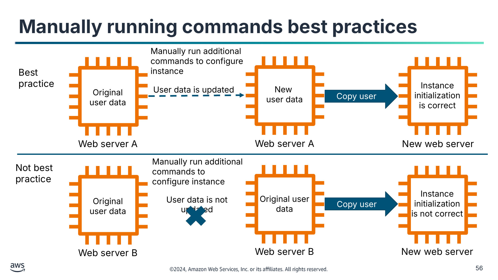

<details>
<summary>Текст зі схеми</summary>

Manually run additional commands to configure instance

Original user data

New

user data

Instance initialization is correct

Best practice

Copy user data

Web server A

Web server A

New web server

User data is updated

Manually run additional commands to configure instance

Not best practice

Original user data

Original user data

Instance initialization is not correct

Copy user data

Web server B

Web server B

New web server

User data is not updated

</details>

> **Нотатки:**
>
> |Slide number 56  
> |Instructor notes  
> |  
> |Student notes  
> You might ask why we should go through all the effort to re-run the user data script? Why not just manually run the commands that are required? Whether you want to run additional commands by running the user data script again or by running them manually is optional. If you do run additional commands manually to configure the instance, it’s a best practice to update the user data script. The reasons for this is are the following:  
> You can maintain a record of the configuration for the instance. You might think of it as a type of version control.  
> You can copy the user data from one instance to a new instance that you launch that requires the same configurations.  
>
> In the Best practices diagram, Web server A was launched with a user data script. Later, the instance required additional commands to be run to configure the instance. The additional commands were run manually. Then the instance’s user data script was updated to retain a record of the instance’s configuration. When you need a new web server that requires the same configurations, you can copy the user data from Web server A to the new instance.  
>
> In the Not best practices diagram, Web server B was launched with a user data script. Later, the instance required additional commands to be run to configure the instance. The additional commands were run manually. However, the instance’s user data script wasn’t updated to retain a record of the instance’s new configuration. It still has the original user data script. Therefore, copying the user data from Web server B won’t be enough to launch an instance with the updated configurations.

---

## Слайд 57: AMI deployment models

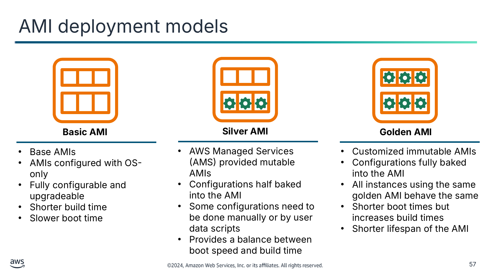

**Basic AMI**

**Silver AMI**

**Golden AMI**

- Base AMIs
- AMIs configured with OS-only
- Fully configurable and upgradeable
- Shorter build time
- Slower boot time

- AWS Managed Services (AMS) provided mutable AMIs
- Configurations half baked into the AMI
- Some configurations need to be done manually or by user data scripts
- Provides a balance between boot speed and build time

- Customized immutable AMIs
- Configurations fully baked into the AMI
- All instances using the same golden AMI behave the same
- Shorter boot times but increases build times
- Shorter lifespan of the AMI

> **Нотатки:**
>
> |Slide number 57  
> |Instructor notes  
> |  
> |Student notes  
> When deploying your instances, you should consider the configuration and customization that should be included in your AMIs. There are three main AMI models that you can use to make these decisions: Basic AMIs, Silver AMIs and Golden AMIs.  
>
> The model you choose can impact how the following configurations are provisioned:  
> Security updates  
> New versions of your applications  
> Application configuration changes  
> Updates to dependencies  
>
> A basic AMI model is your base AMI. This is an AMI with an OS-only configuration. With this model, you need to configure the instance according to your requirements. You can do this manually or by using user data scripts. This approach is fully configurable and upgradeable over time and shortens build times. However, it makes your EC2 instances slow to boot because all required installations and configurations must be run at boot time. This AMI deployment model might be used as the base AMI from which you create silver or golden AMIs.  
>
> A silver AMI is a mutable model. This model is a mix of manually pushing updates and using infrastructure-as-code to launch your instance. Only prerequisite software and utilities are pre-installed, which leads to a longer shelf life for the AMI. AWS Managed Services (AMS) provides AMIs for this model of deployment. This approach provides a balance between boot speed and build time. Rollbacks become easier. This AMI deployment model is a good choice if you want to launch instances from an AMI that might be used for different purposes. With this deployment model, all the instances would have the same prerequisite software and utilities pre-installed. However, there would be manual configurations that might differ from instance to instance.  
>
> A golden AMI is an immutable model. It uses an AMI that you have configured and customized to behave as you want all of your application instances to. For example, the instances created with this golden AMI would self-join the correct domain and DNS, self-configure, reboot and launch all necessary systems. When you want to update your application instances, you re-create the golden AMI and rollout all-new application instances with it. With golden AMIs, the applications and all dependencies are pre-installed, which shortens boot times but increases build times. Golden AMIs typically have a shorter lifespan. Consider your rollback strategy. This AMI deployment model is a good choice if you have instances that need to perform the same functions and behave the same. For this deployment model, there will be no configuration changes from one instance to the other.  
>
> For more information, see Application Maintenance Strategies and Amazon EC2 instance mutability in AMS on the content resources page of your online course.

---

## Слайд 58: Placement groups

Placement groups give you control of where a group of interdependent instances run in an Availability Zone.

Placement benefits

Placement limitations

Placement strategies

- Increase network performance between instances.
- Reduce correlated or simultaneous failure.

- An instance can be launched in only one placement group at a time.
- Instances with a tenancy of host can’t be launched in a placement group.

- Cluster
- Partition
- Spread

> **Нотатки:**
>
> |Slide number 58  
> |Instructor notes  
> |  
> |Student notes  
> When you launch a new EC2 instance, the default behavior of Amazon EC2 is to minimize correlated failures by spreading out new instances across underlying hardware. You can use placement groups to influence the placement of a group of interdependent instances so that they meet the needs of your workload.  
>
> Some key benefits of using placement groups are that it can increase network performance between your instances. Also, it can reduce correlated or simultaneous failure.  
>
> Before you use placement groups, be aware of the following limits:  
> An instance can be launched in only one placement group at a time.  
> Instances with a tenancy of host can’t be launched in a placement group.  
>
> Depending on the type of workload, you can create a placement group by using one of the following placement strategies:  
> Cluster: Packs instances close together inside an Availability Zone. This strategy helps workloads to achieve low-latency network performance.  
> Partition: Spreads your instances across logical partitions so that groups of instances in one partition do not share the underlying hardware with groups of instances in different partitions.  
> Spread: Strictly places a small group of instances across distinct underlying hardware to reduce correlated failures.

---

## Слайд 59: Demo: Configuring an EC2 Instance with User Data

- This demonstration uses Amazon EC2.
- In this demonstration, you will see how to do the following:
  - Create an EC2 instance
  - Configure user data
  - Test the configuration

> **Нотатки:**
>
> |Slide number 59  
> |Instructor notes  
> |This demo is an .mp4 file with captions. Students access it through the online course. The instructor guide includes the duration for each demo.  
> |  
> |Student notes  
> Find this recorded demo in your online course as part of this module.

---

## Слайд 60: Key takeaways: Other EC2 configuration considerations

- User data lets you configure an EC2 instance when you launch it.
- Information about a running instance can be accessed in the instance through an instance metadata URL.
- There are three main AMI deployment models: Basic AMIs, Silver AMIs and Golden AMIs
- Placement groups give you control of where a group of interdependent instances run in an Availability Zone.

> **Нотатки:**
>
> |Slide number 60  
> |Instructor notes  
> |  
> |Student notes

---

## Слайд 61: Amazon EC2 pricing options

Adding a Compute Layer Using Amazon EC2

> **Нотатки:**
>
> |Slide number 61  
> |Instructor notes  
> |  
> |Student notes  
> This section discusses Amazon Elastic Compute Cloud (Amazon EC2) pricing. It also provides guidance about how to choose an the best instance payment method based on the use case for the instance.

---

## Слайд 62: AWS Free Tier: Amazon EC2

**12 months free**

- 750 hours per month of t4g.small instance dependent on region
- 750 hours per month of Linux, RHEL, or SLES t2.micro or t3.micro instance dependent on region
- 750 hours per month of Windows t2.micro or t3.micro instance dependent on region

> **Нотатки:**
>
> |Slide number 62  
> |Instructor notes  
> |Go to the AWS Free Tier page and review how they can filter to see the most up to date compute AWS Free Tier offerings. Review limits of the offerings.  
> |  
> |Student notes  
> With AWS Free Tier, there are three different types of free offers available depending on the product used.  
>
> 12-Months Free: These free tier offers are only available to new AWS customers, and are available for 12 months following your AWS sign-up date. When your 12 month free usage term expires, or if your application use exceeds the tiers, then you begin paying standard, pay-as-you-go service rates.  
>
> Always Free: These free tier offers do not automatically expire at the end of your 12 month AWS Free Tier term, but they are available to both existing and new AWS customers indefinitely.  
>
> Trials: These free tier offers are short term trial offers that start from the time of first usage begins. After the trial period expires, you begin paying standard, pay-as-you-go service rates.  
>
> As part of the AWS Free Tier, you can get started with Amazon EC2 with the 12-Months Free offering.  
>
> This means that new AWS customers have access to a limited selection of EC2 resources for 12 months after signing up with AWS. When the 12 month free usage term expires, or if the application use exceeds the tiers, you begin paying standard, pay-as-you-go service rates.  
>
> This offering is currently limited to the following:  
> 750 hours per month of t4g.small instance dependent on region  
> 750 hours per month of Linux, RHEL, or SLES t2.micro or t3.micro instance dependent on region  
> 750 hours per month of Windows t2.micro or t3.micro instance dependent on region  
>
> These offerings are subject to change. For more information and the most updated AWS Free Tier offerings, visit the AWS Free Tier page.

---

## Слайд 63: Amazon EC2 pricing models

Amazon EC2 provides the following purchasing strategies to help you optimize your costs based on your needs:

Purchase models

Capacity reserved models

Dedicated models

Emphasis is on providing big saving through different use cases

Emphasis is on providing reserved instances to guarantee that you have them when you need them

Emphasis is on providing dedicated hardware that will help you meet compliance and regulation requirements

> **Нотатки:**
>
> |Slide number 63  
> |Instructor notes  
> |  
> |Student notes  
> Amazon EC2 provides the following purchasing strategies to help you optimize your costs based on your needs.  
>
> Purchasing models provide big savings through different use cases.  
>
> Capacity reserved models provide reserved instances to guarantee that you have them when you need them.  
>
> Dedicated models provide dedicated hardware that will help you meet compliance and regulation requirements.

---

## Слайд 64: Amazon EC2 purchase models

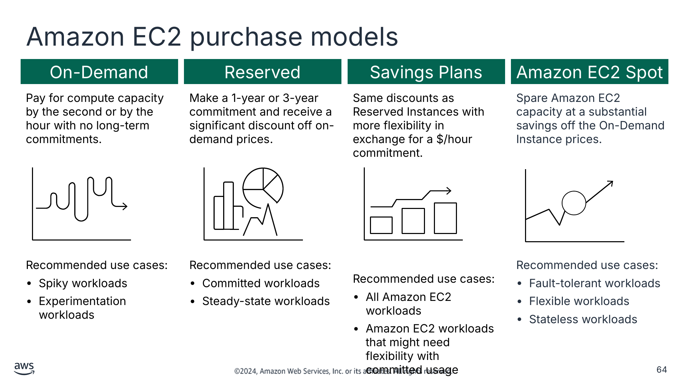

On-Demand

Reserved

Savings Plans

Amazon EC2 Spot

Pay for compute capacity  
by the second or by the hour with no long-term commitments.

Recommended use cases:

- Spiky workloads
- Experimentation workloads

Make a 1-year or 3-year commitment and receive a significant discount off on-demand prices.

Recommended use cases:

- Committed workloads
- Steady-state workloads

Same discounts as Reserved Instances with more flexibility in exchange for a $/hour commitment.

Recommended use cases:

- All Amazon EC2 workloads
- Amazon EC2 workloads that might need flexibility with committed usage

Spare Amazon EC2 capacity at a substantial savings off the On-Demand Instance prices.

Recommended use cases:

- Fault-tolerant workloads
- Flexible workloads
- Stateless workloads

> **Нотатки:**
>
> |Slide number 64  
> |Instructor notes  
> |  
> |Student notes  
> AWS offers four ways that focus on big savings for Amazon EC2 instances: On-Demand Instances, Reserved Instances, Savings Plans, Spot Instances, and Dedicated Hosts.  
>
> On-Demand Instances offer the most flexibility, with no long-term contract and low rates. They are a good choice for applications with short-term, spiky, or unpredictable workloads. They are also suited for developing and testing applications on Amazon EC2 for the first time. With On-Demand Instances, you pay for compute capacity by the hour or by the second, depending on which instances you run. On-Demand Instances have the lowest upfront cost and the most flexibility. They require no upfront commitments or long-term contracts.  
>
> Reserved Instances let you to reserve computing capacity for a 1-year or 3-year term with lower hourly running costs. The discounted usage price is fixed for as long as you own the Reserved Instance. Reserved Instances are a good choice if you have predictable or steady-state compute needs (for example, an instance that you know you want to keep running most or all the time for months or years). If you expect consistent, heavy use, they can provide substantial savings compared to On-Demand Instances.  
>
> Savings Plans is a flexible pricing model that offers low prices on Amazon EC2, AWS Lambda, and AWS Fargate usage in exchange for a commitment to a consistent amount of usage (measured in dollars per hour) for a 1-year or 3-year term. It offers lower prices on EC2 instance usage compared to On-Demand Instances, regardless of instance family, size, operating system, tenancy, or AWS Region. There are two types of Savings Plans: Compute Savings Plans and EC2 Instance Savings Plans.  
> Compute Savings Plans provide the most flexibility and help to reduce your costs by up to 66 percent. These plans automatically apply to EC2 instance usage regardless of instance family, size, Availability Zone, Region, operating system, or tenancy. With these plans, you can make changes to the instance family, size, Availability Zone, Region, operating system, or tenancy. This lets you change from one instance family type to another or shift a workload from the London Region to the Ireland Region. You can even move a workload from Amazon EC2 to AWS Fargate or AWS Lambda and continue to pay the Savings Plan price.  
> EC2 Instance Savings Plans are less flexible. They apply to a specific instance family within a specific Region and provide the largest discount (up to 72 percent, like Standard RIs).  
>
> Spot Instances let you to bid on unused EC2 instances and request spare computing capacity at substantial savings. They are recommended for fault-tolerant, flexible (non-time-critical), stateless workloads. To use a Spot Instance, your workload must have the ability to be stopped and restarted: Amazon EC2 can interrupt it with a 2-minute notification to meet other capacity requirements. Your Spot Instance runs when capacity is available and the maximum price per hour for your request exceeds the Spot Instance price. Spot Instances are billed on 1-second increments, with a minimum of 60 seconds, if they are running the Amazon Linux or Ubuntu operating system. All other operating systems are billed in 1-hour increments, rounded up to nearest hour.  
>
> A variation of Spot Instances, called Spot blocks, lets you to run a workload continuously for a finite duration of 1–6 hours. Spot blocks are designed to not be interrupted and will run continuously for the duration you select, independent of the Spot Instance market price.

---

## Слайд 65: Demo: Reviewing the Spot Instance History Page

- This demonstration uses Amazon EC2.
- In this demonstration, you will see how to do the following:
  - Review Pricing History
  - Customize Pricing History view

> **Нотатки:**
>
> |Slide number 65  
> |Instructor notes  
> |This demo is an .mp4 file with captions. Students access it through the online course. The instructor guide includes the duration for each demo.  
> |  
> |Student notes  
> Find this recorded demo in your online course as part of this module.

---

## Слайд 66: Amazon EC2 Capacity Reservations

Capacity Reservations let you reserve compute capacity for Amazon EC2 instances in a specific Availability Zone.

**On-Demand Capacity Reservations**

**Amazon EC2 Capacity Blocks for ML**

This guarantees that you always have access to EC2 capacity when you need it, for as long as you need it.

Recommended use cases:

- Workloads that need to meet regulatory requirements for high availability
- Workloads that require capacity assurance

Reserve GPU instances for a future date to run any of your machine learning (ML) workloads.

Recommended use cases:

- Training and fine-tuning ML models
- Running experiments and building prototypes
- Planning for future surges in demand for ML applications

66

> **Нотатки:**
>
> |Slide number 66  
> |Instructor notes  
> |  
> |Student notes  
> Capacity Reservations let you reserve compute capacity for Amazon EC2 instances in a specific Availability Zone. There are two types of Capacity Reservations serving different use cases.  
>
> On-Demand Capacity Reservations let you reserve compute capacity for your EC2 instances in a specific Availability Zone for any duration. Capacity reservations mitigate against the risk of being unable to get On-Demand capacity in case of capacity constraints and ensure that you always have access to EC2 capacity when you need it, for as long as you need it.  
>
> On-Demand Capacity Reservations are recommended for the following:  
> Business-critical events or workloads that require capacity assurance  
> Workloads that need to meet regulatory requirements for high availability  
> Disaster recovery strategies that require reserved capacity in a different Availability Zone or Region  
>
> With Amazon EC2 Capacity Blocks for ML, you can reserve GPU instances for a future date to run your machine learning (ML) workloads. You pay only for the amount of compute time that you need, with no long-term commitment. EC2 Capacity Blocks can be used to reserve Amazon EC2 P5 instances.  
>
> EC2 Capacity Blocks are recommended for the following:  
> Training and fine-tuning ML models  
> Running experiments and building prototypes  
> Planning for future surges in demand for ML applications

---

## Слайд 67: Amazon EC2 dedicated options

Amazon EC2 dedicated options provide EC2 instance capacity on physical servers that are dedicated for your use (single-tenant hardware).

Dedicated Instances

Dedicated Hosts

- Per-instance billing
- Automatic instance placement
- Isolates the hosts that run your instances

- Per-host billing
- Visibility of sockets, cores, and host ID
- Affinity between a host and an instance
- Targeted instance placement
- Add capacity by using an allocation request
- Lets you to use your server-bound software licenses and address compliance requirements

> **Нотатки:**
>
> |Slide number 67  
> |Instructor notes  
> |  
> |Student notes  
> Amazon EC2 dedicated options provide EC2 instance capacity on physical servers that are dedicated for your use.  
>
> Dedicated Instances are EC2 instances that run on hardware that's dedicated to a single customer. Dedicated Instances that belong to different AWS accounts are physically isolated at a hardware level, even if those accounts are linked to a single payer account. However, Dedicated Instances might share hardware with other instances from the same AWS account that are not Dedicated Instances.  
>
> A Dedicated Host is a physical EC2 server fully dedicated for your use. Dedicated Hosts can help you reduce costs by letting you use your existing server-bound software licenses including Windows Server, SQL Server, and SUSE Linux Enterprise Server (subject to your license terms). Dedicated Hosts can be purchased On-Demand (hourly) or can be purchased as part of Savings Plans.  
>
> Dedicated Hosts are recommended for the following:  
> Users looking to save money on licensing costs  
> Workloads that need to run on dedicated physical servers  
> Users looking to offload host maintenance onto AWS, while controlling their maintenance event schedules to suit their business’ operational needs  
>
> You can use Dedicated Hosts and Dedicated Instances to launch EC2 instances on physical servers that are dedicated for your use. Both options let you to isolate the hosts that run your instances from the hosts that run instances for other accounts. They also provide the same performance, security, and physical features.  
>
> Dedicated Hosts give you visibility and control over how instances are placed on a physical server. You can consistently deploy your instances to the same physical server over time. As a result, Dedicated Hosts let you to use your existing server-bound software licenses, and to address corporate compliance and regulatory requirements.  
>
> Both options differ in the way that they are billed. A Dedicated Instance is billed per instance, and its pricing has two components. The two components are an hourly per-instance usage fee and a dedicated per-Region fee that you pay once per hour, regardless of how many Dedicated Instances are running.  
>
> A Dedicated Host is billed per host. You can choose from three different pricing models to pay for Dedicated Hosts: On-Demand, Reservation Pricing, and Savings Plans.  
>
> To indicate that an instance should run as a Dedicated Instance or a Dedicated Host, change the instance’s tenancy attribute to dedicated or host, respectively. For more information, see Amazon EC2 Dedicated Hosts.

---

## Слайд 68: Amazon EC2 cost optimization guideline

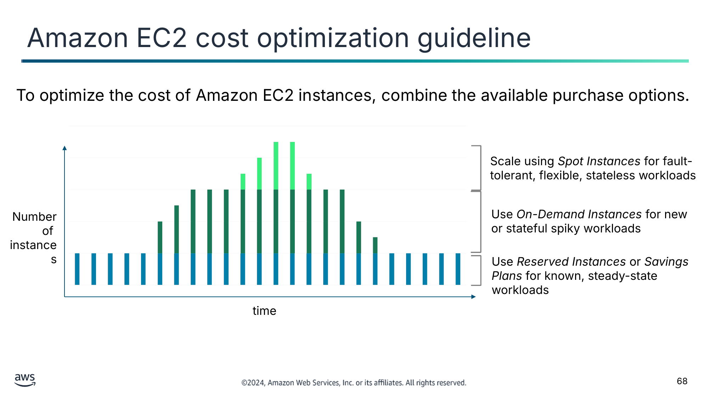

To optimize the cost of Amazon EC2 instances, combine the available purchase options.

<details>
<summary>Текст зі схеми</summary>

Number of  
instances

Scale using *Spot Instances* for fault-tolerant, flexible, stateless workloads

Use *On-Demand Instances* for new or stateful spiky workloads

Use *Reserved Instances* or *Savings Plans* for known, steady-state workloads

time

</details>

> **Нотатки:**
>
> |Slide number 68  
> |Instructor notes  
> |  
> |Student notes  
> Each Amazon EC2 pricing model provides a different set of benefits. As a general guideline, the recommended way to optimize the cost of EC2 instances is to combine the available purchase options.  
>
> Specifically, start by identifying the steady-state workloads in your application portfolio and run them on EC2 instances that use the Reserved Instance or Savings Plans pricing option.  
>
> Next, for your stateful spiky workloads, choose EC2 instances that use the On-Demand Instance pricing plan.  
>
> Finally, use Spot Instances for your fault-tolerant, flexible, stateless workloads.  
>
> The Amazon EC2 cost optimize chart shows Reserved Instances or Savings Plans being used for known, steady-state workloads. They remaining consistent through the timeframe. On-Demand Instances for new or stateful spiky workloads are inconsistent through the timeframe. Spot Instances are used to scale for fault-tolerant, flexible, stateless workloads a few times during the timeframe.  
>
> The Amazon EC2 cost optimize chart shows Reserved Instances or Savings Plans being used for known, steady-state workloads. They remain consistent through the timeframe. On-Demand Instances for new or spiky workloads and Spot Instances for fault-tolerant, flexible, stateless workloads that are inconsistent through the same timeframe.

---

## Слайд 69: Key takeaways: Amazon EC2 pricing options

- Amazon EC2 pricing models include On-Demand Instances, Reserved Instances, Savings Plans, Spot Instances, and Dedicated Hosts
- Per-second billing is available only for On-Demand Instances, Reserved Instances, and Spot Instances that run Amazon Linux or Ubuntu
- Use a combination of Reserved Instances, Savings Plans, On-Demand Instances, and Spot Instances to optimize Amazon EC2 compute costs

> **Нотатки:**
>
> |Slide number 69  
> |Instructor notes  
> |  
> |Student notes

---

## Слайд 70: Café lab: Creating a Dynamic Website for the Café (Dynamic website lab)

> **Нотатки:**
>
> |Slide number 70  
> |Instructor notes  
> |  
> |Student notes  
> You will now complete a lab. The next slides summarize hat you will do in the lab, and you will find the detailed instructions in the lab environment.

---

## Слайд 71: The evolving café architecture: version 2

| Architecture Version | Business reason for update | Technical requirements/ architecture update |
|---|---|---|
| V1 | Static website for small business | Host the website on Amazon S3. |
| V2 | Add online ordering | Deploy a web application and database on Amazon EC2. |
| V3 | Reduce effort to maintain the database and secure its data | Separate web and database layers. Migrate database to Amazon RDS on a private subnet. |
| V4 | Enhance the security of the web application | Use Amazon VPC features to configure and secure public and private subnets. |
| V5 | Create separate access mechanisms based on role | Add IAM groups and attach resource polices to application resources. Add IAM users to groups based on role. |
| V6 | Ensure the website can handle an expected increase in traffic | Add a load balancer, implement auto scaling on the EC2 instances and distribute compute and database instances across 2 availability zones. |
| V7 | Module 11 info |  |
| V8 | Module 14 info |  |

> **Нотатки:**
>
> |Instructor notes  
> |Share or show the architectures.svg file and highlight the sections of the architecture that will be modified/added with this lab.  
> |  
> |Student notes  
> Cafe customers have responded well to the new website. Customers now frequently ask if they can use the website to place orders. The cafe owners and staff think that adding ordering functionality is a good strategy, but they want to make sure they do it in a way that delights their customers. The owners and staff have some ideas on how they want the features to work, and Sofia knows they need a cloud infrastructure that supports dynamic content. She and Nikhil recognize that things are likely to change as they gain experience and see how customers respond. They want to have the flexibility to experiment but limit the risk to the live website.

---

## Слайд 72: Dynamic website lab tasks

- In this lab, you will do the following:
  - Connect an IDE to an existing EC2 instance
  - Analyze the EC2 instance environment and confirm web server accessibility
  - Install a web application on an EC2 instance that also uses AWS Systems Manager Parameter Store
  - Test the web application
  - Create an AMI
  - Deploy a second copy of the web application to another AWS Region

> **Нотатки:**
>
> |Slide number 72  
> |Instructor notes  
> |  
> |Student notes  
> Access the lab environment through your online course to get additional details and complete the lab.

---

## Слайд 73: Debrief: Dynamic website lab

- In this lab, where did you find detailed information about your EC2 instance that is already launched and hosting your café website?
- In this lab, the café website is already running well on an existing EC2 instance. What did you do to duplicate the instance to the Oregon Region?

> **Нотатки:**
>
> |Slide number 73  
> |Instructor notes  
> |An architectural diagram for this lab is included as part of the CafeLabDiagrams.svg file included in the educator files directory. Share this file with students so that they can zoom in and out of each phase of the architecture for a fuller picture as you debrief the lab.  
> |Suggested responses for question 1: In this lab, where did you find detailed information about your EC2 instance that is already launched and hosting your café website?  
> |  
> |In this lab, you navigated to the Instances page and chose the instance. On the Details tab, you reviewed information about your instance. You found answers to the following questions:  
> |Is the instance in a public subnet?  
> |Does the EC2 instance have an IPv4 public IP address assigned to it?  
> |What inbound TCP port numbers are open for this instance?  
> |Does the EC2 instance have an AWS Identity and Access Management (IAM) role associated with it?  
> |When you are working with an instance that you did not launch, it is a best practice to review the details of the instance.  
> |  
> |Suggested responses for question 2: In this lab, the café website is already running well on an existing EC2 instance. What did you do to duplicate the instance to the Oregon Region?  
> |  
> |Because the café website was already running well on an existing EC2 instance, you duplicated it by creating an AMI from the instance. Next, you copied the AMI to the Oregon Region and then launched a new instance from the AMI in the Oregon Region.  
> |  
> |If you need to create EC2 instances that should be similar in their configurations, you can use AMIs. AMIs can act as a template for creating additional EC2 instances with the same configurations.  
> |  
> |However, it is important to remember that the AMI does not capture some external configurations. Security groups, IAM roles, and instance types are separate configurations. For example, suppose you create an AMI from an instance. Then you use the AMI to launch another instance that is meant to serve a similar function. You still need to configure the security group’s rules, choose the instance type, and add the IAM role.  
> |  
> |Student notes  
> Your instructor might review these questions with you, or you might review them on your own. Use this opportunity to extend your thinking about the tasks that you performed during the lab.

---

## Слайд 74: Applying the AWS Well-Architected Framework principles to compute

Adding a Compute Layer Using Amazon EC2

> **Нотатки:**
>
> |Slide number 74  
> |Instructor notes  
> |  
> |Student notes  
> This section looks at how to apply the AWS Well-Architected Framework principles to compute resources.

---

## Слайд 75: AWS Well-Architected pillars


> **Нотатки:**
>
> |Slide number 75  
> |Instructor notes  
> |The remaining slides in this section present examples that highlight how the material in this module aligns to the Well-Architected Framework best practices. Optionally, you might ask students to visit the Well-Architected Framework website and find the best practices that they think connect to the material that is presented in this module, using this section as a starting point.  
> |  
> |Student notes  
> The AWS Well-Architected Framework has six pillars, and each pillar includes best practices and a set of questions that you should consider when you architect cloud solutions. This section highlights a few best practices from the pillars that are most relevant to this module including security, performance efficiency, cost optimization, and sustainability. Find the complete set of best practices by pillar on the Well-Architected Framework website. A link is provided in the content resources section of your online course.

---

## Слайд 76: Best practice approach: Infrastructure protection – Protecting compute


**Best practice**

Automate compute protection.

> **Нотатки:**
>
> |Slide number 76  
> |Instructor notes  
> |  
> |Student notes  
> Infrastructure protection is an important best practice under the security pillar. Before architecting any workload, foundational practices that influence security should be in place. Infrastructure protection is divided into two categories: Network protection and compute protection. The compute protection section asks the question: How do you protect your compute resources? Compute resources in your workload require multiple layers of defense to help protect from external and internal threats. Compute resources include EC2 instances and all the configurations you learned about them in this module.  
>
> Automate compute protection: Automate your protective compute mechanisms including vulnerability management, reduction in attack surface, and management of resources. The automation will help you invest time in securing other aspects of your workload, and reduce the risk of human error.  
>
> In this module, you learned about a number of Amazon EC2 features and configuration choices that support this best practice, such as using the following:  
> EC2 Image Builder, which can reduce your exposure to security vulnerabilities  
> User data scripts to automate commands when launching an instance  
> Silver (mutable) AMIs and golden (immutable) AMIs, when possible, to lock down security configurations in your instances

---

## Слайд 77: Best practice approach: Infrastructure protection – Protecting networks


**Best practice**

Control traffic at all layers.

> **Нотатки:**
>
> |Slide number 77  
> |Instructor notes  
> |  
> |Student notes  
> The protecting network section of the security pillar asks the question: How do you securely operate your workload? To operate your workload securely, you must apply overarching security best practices to every area of connectivity. In AWS, separating different workloads by account, based on their function and compliance or data sensitivity requirements, is a recommended approach.  
>
> Control traffic at all layers: When architecting your network topology, you should examine the connectivity requirements of each component. For example, if a component requires internet accessibility (inbound and outbound), connectivity to virtual private clouds (VPCs), edge services, and external data centers. A VPC lets you to define your network topology that spans an AWS Region with a private IPv4 address range that you set or an IPv6 address range that AWS selects. You should apply multiple controls with a defense in depth approach for both inbound and outbound traffic, including the use of security groups (stateful inspection firewall).  
>
> In this module, you learned the each EC2 instance is protected by a security group. The security group defines which ports network traffic is permitted on. You can configure this based on your workload connectivity needs.

---

## Слайд 78: Best practice approach: Compute and hardware


**Best practices**

Scale the best compute options for your workload.

Configure and right-size compute resources.

> **Нотатки:**
>
> |Slide number 78  
> |Instructor notes  
> |  
> |Student notes  
> The performance efficiency pillar focuses on structured and streamlined allocation of IT and computing resources. Architectures might use different compute choices for various components and permit different features to improve performance. Choosing the wrong compute choice for an architecture can lead to lower performance efficiency. The compute and hardware section of the performance efficiency pillar shares guidance and best practices on how to identify and optimize compute options for performance efficiency in the cloud. The optimal compute choice for a particular workload can vary based on application design, usage patterns, and configuration settings.  
>
> Scale the best compute options for your workload: Selecting the most appropriate compute option for your workload lets you improve performance, reduce unnecessary infrastructure costs, and lower the operational efforts required to maintain your workload. The benefits of this best practice can make your workloads more resource efficient by identifying the compute requirements and evaluating against the options available.  
>
> Configure and right-size compute resources: Configure and right-size compute resources to match your workload’s performance requirements and avoid under or over-utilized resources. The benefits of right-sizing compute resources ensures optimal operation in the cloud by avoiding over-provisioning and under-provisioning resources. Properly sizing compute resources typically results in better performance and enhanced customer experience, while also lowering cost.  
>
> In this module, you learned about a number of Amazon EC2 features and configuration choices that support these best practices, such as choosing the following:  
> AMIs that are pre-configured with required software and support the usage of your root storage type  
> Instance type and size for your computing workloads  
> Storage type (Amazon EBS or Instance store) and size for your root volumes and data volumes

---

## Слайд 79: Best practice approach: Cost effective resourcing


**Best practices**

Select the correct resource type, size, and number.

Select the best pricing model.

> **Нотатки:**
>
> |Slide number 79  
> |Instructor notes  
> |  
> |Student notes  
> Applying cost effective resourcing is part of the Cost optimization pillar of the Well-Architected Framework. Appropriate service selection helps you reduce usage and costs. For example, a reporting process might take 5 hours to run on a smaller server but 1 hour to run on a larger server that is twice as expensive. Both servers give you the same outcome, but the smaller server incurs more cost over time. A well-architected workload uses the most cost-effective resources, which can have a significant and positive economic impact.  
>
> Select the correct resource type, size, and number: By selecting the best resource type, size, and number of resources, you meet the technical requirements with the lowest cost resource. Right-sizing activities takes into account all of the resources of a workload, all of the attributes of each individual resource, and the effort involved in the right-sizing operation. Right-sizing can be an iterative process, initiated by changes in usage patterns and external factors, such as AWS price drops or new AWS resource types.  
>
> Select the best pricing model: Consider the requirements of the workload components and understand the potential pricing models. AWS has multiple pricing models that let you pay for your resources in the most cost-effective way that suits your organization’s needs.  
>
> In this module, you learned about a number of Amazon EC2 features and configuration choices that support these best practices.  
> By right sizing the instance type and storage size for your computing workloads, you can optimize you costs so that you can save money.  
> Choosing the purchasing model or reserved capacity model that best fits the workload’s use case can save you money. AWS purchasing models include On-Demand instances, Reserved instances, Amazon EC2 Spot instances, and Savings Plans. AWS reserved or dedicated capacity model includes On-Demand Capacity Reservations, Amazon EC2 Capacity Blocks for ML, and Dedicated Host.

---

## Слайд 80: Best practice approach: Hardware and services


**Best practices**

Use the minimum amount of hardware to meet your needs.

Use instance types with the least impact.

Use managed services.

> **Нотатки:**
>
> |Slide number 80  
> |Instructor notes  
> |  
> |Student notes  
> The sustainability pillar focuses on minimizing the environmental impacts of running cloud workloads. The hardware services section of this pillar looks for opportunities to select the most efficient hardware and services for your individual workload.  
>
> The following question focuses on these considerations for sustainability: How do you select and use cloud hardware and services in your architecture to support your sustainability goals?  
>
> The answer is to look for opportunities to reduce workload sustainability impacts. This can be done by minimizing the amount of hardware needed to provision and deploy and by selecting the most efficient hardware and services for your individual workload.  
>
> Consider the following best practices for your hardware services:  
>
> Use the minimum amount of hardware to meet your needs: Use the minimum amount of hardware for your workload to efficiently meet your business needs. Right-sizing your cloud resources helps reduce a workload’s environmental impact, save money, and maintain performance benchmarks. The AWS Cloud provides the flexibility to modify computing resources dynamically. Therefore, you can make frequent changes to your workload to meet your business needs.  
>
> Use instance types with the least impact: Continually monitor and use new instance types to take advantage of energy efficiency improvements. Using efficient instances in cloud workloads is crucial for lower resource usage and cost-effectiveness. Continually monitor the release of new instance types and take advantage of energy efficiency improvements, including those instance types designed to support specific workloads such as machine learning training and inference, and video transcoding.  
>
> Use managed services: Use managed services to operate more efficiently in the cloud. Using managed services shifts the responsibility to AWS for maintaining high utilization and sustainability optimization of the deployed hardware. AWS has insights across millions of customers that can help drive new innovations and efficiencies. Managed services also remove the operational and administrative burden of maintaining a service, which lets your team to have more time and focus on innovation. To use managed services, first you need to inventory your workload for services and components. Then, you assess and identify components that can be replaced by managed services.  
>
> In this module, you learned about a number of Amazon EC2 features and configuration choices that support these best practices.  
> AWS offers two different storage options depending on your workload requirements.  
> Use instance store volumes if you don’t need persistent storage and need faster computing time.  
> Use Amazon EBS if you need persistent storage.  
> AWS offers AMIs that are base and AMIs preconfigured. You can also customize AMIs save them to launch instances from them.  
> AWS offers instance types that are designed to meet the needs of specific use cases. These instance types include: General purpose, compute optimized, storage optimized and more. Each instance type offers a range in sizes that you can choose from to meet your business needs.  
>
> In this module, you also learned about the variety of compute services that AWS offers including managed services like AWS Batch and AWS Outposts.

---

## Слайд 81: Key takeaways: Applying AWS Well-Architected Framework principles to compute

- Automate compute protection.
- Scale the best compute options for your workload.
- Configure and right-size compute resource.
- Select the correct resource type, size, and number.
- Select the best pricing model.
- Use the minimum amount of hardware to meet your needs.
- Use instance types with the least impact.

> **Нотатки:**
>
> |Slide number 81  
> |Instructor notes  
> |This is not an exhaustive list of best practices as covered in the AWS Well-Architected best practices. These are key takeaways to explain best practices covered in the module.  
> |  
> |Student notes

---

## Слайд 82: Module wrap-up

Adding a Compute Layer Using Amazon EC2

> **Нотатки:**
>
> |Slide number 82  
> |Instructor notes  
> |  
> |Student notes  
> This section summarizes what you learned and brings the module to a close.

---

## Слайд 83: Module summary

This module prepared you to do the following:

- Identify how Amazon Elastic Compute Cloud (Amazon EC2) can be used in an architecture.
- Explain the value of using Amazon Machine Images (AMIs) to accelerate the creation and repeatability of infrastructure.
- Recommend EC2 instance types based on requirements.
- Recommend storage solutions for Amazon EC2.
- Recognize how to configure Amazon EC2 instances with user data.
- Describe EC2 pricing options and make recommendations based on cost.
- Launch an Amazon EC2 instance.
- Use the AWS Well-Architected Framework principles when designing a compute layer with Amazon EC2.

> **Нотатки:**
>
> |Slide number 83  
> |Instructor notes  
> |  
> |Student notes

---

## Слайд 84: Considerations for the cafe

Discuss how the café labs in this module answered the key questions and decisions that were presented at the start of this module for the café business.


---

## Слайд 85: Module knowledge check

- The knowledge check is delivered online within your course.
- The knowledge check includes 10 questions based on material presented on the slides and in the slide notes.
- You can retake the knowledge check as many times as you like.

> **Нотатки:**
>
> |Slide number 85  
> |Instructor notes  
> |  
> |Student notes  
> Use your online course to access the knowledge check for this module.

---

## Слайд 86: Sample exam question

A solutions architect has a workload that will run for at least 1 year uninterrupted in the same Region. The workload will remain steady, except for occasional spikes during peak seasons. During these spikes, the size of the instance type might need to be increased to handle heavier workloads. However, the instance family will remain the same with any instance size increase. Which pricing option should be used to purchase the instance at the lowest cost?

Identify the key words and phrases before continuing.

The following are the key words and phrases:

- At least 1 year uninterrupted in the same Region
- Workload will remain steady
- Instance family will remain the same
- Lowest cost

> **Нотатки:**
>
> |Slide number 86  
> |Instructor notes  
> |The key words section is animated to be revealed on click.  
> |  
> |Student notes

---

## Слайд 87: Sample exam question: Response choices

A solutions architect has a workload that will run for at least *1 year uninterrupted in the same Region*. The **workload** *will remain steady*, except for occasional spikes during peak seasons. During these spikes, the size of the instance type might need to be increased to handle heavier workloads. However, the instance family will remain the same with any instance size increase. Which pricing option should be used to purchase the instance at the *lowest cost*?

**Choice**

**Response**

**A**

Dedicated instance

**B**

Compute Saving Plans instance

**C**

EC2 Instance Savings Plans instance

**D**

On-Demand instance

> **Нотатки:**
>
> |Slide number 87  
> |Instructor notes  
> |  
> |Student notes  
> Use the key words that you identified on the previous slide, and review each of the possible responses to determine which one best addresses the question.

---

## Слайд 88: Sample exam question: Answer

The answer is C.

**Choice**

**Response**

**C**

EC2 Instance Savings Plans instance

> **Нотатки:**
>
> |Slide number 88  
> |Instructor notes  
> |  
> |Student notes  
> Dedicated instances (choice A) are among the more expensive purchasing options. They are physically isolated at a hardware level. You might use these for workloads that require physical isolation of the hardware for compliance or regulatory reasons. This isn’t required in the scenario.  
>   
> Compute Saving Plans instances (choice B) could fit this use case however, it doesn’t offer the lowest costs among the available options. Compute Saving Plans instances offer you flexibility to switch the instance’s Region and the instance’s type. Neither are required in this scenario.  
>   
> On-Demand instances (choice D) aren’t the preferred pricing option for workloads that will last a year or longer. For such workloads, use a Savings Plan option or a Reserved instance.  
>   
> EC2 Instance Savings Plan instances (choice C) let you change the size of the instance within the same instance family without affecting your costs. This satisfies all the requirements in this scenario and provides the lowest prices in exchange for commitment to usage of individual instance families in a Region.

---

## Слайд 89: Thank you

Corrections, feedback, or other questions?

Contact us at [https://support.aws.amazon.com/#/contacts/aws-academy](https://support.aws.amazon.com/#/contacts/aws-academy).

> **Нотатки:**
>
> |Slide number 89  
> |Instructor notes  
> |  
> |Student notes  
> That concludes this module. The Content Resources page of your course includes links to additional resources that are related to this module.
