## Слайд 1: Додавання обчислювального рівня за допомогою Amazon EC2 (Adding a Compute Layer Using Amazon EC2)

AWS Academy Cloud Architecting

> **Нотатки:**
>
> |Нотатки для інструктора  
> |  
> |Нотатки для студента  
> Вітаємо в модулі «Додавання обчислювального рівня за допомогою Amazon EC2». Цей модуль знайомить вас з використанням і оптимізацією Amazon Elastic Cloud Compute (Amazon EC2) для ваших обчислювальних робочих навантажень.

---

## Слайд 2: Вступ

Додавання обчислювального рівня за допомогою Amazon EC2

> **Нотатки:**
>
> |Номер слайда 2  
> |Нотатки для інструктора  
> |  
> |Нотатки для студента  
> Цей вступний розділ описує вміст модуля.

---

## Слайд 3: Цілі модуля

Цей модуль готує вас до такого:

- Визначати, як використовувати Amazon Elastic Compute Cloud (Amazon EC2) в архітектурі.
- Пояснювати цінність використання образів Amazon Machine Images (AMI) для пришвидшення створення та відтворюваності інфраструктури.
- Рекомендувати типи екземплярів EC2 на основі вимог.
- Рекомендувати рішення для сховищ для Amazon EC2.
- Розпізнавати, як налаштовувати екземпляри Amazon EC2 за допомогою даних користувача (user data).
- Описувати варіанти ціноутворення EC2 і робити рекомендації на основі вартості.
- Запускати екземпляр Amazon EC2.
- Використовувати принципи AWS Well-Architected Framework під час проєктування обчислювального рівня з Amazon EC2.

> **Нотатки:**
>
> |Номер слайда 3  
> |Нотатки для інструктора  
> |  
> |Нотатки для студента

---

## Слайд 4: Огляд модуля

**Розділи презентації**

- Додавання обчислень за допомогою Amazon EC2
- Вибір AMI для запуску екземпляра EC2
- Вибір типу екземпляра EC2
- Додавання сховища до екземпляра Amazon EC2
- Інші міркування щодо конфігурації EC2
- Варіанти ціноутворення Amazon EC2
- Застосування принципів AWS Well-Architected Framework до обчислень

**Демонстрації**

- Налаштування екземпляра EC2 за допомогою даних користувача (Configuring an EC2 Instance with User Data)
- Перегляд сторінки історії цін спотових екземплярів (Reviewing the Spot Instance History Page)

**Практична вправа**

- Вибір типів екземплярів (Choosing Instance Types)

**Перевірки знань**

- 10-запитальна перевірка знань
- Зразок запитання іспиту

> **Нотатки:**
>
> |Номер слайда 4  
> |Нотатки для інструктора  
> |Кожен модуль має вступ, розділи з вмістом і підсумок. Підсумок цього модуля містить зразок запитання іспиту для розбору зі студентами.  
> |  
> |Нотатки для студента  
> Цілі цього модуля розкриваються в кількох розділах.  
>
> Ви також візьмете участь у вправі з вибору типів екземплярів на основі вимог до робочого навантаження.  
>
> Ви також переглянете дві записані демонстрації у вашому онлайн-курсі в цьому модулі. Ці демонстрації подано в вашому посібнику студента.  
>
> Модуль завершується 10-запитальною перевіркою знань, що проводиться в онлайн-курсі, та зразком запитання іспиту для обговорення в класі.  
> Лабораторні роботи цього модуля описано на наступному слайді.

---

## Слайд 5: Практичні лабораторні роботи в цьому модулі

Покрокова лабораторна робота (Guided lab)

Лабораторна робота-виклик (кафе) (Challenge (Café) lab)

Вступ до Amazon EFS (Introducing Amazon EFS)

Створення динамічного вебсайту для кафе (Creating a Dynamic Website for the Café)

> **Нотатки:**
>
> |Номер слайда 5  
> |Нотатки для інструктора  
> |Цей модуль містить як самодостатню покрокову лабораторну роботу, так і лабораторну роботу кафе, що доповнює архітектуру кафе, що еволюціонує. Лабораторна робота кафе — це лабораторна робота-виклик, де від студентів очікується виконання завдань без надання кожного кроку. Вступи до кожної лабораторної роботи включено до розділів лабораторних робіт у межах модуля.  
> |  
> |Нотатки для студента  
> Цей модуль містить зазначені практичні лабораторні роботи. Є покрокова лабораторна робота, де вам надаються інструкції крок за кроком, і лабораторна робота кафе (виклик), де ви працюєте над оновленням архітектури кафе. Додаткова інформація про кожну лабораторну роботу міститься в посібнику студента там, де вона виконується, а докладні інструкції надаються в лабораторному середовищі.

---

## Слайд 6: Як хмарний архітектор, що проєктує обчислювальний рівень з EC2:

- Мені потрібно проаналізувати ключові характеристики мого робочого навантаження, щоб я міг обрати AMI, тип екземпляра EC2 та варіанти приєднаного сховища, що оптимізують продуктивність і безпеку моїх робочих навантажень на основі EC2.
- Мені потрібно обрати модель придбання EC2, що відповідає моєму обчислювальному сценарію використання, щоб я міг оптимізувати витрати на запуск моїх робочих навантажень.


> **Нотатки:**
>
> |Номер слайда 6  
> |Нотатки для інструктора: цей слайд подає ключові наскрізні міркування проєктування, що мають спрямовувати ухвалення рішень для цього рівня хмарної архітектури. Підкресліть, що хмарний архітектор завжди має починати з бізнес-кейсу й рухатися у зворотному напрямку, щоб обрати найкращі компоненти для цього сценарію використання. Також нагадайте студентам, що рішення, імовірно, еволюціонуватимуть з часом, у міру зміни чи кращого розуміння потреб, для оптимізації вартості та продуктивності. Наприкінці модуля в підсумковому розділі включено необов’язкове обговорення, що спонукає студентів розглянути ці чинники в контексті сценарію з кафе.  
> |  
> |Нотатки для студента  
> Цей слайд просить вас прийняти перспективу хмарного архітектора, коли ви думаєте про те, як підходити до проєктування хмарної мережі. Тримайте ці міркування в голові, просуваючись цим модулем, пам’ятаючи, що хмарний архітектор має працювати у зворотному напрямку від бізнес-потреби, щоб спроєктувати найкращу архітектуру для конкретного сценарію використання. Просуваючись модулем, розглядайте сценарій з кафе, поданий у курсі, як приклад бізнес-потреби й думайте про те, як би ви відповіли на ці потреби для вигаданого бізнесу кафе.

---

## Слайд 7: Додавання обчислень за допомогою Amazon EC2

Додавання обчислювального рівня за допомогою Amazon EC2

> **Нотатки:**
>
> |Номер слайда 7  
> |Нотатки для інструктора  
> |  
> |Нотатки для студента  
> Цей розділ описує основні обчислювальні варіанти в хмарі AWS і знайомить із сервісом Amazon Elastic Compute Cloud (Amazon EC2).

---

## Слайд 8: Варіанти обчислень AWS під час виконання (runtime compute choices)

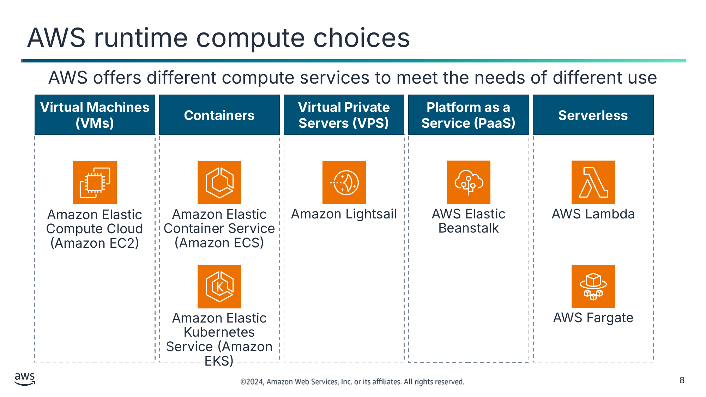

AWS offers different compute services to meet the needs of different use cases. (AWS пропонує різні обчислювальні сервіси для задоволення потреб різних сценаріїв використання.)

<details>
<summary>Текст зі схеми</summary>

**Virtual Machines (VMs) (Віртуальні машини)**

Amazon Elastic Compute Cloud (Amazon EC2)

**Containers (Контейнери)**

Amazon Elastic Container Service (Amazon ECS)

Amazon Elastic Kubernetes Service (Amazon EKS)

**Virtual Private Servers (VPS) (Віртуальні приватні сервери)**

Amazon Lightsail

**Platform as a Service (PaaS) (Платформа як послуга)**

AWS Elastic Beanstalk

**Serverless (Безсерверні)**

AWS Lambda

AWS Fargate

</details>

> **Нотатки:**
>
> |Номер слайда 8  
> |Нотатки для інструктора  
> |Коротко поясніть мету розділу та чому розуміння обчислювальних варіантів AWS важливе для проєктування хмарної архітектури. Підкресліть необхідність вибору правильного обчислювального варіанта для різних робочих навантажень, щоб забезпечити оптимальну продуктивність і економічну ефективність. Подайте п’ять категорій моделей хмарних обчислень як основні теми для обговорення.  
> |  
> |Ось визначення для студентів на випадок, якщо хтось із них не знайомий з термінами в нотатках для студента:  
> |Віртуальні машини (VM): віртуальна машина — це комп’ютер, що забезпечує ту саму функціональність, що й локальні (on-premises) комп’ютери, але доступний через інтернет.  
> |Віртуальні приватні сервери (VPS): віртуальний приватний сервер, також відомий як «екземпляр», дає користувачам змогу запускати вебсайти та вебзастосунки у високозахищеному й доступному середовищі, водночас будучи економічно ефективним.  
> |Платформа як послуга (PAAS): платформи як послуги усувають потребу організацій керувати базовою інфраструктурою (зазвичай апаратне забезпечення та операційні системи) й дають змогу зосередитися на розгортанні та керуванні застосунками.  
> |Безсерверні (Serverless): архітектура чи сервіс без керування серверами, із сервісами за принципом оплати за цінність, безперервним масштабуванням і вбудованою відмовостійкістю.  
> |  
> |Нотатки для студента  
> AWS пропонує кілька обчислювальних варіантів для задоволення різних потреб. Проєктуючи архітектуру для підтримки певного типу робочого навантаження, важливо розуміти наявні обчислювальні варіанти. Як показує схема, основні варіанти обчислень під час виконання можна згрупувати в п’ять категорій моделей хмарних обчислень: віртуальні машини (VM), контейнери, віртуальні приватні сервери (VPS), платформа як послуга, також відома як PaaS, та безсерверні (serverless).  
>
> У категорії VM AWS пропонує сервіс Amazon EC2. Цей сервіс надає безпечні віртуальні сервери зі змінним розміром у хмарі, які можна використовувати для запуску робочих навантажень різних розмірів — від малого масштабу до корпоративного рівня.  
>
> У категорії контейнерів AWS пропонує Amazon Elastic Container Service (Amazon ECS). Він дає змогу запускати застосунки в контейнерах Docker в AWS. AWS також пропонує Amazon Elastic Kubernetes Service (Amazon EKS) — кероване обслуговування Kubernetes, що запускає Kubernetes у хмарі AWS і локальних центрах обробки даних. Ви можете використовувати обидва сервіси для запуску контейнерних застосунків високодоступним і масштабованим способом.  
>
> У категорії віртуальних приватних серверів Amazon Lightsail надає розробникам обчислювальні потужності, сховище та мережеві потужності й можливості для швидкого розгортання та керування вебсайтами та вебзастосунками в хмарі. Lightsail включає все, що потрібно для швидкого запуску вашого проєкту (VM, контейнери, бази даних, мережі доставки контенту (CDN), балансувальники навантаження та керування DNS) за низькою, передбачуваною щомісячною ціною. Lightsail найкраще підходить для проєктів, що потребують кількох віртуальних приватних серверів, і для користувачів, які надають перевагу простому інтерфейсу керування. Поширені сценарії використання Lightsail включають запуск вебсайтів, вебзастосунків, блогів, сайтів електронної комерції, простого програмного забезпечення тощо.  
>
> Категорія PaaS включає AWS Elastic Beanstalk. Це рішення, що запускає вебзастосунки та сервіси, розроблені мовами, як-от Java, .NET, PHP, Node.js, Python, Ruby, Go і Docker. AWS Elastic Beanstalk підходить для ситуацій, коли ви просто хочете завантажити свій код і щоб сервіс автоматично виконав розгортання за вас.  
>
> Безсерверна категорія включає AWS Lambda — безсерверне обчислювальне рішення, що запускає код на Java, Go, PowerShell, Node.js, C#, Python або Ruby. Ця категорія також включає AWS Fargate, що надає безсерверну обчислювальну платформу для контейнерів. Оскільки це безсерверні пропозиції, ці сервіси дають змогу запускати робочі навантаження без потреби розгортати, налаштовувати чи керувати серверами.  
>
> Цей модуль зосереджений на сервісі Amazon EC2.

---

## Слайд 9: Відмінності категорій обчислювальних сервісів

Кожна категорія сервісів пропонує різні рівні контролю над інфраструктурою та швидкості розгортання застосунків.

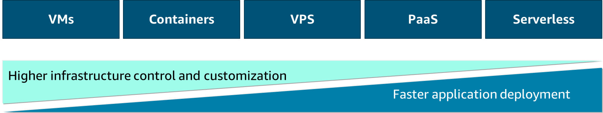

> **Нотатки:**
>
> |Номер слайда 9  
> |Нотатки для інструктора  
> Поясніть, як кожна категорія відрізняється за обов’язками з керування, масштабованістю та придатністю для різних типів робочих навантажень.  
> |  
> |Нотатки для студента  
> Обираючи обчислювальне середовище виконання AWS для вашого робочого навантаження, враховуйте, що VM, сервіси на основі контейнерів і VPS забезпечують більший контроль над вашою інфраструктурою й дають змогу вищою мірою налаштовувати її. Сервіси PaaS і безсерверні сервіси дають змогу більше зосередитися на вашому застосунку й менше — на інфраструктурі. Вони також забезпечують швидке розгортання.  
>
> Схема показує різні категорії сервісів і ілюструє, як VM, контейнери та VPS пропонують більший контроль над інфраструктурою та налаштування, тоді як платформа як послуга та безсерверні сервіси пропонують швидші розгортання застосунків.

---

## Слайд 10: Amazon EC2

- Надає VM (сервери) в хмарі
- Розгортає сервери за лічені хвилини
- Може автоматично збільшувати чи зменшувати потужності за потреби
- Дає змогу платити лише за ту потужність, яку ви використовуєте

Amazon EC2

> **Нотатки:**
>
> |Номер слайда 10  
> |Нотатки для інструктора  
> |  
> |Нотатки для студента  
> У решті цього модуля наша увага буде зосереджена на вивченні Amazon EC2. Він пропонує найширшу та найглибшу обчислювальну платформу в хмарі. Ви можете використовувати Amazon EC2 для розгортання віртуальних серверів, які називаються екземплярами EC2, і повністю контролювати обчислювальні ресурси цих серверів. Ви можете отримувати й запускати нові екземпляри серверів за лічені хвилини та швидко масштабувати потужності вгору й вниз у міру зміни ваших обчислювальних вимог. Ви також можете збільшувати чи зменшувати розмір наявних серверів.  
> З погляду вартості ви платите лише за ту потужність, яку використовуєте.  
>
> Amazon EC2 надає VM в хмарі та підтримує різноманітні операційні системи, зокрема Microsoft Windows і багато варіантів Linux. Сервіс також надає екземпляри Mac, що нативно підтримують операційну систему macOS.  
>
> Він пропонує варіанти з найновішими процесором, сховищем, мережею, операційною системою та моделлю придбання, щоб допомогти вам якнайкраще відповісти потребам вашого робочого навантаження.

---

## Слайд 11: Віртуалізація Amazon EC2

Екземпляр EC2 — це VM, що працює на фізичному хості.

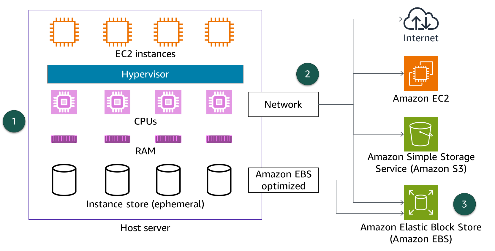

> **Нотатки:**
>
> |Номер слайда 11  
> |Нотатки для інструктора  
> Обговоріть різні компоненти, що складають екземпляр EC2. Поясніть роль хост-комп’ютера, зон доступності, VM, операційних систем і рівня гіпервізора. Підкресліть важливість гіпервізора в керуванні доступом VM до фізичних апаратних ресурсів.  
> |  
> |Нотатки для студента  
> Екземпляри Amazon EC2 працюють як віртуальні машини на хост-комп’ютерах, розташованих у зонах доступності AWS. Кожна VM запускає операційну систему (ОС), як-от Amazon Linux чи Microsoft Windows. Ви можете встановлювати й запускати застосунки на ОС у кожній VM. Ви навіть можете запускати корпоративні застосунки, що охоплюють кілька VM.  
>
> VM працюють поверх рівня гіпервізора, що підтримується AWS. Гіпервізор — це рівень операційної платформи, що надає екземпляру EC2 доступ до фактичних фізичних апаратних ресурсів, потрібних для його роботи, як-от процесори, пам’ять і сховище.  
>
> Деякі екземпляри EC2 використовують сховище екземпляра (instance store). Сховище екземпляра також відоме як ефемерне сховище (ephemeral storage). Це сховище, фізично приєднане до хост-комп’ютера, що надає тимчасове блочне сховище для екземпляра.  
>
> Багато екземплярів EC2 використовують Amazon Elastic Block Store (Amazon EBS) для завантажувального диска та інших потреб у сховищі. Amazon EBS надає томи постійного блочного сховища, що означає, що дані зберігатимуться. Наприклад, дані зберігаються на екземплярі EC2, навіть коли цей екземпляр EC2 перебуває в зупиненому стані.  
>
> Екземпляри, оптимізовані для EBS (EBS-optimized), забезпечують швидший доступ до приєднаного тому Amazon EBS, мінімізуючи конкуренцію за введення-виведення (I/O) між томом та іншим трафіком від екземпляра.  
>
> Екземпляри EC2 можуть мати мережеве підключення до інших ресурсів, як-от інші екземпляри EC2, сервіси AWS та інтернет. Ви можете налаштувати ступінь мережевого доступу відповідно до ваших потреб і збалансувати потреби в доступності з вимогами безпеки. Крім того, різні типи екземплярів забезпечують різні рівні мережевої продуктивності.  
>
> Схема на слайді ілюструє такі характеристики екземпляра EC2:  
> Ви можете обирати різні конфігурації потужності ЦП і пам’яті для екземпляра.  
> Екземпляр забезпечує мережеве підключення.  
> Екземпляр підтримує різні варіанти сховищ, зокрема сховище екземпляра та томи Amazon EBS.

---

## Слайд 12: Сценарії використання Amazon EC2

Використовуйте Amazon EC2, коли вам потрібне таке:

- Повний контроль над вашими обчислювальними ресурсами, зокрема над операційною системою та типом процесора.
- Варіанти оптимізації ваших обчислювальних витрат
  - Екземпляри за запитом (On-Demand Instances), зарезервовані екземпляри (Reserved Instances) і спотові екземпляри (Spot Instances)
  - Плани заощаджень (Savings Plans)
- Здатність запускати будь-який тип робочого навантаження
  - Прості вебсайти
  - Корпоративні застосунки
  - Застосунки генеративного штучного інтелекту (generative AI)

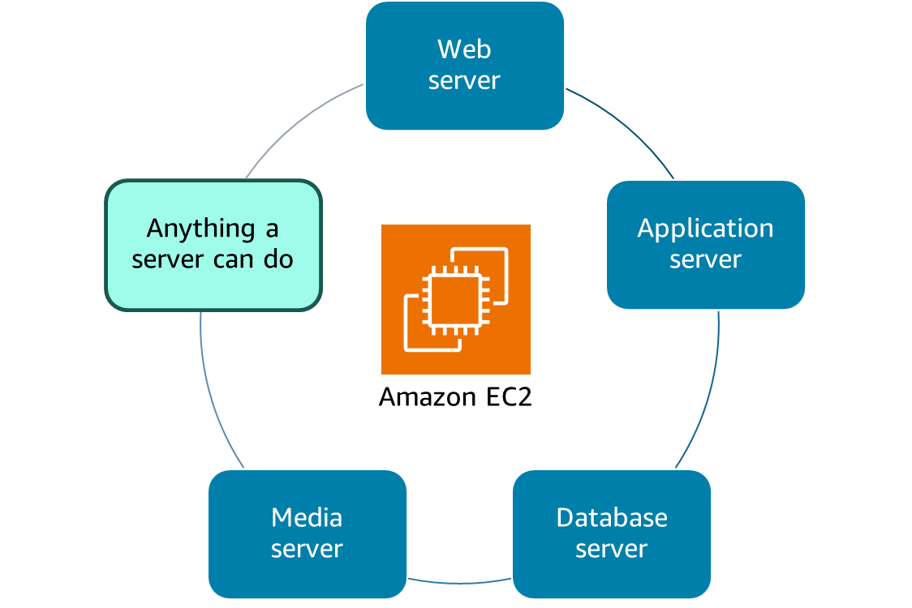

> **Нотатки:**
>
> |Номер слайда 12  
> |Нотатки для інструктора  
> |  
> |Нотатки для студента  
> Amazon EC2 надає віртуальні машини, де можна розміщувати ті самі види застосунків, які ви могли б запускати на традиційному локальному (on-premises) сервері. Поширені сценарії використання екземплярів EC2 включають вебсервери, сервери застосунків, сервери баз даних і медіасервери.  
>
> Зокрема, розглядайте Amazon EC2 як обчислювальний вибір у ситуаціях, коли вам потрібне таке:  
> Повний контроль над вашими обчислювальними ресурсами: Amazon EC2 дає змогу налаштувати й сконфігурувати все щодо ваших екземплярів — від операційної системи до ваших застосунків. Крім того, ви можете обирати екземпляри з архітектурою процесора x86 або Advanced RISC Machine (ARM) та екземпляри з процесорними акселераторами, як-от акселератори машинного навчання.  
> Варіанти оптимізації ваших обчислювальних витрат: Amazon EC2 пропонує кілька способів оплати екземплярів EC2, зокрема екземпляри за запитом, зарезервовані екземпляри, спотові екземпляри та плани заощаджень. Ви також можете платити за виділені хости (Dedicated Hosts), що надають вам потужності екземплярів EC2 на фізичних серверах, виділених для вашого використання.  
> Віртуальний сервер для запуску будь-якого типу робочого навантаження: від простих вебсайтів до застосунків генеративного штучного інтелекту, Amazon EC2 надає широкий вибір типів екземплярів, оптимізованих для різних сценаріїв використання.  
>
> Докладніше про конфігурацію Amazon EC2 і варіанти ціноутворення ви дізнаєтеся в наступних розділах цього модуля.

---

## Слайд 13: Кроки розгортання екземпляра EC2

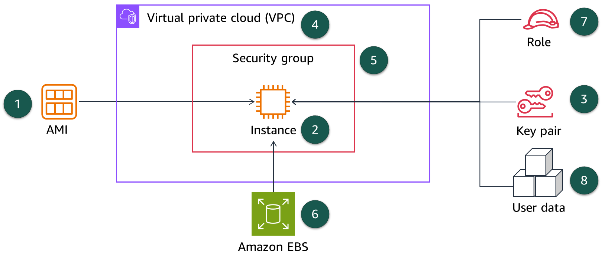

> **Нотатки:**
>
> |Номер слайда 13  
> |Нотатки для інструктора  
> Розберіть схему: опишіть кожен компонент і його функцію. Нагадайте студентам про функцію груп безпеки. Обговоріть компонент пари ключів, що забезпечує безпечний доступ до екземпляра за SSH і є важливим для віддаленого керування. Підкресліть важливість безпеки й наголосіть на потребі в захищеному екземплярі, пояснивши потенційні ризики невпровадження належних заходів безпеки. Запропонуйте додаткові заходи безпеки, які можна впровадити, як-от регулярні оновлення й виправлення операційної системи та програмного забезпечення.  
> |  
> |Нотатки для студента  
> Ця схема ілюструє основні кроки та компоненти розгортання екземпляра. Компоненти на схемі не є вичерпним переліком варіантів, доступних під час налаштування екземпляра. Однак це важливі елементи, потрібні для запуску захищеного екземпляра.  
>
> Кроки такі:  
> Ви починаєте з образу Amazon Machine Image (AMI) — шаблона, який Amazon EC2 використовує для запуску екземпляра. AWS надає деякі AMI. Інші AMI надходять від сторонніх організацій і доступні в AWS Marketplace. Ви також можете створити власний AMI із наявного екземпляра EC2.  
> Після вибору AMI оберіть тип екземпляра. Amazon EC2 надає вибір типів екземплярів, оптимізованих для різних сценаріїв використання. Типи екземплярів складаються з різних комбінацій потужностей ЦП, пам’яті, сховища та мережі.  
> Якщо ви плануєте підключатися до екземпляра за допомогою Secure Shell (SSH) або Remote Desktop Protocol (RDP), потрібно вказати пару ключів (key pair). Пара ключів — це набір облікових даних безпеки, які ви використовуєте для підтвердження своєї особи під час підключення до екземпляра EC2. Пара ключів складається з відкритого ключа та закритого ключа.  
> Запускаючи екземпляр, ви можете вказати мережеве розташування та адресацію відповідно до потреб захисту екземпляра й надання доступу до нього. Усі екземпляри розгортаються в мережі у віртуальній приватній хмарі (VPC). Ви також можете вирішити, чи призначати екземпляру публічну IP-адресу або адресу DNS.  
> Ви також повинні призначити екземпляру нову чи наявну групу безпеки. Група безпеки — це набір правил брандмауера, що контролює трафік до вашого екземпляра та від нього. Група безпеки визначає, які порти може використовувати мережевий трафік.  
> Далі ви вказуєте варіанти сховищ для екземпляра. Тип сховища, з якого завантажуватиметься ОС екземпляра, може бути або сховищем екземпляра (ефемерне сховище), або томом EBS. Ви також можете приєднати до екземпляра додаткові томи блочного сховища.  
> Якщо ви маєте намір запускати на екземплярі застосунок, що робить виклики API до сервісів AWS, потрібно прикріпити до екземпляра роль AWS Identity and Access Management (IAM). Ви використовуєте профіль екземпляра (instance profile), щоб передати роль IAM екземпляру EC2.  
> Нарешті, за бажанням ви можете вказати дані користувача (user data) під час запуску екземпляра. Ці дані — потужний спосіб автоматизувати встановлення та налаштування на екземплярі під час його запуску.

---

## Слайд 14: Ключові висновки: додавання обчислень за допомогою Amazon EC2

- Amazon EC2 дає змогу запускати VM в хмарі та легко збільшувати чи зменшувати потужності за потреби.
- Ви можете використовувати екземпляр EC2, коли вам потрібен повний контроль над вашими обчислювальними ресурсами й ви хочете запускати будь-який тип робочого навантаження.
- Запускаючи екземпляр EC2, ви повинні обрати AMI та тип екземпляра. Запуск екземпляра передбачає вказання параметрів конфігурації, зокрема налаштувань мережі, безпеки, сховища та даних користувача.

> **Нотатки:**
>
> |Номер слайда 14  
> |Нотатки для інструктора  
> |  
> |Нотатки для студента

---

## Слайд 15: Вибір AMI для запуску екземпляра EC2

Додавання обчислювального рівня за допомогою Amazon EC2

> **Нотатки:**
>
> |Номер слайда 15  
> |Нотатки для інструктора  
> |  
> |Нотатки для студента  
> Цей розділ визначає образ Amazon Machine Image (AMI) і обговорює його основні переваги. Він також надає настанови щодо вибору AMI і створення нового.

---

## Слайд 16: Amazon Machine Image (AMI)

AMI надає інформацію, потрібну для запуску екземпляра, зокрема таку:

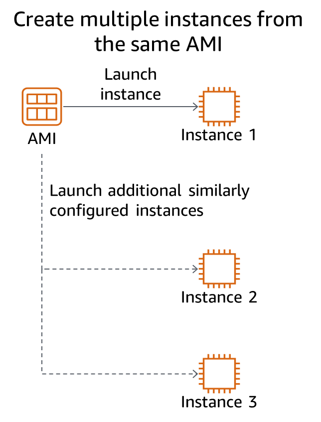

- Шаблон кореневого тому (root volume): містить гостьову операційну систему (ОС) і, можливо, інше встановлене програмне забезпечення
- Дозволи на запуск (launch permissions): контролюють, хто може отримати доступ до AMI
- Зіставлення блочних пристроїв (block device mappings): визначає томи сховища, які слід приєднати до екземпляра (за наявності)

> **Нотатки:**
>
> |Номер слайда 16  
> |Нотатки для інструктора  
> |  
> |Нотатки для студента  
> AMI надає інформацію, потрібну для запуску екземпляра. Ви повинні вказати вихідний AMI під час запуску екземпляра. AMI включає шаблон кореневого тому екземпляра, дозволи на запуск і зіставлення блочних пристроїв.  
>
> Кореневий том зазвичай містить операційну систему (ОС) і все, що було встановлено в цій ОС (застосунки, бібліотеки, утиліти та інше). Amazon Elastic Compute Cloud (Amazon EC2) копіює шаблон на кореневий том нового екземпляра, а потім запускає його.  
>
> Дозволи на запуск контролюють, які акаунти AWS можуть використовувати AMI для запуску екземплярів. Вони також дають змогу зробити AMI загальнодоступним.  
>
> Зіставлення блочних пристроїв визначають додаткові томи сховища (за наявності), які слід приєднати до екземпляра під час його запуску.  
>
> Ви можете запускати кілька екземплярів з одного AMI, коли вам потрібні кілька екземплярів з однаковою конфігурацією.  
>
> Ви також можете використовувати різні AMI для запуску екземплярів, коли вам потрібні екземпляри з різними конфігураціями. Наприклад, ви можете мати один AMI для впровадження екземплярів вебсерверів у вашій архітектурі та інший — для впровадження екземплярів серверів застосунків.

---

## Слайд 17: Переваги AMI

Відтворюваність (Repeatability)

Повторне використання (Reusability)

Відновлюваність (Recoverability)

AMI можна використовувати багаторазово для запуску екземплярів ефективно й точно.

Екземпляри, запущені з того самого AMI, налаштовані ідентично.

Ви можете створити AMI із налаштованого екземпляра як резервну копію, що відновлюється.

Ви можете замінити несправний екземпляр, запустивши новий екземпляр із того самого AMI.

> **Нотатки:**
>
> |Номер слайда 17  
> |Нотатки для інструктора  
> |  
> |Нотатки для студента  
> Переваги використання AMI включають відтворюваність, повторне використання та відновлюваність.  
>
> AMI забезпечують відтворюваність, оскільки AMI пакує повну конфігурацію та вміст екземпляра EC2. Тому його можна використовувати багаторазово для запуску кількох екземплярів ефективно й точно.  
>
> AMI сприяють повторному використанню, оскільки екземпляри, запущені з того самого AMI, є точними копіями одне одного. Цей проєкт полегшує побудову кластерів подібних екземплярів чи відтворення обчислювальних середовищ.  
>
> AMI також сприяють відновлюваності. Якщо екземпляр виходить з ладу, ви можете замінити його, запустивши новий екземпляр із того самого AMI, який використовували для запуску оригінального екземпляра. Крім того, AMI надають спосіб створення резервної копії повної конфігурації екземпляра EC2, яку можна використати для запуску замінного екземпляра в разі збою. Якщо до базової конфігурації AMI додається будь-яке додаткове програмне забезпечення чи вносяться зміни, найкраща практика — зберегти ці зміни, створивши новий AMI. Це дає вам копію вашого останнього налаштованого AMI для відновлення після збою. Без нього ці програмні доповнення чи нові зміни конфігурації, не збережені до збою екземпляра, не підлягатимуть відновленню.  
>
> Докладніше про AMI див. вебсторінку Amazon Machine Images (AMI).

---

## Слайд 18: Вибір AMI

Обирайте AMI на основі такого:

Джерело AMI:

- Регіон
- Операційна система
- Тип сховища кореневого пристрою
- Архітектура
- Тип віртуалізації: для найкращої продуктивності використовуйте AMI з типом віртуалізації Hardware Virtual Machine (HVM).

- Quick Start: AMI для Linux і Microsoft Windows, надані AWS.
- My AMIs: будь-які AMI, створені вами.
- AWS Marketplace: попередньо налаштовані шаблони від третіх сторін.
- Community AMIs: AMI, до яких надали спільний доступ інші. Використовуйте на власний ризик.

> **Нотатки:**
>
> |Номер слайда 18  
> |Нотатки для інструктора  
> Виділіть основні моменти тут.  
> |  
> |Нотатки для студента  
> Обираючи AMI для запуску екземпляра, ваше рішення має ґрунтуватися на п’яти ключових характеристиках:  
> Регіон: кожен AMI існує в певному регіоні. Тому ви повинні обрати AMI, що перебуває в регіоні, де ви хочете запустити екземпляр. За потреби можна скопіювати AMI з одного регіону до іншого.  
> Операційна система: для AMI, наданого AWS, можна обрати між Microsoft Windows чи варіантом Linux.  
> Сховище для кореневого пристрою: усі AMI класифікуються як такі, що базуються на Amazon EBS (EBS-backed), або на сховищі екземпляра (instance store-backed). Дані на томі сховища екземпляра зберігаються лише протягом життя екземпляра, але дані на томі EBS зберігаються незалежно від життя екземпляра.  
> Архітектура: ця характеристика визначає тип архітектури процесора, що найкраще відповідає вашому робочому навантаженню. Варіанти: 32-бітна або 64-бітна, а також набір інструкцій x86 або Advanced RISC Machine (ARM).  
> Тип віртуалізації: AMI використовують один із двох типів віртуалізації: паравіртуальний (PV) або Hardware Virtual Machine (HVM). Основні відмінності між AMI PV і HVM включають спосіб їх завантаження та те, чи можуть вони скористатися спеціальними апаратними розширеннями для кращої продуктивності. Для найкращої продуктивності використовуйте AMI з типом віртуалізації HVM.  
>
> Докладніше про відмінності між PV і HVM див. вебсторінку «Linux AMI virtualization types».  
>
> Ви можете отримати AMI з одного з чотирьох джерел:  
> Quick Start — це AMI, створені AWS. Вони пропонують вибір між Microsoft Windows або варіантами операційної системи Linux. Варіанти Linux включають: Amazon Linux, Ubuntu, Red Hat Enterprise Linux, SUSE Linux Enterprise Server, Fedora, Debian, CentOS, Gentoo Linux, Oracle Linux та FreeBSD.  
> AWS також дає змогу створювати власні AMI (My AMIs). Ви можете створити AMI із екземпляра EC2.  
> Ви також можете шукати AMI в AWS Marketplace, що пропонує цифровий каталог із тисячами програмних рішень. Ці рішення включають AMI від постачальників програмного забезпечення для конкретних сценаріїв використання.  
> Community-built AMI створюють люди з усього світу, і вони можуть пропонувати рішення багатьох різних типів проблем. Однак вони не перевіряються AWS. Тому використовуйте їх на власний ризик. Зокрема, уникайте використання їх у будь-якому продуктивному чи корпоративному середовищі.  
>
> Докладніше про вибір AMI див. вебсторінку «AMI types».

---

## Слайд 19: AMI на основі сховища екземпляра та AMI на основі Amazon EBS

| Характеристика (Characteristic) | Екземпляр на основі Amazon EBS (Amazon EBS-Backed Instance) | Екземпляр на основі сховища екземпляра (Instance Store-Backed Instance) |
|---|---|---|
| Час завантаження екземпляра | Завантажується швидше | Завантаження займає більше часу |
| Максимальний розмір кореневого пристрою | 16 ТіБ | 10 ГіБ |
| Можливість зупинки екземпляра | Екземпляр можна зупинити | Не може перебувати в зупиненому стані; екземпляри або працюють, або завершені |
| Можливість зміни типу екземпляра | Тип екземпляра можна змінити, зупинивши екземпляр | Тип екземпляра змінити не можна, оскільки екземпляр не можна зупинити |
| Плата за екземпляр | Ви платите за використання екземпляра, використання тому EBS і зберігання вашого AMI як знімка EBS | Ви платите за використання екземпляра та зберігання вашого AMI в Amazon S3 |
| Сценарій використання | Постійне сховище | Тимчасове сховище |

> **Нотатки:**
>
> |Номер слайда 19  
> |Нотатки для інструктора  
> |  
> |Нотатки для студента  
> Існують важливі відмінності в поведінці та продуктивності під час запуску екземпляра за допомогою AMI на основі сховища екземпляра порівняно з AMI на основі Amazon EBS. Ось вони:  
> Екземпляри Amazon EC2, що використовують сховище екземпляра, завантажуються довше, ніж екземпляри Amazon EC2, що використовують Amazon EBS. Це тому, що всі частини образу доводиться отримувати з Amazon Simple Storage Service (Amazon S3).  
> Максимальна потужність кореневого пристрою екземпляра, що базується на Amazon EBS, становить 16 тебібайтів (ТіБ) і є більшою, ніж у екземпляра на основі сховища екземпляра, — 10 гібібайтів (ГіБ).  
> Екземпляр на основі сховища екземпляра не можна зупинити, його можна лише перезавантажити чи завершити.  
> Тип екземпляра на основі сховища екземпляра змінити не можна.  
> Вартість екземпляра на основі Amazon EBS включає плату за сховище EBS. Вартість екземпляра на основі сховища екземпляра включає плату за сховище Amazon S3. Вартість сховища Amazon S3 зазвичай нижча.  
> Використовуйте екземпляр на основі Amazon EBS, якщо вам потрібні постійні дані на сховищі екземпляра, як-от база даних чи вебзастосунок. Використовуйте екземпляр на основі сховища екземпляра, якщо ваші дані не потрібно зберігати постійно на цьому томі.

---

## Слайд 20: Життєвий цикл екземпляра Amazon EC2

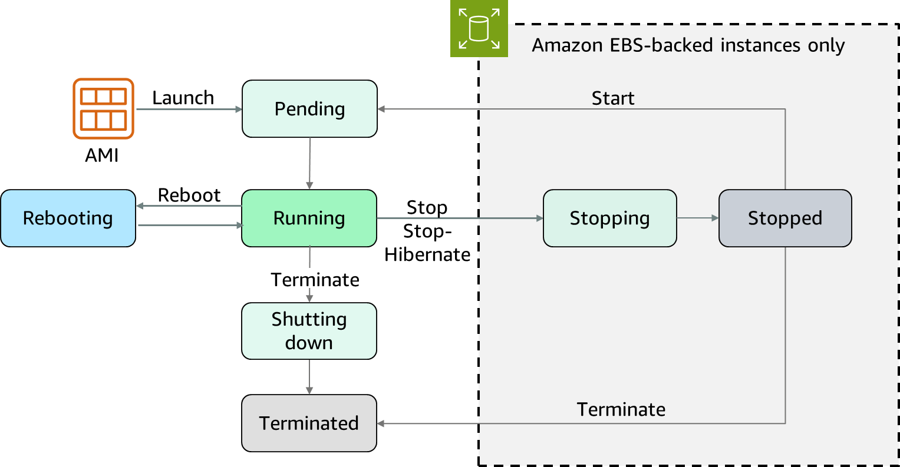

> **Нотатки:**
>
> |Номер слайда 20  
> |Нотатки для інструктора  
> |Поясніть можливі стани екземпляра та переходи. Також виділіть додаткові стани й переходи, доступні лише якщо екземпляр базується на Amazon EBS. Повідомте студентам, що інформація на цьому слайді дуже відповідає обсягу сертифікаційного іспиту AWS Certified Solutions Architect – Associate.  
> |  
> |Нотатки для студента  
> Ця схема показує життєвий цикл екземпляра й виділяє додаткові дії та стани, які дозволяє екземпляр на основі Amazon EBS. Запущений екземпляр стає «очікуючим» (pending), а потім «працюючим» (running). Працюючі екземпляри можна перезавантажити, завершити чи зупинити. Зупинений екземпляр можна запустити або завершити.  
>
> Коли екземпляр уперше запускається з AMI або коли ви запускаєте зупинений екземпляр, він переходить у стан pending. Цей стан вказує, що екземпляр розгортається на хост-комп’ютері й завантажується. Тип екземпляра, указаний в AMI або для початкового зупиненого екземпляра, визначає апаратне забезпечення хост-комп’ютера для нового екземпляра.  
>
> Коли екземпляр повністю завантажено й він готовий, він виходить зі стану pending і переходить у стан running. На цьому етапі ви можете підключитися до вашого працюючого екземпляра через інтернет і почати ним користуватися.  
>
> Щойно екземпляр перебуває в стані running, його можна перезавантажити за допомогою консолі Amazon EC2, AWS Command Line Interface (AWS CLI) або AWS SDK. Тоді він переходить у стан перезавантаження (rebooting). Перезавантажений екземпляр залишається на тому самому фізичному хості, зберігає те саме публічне DNS-ім’я та ту саму публічну IP-адресу. Якщо екземпляр має томи сховища екземпляра, він зберігає дані на цих томах.  
>
> Зі стану running можна також завершити екземпляр. Завершення екземпляра призводить до переходу екземпляра в проміжний стан завершення роботи (shutting down), перш ніж він відобразить стан terminated. Завершений екземпляр залишається видимим у консолі Amazon EC2 ще деякий час, перш ніж віртуальну машину (VM) буде видалено. Однак ви не можете підключитися до завершеного екземпляра чи відновити його.  
>
> Екземпляри на основі Amazon EBS також можна зупинити зі стану running. Вони переходять у стан зупинки (stopping), перш ніж досягти повністю зупиненого стану (stopped). Зупинений чи завершений екземпляр не спричиняє тієї самої вартості, що й працюючий екземпляр. Щойно стан екземпляра змінюється на stopping або shutting-down, плата за екземпляр більше не стягується. Запуск зупиненого екземпляра повертає його в стан pending. Коли ви запускаєте екземпляр, його зазвичай переміщують на новий базовий хост-комп’ютер і призначають йому нову публічну адресу IPv4.  
>
> Ви також можете перевести екземпляр на основі EBS у гібернацію (hibernate) зі стану running. Це призводить до збереження пам’яті (in-memory storage), приватної IP-адреси та еластичної IP-адреси. Вони залишаються тими самими, коли ви знову запускаєте екземпляр, тож ви можете продовжити з того місця, де зупинилися. У більшості випадків, коли ви запускаєте екземпляр у гібернації, його переміщують на новий хост-комп’ютер. Однак ваш екземпляр може залишитися на тому самому хост-комп’ютері, якщо в хост-комп’ютера немає проблем. Подібно до зупинки екземпляра, ви не платите за екземпляр, коли він перебуває в стані гібернації.

---

## Слайд 21: Створення нового AMI

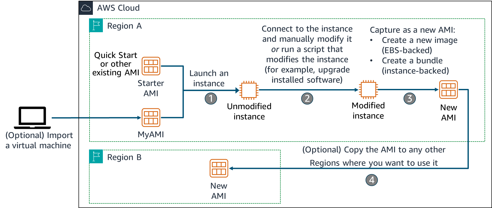

> **Нотатки:**
>
> |Номер слайда 21  
> |Нотатки для інструктора  
> |  
> |Нотатки для студента  
> Ця схема показує екземпляр, запущений із початкового AMI. Потім його змінюють і захоплюють як новий AMI, що сам стає новим початковим AMI. Як новий початковий AMI його можна за бажанням скопіювати до інших регіонів.  
>
> Ви створюєте AMI із екземпляра EC2. Ви починаєте з вихідного AMI, яким може бути наявний AMI, як-от AMI Quick Start, наданий AWS. Або можна почати з AMI, який ви будуєте з імпортованої VM. AWS пропонує сервіс VM Import/Export, який можна використовувати для імпорту образів віртуальних машин із вашого наявного середовища в екземпляри Amazon EC2. Ви також можете експортувати їх назад у ваше локальне середовище. Коли ваш вихідний AMI готовий, ви можете запустити екземпляр EC2 із цього AMI (крок 1).  
>
> Незалежно від обраного варіанта (крок 1), у вас буде те, що схема називає незмінений екземпляр (unmodified instance). З цього екземпляра ви можете створити «золотий» екземпляр (golden instance). Іншими словами, створити VM, яку ви налаштовуєте з потрібними вам ОС і налаштуваннями застосунків (крок 2). Потім захопити її як новий AMI (крок 3).  
>
> Для AMI на основі EBS ви захоплюєте новий AMI, створюючи новий образ, і AWS автоматично реєструє його за вас. Для AMI на основі екземпляра ви захоплюєте новий AMI за допомогою інструментів AMI Amazon EC2 для створення пакета (bundle) кореневого тому екземпляра й завантажуєте пакет до бакета Amazon S3. Потім ви повинні вручну зареєструвати новий AMI.  
>
> Після реєстрації AMI його можна використовувати для запуску нових екземплярів у тому самому регіоні AWS. Тепер ви можете розглядати новий AMI як новий початковий AMI. За бажанням можна також скопіювати AMI в інші регіони (крок 4), щоб також запускати нові екземпляри EC2 у цих розташуваннях.

---

## Слайд 22: EC2 Image Builder

EC2 Image Builder автоматизує створення, керування та розгортання актуальних і сумісних із вимогами «золотих» образів VM.

- Надає графічний інтерфейс для створення конвеєрів побудови образів
- Створює та підтримує AMI Amazon EC2 і образи VM для локального використання
- Створює безпечні, перевірені та актуальні образи
- Забезпечує контроль версій

EC2 Image Builder

> **Нотатки:**
>
> |Номер слайда 22  
> |Нотатки для інструктора  
> Представте EC2 Image Builder — сервіс, запроваджений у грудні 2019 року. Якщо сервіс для вас новий, знайдіть час, щоб ознайомитися з ним.  
> |  
> |Нотатки для студента  
> Ще один спосіб створити AMI — використати EC2 Image Builder.  
>
> EC2 Image Builder — це сервіс AWS, що спрощує створення, підтримку, перевірку, спільне використання та розгортання образів Linux чи Microsoft Windows. Він надає графічний інтерфейс для створення AMI для використання в AWS і генерування образів VM для локального використання.  
>
> Одна з переваг використання EC2 Image Builder — він дає змогу створювати образи лише з основними компонентами, як-от програмне забезпечення, налаштування та інші конфігурації. Це може зменшити вашу вразливість до загроз безпеки. Перш ніж використовувати ваші образи в продуктивному середовищі, ви можете використовувати EC2 Image Builder для перевірки ваших образів за допомогою тестів, наданих AWS або вашими власними тестами. Нарешті, він забезпечує контроль версій для керування редакціями.

---

## Слайд 23: Ключові висновки: вибір AMI для запуску екземпляра EC2

- AMI надає інформацію, потрібну для запуску екземпляра EC2.
- Переваги AMI включають відтворюваність, повторне використання та відновлюваність.
- Для найкращої продуктивності використовуйте AMI з типом віртуалізації HVM.
- Існує кілька джерел отримання AMI, зокрема Quick Start, Community AMI, AWS Marketplace та My AMIs (де зберігаються AMI, створені вами).

> **Нотатки:**
>
> |Номер слайда 23  
> |Нотатки для інструктора  
> |  
> |Нотатки для студента

---

## Слайд 24: Вибір типу екземпляра Amazon EC2

Додавання обчислювального рівня за допомогою Amazon EC2

> **Нотатки:**
>
> |Номер слайда 24  
> |Нотатки для інструктора  
> |  
> |Нотатки для студента  
> Цей розділ визначає типи екземплярів Amazon EC2. Він також надає настанови щодо вибору найкращих типів екземплярів на основі вимог до робочого навантаження екземпляра.

---

## Слайд 25: Конфігурація типу екземпляра EC2

Тип екземпляра EC2 визначає конфігурацію ЦП, пам’яті, сховища та мережевої продуктивності.

| Тип екземпляра (Instance type) | vCPU | Пам’ять (Memory) | Сховище (Storage) | Мережева продуктивність (Network performance) |
|---|---|---|---|---|
| m5d.large | 2 | 4 GiB | 1 x 50 NVMe SSD | До 10 Гбіт/с |
| m5d.xlarge | 4 | 8 GiB | 1 x 100 NVMe SSD | До 10 Гбіт/с |
| m5d.8xlarge | 32 | 128 GiB | 2 x 600 NVMe SSD | 10 Гбіт/с |

Усі типи екземплярів поточного покоління підтримують розширену мережеву функціональність (enhanced networking), окрім екземплярів T2.

> **Нотатки:**
>
> |Номер слайда 25  
> |Нотатки для інструктора  
> |  
> |Нотатки для студента  
> Перш ніж запускати екземпляр, слід знати, яке робоче навантаження працюватиме на ньому. Це допомагає обрати правильний тип екземпляра під час запуску. Тип екземпляра EC2 визначає конфігурацію характеристик ЦП, пам’яті, сховища та мережевої продуктивності. Тип екземпляра, який ви оберете, залежатиме від вимог вашого робочого навантаження до продуктивності та вартості.  
>
> Ця таблиця показує конфігурацію трьох типів екземплярів: m5d.large, m5d.xlarge і m5d.8xlarge. У міру збільшення розміру типу екземпляра збільшується також кількість vCPU, пам’яті та сховища.  
>
> Зверніть увагу, що мережева продуктивність між розмірами більш статична, ніж vCPU, пам’ять і сховище. І m5d.large, і m5d.xlarge пропонують мережеву продуктивність до 10 гігабайтів на секунду. Однак m5d.8xlarge пропонує стабільні 10 гігабайтів на секунду мережевої продуктивності.  
>
> Однак це не означає, що тип екземпляра m5d.8xlarge — правильний вибір. Щоб зробити правильний вибір, потрібно враховувати потреби робочого навантаження екземпляра в продуктивності та вимоги до вартості. Потім оберіть тип екземпляра з конфігурацією, що найкраще відповідає цим параметрам.  
>
> Усі типи екземплярів поточного покоління підтримують розширену мережеву функціональність, окрім екземплярів T2. Ці типи екземплярів із розширеною мережевою функціональністю гарантують, що робочі навантаження Session Initiation Protocol (SIP), які на них працюють, мають доступ до стабільної пропускної здатності та порівняно нижчої сукупної затримки.

---

## Слайд 26: Назва типу екземпляра EC2

Іменовані компоненти типів екземплярів

- Сімейство (Family)
- Покоління (Generation)
- Сімейство процесорів (Processor family)
- Додаткові можливості (Additional capabilities)
- Розмір (Size)

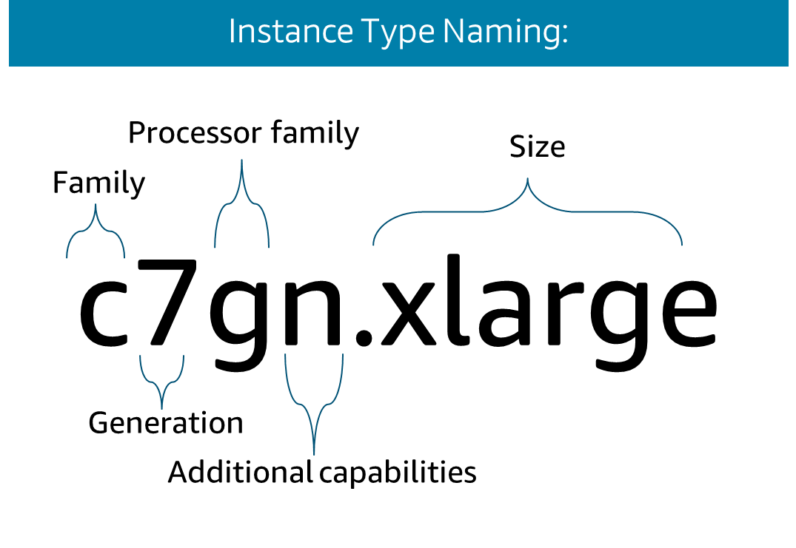

> **Нотатки:**
>
> |Номер слайда 26  
> |Нотатки для інструктора  
> |  
> |Нотатки для студента  
> Назви типів екземплярів дотримуються стандартної угоди. Назва типу екземпляра складається з кількох частин, що описують різні характеристики типу екземпляра.  
>
> У цьому прикладі c — це назва сімейства для назви типу екземпляра c7gn.xlarge. За нею йде число, у цьому випадку 7. Воно позначає номер покоління цього типу. Отже, екземпляр c7 — це сьоме покоління сімейства c. Загалом екземпляри з вищим номером покоління потужніші та забезпечують кращу ціну за якість, ніж екземпляри з нижчим номером покоління.  
>
> Після номера покоління іде необов’язкова частина, що вказує на сімейство процесорів і додаткові можливості типу екземпляра. У прикладі g у назві вказує, що тип екземпляра використовує процесор AWS Graviton. n у назві вказує, що тип екземпляра має додаткові можливості — оптимізацію для мережі та EBS.  
>
> Наступна частина назви, що йде після роздільника-крапки (.), позначає розмір екземпляра. Розмір типу екземпляра визначає специфікацію продуктивності екземпляра за категоріями ЦП, пам’яті, сховища та мережевої продуктивності. У прикладі xlarge вказує, що це надвеликий екземпляр.  
>
> Знову ж таки, не всі типи екземплярів включають у назву сімейство процесорів і додаткові можливості. Наприклад, назва екземпляра m5d.xlarge не включає літеру сімейства процесорів у назві типу екземпляра.  
>
> Докладніше про угоду іменування типів екземплярів див. вебсторінку «Instance types».

---

## Слайд 27: Придатність типів екземплярів для робочих навантажень

| Тип (Type) | Приклади робочих навантажень (Workload examples) | Приклади типів екземплярів (Instance type examples) |
|---|---|---|
| Типи екземплярів загального призначення (General purpose) | • Вебсервери чи сервери застосунків<br>• Корпоративні застосунки<br>• Ігрові сервери<br>• Середовища розробки чи тестування | M7, Mac, M6, M5, M4, T4, T3, T2 |
| Типи екземплярів, оптимізовані для обчислень (Compute optimized) | • Пакетна обробка<br>• Розподілена аналітика<br>• Високопродуктивні обчислення (HPC) | C7, C6, C5, C4 |
| Типи екземплярів, оптимізовані для сховищ (Storage optimized) | • Високопродуктивні бази даних<br>• Аналітика в реальному часі<br>• Транзакційні робочі навантаження | I4, Im4, Is4, I3, D2, D3, H1 |
| Типи екземплярів, оптимізовані для пам’яті (Memory optimized) | • Кеші в пам’яті<br>• Високопродуктивні бази даних<br>• Аналітика великих даних | R7, R6, R5, R4, X2, X1, Z1 |
| Типи екземплярів із прискореними обчисленнями (Accelerated computing) | • Машинне навчання, штучний інтелект (AI)<br>• HPC | P5, P4, P3, P2, DL1, Trn1, Inf2, Inf1, G5, G4, G3, F1, VT1 |
| Типи екземплярів, оптимізовані для високопродуктивних обчислень (HPC optimized) | • Робочі навантаження глибокого навчання<br>• Ресурсомісткі HPC-навантаження | Hpc7, Hpc6 |

> **Нотатки:**
>
> |Номер слайда 27  
> |Нотатки для інструктора  
> |Цей слайд перелічує приклади робочих навантажень, що підходять для кожної категорії типів екземплярів. Він також перелічує приклади типів екземплярів для певної категорії.  
> |Інструктор має відвідати сторінку «Instance Type Detail», щоб переглянути типи екземплярів із класом.  
> |  
> |Нотатки для студента  
> Тепер ви дізнаєтеся про придатність різних типів екземплярів для різних робочих навантажень. Типи екземплярів можна класифікувати як загального призначення, оптимізовані для обчислень, оптимізовані для сховищ, оптимізовані для пам’яті, із прискореними обчисленнями або оптимізовані для високопродуктивних обчислень (HPC). Ви побачите кожну з категорій на цьому та наступному слайдах.  
>
> Екземпляри загального призначення забезпечують баланс обчислювальних ресурсів, пам’яті та мережевих ресурсів. Їх можна використовувати для різноманітних робочих навантажень. Ці екземпляри добре підходять для застосунків, що використовують ці ресурси в рівних пропорціях. Типові сценарії використання екземплярів загального призначення — вебсервери чи сервери застосунків, корпоративні застосунки, ігрові сервери, парки кешування, аналітичні застосунки та середовища розробки чи тестування.  
>
> Приклади типів екземплярів загального призначення включають екземпляри M5, T3 і A1.  
>
> Екземпляри, оптимізовані для обчислень, добре працюють для застосунків, обмежених обчислювальною потужністю (compute-bound), що виграють від високопродуктивних процесорів. Екземпляри цього сімейства підходять для таких робочих навантажень, як пакетна обробка, розподілена аналітика, високопродуктивні обчислення (HPC), рушії рекламних серверів, багатокористувацькі ігри та кодування відео.  
>
> Приклади типів екземплярів, оптимізованих для обчислень, включають екземпляри C5 і C5n.  
>
> Екземпляри, оптимізовані для сховищ, призначені для робочих навантажень, що потребують високого послідовного доступу на читання/запис до дуже великих наборів даних на локальному сховищі. Вони оптимізовані для забезпечення десятків тисяч випадкових IOPS із низькою затримкою. Вони підходять для таких застосунків, як високопродуктивні бази даних, бази даних NoSQL, аналітика в реальному часі, транзакційні робочі навантаження, великі дані, сховища даних та обробка журналів.  
>
> Приклади типів екземплярів, оптимізованих для сховищ, включають екземпляри I3, D2 і H1.  
>
> Екземпляри, оптимізовані для пам’яті, розроблені для забезпечення швидкої продуктивності робочих навантажень, що обробляють великі набори даних у пам’яті. Вони підходять для таких застосунків, як кеші в пам’яті, високопродуктивні бази даних та аналітика великих даних.  
>
> Приклади типів екземплярів, оптимізованих для пам’яті, включають екземпляри R5, X1 і HMI.  
>
> Екземпляри з прискореними обчисленнями використовують апаратні акселератори (або співпроцесори) для виконання таких функцій, як обчислення з числами з плаваючою комою, обробка графіки та зіставлення шаблонів даних. Вони роблять це ефективніше, ніж виконання цих функцій у програмному забезпеченні, що працює на ЦП. Екземпляри з прискореними обчисленнями підходять для робочих навантажень машинного навчання та штучного інтелекту, HPC і графіки.  
>
> Приклади типів екземплярів із прискореними обчисленнями включають екземпляри P3, G4 і F1.  
>
> Екземпляри для високопродуктивних обчислень (HPC) спеціально створені для забезпечення найкращого співвідношення ціни та продуктивності під час запуску робочих навантажень HPC у великому масштабі в AWS. Екземпляри HPC ідеально підходять для застосунків, що виграють від високопродуктивних процесорів, як-от великі складні симуляції та робочі навантаження глибокого навчання.  
>
> Приклади типів екземплярів HPC включають екземпляри Hpc7g, Hpc7a і Hpc6id.  
>
> Докладніше див. «Instance Type Details» на сторінці ресурсів вашого курсу.

---

## Слайд 28: Вибір типу екземпляра

- Із понад 270 доступними типами екземплярів, як обрати правильний тип?
  - Враховуйте як вимоги до продуктивності, так і вимоги до вартості.
  - Використовуйте наявні ресурси, щоб отримати рекомендовані варіанти.

| Завдання (Task) | Рішення (Solution) |
|---|---|
| Створення нового екземпляра | • У консолі EC2 використовуйте сторінку Instance Types, щоб фільтрувати за характеристиками, які ви оберете.<br>• Рекомендація: найновіше покоління в сімействі екземплярів зазвичай має краще співвідношення ціни та продуктивності. |
| Оптимізація наявного екземпляра | • Ви можете отримувати рекомендації з оптимізації типу екземпляра за допомогою AWS Compute Optimizer.<br>• Ви можете оцінювати рекомендації та відповідно змінювати екземпляр. |

> **Нотатки:**
>
> |Номер слайда 28  
> |Нотатки для інструктора  
> |Поставте архітектурне запитання: які інструменти пропонує AWS, щоб допомогти обрати правильний тип екземпляра для робочого навантаження?  
> |Відповідь: сторінка Instance Types в консолі Amazon EC2 і сервіс AWS Compute Optimizer. Сторінку Instance Types в консолі Amazon EC2 і сервіс AWS Compute Optimizer було запроваджено в листопаді 2019 року та в грудні 2019 року відповідно.  
> |  
> |Підкресліть, що ніщо не замінить вимірювання та збирання метрик, що допомагають вирішити, який тип екземпляра використовувати.  
> |  
> |Нотатки для студента  
> З огляду на комбінацію категорій типів екземплярів, можливостей і варіантів, пов’язаних з типом екземпляра, не дивно, що їх чимало. Станом на березень 2020 року доступно понад 270 типів екземплярів. Цей широкий вибір відображає глибоке та широке багатство обчислювальних пропозицій, що надаються AWS.  
>
> Велика кількість типів екземплярів ускладнює відповідь на запитання: як обрати правильний тип екземпляра для вашого робочого навантаження?  
>
> Ви хочете обрати тип екземпляра, що забезпечує рівень продуктивності, потрібний вашому робочому навантаженню, водночас гарантуючи ефективне використання ресурсів вашого екземпляра для мінімізації витрат. Почніть з аналізу або прогнозування навантаження, потрібного для оптимальної роботи. Під час розробки вашого застосунку тип і розмір екземпляра, що найкраще підходить для робочого навантаження, проявляться самі. Краще трохи недооцінити специфікацію, а потім змінити розмір/масштабувати за потреби. Починати з непомірно більшого екземпляра, ніж потрібно, економічно неефективно й може навіть приховати деякі проблеми з продуктивністю.  
>
> AWS пропонує інструменти, що допомагають обрати правильний тип екземпляра для робочого навантаження: сторінка Instance Types в консолі Amazon EC2 і сервіс AWS Compute Optimizer.  
>
> Якщо ви створюєте новий екземпляр, використовуйте сторінку Instance Types в консолі Amazon EC2, щоб допомогти шукати та порівнювати варіанти. Ця сторінка відображає всі доступні типи екземплярів у регіоні та надає можливості пошуку й фільтрації за значеннями атрибутів. Як рекомендація: обираючи тип екземпляра в сімействі, обирайте тип екземпляра найновішого покоління, оскільки він зазвичай має краще співвідношення ціни та продуктивності.  
>
> Якщо у вас уже є працюючий екземпляр, ви можете використовувати сервіс AWS Compute Optimizer, щоб отримати рекомендації щодо оптимізації типу екземпляра. Цей сервіс може аналізувати поведінку вашого екземпляра під час виконання й давати рекомендації щодо його оптимізації. Потім ви можете оцінити рекомендації та відповідно змінити екземпляр.

---

## Слайд 29: AWS Compute Optimizer

AWS Compute Optimizer

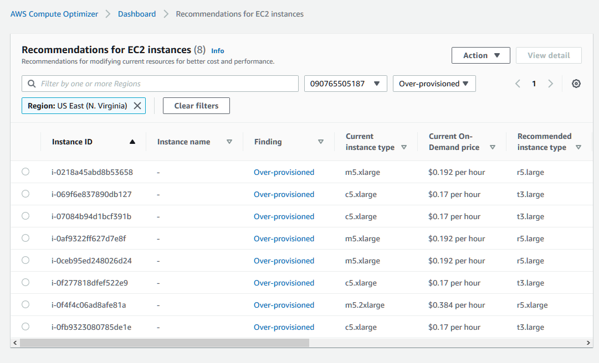

- Рекомендує оптимальний тип екземпляра, розмір екземпляра та конфігурацію групи Auto Scaling
- Аналізує шаблони робочих навантажень і дає рекомендації
- Класифікує результати для екземплярів як Under-provisioned (недостатньо потужностей), Over-provisioned (надлишок потужностей), Optimized (оптимізовано) або None (немає)

> **Нотатки:**
>
> |Номер слайда 29  
> |Нотатки для інструктора  
> |  
> |Нотатки для студента  
> AWS Compute Optimizer — це сервіс, що аналізує конфігурацію та метрики використання екземплярів EC2 і груп Auto Scaling. Він генерує рекомендації з оптимізації, щоб зменшити вартість і покращити продуктивність ваших робочих навантажень. Ви можете використовувати ці рекомендації, щоб вирішити, чи переходити на новий тип екземпляра.  
>
> Compute Optimizer використовує Amazon Machine Learning (Amazon ML) для аналізу ваших робочих навантажень. Наразі він генерує рекомендації щодо типу та розміру екземпляра EC2 для сімейств екземплярів M, C, R, T і X. Коли його активовано, Compute Optimizer аналізуватиме ваші працюючі обчислювальні ресурси AWS і почне надавати рекомендації.  
>
> Compute Optimizer класифікує свої результати для екземплярів EC2 як Under-provisioned, Over-provisioned, Optimized або None. Класифікація None може виникнути, якщо ви активували Compute Optimizer менш ніж 12 годин тому, коли екземпляр працює менш ніж 30 годин або коли тип екземпляра не підтримується Compute Optimizer.  
>
> Докладніше див. посібник користувача AWS Compute Optimizer на сторінці ресурсів вмісту вашого онлайн-курсу.

---

## Слайд 30: Практична вправа: вибір типів екземплярів (Choosing Instance Types)

- Зіставте приклади сценаріїв використання з типом екземпляра EC2, що підходить для кожного.
- Використовуйте інформацію за адресою https://aws.amazon.com/ec2/instance-types/

> **Нотатки:**
>
> |Номер слайда 30  
> |Нотатки для інструктора  
> |Необов’язково: розділіть клас на групи для групової вправи або зробіть її індивідуальною.  
> |  
> |Дайте слухачам вказівку перейти на сторінку Instance Type Details  
> |Нотатки для студента  
> Перейдіть на сторінку Instance Type Details.

---

## Слайд 31: Практична вправа: вибір типів екземплярів

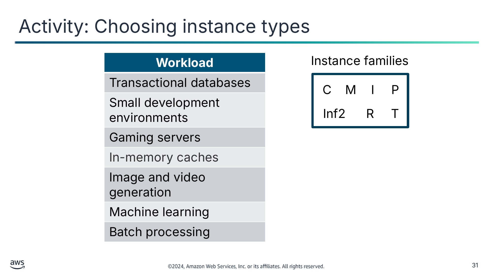

| Робоче навантаження (Workload) |
|---|
| Транзакційні бази даних |
| Малі середовища розробки |
| Ігрові сервери |
| Кеші в пам’яті |
| Генерація зображень і відео |
| Машинне навчання |
| Пакетна обробка |

<details>
<summary>Текст зі схеми</summary>

Instance families (Сімейства екземплярів)

C

M

I

P

Inf2

R

T

</details>

> **Нотатки:**
>
> |Номер слайда 31  
> |Нотатки для інструктора  
> |Підкресліть, що сторінка Instance Type Details — це інструмент. AWS рекомендує клієнтам часто переглядати її, щоб бути в курсі нових типів екземплярів, що випускаються. Можуть випускатися нові типи екземплярів, що можуть покращити ефективність і вартість наявних робочих навантажень.  
> |  
> |Нотатки для студента  
> Розгляньте кожне перелічене робоче навантаження. Оберіть сімейство екземплярів із групи сімейств екземплярів, що найкраще підходить для робочого навантаження.  
>
> AWS рекомендує клієнтам часто переглядати сторінку Instance Type Details, щоб бути в курсі нових типів екземплярів, що випускаються. Можуть випускатися нові типи екземплярів, що покращують ефективність і вартість наявних робочих навантажень.

---

## Слайд 32: Практична вправа: вибір типів екземплярів (відповіді)

| Робоче навантаження (Workload) | Сімейство типів екземплярів (Instance type family) |
|---|---|
| Транзакційні бази даних | I |
| Малі середовища розробки | T |
| Ігрові сервери | M |
| Кеші в пам’яті | R |
| Генерація зображень і відео | Inf2 |
| Машинне навчання | P |
| Пакетна обробка | C |

> **Нотатки:**
>
> |Номер слайда 32  
> |Нотатки для інструктора  
> |Сімейство I рекомендовано для сценаріїв використання транзакційних баз даних. Оберіть I3 і перейдіть до розділу сценаріїв використання. Звернути увагу на сценарій використання для транзакційних баз даних.  
> |Сімейство T рекомендовано для сценаріїв використання середовищ розробки. Оберіть T3 і перейдіть до розділу сценаріїв використання. Звернути увагу на сценарій використання для середовищ розробки.  
> |Сімейство M7g рекомендовано для сценаріїв використання ігрових серверів. Оберіть M7g і перейдіть до розділу сценаріїв використання. Звернути увагу на сценарій використання для ігрових серверів.  
> |Сімейство R рекомендовано для сценаріїв використання кешів у пам’яті. Оберіть R5 і перейдіть до розділу сценаріїв використання. Звернути увагу на сценарій використання для кешів у пам’яті.  
> |Сімейство Inf2 рекомендовано для сценаріїв використання генерації зображень і відео. Оберіть Inf2 і перейдіть до розділу сценаріїв використання. Звернути увагу на сценарій використання для генерації зображень і відео.  
> |Сімейство P рекомендовано для сценаріїв використання машинного навчання. Оберіть P3 і перейдіть до розділу сценаріїв використання. Звернути увагу на сценарій використання для машинного навчання.  
> |Сімейство C рекомендовано для сценаріїв використання пакетної обробки. Оберіть C5 і перейдіть до розділу сценаріїв використання. Звернути увагу на сценарій використання для пакетної обробки.  
> |  
> |Нотатки для студента  
> Сімейство I рекомендовано для сценаріїв використання транзакційних баз даних.  
> Сімейство T рекомендовано для сценаріїв використання середовищ розробки.  
> Сімейство M рекомендовано для сценаріїв використання ігрових серверів.  
> Сімейство R рекомендовано для сценаріїв використання кешів у пам’яті.  
> Сімейство Inf2 рекомендовано для сценаріїв використання генерації зображень і відео.  
> Сімейство P рекомендовано для сценаріїв використання машинного навчання.  
> Сімейство C рекомендовано для сценаріїв використання пакетної обробки.

---

## Слайд 33: Ключові висновки: вибір типу екземпляра EC2

- Тип екземпляра EC2 визначає конфігурацію характеристик ЦП, пам’яті, сховища та мережевої продуктивності.
- Як рекомендацію, обирайте типи екземплярів нового покоління в сімействі, оскільки вони зазвичай мають кращі  
співвідношення ціни та продуктивності.
- Використовуйте сторінку Instance Types в консолі Amazon EC2 та AWS Compute Optimizer, щоб знайти правильний тип екземпляра для вашого робочого навантаження.

> **Нотатки:**
>
> |Номер слайда 33  
> |Нотатки для інструктора  
> |  
> |Нотатки для студента

---

## Слайд 34: Додавання сховища до екземпляра Amazon EC2

Додавання обчислювального рівня за допомогою Amazon EC2

> **Нотатки:**
>
> |Номер слайда 34  
> |Нотатки для інструктора  
> |  
> |Нотатки для студента  
> Цей розділ описує різні варіанти сховищ, доступні для ваших екземплярів EC2. Він охоплює різні варіанти для вашого кореневого тому, а також томів даних.

---

## Слайд 35: Огляд сховищ Amazon EC2

| Ресурс сховища AWS EC2 (AWS EC2 storage resource) | Кореневий том (Root Volume) | Томи даних для одного екземпляра (Data volumes for a single instance) | Томи даних для даних, доступних з кількох екземплярів Linux | Томи даних для даних, доступних з кількох екземплярів Windows |
|---|---|---|---|---|
| Amazon EBS (лише на основі SSD) | Так (Yes) | Так | Ні (No) | Ні |
| Сховище екземпляра (Instance store) | Так | Так | Ні | Ні |
| Amazon Elastic File System (Amazon EFS) [Linux] | Ні | Ні | Так | Ні |
| Amazon FSx for Windows File Server | Ні | Ні | Ні | Так |

Екземпляр EC2 *завжди* матиме кореневий том і *за бажанням* може мати один чи кілька томів даних.

> **Нотатки:**
>
> |Номер слайда 35  
> |Нотатки для інструктора  
> |Знайдіть час, щоб ретельно пояснити слайди про сховище екземпляра (Instance store), Amazon Elastic Block Store (Amazon EBS), Amazon Elastic File System (Amazon EFS) та Amazon FSx for Windows File Server. Підкресліть, чим вони відрізняються за сценарієм використання. Почніть із розрізнення варіантів залежно від того, чи сценарій призначений для зберігання кореневого/завантажувального тому, чи тому даних. Потім для тому даних розрізніть сценарій використання для одного екземпляра та вимогу спільного використання кількома екземплярами.  
> |  
> |Нотатки для студента  
> Екземпляри EC2 мають чотири основні варіанти сховищ:  
> Сховище екземпляра  
> Amazon Elastic Block Store (Amazon EBS)  
> Amazon Elastic File System (Amazon EFS)  
> Amazon FSx for Windows File Server  
>
> Лише сховище екземпляра або том EBS на основі SSD можна використовувати для зберігання кореневого тому. Використовуйте сховище екземпляра, коли вам потрібен швидший обчислювальний час, а дані не потрібно постійно зберігати на томі. Якщо екземпляри на основі сховища екземпляра зупинити, усі дані на томі буде видалено. Використовуйте том Amazon EBS, якщо вам потрібно, щоб дані на томі були постійними. Ви можете зупинити й перезапустити том EBS без втрати даних на томі.  
>
> Окрім використання як кореневого тому, сховище екземпляра чи том EBS можна використовувати як том даних. Однак вони мають використовуватися одним екземпляром одночасно. Томи EBS можна від’єднувати й додавати до іншого екземпляра. У випадку тому сховища екземпляра його може використовувати лише екземпляр, з яким він було запущено.  
>
> Якщо ви хочете спільно використовувати том даних кількома екземплярами одночасно, можна використати Amazon EFS або Amazon FSx for Windows File Server. Amazon EFS надає спільну файлову систему для екземплярів Linux, а Amazon FSx — спільну файлову систему для екземплярів Microsoft Windows.  
>
> У цьому розділі ви розглянете кожен із цих варіантів.

---

## Слайд 36: Сховище екземпляра (instance store)

Сховище екземпляра надає непостійне сховище екземпляру. Том даних зберігається на тому самому фізичному сервері, де працює екземпляр.

Характеристики

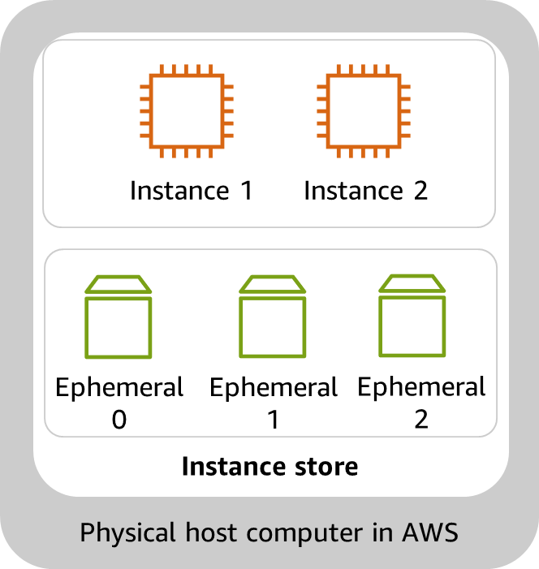

- Тимчасове блочне сховище
- Використовує HDD або SSD
- Дані сховища екземпляра втрачаються, коли екземпляр зупиняють або завершують.

Приклади сценаріїв використання

- Буфери
- Кеш
- Тимчасові дані (scratch data)

> **Нотатки:**
>
> |Номер слайда 36  
> |Нотатки для інструктора  
> |  
> |Нотатки для студента  
> Том сховища екземпляра надає тимчасове блочне сховище для вашого екземпляра. Це сховище розміщене на дисках, фізично приєднаних до комп’ютера, що розміщує працюючий екземпляр. Сховище екземпляра добре підходить для тимчасового зберігання інформації, що часто змінюється, як-от буфери, кеші, тимчасові дані та інший тимчасовий вміст.  
>
> Сховище екземпляра складається з одного чи кількох томів, що відображаються як блочні пристрої. Томи розміщені на HDD або SSD. SSD можуть бути Serial ATA SSD або Non-Volatile Memory Express (NVMe) SSD. Сховища екземпляра, що використовують NVMe, мають вищу продуктивність введення-виведення (I/O). Сховище екземпляра виділене для конкретного екземпляра, але дискова підсистема є спільною між екземплярами на хост-комп’ютері.  
>
> Тип екземпляра визначає доступні розміри для сховища екземпляра та тип апаратного забезпечення, що використовується для томів сховища екземпляра. Більшість типів екземплярів підтримують сховища екземпляра, але не всі.  
>
> Дані у сховищі екземпляра зберігаються, коли екземпляр перезавантажують, але не коли його завершують. Екземпляри на основі сховища екземпляра не можна зупинити. Їх можна лише перезавантажити чи завершити. Якщо екземпляр перезавантажується, дані у сховищі екземпляра зберігаються.  
>
> Докладніше див. тему «Amazon EC2 Instance Store» в онлайн-документації Amazon EC2.

---

## Слайд 37: Amazon EBS

Томи Amazon EBS надають мережеве постійне сховище для екземпляра EC2.

Характеристики

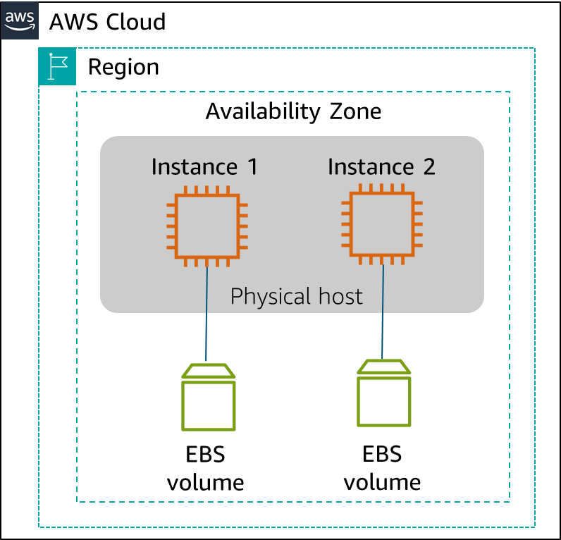

- Є постійним блочним сховищем
- Можна приєднати до будь-якого екземпляра в тій самій зоні доступності
- Використовує HDD або SSD
- Можна шифрувати
- Підтримує знімки (snapshots), що зберігаються в S3
- Дані зберігаються незалежно від життя екземпляра

Приклади сценаріїв використання

- Самостійна база даних
- Загальне зберігання даних застосунків

> **Нотатки:**
>
> |Номер слайда 37  
> |Нотатки для інструктора  
> |  
> |Нотатки для студента  
> Amazon EBS надає томи блочного сховища, подібні до зовнішнього жорсткого диска, для використання з екземплярами Amazon Elastic Compute Cloud (Amazon EC2). Томи Amazon EBS високодоступні та надійні й можуть приєднуватися через мережу до працюючих екземплярів у тій самій зоні доступності.  
>
> Томи Amazon EBS зберігаються незалежно від життя екземпляра й можуть бути зашифровані. Крім того, ви можете створити резервну копію даних на томі Amazon EBS в Amazon Simple Storage Service (Amazon S3), створивши знімок на певний момент часу (point-in-time snapshot).  
>
> Томи Amazon EBS розміщуються на HDD або SSD (Serial ATA SSD чи NVMe SSD).  
>
> Оскільки вони змонтовані на екземплярі, томи EBS можуть забезпечувати надзвичайно низьку затримку доступу. З цієї причини томи EBS можна використовувати, наприклад, для запуску бази даних на екземплярі EC2.

---

## Слайд 38: Типи томів Amazon EBS на основі SSD

Томи Amazon EBS на основі SSD підходять для сценаріїв використання, де основний акцент  
продуктивності робиться на IOPS.

| Тип тому (Volume type) | Опис (Description) | Сценарії використання (Use Cases) |
|---|---|---|
| General Purpose SSD (gp2) | Балансує ціну та продуктивність для широкого спектра робочих навантажень | • Рекомендований для більшості робочих навантажень<br>• Може бути завантажувальним томом |
| Provisioned IOPS SSD (io1) | • Найпродуктивніший том SSD<br>• Добре підходить для критично важливих робочих навантажень, робочих навантажень з низькою затримкою чи високою пропускною здатністю | • Критично важливі бізнес-застосунки, що потребують стабільної продуктивності IOPS<br>• Великі робочі навантаження баз даних<br>• Транзакційні робочі навантаження<br>• Може бути завантажувальним томом |

> **Нотатки:**
>
> |Номер слайда 38  
> |Нотатки для інструктора  
> |  
> |Нотатки для студента  
> Amazon EBS надає типи томів, що відрізняються характеристиками продуктивності та ціною, щоб підібрати продуктивність і вартість сховища до потреб різних застосунків. Вони поділяються на дві категорії: HDD і SSD.  
>
> Томи на основі SSD оптимізовані для транзакційних робочих навантажень, що передбачають часті операції читання/запису з малим розміром введення-виведення, де домінуючий атрибут продуктивності — IOPS (Input/Output Operations Per Second, кількість операцій введення-виведення на секунду).  
>
> Два типи томів Amazon на основі SSD:  
> General Purpose SSD (gp2) — цей тип тому є типом тому EBS за замовчуванням для екземплярів EC2. Ці томи підходять для низки транзакційних робочих навантажень, зокрема середовищ розробки чи тестування, інтерактивних застосунків із низькою затримкою та завантажувальних томів.  
> Provisioned IOPS SSD (io1) — цей тип тому є варіантом сховища EBS з найвищою продуктивністю. Його розроблено для критично важливих, ресурсомістких за введенням-виведенням баз даних і робочих навантажень застосунків, а також для баз даних і сховищ даних, що потребують високої пропускної здатності.  
>
> Томи Amazon EBS на основі SSD ідеально підходять як для робочих навантажень, інтенсивних за IOPS, так і для інтенсивних за пропускною здатністю, що потребують надзвичайно низької затримки.

---

## Слайд 39: Типи томів Amazon EBS на основі HDD

Томи Amazon EBS на основі HDD добре працюють, коли акцент робиться на пропускній здатності.

| Тип тому (Volume type) | Опис (Description) | Сценарії використання (Use Cases) |
|---|---|---|
| • Throughput Optimized HDD (st1)<br>• Опис | • Недорогий тип тому<br>• Призначений для робочих навантажень із частим доступом, інтенсивних за пропускною здатністю | • Потокові робочі навантаження<br>• Великі дані<br>• Сховища даних<br>• Обробка журналів<br>• Не може бути завантажувальним томом |
| Cold HDD (sc1) | • HDD-том із найнижчою вартістю<br>• Призначений для робочих навантажень із рідшим доступом | • Сховище, орієнтоване на пропускну здатність, для великих обсягів даних, до яких звертаються нечасто<br>• Сценарії використання, де важлива найнижча вартість зберігання<br>• Не може бути завантажувальним томом |

> **Нотатки:**
>
> |Номер слайда 39  
> |Нотатки для інструктора  
> |  
> |Нотатки для студента  
> Томи на основі HDD оптимізовані для великих потокових робочих навантажень, де пропускна здатність (вимірюється в МіБ/с) є кращим показником продуктивності, ніж IOPS.  
>
> Томи Amazon на основі HDD бувають двох типів:  
> Throughput Optimized HDD (st1) — цей тип тому ідеально підходить для робочих навантажень із частим доступом, інтенсивних за пропускною здатністю, з великими наборами даних і великим розміром введення-виведення.  
> Cold HDD (sc1) — цей тип тому забезпечує найнижчу вартість за ГБ серед усіх типів томів EBS. Він добре працює для робочих навантажень із рідшим доступом з великими «холодними» наборами даних.  
>
> Докладніше див. тему «Amazon EBS Volume Types» у посібнику користувача Amazon EC2.

---

## Слайд 40: Екземпляри, оптимізовані для Amazon EBS (EBS-optimized instances)

Певні типи екземплярів EC2 можуть бути оптимізовані для EBS

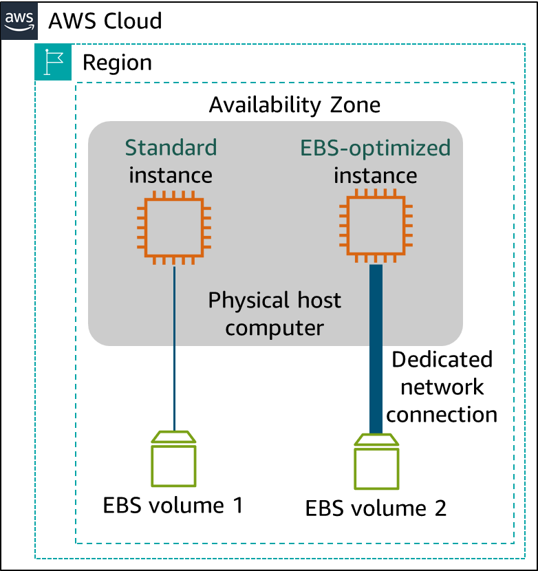

Переваги

- Забезпечує виділене мережеве з’єднання з приєднаними томами EBS.
- Підвищує продуктивність введення-виведення (I/O).
- Додаткова продуктивність досягається за використання типу екземпляра на основі Amazon EC2 Nitro System.

Використання

- Для типів екземплярів, оптимізованих для EBS, оптимізація ввімкнена за замовчуванням.
- Для інших типів екземплярів, що її підтримують, оптимізацію потрібно вмикати вручну.

> **Нотатки:**
>
> |Номер слайда 40  
> |Нотатки для інструктора  
> |  
> |Нотатки для студента  
> Опис зображення: схема двох екземплярів на одному фізичному хості, кожен приєднаний до власного тому EBS. Усі ці чотири об’єкти існують в одній зоні доступності. Другий екземпляр використовує виділене мережеве з’єднання для підключення до свого тому EBS. Кінець опису.  
> Певні типи екземплярів EC2 можна оптимізувати так, щоб збільшити доступ введення-виведення до тому EBS. Ці екземпляри називаються екземплярами, оптимізованими для Amazon EBS.  
>
> Екземпляр, оптимізований для EBS, має виділене мережеве з’єднання між собою та томом EBS. Ця оптимізація забезпечує найкращу продуктивність доступу до томів EBS, мінімізуючи конкуренцію між введенням-виведенням Amazon EBS та іншим мережевим трафіком від екземпляра. Зокрема, вона надає виділену пропускну здатність для Amazon EBS з варіантами від 425 Мбіт/с до 14 000 Мбіт/с (залежно від використовуваного типу екземпляра). Ця виділена пропускна здатність забезпечує стабільність продуктивності. Наприклад, для тому General Purpose SSD (gp2), приєднаного до екземпляра, оптимізованого для EBS, це може означати покращення на 10 відсотків порівняно з базовою продуктивністю.  
>
> Якщо тип екземпляра EC2 підтримує оптимізацію для EBS, вона автоматично вмикається, коли тип екземпляра класифіковано як оптимізований для EBS. В іншому разі потрібно вручну ввімкнути оптимізацію під час запуску екземпляра, встановивши його атрибут Amazon EBS-optimized.  
>
> Крім того, якщо тип екземпляра, оптимізований для EBS, побудований на AWS Nitro System, він може отримати додаткове підвищення продуктивності. Ця система — це набір апаратних і програмних компонентів, створених AWS, що забезпечують високу продуктивність, високу доступність, високу безпеку та можливості bare metal для усунення накладних витрат віртуалізації.  
>
> Докладніше див. тему «Amazon EBS–Optimized Instances» у посібнику користувача Amazon EC2. Посилання включено до довідкових матеріалів вашого курсу.

---

## Слайд 41: Спільні файлові системи для екземплярів EC2

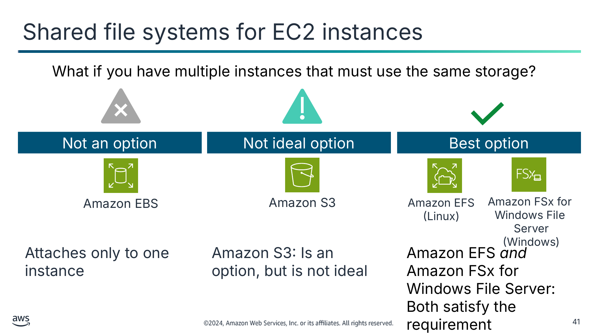

Що, якщо у вас є кілька екземплярів, які мають використовувати те саме сховище?

Not an option (Не варіант)

Not ideal option (Не ідеальний варіант)

Best option (Найкращий варіант)

Amazon EBS

Amazon S3

Amazon EFS (Linux)

Amazon FSx for

Windows File  
Server (Windows)

Attaches only to one instance (Приєднується лише до одного екземпляра)

Amazon S3: Is an option, but is not ideal (Amazon S3: є варіантом, але не ідеальним)

Amazon EFS *and* Amazon FSx for Windows File Server: Both satisfy the requirement (Amazon EFS *та* Amazon FSx for Windows File Server: обидва задовольняють вимогу)

> **Нотатки:**
>
> |Номер слайда 41  
> |Нотатки для інструктора  
> |Підкресліть той факт, що доступні варіанти сховища файлової системи залежать від операційної системи екземпляра. Для екземпляра Linux вибір — Amazon EFS. Для екземпляра Windows оберіть Amazon FSx for Windows File Server.  
> |  
> |Нотатки для студента  
> Сховище екземпляра Amazon EC2 і Amazon EBS — хороший вибір для зберігання як кореневого тому, так і тому даних для одного екземпляра. Однак що робити, якщо вам потрібно одночасно спільно використовувати дані між кількома екземплярами? Як упоратися із застосунком, що працює на кількох екземплярах і має використовувати ту саму файлову систему?  
>
> Раніше в цьому розділі ви дізналися, що том EBS має бути приєднаний лише до одного екземпляра одночасно. Тому він не може розв’язати поставлену проблему. Amazon S3 — ще один варіант, але це система об’єктного сховища, а не блочного. Тож зміни в Amazon S3 перезаписують цілі файли, а не блоки символів у файлах. Для внесення змін із високою пропускною здатністю до файлів різних розмірів файлова система працює краще, ніж система об’єктного сховища.  
>
> Ця вимога потребує продуктивності та узгодженості читання/запису мережевої файлової системи. Amazon EFS і Amazon FSx for Windows File Server надають спільну файлову систему для екземплярів Linux і екземплярів Windows. Про ці два сервіси ви дізнаєтеся далі.

---

## Слайд 42: Amazon Elastic File System (Amazon EFS)

- Надає сховище файлової системи для робочих навантажень на основі Linux.
- Повністю керована еластична файлова система
- Автоматично масштабується вгору чи вниз, коли додаються й видаляються файли
- Потужність до петабайтів
- Підтримує протоколи Network File System (NFS)
- Монтує файлову систему до екземпляра EC2
- Сумісна з усіма AMI на основі Linux для Amazon EC2

Amazon EFS

> **Нотатки:**
>
> |Номер слайда 42  
> |Нотатки для інструктора  
> |  
> |Нотатки для студента  
> Amazon EFS — це повністю кероване обслуговування, що надає сховище файлової системи для робочих навантажень на основі Linux. Доступ до файлів здійснюється через інтерфейс файлової системи (за допомогою стандартних API введення-виведення файлів операційної системи). Вони підтримують повну семантику доступу до файлової системи, як-от сильна узгодженість і блокування файлів. Amazon EFS використовує протокол Network File System (NFS) версії 4.x. Його можна використовувати з будь-якими AMI, що підтримують цей протокол.  
>
> Кілька екземплярів EC2 можуть одночасно отримувати доступ до файлової системи EFS. Тому Amazon EFS може надавати спільне джерело даних для робочих навантажень і застосунків, що працюють більш ніж на одному екземплярі Amazon EC2. Крім того, файлові системи EFS можуть автоматично масштабуватися від гігабайтів до петабайтів даних без потреби розгортати сховище.

---

## Слайд 43: Сценарії використання Amazon EFS

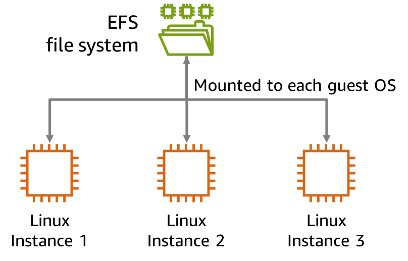

Поширені приклади робочих навантажень і застосунків для Amazon EFS включають такі:

- Домашні каталоги
- Файлова система для корпоративних застосунків
- Тестування та розробка застосунків
- Резервні копії баз даних
- Вебобслуговування та керування контентом
- Медіапроцеси
- Аналітика великих даних

Приклад команди для монтування файлової системи до кожної гостьової ОС:  
`$ sudo mount -t nfs4 mount-target-DNS:/ ~/efs-mount-point`

> **Нотатки:**
>
> |Номер слайда 43  
> |Нотатки для інструктора  
> |  
> |Нотатки для студента  
> Ви можете отримувати доступ до вашої файлової системи Amazon EFS одночасно з кількох клієнтів NFS, тож застосунки, що масштабуються за межі одного з’єднання, можуть отримувати доступ до файлової системи.  
>
> Основні сценарії використання Amazon EFS включають такі:  
> Домашні каталоги: забезпечує сховище для організацій, у яких багато користувачів мають отримувати доступ до спільних наборів даних і ділитися ними  
> Файлова система для корпоративних застосунків: забезпечує масштабованість, еластичність, доступність і довговічність, щоб бути файловим сховищем для корпоративних застосунків і застосунків, що надаються як сервіс  
> Тестування та розробка застосунків: забезпечує спільне сховище, що допомагає ділитися кодом та іншими файлами безпечним і впорядкованим способом  
> Резервні копії баз даних: можна монтувати за допомогою NFSv4 із серверів баз даних  
> Вебобслуговування та керування контентом: забезпечує довговічну файлову систему з високою пропускною здатністю для систем керування контентом, що зберігають і обслуговують інформацію для низки застосунків (як-от вебсайти, онлайн-публікації та архіви)  
> Аналітика великих даних: забезпечує масштаб і продуктивність для застосунків великих даних, що потребують високої пропускної здатності до обчислювальних вузлів, а також узгодженості «читання після запису» та файлових операцій із низькою затримкою.  
> Медіапроцеси: забезпечує сильну модель узгодженості даних, високу пропускну здатність і доступ до спільних файлів, що можуть скоротити час виконання завдань відеомонтажу, студійного виробництва, обробки мовлення, звукового дизайну та рендерингу. Водночас вона консолідує кілька локальних файлових сховищ в одному місці для всіх користувачів.  
>
> Докладніше див. посібник користувача Amazon EFS на сторінці ресурсів вмісту вашого онлайн-курсу.

---

## Слайд 44: Amazon EFS зі сховищем класу Standard

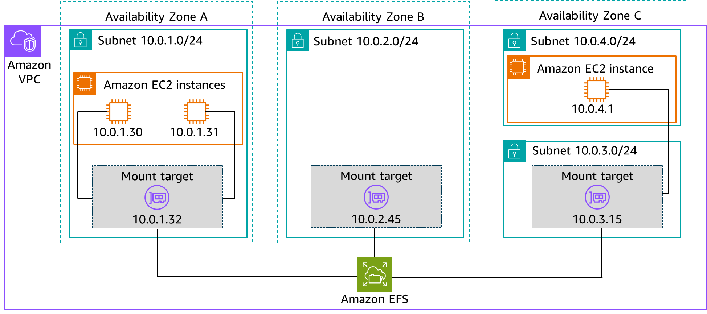

> **Нотатки:**
>
> |Номер слайда 44  
> |Нотатки для інструктора  
> |Опишіть схему як таку, що показує архітектуру високодоступної файлової системи з підтримкою кількох зон доступності. Поясніть, що кожна зона доступності має власну точку монтування (mount target) — мережеву адресу, що дозволяє екземплярам підключатися до файлової системи. Підкресліть, що файлова система реплікується між кількома зонами доступності для забезпечення надлишковості даних і високої доступності. Обговоріть роль точок монтування в забезпеченні підключення екземплярів до файлової системи у відповідних зонах доступності. Поясніть, що кожна точка монтування має пов’язану IP-адресу, і як вона використовується.  
> |  
> |Нотатки для студента  
> Опис зображення: схема файлової системи Amazon EFS зі сховищем класу Standard. Amazon EFS підтримує екземпляри в кількох зонах доступності. Кожна зона доступності має точку монтування з IP-адресою, через яку файлова система може підключатися до екземплярів. Кінець опису.  
>
> Екземпляри Amazon EC2 та інші обчислювальні екземпляри AWS, що працюють у кількох зонах доступності в тому самому регіоні AWS, можуть отримувати доступ до файлової системи, щоб багато користувачів могли отримувати доступ до спільного джерела даних і ділитися ним.  
>
> Щоб отримати доступ до вашої файлової системи Amazon EFS у віртуальній приватній хмарі (VPC), ви створюєте одну чи кілька точок монтування (mount targets) у VPC.  
> Для файлових систем, що використовують класи зберігання Standard, можна створити точку монтування в кожній зоні доступності в регіоні AWS.  
> Для файлових систем, що використовують класи зберігання One Zone, можна створити лише одну точку монтування, розташовану в тій самій зоні доступності, що й файлова система.  
>
> Використовуйте Amazon EFS із файловою системою класу зберігання Standard, якщо до ваших даних активно звертаються й вони потребують найвищої довговічності та доступності. Для даних, до яких звертаються рідше й які не потребують найвищих рівнів довговічності та доступності, використовуйте класи зберігання One Zone. Для робочих навантажень, що не потребують стійкості Multi-AZ, файлова система зі сховищем One Zone може коштувати на 47 відсотків дешевше порівняно з файловими системами, що використовують класи зберігання Standard.  
>
> Докладніше див. «EFS storage classes» на сторінці ресурсів вмісту вашого онлайн-курсу.  
>
> Точка монтування надає IP-адресу для кінцевої точки NFSv4, яку ви використовуєте для монтування файлової системи Amazon EFS. Ви монтуєте свою файлову систему, використовуючи її DNS-ім’я, що розв’язується в IP-адресу точки монтування EFS у тій самій зоні доступності, що й ваш екземпляр EC2. Ви можете створити одну точку монтування в кожній зоні доступності в регіоні AWS. Якщо в зоні доступності у вашій VPC кілька підмереж, ви створюєте точку монтування в одній із підмереж. Тоді всі екземпляри EC2 у цій зоні доступності спільно використовують цю точку монтування.  
>
> Цей приклад показує кілька екземплярів EC2, що отримують доступ до файлової системи Amazon EFS, налаштованої з класами зберігання Standard, з кількох зон доступності в регіоні AWS.  
>   
> У цьому прикладі VPC має три зони доступності. Оскільки файлова система використовує класи зберігання Standard, у кожній зоні доступності створено точку монтування. Ми рекомендуємо отримувати доступ до файлової системи з точки монтування в тій самій зоні доступності з міркувань продуктивності та вартості. Одна із зон доступності має дві підмережі. Однак точку монтування створено лише в одній з підмереж.  
>
> Докладніше див. «Using the EFS mount helper to mount EFS file systems» і «Mounting on Amazon EC2 Linux instances using the EFS mount helper».

---

## Слайд 45: Amazon EFS зі сховищем класу One Zone

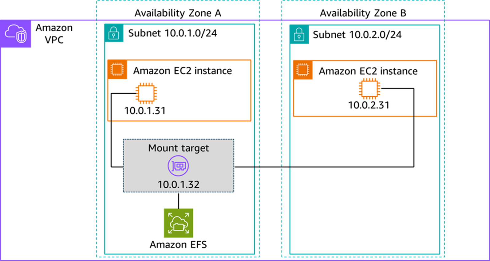

> **Нотатки:**
>
> |Номер слайда 45  
> |Нотатки для інструктора  
> |  
> |Нотатки для студента  
> Опис зображення: схема файлової системи Amazon EFS зі сховищем класу One Zone. Amazon EFS підтримує екземпляри в кількох зонах доступності. Кожна зона доступності використовує ту саму точку монтування в зоні доступності A. Точка монтування має IP-адресу, через яку екземпляри. Кінець опису.  
>
> Цей приклад показує кілька екземплярів EC2, що отримують доступ до файлової системи Amazon EFS зі сховищем One Zone з різних зон доступності в регіоні AWS.  
>
> На цій ілюстрації VPC має дві зони доступності, у кожній по одній підмережі. Файлова система використовує класи зберігання One Zone, тож вона може мати лише одну точку монтування. Для кращої продуктивності та вартості ми рекомендуємо отримувати доступ до файлової системи з точки монтування в тій самій зоні доступності, що й екземпляр EC2, на якому ви її монтуєте.  
>
> У цьому прикладі екземпляр EC2 у зоні доступності us-west-2c платитиме за доступ до даних EC2 за звернення до точки монтування в іншій зоні доступності.  
>
> Типовий сценарій використання Amazon EFS із класом зберігання One Zone — для даних із частим доступом, що не потребують найвищих рівнів довговічності та доступності. Прикладом може бути вебсайт, що розміщує сторінки блогу.  
>
> Докладніше див. «Using the EFS mount helper to mount EFS file systems» і «Mounting on Amazon EC2 Linux instances using the EFS mount helper».

---

## Слайд 46: Amazon FSx for Windows File Server

- Надає повністю кероване сховище спільної файлової системи для екземплярів EC2 з Microsoft Windows.
- Нативна сумісність з Microsoft Windows
- New Technology File System (NTFS)
- Використовує нативний протокол Server Message Block (SMB) версій від 2.0 до 3.1.1
- Простори імен Distributed File System (DFS) і реплікація DFS
- Інтегрується з Microsoft Active Directory і підтримує списки контролю доступу (ACL) Windows
- Підтримується високопродуктивним сховищем SSD

Amazon FSx for Windows File Server

> **Нотатки:**
>
> |Номер слайда 46  
> |Нотатки для інструктора  
> |  
> |Нотатки для студента  
> Якщо вам потрібне сховище на основі файлової системи для екземплярів EC2 з Microsoft Windows, Amazon FSx for Windows File Server надає повністю керовані файлові сервери Windows, що підтримуються повністю нативною файловою системою Windows. Він побудований на Microsoft Windows Server і має нативну підтримку функцій і протоколів файлової системи Windows, зокрема таких:  
> New Technology File System (NTFS) — файлова система серверів Windows за замовчуванням  
> Server Message Block (SMB) — відкритий стандартний протокол для доступу до файлового сховища через мережу  
> Distributed File System (DFS) — сервіс, що допомагає організувати кілька розподілених спільних ресурсів SMB у розподілену файлову систему  
> Microsoft Active Directory — каталогова служба Microsoft, що адмініструє та організовує корпоративні ресурси (зокрема користувачів, групи та мережеві ресурси)  
>
> Amazon FSx використовує сховище SSD для забезпечення швидкої продуктивності, високих рівнів пропускної здатності та IOPS і низьких затримок. Він також зменшує адміністративні накладні витрати на налаштування та розгортання файлових серверів і томів сховищ.

---

## Слайд 47: Сценарії використання Amazon FSx for Windows File Server

- Домашні каталоги
- Робочі навантаження застосунків за підходом lift-and-shift
- Медіа- та розважальні процеси
- Аналітика даних
- Вебобслуговування та керування контентом
- Середовища розробки програмного забезпечення

> **Нотатки:**
>
> |Номер слайда 47  
> |Нотатки для інструктора  
> |  
> |Нотатки для студента  
> Сценарії використання Amazon FSx for Windows File Server (FSx) включають такі робочі навантаження Microsoft Windows:  
> Домашні каталоги: створіть файлову систему, до якої можуть отримувати доступ сотні тисяч користувачів, і встановлюйте дозволи на рівні файлу чи папки.  
> Застосунки за підходом lift-and-shift: вона надає повністю керовані нативні файлові спільні ресурси Windows із такими функціями, як інтеграція з Microsoft Active Directory та автоматичні резервні копії.  
> Медіа- та розважальні процеси: медіапроцеси — як-от транскодування, обробка та потокова передача медіа — часто залежать від спільного файлового сховища Windows зі стабільною продуктивністю. FSx for Windows File Server надає вам спільну файлову систему з високою пропускною здатністю та низькими затримками, що потрібні цим робочим навантаженням Windows.  
> Аналітика даних: надаючи масштабовані файлові системи з високою пропускною здатністю та низькими затримками, FSx for Windows File Server допомагає запускати аналітичні робочі навантаження з інтенсивною обробкою даних.  
> Вебобслуговування та керування контентом: кільком веб- чи контент-серверам зазвичай потрібен доступ до тих самих файлів. FSx for Windows File Server надає файлову систему, до якої можна отримувати доступ одночасно з тисяч екземплярів.  
> Середовища розробки програмного забезпечення: FSx for Windows File Server дає змогу перейти до розробки в хмарі без змін у ваших процесах розробки, надаючи спільне файлове сховище, до якого можуть отримувати доступ ваші розробники та їхні середовища.  
>
> Докладніше див. посібник користувача Amazon FSx for Windows File Server.

---

## Слайд 48: Ключові висновки: додавання сховища до екземпляра Amazon EC2

- Варіанти сховищ для екземплярів EC2 включають сховище екземпляра, Amazon EBS, Amazon EFS та Amazon FSx for Windows File Server.
- Для кореневого тому використовуйте сховище екземпляра або Amazon EBS на основі SSD.
- Для тому даних, що обслуговує лише один екземпляр, використовуйте сховище екземпляра або сховище Amazon EBS.
- Для тому даних, що обслуговує кілька екземплярів Linux, використовуйте Amazon EFS.
- Для тому даних, що обслуговує кілька екземплярів Microsoft Windows, використовуйте Amazon FSx for Windows File Server.

> **Нотатки:**
>
> |Номер слайда 48  
> |Нотатки для інструктора  
> |  
> |Нотатки для студента

---

## Слайд 49: Покрокова лабораторна робота: вступ до Amazon EFS (Amazon EFS lab)

> **Нотатки:**
>
> |Номер слайда 49  
> |Нотатки для інструктора  
> |  
> |Нотатки для студента  
> Зараз ви виконаєте лабораторну роботу. Наступні слайди підсумовують, що ви робитимете в лабораторній роботі, а докладні інструкції ви знайдете в лабораторному середовищі.

---

## Слайд 50: Завдання лабораторної роботи «Amazon EFS»:

- У цій лабораторній роботі ви виконаєте такі основні завдання:
  - Увійдіть в AWS Management Console
  - Створіть файлову систему Amazon EFS
  - Увійдіть в екземпляр Amazon Elastic Compute Cloud (Amazon EC2) під керуванням Amazon Linux
  - Змонтуйте вашу файлову систему до вашого екземпляра EC2
  - Дослідіть і відстежуйте продуктивність вашої файлової системи

> **Нотатки:**
>
> |Номер слайда 50  
> |Нотатки для інструктора  
> |<Add directions to find the lab guide information.>  
> |  
> |Нотатки для студента  
> Отримайте доступ до лабораторного середовища через ваш онлайн-курс, щоб дізнатися додаткові подробиці та виконати лабораторну роботу.

---

## Слайд 51: Підсумки лабораторної роботи: Amazon EFS

- Для екземплярів, що підключаються до файлової системи EFS, де вони повинні розташовуватися відносно файлової системи EFS?
- Який порт ви додали до вхідних правил групи безпеки точки монтування?

> **Нотатки:**
>
> |Номер слайда 51  
> |Нотатки для інструктора  
> |Відповідні архітектурні схеми «до» та «після» включено до інструкцій кожної лабораторної роботи. Вам може бути корисно відкрити схеми лабораторної роботи під час підбиття підсумків цієї лабораторної роботи.  
> |Запропоновані відповіді на запитання 1: для екземплярів, що підключаються до файлової системи EFS, де вони повинні розташовуватися відносно файлової системи EFS?  
> |  
> |Файлові системи EFS можна монтувати до кількох екземплярів EC2, що працюють у різних зонах доступності, але вони повинні бути в тому самому регіоні. Також файлові системи можна монтувати на екземплярах лише в одній VPC одночасно.  
> |  
> |Запропоновані відповіді на запитання 2: який порт ви додали до вхідних правил групи безпеки точки монтування?  
> |  
> |Група безпеки, яку ви пов’язуєте з точкою монтування, повинна дозволяти вхідний доступ за TCP на порту 2049 для Network File System (NFS).  
> |  
> |Нотатки для студента  
> Ваш інструктор може розглянути ці запитання з вами, або ви можете розглянути їх самостійно. Скористайтеся цією нагодою, щоб поглибити своє мислення щодо завдань, які ви виконували під час лабораторної роботи.

---

## Слайд 52: Інші міркування щодо конфігурації EC2

Додавання обчислювального рівня за допомогою Amazon EC2

> **Нотатки:**
>
> |Номер слайда 52  
> |Нотатки для інструктора  
> |  
> |Нотатки для студента  
> Цей розділ охоплює інші варіанти конфігурації EC2. Він охоплює використання даних користувача (user data) для запуску ініціалізаційних скриптів. Він також охоплює стратегії розгортання образів Amazon Machine Image (AMI) і групи розміщення (placement groups) на високому рівні.

---

## Слайд 53: Дані користувача екземпляра EC2 (user data)

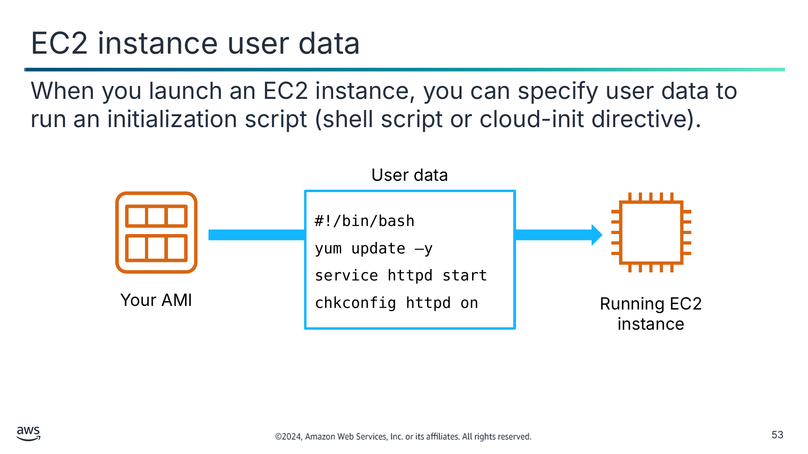

Коли ви запускаєте екземпляр EC2, ви можете вказати дані користувача для запуску ініціалізаційного скрипта (скрипта оболонки або директиви cloud-init).

<details>
<summary>Текст зі схеми</summary>

User data (Дані користувача)

```
#!/bin/bash
yum update –y
service httpd start
chkconfig httpd on
```

Your AMI (Ваш AMI)

Running EC2 instance (Працюючий екземпляр EC2)

</details>

> **Нотатки:**
>
> |Номер слайда 53  
> |Нотатки для інструктора  
> |Поясніть слухачам, як потрібно будувати скрипт і що станеться, якщо вони не напишуть правильний скрипт.  
> |  
> |Нотатки для студента  
> Коли ви запускаєте екземпляр EC2, ви маєте змогу передати дані користувача операційній системі екземпляра. Дані користувача дають змогу надати скрипт, який можна використати для ініціалізації. Наприклад, ви можете використати дані користувача для встановлення виправлень і оновлення програмного забезпечення, встановленого на екземплярі з AMI, отримання й встановлення ключів ліцензій програмного забезпечення або встановлення додаткового програмного забезпечення.  
>
> Дані користувача реалізуються як скрипт, що містить команди оболонки чи директиви cloud-init. Він запускається з правами root чи адміністратора після старту екземпляра, але до того, як він стане доступним у мережі. На схемі даних користувача надається скрипт даних користувача для виконання таких завдань під час запуску екземпляра:  
> Оновити всі пакети, встановлені на екземплярі.  
> Запустити встановлений вебсервер Apache HTTP.  
> Налаштувати вебсервер HTTP на автоматичний запуск під час завантаження екземпляра.  
>
> Пакет cloud-init — це застосунок із відкритим кодом. Він використовується для початкового завантаження (bootstrap) екземплярів Linux у середовищах хмарних обчислень, як-от Amazon EC2. Amazon Linux та багато інших варіантів Linux (як-от Ubuntu) містять версію cloud-init. Пакет cloud-init налаштовує певні аспекти нового екземпляра Amazon Linux під час його запуску, навіть якщо ви спеціально не додаєте їх до скриптів даних користувача. Найпомітніше, він налаштовує файл .ssh/authorized_keys для ec2-user, щоб ви могли входити з вашим власним закритим ключем. Однак ви також можете вказати власні директиви користувача cloud-init, додавши їх як директиви даних користувача. Подробиці, зокрема приклади директив cloud-init, можна знайти в документації «Running Commands on Your Linux Instance at Launch».  
>
> Коли скрипт даних користувача виконується, він створює повідомлення у файлі журналу, розташованому в /var/log/cloud-init-output.log на екземплярі Linux. Для екземпляра Microsoft Windows файл журналу розташований у C:\ProgramData\Amazon\EC2-Windows\Launch\Log\UserdataExecution.log.  
>
> На екземплярах Microsoft Windows дані користувача обробляються інструментами EC2Config або EC2Launch, що включають скрипти Windows PowerShell. Windows 2016 та новіші версії Windows включають EC2Launch. Старіші версії Windows включають EC2Config.

---

## Слайд 54: Отримання метаданих екземпляра (instance metadata)

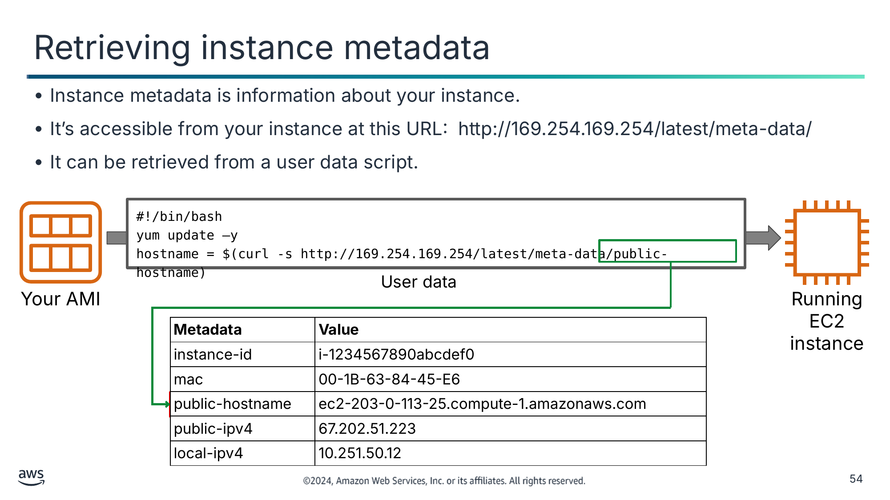

- Метадані екземпляра — це інформація про ваш екземпляр.
- Вони доступні з вашого екземпляра за такою URL-адресою:  http://169.254.169.254/latest/meta-data/
- Їх можна отримати зі скрипта даних користувача.

| Метадані (Metadata) | Значення (Value) |
|---|---|
| instance-id | i-1234567890abcdef0 |
| mac | 00-1B-63-84-45-E6 |
| public-hostname | ec2-203-0-113-25.compute-1.amazonaws.com |
| public-ipv4 | 67.202.51.223 |
| local-ipv4 | 10.251.50.12 |

<details>
<summary>Текст зі схеми</summary>

```
#!/bin/bash
yum update –y
hostname = $(curl -s http://169.254.169.254/latest/meta-data/public-hostname)
```

Your AMI (Ваш AMI)

Running EC2 instance (Працюючий екземпляр EC2)

User data (Дані користувача)

</details>

> **Нотатки:**
>
> |Номер слайда 54  
> |Нотатки для інструктора  
> |Поясніть, що одна з ключових переваг метаданих екземпляра — їхня простота. Ви можете отримати метадані, просто виконавши запит HTTP до певної URL-адреси. URL-адреса забезпечує стандартизований спосіб доступу до метаданих.  
> |  
> |Нотатки для студента  
> Щоб дані користувача завершили запуск нового екземпляра EC2, їм може знадобитися переглянути метадані екземпляра. Метадані екземпляра — це дані про ваш екземпляр. Наприклад, даним користувача може знадобитися дізнатися й поділитися публічною IP-адресою, ім’ям хоста чи адресою керування доступом до середовища (MAC) нового екземпляра, щоб завершити запуск. Сервіс метаданих екземпляра (Instance Metadata Service) може надати цю інформацію.  
>
> Зокрема, ви можете отримати інформацію про метадані зі свого працюючого екземпляра, звернувшись за такою URL-адресою: http://169.254.169.254/latest/meta-data/. IP-адреса 169.254.169.254 — це локальна адреса зв’язку (link-local), і вона дійсна лише з екземпляра.  
> Метадані екземпляра надають значну частину тієї самої інформації про працюючий екземпляр, яку можна знайти в AWS Management Console. Наприклад, ви можете дізнатися публічну IP-адресу, приватну IP-адресу, публічне ім’я хоста, ідентифікатор екземпляра, групи безпеки, регіон, зону доступності тощо. Ви можете навіть отримати доступ до даних користувача, указаних під час запуску екземпляра, звернувшись за такою URL-адресою: http://169.254.169.254/latest/user-data.

---

## Слайд 55: Робота з даними користувача на працюючих екземплярах

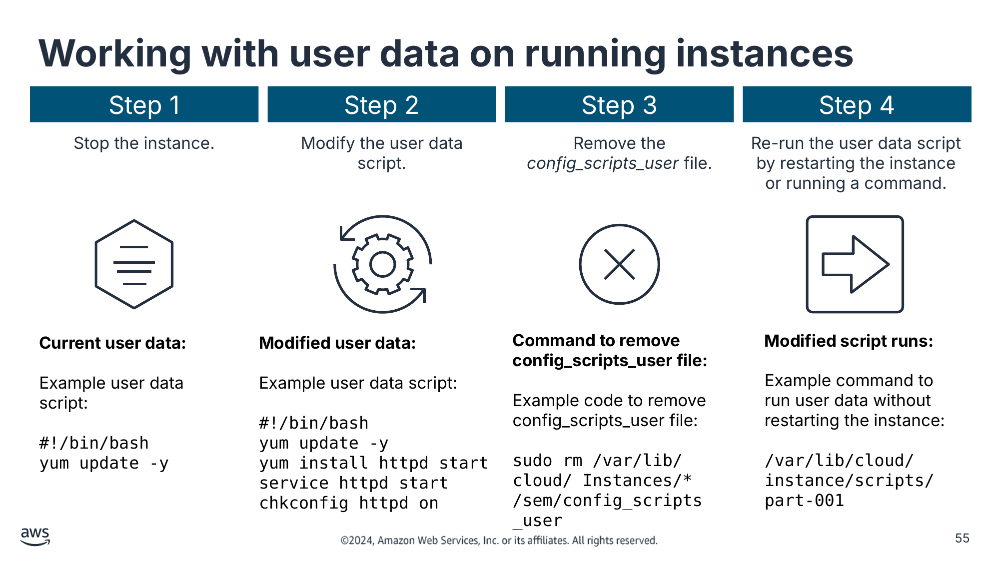

Step 1 (Крок 1)

Step 2 (Крок 2)

Step 3 (Крок 3)

Step 4 (Крок 4)

Stop the instance. (Зупиніть екземпляр.)

Modify the user data script. (Змініть скрипт даних користувача.)

Remove the *config_scripts_user* file. (Видаліть файл *config_scripts_user*.)

Re-run the user data script by restarting the instance or running a command. (Повторно запустіть скрипт даних користувача, перезапустивши екземпляр або виконавши команду.)

**Current user data: (Поточні дані користувача:)**

Example user data script: (Приклад скрипта даних користувача:)

`#!/bin/bash`

`yum update -y`

```
Modified user data: 

Example user data script:

#!/bin/bash
yum update -y
yum install httpd start
service httpd start
chkconfig httpd on
```

**Command to remove config_scripts_user file: (Команда для видалення файлу config_scripts_user:)**

Example code to remove config_scripts_user file: (Приклад коду для видалення файлу config_scripts_user:)

`sudo rm /var/lib/`

`cloud/ Instances/* /sem/config_scripts`

`_user`

**Modified script runs: (Змінений скрипт виконується:)**

Example command to run user data without restarting the instance: (Приклад команди для запуску даних користувача без перезапуску екземпляра:)

`/var/lib/cloud/`

`instance/scripts/`

`part-001`

> **Нотатки:**
>
> |Номер слайда 55  
> |Нотатки для інструктора  
> |  
> |Нотатки для студента  
> Коли у вас є працюючий екземпляр, вам усе одно може знадобитися працювати з даними користувача цього екземпляра. Наприклад, може бути так, що деякі команди скрипта даних користувача не були включені під час запуску екземпляра. Або ж сценарій використання екземпляра змінився, і для належного переналаштування екземпляра потрібно виконати додаткові команди. У таких ситуаціях ви можете відредагувати скрипт даних користувача.  
>
> Тому важливо розуміти, що скрипт даних користувача виконується лише під час першого запуску екземпляра. Щоб успішно змінити дані користувача так, щоб змінений скрипт знову виконувався на вашому екземплярі, потрібно виконати чотири кроки.  
>
> Крок 1: спочатку потрібно зупинити екземпляр.  
> Крок 2: далі ви можете перейти на сторінку редагування даних користувача, щоб змінити дані користувача. (Навігація: оберіть ваш екземпляр > Actions > Instance Settings > Edit User Data)  
> Крок 3: потім потрібно видалити файл config_scripts_user. Це не можна зробити в інтерфейсі користувача AWS Management Console. Щоб видалити файл config_scripts_user, потрібно віддалено підключитися до екземпляра через SSH або SSM і виконати таку команду: sudo rm /var/lib/cloud/instances/*/sem/config_scripts_user  
> Крок 4: нарешті, є два варіанти повторного запуску скрипта даних користувача:  
> Ви можете перезапустити екземпляр. Після перезапуску екземпляра дані користувача почнуть виконуватися.  
> Ви можете виконати команду /var/lib/cloud/instance/scripts/part-001, щоб повторно запустити скрипт даних користувача без перезапуску екземпляра.  
>
> ВАЖЛИВО: якщо ви пропустите крок 3, ваш змінений скрипт даних користувача не виконуватиметься.

---

## Слайд 56: Найкращі практики ручного виконання команд

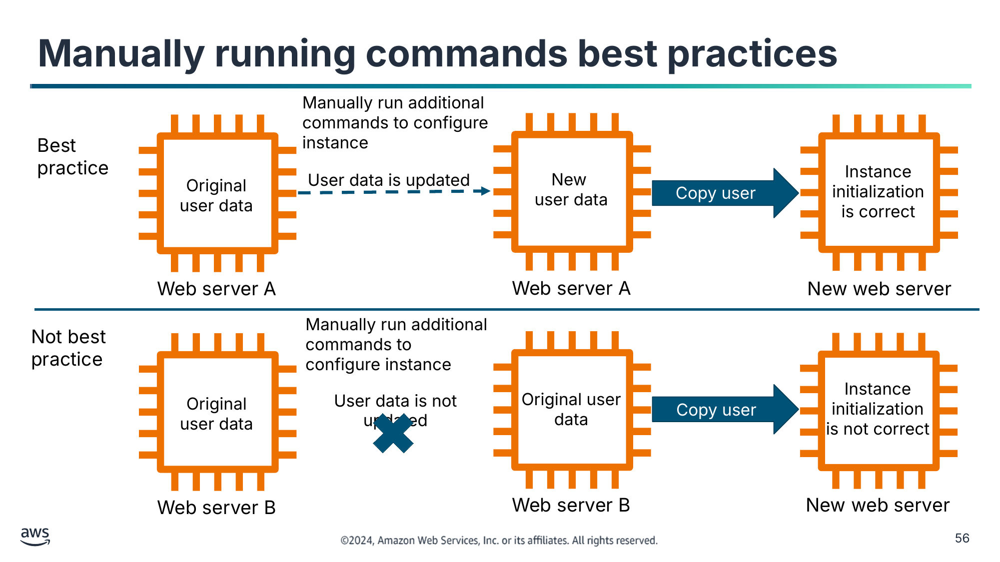

<details>
<summary>Текст зі схеми</summary>

Manually run additional commands to configure instance (Вручну виконайте додаткові команди для налаштування екземпляра)

Original user data (Початкові дані користувача)

New

user data (Нові дані користувача)

Instance initialization is correct (Ініціалізація екземпляра коректна)

Best practice (Найкраща практика)

Copy user data (Скопіювати дані користувача)

Web server A (Вебсервер A)

Web server A

New web server (Новий вебсервер)

User data is updated (Дані користувача оновлено)

Manually run additional commands to configure instance

Not best practice (Не найкраща практика)

Original user data

Original user data

Instance initialization is not correct (Ініціалізація екземпляра некоректна)

Copy user data

Web server B (Вебсервер B)

Web server B

New web server

User data is not updated (Дані користувача не оновлено)

</details>

> **Нотатки:**
>
> |Номер слайда 56  
> |Нотатки для інструктора  
> |  
> |Нотатки для студента  
> Ви можете запитати, чому ми маємо докладати всіх зусиль, щоб повторно запускати скрипт даних користувача? Чому б просто не виконати вручну потрібні команди? Чи запускати додаткові команди повторним запуском скрипта даних користувача, чи вручну — необов’язково. Якщо ви таки виконуєте додаткові команди вручну для налаштування екземпляра, найкраща практика — оновити скрипт даних користувача. Причини цього такі:  
> Ви можете підтримувати запис конфігурації екземпляра. Ви можете розглядати це як вид контролю версій.  
> Ви можете скопіювати дані користувача з одного екземпляра на новий екземпляр, який ви запускаєте й який потребує тих самих конфігурацій.  
>
> На схемі найкращих практик Вебсервер A було запущено зі скриптом даних користувача. Пізніше екземпляр потребував виконання додаткових команд для його налаштування. Додаткові команди було виконано вручну. Потім скрипт даних користувача екземпляра було оновлено, щоб зберегти запис конфігурації екземпляра. Коли вам потрібен новий вебсервер із тими самими конфігураціями, ви можете скопіювати дані користувача з Вебсервера A на новий екземпляр.  
>
> На схемі не найкращих практик Вебсервер B було запущено зі скриптом даних користувача. Пізніше екземпляр потребував виконання додаткових команд для його налаштування. Додаткові команди було виконано вручну. Однак скрипт даних користувача екземпляра не було оновлено, щоб зберегти запис нової конфігурації екземпляра. Він усе ще має початковий скрипт даних користувача. Тому копіювання даних користувача з Вебсервера B буде недостатньо для запуску екземпляра з оновленими конфігураціями.

---

## Слайд 57: Моделі розгортання AMI (AMI deployment models)

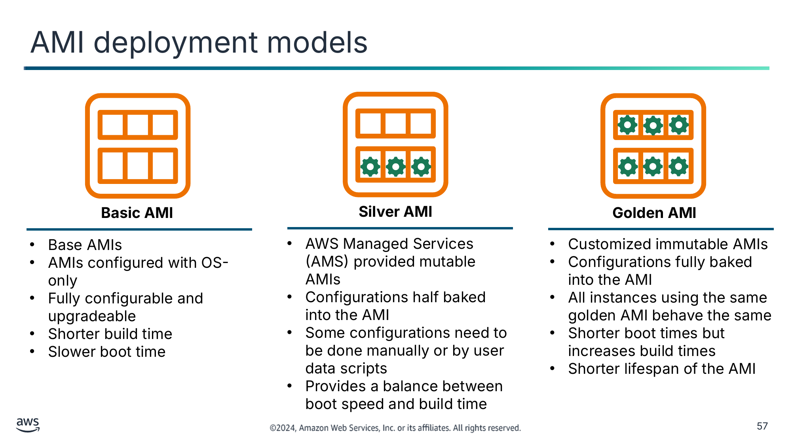

**Basic AMI (Базовий AMI)**

**Silver AMI (Срібний AMI)**

**Golden AMI («Золотий» AMI)**

- Базові AMI
- AMI, налаштовані лише з ОС
- Повністю настроювані та оновлювані
- Коротший час побудови
- Повільніше завантаження

- AMI із можливістю змін (mutable), надані AWS Managed Services (AMS)
- Конфігурації наполовину «запечені» в AMI
- Деякі конфігурації потрібно виконувати вручну або за допомогою скриптів даних користувача
- Забезпечує баланс між швидкістю завантаження та часом побудови

- Налаштовані незмінні (immutable) AMI
- Конфігурації повністю «запечені» в AMI
- Усі екземпляри, що використовують той самий «золотий» AMI, поводяться однаково
- Коротший час завантаження, але більший час побудови
- Коротший термін життя AMI

> **Нотатки:**
>
> |Номер слайда 57  
> |Нотатки для інструктора  
> |  
> |Нотатки для студента  
> Розгортаючи екземпляри, слід враховувати конфігурацію та налаштування, які мають бути включені до ваших AMI. Існують три основні моделі AMI, які можна використати для ухвалення цих рішень: базові AMI, срібні AMI та «золоті» AMI.  
>
> Модель, яку ви оберете, може впливати на те, як розгортаються такі конфігурації:  
> Оновлення безпеки  
> Нові версії ваших застосунків  
> Зміни конфігурації застосунків  
> Оновлення залежностей  
>
> Модель базового AMI — це ваш базовий AMI. Це AMI із конфігурацією лише з ОС. За цієї моделі потрібно налаштувати екземпляр відповідно до ваших вимог. Це можна зробити вручну або за допомогою скриптів даних користувача. Цей підхід повністю настроюваний і оновлюваний з часом та скорочує час побудови. Однак він робить ваші екземпляри EC2 повільними під час завантаження, оскільки всі потрібні встановлення та конфігурації мають виконуватися під час завантаження. Цю модель розгортання AMI можна використовувати як базовий AMI, з якого ви створюєте срібні чи «золоті» AMI.  
>
> Срібний AMI — це модель зі змінним вмістом (mutable). Ця модель — суміш ручного поширення оновлень і використання інфраструктури як коду для запуску вашого екземпляра. Попередньо встановлюється лише необхідне програмне забезпечення й утиліти, що веде до довшого терміну придатності AMI. AWS Managed Services (AMS) надає AMI для цієї моделі розгортання. Цей підхід забезпечує баланс між швидкістю завантаження та часом побудови. Відкат стає простішим. Ця модель розгортання AMI — хороший вибір, якщо ви хочете запускати екземпляри з AMI, що може використовуватися для різних цілей. За цієї моделі розгортання всі екземпляри матимуть попередньо встановлене те саме необхідне програмне забезпечення й утиліти. Однак будуть ручні конфігурації, що можуть відрізнятися від екземпляра до екземпляра.  
>
> «Золотий» AMI — це незмінна модель (immutable). Вона використовує AMI, який ви налаштували й кастомізували так, щоб він поводився так, як ви хочете, щоб поводилися всі ваші екземпляри застосунків. Наприклад, екземпляри, створені з цього «золотого» AMI, самостійно приєднуватимуться до правильного домену й DNS, самоналаштовуватимуться, перезавантажуватимуться та запускатимуть усі потрібні системи. Коли ви хочете оновити свої екземпляри застосунків, ви заново створюєте «золотий» AMI і розгортаєте з ним усі нові екземпляри застосунків. З «золотими» AMI застосунки та всі залежності попередньо встановлено, що скорочує час завантаження, але збільшує час побудови. «Золоті» AMI зазвичай мають коротший термін життя. Продумайте свою стратегію відкату. Ця модель розгортання AMI — хороший вибір, якщо у вас є екземпляри, що мають виконувати ті самі функції й поводитися однаково. Для цієї моделі розгортання не буде змін конфігурації від одного екземпляра до іншого.  
>
> Докладніше див. «Application Maintenance Strategies» і «Amazon EC2 instance mutability in AMS» на сторінці ресурсів вмісту вашого онлайн-курсу.

---

## Слайд 58: Групи розміщення (placement groups)

Групи розміщення дають вам контроль над тим, де в зоні доступності працює група взаємозалежних екземплярів.

Переваги розміщення (Placement benefits)

Обмеження розміщення (Placement limitations)

Стратегії розміщення (Placement strategies)

- Підвищують мережеву продуктивність між екземплярами.
- Зменшують корельовані чи одночасні збої.

- Екземпляр можна запустити лише в одній групі розміщення одночасно.
- Екземпляри з орендою хоста (tenancy of host) не можна запустити в групі розміщення.

- Cluster
- Partition
- Spread

> **Нотатки:**
>
> |Номер слайда 58  
> |Нотатки для інструктора  
> |  
> |Нотатки для студента  
> Коли ви запускаєте новий екземпляр EC2, поведінка Amazon EC2 за замовчуванням — мінімізувати корельовані збої, розподіляючи нові екземпляри по базовому апаратному забезпеченню. Ви можете використовувати групи розміщення, щоб впливати на розміщення групи взаємозалежних екземплярів так, щоб вони відповідали потребам вашого робочого навантаження.  
>
> Деякі ключові переваги використання груп розміщення: вони можуть підвищити мережеву продуктивність між вашими екземплярами. Також вони можуть зменшити корельовані чи одночасні збої.  
>
> Перш ніж використовувати групи розміщення, пам’ятайте про такі обмеження:  
> Екземпляр можна запустити лише в одній групі розміщення одночасно.  
> Екземпляри з орендою хоста не можна запустити в групі розміщення.  
>
> Залежно від типу робочого навантаження, ви можете створити групу розміщення за допомогою однієї з таких стратегій розміщення:  
> Cluster: упаковує екземпляри близько один до одного всередині зони доступності. Ця стратегія допомагає робочим навантаженням досягти мережевої продуктивності з низькою затримкою.  
> Partition: розподіляє ваші екземпляри між логічними розділами так, щоб групи екземплярів в одному розділі не ділили базове апаратне забезпечення з групами екземплярів у різних розділах.  
> Spread: суворо розміщує невелику групу екземплярів на окремому базовому апаратному забезпеченні, щоб зменшити корельовані збої.

---

## Слайд 59: Демонстрація: налаштування екземпляра EC2 за допомогою даних користувача (Configuring an EC2 Instance with User Data)

- Ця демонстрація використовує Amazon EC2.
- У цій демонстрації ви побачите, як виконати таке:
  - Створити екземпляр EC2
  - Налаштувати дані користувача
  - Протестувати конфігурацію

> **Нотатки:**
>
> |Номер слайда 59  
> |Нотатки для інструктора  
> |Ця демонстрація — файл .mp4 із субтитрами. Студенти отримують до неї доступ через онлайн-курс. Посібник інструктора містить тривалість кожної демонстрації.  
> |  
> |Нотатки для студента  
> Знайдіть цю записану демонстрацію у вашому онлайн-курсі як частину цього модуля.

---

## Слайд 60: Ключові висновки: інші міркування щодо конфігурації EC2

- Дані користувача дають змогу налаштувати екземпляр EC2 під час його запуску.
- Інформацію про працюючий екземпляр можна отримати в екземплярі через URL-адресу метаданих екземпляра.
- Існують три основні моделі розгортання AMI: базові AMI, срібні AMI та «золоті» AMI
- Групи розміщення дають вам контроль над тим, де в зоні доступності працює група взаємозалежних екземплярів.

> **Нотатки:**
>
> |Номер слайда 60  
> |Нотатки для інструктора  
> |  
> |Нотатки для студента

---

## Слайд 61: Варіанти ціноутворення Amazon EC2

Додавання обчислювального рівня за допомогою Amazon EC2

> **Нотатки:**
>
> |Номер слайда 61  
> |Нотатки для інструктора  
> |  
> |Нотатки для студента  
> Цей розділ обговорює ціноутворення Amazon Elastic Compute Cloud (Amazon EC2). Він також надає настанови щодо вибору найкращого способу оплати екземпляра на основі сценарію використання екземпляра.

---

## Слайд 62: AWS Free Tier: Amazon EC2

**12 місяців безкоштовно**

- 750 годин на місяць екземпляра t4g.small залежно від регіону
- 750 годин на місяць екземпляра t2.micro чи t3.micro з Linux, RHEL або SLES залежно від регіону
- 750 годин на місяць екземпляра t2.micro чи t3.micro з Windows залежно від регіону

> **Нотатки:**
>
> |Номер слайда 62  
> |Нотатки для інструктора  
> |Перейдіть на сторінку AWS Free Tier і покажіть, як фільтрувати, щоб побачити найактуальніші обчислювальні пропозиції AWS Free Tier. Розгляньте обмеження пропозицій.  
> |  
> |Нотатки для студента  
> З AWS Free Tier доступні три різні типи безкоштовних пропозицій залежно від використовуваного продукту.  
>
> 12-Months Free (12 місяців безкоштовно): ці пропозиції безкоштовного рівня доступні лише новим клієнтам AWS і доступні протягом 12 місяців після дати вашої реєстрації в AWS. Коли термін 12-місячного безкоштовного використання спливає або якщо використання вашого застосунку перевищує рівні, ви починаєте платити за стандартними тарифами сервісів з оплатою за фактом використання.  
>
> Always Free (завжди безкоштовно): ці пропозиції безкоштовного рівня автоматично не спливають наприкінці вашого 12-місячного терміну AWS Free Tier, але доступні як наявним, так і новим клієнтам AWS необмежено.  
>
> Trials (пробні версії): ці пропозиції безкоштовного рівня — короткострокові пробні пропозиції, що починаються з моменту першого використання. Після завершення пробного періоду ви починаєте платити за стандартними тарифами сервісів з оплатою за фактом використання.  
>
> У межах AWS Free Tier ви можете розпочати роботу з Amazon EC2 за допомогою пропозиції 12-Months Free.  
>
> Це означає, що нові клієнти AWS мають доступ до обмеженого вибору ресурсів EC2 протягом 12 місяців після реєстрації в AWS. Коли термін 12-місячного безкоштовного використання спливає або якщо використання застосунку перевищує рівні, ви починаєте платити за стандартними тарифами сервісів з оплатою за фактом використання.  
>
> Ця пропозиція наразі обмежена такими:  
> 750 годин на місяць екземпляра t4g.small залежно від регіону  
> 750 годин на місяць екземпляра t2.micro чи t3.micro з Linux, RHEL або SLES залежно від регіону  
> 750 годин на місяць екземпляра t2.micro чи t3.micro з Windows залежно від регіону  
>
> Ці пропозиції можуть змінюватися. Докладніше та найактуальніші пропозиції AWS Free Tier див. на сторінці AWS Free Tier.

---

## Слайд 63: Моделі ціноутворення Amazon EC2

Amazon EC2 надає такі стратегії придбання, щоб допомогти оптимізувати ваші витрати залежно від ваших потреб:

Моделі придбання (Purchase models)

Моделі зарезервованої потужності (Capacity reserved models)

Виділені моделі (Dedicated models)

Акцент на забезпеченні значної економії в різних сценаріях використання

Акцент на наданні зарезервованих екземплярів, щоб гарантувати, що вони є у вас, коли потрібні

Акцент на наданні виділеного апаратного забезпечення, що допоможе виконати вимоги відповідності та регуляцій

> **Нотатки:**
>
> |Номер слайда 63  
> |Нотатки для інструктора  
> |  
> |Нотатки для студента  
> Amazon EC2 надає такі стратегії придбання, щоб допомогти оптимізувати ваші витрати залежно від ваших потреб.  
>
> Моделі придбання забезпечують значну економію в різних сценаріях використання.  
>
> Моделі зарезервованої потужності надають зарезервовані екземпляри, щоб гарантувати, що вони є у вас, коли потрібні.  
>
> Виділені моделі надають виділене апаратне забезпечення, що допоможе виконати вимоги відповідності та регуляцій.

---

## Слайд 64: Моделі придбання Amazon EC2 (purchase models)

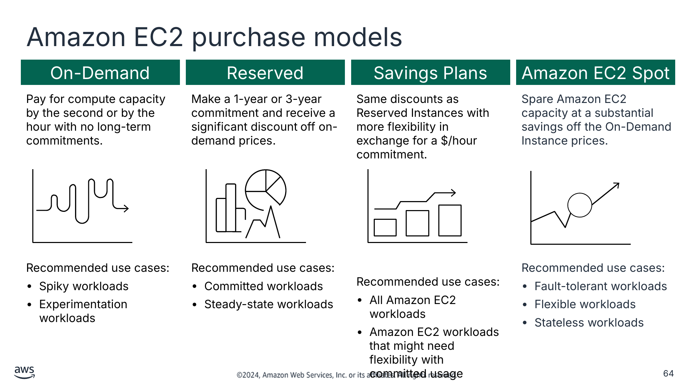

On-Demand (За запитом)

Reserved (Зарезервовані)

Savings Plans (Плани заощаджень)

Amazon EC2 Spot (Спотові)

Платіть за обчислювальну потужність  
посекундно або погодинно без довгострокових зобов’язань.

Рекомендовані сценарії використання:

- Робочі навантаження зі сплесками
- Робочі навантаження для експериментів

Візьміть зобов’язання на 1 рік чи 3 роки та отримайте значну знижку від цін за запитом.

Рекомендовані сценарії використання:

- Робочі навантаження із зобов’язаннями
- Робочі навантаження сталого стану

Ті самі знижки, що й для зарезервованих екземплярів, з більшою гнучкістю в обмін на зобов’язання за $/годину.

Рекомендовані сценарії використання:

- Усі робочі навантаження Amazon EC2
- Робочі навантаження Amazon EC2, що можуть потребувати гнучкості із зобов’язаним використанням

Вільна потужність Amazon EC2 зі значною економією порівняно з цінами екземплярів за запитом.

Рекомендовані сценарії використання:

- Відмовостійкі робочі навантаження
- Гнучкі робочі навантаження
- Робочі навантаження без стану (stateless)

> **Нотатки:**
>
> |Номер слайда 64  
> |Нотатки для інструктора  
> |  
> |Нотатки для студента  
> AWS пропонує чотири способи, спрямовані на значну економію для екземплярів Amazon EC2: екземпляри за запитом, зарезервовані екземпляри, плани заощаджень, спотові екземпляри та виділені хости.  
>
> Екземпляри за запитом (On-Demand Instances) пропонують найбільшу гнучкість без довгострокового контракту та з низькими тарифами. Вони — хороший вибір для застосунків із короткостроковими, зі сплесками чи непередбачуваними робочими навантаженнями. Вони також підходять для розробки та тестування застосунків в Amazon EC2 уперше. З екземплярами за запитом ви платите за обчислювальну потужність погодинно або посекундно залежно від екземплярів, які ви запускаєте. Екземпляри за запитом мають найнижчі авансові витрати та найбільшу гнучкість. Вони не потребують авансових зобов’язань чи довгострокових контрактів.  
>
> Зарезервовані екземпляри (Reserved Instances) дають змогу зарезервувати обчислювальні потужності на 1 рік або 3 роки з нижчими погодинними експлуатаційними витратами. Знижена ціна використання фіксується, доки ви володієте зарезервованим екземпляром. Зарезервовані екземпляри — хороший вибір, якщо у вас передбачувані чи сталі обчислювальні потреби (наприклад, екземпляр, який, як ви знаєте, хочете тримати запущеним більшість часу чи весь час протягом місяців чи років). Якщо ви очікуєте стабільного, інтенсивного використання, вони можуть забезпечити значну економію порівняно з екземплярами за запитом.  
>
> Плани заощаджень (Savings Plans) — це гнучка модель ціноутворення, що пропонує низькі ціни на використання Amazon EC2, AWS Lambda та AWS Fargate в обмін на зобов’язання щодо сталого обсягу використання (вимірюється в доларах на годину) на 1 рік або 3 роки. Вона пропонує нижчі ціни на використання екземплярів EC2 порівняно з екземплярами за запитом незалежно від сімейства, розміру, операційної системи, оренди чи регіону AWS екземпляра. Існують два типи планів заощаджень: Compute Savings Plans та EC2 Instance Savings Plans.  
> Compute Savings Plans забезпечують найбільшу гнучкість і допомагають зменшити ваші витрати до 66 відсотків. Ці плани автоматично застосовуються до використання екземплярів EC2 незалежно від сімейства екземпляра, розміру, зони доступності, регіону, операційної системи чи оренди. За цих планів можна вносити зміни до сімейства екземпляра, розміру, зони доступності, регіону, операційної системи чи оренди. Це дає змогу переходити з одного типу сімейства екземплярів на інший або переносити робоче навантаження з регіону Лондон до регіону Ірландія. Ви навіть можете перенести робоче навантаження з Amazon EC2 на AWS Fargate чи AWS Lambda й далі платити за ціною плану заощаджень.  
> EC2 Instance Savings Plans менш гнучкі. Вони застосовуються до певного сімейства екземплярів у певному регіоні та забезпечують найбільшу знижку (до 72 відсотків, як стандартні RI).  
>
> Спотові екземпляри (Spot Instances) дають змогу робити ставки на невикористані екземпляри EC2 і запитувати вільну обчислювальну потужність зі значною економією. Вони рекомендовані для відмовостійких, гнучких (некритичних до часу), безстанних робочих навантажень. Щоб використовувати спотовий екземпляр, ваше робоче навантаження має мати можливість бути зупиненим і перезапущеним: Amazon EC2 може перервати його з 2-хвилинним сповіщенням для виконання інших вимог до потужностей. Ваш спотовий екземпляр працює, коли потужність доступна, а максимальна ціна за годину для вашого запиту перевищує ціну спотового екземпляра. Спотові екземпляри тарифікуються з кроком 1 секунда, мінімум 60 секунд, якщо на них працює операційна система Amazon Linux чи Ubuntu. Усі інші операційні системи тарифікуються з кроком 1 година, з округленням до найближчої години.  
>
> Варіація спотових екземплярів, що називається спотовими блоками (Spot blocks), дає змогу безперервно запускати робоче навантаження протягом обмеженої тривалості 1–6 годин. Спотові блоки розроблені так, щоб не переривалися й працюватимуть безперервно протягом обраної вами тривалості, незалежно від ринкової ціни спотових екземплярів.

---

## Слайд 65: Демонстрація: перегляд сторінки історії цін спотових екземплярів (Spot Instance History Page)

- Ця демонстрація використовує Amazon EC2.
- У цій демонстрації ви побачите, як виконати таке:
  - Переглянути історію цін
  - Налаштувати вигляд історії цін

> **Нотатки:**
>
> |Номер слайда 65  
> |Нотатки для інструктора  
> |Ця демонстрація — файл .mp4 із субтитрами. Студенти отримують до неї доступ через онлайн-курс. Посібник інструктора містить тривалість кожної демонстрації.  
> |  
> |Нотатки для студента  
> Знайдіть цю записану демонстрацію у вашому онлайн-курсі як частину цього модуля.

---

## Слайд 66: Резервування потужностей Amazon EC2 (Capacity Reservations)

Резервування потужностей дає змогу зарезервувати обчислювальну потужність для екземплярів Amazon EC2 у певній зоні доступності.

**On-Demand Capacity Reservations**

**Amazon EC2 Capacity Blocks for ML**

Це гарантує, що ви завжди маєте доступ до потужностей EC2, коли вони вам потрібні, так довго, як вам потрібно.

Рекомендовані сценарії використання:

- Робочі навантаження, що мають відповідати регуляторним вимогам до високої доступності
- Робочі навантаження, що потребують гарантії потужностей

Резервуйте екземпляри GPU на майбутню дату для запуску будь-яких ваших робочих навантажень машинного навчання (ML).

Рекомендовані сценарії використання:

- Навчання та тонке налаштування моделей ML
- Проведення експериментів і створення прототипів
- Планування майбутніх сплесків попиту на застосунки ML

66

> **Нотатки:**
>
> |Номер слайда 66  
> |Нотатки для інструктора  
> |  
> |Нотатки для студента  
> Резервування потужностей дає змогу зарезервувати обчислювальну потужність для екземплярів Amazon EC2 у певній зоні доступності. Існують два типи резервування потужностей, що обслуговують різні сценарії використання.  
>
> On-Demand Capacity Reservations дають змогу зарезервувати обчислювальну потужність для ваших екземплярів EC2 у певній зоні доступності на будь-яку тривалість. Резервування потужностей пом’якшують ризик неможливості отримати потужності за запитом у разі обмежень потужностей і гарантують, що ви завжди маєте доступ до потужностей EC2, коли вони вам потрібні, так довго, як вам потрібно.  
>
> On-Demand Capacity Reservations рекомендовані для такого:  
> Критично важливі для бізнесу події чи робочі навантаження, що потребують гарантії потужностей  
> Робочі навантаження, що мають відповідати регуляторним вимогам до високої доступності  
> Стратегії аварійного відновлення, що потребують зарезервованих потужностей в іншій зоні доступності чи регіоні  
>
> З Amazon EC2 Capacity Blocks for ML ви можете резервувати екземпляри GPU на майбутню дату для запуску ваших робочих навантажень машинного навчання (ML). Ви платите лише за обсяг обчислювального часу, який вам потрібен, без довгострокових зобов’язань. EC2 Capacity Blocks можна використовувати для резервування екземплярів Amazon EC2 P5.  
>
> EC2 Capacity Blocks рекомендовані для такого:  
> Навчання та тонке налаштування моделей ML  
> Проведення експериментів і створення прототипів  
> Планування майбутніх сплесків попиту на застосунки ML

---

## Слайд 67: Виділені варіанти Amazon EC2 (dedicated options)

Виділені варіанти Amazon EC2 надають потужності екземплярів EC2 на фізичних серверах, виділених для вашого використання (апаратне забезпечення з одним орендарем, single-tenant).

Виділені екземпляри (Dedicated Instances)

Виділені хости (Dedicated Hosts)

- Тарифікація за екземпляр
- Автоматичне розміщення екземплярів
- Ізолює хости, що запускають ваші екземпляри

- Тарифікація за хост
- Видимість сокетів, ядер і ідентифікатора хоста
- Спорідненість (affinity) між хостом та екземпляром
- Цільове розміщення екземплярів
- Додавання потужностей за допомогою запиту на виділення
- Дає змогу використовувати ваші ліцензії на програмне забезпечення, прив’язані до сервера, і відповідати вимогам відповідності

> **Нотатки:**
>
> |Номер слайда 67  
> |Нотатки для інструктора  
> |  
> |Нотатки для студента  
> Виділені варіанти Amazon EC2 надають потужності екземплярів EC2 на фізичних серверах, виділених для вашого використання.  
>
> Виділені екземпляри — це екземпляри EC2, що працюють на апаратному забезпеченні, виділеному одному клієнту. Виділені екземпляри, що належать до різних акаунтів AWS, фізично ізольовані на апаратному рівні, навіть якщо ці акаунти пов’язано з одним акаунтом платника. Однак виділені екземпляри можуть ділити апаратне забезпечення з іншими екземплярами з того самого акаунта AWS, що не є виділеними екземплярами.  
>
> Виділений хост — це фізичний сервер EC2, повністю виділений для вашого використання. Виділені хости можуть допомогти зменшити витрати, дозволяючи використовувати ваші наявні ліцензії на програмне забезпечення, прив’язані до сервера, зокрема Windows Server, SQL Server і SUSE Linux Enterprise Server (залежно від умов вашої ліцензії). Виділені хости можна придбати за запитом (погодинно) або як частину планів заощаджень.  
>
> Виділені хости рекомендовані для такого:  
> Користувачі, що прагнуть заощадити на витратах на ліцензування  
> Робочі навантаження, що мають працювати на виділених фізичних серверах  
> Користувачі, що прагнуть передати обслуговування хоста AWS, водночас контролюючи розклад подій обслуговування відповідно до операційних потреб свого бізнесу  
>
> Ви можете використовувати виділені хости та виділені екземпляри для запуску екземплярів EC2 на фізичних серверах, виділених для вашого використання. Обидва варіанти дають змогу ізолювати хости, що запускають ваші екземпляри, від хостів, що запускають екземпляри для інших акаунтів. Вони також забезпечують однакову продуктивність, безпеку та фізичні функції.  
>
> Виділені хости дають вам видимість і контроль над тим, як екземпляри розміщуються на фізичному сервері. Ви можете послідовно розгортати свої екземпляри на тому самому фізичному сервері з часом. У результаті виділені хости дають змогу використовувати ваші наявні ліцензії на програмне забезпечення, прив’язані до сервера, і виконувати вимоги корпоративної відповідності та регуляторні вимоги.  
>
> Обидва варіанти відрізняються способом тарифікації. Виділений екземпляр тарифікується за екземпляр, і його ціноутворення має два компоненти. Ці два компоненти — погодинна плата за використання екземпляра та виділена плата за регіон, яку ви сплачуєте раз на годину незалежно від того, скільки виділених екземплярів працює.  
>
> Виділений хост тарифікується за хост. Ви можете обрати одну з трьох різних моделей ціноутворення для оплати виділених хостів: за запитом (On-Demand), ціноутворення резервування (Reservation Pricing) і плани заощаджень (Savings Plans).  
>
> Щоб вказати, що екземпляр має працювати як виділений екземпляр чи виділений хост, змініть атрибут оренди (tenancy) екземпляра на dedicated або host відповідно. Докладніше див. «Amazon EC2 Dedicated Hosts».

---

## Слайд 68: Рекомендації з оптимізації витрат Amazon EC2

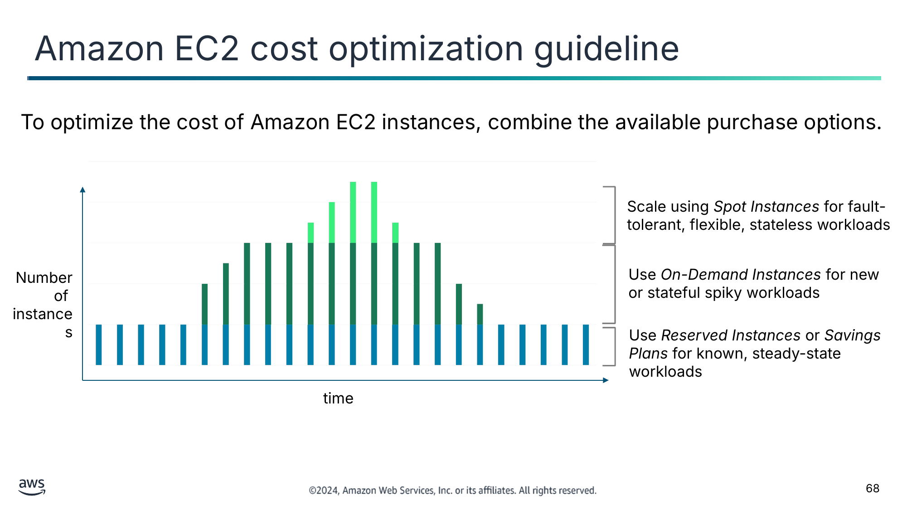

Щоб оптимізувати вартість екземплярів Amazon EC2, поєднуйте наявні варіанти придбання.

<details>
<summary>Текст зі схеми</summary>

Number of  
instances (Кількість екземплярів)

Scale using *Spot Instances* for fault-tolerant, flexible, stateless workloads (Масштабуйте за допомогою *спотових екземплярів* для відмовостійких, гнучких, безстанних робочих навантажень)

Use *On-Demand Instances* for new or stateful spiky workloads (Використовуйте *екземпляри за запитом* для нових чи станних робочих навантажень зі сплесками)

Use *Reserved Instances* or *Savings Plans* for known, steady-state workloads (Використовуйте *зарезервовані екземпляри* або *плани заощаджень* для відомих робочих навантажень сталого стану)

time (час)

</details>

> **Нотатки:**
>
> |Номер слайда 68  
> |Нотатки для інструктора  
> |  
> |Нотатки для студента  
> Кожна модель ціноутворення Amazon EC2 надає різний набір переваг. Як загальна настанова, рекомендований спосіб оптимізувати вартість екземплярів EC2 — поєднувати наявні варіанти придбання.  
>
> Зокрема, почніть із визначення робочих навантажень сталого стану у вашому портфелі застосунків і запускайте їх на екземплярах EC2, що використовують варіант ціноутворення зарезервованих екземплярів чи планів заощаджень.  
>
> Далі для ваших станних робочих навантажень зі сплесками оберіть екземпляри EC2, що використовують план ціноутворення екземплярів за запитом.  
>
> Нарешті, використовуйте спотові екземпляри для ваших відмовостійких, гнучких, безстанних робочих навантажень.  
>
> Діаграма оптимізації вартості Amazon EC2 показує зарезервовані екземпляри чи плани заощаджень, що використовуються для відомих робочих навантажень сталого стану. Вони залишаються сталими протягом періоду часу. Екземпляри за запитом для нових чи станних робочих навантажень зі сплесками непостійні протягом періоду часу. Спотові екземпляри використовуються для масштабування відмовостійких, гнучких, безстанних робочих навантажень кілька разів протягом періоду часу.  
>
> Діаграма оптимізації вартості Amazon EC2 показує зарезервовані екземпляри чи плани заощаджень, що використовуються для відомих робочих навантажень сталого стану. Вони залишаються сталими протягом періоду часу. Екземпляри за запитом для нових чи зі сплесками робочих навантажень і спотові екземпляри для відмовостійких, гнучких, безстанних робочих навантажень, що непостійні протягом того самого періоду часу.

---

## Слайд 69: Ключові висновки: варіанти ціноутворення Amazon EC2

- Моделі ціноутворення Amazon EC2 включають екземпляри за запитом, зарезервовані екземпляри, плани заощаджень, спотові екземпляри та виділені хости
- Посекундна тарифікація доступна лише для екземплярів за запитом, зарезервованих екземплярів і спотових екземплярів, на яких працює Amazon Linux чи Ubuntu
- Використовуйте комбінацію зарезервованих екземплярів, планів заощаджень, екземплярів за запитом і спотових екземплярів для оптимізації обчислювальних витрат Amazon EC2

> **Нотатки:**
>
> |Номер слайда 69  
> |Нотатки для інструктора  
> |  
> |Нотатки для студента

---

## Слайд 70: Лабораторна робота кафе: створення динамічного вебсайту для кафе (Dynamic website lab)

> **Нотатки:**
>
> |Номер слайда 70  
> |Нотатки для інструктора  
> |  
> |Нотатки для студента  
> Зараз ви виконаєте лабораторну роботу. Наступні слайди підсумовують те, що ви робитимете в лабораторній роботі, а докладні інструкції ви знайдете в лабораторному середовищі.

---

## Слайд 71: Еволюція архітектури кафе: версія 2

| Версія архітектури (Architecture Version) | Бізнес-причина оновлення (Business reason for update) | Технічні вимоги / оновлення архітектури (Technical requirements/ architecture update) |
|---|---|---|
| V1 | Статичний вебсайт для малого бізнесу | Розмістити вебсайт на Amazon S3. |
| V2 | Додати онлайн-замовлення | Розгорнути вебзастосунок і базу даних на Amazon EC2. |
| V3 | Зменшити зусилля на обслуговування бази даних і захист її даних | Розділити рівні вебу та бази даних. Перенести базу даних в Amazon RDS у приватній підмережі. |
| V4 | Підвищити безпеку вебзастосунку | Використати функції Amazon VPC для налаштування та захисту публічних і приватних підмереж. |
| V5 | Створити окремі механізми доступу на основі ролі | Додати групи IAM і прикріпити політики ресурсів до ресурсів застосунку. Додати користувачів IAM до груп на основі ролі. |
| V6 | Забезпечити, щоб вебсайт міг витримати очікуване зростання трафіку | Додати балансувальник навантаження, впровадити автоматичне масштабування екземплярів EC2 і розподілити екземпляри обчислень і баз даних між 2 зонами доступності. |
| V7 | Інформація з модуля 11 |  |
| V8 | Інформація з модуля 14 |  |

> **Нотатки:**
>
> |Нотатки для інструктора  
> |Поділіться файлом architectures.svg або покажіть його й виділіть розділи архітектури, які буде змінено чи додано в цій лабораторній роботі.  
> |  
> |Нотатки для студента  
> Клієнти кафе добре відреагували на новий вебсайт. Тепер клієнти часто запитують, чи можна використовувати вебсайт для оформлення замовлень. Власники та персонал кафе вважають, що додавання функціональності замовлень — хороша стратегія, але хочуть переконатися, що зроблять це так, щоб порадувати своїх клієнтів. Власники та персонал мають певні ідеї щодо того, як вони хочуть, щоб працювали функції, а Софія знає, що їм потрібна хмарна інфраструктура, що підтримує динамічний контент. Вона й Нікіл розуміють, що, імовірно, усе змінюватиметься, коли вони набуватимуть досвіду та бачитимуть, як реагують клієнти. Вони хочуть мати гнучкість для експериментів, але обмежити ризик для працюючого вебсайту.

---

## Слайд 72: Завдання лабораторної роботи «Динамічний вебсайт» (Dynamic website lab)

- У цій лабораторній роботі ви виконаєте таке:
  - Підключите IDE до наявного екземпляра EC2
  - Проаналізуєте середовище екземпляра EC2 і підтвердите доступність вебсервера
  - Встановите вебзастосунок на екземпляр EC2, що також використовує AWS Systems Manager Parameter Store
  - Протестуєте вебзастосунок
  - Створите AMI
  - Розгорнете другу копію вебзастосунку в іншому регіоні AWS

> **Нотатки:**
>
> |Номер слайда 72  
> |Нотатки для інструктора  
> |  
> |Нотатки для студента  
> Отримайте доступ до лабораторного середовища через ваш онлайн-курс, щоб дізнатися додаткові подробиці та виконати лабораторну роботу.

---

## Слайд 73: Підсумки лабораторної роботи «Динамічний вебсайт»

- Де в цій лабораторній роботі ви знайшли докладну інформацію про ваш екземпляр EC2, який уже запущено та який розміщує ваш вебсайт кафе?
- У цій лабораторній роботі вебсайт кафе вже добре працює на наявному екземплярі EC2. Що ви зробили, щоб дублювати екземпляр у регіон Oregon?

> **Нотатки:**
>
> |Номер слайда 73  
> |Нотатки для інструктора  
> |Архітектурну схему для цієї лабораторної роботи включено до файлу CafeLabDiagrams.svg, що входить до каталогу файлів викладача. Поділіться цим файлом зі студентами, щоб вони могли наближати й віддаляти кожну фазу архітектури для повнішої картини під час підбиття підсумків лабораторної роботи.  
> |Запропоновані відповіді на запитання 1: де в цій лабораторній роботі ви знайшли докладну інформацію про ваш екземпляр EC2, який уже запущено та який розміщує ваш вебсайт кафе?  
> |  
> |У цій лабораторній роботі ви перейшли на сторінку Instances і обрали екземпляр. На вкладці Details ви переглянули інформацію про ваш екземпляр. Ви знайшли відповіді на такі запитання:  
> |Чи перебуває екземпляр у публічній підмережі?  
> |Чи призначено екземпляру EC2 публічну IP-адресу IPv4?  
> |Які номери вхідних портів TCP відкриті для цього екземпляра?  
> |Чи пов’язано з екземпляром EC2 роль AWS Identity and Access Management (IAM)?  
> |Коли ви працюєте з екземпляром, який не запускали самі, найкраща практика — переглянути подробиці екземпляра.  
> |  
> |Запропоновані відповіді на запитання 2: у цій лабораторній роботі вебсайт кафе вже добре працює на наявному екземплярі EC2. Що ви зробили, щоб дублювати екземпляр у регіон Oregon?  
> |  
> |Оскільки вебсайт кафе вже добре працював на наявному екземплярі EC2, ви дублювали його, створивши AMI із екземпляра. Далі ви скопіювали AMI до регіону Oregon, а потім запустили новий екземпляр із AMI в регіоні Oregon.  
> |  
> |Якщо вам потрібно створити екземпляри EC2, що мають бути подібними за конфігураціями, можна використовувати AMI. AMI можуть слугувати шаблоном для створення додаткових екземплярів EC2 з однаковими конфігураціями.  
> |  
> |Однак важливо пам’ятати, що AMI не захоплює деякі зовнішні конфігурації. Групи безпеки, ролі IAM і типи екземплярів — це окремі конфігурації. Наприклад, припустімо, ви створюєте AMI із екземпляра. Потім ви використовуєте AMI для запуску іншого екземпляра, призначеного виконувати подібну функцію. Вам усе одно потрібно налаштувати правила групи безпеки, обрати тип екземпляра й додати роль IAM.  
> |  
> |Нотатки для студента  
> Ваш інструктор може розглянути ці запитання з вами, або ви можете розглянути їх самостійно. Скористайтеся цією нагодою, щоб поглибити своє мислення щодо завдань, які ви виконували під час лабораторної роботи.

---

## Слайд 74: Застосування принципів AWS Well-Architected Framework до обчислень

Додавання обчислювального рівня за допомогою Amazon EC2

> **Нотатки:**
>
> |Номер слайда 74  
> |Нотатки для інструктора  
> |  
> |Нотатки для студента  
> Цей розділ розглядає, як застосовувати принципи AWS Well-Architected Framework до обчислювальних ресурсів.

---

## Слайд 75: Опори AWS Well-Architected


> **Нотатки:**
>
> |Номер слайда 75  
> |Нотатки для інструктора  
> |Решта слайдів у цьому розділі подають приклади, що підкреслюють, як матеріал цього модуля узгоджується з найкращими практиками Well-Architected Framework. За бажанням ви можете попросити студентів відвідати вебсайт Well-Architected Framework і знайти найкращі практики, які, на їхню думку, пов’язані з матеріалом, поданим у цьому модулі, використовуючи цей розділ як відправну точку.  
> |  
> |Нотатки для студента  
> AWS Well-Architected Framework має шість опор, і кожна опора включає найкращі практики та набір запитань, які слід враховувати під час проєктування хмарних рішень. Цей розділ виділяє кілька найкращих практик з опор, найактуальніших для цього модуля, зокрема безпеки, ефективності продуктивності, оптимізації витрат і сталості. Повний набір найкращих практик за опорами знайдіть на вебсайті Well-Architected Framework. Посилання надано в розділі ресурсів вмісту вашого онлайн-курсу.

---

## Слайд 76: Підхід найкращих практик: захист інфраструктури — захист обчислень


**Найкраща практика**

Автоматизуйте захист обчислень.

> **Нотатки:**
>
> |Номер слайда 76  
> |Нотатки для інструктора  
> |  
> |Нотатки для студента  
> Захист інфраструктури — важлива найкраща практика в опорі безпеки. Перш ніж проєктувати будь-яке робоче навантаження, мають бути запроваджені основоположні практики, що впливають на безпеку. Захист інфраструктури поділяється на дві категорії: захист мережі та захист обчислень. Розділ захисту обчислень ставить запитання: як ви захищаєте свої обчислювальні ресурси? Обчислювальні ресурси у вашому робочому навантаженні потребують кількох рівнів захисту, щоб допомогти захистити від зовнішніх і внутрішніх загроз. Обчислювальні ресурси включають екземпляри EC2 і всі конфігурації, про які ви дізналися в цьому модулі.  
>
> Автоматизуйте захист обчислень: автоматизуйте свої захисні обчислювальні механізми, зокрема керування вразливостями, зменшення поверхні атаки та керування ресурсами. Автоматизація допоможе вам інвестувати час у захист інших аспектів вашого робочого навантаження та зменшити ризик людської помилки.  
>
> У цьому модулі ви дізналися про низку функцій і варіантів конфігурації Amazon EC2, що підтримують цю найкращу практику, як-от використання таких:  
> EC2 Image Builder, що може зменшити вашу вразливість до загроз безпеки  
> Скрипти даних користувача для автоматизації команд під час запуску екземпляра  
> Срібні (змінні, mutable) AMI та «золоті» (незмінні, immutable) AMI, коли можливо, щоб зафіксувати конфігурації безпеки у ваших екземплярах

---

## Слайд 77: Підхід найкращих практик: захист інфраструктури — захист мереж


**Найкраща практика**

Контролюйте трафік на всіх рівнях.

> **Нотатки:**
>
> |Номер слайда 77  
> |Нотатки для інструктора  
> |  
> |Нотатки для студента  
> Розділ захисту мережі опори безпеки ставить запитання: як ви безпечно експлуатуєте своє робоче навантаження? Щоб безпечно експлуатувати своє робоче навантаження, потрібно застосовувати наскрізні найкращі практики безпеки до кожної галузі підключення. В AWS рекомендований підхід — розділяти різні робочі навантаження за акаунтами на основі їхньої функції та вимог відповідності чи чутливості даних.  
>
> Контролюйте трафік на всіх рівнях: проєктуючи топологію вашої мережі, слід вивчити вимоги до підключення кожного компонента. Наприклад, чи потребує компонент доступності з інтернету (вхідної та вихідної), підключення до віртуальних приватних хмар (VPC), периферійних сервісів і зовнішніх центрів обробки даних. VPC дає змогу визначити топологію вашої мережі, що охоплює регіон AWS, із діапазоном приватних адрес IPv4, який ви встановлюєте, або діапазоном адрес IPv6, який обирає AWS. Слід застосовувати кілька засобів контролю за підходом глибокоешелонованого захисту (defense in depth) як для вхідного, так і для вихідного трафіку, зокрема використання груп безпеки (брандмауер із перевіркою стану, stateful inspection).  
>
> У цьому модулі ви дізналися, що кожен екземпляр EC2 захищено групою безпеки. Група безпеки визначає, на яких портах дозволено мережевий трафік. Ви можете налаштувати це на основі потреб підключення вашого робочого навантаження.

---

## Слайд 78: Підхід найкращих практик: обчислення та апаратне забезпечення


**Найкращі практики**

Масштабуйте найкращі обчислювальні варіанти для вашого робочого навантаження.

Налаштовуйте обчислювальні ресурси та підбирайте їхній розмір (right-size).

> **Нотатки:**
>
> |Номер слайда 78  
> |Нотатки для інструктора  
> |  
> |Нотатки для студента  
> Опора ефективності продуктивності зосереджена на структурованому та впорядкованому виділенні ІТ- та обчислювальних ресурсів. Архітектури можуть використовувати різні обчислювальні варіанти для різних компонентів і дозволяти різні функції для покращення продуктивності. Вибір неправильного обчислювального варіанта для архітектури може призвести до нижчої ефективності продуктивності. Розділ обчислень і апаратного забезпечення опори ефективності продуктивності надає настанови та найкращі практики щодо того, як визначити й оптимізувати обчислювальні варіанти для ефективності продуктивності в хмарі. Оптимальний обчислювальний варіант для певного робочого навантаження може різнитися залежно від проєкту застосунку, шаблонів використання та налаштувань конфігурації.  
>
> Масштабуйте найкращі обчислювальні варіанти для вашого робочого навантаження: вибір найдоречнішого обчислювального варіанта для вашого робочого навантаження дає змогу покращити продуктивність, зменшити непотрібні витрати на інфраструктуру та знизити операційні зусилля, потрібні для підтримки вашого робочого навантаження. Переваги цієї найкращої практики можуть зробити ваші робочі навантаження ресурсоефективнішими завдяки визначенню обчислювальних вимог і оцінюванню їх щодо наявних варіантів.  
>
> Налаштовуйте обчислювальні ресурси та підбирайте їхній розмір: налаштовуйте обчислювальні ресурси та підбирайте їхній розмір так, щоб він відповідав вимогам до продуктивності вашого робочого навантаження, і уникайте недовикористаних чи надмірно використаних ресурсів. Переваги правильного підбору розміру обчислювальних ресурсів забезпечують оптимальну роботу в хмарі, уникаючи надмірного й недостатнього виділення ресурсів. Правильний підбір розміру обчислювальних ресурсів зазвичай призводить до кращої продуктивності та покращеного досвіду клієнтів, водночас знижуючи вартість.  
>
> У цьому модулі ви дізналися про низку функцій і варіантів конфігурації Amazon EC2, що підтримують ці найкращі практики, як-от вибір таких:  
> AMI, попередньо налаштовані з потрібним програмним забезпеченням і такі, що підтримують використання вашого типу кореневого сховища  
> Тип і розмір екземпляра для ваших обчислювальних робочих навантажень  
> Тип сховища (Amazon EBS чи сховище екземпляра) і розмір для ваших кореневих томів і томів даних

---

## Слайд 79: Підхід найкращих практик: економічно ефективне виділення ресурсів


**Найкращі практики**

Обирайте правильний тип, розмір і кількість ресурсів.

Обирайте найкращу модель ціноутворення.

> **Нотатки:**
>
> |Номер слайда 79  
> |Нотатки для інструктора  
> |  
> |Нотатки для студента  
> Застосування економічно ефективного виділення ресурсів — частина опори оптимізації витрат Well-Architected Framework. Належний вибір сервісів допомагає зменшити використання та витрати. Наприклад, процес звітування може виконуватися 5 годин на меншому сервері, але 1 годину на більшому сервері, що вдвічі дорожчий. Обидва сервери дають вам той самий результат, але менший сервер спричиняє більше витрат з часом. Добре спроєктоване (well-architected) робоче навантаження використовує найекономічніші ресурси, що може мати значний і позитивний економічний вплив.  
>
> Обирайте правильний тип, розмір і кількість ресурсів: обираючи найкращий тип, розмір і кількість ресурсів, ви виконуєте технічні вимоги з ресурсом найнижчої вартості. Заходи з правильного підбору розміру (right-sizing) враховують усі ресурси робочого навантаження, усі атрибути кожного окремого ресурсу та зусилля, пов’язані з операцією підбору розміру. Правильний підбір розміру може бути ітеративним процесом, що ініціюється змінами шаблонів використання та зовнішніми чинниками, як-от зниження цін AWS чи нові типи ресурсів AWS.  
>
> Обирайте найкращу модель ціноутворення: враховуйте вимоги компонентів робочого навантаження й розумійте потенційні моделі ціноутворення. AWS має кілька моделей ціноутворення, що дають змогу платити за ваші ресурси найекономічнішим способом, який відповідає потребам вашої організації.  
>
> У цьому модулі ви дізналися про низку функцій і варіантів конфігурації Amazon EC2, що підтримують ці найкращі практики.  
> Правильно підібравши тип екземпляра та розмір сховища для ваших обчислювальних робочих навантажень, ви можете оптимізувати витрати, щоб заощадити кошти.  
> Вибір моделі придбання чи моделі зарезервованої потужності, що найкраще відповідає сценарію використання робочого навантаження, може заощадити вам кошти. Моделі придбання AWS включають екземпляри за запитом, зарезервовані екземпляри, спотові екземпляри Amazon EC2 і плани заощаджень. Модель зарезервованої чи виділеної потужності AWS включає On-Demand Capacity Reservations, Amazon EC2 Capacity Blocks for ML і Dedicated Host.

---

## Слайд 80: Підхід найкращих практик: апаратне забезпечення та сервіси


**Найкращі практики**

Використовуйте мінімальний обсяг апаратного забезпечення для задоволення ваших потреб.

Використовуйте типи екземплярів із найменшим впливом.

Використовуйте керовані сервіси.

> **Нотатки:**
>
> |Номер слайда 80  
> |Нотатки для інструктора  
> |  
> |Нотатки для студента  
> Опора сталості зосереджена на мінімізації впливу на довкілля від запуску хмарних робочих навантажень. Розділ апаратних сервісів цієї опори шукає можливості обрати найефективніше апаратне забезпечення та сервіси для вашого окремого робочого навантаження.  
>
> Наступне запитання зосереджується на цих міркуваннях щодо сталості: як ви обираєте й використовуєте хмарне апаратне забезпечення та сервіси у вашій архітектурі для підтримки ваших цілей сталості?  
>
> Відповідь — шукати можливості зменшити вплив робочого навантаження на сталість. Це можна зробити, мінімізуючи обсяг апаратного забезпечення, яке потрібно розгортати, і обираючи найефективніше апаратне забезпечення та сервіси для вашого окремого робочого навантаження.  
>
> Розгляньте такі найкращі практики для ваших апаратних сервісів:  
>
> Використовуйте мінімальний обсяг апаратного забезпечення для задоволення ваших потреб: використовуйте мінімальний обсяг апаратного забезпечення для вашого робочого навантаження, щоб ефективно задовольняти ваші бізнес-потреби. Правильний підбір розміру ваших хмарних ресурсів допомагає зменшити вплив робочого навантаження на довкілля, заощадити кошти та підтримувати орієнтири продуктивності. Хмара AWS надає гнучкість динамічно змінювати обчислювальні ресурси. Тому ви можете часто вносити зміни до вашого робочого навантаження для задоволення ваших бізнес-потреб.  
>
> Використовуйте типи екземплярів із найменшим впливом: постійно відстежуйте й використовуйте нові типи екземплярів, щоб скористатися покращеннями енергоефективності. Використання ефективних екземплярів у хмарних робочих навантаженнях критично важливе для нижчого споживання ресурсів і економічної ефективності. Постійно відстежуйте випуск нових типів екземплярів і скористайтеся покращеннями енергоефективності, зокрема тими типами екземплярів, розробленими для підтримки конкретних робочих навантажень, як-от навчання й інференс машинного навчання та транскодування відео.  
>
> Використовуйте керовані сервіси: використовуйте керовані сервіси, щоб працювати ефективніше в хмарі. Використання керованих сервісів переносить відповідальність на AWS за підтримку високого використання та оптимізації сталості розгорнутого апаратного забезпечення. AWS має розуміння, отримане від мільйонів клієнтів, що може допомогти рухати нові інновації та ефективність. Керовані сервіси також усувають операційний та адміністративний тягар підтримки сервісу, що дає вашій команді більше часу й можливостей зосередитися на інноваціях. Щоб використовувати керовані сервіси, спершу потрібно провести інвентаризацію вашого робочого навантаження на сервіси та компоненти. Потім ви оцінюєте й визначаєте компоненти, які можна замінити керованими сервісами.  
>
> У цьому модулі ви дізналися про низку функцій і варіантів конфігурації Amazon EC2, що підтримують ці найкращі практики.  
> AWS пропонує два різні варіанти сховищ залежно від вимог вашого робочого навантаження.  
> Використовуйте томи сховища екземпляра, якщо вам не потрібне постійне сховище й потрібен швидший обчислювальний час.  
> Використовуйте Amazon EBS, якщо вам потрібне постійне сховище.  
> AWS пропонує базові AMI та попередньо налаштовані AMI. Ви також можете налаштовувати AMI й зберігати їх, щоб запускати з них екземпляри.  
> AWS пропонує типи екземплярів, розроблені для задоволення потреб конкретних сценаріїв використання. Ці типи екземплярів включають: загального призначення, оптимізовані для обчислень, оптимізовані для сховищ тощо. Кожен тип екземпляра пропонує діапазон розмірів, з якого можна обрати відповідно до ваших бізнес-потреб.  
>
> У цьому модулі ви також дізналися про різноманітність обчислювальних сервісів, що пропонує AWS, зокрема керовані сервіси, як-от AWS Batch та AWS Outposts.

---

## Слайд 81: Ключові висновки: застосування принципів AWS Well-Architected Framework до обчислень

- Автоматизуйте захист обчислень.
- Масштабуйте найкращі обчислювальні варіанти для вашого робочого навантаження.
- Налаштовуйте обчислювальні ресурси та підбирайте їхній розмір.
- Обирайте правильний тип, розмір і кількість ресурсів.
- Обирайте найкращу модель ціноутворення.
- Використовуйте мінімальний обсяг апаратного забезпечення для задоволення ваших потреб.
- Використовуйте типи екземплярів із найменшим впливом.

> **Нотатки:**
>
> |Номер слайда 81  
> |Нотатки для інструктора  
> |Це не вичерпний перелік найкращих практик, охоплених найкращими практиками AWS Well-Architected. Це ключові висновки для пояснення найкращих практик, розглянутих у модулі.  
> |  
> |Нотатки для студента

---

## Слайд 82: Підсумки модуля

Додавання обчислювального рівня за допомогою Amazon EC2

> **Нотатки:**
>
> |Номер слайда 82  
> |Нотатки для інструктора  
> |  
> |Нотатки для студента  
> Цей розділ підсумовує те, що ви дізналися, і завершує модуль.

---

## Слайд 83: Резюме модуля

Цей модуль підготував вас до такого:

- Визначати, як Amazon Elastic Compute Cloud (Amazon EC2) можна використовувати в архітектурі.
- Пояснювати цінність використання образів Amazon Machine Images (AMI) для пришвидшення створення та відтворюваності інфраструктури.
- Рекомендувати типи екземплярів EC2 на основі вимог.
- Рекомендувати рішення для сховищ для Amazon EC2.
- Розпізнавати, як налаштовувати екземпляри Amazon EC2 за допомогою даних користувача.
- Описувати варіанти ціноутворення EC2 і робити рекомендації на основі вартості.
- Запускати екземпляр Amazon EC2.
- Використовувати принципи AWS Well-Architected Framework під час проєктування обчислювального рівня з Amazon EC2.

> **Нотатки:**
>
> |Номер слайда 83  
> |Нотатки для інструктора  
> |  
> |Нотатки для студента

---

## Слайд 84: Міркування щодо кафе

Обговоріть, як лабораторні роботи кафе в цьому модулі відповіли на ключові запитання та рішення, подані на початку цього модуля для бізнесу кафе.


---

## Слайд 85: Перевірка знань модуля

- Перевірка знань проводиться онлайн у вашому курсі.
- Перевірка знань включає 10 запитань на основі матеріалу, поданого на слайдах і в нотатках до слайдів.
- Ви можете повторно проходити перевірку знань стільки разів, скільки захочете.

> **Нотатки:**
>
> |Номер слайда 85  
> |Нотатки для інструктора  
> |  
> |Нотатки для студента  
> Скористайтеся своїм онлайн-курсом, щоб отримати доступ до перевірки знань для цього модуля.

---

## Слайд 86: Зразок запитання іспиту

В архітектора рішень є робоче навантаження, що працюватиме щонайменше 1 рік без перерв в одному регіоні. Робоче навантаження залишатиметься сталим, окрім випадкових сплесків у пікові сезони. Під час цих сплесків розмір типу екземпляра може потребувати збільшення для обробки важчих навантажень. Однак сімейство екземплярів залишатиметься тим самим за будь-якого збільшення розміру екземпляра. Який варіант ціноутворення слід використати для придбання екземпляра за найнижчою вартістю?

Визначте ключові слова та фрази, перш ніж продовжувати.

Ось ключові слова та фрази:

- Щонайменше 1 рік без перерв в одному регіоні
- Робоче навантаження залишатиметься сталим
- Сімейство екземплярів залишатиметься тим самим
- Найнижча вартість

> **Нотатки:**
>
> |Номер слайда 86  
> |Нотатки для інструктора  
> |Розділ із ключовими словами налаштовано з анімацією для розкриття за клацанням.  
> |  
> |Нотатки для студента

---

## Слайд 87: Зразок запитання іспиту: варіанти відповідей

В архітектора рішень є робоче навантаження, що працюватиме щонайменше *1 рік без перерв в одному регіоні*. **Робоче навантаження** *залишатиметься сталим*, окрім випадкових сплесків у пікові сезони. Під час цих сплесків розмір типу екземпляра може потребувати збільшення для обробки важчих навантажень. Однак сімейство екземплярів залишатиметься тим самим за будь-якого збільшення розміру екземпляра. Який варіант ціноутворення слід використати для придбання екземпляра за *найнижчою вартістю*?

**Варіант**

**Відповідь**

**A**

Виділений екземпляр (Dedicated instance)

**B**

Екземпляр за Compute Savings Plans

**C**

Екземпляр за EC2 Instance Savings Plans

**D**

Екземпляр за запитом (On-Demand instance)

> **Нотатки:**
>
> |Номер слайда 87  
> |Нотатки для інструктора  
> |  
> |Нотатки для студента  
> Використайте ключові слова, які ви визначили на попередньому слайді, і розгляньте кожен із можливих варіантів відповіді, щоб визначити, який із них найкраще відповідає запитанню.

---

## Слайд 88: Зразок запитання іспиту: відповідь

Правильна відповідь — C.

**Варіант**

**Відповідь**

**C**

Екземпляр за EC2 Instance Savings Plans

> **Нотатки:**
>
> |Номер слайда 88  
> |Нотатки для інструктора  
> |  
> |Нотатки для студента  
> Виділені екземпляри (варіант A) належать до дорожчих варіантів придбання. Вони фізично ізольовані на апаратному рівні. Ви можете використовувати їх для робочих навантажень, що потребують фізичної ізоляції апаратного забезпечення з міркувань відповідності чи регуляторних вимог. У цьому сценарії це не потрібно.  
>   
> Екземпляри за Compute Savings Plans (варіант B) могли б підійти для цього сценарію використання, однак вони не пропонують найнижчих витрат серед наявних варіантів. Екземпляри за Compute Savings Plans надають вам гнучкість змінювати регіон екземпляра та тип екземпляра. Жодне з цього не потрібне в цьому сценарії.  
>   
> Екземпляри за запитом (варіант D) не є бажаним варіантом ціноутворення для робочих навантажень, що триватимуть рік або довше. Для таких робочих навантажень використовуйте варіант плану заощаджень або зарезервований екземпляр.  
>   
> Екземпляри за EC2 Instance Savings Plans (варіант C) дають змогу змінювати розмір екземпляра в межах того самого сімейства екземплярів без впливу на ваші витрати. Це задовольняє всі вимоги цього сценарію та забезпечує найнижчі ціни в обмін на зобов’язання щодо використання окремих сімейств екземплярів у регіоні.

---

## Слайд 89: Дякуємо

Виправлення, відгуки чи інші запитання?

Зв’яжіться з нами за адресою [https://support.aws.amazon.com/#/contacts/aws-academy](https://support.aws.amazon.com/#/contacts/aws-academy).

> **Нотатки:**
>
> |Номер слайда 89  
> |Нотатки для інструктора  
> |  
> |Нотатки для студента  
> На цьому цей модуль завершено. Сторінка ресурсів вмісту вашого курсу містить посилання на додаткові ресурси, пов’язані з цим модулем.
