## Слайд 1: Adding a Database Layer

AWS Academy Cloud Architecting

> **Нотатки:**
>
> |Instructor notes  
> |  
> |Student notes  
> Welcome to the Adding a Database Layer module. This module focuses on database types and services offered by Amazon Web Services (AWS).

---

## Слайд 2: Introduction

Adding a Database Layer

> **Нотатки:**
>
> |Instructor notes  
> |  
> |Student notes  
> This introduction section describes the content of this module.

---

## Слайд 3: Module objectives

This module prepares you to do the following:

- Compare database types and services offered by Amazon Web Services (AWS).
- Explain when to use Amazon Relational Database Service (Amazon RDS).
- Describe the advanced features of Amazon RDS.
- Explain when to use Amazon DynamoDB.
- Identify AWS purpose-built database services.
- Describe how to migrate data into AWS databases.
- Design and deploy a database server.
- Use the AWS Well-Architected Framework principles when designing a database layer.

> **Нотатки:**
>
> |Slide number 3  
> |Instructor notes  
> |  
> |Student notes

---

## Слайд 4: Module overview

**Presentation sections**

- Database layer considerations
- Amazon RDS
- Amazon RDS Proxy connection management
- Amazon DynamoDB
- Purpose-built databases
- Migrating data into AWS databases
- Applying AWS Well-Architected Framework principles to the database layer

**Demo**

- Amazon RDS Automated Backup and Read Replicas

**Knowledge checks**

- 10-question knowledge check
- Sample exam question

> **Нотатки:**
>
> |Slide number 4  
> |Instructor notes  
> |Each module has an introduction, content sections, and a wrap-up. The wrap-up for this module contains a sample exam question for you to review with the students.  
> |  
> |Student notes  
> The objectives of this module are presented across multiple sections.  
>
> This module includes a recorded demo that is introduced in your student guide.  
>
> The module wraps up with a 10-question knowledge check delivered in the online course and a sample exam question to discuss in class.  
>
> The next slide describes the labs in this module.

---

## Слайд 5: Hands-on labs in this module

Guided lab

Challenge (Café) lab

- Creating an Amazon RDS Database

- Migrating a Database to Amazon RDS

> **Нотатки:**
>
> |Slide number 5  
> |Instructor notes  
> |This module includes both a stand-alone guided lab and a café labs that adds to the evolving architecture of the café. The café lab is a challenge lab where students are expected to complete tasks without every step being provided. The lab sections within the module include introductions to each lab.  
> |  
> |Student notes  
> This module includes the hands-on labs listed. There is a guided lab where you will receive step-by-step instructions and a café (challenge) lab where you will work on updating the architecture for the café. Additional information about each lab is included in the student guide where the lab takes place, and the lab environment provides detailed instructions.

---

## Слайд 6: As a cloud architect designing a database layer:

- I need to evaluate the available database options before selecting a data management solution so that I can optimize performance.
- I need to secure my infrastructure effectively so that data is durable and safe from threats.

> **Нотатки:**
>
> |Slide number 6  
> |Instructor notes: This slide presents key overarching design considerations that should guide decision making for this layer of a cloud architecture. Emphasize how a cloud architect must always start with the business case and work backwards to choose the best components for that use case. Also remind students that the decisions are likely to evolve over time as needs change or are better understood to optimize cost and performance. At the end of the module, there is an optional discussion included in the wrap-up section to prompt the students to consider these factors in the context of the café scenario.  
> |  
> |Student notes  
> This slide asks you to take the perspective of a cloud architect as you think about how to approach cloud network design. Keep these considerations in mind as you progress through this module. Also remember that the cloud architect should work backward from the business need to design the best architecture for a specific use case. As you progress through the module, consider the café scenario presented in the course as an example business need, and think about how you would address these needs for the fictional café business.

---

## Слайд 7: Database layer considerations

Adding a Database Layer

> **Нотатки:**
>
> |Slide number 7  
> |Instructor notes  
> |  
> |Student notes  
> This section provides an overview of what to consider when selecting a database.

---

## Слайд 8: Database considerations

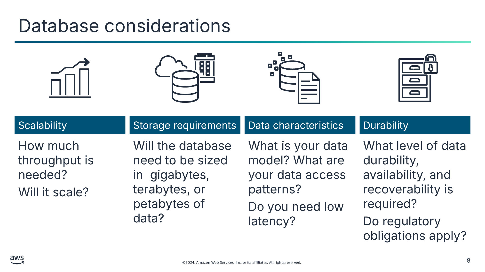

Scalability

Storage requirements

Data characteristics

Durability

How much throughput is needed?

Will it scale?

Will the database need to be sized in  gigabytes, terabytes, or petabytes of data?

What is your data model? What are your data access patterns?

Do you need low latency?

What level of data durability, availability, and recoverability is required?

Do regulatory obligations apply?

> **Нотатки:**
>
> |Slide number 8  
> |Instructor notes  
> |  
> |Student notes  
> As an architect, you will often need to choose between different database types when you consider which type will best handle a particular workload. Before you choose a database, there are some key considerations that should inform your decision-making process.  
>
> Scalability  
> Having a properly scaled database is important. With traditional on-premises databases, the impact to database performance while it scales up can be unpredictable and might require downtime. If you underprovision your database, your applications might stop working. If you overprovision your database, you increase your upfront costs by procuring resources that you do not need, which violates the cost-optimization principle of the AWS Well-Architected Framework.  
>
> Ideally, you would choose a database solution that has the resources to handle the needed throughput at launch and that can also be scaled up later if your throughput needs to increase.  
>
> Storage requirements  
> Consider the storage requirements of your workload. How large must the database be to handle your data requirements? Does it need to store gigabytes, terabytes, or petabytes? Different database architectures support different maximum data capacities. Some database designs are ideal for traditional applications while others are ideal for caching or session management.  
>
> Data characteristics  
> Consider what you need to store as you select a database. The core of any database choice includes the characteristics of the data that you need to store, retrieve, analyze, and work with. These characteristics include your data model (is it relational, structured or semi-structured, using a highly connected dataset, or timeseries?), data access (how do you need to access your data?), the extent to which you need low-latency data, and whether there is a particular data record size you have in mind.  
>   
> Durability  
> Data durability refers to the assurance that your data will not be lost, and data availability refers to your ability to access your data when you want to.  
>
> What level of data durability and data availability do you need? If the data you will store is absolutely critical to your business, you should choose a database solution that stores multiple redundant copies of your data across multiple geographically separated physical locations. This solution will usually result in an increased cost, so it is important to balance your business needs with cost considerations.  
>
> Another important consideration is whether data residency or regulatory obligations apply to your data. For example, are there regional data privacy laws that you must comply with? If so, choose a database solution that can support compliance.

---

## Слайд 9: Relational and non-relational databases

| Features | Relational Databases | Non-Relational Databases |
|---|---|---|
| Structure | Tabular form of columns and rows | Variety of structure models (key-value pairs, document, or graph-based) |
| Schema | Strict schema rules | Flexible schemas |
| Benefits | Ease of use, data integrity, reduced data storage, and common language (SQL) | Flexibility, scalability, and high performance |
| Use Case | When migrating an on-premises relational workload or if your workload involves online transactional processing | When a caching layer is needed to improve read performance, when storing JSON documents, or when a single digit millisecond data retrieval is needed |
| Optimization | Optimized for structured data stored in tables; supports complex one-time queries through joins | Optimized for fast access to structured, semi-structured, or unstructured data with high read and write throughput |

> **Нотатки:**
>
> |Slide number 9  
> |Instructor notes  
> |  
> |Student notes  
> The world has changed, and the one-size-fits-all approach of using relational databases for every application no longer works. Relational databases still play an important role in application design and functionality, but a number of purpose-built databases are rising in popularity. Modern applications must consider social, mobile, Internet of Things (IoT), and global access. Purpose-built database models are designed from the ground up to quickly and efficiently perform the specific functions that these applications require.  
>
> In a relational database management system (RDBMS), data is stored in a tabular form of columns and rows, and data is queried by using SQL. If your use case lends itself well to strict schema rules, where the schema structure is well defined and does not need to change often, a relational database would be a good choice. When migrating to an on-premises relational workload or if your workload involves online transactional processing, this type of database is suitable. However, if your application needs extreme read/write capacity, a relational database might not be the right choice. A relational database can be the best low-effort solution for many use cases.  
>   
> Relational databases transactions are ACID-compliant. This means that they help ensure data integrity by providing transactions that are atomic, consistent, isolated, and durable. Atomic transactions mean they should be treated as a single logical operation on the data. Consistent transactions always act or behave in the same way. Isolated transactions refer to being carried out concurrently, but the system state should be the same as if the transactions were carried out serially. A durable transaction means that once a transaction is committed, its effects should be permanent even in the event of a system failure.  
>
> Non-relational databases are sometimes called NoSQL databases. They are purpose-built databases for a variety of data models, including key-value, graph, document, in-memory, and search. They can store structured data, such as relational database records; semi-structured data, such as JSON documents; and unstructured data, such as photo files or email messages. This type of database has flexible schemas, where each object can have a different structure. When a caching layer is needed to improve read performance, when storing JSON documents, or when a single digit millisecond data retrieval is needed, a non-relational database is a suitable option. Non-relational databases are optimized for specific data models and access patterns that help enable higher performance instead of trying to achieve the functionality of relational databases.  
>
> Both relational and non-relational databases can scale horizontally and vertically. For example, Amazon Relational Database Service (Amazon RDS) can have read replicas along with relational scaling horizontally. Redis can scale vertically with bigger instance types.

---

## Слайд 10: Amazon database options

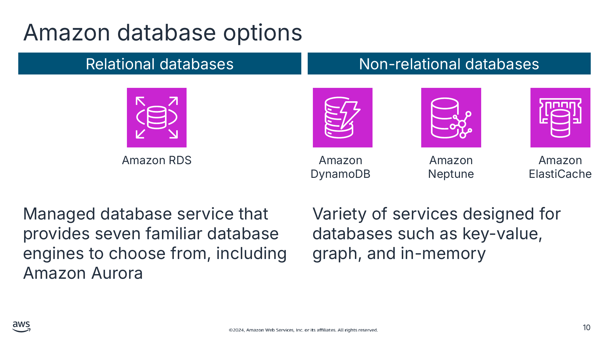

Relational databases

Non-relational databases

Amazon RDS

Amazon DynamoDB

Amazon Neptune

Amazon ElastiCache

Managed database service that provides seven familiar database engines to choose from, including Amazon Aurora

Variety of services designed for databases such as key-value, graph, and in-memory

> **Нотатки:**
>
> |Slide number 10  
> |Instructor notes  
> |  
> |Student notes  
> This module will explain these database options. The purpose of this slide is to provide an overview:  
> The main relational database service option from AWS is Amazon RDS. It is a managed service that you can use to set up, operate, and scale a relational database in the cloud. With Amazon RDS, you can choose from Amazon Aurora with MySQL compatibility, Amazon Aurora with PostgreSQL compatibility, Amazon RDS for MySQL, Amazon RDS for MariaDB, Amazon RDS for PostgreSQL, Amazon RDS for Oracle, and Amazon RDS for SQL Server. Amazon RDS is used for transactional applications like enterprise resource planning (ERP), customer relationship management (CRM), and ecommerce applications to store structured data.  
> There are multiple non-relational database service options. Amazon DynamoDB for key-value databases, Amazon Neptune for graph databases, and Amazon ElastiCache for in-memory databases are a few of them. These are purpose-built databases designed to quickly and efficiently perform the specific functions these applications require.

---

## Слайд 11: Less responsibility with managed AWS database services

| Tasks | Host Database on Premises | Host Database in  Amazon EC2 | Host Database in a Managed AWS Database Service |
|---|---|---|---|
| Power, HVAC, and Network | x |  |  |
| Rack and Stack | x |  |  |
| Server Maintenance | x |  |  |
| OS Installation | x |  |  |
| OS Patches | x |  |  |
| Database Installation | x | x |  |
| Database Patches | x | x |  |
| Database Backups | x | x |  |
| High Availability | x | x |  |
| Scaling | x | x |  |
| Application Optimization | x | x | x |

> **Нотатки:**
>
> |Slide number 11  
> |Instructor notes  
> |  
> |Student notes  
> The table shows the tasks that you are responsible for based on where the database is hosted:  
> When your database is on premises, the database administrator is responsible for everything from application and query optimization to setting up the hardware. The administrator also handles patching the hardware and setting up networking, power, and heating, ventilation, and air conditioning (HVAC).  
> If you move to a database that runs on an Amazon Elastic Compute Cloud (Amazon EC2) instance, you no longer manage the underlying hardware or data center operations. AWS handles the maintenance of the physical data center environment, and the operating system (OS) is pre-installed on the EC2 instance that you launch. However, you are still responsible for scaling, patching the OS, and managing all software and backup operations.  
> If the database is hosted in an AWS managed database offering, such as Amazon RDS or Aurora, AWS is responsible for handling common and repetitive database administration tasks. You are responsible only for optimizing your queries and making sure that the database layer works efficiently for your application. These solutions provide high availability, scalability, and database backups as built-in options that you can configure.  
>
> Your responsibility decreases as you move away from hosting your database on premises to hosting it in managed AWS database services.

---

## Слайд 12: Database capacity planning

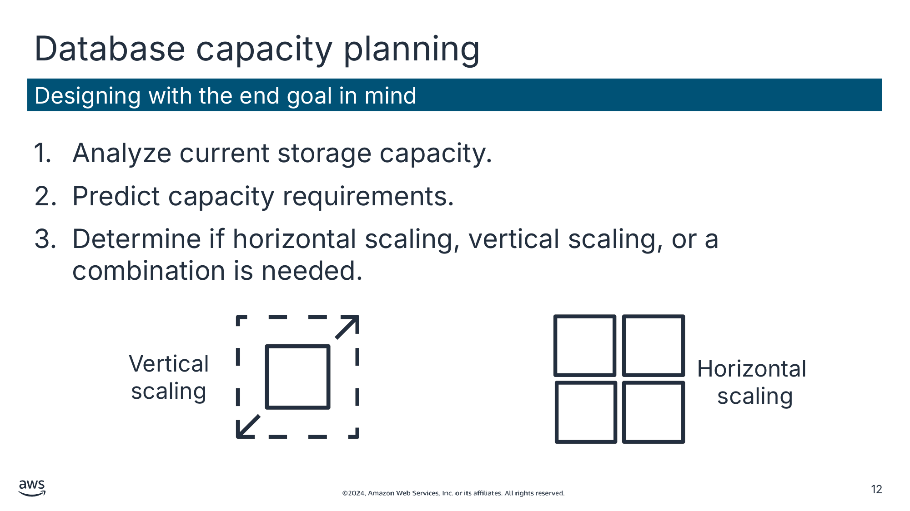

Designing with the end goal in mind

1. Analyze current storage capacity.
2. Predict capacity requirements.
3. Determine if horizontal scaling, vertical scaling, or a combination is needed.

Vertical  
scaling

Horizontal

scaling

> **Нотатки:**
>
> |Slide number 12  
> |Instructor notes  
> |  
> |Student notes  
> Database capacity planning is a process in which you consider the current and future capacity as you select and update your database resources. The goal is to adjust and optimize database resources based on usage patterns and forecasts. Continuously monitor to determine whether the existing infrastructure can sustain the anticipated workload. If it can’t, you will need to evaluate the cost dynamics of scaling up the infrastructure.  
>
> There are two ways to scale databases: vertically and horizontally. Scaling vertically involves expanding the resources that the existing server uses in order to increase its capacity. This complex and time-consuming process includes upgrading memory, storage, or processing power. Usually this means that the database will be down for some period of time. Horizontal scaling involves increasing the number of servers that the database runs on, which decreases the load on the server. The compute capacity is added while the database is running, which usually means that this scaling happens without downtime.

---

## Слайд 13: Key takeaways: Database layer considerations

- When you choose a database, consider scalability, storage requirements, data characteristics, cost, and durability requirements. Database capacity planning is also a consideration.
- Relational databases have strict schema rules, scale vertically, provide data integrity, and work well for structured data stored in tables.
- Non-relational databases have flexible schemas, scale horizontally, provide higher scalability and flexibility, and work well for semi-structured and unstructured data.
- With AWS managed database services, you are responsible only for optimizing your application.

> **Нотатки:**
>
> |Slide number 13  
> |Instructor notes  
> |  
> |Student notes

---

## Слайд 14: Amazon RDS

Adding a Database Layer

> **Нотатки:**
>
> |Slide number 14  
> |Instructor notes  
> |  
> |Student notes  
> This section describes the characteristics and use cases of Amazon RDS and Aurora.

---

## Слайд 15: Amazon Relational Database Service

- Is a managed relational database service to deploy and scale relational databases
- Supports multiple database engines
- Uses Amazon Elastic Block Store (Amazon EBS) volumes for database and log storage

Amazon RDS

> **Нотатки:**
>
> |Slide number 15  
> |Instructor notes  
> |  
> |Student notes  
> Why do you want to run a managed relational database in the AWS Cloud? Because AWS takes over many of the difficult and tedious management tasks of a relational database. Amazon RDS is a fully managed relational database service that you can use to set up, operate, and scale relational databases in the cloud.  
>
> As a managed service, Amazon RDS automates routine database tasks, such as provisioning, patching, backup, recovery, failure detection, and repair. It removes inefficient and time-consuming database administration tasks without needing to provision infrastructure or maintain software. With Amazon RDS, you can choose from Aurora with MySQL compatibility, Aurora with PostgreSQL compatibility, RDS for MySQL, RDS for MariaDB, RDS for PostgreSQL, RDS for Oracle, and RDS for SQL Server.  
>
> Amazon RDS uses Amazon Elastic Block Store (Amazon EBS) volumes for database and log storage. You can scale the storage capacity allocated to your database instance.

---

## Слайд 16: Benefits of Amazon RDS

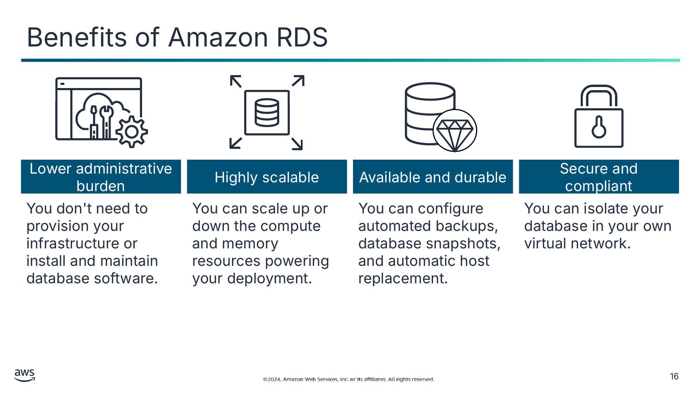

Lower administrative burden

Highly scalable

Available and durable

Secure and compliant

You don't need to provision your infrastructure or install and maintain database software.

You can scale up or down the compute and memory resources powering your deployment.

You can configure automated backups, database snapshots, and automatic host replacement.

You can isolate your database in your own virtual network.

> **Нотатки:**
>
> |Slide number 16  
> |Instructor notes  
> |  
> |Student notes  
> The following are some of the characteristics of Amazon RDS:  
> Lower administrative burden: With Amazon RDS, there is no need to provision infrastructure or to install and maintain database software. Amazon RDS provides a single console and API for managing all your relational databases, and the security and monitoring is built in.  
> Highly scalable: You can scale your Amazon RDS database’s compute and storage resources with only a few mouse clicks or an API call. Amazon RDS provides a selection of instance types that are optimized to fit different relational database use cases. Instance types comprise varying combinations of CPU, memory, storage, and networking capacity and give you the flexibility to choose the appropriate mix of resources for your database. This module will cover Amazon RDS scaling in more detail.  
> Available and durable: With Amazon RDS, you can use replication to enhance availability and reliability for production workloads. By using the Multi-AZ deployment option, you can run mission-critical workloads with high availability and built-in automated failover from your primary database to a synchronously replicated secondary database. By using read replicas, you can scale out beyond the capacity of a single database deployment for read-heavy database workloads.  
> Secure and compliant: You can also use Amazon RDS to run your database instances in Amazon Virtual Private Cloud (Amazon VPC). By using Amazon VPC, you can isolate your database instances and connect to your existing IT infrastructure through an industry-standard-encrypted IPsec virtual private network (VPN). You can configure firewall settings and control network access to your database instances. Many Amazon RDS engine types offer encryption at rest, and all engines support encryption in transit. Amazon RDS offers a wide range of compliance readiness, including Health Insurance Portability and Accountability Act of 1996 (HIPAA) eligibility.

---

## Слайд 17: Amazon RDS database architecture

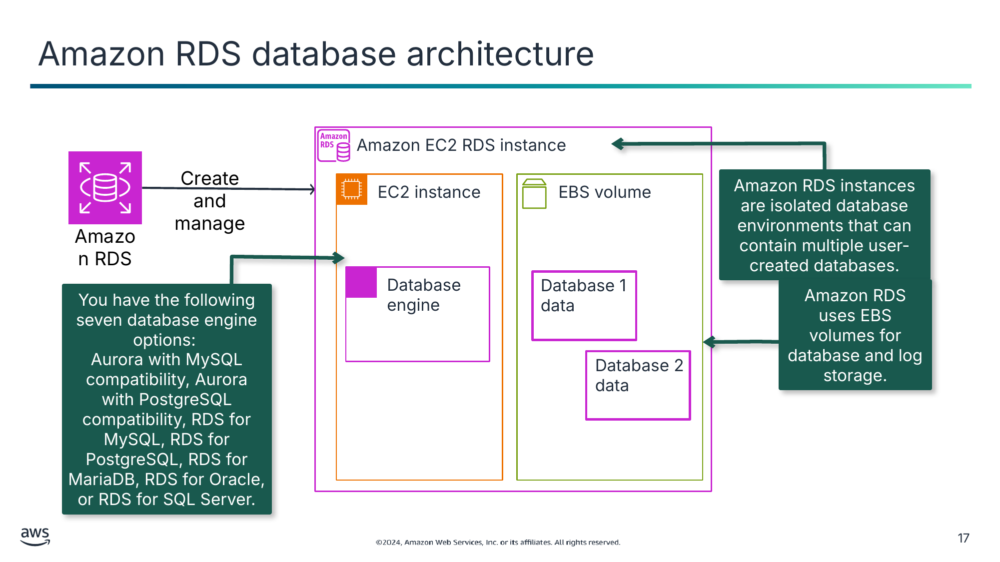

Amazon RDS instances are isolated database environments that can contain multiple user-created databases.

You have the following seven database engine options:  
Aurora with MySQL compatibility, Aurora with PostgreSQL compatibility, RDS for MySQL, RDS for PostgreSQL, RDS for MariaDB, RDS for Oracle, or RDS for SQL Server.

Amazon RDS uses EBS volumes for database and log storage.

Текст зі схеми

Amazon EC2 RDS instance

Create and manage

EC2 instance

EBS volume

Amazon RDS

Database engine

Database 1 data

Database 2 data

> **Нотатки:**
>
> |Slide number 17  
> |Instructor notes  
> |  
> |Student notes  
> Amazon RDS provides a way for you to deploy relational database management systems with the engine and deployment environment of your choice. With Amazon RDS, you have the choice to deploy on any of seven managed database engines in the cloud, including Amazon Aurora with MySQL compatibility, Amazon Aurora with PostgreSQL compatibility, Amazon RDS for MariaDB, Amazon RDS for MySQL, Amazon RDS for PostgreSQL, Amazon RDS for Oracle, and Amazon RDS for SQL Server.  
>
> Amazon RDS facilitates the deployment and maintenance of relational databases in the cloud. It manages a specialized EC2 instance that provides computing capacity.  
> Amazon RDS instances are isolated database environments that can contain multiple user-created databases. Each database contains your organization's data.  
> The database engine allows for storing, sorting, and retrieving your data.  
>
> Amazon RDS uses EBS volumes for database and log storage. You can scale the storage capacity allocated to your database instance.

---

## Слайд 18: Architecture diagram of a database layer

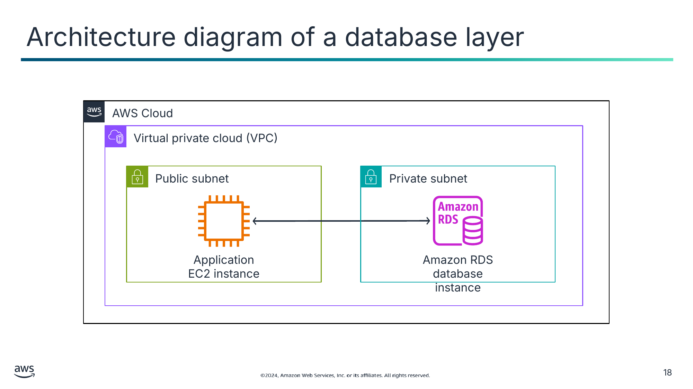

Текст зі схеми

AWS Cloud

Virtual private cloud (VPC)

Public subnet

Private subnet

Application EC2 instance

Amazon RDS database instance

> **Нотатки:**
>
> |Slide number 18  
> |Instructor notes  
> |  
> |Student notes  
> This architecture diagram shows the EC2 instance and the Amazon RDS instance inside an Amazon Virtual Private Cloud (Amazon VPC).  
>
> A Virtual Private Cloud (VPC) is an isolated virtual environment in which you can launch AWS resources. You will learn more about VPCs elsewhere in this course.  
>
> In this module, you will get hands-on experience creating a database layer by using Amazon RDS. You will choose a database engine when launching the database.

---

## Слайд 19: Aurora

- Is a relational database management system (RDBMS) built for the cloud with full MySQL and PostgreSQL compatibility
- Is managed by Amazon RDS
- Provides high performance and availability at one-tenth of the cost
- Delivers Multi-AZ deployments with Aurora Replicas

Aurora

> **Нотатки:**
>
> |Slide number 19  
> |Instructor notes  
> |  
> |Student notes  
> Aurora is a MySQL and PostgreSQL-compatible RDBMS built for the cloud:  
> Aurora is up to five times faster than standard MySQL databases and three times faster than standard PostgreSQL databases.  
> It provides the security, availability, and reliability of commercial databases at approximately one-tenth the cost.  
> Aurora is fully managed by Amazon RDS, which automates time-consuming administration tasks such as hardware provisioning, database setup, patching, and backups.  
> Aurora features a distributed, fault-tolerant, self-healing storage system that auto scales up to 64 TB per database instance.  
> It delivers high performance and availability with up to 15 low-latency read replicas, point-in-time recovery, continuous backup to Amazon Simple Storage Service (Amazon S3), and replication across three Availability Zones.

---

## Слайд 20: Aurora database clusters

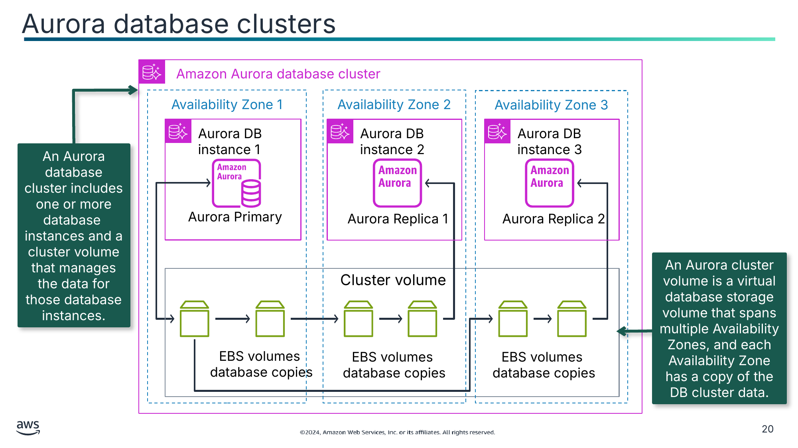

An Aurora database cluster includes one or more database  instances and a cluster volume that manages the data for those database instances.

An Aurora cluster volume is a virtual database storage volume that spans multiple Availability Zones, and each Availability Zone has a copy of the DB cluster data.

Текст зі схеми

Amazon Aurora database cluster

Availability Zone 1

Availability Zone 2

Availability Zone 3

Aurora DB instance 1

Aurora DB instance 2

Aurora DB instance 3

Aurora Primary

Aurora Replica 1

Aurora Replica 2

Cluster volume

EBS volumes

database copies

EBS volumes

database copies

EBS volumes

database copies

> **Нотатки:**
>
> |Slide number 20  
> |Instructor notes  
> |  
> |Student notes  
> Image description: An Amazon Aurora database cluster showing a Primary instance in Availability Zone 1, and one replica instance in both Availability Zone 2 and 3. Each instance connects to a set of EBS volumes in the same Availability zone. The Primary instance copies its database to its EBS volumes and those are copied to EBS volumes for each of the database replicas. The EBS volumes are in the Aurora Cluster volume which spans across all three Availability Zones. End description.  
>
> An Aurora database cluster consists of one or more database (DB) instances and a cluster volume that manages the data for those database instances. An Aurora cluster volume is a virtual database storage volume that spans multiple Availability Zones, and each Availability Zone has a copy of the database cluster data. Two types of database instances make up an Aurora database cluster:  
> A primary database instance supports read and write operations and performs all of the data modifications to the cluster volume. Each Aurora DB cluster has one primary DB instance.  
> An Aurora replica connects to the same storage volume as the primary DB instance and supports only read operations. Each Aurora database cluster can have up to 15 Aurora replicas in addition to the primary DB instance. Maintain high availability by locating Aurora replicas in separate Availability Zones. Aurora automatically fails over to an Aurora replica in case the primary DB instance becomes unavailable. You can specify the failover priority for Aurora replicas. Aurora replicas can also offload read workloads from the primary DB instance.

---

## Слайд 21: Aurora Serverless

- Is an on-demand auto scaling configuration for Aurora
- Provides hands-off capacity management
- Provides fine-grained scaling
- Is suitable for the following:
  - Variable workloads
  - New applications
  - Development and testing
  - Capacity planning

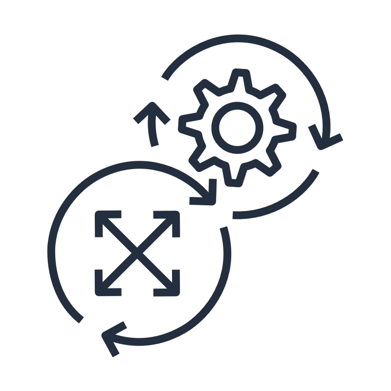

> **Нотатки:**
>
> |Slide number 21  
> |Instructor notes  
> |  
> |Student notes  
> Amazon Aurora Serverless is an on-demand, auto scaling configuration for Aurora where the database automatically starts up, shuts down, and scales capacity up or down based on your application's needs. This configuration helps you manage and provision database capacity.  
>
> With Aurora Serverless, you can run your database in the cloud without managing any database instances. You can also use Aurora Serverless v2 instances along with provisioned instances in your existing or new database clusters.  
>
> The granularity of scaling in Aurora Serverless v2 helps you to match capacity closely to your database's needs.  
>
> Aurora Serverless v2 is particularly useful for the following use cases:  
> Variable workloads: You're running workloads that have sudden and unpredictable increases in activity. With Aurora Serverless v2, your database automatically scales capacity to meet the needs of the application's peak load and scales back down when the surge of activity is over.  
> New applications: You're deploying a new application and you're unsure about the DB instance size you need. By using Aurora Serverless v2, you can set up a cluster with one or many DB instances and have the database auto scale to the capacity requirements of your application.  
> Development and testing: With Aurora Serverless v2, you can create DB instances with a low minimum capacity. You can set the maximum capacity high enough that those DB instances can still run substantial workloads without running low on memory. When the database isn't in use, all of the DB instances scale down to avoid unnecessary charges.  
> Capacity planning: Suppose that you usually adjust your database capacity or verify the optimal database capacity for your workload by modifying the DB instance classes of all the DB instances in a cluster. With Aurora Serverless v2, you can avoid this administrative overhead. You can determine the appropriate minimum and maximum capacity by running the workload and checking how much the DB instances actually scale. You can modify existing DB instances from provisioned to Aurora Serverless v2 or from Aurora Serverless v2 to provisioned. You don't need to create a new cluster or a new DB instance in such cases.

---

## Слайд 22: Amazon RDS use case: Banking transactions

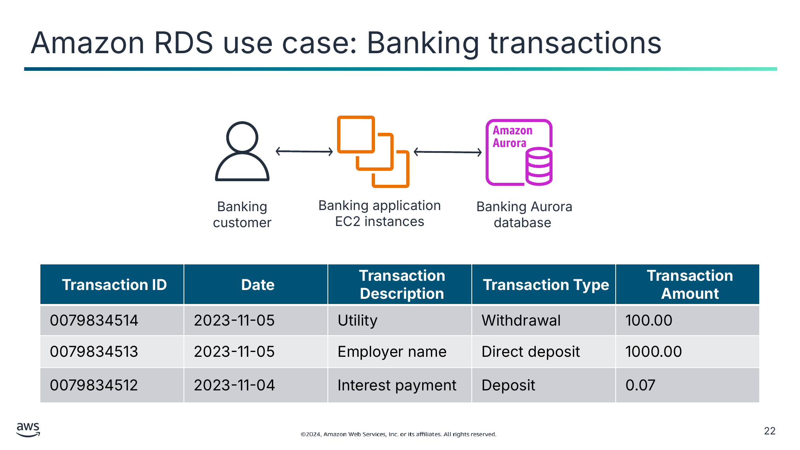

| Transaction ID | Date | Transaction Description | Transaction Type | Transaction Amount |
|---|---|---|---|---|
| 0079834514 | 2023-11-05 | Utility | Withdrawal | 100.00 |
| 0079834513 | 2023-11-05 | Employer name | Direct deposit | 1000.00 |
| 0079834512 | 2023-11-04 | Interest payment | Deposit | 0.07 |

Текст зі схеми

Banking application  
EC2 instances

Banking customer

Banking Aurora database

> **Нотатки:**
>
> |Slide number 22  
> |Instructor notes  
> |  
> |Student notes  
> Amazon RDS is suitable for online transaction processing (OLTP) transactions. OLTP stores and updates transactional data reliably and efficiently in high volumes.  
>
> One use case for Amazon RDS is for transactional tables of data: for example, banking transactions. When the banking customer makes a deposit or withdrawal, they are accessing the banking Aurora database, which is hosted on banking application EC2 instances.  
>
> The table shows a few rows of a banking customer’s checking account. Each transaction has a unique identifier. Data such as the transaction date, description, type, and amount are recorded for each transaction.

---

## Слайд 23: Amazon RDS EC2 instance types and sizing

- General purpose (T4g, T3, M6g, and M5)
- Memory-optimized (R6g, R5, X2g, and X1E)

| Instance type | Memory (GiB) | vCPU |
|---|---|---|
| db.m6g.large | 8 | 2 |
| db.r6g.large | 16 | 2 |
| db.m6g.xlarge | 16 | 4 |
| db.r6g.xlarge | 32 | 4 |

If m6g.large is the instance that needs an upgrade, first identify the issue.

Does it need more memory or CPU?

mg6.xlarge would provide the CPU upgrade.

rg6.large would provide the memory upgrade.

> **Нотатки:**
>
> |Slide number 23  
> |Instructor notes  
> |  
> |Student notes  
> Amazon RDS provides a selection of instance types optimized to fit different relational database use cases. Instance types comprise varying combinations of CPU, memory, storage, and networking capacity and give you the flexibility to choose the appropriate mix of resources for your database. Each instance type includes several instance sizes, which gives you the ability to scale your database to the requirements of your target workload. Not every instance type is supported for every database engine, version, edition, or Region:  
> General purpose Amazon RDS instance types are suitable for CPU-intensive workloads and workloads with moderate CPU usage that experience temporary spikes in use. The T and M family are general purpose instance types.  
> Memory-optimized Amazon RDS instance types are suitable for query-intensive workloads or high connection counts. The R and X family are memory-optimized instance types.  
>
> When it comes to upgrading instance types, first determine if the workload is memory intensive or compute intensive. Identify which resource is constrained, and upgrade based on that deficit.

---

## Слайд 24: Amazon RDS security best practices

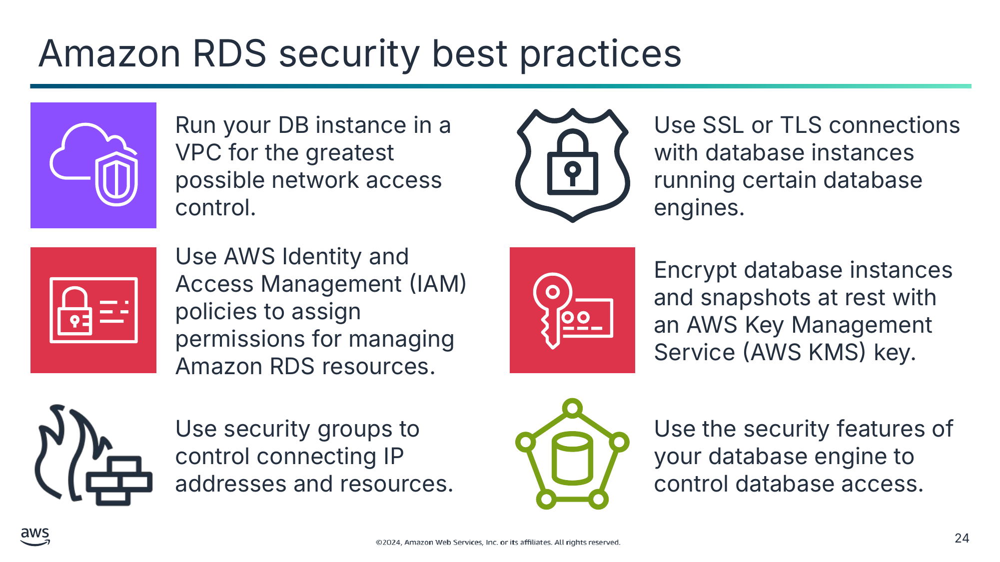

Run your DB instance in a VPC for the greatest possible network access control.

Use SSL or TLS connections with database instances running certain database engines.

Use AWS Identity and Access Management (IAM) policies to assign permissions for managing Amazon RDS resources.

Encrypt database instances and snapshots at rest with an AWS Key Management Service (AWS KMS) key.

Use security groups to control connecting IP addresses and resources.

Use the security features of your database engine to control database access.

> **Нотатки:**
>
> |Slide number 24  
> |Instructor notes  
> |  
> |Student notes  
> Security is a shared responsibility between you and AWS. AWS is responsible for security of the cloud, which means that AWS protects the infrastructure that runs Amazon RDS. Meanwhile, you are responsible for security in the cloud.  
>   
> You can manage access to your Amazon RDS resources and your databases on a database instance. The method you use to manage access depends on the type of task the user needs to perform with Amazon RDS. The following are recommended security best practices:  
> Run your DB instance in a custom and private VPC based on the Amazon VPC service for the greatest possible network access control.  
> Use AWS Identity and Access Management (IAM) policies to assign permissions that determine who is allowed to manage Amazon RDS resources. For example, you can use IAM to determine who is allowed to create, describe, modify, and delete DB instances, tag resources, or modify security groups.  
> Use security groups to control which IP addresses or EC2 instances can connect to your databases on a DB instance. When you first create a DB instance, its firewall prevents any database access except through rules specified by an associated security group.  
> Use SSL or TLS connections with DB instances running the MySQL, MariaDB, PostgreSQL, Oracle, or Microsoft SQL Server database engines.  
> Use Amazon RDS encryption to secure your database instances and snapshots at rest. Amazon RDS encryption uses the industry standard AES-256 encryption algorithm to encrypt your data on the server that hosts your DB instance. For an Amazon RDS encrypted database instance, all logs, backups, and snapshots are encrypted. Amazon RDS uses an AWS Key Management Service (AWS KMS) key to encrypt these resources.  
> Use the security features of your database engine to control who can log in to the databases on a database instance. These features work as if the database were on your local network.

---

## Слайд 25: Key takeaways: Amazon RDS

- Amazon RDS is a managed relational database service that can deploy familiar database engines.
- Aurora is a managed relational database engine built for the cloud. Aurora Serverless provides support for Aurora on-demand auto scaling.
- Amazon RDS provides a selection of instance types that are optimized to fit different relational database use cases.
- Differences in performance, scalability, failover, storage, high availability, backup, and database versions will determine which relational database is the optimum selection.

> **Нотатки:**
>
> |Slide number 25  
> |Instructor notes  
> |  
> |Student notes

---

## Слайд 26: Guided lab: Creating an Amazon RDS Database (Amazon RDS lab)

> **Нотатки:**
>
> |Slide number 26  
> |Instructor notes  
> |  
> |Student notes  
> You will now complete a lab. The next slides summarize what you will do in the lab, and you will find the detailed instructions in the lab environment.

---

## Слайд 27: Amazon RDS lab tasks

- In this lab, you will perform the following main tasks:
  - Create an Amazon RDS database.
  - Configure web application communication with a database instance.
- Open your lab environment to start the lab and find additional details about the tasks that you will perform.

> **Нотатки:**
>
> |Slide number 27  
> |Instructor notes  
> |  
> |Student notes  
> Access the lab environment through your online course to get additional details and complete the lab.

---

## Слайд 28: Debrief: Amazon RDS lab

- When you created your RDS DB instance, why did you configure it as single database instance without a Multi-AZ deployment option?
- What did you need to do so that your application could connect to your database?

> **Нотатки:**
>
> |Slide number 28  
> |Instructor notes  
> |Relevant before and after architectural diagrams are included in the lab instructions for each lab. You might find it helpful to pull the lab diagrams up as part of debriefing this lab.  
> |Suggested responses for question 1: When you created your RDS DB instance, why did you configure it as single database instance without a Multi-AZ deployment option?  
> |The Multi-AZ deployment option automatically creates a replica of the database in a second Availability Zone for high availability. In this lab, however, you were creating only a development (test) RDS instance. Therefore, you used a single database |instance because you did not need high availability.  
> |Suggested responses for question 2: What did you need to do so that your application could connect to your database?  
> |You needed to retrieve the database endpoint so that the application knows how to connect to a database. You found the database endpoint in the Connectivity and Security section of your RDS DB instance.  
> |Then you returned to your browser tab with the Inventory application and entered the database endpoint, initial database name, database username, and password.  
> |  
> |Student notes  
> Your instructor might review these questions with you, or you might review them on your own. Use this opportunity to extend your thinking about the tasks that you performed during the lab.

---

## Слайд 29: Amazon RDS proxy connection management

Adding a Database Layer

> **Нотатки:**
>
> |Slide number 29  
> |Instructor notes  
> |  
> |Student notes  
> This section describes features of Amazon RDS Proxy and backing up data for RDS.

---

## Слайд 30: Amazon RDS Proxy

Fully managed, highly available database proxy for Amazon RDS

More scalable

More resilient

More secure

Pools and shares database connections for improved application scaling

Reduces database failover times for Aurora and Amazon RDS databases by up to 66 percent for Amazon RDS Multi-AZ databases

Enforces IAM authentication and stores credentials in AWS Secrets Manager

> **Нотатки:**
>
> |Slide number 30  
> |Instructor notes  
> |  
> |Student notes  
> Amazon RDS Proxy is a fully managed, highly available database proxy for Amazon RDS. It is available for Aurora with MySQL compatibility, Aurora with PostgreSQL compatibility, RDS for MariaDB, RDS for MySQL, RDS for PostgreSQL, and RDS for SQL Server. You don’t need to provision or manage any additional infrastructure to start using RDS Proxy:  
> RDS Proxy allows applications to pool and share connections established with the database. This makes applications more scalable.  
> RDS Proxy reduces database failover times for Aurora and Amazon RDS databases. This makes applications more available and resilient.  
> RDS Proxy enforces IAM authentication and stores credentials in AWS Secrets Manager. This makes applications more secure.

---

## Слайд 31: Connection pooling: Improved scalability

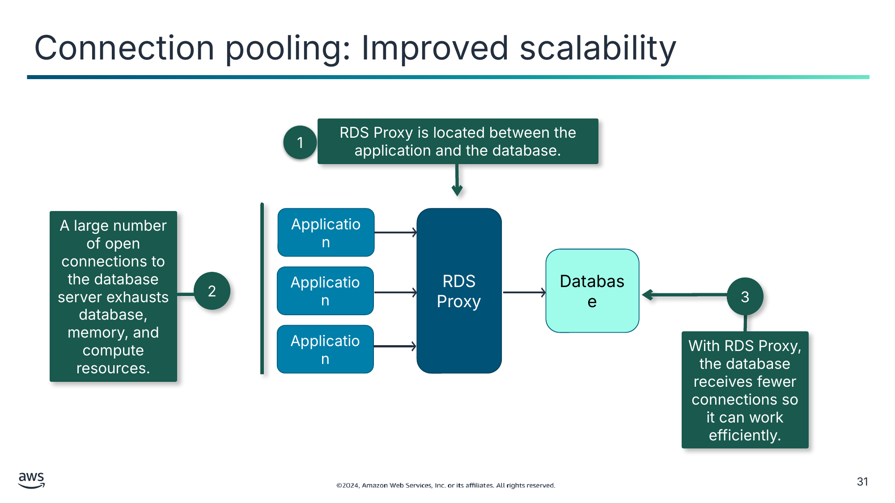

1

RDS Proxy is located between the application and the database.

2

3

With RDS Proxy, the database receives fewer connections so it can work efficiently.

Текст зі схеми

A large number of open connections to the database server exhausts database, memory, and compute resources.

Application

RDS Proxy

Database

Application

Application

> **Нотатки:**
>
> |Slide number 31  
> |Instructor notes  
> |  
> |Student notes  
> This diagram is a representation of how RDS Proxy reduces the number of application connections that reach the database layer.  
> RDS Proxy sits in the middle between the application and database.  
> Many applications, including those built on modern serverless architectures, can have thousands of open connections from the application to the database server. Not all of these connections are always carrying out a transaction. RDS Proxy detects these gaps in operations and reuses the connection to serve other application connections.  
> With the help of RDS Proxy connection pooling, the database receives fewer connections so it can work efficiently without exhausting database memory and compute resources.  
>
> You might want to consider using RDS Proxy in these situations:  
> Any database instance that encounters errors regarding too many connections is a good candidate for associating with a proxy. The proxy enables applications to open many client connections while the proxy manages a smaller number of long-lived connections to the database instance.  
> Applications that typically open and close large numbers of database connections and don't have built-in connection pooling mechanisms are good candidates for using a proxy.  
> Applications that keep a large number of connections open for long periods are typically good candidates for using a proxy. Applications in industries such as software as a service (SaaS) or ecommerce often minimize the latency for database requests by leaving connections open. With RDS Proxy, an application can keep more connections open than it can when connecting directly to the database instance.

---

## Слайд 32: Seamless and fast failover: Improved availability

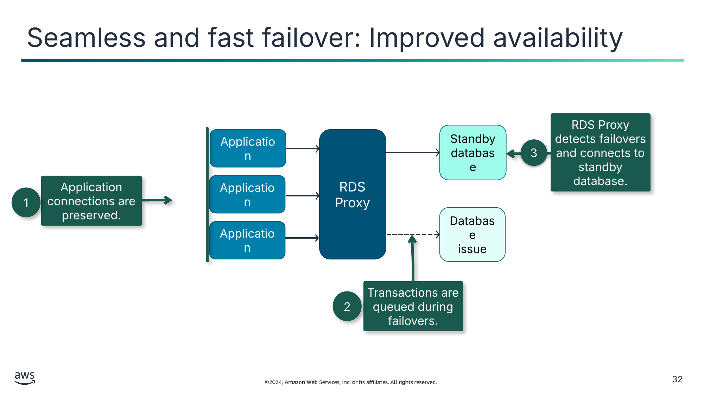

RDS Proxy detects failovers and connects to standby database.

3

Application connections are preserved.

1

Transactions are queued during failovers.

2

Текст зі схеми

Application

RDS Proxy

Standby database

Application

Database

issue

Application

> **Нотатки:**
>
> |Slide number 32  
> |Instructor notes  
> |  
> |Student notes  
> RDS Proxy can help make applications more resilient and transparent to database failures. RDS Proxy bypasses DNS caches to reduce failover times by up to 66 percent for Amazon RDS Multi-AZ databases. RDS Proxy also automatically routes traffic to a new database instance while preserving application connections. This makes failovers more transparent for applications.  
>
> This diagram is a representation of how RDS Proxy makes failover seamless and fast.  
> When a failover happens, RDS Proxy immediately detects this event. RDS Proxy will preserve any connection that is not actively carrying out a transaction. It will also accept new connections that come in.  
> You can use RDS Proxy to queue up any transaction that you may send when the failover is happening.  
> As soon as the new instance is available, it passes any pending transactions that are queued.

---

## Слайд 33: Streamlined authentication: Improved application security

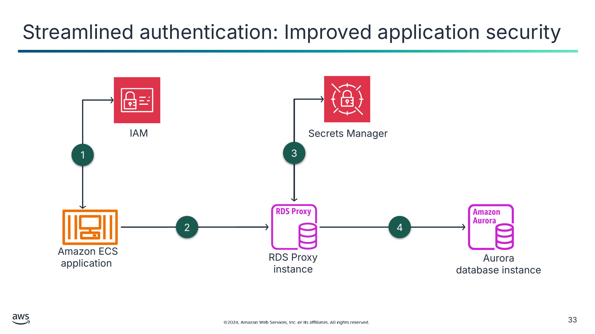

Текст зі схеми

IAM

Secrets Manager

1

3

2

4

Amazon ECS  
application

RDS Proxy instance

Aurora  
database instance

> **Нотатки:**
>
> |Slide number 33  
> |Instructor notes  
> |  
> |Student notes  
> When you use RDS Proxy, IAM authentication is enforced, which improves security. Passwords embedded in code are eliminated, which streamlines security.  
>
> For example, you might not have adopted IAM authentication and Secrets Manager because of the complexity of setting up such authentication for all database instances. If so, you can leave the existing authentication methods in place and delegate the authentication to a proxy. The proxy can enforce the authentication policies for client connections for particular applications. You can take advantage of any IAM authentication that you already have for AWS  Lambda functions instead of managing database credentials in your Lambda application code.  
>
> This diagram is a representation of how RDS Proxy incorporates IAM and Secrets Manager to streamline authentication.  
> The application requests an authentication token from IAM. IAM returns the authentication token to Elastic Container Service (Amazon ECS) application container.  
> The application sends a database request to RDS Proxy connecting with the validated IAM token.  
> RDS Proxy calls Secrets Manager for the mapped identity. Secrets Manager returns the secret (username and password) to RDS Proxy.  
> RDS Proxy sends the database request to the Aurora database instance connecting with the secret.

---

## Слайд 34: Backing up data in Amazon RDS

| Features | Automated Backups | Database Snapshots |
|---|---|---|
| Use Case | Restore a database instance to a specific point in time. | Back up a database instance in a known state, and then restore it to that specific state. |
| Backup Frequency | Daily during your backup window (transaction logs are captured every 5 minutes) | User-initiated (as frequently as the user chooses) |
| Retention Period | The default is 7 days but it can be set to up to 35 days. The backups can be automatically deleted after any retention period. | Kept until the user explicitly deletes it |
| Sharing with Other AWS Accounts | Cannot be shared (needs to be copied to a manual snapshot first) | Can be shared (shared snapshots can be copied by other AWS accounts) |

> **Нотатки:**
>
> |Slide number 34  
> |Instructor notes  
> |  
> |Student notes  
> Amazon RDS provides two different options for backing up and restoring database instances:  
> Automated backups: When automated backups are turned on for your database instance, Amazon RDS automatically performs a full daily snapshot of your data during your preferred backup window and captures transaction logs as updates to your database instance are made. When you initiate a point-in-time recovery, transaction logs are applied to the most appropriate daily backup in order to restore your database instance to the specific time you requested.  
> Database snapshots: These are user-initiated backups that you can use to restore your database instance to a known state as frequently as you like. These snapshots are kept until you explicitly delete them.  
>
> Automated backups and manual snapshots are stored in S3 buckets that are owned and managed by the Amazon RDS service.  
>
> With Amazon RDS, you can copy database snapshots and database cluster snapshots. You can copy automated backups or manual snapshots. After you copy a snapshot, the copy becomes a manual snapshot.  
>   
> You can copy a snapshot within the same AWS Region, you can copy a snapshot across AWS Regions, and you can copy a snapshot across AWS accounts.

---

## Слайд 35: Amazon RDS cross-region backups

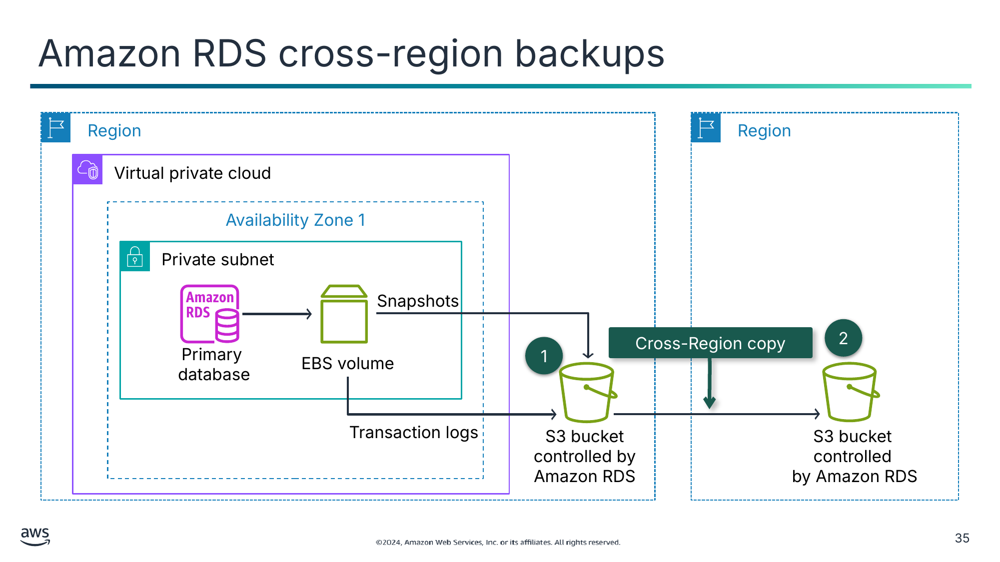

1

Cross-Region copy

2

Текст зі схеми

Region

Region

Virtual private cloud

Availability Zone 1

Private subnet

Snapshots

Primary

database

EBS volume

Transaction logs

S3 bucket controlled by Amazon RDS

S3 bucket  
controlled  
by Amazon RDS

> **Нотатки:**
>
> |Slide number 35  
> |Instructor notes  
> |  
> |Student notes  
> For added disaster recovery capability, you can configure your Amazon RDS database instance to replicate snapshots and transaction logs to a destination AWS Region of your choice.  
> Snapshots and transaction logs from the primary RDS database are stored in an S3 bucket that is controlled by Amazon RDS.  
> When backup replication is configured for a database instance, RDS initiates a cross-Region copy of all snapshots and transaction logs on the database instance.  
> You can specify it to copy automated or manual database to a second AWS Region or to separate AWS accounts.  
>   
> Additionally, with Amazon RDS, you can create a read replica in a different AWS Region from the source DB instance. You can create a read replica in a different AWS Region to do the following:  
> Improve your disaster recovery capabilities.  
> Scale read operations into an AWS Region closer to your users.  
> Make it easier to migrate from a data center in one AWS Region to a data center in another AWS Region.

---

## Слайд 36: Amazon RDS encryption for backups

Amazon RDS can encrypt your RDS DB instances.

- Data at rest by using AWS KMS
- Data in transit by using SSL/TLS

Steps to back up an unencrypted database:

Take a snapshot of the existing unencrypted database instance.

Create a copy of the snapshot, and enable the encryption option.

Restore the encrypted snapshot to a new database instance.

> **Нотатки:**
>
> |Slide number 36  
> |Instructor notes  
> |  
> |Student notes  
> Amazon RDS encrypted DB instances provide an additional layer of data protection by securing your data from unauthorized access to the underlying storage.  
>
> Amazon RDS can encrypt your RDS DB instances:  
> Encryption of data at rest: Amazon RDS encrypts your databases by using keys that you manage with AWS KMS. For an Amazon RDS encrypted database instance, data stored at rest in the underlying storage is encrypted, as are all logs, backups, and snapshots.  
> Encryption of data in transit: Amazon RDS creates an SSL certificate and installs the certificate on the DB instance when the instance is provisioned. Once an encrypted connection is established, data transferred between the DB Instance and your application will be encrypted during transfer. You can also require your DB instance to accept only encrypted connections.  
>   
> After your data is encrypted, Amazon RDS handles the authentication of access and decryption of your data transparently with minimal impact on performance.  
>
> To backup an unencrypted database, you need to create a snapshot, copy it, encrypt the copy, and then build an encrypted database from the snapshot.

---

## Слайд 37: Demo: Amazon RDS Automated Backup and Read Replicas

- This demo uses Amazon RDS.
- In this demonstration, you will see how to:
  - Create a backup database schedule.
  - Create a database read replica.

> **Нотатки:**
>
> |Slide number 37  
> |Instructor notes  
> |This demo is an .mp4 file with captions. Students access it through the online course. The instructor guide includes the duration for each demo.  
> |  
> |Student notes  
> Find this recorded demo in your online course as part of this module.

---

## Слайд 38: Key takeaways: Amazon RDS proxy connection management

- RDS Proxy is a fully managed, highly available database proxy for Amazon RDS.
- By using a Multi-AZ approach, Amazon RDS  synchronously replicates data to provide high availability. There is automatic failover to the standby instance.
- With read replicas, Amazon RDS  asynchronously replicates data to provide high scalability. The standby instance can be manually promoted to stand alone.
- Amazon RDS provides different options for backing up and restoring database instances: automated backups and database snapshots. It offers encryption for data at rest and in transit.

> **Нотатки:**
>
> |Slide number 38  
> |Instructor notes  
> |  
> |Student notes

---

## Слайд 39: Amazon DynamoDB

Adding a Database Layer

> **Нотатки:**
>
> |Slide number 39  
> |Instructor notes  
> |  
> |Student notes  
> This section describes DynamoDB, its features, and how secondary indexing is used to derive insights from data with maximum flexibility.

---

## Слайд 40: DynamoDB

- Is a fully managed, serverless, NoSQL database
- Supports key-value and document data models
- Delivers millisecond performance and can automatically scale tables to adjust for capacity
- Is used for developing applications, mission-critical workloads that prioritize speed, scalability, and data durability

DynamoDB

> **Нотатки:**
>
> |Slide number 40  
> |Instructor notes  
> |  
> |Student notes  
> DynamoDB is a fully managed, serverless, NoSQL database. It supports both key-value and document data models. DynamoDB has a flexible schema, so each item can have many different attributes. A flexible schema gives you the ability to adapt as your business requirements change without the burden of having to redefine the table schema as you would in relational databases.  
>
> DynamoDB can provide consistent response times in the single-digit millisecond range. The database automatically scales tables to adjust for capacity and maintains performance with zero administration. DynamoDB helps secure your data with encryption and continuously backs up your data for protection.

---

## Слайд 41: DynamoDB use cases

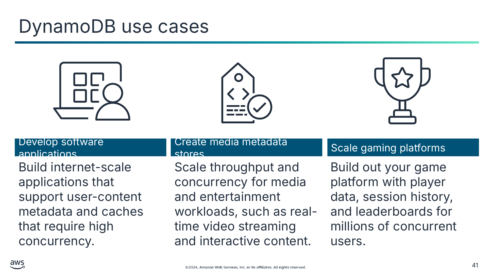

Develop software applications

Create media metadata stores

Scale gaming platforms

Build internet-scale applications that support user-content metadata and caches that require high concurrency.

Scale throughput and concurrency for media and entertainment workloads, such as real-time video streaming and interactive content.

Build out your game platform with player data, session history, and leaderboards for millions of concurrent users.

> **Нотатки:**
>
> |Slide number 41  
> |Instructor notes  
> |  
> |Student notes  
> The following are some use cases in which DynamoDB would be suitable:  
> Developing software applications: Build internet-scale applications that support user-content metadata and caches that require high concurrency and connections for millions of users and millions of requests per second.  
> Creating media metadata stores: Scale throughput and concurrency for media and entertainment workloads, such as real-time video streaming and interactive content, and deliver lower latency with multi-Region replication across AWS Regions.  
> Scaling gaming platforms: Focus on driving innovation with no operational overhead. Build out your game platform with player data, session history, and leaderboards for millions of concurrent users.

---

## Слайд 42: DynamoDB features

Serverless performance with limitless scalability

- Secondary indexes provide flexibility on how to access your data.
- Amazon DynamoDB Streams is ideal for an event-driven architecture.
- Multi-Region, multi-active data replication with global tables

Built-in security and reliability

- DynamoDB encrypts all customer data at rest by default.
- Point-in-time recovery protects data from accidental operations.
- DynamoDB allows fine-grained access control.

> **Нотатки:**
>
> |Slide number 42  
> |Instructor notes  
> |Reference the link in the resource list for a guide to set up DynamoDB.  
> |  
> |Student notes  
> This section further explores some of the features of DynamoDB.  
>
> Serverless performance with limitless scalability  
> DynamoDB offers the option to create global and local secondary indexes that you can use to query the data in the table by using an alternate key. In addition to giving you maximum flexibility on how to access your data, you can provision lower write throughput with excellent performance at a lower cost.  
> Amazon DynamoDB Streams is a change data capture capability. Whenever an application creates, updates, or deletes items in a table, DynamoDB Streams records a time-ordered sequence of every item-level change in near-real time, making it ideal for event-driven architecture applications to consume and action the changes.  Applications can also access this log and view the data items as they appeared before and after they were modified in near-real time.  
> DynamoDB global tables provide multi-active replication of your data across your choice of AWS Regions. Global tables are multi-active, which means that you can write and read from any replica, and your globally distributed applications can access data locally in the selected Regions to get single-digit millisecond read and write performance. Global tables also automatically scale capacity to accommodate your multi-Region workloads.  
>
> Built-in security and reliability  
> DynamoDB uses IAM to authenticate, create, and access resources. It encrypts all customer data at rest by default.  
> Point-in-time recovery (PITR) protects data in DynamoDB tables from accidental write or delete operations. PITR provides continuous backups of your DynamoDB table data, and you can restore that table to any point in time up to the second during the preceding 35 days.  
> With DynamoDB, there are no usernames or passwords. DynamoDB uses IAM to authenticate, create, and access resources. You can specify IAM policies and conditions that allow fine-grained access, restricting read or write access down to specific items and attributes in a table based on the identity of that user. This feature makes it possible for customers to enforce security policies at the code level.

---

## Слайд 43: Amazon DynamoDB data structure

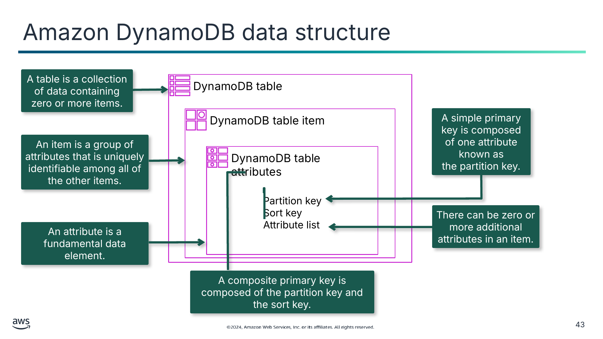

A table is a collection of data containing zero or more items.

A simple primary key is composed of one attribute known as the partition key.

An item is a group of attributes that is uniquely identifiable among all of the other items.

There can be zero or more additional attributes in an item.

An attribute is a fundamental data element.

A composite primary key is composed of the partition key and the sort key.

Текст зі схеми

DynamoDB table

DynamoDB table item

DynamoDB table attributes

Partition key

Sort key

Attribute list

> **Нотатки:**
>
> |Slide number 43  
> |Instructor notes  
> |The documentation page explaining the core components of Amazon DynamoDB is in the course resource document. You will find a diagram that shows a table named People with some example items and attributes.  
> |  
> |Student notes  
> Consider the Amazon DynamoDB data structure to better understand the features it offers.  
> A table is a collection of data. A table is unique to an account ID and a region. Each DynamoDB table contains zero or more items.  
> A DynamoDB item is a group of attributes that is uniquely identifiable among all of the other items. Each attribute consists of a key-value pair. (e.g. Key = Name, Value = Sam)  
> Conceptually, an item is similar to a row of a table. It is the core unit of data in DynamoDB.  
> Each item is composed of one or more attributes. An attribute is a fundamental data element, something that does not need to be broken down any further.  
> Attributes in DynamoDB are similar in many ways to fields or columns in other database systems.  
> All items must have a partition key, also known as a hash key. A simple primary key is composed of one attribute known as the partition key.  
> Having a sort key is optional. A sort key denotes how the items that share the same partition key are sorted within the partition.  
> Sort keys can be timestamps, version numbers, or audit log IDs. The sort keys are used to create groupings of data.  
> A composite primary key is the combination of the partition key and sort key which will uniquely identify an item. Having a primary key enables rich query capabilities.  
> There can be zero or more additional attributes in an item.

---

## Слайд 44: Amazon DynamoDB sample base table

| Partition key =  Device ID: 1 | • Sort key = • Timestamp: 2023-11-20 15:42:00 | Attribute = Temperature: 41.9 | • Attribute = • Error Status: Low |
|---|---|---|---|
| Partition key =  Device ID: 1 | • Sort key = • Timestamp: 2023-11-20 15:42:30 | Attribute = Temperature: 42 |  |
| Partition key =  Device ID: 1 | • Sort key = • Timestamp: 2023-11-20 15:43:00 | Attribute = Temperature: 39 | • Attribute = • Error Status: Low |
| Partition key =  Device ID: 2 | • Sort key = • Timestamp: 2023-11-20 15:42:00 | Attribute = Temperature: 47 | • Attribute = • Error Status: Low |
| Partition key =  Device ID: 2 | • Sort key = • Timestamp: 2023-11-20 15:42:30 | Attribute = Temperature: 49 | • Attribute = • Error Status: High |
| Partition key =  Device ID: 2 | • Sort key = Timestamp: • 2023-11-20 15:43:00 | Attribute = Temperature: 46.9 |  |

> **Нотатки:**
>
> |Slide number 44  
> |Instructor notes  
> |  
> |Student notes  
> This is a representation of a DynamoDB base table of IoT sensor data from two devices.  
> The partition key is the device ID for device 1 and 2. The sort key is a timestamp of the reading of each device.  
> The items shown have temperature as an attribute.  
> The items also have the attribute error status of low and high when the temperature recorded was within or outside of the optimal range.  
>
> This sample base table is used for a query to read the attributes associated with a device. Alternatively, the whole table can be read to get all device readings with a table scan.  
>
> Sometimes you want to query based on attributes other than the partition keys or sort keys without having to do a full table scan. To support alternate query patterns in DynamoDB, you can use secondary indexes.

---

## Слайд 45: Alternate schema using a global secondary index

Base table

| Partition key =  Device ID: 1 | • Sort key = Timestamp: • 2023-11-20 15:42:00 | Attribute = Temperature: 41.9 | • Attribute = • Error Status: Low |
|---|---|---|---|
| Partition key =  Device ID: 1 | • Sort key = Timestamp: • 2023-11-20 15:42:30 | Attribute = Temperature: 42 |  |
| Partition key =  Device ID: 2 | • Sort key = Timestamp: • 2023-11-20 15:42:30 | Attribute = Temperature: 49 | • Attribute = • Error Status: High |
| Partition key =  Device ID: 2 | • Sort key = Timestamp: • 2023-11-20 15:43:00 | Attribute = Temperature: 46.9 |  |

**Query 1:** For a given device id and timestamp, find the associated temperature and error status.

Global Secondary Index (GSI)  
[Eventual consistency]

| • Partition key = • Temperature: 49 | Sort key =  Device ID: 2 | • Attribute = Timestamp: • 2023-11-20 15:42:30 | Attribute = Error Status: High |
|---|---|---|---|

**Query 2:**

For a given temperature and device id, find the associated error status and timestamp.

Alternate partition key as base table

Alternate sort key as base table

> **Нотатки:**
>
> |Slide number 45  
> |Instructor notes  
> |  
> |Student notes  
> With a global secondary index (GSI), DynamoDB creates a read-only copy of the base table in which you can pivot the data around different partition and sort keys. You do not have to include every attribute of your items in the GSI. This provides an alternate schema on your DynamoDB base table.  
>
> DynamoDB copies data from your base table into your GSI asynchronously and data becomes eventually consistent with the base table. The default behavior is that all copies of data usually reach consistency within 1 second. When you read data from a GSI, the response might not reflect the results of a recently completed write operation on the base table.  
>
> In the above example, the base table explained earlier is shown. The base table is used to obtain readings for a given device id and timestamp.  
>
> The GSI of the same data is shown. An alternate partition key of temperature and sort key of device id has been specified. From the GSI, you can query the associated readings for a given temperature and device id.  
> Both the partition key and the sort key can be different from the base table in GSIs.  
> You can create and remove a GSI  at any time.  
> There are no data size limits. The maximum number of GSIs per DynamoDB table is 20.  
> Separate capacity is provisioned for GSIs.  
> When you query a GSI, you get eventual consistent reads.

---

## Слайд 46: Alternate schema using a local secondary index

Base table

| Partition key =  Device ID: 1 | • Sort key = Timestamp: • 2023-11-20 15:42:00 | Attribute = Temperature: 41.9 | • Attribute = • Error Status: Low |
|---|---|---|---|
| Partition key =  Device ID: 1 | • Sort key = Timestamp: • 2023-11-20 15:42:30 | Attribute = Temperature: 42 |  |
| Partition key =  Device ID: 2 | • Sort key = Timestamp: • 2023-11-20 15:42:30 | Attribute = Temperature: 49 | • Attribute = • Error Status: High |
| Partition key =  Device ID: 2 | • Sort key = Timestamp: • 2023-11-20 15:43:00 | Attribute = Temperature: 46.9 |  |

**Query 1:** For a given device id and timestamp, find the associated temperature and error status.

Local Secondary Index (LSI)

[Eventual or strong consistency]

| Partition key =  Device ID: 2 | Sort key =  Error Status: High | Attribute = Temperature: 49 | • Attribute = Timestamp: • 2023-11-20 15:42:30 |
|---|---|---|---|

**Query 2:**

For a given device id and error status, find its temperature and timestamp.

Same partition key as base table

Alternate sort key as base table

> **Нотатки:**
>
> |Slide number 46  
> |Instructor notes  
> |  
> |Student notes  
> You can retrieve data from a DynamoDB base table using eventual consistency or strong consistency. If you request a strongly consistent read, DynamoDB returns a response with the most up-to-date data. The response reflects the updates from all previous write operations that were successful.  
>
> If your use case requires strongly consistent reads, you could implement an alternate schema with a local secondary index (LSI).  
>
> In the example above, the base table explained earlier is shown. It provides the associated temperature and error status for a given device id and timestamp.  
>
> In the LSI, the same partition key and an alternate sort key as the base table have been specified. This will provide the temperature and timestamp for a given device ID and error status.  
> The partition key stays the same as the base table, but the sort key can be different from the base table in an LSIs.  
> LSIs must be created along with the table. You cannot add or remove an LSI later.  
> There are data size limits. The maximum number of LSIs per DynamoDB base table is five.  
> Queries or scans on an LSI consume read capacity from the base table.  
> When you query a LSI, you choose either eventual consistency or strong consistency.

---

## Слайд 47: Multi-region replication: Amazon DynamoDB global tables

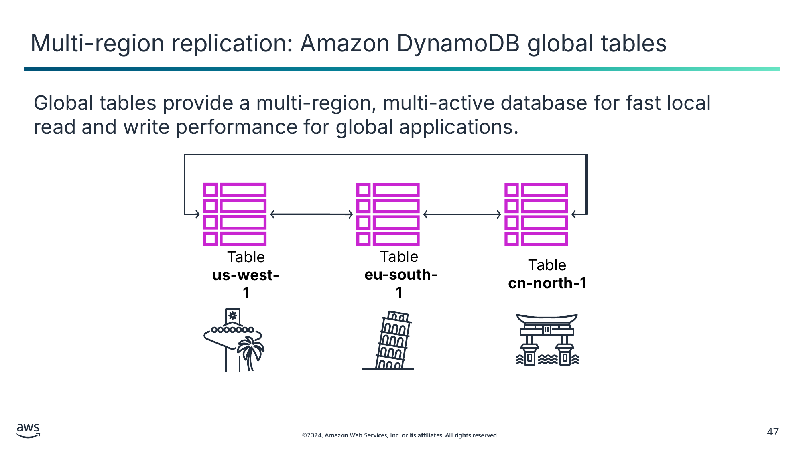

Global tables provide a multi-region, multi-active database for fast local read and write performance for global applications.

Table

**us-west-1**

Table

 **eu-south-1**

Table

**cn-north-1**

cn-north-1

> **Нотатки:**
>
> |Slide number 47  
> |Instructor notes  
> |  
> |Student notes  
> By default, Amazon DynamoDB replicates your data across multiple Availability Zones in a single Region. However, there might be occasions when you want to replicate your data across multiple Regions.  
>
> A global table is a collection of one or more replica tables, all owned by a single AWS account. A replica table is a single DynamoDB table that functions as a part of a global table. Each replica stores the same set of data items. You can add replica tables to the global table so that it can be available in additional Regions.  
>
> Amazon DynamoDB global tables provide a fully managed, serverless solution for deploying a multi-region, multi-active database. As global tables replicate your Amazon DynamoDB tables automatically across your choice of AWS Regions, you can achieve fast, local read and write performance. Global tables also eliminate the difficult work of replicating data between regions and resolving update conflicts for multi-active workloads. In addition, global tables enable your applications to stay highly available even in the rare event of isolation or degradation of an entire region.  
>
> Scenario: Suppose that you have a large customer base spread across three geographic areas—the US west coast, the South of Europe, and north of China. Customers must update their profile information while they use your application.  
> Solution with Amazon DynamoDB global tables: You could create a global table that consists of your three Region-specific CustomerProfiles tables. DynamoDB would then automatically replicate data changes among those tables. Changes to CustomerProfiles data in one Region would seamlessly propagate to the other Regions. In addition, if one of the AWS Regions became temporarily unavailable, your customers could still access the same CustomerProfiles data in the other Regions.

---

## Слайд 48: DynamoDB security best practices

Preventative

Detective

- Use IAM roles to authenticate access.
- Use IAM policies for DynamoDB base authorization.
- Use IAM policy conditions for fine-grained access control.
- Use a VPC endpoint and policies to access DynamoDB.

- Use AWS CloudTrail to monitor AWS managed AWS KMS key usage.
- Monitor DynamoDB operations by using CloudTrail.
- Monitor DynamoDB configuration with AWS Config.
- Monitor DynamoDB compliance with AWS Config rules.

> **Нотатки:**
>
> |Slide number 48  
> |Instructor notes  
> |  
> |Student notes  
> DynamoDB encrypts all user data at rest stored in tables, indexes, streams, and backups by using encryption keys stored in AWS KMS. This provides an additional layer of data protection by securing your data from unauthorized access to the underlying storage.  
>
> The following best practices can help you anticipate and prevent security incidents in DynamoDB:  
> Use IAM roles to authenticate access: For users, applications, and other AWS services to access DynamoDB, they must include valid AWS credentials in their AWS API requests.  
> Use IAM policies for DynamoDB base authorization: When granting permissions, you decide who is getting them, which DynamoDB APIs they are getting permissions for, and the specific actions you want to allow on those resources. Implementing least privilege is key in reducing security risk and the impact that can result from errors or malicious intent. Attach permissions policies to IAM identities (that is, users, groups, and roles) and thereby grant permissions to perform operations on DynamoDB resources.  
> Use IAM policy conditions for fine-grained access control: When you grant permissions in DynamoDB, you can specify conditions that determine how a permissions policy takes effect.  
> Use a VPC endpoint and policies to access DynamoDB: If you require access to DynamoDB only from within a VPC, you should use a VPC endpoint to limit access from only the required VPC. Doing this prevents that traffic from traversing the open internet and being subject to that environment.  
>
> The following best practices for DynamoDB can help you detect potential security weaknesses and incidents:  
> Use AWS CloudTrail to monitor AWS managed AWS KMS key usage: If you are using an AWS managed key for encryption at rest, usage of this key is logged into CloudTrail. CloudTrail provides visibility into user activity by recording actions taken on your account.  
> Monitor DynamoDB operations by using CloudTrail: When activity occurs in DynamoDB, that activity is recorded in a CloudTrail event along with other AWS service events in the event history.  
> Monitor DynamoDB configuration with AWS Config: By using AWS Config, you can continuously monitor and record configuration changes of your AWS resources. You can also use AWS Config to inventory your AWS resources.  
> Monitor DynamoDB compliance with AWS Config rules: AWS Config continuously tracks the configuration changes that occur among your resources. It checks whether these changes violate any of the conditions in your rules. If a resource violates a rule, AWS Config flags the resource and the rule as noncompliant. By using AWS Config to evaluate your resource configurations, you can assess how well your resource configurations comply with internal practices, industry guidelines, and regulations.

---

## Слайд 49: Key takeaways: Amazon DynamoDB

- DynamoDB is a fully managed, serverless, NoSQL database that supports key-value and document data models.
- DynamoDB offers global and local secondary indexes to provide flexibility on how to access your data.
- Global tables provide a multi-Region, multi-active database for fast performance for global applications.
- DynamoDB encrypts all user data at rest stored in tables, indexes, and streams. Preventative and detective security best practices help ensure data protection.

> **Нотатки:**
>
> |Slide number 49  
> |Instructor notes  
> |  
> |Student notes

---

## Слайд 50: Purpose-built databases

Adding a Database Layer

> **Нотатки:**
>
> |Slide number 50  
> |Instructor notes  
> |  
> |Student notes  
> This section describes the relational database offering Amazon Redshift and six non-relational database options that are purpose-built for specific use cases.

---

## Слайд 51: The evolution of purpose-built databases

| Opportunity | Database Evolution | AWS Examples |
|---|---|---|
| Improve on hierarchical databases' limited abilities to define relationships among data. | Relational | Amazon RDS |
| Improve performance by separating read-heavy reporting from an application's transactional database. | Data warehouse/ OLAP | Amazon Redshift |
| Analyze the more varied types of data being generated in large amounts on the internet. | Non-relational | DynamoDB |
| Take advantage of cloud computing's freedom to scale data stores up and down based on actual usage, and the ease of connecting different microservices to purpose-built data stores. | • Purpose-built: • Document • Wide-column • In-memory • Graph • Timeseries • Ledger | • Fully managed database services: • Amazon DocumentDB • Amazon Keyspaces • MemoryDB • Neptune • Timestream • Amazon QLDB |

> **Нотатки:**
>
> |Slide number 51  
> |Instructor notes  
> |  
> |Student notes  
> Application architectures have changed quite a bit in recent decades. Each of the major shifts focused on splitting up your application to improve scaling and resiliency. Parallel to the evolution of application architecture is the evolution of how you store and access data in increasingly purpose-built solutions. Relational databases replaced hierarchical ones, which had limited abilities to define relationships among data. Data warehouses evolved as a way to separate operational reporting, which requires read-heavy querying across a full dataset, from the application's transactional database, which is focused on fast reads and writes in a much smaller set of records. Data warehouses are still relational databases, but they are online analytical processing (OLAP) databases that have been optimized for reporting and analytics.  
>
> As the internet era took off, organizations started to get more varied types of data, which they wanted to be able to analyze. This new variety of data was less structured and needed less rigid rules. This change in the types of data led to the development of the first non-relational databases in the late 90s.  
>
> Cloud computing gave organizations the freedom to scale data stores up and down based on actual usage. Coupled with a move toward microservices, the flexibility of the cloud made it attractive to connect different application components to different databases rather than relying on a single multipurpose one. Additional non-relational purpose-built databases emerged to give developers the ability to optimize the storage that is connected to a component to match the data type and processing of that component. For example, developers might use a ledger database for financial transactions.  
>
> Other sections in this module have looked in more depth at Amazon RDS and DynamoDB. This section provides a quick overview of Amazon Redshift and the six purpose-built databases that this slide describes.

---

## Слайд 52: Amazon Redshift

- Is a fully managed, cloud-based data warehousing service designed to handle petabyte-scale analytics workloads
- Achieves optimum query performance with columnar storage
- Has an Amazon Redshift Serverless option
- Is used for online analytics processing (OLAP)

Amazon Redshift

> **Нотатки:**
>
> |Slide number 52  
> |Instructor notes  
> |  
> |Student notes  
> Data warehouses are relational databases that have been optimized for reporting and analytics. This involves reading large amounts of data to understand relationships and trends across the data.  A data warehouse requires that the data be organized in a tabular format, which is needed so that SQL can be used to query the data. A database is used to capture and store data, such as recording details of a transaction.  
>
> An Amazon Redshift data warehouse is an enterprise-class relational database query and management system. Amazon Redshift supports client connections with many types of applications, including business intelligence (BI), reporting, data, and analytics tools. Amazon Redshift is an open source database that is optimized for high performance and analysis of massive datasets. It is a suitable choice if you primarily need to store and analyze massive amounts of data quickly and efficiently, typically met by an OLAP application.  
> Amazon Redshift achieves efficient storage and optimum query performance through a combination of massively parallel processing, columnar data storage, and very efficient, targeted data compression encoding schemes. Columnar storage for database tables drastically reduces the overall disk I/O requirements. It reduces the amount of data that you need to load from disk.  
> Amazon Redshift manages all of the work of setting up, operating, and scaling a data warehouse. These tasks include provisioning capacity, monitoring and backing up the cluster, and applying patches and upgrades to the Amazon Redshift engine.  
> Amazon Redshift Serverless is designed for unpredictable workloads. Amazon Redshift Serverless adjusts capacity in seconds to deliver consistently high performance.  
>
> The following are some use cases for Amazon Redshift:  
> Automatically create, train, and deploy machine learning models to improve financial and demand forecasts.  
> Securely share data among accounts, organizations, and partners while building applications on top of third-party data.  
> Increase developer productivity by getting simplified data access without configuring drivers and managing database connections.

---

## Слайд 53: AWS fully managed purpose-built database options

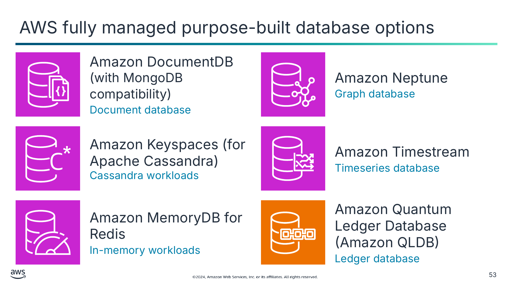

Amazon DocumentDB (with MongoDB compatibility)

Document database

Amazon Neptune

Graph database

Amazon Keyspaces (for Apache Cassandra)  
Cassandra workloads

Amazon Timestream

Timeseries database

Amazon MemoryDB for Redis

In-memory workloads

Amazon Quantum Ledger Database (Amazon QLDB)

Ledger database

> **Нотатки:**
>
> |Slide number 53  
> |Instructor notes  
> |  
> |Student notes  
> The slide summarizes the six types of AWS purpose-built databases:  
> Amazon DocumentDB (with MongoDB compatibility) is a fast, scalable, document database service that supports MongoDB workloads.  
> Amazon Keyspaces (for Apache Cassandra) is a highly available and managed Apache Cassandra–compatible database service.  
> Amazon MemoryDB for Redis is a Redis-compatible, durable, in-memory database service for ultra-fast performance.  
> Amazon Neptune is a fast, reliable, fully managed graph database service that you can use to build and run applications that work with highly connected datasets.  
> Amazon Timestream is a scalable, fully managed, fast timeseries database service for IoT and operational applications.  
> Amazon Quantum Ledger Database (QLDB) is a fully managed ledger database that tracks each and every application data change and maintains a complete and verifiable history of changes over time.  
>
> All of these databases are fully managed cloud services that help you limit the time and cost of experimenting and maintaining different types of databases.

---

## Слайд 54: Matching a database to your business need

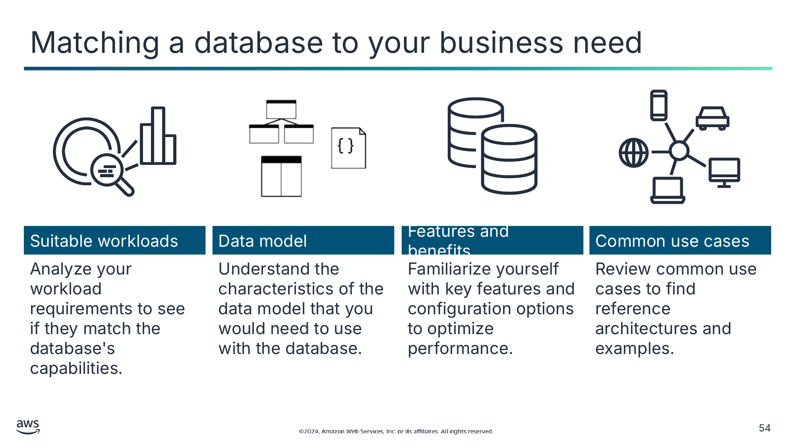

Suitable workloads

Data model

Features and benefits

Common use cases

Analyze your workload requirements to see if they match the database's capabilities.

Understand the characteristics of the data model that you would need to use with the database.

Familiarize yourself with key features and configuration options to optimize performance.

Review common use cases to find reference architectures and examples.

> **Нотатки:**
>
> |Slide number 54  
> |Instructor notes  
> |  
> |Student notes  
> The concept of having purpose-built databases closely aligns with the performance efficiency pillar of the AWS Well-Architected Framework. It is essential to select the right tool for the job. This section presents examples of AWS databases suited to specific types of data and workloads.  
>
> As an architect choosing a database, thinking about the workload requirements and the data model that fits those requirements is an important first step. You then evaluate available database options to choose one that best matches your use case. Take advantage of your selected databases features and configurations to optimize the database for your use case. It is also helpful to review common use cases to learn about proven ways of doing things and to find reference architectures and examples to help guide your architecture designs.  
>
> The remaining slides in this section summarize each of the six databases presented on the previous slide along these four elements: suitable workloads, data model, key features/benefits, and common use cases.

---

## Слайд 55: Amazon DocumentDB

Suitable workloads

Data model

Features and benefits

Common use cases

- Require a flexible schema for fast, iterative development
- Need to store data that has different attributes and data values

- Uses a document data model
- Stores and quickly accesses documents
- Queries on any attribute

- Is a MongoDB-compatible, JSON document database
- Is good for complex documents that are dynamic and require one-time querying, indexing, and aggregations

- Content management system (CMS)
- Customer profiles
- Storage and management of operational data from any source

> **Нотатки:**
>
> |Slide number 55  
> |Instructor notes  
> |  
> |Student notes  
> Suitable workloads  
> Some organizations need to have a way to store data that has different attributes and data value. An example is online customer profiles in which different users provide different types of information. There is a need for a flexible schema to store each user's profile efficiently by storing only the attributes that are specific to each user. When a user elects to add or remove information from their profile, the data should be replaced with an updated version. Some workloads require this level of individuality and fluidity.  
>
> Data model  
> This database uses a document data model. Documents are often used to store semi-structured data in field-value pairs and are typically stored as JSON files. A simple document has one or more fields that are all at the same level within the document. In the following example, the fields LName, FName, and DOB are all siblings within the document. When information is organized in a simple document, each field is managed individually. To retrieve a person’s full name, you must retrieve LName and FName as individual data items.  
>
> {  
> "LName": "Rivera",  
> "FName": "Martha",  
> "DOB": "1992-11-16"  
> }  
>
> A document database is designed to store and query data as JSON-like documents. Document databases make it possible for developers to store and query data in a database by using the same document-model format they use in their application code. The flexible, semi-structured, and hierarchical nature of documents and document databases gives them the ability to evolve with their applications’ needs. Document databases enable flexible indexing, powerful one-time queries, and analytics over collections of documents.  
>
> Key features/benefits  
> Amazon DocumentDB is a fully managed, MongoDB-compatible, JSON document database. It is suitable to use for high-performance applications at scale that require data represented as JSON. Amazon DocumentDB is great for complex documents that are dynamic and may require one-time querying, indexing, and aggregations. Native integrations with AWS Database Migration Service (AWS DMS) to migrate MongoDB non-relational databases to Amazon DocumentDB make integration possible with virtually no downtime. A vast majority of the applications, drivers, and tools that customers already use today with their open source MongoDB non-relational database can be used with Amazon DocumentDB. You can control access to Amazon DocumentDB management operations, such as creating and modifying clusters, instances, and more by using IAM users, roles, and policies.  
>
> Common use cases  
> To effectively manage content, you must be able to collect and aggregate content from a variety of sources, and then deliver it to the customer. Due to their flexible schema, document databases are perfect for collecting and storing any type of data. You can use them to create and incorporate new types of content, including user-generated content, such as images, comments, and videos. Another Amazon DocumentDB use case is related to real-time big data. Historically, the ability to extract information from operational data was hampered by the fact that operational databases and analytical databases were maintained in different environments—operational and business reporting, respectively. Being able to extract operational information in real time is critical in a highly competitive business environment. By using document databases, a business can store and manage operational data from any source and concurrently feed the data to the business intelligence engine of choice for analysis. There is no requirement to have two environments.

---

## Слайд 56: Amazon Keyspaces

Suitable workloads

Data model

Features and benefits

Common use cases

- Fast querying capability of high volumes of data
- Scalability and consistent performance on heavy write loads

- Is a wide column data model
- Stores data in flexible columns, which permits data to evolve over time
- Partitions across distributed database systems

Scalable, highly available, and managed Apache Cassandra-compatible database service

Process data at high speeds for applications that require millisecond latency:

- Industrial equipment maintenance
- Trade monitoring
- Route optimization

> **Нотатки:**
>
> |Slide number 56  
> |Instructor notes  
> |  
> |Student notes  
> Suitable workloads  
> Some organizations have high volumes of data that need to be queried quickly. These workloads are typically write-heavy or read/write balanced and have requirements for scalability and consistent performance.  
>
> Data model  
> The suitable data model is wide column. In this data model, data is stored in flexible columns, which permits data to evolve over time and be partitioned across distributed database systems. A wide-column database uses tables, rows, and columns, but unlike a relational database, the names and formats of the columns vary from row to row in the same table. You can interpret a wide-column store as a two-dimensional key-value store. Wide-column databases allow an additional dimension of information over a standard key-value database. It extends the basic key-value data model, which means you can use Cassandra Query Language (CQL) on your data. Wide-column databases provide massive scalability and consistent performance on heavy write loads. Although standard key-value databases work well for read-heavy workloads, wide-column databases work well when the read/write is more balanced or for heavy write operations. Apache Cassandra is an open source, wide-column data store that is designed for large-scale applications that need fast read and write performance.  
>
> Key features/benefits  
> Amazon Keyspaces (for Apache Cassandra) is a scalable, highly available, and managed Apache Cassandra-compatible database service. Amazon Keyspaces gives you the performance, elasticity, and enterprise features that you need to operate business-critical Cassandra workloads at scale. You can use CQL API code, Cassandra drivers, and developer tools without having to manage servers, tombstones, or compaction strategies. It removes the need for specialized expertise to deploy, configure, and manage Cassandra software. You pay for only the resources you use, and the service can automatically scale tables up and down in response to application traffic. You can create continuous table backups with hundreds of terabytes of data with no performance impact to your application and recover to any point in time in the preceding 35 days.  
>
> Common use cases  
> With Amazon Keyspaces you can move your Cassandra workloads to the cloud. You can process data at high speeds for applications that require single-digit-millisecond latency, such as industrial equipment maintenance, trade monitoring, fleet management, and route optimization.

---

## Слайд 57: MemoryDB

Suitable workloads

Data model

Features and benefits

Common use cases

- Latency-sensitive workloads
- High request rate
- High data throughput
- No data loss

- Is an in-memory database service
- Relies primarily on memory for data storage
- Minimizes response time by eliminating the need to access disks

Stores an entire dataset in memory and leverages a distributed transactional log to provide the following:

- In-memory speed and consistency
- Data durability and recoverability

- Caching
- Game leaderboards
- Bank user transactions

> **Нотатки:**
>
> |Slide number 57  
> |Instructor notes  
> |  
> |Student notes  
> Suitable workloads  
> Some organizations need to have a primary database for their workloads that are latency sensitive and require extremely low response times, have high request rates (up to hundreds of millions of requests per second), have high data throughput needs (GB per second read data access), and have high durability needs.  
>
> Data model  
> In-memory databases rely primarily on memory for data storage in contrast to databases that store data on disk or SSDs. In-memory databases are designed to enable minimal response times by eliminating the need to access disks.  
>
> Key features/benefits  
> Amazon MemoryDB for Redis is an in-memory database service. MemoryDB stores your entire dataset in memory and leverages a distributed transactional log to provide both in-memory speed and data durability, consistency, and recoverability. You can use MemoryDB as a fully managed, primary database to build high-performance applications without having to separately manage a cache, a durable database, or the required underlying infrastructure. MemoryDB is compatible with open source Redis and supports the same data types, parameters, and commands. This means that you can use the same code, applications, drivers, and tools with MemoryDB that you use with open source Redis.  
>
> Common use cases  
> Some industry use cases are customer profiles in retail, leaderboards in gaming, and user transactions in banking. For scenarios in which there is a need to make multiple requests at a time or manage highly dynamic data without introducing additional storage latency, MemoryDB would be suitable because it accesses the data directly from memory.

---

## Слайд 58: Neptune

Suitable workloads

Data model

Features and benefits

Common use cases

- Find connections or paths in data
- Combine data with complex relationships across data silos
- Navigate highly connected datasets, and filter results based on certain variables

- Is a graph data model
- Stores data and the relationship of that data to other data as equally important to the data itself
- Quickly creates and navigates relationships between data

- Supports graph applications that require high throughput and low latency graph queries
- Creates and navigates data relations quickly

- Recommendation engines
- Fraud detection
- Knowledge graphs
- Drug discovery
- Social networking

> **Нотатки:**
>
> |Slide number 58  
> |Instructor notes  
> |  
> |Student notes  
> Suitable workloads  
> Some organizations have highly connected datasets and want to find connections in their data. They need to be able to navigate the connected data structures and filter those results based on certain variables.  
>
> Data model  
> Imagine a relational database. It stores data based on a predefined schema, which is based on business patterns. You must navigate the relationships in the database by using complex JOIN operations. This works well when answering questions about business processes; however, answering questions about the relationships themselves is often difficult. For the workload requirements outlined in the previous step, a graph data model is needed to store data, and the relationship of that data to other data as equally important to the data itself. With the structure of nodes and edges, you can quickly create and navigate relationships between data.  
>
> Key features/benefits  
> Neptune is a high-performance graph database engine. It efficiently stores and navigates graph data and uses a scale-up, in-memory-optimized architecture to allow for fast query evaluation over large graphs. It supports graph query languages Apache TinkerPop Gremlin, W3C SPARQL, and openCypher to run powerful queries that perform well on connected data. This capability significantly reduces code complexity so that you can quickly create applications that process relationships. With support for up to 15 read replicas, Neptune can support hundreds of thousands of queries per second.  
>
> Common use cases  
> Neptune powers graph use cases such as recommendation engines, fraud detection, knowledge graphs, drug discovery, and network security.

---

## Слайд 59: Timestream

Suitable workloads

Data model

Features and benefits

Common use cases

- Identify patterns and trends over time
- Determine value or performance over time
- Rely on efficient data processing and analytics
- Require ease of data management

- Is a timeseries data model
- Is a sequence of data points recorded over a time interval for measuring events that change over time
- Provides the ability to collect, store, and process data sequenced by time

- Simplifies timeseries data access
- Has built-in timeseries functions for quick analysis of timeseries data by using SQL

- Identify trends from data generated by Internet of Things (IoT) applications
- Improve performance by analyzing web traffic data for your applications in real time

> **Нотатки:**
>
> |Slide number 59  
> |Instructor notes  
> |  
> |Student notes  
> Suitable workloads  
> Some organizations need to identify trends over time to make data-driven business decisions. For example, financial service businesses need to identify their measure and values and place them over a sequence of timestamps to identify a cyclical trend analysis. Call centers need to collect call volume data over a series of timestamps to accurately scale business processes and identify trends.  
>
> Data model  
> Timeseries data is a sequence of data points recorded over a time interval for measuring events that change over time. With a timeseries data model, you can collect, store, and process data sequenced by time.  
>
> Key features/benefits  
> Timestream is a serverless database that simplifies data access and provides a durable and secure way to derive insights from timeseries data. The Timestream query engine transparently accesses and combines data across storage tiers without you having to specify the data location. You can quickly analyze timeseries data by using SQL, using the built-in timeseries functions Timestream has for smoothing, approximation, and interpolation. Timestream also supports advanced aggregates, window functions, and complex data types such as arrays and rows. Timestream helps ensure the durability of your data by automatically replicating your memory and magnetic store data across different Availability Zones within a single AWS Region.  
>
> Common use cases  
> With Timestream, you can analyze timeseries data generated by IoT applications by using built-in analytic functions to help you identify trends and patterns. You can also collect and analyze operational metrics to monitor health and usage, and analyze data in real time to improve performance and availability. You can store and process incoming and outgoing web traffic data for your applications and use additional aggregate functions for analysis and insights.

---

## Слайд 60: Amazon QLDB

Suitable workloads

Data model

Features and benefits

Common use cases

- Maintain an accurate history of application data
- Track the history of financial transactions
- Verify the data lineage of claims

- Is a ledger database
- Provides an immutable and verifiable history of all changes to application data

- Provides a transparent, immutable, and cryptographically verifiable transaction log
- Provides built-in data integrity
- Provides a consistent event store

- Storing financial transactions
- Maintaining claim history

> **Нотатки:**
>
> |Slide number 60  
> |Instructor notes  
> |  
> |Student notes  
> Suitable workloads  
> Many organizations spend significant effort and expense to meet audit and compliance requirements. Generally, auditing focuses on the controls in place to help ensure that data is verifiable by reviewing complicated audit trails and logging mechanisms. Ledgers are typically used to record a history of financial activity in an organization. Many organizations build applications with ledger-like functionality because they want to maintain an accurate history of their applications' data. For example, an organization might want to track the history of credits and debits in banking transactions, verify the data lineage of an insurance claim, or trace the movement of an item in a supply chain network. Attempts to implement ledger functionality by using relational databases or blockchain frameworks have significant challenges. The workload requirements are to maintain, track, verify, and trace data accurately. Being able to trace the movement of an item in a supply chain network is an example.  
>
> Data model  
> A ledger database is a database that uses different methods to help ensure that data is immutable and cryptographically verifiable. Ledger databases are often slower and, therefore, not ideal for complex or quick reads and writes.  
>
> Key features/benefits  
> Amazon Quantum Ledger Database (Amazon QLDB) is a fully managed ledger database that provides a transparent, immutable, and cryptographically verifiable transaction log.  
> Provides built-in data integrity: With Amazon QLDB, you can trust the integrity of your data with built-in cryptographic verification that enables third-party validation of data changes.  
> Provides a consistent event store: You can track and maintain a sequenced history of every application data change by using an immutable and transparent journal. You can build correct, event-driven systems with Amazon QLDB ACID transactions and support for real-time streaming to Amazon Kinesis.  
> Flexibility of use: With Amazon QLDB, you have the flexibility of a document database and can query data by using a SQL-based language called PartiQL.  
>
> Common use cases  
> The following are some use cases for which Amazon QLDB would be suitable:  
> Creating a complete and accurate record of all financial transactions, such as credit and debit transactions  
> Recording the history of each transaction and providing details of every batch manufactured, shipped, stored, and sold from facility to store  
> Tracking a claim over its lifetime and cryptographically verifying data integrity to make the application resilient against data entry errors and manipulation

---

## Слайд 61: Key takeaways: Purpose-built databases

- Amazon Redshift is a cloud-based data warehousing service.
- Amazon DocumentDB is a MongoDB-compatible, JSON document database.
- Amazon Keyspaces is a wide-column database service that is compatible with Apache Cassandra.
- MemoryDB is a durable in-memory database service.
- Neptune is a high-performance graph database engine.
- Timestream is a purpose-built database for timeseries data.
- Amazon QLDB is a ledger database that maintains a verifiable log of data changes.

> **Нотатки:**
>
> |Slide number 61  
> |Instructor notes  
> |  
> |Student notes

---

## Слайд 62: Migrating data into AWS databases

Adding a Database Layer

> **Нотатки:**
>
> |Slide number 62  
> |Instructor notes  
> |  
> |Student notes  
> This section describes how AWS Database Migration Service (AWS DMS) provides migration and replication solutions.

---

## Слайд 63: AWS DMS

- Is a managed migration and replication service
- Helps move existing database and analytics workloads to and within AWS
- Supports most widely used commercial and open source databases
- Replicates data on demand or on a schedule to replicate changes from a source

AWS DMS

> **Нотатки:**
>
> |Slide number 63  
> |Instructor notes  
> |  
> |Student notes  
> AWS DMS is a web service that you can use to migrate data from a source data store to a target data store. These two data stores are called endpoints.  
> You can migrate between source and target endpoints that use the same database engine (homogenous migration) and migrate between source and target endpoints that use different database engines (heterogenous migration). One of your endpoints must be on an AWS service.  
> AWS DMS supports a range of relational, NoSQL, analytics, and data warehouse sources and targets. The source database remains fully operational during the migration, minimizing downtime to applications that rely on the database.  
> You can continuously replicate data with low latency from any supported source to any supported target by using AWS DMS. For example, you can replicate from multiple sources to Amazon S3 to build a highly available and scalable data lake solution. You can also consolidate databases into a petabyte-scale data warehouse by streaming data to Amazon Redshift.  
> You cannot use AWS DMS to migrate from an on-premises database to another on-premises database.  
> Supported source databases include Oracle, Microsoft SQL Server, MySQL, MariaDB, PostgreSQL, IBM Db2 LUW, SAP, MongoDB, and Aurora. Target database engines include Oracle, Microsoft SQL Server, PostgreSQL, MySQL, Amazon Redshift, SAP ASE, Amazon S3, and DynamoDB.

---

## Слайд 64: AWS DMS homogeneous migration

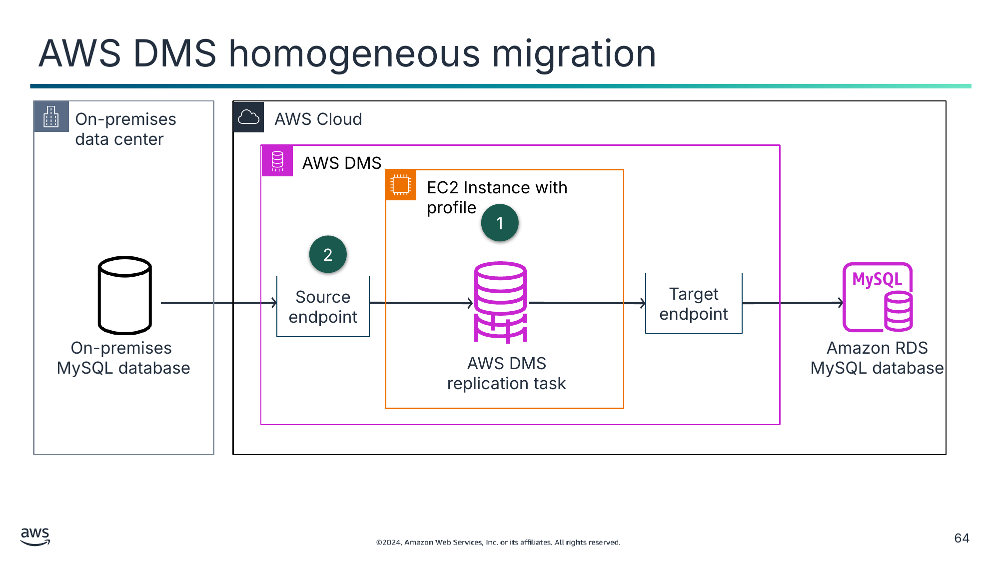

Текст зі схеми

On-premises data center

AWS Cloud

AWS DMS

EC2 Instance with profile

1

2

Source endpoint

Target endpoint

On-premises

MySQL database

Amazon RDS  
MySQL database

AWS DMS

replication task

> **Нотатки:**
>
> |Slide number 64  
> |Instructor notes  
> |  
> |Student notes  
> Homogeneous data migrations in AWS DMS simplify the migration of self-managed, on-premises databases or cloud databases to the equivalent engine on Amazon RDS or Aurora.  
> For example, you can use homogeneous data replications to migrate an on-premises PostgreSQL database to Amazon RDS for PostgreSQL or Aurora PostgreSQL.  
>
> Homogeneous data migrations are serverless, which means that AWS DMS automatically scales the resources that are required for your migration. For homogeneous data replications, AWS DMS uses native database tools to provide high-performing like-to-like migrations. At a high level, homogeneous data migrations operate with instance profiles, data providers, and replication projects.  
>
> This example shows that the database engine is the same for the source database (on-premises MySQL) and the target database (Amazon RDS database running MySQL).  
> An instance profile specifies network and security settings for the managed environment where your migration project runs. When you create a migration project with the compatible source and target data providers of the same type, AWS DMS deploys a managed environment where your data migration runs.  
> Next, AWS DMS connects to the source data endpoint, reads the source data, dumps the files on the disk, and restores the data by using native database tools.

---

## Слайд 65: Tools for heterogeneous database migrations

Database discovery tool

Schema conversion tools

**AWS DMS Fleet Advisor**

Automatically inventories and assesses on-premises database and analytics server fleet

**AWS Schema Conversion Tool (AWS SCT)**

Converts your source schema and SQL code into an equivalent target schema and SQL code

**AWS DMS Schema Conversion**

  
  
Is a centrally managed service for schema assessment and conversion available within AWS DMS workflows

> **Нотатки:**
>
> |Slide number 65  
> |Instructor notes  
> |  
> |Student notes  
> Heterogenous migration is migrating between source and target endpoints that use different database engines. There are multiple solutions for simplifying database migrations by automating schema analysis, recommendations, and conversion at scale. Three of them are explained here.  
>
> AWS DMS Fleet Advisor is a database discovery tool that automatically inventories and assesses your on-premises database and analytics server fleet and identifies potential migration paths. AWS DMS Fleet Advisor can recommend potential database engine and instance options for migration to AWS. This tool delivers results in a few hours instead of weeks or even months without using third-party tools or hiring migration experts.  
>
> AWS offers two schema conversion solutions to make heterogeneous database migrations predictable, fast, and secure:  
> Download the AWS Schema Conversion Tool (AWS SCT) software to your local drive.  
> Log in to the AWS DMS console to initiate the AWS DMS Schema Conversion workflow for a fully managed experience.  
>
> Both options will automatically assess and convert the source database schema and a majority of the database code objects to a format compatible with the target database. Any objects that cannot be automatically converted are clearly marked as action items with prescriptive instructions on how to convert so that they can be manually converted to complete the migration.

---

## Слайд 66: AWS DMS heterogeneous migration with AWS SCT

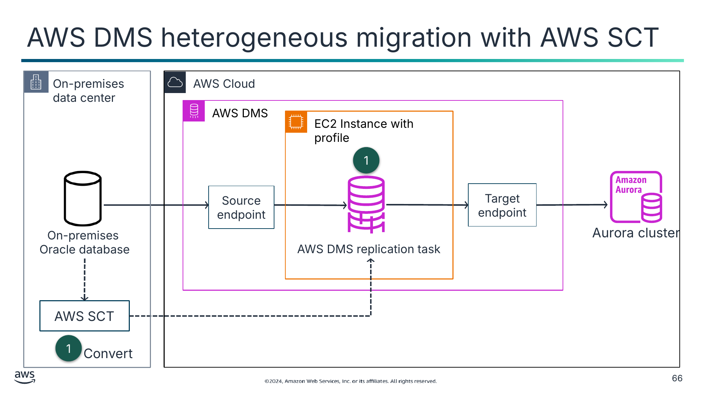

Aurora cluster

Текст зі схеми

On-premises data center

AWS Cloud

AWS DMS

EC2 Instance with profile

1

Target endpoint

Source endpoint

On-premises

Oracle database

AWS DMS replication task

AWS SCT

1

Convert

> **Нотатки:**
>
> |Slide number 66  
> |Instructor notes  
> |  
> |Student notes  
> This example illustrates an AWS DMS heterogenous migration by using AWS Schema Conversion Tool (SCT):  
> Convert: The AWS SCT works in conjunction with AWS DMS when you are moving your source database to a different target database to convert all schema and code objects to the target engine. The AWS SCT automatically converts your source database schemas and most of the database code objects to a format compatible with the target database. The AWS SCT is a standalone application that you need to download to your local drive. Alternatively the AWS DMS replication task can use the AWS DMS Schema conversion feature instead of AWS SCT.  
> Migrate schema and code: You create an AWS DMS migration by creating the necessary replication instance, endpoints, and tasks in an AWS Region.  An AWS DMS replication instance is a managed EC2 instance that hosts one or more replication tasks. One or more migration tasks are created to migrate data between the source and target data stores.

---

## Слайд 67: AWS DMS replicates data from a database into a data lake

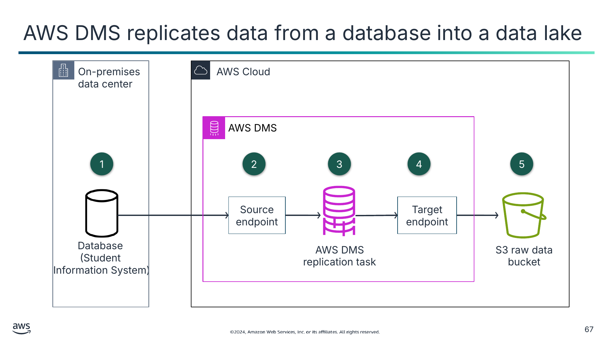

Текст зі схеми

On-premises

data center

AWS Cloud

AWS DMS

1

2

3

4

5

Source endpoint

Target endpoint

Database

(Student

Information System)

AWS DMS

replication task

S3 raw data bucket

> **Нотатки:**
>
> |Slide number 67  
> |Instructor notes  
> |  
> |Student notes  
> Another use case is data replication into a data lake. In this higher education use case, AWS DMS is used to replicate data from a database into an Amazon S3 data lake:  
> Student Information System data exists in an on-premises database. This data needs to be ingested into the data lake for analytics.  
> An AWS DMS source endpoint is connected to the SIS data.  
> An AWS DMS replication task is run to replicate data from the demo SIS database.  
> An AWS DMS destination endpoint connects the replication task to the Amazon S3 raw data bucket.  
> The data can be accessed by analysis and visualization services to derive insight from the student information data.

---

## Слайд 68: Key takeaways: Migrating data into AWS databases

- AWS DMS is a managed migration and replication service that helps you move your databases and analytics workloads to AWS quickly and securely.
- You can migrate between source and target endpoints that use the same database engine (homogenous migration) and migrate between source and target endpoints that use different database engines (heterogenous migration).
- AWS SCT and AWS DMS Schema Conversion are tools for schema and  code conversion.

> **Нотатки:**
>
> |Slide number 68  
> |Instructor notes  
> |  
> |Student notes

---

## Слайд 69: Café lab: Migrating a Database to Amazon RDS (Migration lab)

> **Нотатки:**
>
> |Slide number 69  
> |Instructor notes  
> |  
> |Student notes  
> You will now complete a lab. The next slides summarize what you will do in the lab, and you will find the detailed instructions in the lab environment.

---

## Слайд 70: The evolving café architecture: Version 3

| Architecture Version | Business Reason for Update | Technical Requirements and Architecture Update |
|---|---|---|
| V1 | Create a static website for a small business. | Host the website on Amazon S3. |
| V2 | Add online ordering. | Deploy the web application and database on Amazon EC2. |
| V3 | Reduce the effort to maintain the database and secure its data. | Separate the web and database layers. Migrate the database to Amazon RDS on a private subnet. |
| V4 | Enhance the security of the web application. | Use Amazon VPC features to configure and secure public and private subnets. |
| V5 | Create separate access mechanisms based on role. | Add IAM groups and attach resource polices to application resources. Add IAM users to groups based on role. |
| V6 | Ensure that the website can handle an expected increase in traffic. | Add a load balancer, implement auto scaling on the EC2 instances, and distribute compute and database instances across two Availability Zones. |

> **Нотатки:**
>
> |Instructor notes  
> |Share or show the architectures.svg file and highlight the sections of the architecture that will be modified or added with this lab.  
> |Student notes  
> The administration of the café database is becoming difficult for Sofía and Nikhil. For example, they must work extra hours when the café is closed to do weekly database backups.  
>
> In addition, they recently struggled to install a required patch. Sofía and Nikhil almost did not complete it during the weekend afterhours window. Frank and Martha now realize that these maintenance tasks increase the business’s labor costs because they must pay for the overtime hours that Sofía and Nikhil work.  
>
> Raquel, an AWS solutions architect, is a café customer and Sofía’s friend. Sofía mentioned the topic of databases to Olivia during a recent conversation. Olivia suggested that they migrate the database to Amazon RDS.  
>
> This solution will reduce the burden of manually performing common database maintenance tasks, such as backups, patch installation, and upgrades. As a fully managed service, Amazon RDS performs these tasks automatically.

---

## Слайд 71: Migration lab tasks

- In this lab, you will perform the following main tasks:
  - Create an RDS DB instance.
  - Import data from the EC2 DB instance to the RDS DB instance.
  - Connect the café application to the new database.
- Open your lab environment to start the lab and find additional details about the tasks that you will perform.

> **Нотатки:**
>
> |Slide number 71  
> |Instructor notes  
> |  
> |Student notes  
> Access the lab environment through your online course to get additional details and complete the lab.

---

## Слайд 72: Debrief: Migration lab

- When you created your Amazon RDS MariaDB database, why did you not create a standby instance?
- Where did you get the password that you used to connect to the MariaDB database that runs on the EC2 instance?

> **Нотатки:**
>
> |Slide number 72  
> |Instructor notes  
> |An architectural diagram for this lab is included as part of the CafeLabDiagrams.svg file included in the educator files directory. Share this file with students so that they can zoom in and out of each phase of the architecture for a fuller picture as you debrief the lab.  
> |Lead the class in a conversation about the key takeaways from the lab. Use the details from the previous section to help you debrief the lab with the students after they have completed it. Debriefing the lab is strongly encouraged. It helps the students make connections between their hands-on experience and the concepts that you discussed in the lecture before this lab.  
> |Suggested responses for question 1: When you created your Amazon RDS MariaDB database, why did you not create a standby instance?  
> |The template that you chose to create your database from was a dev/test template. It is recommended that you create a standby instance for only production use.  
> |Suggested responses for question 2: Where did you get the password that you used to connect to the MariaDB database that runs on the EC2 instance?  
> |In this lab, you navigated to Parameter Store, a capability of AWS Systems Manager (AWS Systems Manager > Application Management > Parameter Store), and copied the MariaDB database password from there. To connect to the MariaDB database that is running on the EC2 instance, you returned to the browser tab with the bash terminal. When prompted for the database password in the bash terminal, you pasted the dbPassword parameter value to connect to the database.  
> |  
> |Student notes  
> Your instructor might review these questions with you, or you might review them on your own. Use this opportunity to extend your thinking about the tasks that you performed during the lab.

---

## Слайд 73: Applying AWS Well-Architected Framework principles to the database layer

**Adding a Database Layer**

> **Нотатки:**
>
> |Slide number 73  
> |Instructor notes  
> |  
> |Student notes  
> This section looks at how to apply the AWS Well-Architected Framework principles to your database layer.

---

## Слайд 74: AWS Well-Architected Framework database pillars

> **Нотатки:**
>
> |Slide number 74  
> |Instructor notes  
> |The remaining slides in this section present examples that highlight how the material in this module aligns to the Well-Architected Framework best practices. Optionally, you might ask students to visit the Well-Architected Framework website and find the best practices that they think connect to the material that is presented in this module, using this section as a starting point.  
> |Student notes  
> The AWS Well-Architected Framework has six pillars, and each pillar includes best practices and a set of questions that you should consider when you architect cloud solutions. This section highlights a few best practices from the pillars that are most relevant to this module. Find the complete set of best practices by pillar on the Well-Architected Framework website. The content resources section of your online course includes a link.  
>
> As you make connections between the AWS Well-Architected Framework pillars and the database layer, consider your role as a cloud architect who is adding a database layer:  
> You need to evaluate the available database options before selecting a data management solution so that you can optimize performance.  
> You need to secure your infrastructure effectively so that data is durable and safe from threats.

---

## Слайд 75: Best practice approach: Architecture Selection

**Best practices**

Evaluate how trade-offs impact customers and architecture efficiency.

Use a data-driven approach for architectural choices.

Factor cost into architectural decisions.

> **Нотатки:**
>
> |Slide number 75  
> |Instructor notes  
> |  
> |Student notes  
> Database architecture selection is an important best practice under the performance efficiency pillar. The optimal database solution for a system varies based on requirements for availability, consistency, partition tolerance, latency, durability, scalability, and query capability. Many systems use different database solutions for various sub-systems and allow different features to improve performance. Selecting the wrong database solution and features for a system can lead to lower performance efficiency. Three important best practices related to database architecture selection include understanding data characteristics, evaluating available options, and choosing data storage based on access patterns.  
>
> Evaluate how trade-offs impact customers and architecture efficiency: When evaluating performance-related improvements, determine which choices impact your customers and workload efficiency. For example, if using a key-value data store increases system performance, it is important to evaluate how the eventually consistent nature of this change will impact customers. When selecting and implementing a data management solution, you must ensure that the querying, scaling, and storage characteristics support the workload data requirements. Before implementing a solution, learn how each available option matches your data models and use case.  
>
> Use a data-driven approach for architectural choices: Define a clear, data-driven approach for architectural choices to verify that the right cloud services and configurations are used to meet your specific business needs. Use the access patterns of the workload and requirements of the applications to decide on optimal data services and technologies to use. Understanding when to use read replicas, global tables, data partitioning, and caching will help you decrease operational overhead and scale based on your workload needs. For example, you should identify and document the anticipated growth of the data and traffic. With that pattern in mind, consider available database options and configurations.  
> Document workload data characteristics with enough detail to facilitate the selection and configuration of supporting database solutions, and provide insight into potential alternatives.  
>
> Once you have considered the workload data characteristics enough to identify alternatives, evaluate and verify your selections and the available database configuration options that best suit your specific workload. Run load tests to identify your key performance metrics and bottlenecks. Use these characteristics and metrics to evaluate database options and experiment with different configurations. Don't increase instance size to improve performance without looking at the impact of available configuration options. Evaluate the acceptable query times to ensure that the selected database options can meet the requirements. For example, after determining the extent to which your workload is read-heavy, you can evaluate solutions that are available for offloading reads such as read replicas or caching.  
>
> Factor cost into architectural decisions: Factor cost into your architectural decisions to improve resource utilization and performance efficiency of your cloud workload. When you are aware of the cost implications of your cloud workload, you are more likely to leverage efficient resources and reduce wasteful practices.  
>
> In this module, you've learned about a number of database solutions and configuration options that align to these best practices. You learned that AWS has a variety of database solutions so that you can select the one that meets the workload requirements and data models for your use case. For example, use Amazon RDS for relational data, Amazon Redshift for a data warehouse, DynamoDB for key-value data that requires very low latency at very high scale, or one of the other purpose-built databases that are designed for specific workloads.  
>
> You also learned about the configuration options that optimize performance for your selected database. For example with Amazon RDS, you can configure the instance type and size suited to your workload. You can configure high availability and implement read replicas. You can use RDS Proxy to scale connection pools. DynamoDB automatically scales horizontally, and you learned how secondary indexes and global tables can improve performance based on your table structures and access patterns.  
>
> These are just a couple of examples of best practices for performance efficiency in your database layer. With all of the options and flexibility available in cloud databases, you can follow these best practices for any use case.

---

## Слайд 76: Best practice approach: Data protection – protecting data at rest

**Best practice**

Implement secure key management.

Enforce encryption at rest.

> **Нотатки:**
>
> |Slide number 76  
> |Instructor notes  
> |  
> |Student notes  
> Protecting the data residing in your database storage is a critical part of the security pillar. Encryption maintains the confidentiality of sensitive data in the event of unauthorized access or accidental disclosure. Protecting your data at rest reduces the risk of unauthorized access when encryption and appropriate access controls are implemented. Two important best practices related to protecting data at rest are implementing secure key management and enforcing encryption at rest.  
>   
> Implement secure key management: By defining an encryption approach that includes the storage, rotation, and access control of keys, you can help provide protection for your content against unauthorized users and against unnecessary exposure to authorized users. AWS KMS helps you manage encryption keys and integrates with many AWS services. This service provides durable, secure, and redundant storage for your AWS KMS keys.  
>
> Enforce encryption at rest: You should ensure that the only way to store data is by using encryption. AWS KMS integrates seamlessly with many AWS services to help you encrypt all your data at rest.  
>
> The following are examples of these best practices you learned about in this module:  
> Amazon databases such as Amazon RDS and DynamoDB use AWS KMS to secure data.  
> DynamoDB encrypts all user data at rest stored in tables, indexes, streams, and backups by using encryption keys stored in AWS KMS.  
> Amazon RDS encrypts your databases by using keys that you manage with AWS KMS. For an Amazon RDS encrypted database instance, data stored at rest in the underlying storage is encrypted, as are all logs, backups, and snapshots. After your data is encrypted, Amazon RDS handles the authentication of access and the decryption of your data transparently with minimal impact on performance.

---

## Слайд 77: Best practice approach: Cost-effective resources – select the correct resource type, size, and number

**Best practice**

Select the resource type, size, and number based on data.

> **Нотатки:**
>
> |Slide number 77  
> |Instructor notes  
> |  
> |Student notes  
> By selecting the best database type, size, and number of resources, you meet the technical requirements with the lowest cost resource. Right-sizing activities takes into account all of the resources of a workload, all of the attributes of each individual resource, and the effort involved in the right-sizing operation. Right-sizing can be an iterative process, initiated by changes in usage patterns and external factors, such as AWS price drops or new AWS resource types. Central to this process is selecting the resource type, size, and number based on data.  
>
> Select the resource type, size, and number based on data: Select the resource size or type based on data about the workload and resource characteristics: for example, compute, memory, throughput, or write intensive. This selection is typically made by using a previous (on-premises) version of the workload, using documentation, or using other sources of information about the workload.  
>
> In this module, you learned how different database resources can scale and saw examples of use cases suited to different configurations. It is important to find the right balance of performance and costs to right-size your resources. For example, you saw how Aurora can provide better performance and lower cost that standard database engines and how Aurora Serverless can be used to provide on-demand scaling so that you can avoid overprovisioning resources.

---

## Слайд 78: Key takeaways: Applying AWS Well-Architected Framework principles to your database layer

- To achieve and maintain efficient workloads in the cloud, consider best practices in the performance efficiency pillar such as making selection choices based on data characteristics and access patterns.
- To secure your infrastructure effectively so that data is durable and safe from threats, consider best practices in the security pillar such as implementing secure key management and protecting data at rest.
- To meet the technical requirements of a workload with the lowest cost resource, consider best practices in the cost optimization pillar such as selecting the resource type, size, and number based on data.

> **Нотатки:**
>
> |Slide number 78  
> |Instructor notes  
> |This is not an exhaustive list of best practices as covered in the AWS Well-Architected best practices. These are key takeaways to explain best practices covered in the module. For more information, see the AWS Well-Architected Framework on the content resources page of your online course.  
> |Student notes

---

## Слайд 79: Module wrap-up

Adding a Database Layer

> **Нотатки:**
>
> |Slide number 79  
> |Instructor notes  
> |  
> |Student notes  
> This section summarizes what you have learned and brings the module to a close.

---

## Слайд 80: Module summary

This module prepared you to do the following:

- Compare database types and services offered by Amazon Web Services (AWS).
- Explain when to use Amazon Relational Database Service (Amazon RDS).
- Describe the advanced features of Amazon RDS.
- Explain when to use Amazon DynamoDB.
- Identify AWS purpose-built database services.
- Describe how to migrate data into AWS databases.
- Design and deploy a database server.
- Use the AWS Well-Architected Framework principles when designing a database layer.

> **Нотатки:**
>
> |Slide number 80  
> |Instructor notes  
> |  
> |Student notes

---

## Слайд 81: Module objectives

This module prepared you to do the following:

- Compare database types and services offered by Amazon Web Services (AWS).
- Explain when to use Amazon Relational Database Service (Amazon RDS).
- Describe the advanced features of Amazon RDS.
- Explain when to use Amazon DynamoDB.
- Identify AWS purpose-built database services.
- Describe how to migrate data into AWS databases.
- Design and deploy a database server. Use the Well-Architected Framework principles when designing a database layer.

> **Нотатки:**
>
> |Slide number 81  
> |Instructor notes  
> |  
> |Student notes

---

## Слайд 82: Considerations for the café

- Discuss how the café lab in this module answered the key questions and decisions presented at the start of this module for the café business.

---

## Слайд 83: Module knowledge check

- The knowledge check is delivered online within your course.
- The knowledge check includes 10 questions based on material presented on the slides and in the slide notes.
- You can retake the knowledge check as many times as you like.

> **Нотатки:**
>
> |Slide number 83  
> |Instructor notes  
> |  
> |Student notes  
> Use your online course to access the knowledge check for this module.

---

## Слайд 84: Sample exam question

An application requires a highly available relational database with an initial storage capacity of 8 TB. The database will grow by 8 GB every day. To support expected traffic, at least eight read replicas will be required to handle database reads. Which option will meet these requirements?

Identify the key words and phrases before continuing.

The following are the key words and phrases:

- Highly available relational database
- Grow by 8 GB every day
- Read replicas

> **Нотатки:**
>
> |Slide number 84  
> |Instructor notes  
> |The key words section is animated to be revealed on click.  
> |  
> |Student notes  
> The question suggests a highly available relational database with significant growth and the need for read replicas.

---

## Слайд 85: Sample exam question: Response choices

An application requires a highly available relational database with an initial storage capacity of 8 TB. The database will grow by 8 GB every day. To support expected traffic, at least eight read replicas will be required to handle database reads. Which option will meet these requirements?

**Choice**

**Response**

**A**

Amazon DynamoDB

**B**

Amazon Neptune

**C**

Amazon Aurora

**D**

Amazon Redshift

> **Нотатки:**
>
> |Slide number 85  
> |Instructor notes  
> |  
> |Student notes  
> Use the key words that you identified on the previous slide, and review each of the possible responses to determine which one best addresses the question.

---

## Слайд 86: Sample exam question: Answer

The answer is C.

**Choice**

**Response**

**A**

**B**

**C**

Amazon Aurora

**D**

> **Нотатки:**
>
> |Slide number 86  
> |Instructor notes  
> |  
> |Student notes  
> Answer A (Amazon DynamoDB) is a non-relational database, so it does not match the requirement.  
>   
> Answer B (Amazon Neptune) is a purpose-built graph database, so it does not match the requirement.  
>   
> Answer D (Amazon Redshift) does not support read replicas.  
>
> The correct answer is C. Amazon Aurora is a fully managed relational database that can support up to 15 read replicas. Aurora storage automatically scales with the data in your cluster volume.

---

## Слайд 87: Thank you

Corrections, feedback, or other questions?

Contact us at [https://support.aws.amazon.com/#/contacts/aws-academy](https://support.aws.amazon.com/#/contacts/aws-academy).

> **Нотатки:**
>
> |Slide number 87  
> |Instructor notes  
> |  
> |Student notes  
> That concludes this module. The Content Resources page of your course includes links to additional resources that are related to this module.
