## Слайд 1: Додавання рівня бази даних (Adding a Database Layer)

AWS Academy Cloud Architecting

> **Нотатки:**
>
> |Нотатки для інструктора  
> |  
> |Нотатки для студента  
> Вітаємо в модулі «Додавання рівня бази даних». Цей модуль зосереджений на типах баз даних і сервісах, що пропонує Amazon Web Services (AWS).

---

## Слайд 2: Вступ

Додавання рівня бази даних

> **Нотатки:**
>
> |Нотатки для інструктора  
> |  
> |Нотатки для студента  
> Цей вступний розділ описує вміст модуля.

---

## Слайд 3: Цілі модуля

Цей модуль готує вас до такого:

- Порівнювати типи баз даних і сервіси, що пропонує Amazon Web Services (AWS).
- Пояснювати, коли використовувати Amazon Relational Database Service (Amazon RDS).
- Описувати розширені функції Amazon RDS.
- Пояснювати, коли використовувати Amazon DynamoDB.
- Визначати спеціалізовані сервіси баз даних AWS (purpose-built).
- Описувати, як мігрувати дані в бази даних AWS.
- Проєктувати й розгортати сервер бази даних.
- Використовувати принципи AWS Well-Architected Framework під час проєктування рівня бази даних.

> **Нотатки:**
>
> |Номер слайда 3  
> |Нотатки для інструктора  
> |  
> |Нотатки для студента

---

## Слайд 4: Огляд модуля

**Розділи презентації**

- Міркування щодо рівня бази даних
- Amazon RDS
- Керування з’єднаннями Amazon RDS Proxy
- Amazon DynamoDB
- Спеціалізовані бази даних (Purpose-built databases)
- Міграція даних у бази даних AWS
- Застосування принципів AWS Well-Architected Framework до рівня бази даних

**Демонстрація**

- Автоматичне резервне копіювання Amazon RDS і репліки для читання (Amazon RDS Automated Backup and Read Replicas)

**Перевірки знань**

- 10-запитальна перевірка знань
- Зразок запитання іспиту

> **Нотатки:**
>
> |Номер слайда 4  
> |Нотатки для інструктора  
> |Кожен модуль має вступ, розділи з вмістом і підсумок. Підсумок цього модуля містить зразок запитання іспиту для розбору зі студентами.  
> |  
> |Нотатки для студента  
> Цілі цього модуля розкриваються в кількох розділах.  
>
> Цей модуль включає записану демонстрацію, що подана в посібнику студента.  
>
> Модуль завершується 10-запитальною перевіркою знань, що проводиться в онлайн-курсі, та зразком запитання іспиту для обговорення в класі.  
>
> Наступний слайд описує лабораторні роботи цього модуля.

---

## Слайд 5: Практичні лабораторні роботи в цьому модулі

Покрокова лабораторна робота (Guided lab)

Лабораторна робота-виклик (кафе) (Challenge (Café) lab)

- Створення бази даних Amazon RDS (Creating an Amazon RDS Database)

- Міграція бази даних в Amazon RDS (Migrating a Database to Amazon RDS)

> **Нотатки:**
>
> |Номер слайда 5  
> |Нотатки для інструктора  
> |Цей модуль містить як самодостатню покрокову лабораторну роботу, так і лабораторну роботу кафе, що доповнює архітектуру кафе, що еволюціонує. Лабораторна робота кафе — це лабораторна робота-виклик, де від студентів очікується виконання завдань без надання кожного кроку. Розділи лабораторних робіт у межах модуля включають вступи до кожної лабораторної роботи.  
> |  
> |Нотатки для студента  
> Цей модуль містить зазначені практичні лабораторні роботи. Є покрокова лабораторна робота, де ви отримаєте інструкції крок за кроком, і лабораторна робота кафе (виклик), де ви працюватимете над оновленням архітектури кафе. Додаткова інформація про кожну лабораторну роботу міститься в посібнику студента там, де вона виконується, а лабораторне середовище надає докладні інструкції.

---

## Слайд 6: Як хмарний архітектор, що проєктує рівень бази даних:

- Мені потрібно оцінити наявні варіанти баз даних, перш ніж обирати рішення для керування даними, щоб я міг оптимізувати продуктивність.
- Мені потрібно ефективно захистити свою інфраструктуру, щоб дані були довговічними та захищеними від загроз.

> **Нотатки:**
>
> |Номер слайда 6  
> |Нотатки для інструктора: цей слайд подає ключові наскрізні міркування проєктування, що мають спрямовувати ухвалення рішень для цього рівня хмарної архітектури. Підкресліть, що хмарний архітектор завжди має починати з бізнес-кейсу й рухатися у зворотному напрямку, щоб обрати найкращі компоненти для цього сценарію використання. Також нагадайте студентам, що рішення, імовірно, еволюціонуватимуть з часом, у міру зміни чи кращого розуміння потреб, для оптимізації вартості та продуктивності. Наприкінці модуля в підсумковому розділі включено необов’язкове обговорення, що спонукає студентів розглянути ці чинники в контексті сценарію з кафе.  
> |  
> |Нотатки для студента  
> Цей слайд просить вас прийняти перспективу хмарного архітектора, коли ви думаєте про те, як підходити до проєктування хмарної мережі. Тримайте ці міркування в голові, просуваючись цим модулем. Також пам’ятайте, що хмарний архітектор має працювати у зворотному напрямку від бізнес-потреби, щоб спроєктувати найкращу архітектуру для конкретного сценарію використання. Просуваючись модулем, розглядайте сценарій з кафе, поданий у курсі, як приклад бізнес-потреби й думайте про те, як би ви відповіли на ці потреби для вигаданого бізнесу кафе.

---

## Слайд 7: Міркування щодо рівня бази даних

Додавання рівня бази даних

> **Нотатки:**
>
> |Номер слайда 7  
> |Нотатки для інструктора  
> |  
> |Нотатки для студента  
> Цей розділ надає огляд того, що слід враховувати під час вибору бази даних.

---

## Слайд 8: Міркування щодо бази даних

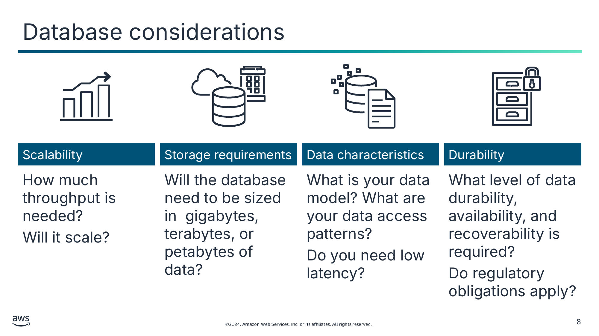

Scalability (Масштабованість)

Storage requirements (Вимоги до сховища)

Data characteristics (Характеристики даних)

Durability (Довговічність)

Яка пропускна здатність потрібна?

Чи масштабуватиметься вона?

Чи потрібно буде розраховувати розмір бази даних у гігабайтах, терабайтах чи петабайтах даних?

Яка у вас модель даних? Які у вас шаблони доступу до даних?

Чи потрібна вам низька затримка?

Який рівень довговічності, доступності та відновлюваності даних потрібен?

Чи застосовуються регуляторні зобов’язання?

> **Нотатки:**
>
> |Номер слайда 8  
> |Нотатки для інструктора  
> |  
> |Нотатки для студента  
> Як архітектор, ви часто мусите обирати між різними типами баз даних, розглядаючи, який тип найкраще впорається з певним робочим навантаженням. Перш ніж обрати базу даних, є деякі ключові міркування, що мають спрямовувати ваш процес ухвалення рішень.  
>
> Масштабованість  
> Правильно масштабована база даних важлива. З традиційними локальними (on-premises) базами даних вплив на продуктивність бази даних під час її масштабування вгору може бути непередбачуваним і може потребувати простою. Якщо ви недостатньо виділите потужностей для вашої бази даних, ваші застосунки можуть припинити працювати. Якщо ви надмірно виділите потужності для вашої бази даних, ви збільшите свої авансові витрати, придбавши ресурси, які вам не потрібні, що порушує принцип оптимізації витрат AWS Well-Architected Framework.  
>
> В ідеалі ви обрали б рішення для бази даних, що має ресурси для обробки потрібної пропускної здатності під час запуску й що також можна масштабувати вгору пізніше, якщо вашу пропускну здатність потрібно збільшити.  
>
> Вимоги до сховища  
> Враховуйте вимоги вашого робочого навантаження до сховища. Якого розміру має бути база даних для обробки ваших вимог до даних? Чи потрібно їй зберігати гігабайти, терабайти чи петабайти? Різні архітектури баз даних підтримують різні максимальні потужності даних. Деякі проєкти баз даних ідеальні для традиційних застосунків, тоді як інші ідеальні для кешування чи керування сеансами.  
>
> Характеристики даних  
> Враховуйте, що вам потрібно зберігати, обираючи базу даних. Основа будь-якого вибору бази даних включає характеристики даних, які потрібно зберігати, отримувати, аналізувати та з якими потрібно працювати. Ці характеристики включають вашу модель даних (чи вона реляційна, структурована або напівструктурована, використовує набір даних із високим ступенем зв’язків чи часові ряди?), доступ до даних (як вам потрібно отримувати доступ до даних?), міру, в якій вам потрібні дані з низькою затримкою, і чи є певний розмір запису даних, який ви маєте на увазі.  
>   
> Довговічність  
> Довговічність даних (data durability) означає гарантію того, що ваші дані не будуть втрачені, а доступність даних (data availability) означає вашу здатність отримувати доступ до даних, коли ви цього хочете.  
>
> Який рівень довговічності й доступності даних вам потрібен? Якщо дані, які ви зберігатимете, абсолютно критичні для вашого бізнесу, слід обрати рішення для бази даних, що зберігає кілька надлишкових копій ваших даних у кількох географічно розділених фізичних розташуваннях. Це рішення зазвичай призводить до збільшення вартості, тож важливо збалансувати ваші бізнес-потреби з міркуваннями вартості.  
>
> Ще одне важливе міркування — чи застосовуються до ваших даних вимоги щодо розташування даних (data residency) або регуляторні зобов’язання. Наприклад, чи існують регіональні закони про конфіденційність даних, яких ви маєте дотримуватися? Якщо так, оберіть рішення для бази даних, що може підтримувати відповідність.

---

## Слайд 9: Реляційні та нереляційні бази даних

| Функції (Features) | Реляційні бази даних (Relational Databases) | Нереляційні бази даних (Non-Relational Databases) |
|---|---|---|
| Структура | Табличний вигляд зі стовпців і рядків | Різноманітні моделі структури (пари «ключ-значення», документи або на основі графів) |
| Схема | Суворі правила схеми | Гнучкі схеми |
| Переваги | Простота використання, цілісність даних, зменшене зберігання даних і спільна мова (SQL) | Гнучкість, масштабованість і висока продуктивність |
| Сценарій використання | Під час міграції локального реляційного робочого навантаження або якщо ваше робоче навантаження передбачає оперативну обробку транзакцій (OLTP) | Коли потрібен рівень кешування для покращення продуктивності читання, під час зберігання документів JSON або коли потрібне отримання даних за одиниці мілісекунд |
| Оптимізація | Оптимізовані для структурованих даних, що зберігаються в таблицях; підтримують складні одноразові запити за допомогою об’єднань (joins) | Оптимізовані для швидкого доступу до структурованих, напівструктурованих чи неструктурованих даних з високою пропускною здатністю читання та запису |

> **Нотатки:**
>
> |Номер слайда 9  
> |Нотатки для інструктора  
> |  
> |Нотатки для студента  
> Світ змінився, і підхід «один розмір для всіх» — використання реляційних баз даних для кожного застосунку — більше не працює. Реляційні бази даних усе ще відіграють важливу роль у проєктуванні та функціональності застосунків, але зростає популярність низки спеціалізованих баз даних (purpose-built). Сучасні застосунки мають враховувати соціальні мережі, мобільність, Інтернет речей (IoT) і глобальний доступ. Моделі спеціалізованих баз даних розроблено з нуля для швидкого та ефективного виконання конкретних функцій, яких потребують ці застосунки.  
>
> У системі керування реляційними базами даних (RDBMS) дані зберігаються в табличному вигляді зі стовпців і рядків, а запити до даних виконуються за допомогою SQL. Якщо ваш сценарій використання добре підходить для суворих правил схеми, де структура схеми чітко визначена й не потребує частих змін, реляційна база даних була б хорошим вибором. Під час міграції локального реляційного робочого навантаження або якщо ваше робоче навантаження передбачає оперативну обробку транзакцій, цей тип бази даних підходить. Однак якщо вашому застосунку потрібна екстремальна потужність читання/запису, реляційна база даних може бути не найкращим вибором. Реляційна база даних може бути найкращим рішенням із мінімальними зусиллями для багатьох сценаріїв використання.  
>   
> Транзакції реляційних баз даних відповідають вимогам ACID. Це означає, що вони допомагають забезпечити цілісність даних, надаючи транзакції, що є атомарними, узгодженими, ізольованими та довговічними. Атомарні транзакції означають, що їх слід розглядати як єдину логічну операцію над даними. Узгоджені транзакції завжди діють чи поводяться однаково. Ізольовані транзакції стосуються виконання одночасно, але стан системи має бути таким самим, ніби транзакції виконувались послідовно. Довговічна транзакція означає, що після фіксації транзакції її наслідки мають бути постійними навіть у разі збою системи.  
>
> Нереляційні бази даних іноді називають базами даних NoSQL. Це спеціалізовані бази даних для різноманітних моделей даних, зокрема «ключ-значення», графів, документів, в пам’яті й пошуку. Вони можуть зберігати структуровані дані, як-от записи реляційної бази даних; напівструктуровані дані, як-от документи JSON; і неструктуровані дані, як-от файли фотографій чи повідомлення електронної пошти. Цей тип бази даних має гнучкі схеми, де кожен об’єкт може мати іншу структуру. Коли потрібен рівень кешування для покращення продуктивності читання, під час зберігання документів JSON або коли потрібне отримання даних за одиниці мілісекунд, нереляційна база даних — доречний варіант. Нереляційні бази даних оптимізовані для конкретних моделей даних і шаблонів доступу, що допомагають забезпечити вищу продуктивність замість спроби досягти функціональності реляційних баз даних.  
>
> І реляційні, і нереляційні бази даних можуть масштабуватися горизонтально та вертикально. Наприклад, Amazon Relational Database Service (Amazon RDS) може мати репліки для читання разом із реляційним горизонтальним масштабуванням. Redis може масштабуватися вертикально за допомогою більших типів екземплярів.

---

## Слайд 10: Варіанти баз даних Amazon

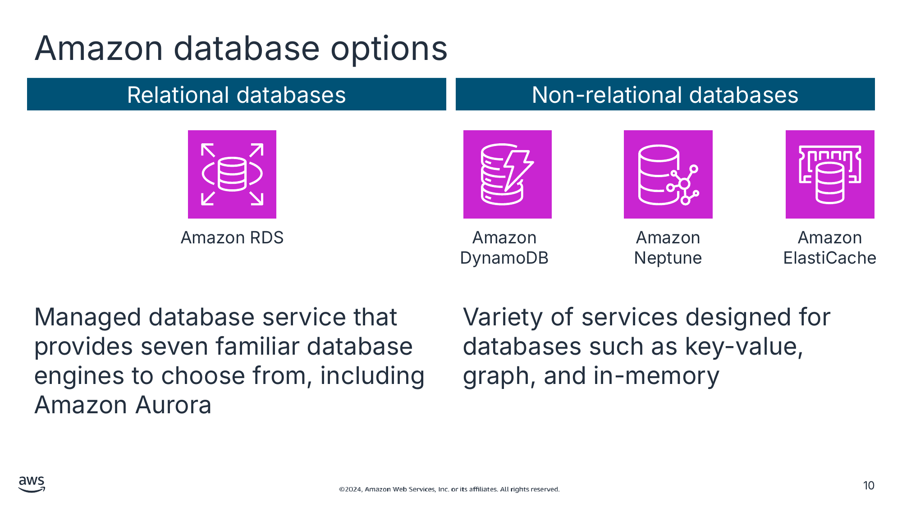

Relational databases (Реляційні бази даних)

Non-relational databases (Нереляційні бази даних)

Amazon RDS

Amazon DynamoDB

Amazon Neptune

Amazon ElastiCache

Кероване обслуговування баз даних, що пропонує сім знайомих рушіїв баз даних на вибір, зокрема Amazon Aurora

Різноманітні сервіси, розроблені для баз даних, як-от «ключ-значення», графові та в пам’яті

> **Нотатки:**
>
> |Номер слайда 10  
> |Нотатки для інструктора  
> |  
> |Нотатки для студента  
> Цей модуль пояснить ці варіанти баз даних. Мета цього слайда — надати огляд:  
> Основний варіант сервісу реляційних баз даних від AWS — Amazon RDS. Це кероване обслуговування, яке можна використовувати для налаштування, експлуатації та масштабування реляційної бази даних у хмарі. З Amazon RDS можна обрати Amazon Aurora із сумісністю з MySQL, Amazon Aurora із сумісністю з PostgreSQL, Amazon RDS for MySQL, Amazon RDS for MariaDB, Amazon RDS for PostgreSQL, Amazon RDS for Oracle та Amazon RDS for SQL Server. Amazon RDS використовується для транзакційних застосунків, як-от планування ресурсів підприємства (ERP), керування взаємовідносинами з клієнтами (CRM) і застосунки електронної комерції, для зберігання структурованих даних.  
> Існує кілька варіантів сервісів нереляційних баз даних. Amazon DynamoDB для баз даних «ключ-значення», Amazon Neptune для графових баз даних і Amazon ElastiCache для баз даних в пам’яті — це лише деякі з них. Це спеціалізовані бази даних, розроблені для швидкого та ефективного виконання конкретних функцій, яких потребують ці застосунки.

---

## Слайд 11: Менша відповідальність із керованими сервісами баз даних AWS

| Завдання (Tasks) | Розміщення бази даних локально (Host Database on Premises) | Розміщення бази даних в Amazon EC2 (Host Database in Amazon EC2) | Розміщення бази даних у керованому сервісі баз даних AWS (Host Database in a Managed AWS Database Service) |
|---|---|---|---|
| Живлення, HVAC і мережа | x |  |  |
| Монтаж у стійки (Rack and Stack) | x |  |  |
| Обслуговування серверів | x |  |  |
| Встановлення ОС | x |  |  |
| Виправлення ОС | x |  |  |
| Встановлення бази даних | x | x |  |
| Виправлення бази даних | x | x |  |
| Резервні копії бази даних | x | x |  |
| Висока доступність | x | x |  |
| Масштабування | x | x |  |
| Оптимізація застосунку | x | x | x |

> **Нотатки:**
>
> |Номер слайда 11  
> |Нотатки для інструктора  
> |  
> |Нотатки для студента  
> Таблиця показує завдання, за які ви відповідаєте залежно від того, де розміщено базу даних:  
> Коли ваша база даних розташована локально, адміністратор бази даних відповідає за все — від оптимізації застосунку та запитів до налаштування апаратного забезпечення. Адміністратор також займається встановленням виправлень апаратного забезпечення та налаштуванням мережі, живлення й опалення, вентиляції та кондиціонування повітря (HVAC).  
> Якщо ви переходите до бази даних, що працює на екземплярі Amazon Elastic Compute Cloud (Amazon EC2), ви більше не керуєте базовим апаратним забезпеченням чи операціями центру обробки даних. AWS займається обслуговуванням середовища фізичного центру обробки даних, а операційну систему (ОС) попередньо встановлено на екземплярі EC2, який ви запускаєте. Однак ви все одно відповідаєте за масштабування, встановлення виправлень ОС і керування всім програмним забезпеченням та операціями резервного копіювання.  
> Якщо базу даних розміщено в керованій пропозиції баз даних AWS, як-от Amazon RDS чи Aurora, AWS відповідає за виконання поширених і повторюваних завдань адміністрування баз даних. Ви відповідаєте лише за оптимізацію ваших запитів і забезпечення того, щоб рівень бази даних ефективно працював для вашого застосунку. Ці рішення надають високу доступність, масштабованість і резервні копії баз даних як вбудовані варіанти, які можна налаштувати.  
>
> Ваша відповідальність зменшується в міру переходу від розміщення бази даних локально до розміщення в керованих сервісах баз даних AWS.

---

## Слайд 12: Планування потужностей бази даних (database capacity planning)

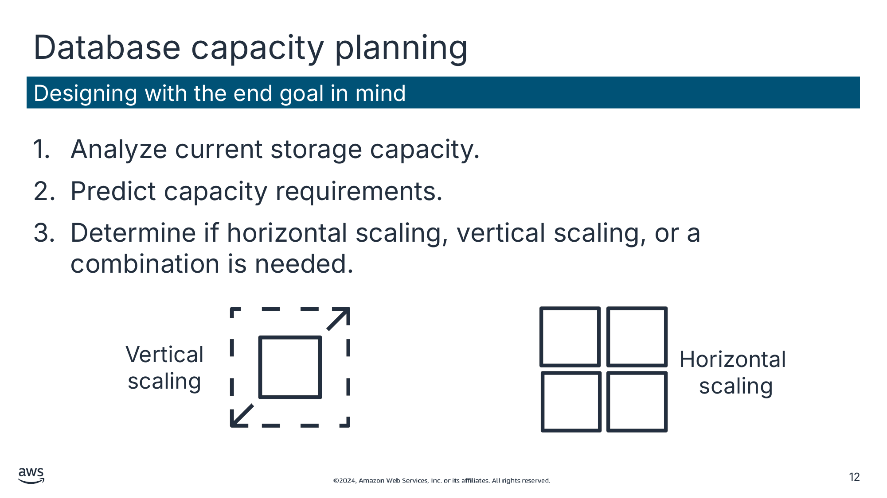

Проєктування з огляду на кінцеву мету

1. Проаналізуйте поточну потужність сховища.
2. Спрогнозуйте вимоги до потужностей.
3. Визначте, чи потрібне горизонтальне масштабування, вертикальне масштабування чи їх комбінація.

Vertical  
scaling (Вертикальне масштабування)

Horizontal

scaling (Горизонтальне масштабування)

> **Нотатки:**
>
> |Номер слайда 12  
> |Нотатки для інструктора  
> |  
> |Нотатки для студента  
> Планування потужностей бази даних — це процес, у якому ви враховуєте поточну та майбутню потужність під час вибору та оновлення ресурсів вашої бази даних. Мета — коригувати й оптимізувати ресурси бази даних на основі шаблонів використання та прогнозів. Постійно відстежуйте, щоб визначити, чи може наявна інфраструктура витримати прогнозоване робоче навантаження. Якщо ні, вам потрібно буде оцінити динаміку витрат на масштабування інфраструктури вгору.  
>
> Існують два способи масштабування баз даних: вертикально та горизонтально. Вертикальне масштабування передбачає розширення ресурсів, що використовуються наявним сервером, щоб збільшити його потужність. Цей складний і трудомісткий процес включає оновлення пам’яті, сховища чи обчислювальної потужності. Зазвичай це означає, що база даних буде недоступною протягом певного часу. Горизонтальне масштабування передбачає збільшення кількості серверів, на яких працює база даних, що зменшує навантаження на сервер. Обчислювальна потужність додається, поки база даних працює, що зазвичай означає, що це масштабування відбувається без простою.

---

## Слайд 13: Ключові висновки: міркування щодо рівня бази даних

- Обираючи базу даних, враховуйте масштабованість, вимоги до сховища, характеристики даних, вартість і вимоги до довговічності. Планування потужностей бази даних також є міркуванням.
- Реляційні бази даних мають суворі правила схеми, масштабуються вертикально, забезпечують цілісність даних і добре підходять для структурованих даних, що зберігаються в таблицях.
- Нереляційні бази даних мають гнучкі схеми, масштабуються горизонтально, забезпечують вищу масштабованість і гнучкість і добре підходять для напівструктурованих і неструктурованих даних.
- З керованими сервісами баз даних AWS ви відповідаєте лише за оптимізацію вашого застосунку.

> **Нотатки:**
>
> |Номер слайда 13  
> |Нотатки для інструктора  
> |  
> |Нотатки для студента

---

## Слайд 14: Amazon RDS

Додавання рівня бази даних

> **Нотатки:**
>
> |Номер слайда 14  
> |Нотатки для інструктора  
> |  
> |Нотатки для студента  
> Цей розділ описує характеристики та сценарії використання Amazon RDS і Aurora.

---

## Слайд 15: Amazon Relational Database Service

- Є керованим сервісом реляційних баз даних для розгортання та масштабування реляційних баз даних
- Підтримує кілька рушіїв баз даних
- Використовує томи Amazon Elastic Block Store (Amazon EBS) для зберігання бази даних і журналів

Amazon RDS

> **Нотатки:**
>
> |Номер слайда 15  
> |Нотатки для інструктора  
> |  
> |Нотатки для студента  
> Навіщо запускати кероване реляційне обслуговування баз даних у хмарі AWS? Тому що AWS бере на себе багато складних і виснажливих завдань керування реляційною базою даних. Amazon RDS — це повністю кероване обслуговування реляційних баз даних, яке можна використовувати для налаштування, експлуатації та масштабування реляційних баз даних у хмарі.  
>
> Як кероване обслуговування, Amazon RDS автоматизує рутинні завдання бази даних, як-от розгортання, встановлення виправлень, резервне копіювання, відновлення, виявлення збоїв і ремонт. Він усуває неефективні та трудомісткі завдання адміністрування баз даних без потреби розгортати інфраструктуру чи підтримувати програмне забезпечення. З Amazon RDS можна обрати Aurora із сумісністю з MySQL, Aurora із сумісністю з PostgreSQL, RDS for MySQL, RDS for MariaDB, RDS for PostgreSQL, RDS for Oracle та RDS for SQL Server.  
>
> Amazon RDS використовує томи Amazon Elastic Block Store (Amazon EBS) для зберігання бази даних і журналів. Ви можете масштабувати потужність сховища, виділену вашому екземпляру бази даних.

---

## Слайд 16: Переваги Amazon RDS

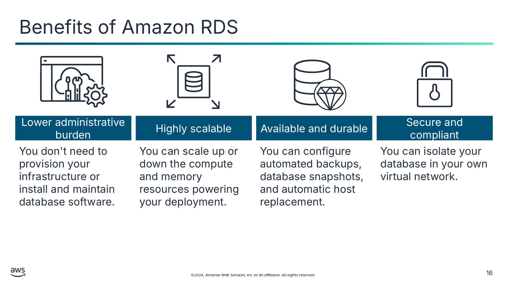

Lower administrative burden (Менше адміністративне навантаження)

Highly scalable (Висока масштабованість)

Available and durable (Доступність і довговічність)

Secure and compliant (Безпека та відповідність вимогам)

Вам не потрібно розгортати свою інфраструктуру чи встановлювати й підтримувати програмне забезпечення баз даних.

Ви можете масштабувати вгору чи вниз обчислювальні та пам’яттєві ресурси, що забезпечують ваше розгортання.

Ви можете налаштувати автоматичні резервні копії, знімки бази даних і автоматичну заміну хоста.

Ви можете ізолювати свою базу даних у власній віртуальній мережі.

> **Нотатки:**
>
> |Номер слайда 16  
> |Нотатки для інструктора  
> |  
> |Нотатки для студента  
> Ось деякі характеристики Amazon RDS:  
> Менше адміністративне навантаження: з Amazon RDS не потрібно розгортати інфраструктуру чи встановлювати й підтримувати програмне забезпечення баз даних. Amazon RDS надає єдину консоль і API для керування всіма вашими реляційними базами даних, а безпека й моніторинг вбудовані.  
> Висока масштабованість: ви можете масштабувати обчислювальні ресурси та ресурси сховища вашої бази даних Amazon RDS лише кількома клацаннями миші чи викликом API. Amazon RDS надає вибір типів екземплярів, оптимізованих для різних сценаріїв використання реляційних баз даних. Типи екземплярів складаються з різних комбінацій потужностей ЦП, пам’яті, сховища та мережі й дають вам гнучкість обрати відповідний набір ресурсів для вашої бази даних. Цей модуль охопить масштабування Amazon RDS докладніше.  
> Доступність і довговічність: з Amazon RDS ви можете використовувати реплікацію для підвищення доступності та надійності продуктивних робочих навантажень. Використовуючи варіант розгортання Multi-AZ, ви можете запускати критично важливі робочі навантаження з високою доступністю та вбудованим автоматичним відмовостійким перемиканням (failover) з основної бази даних на синхронно реплікувану вторинну базу даних. Використовуючи репліки для читання (read replicas), ви можете масштабувати назовні за межі потужності одного розгортання бази даних для робочих навантажень баз даних із великою кількістю читань.  
> Безпека та відповідність вимогам: ви також можете використовувати Amazon RDS для запуску ваших екземплярів баз даних в Amazon Virtual Private Cloud (Amazon VPC). Використовуючи Amazon VPC, ви можете ізолювати свої екземпляри баз даних і підключатися до вашої наявної ІТ-інфраструктури через віртуальну приватну мережу (VPN) IPsec із шифруванням за галузевим стандартом. Ви можете налаштувати параметри брандмауера й контролювати мережевий доступ до ваших екземплярів баз даних. Багато типів рушіїв Amazon RDS пропонують шифрування в стані спокою, а всі рушії підтримують шифрування під час передавання. Amazon RDS пропонує широкий спектр готовності до відповідності вимогам, зокрема відповідність Закону про переносимість і підзвітність медичного страхування 1996 року (HIPAA).

---

## Слайд 17: Архітектура бази даних Amazon RDS

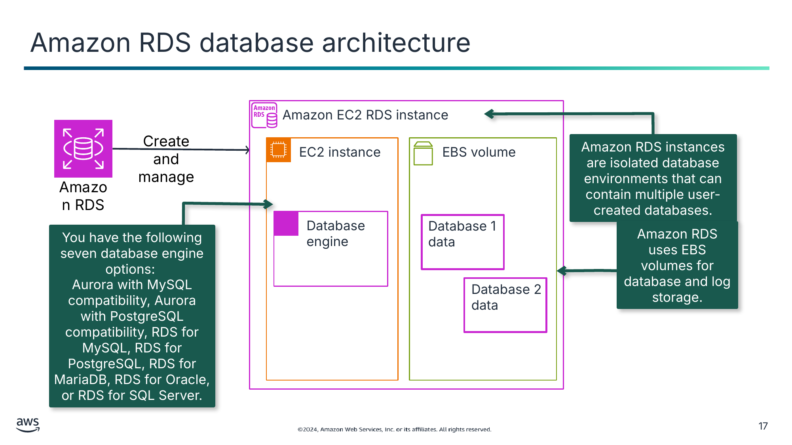

Amazon RDS instances are isolated database environments that can contain multiple user-created databases. (Екземпляри Amazon RDS — це ізольовані середовища баз даних, що можуть містити кілька баз даних, створених користувачами.)

You have the following seven database engine options:  
Aurora with MySQL compatibility, Aurora with PostgreSQL compatibility, RDS for MySQL, RDS for PostgreSQL, RDS for MariaDB, RDS for Oracle, or RDS for SQL Server. (Ви маєте такі сім варіантів рушія бази даних: Aurora із сумісністю з MySQL, Aurora із сумісністю з PostgreSQL, RDS for MySQL, RDS for PostgreSQL, RDS for MariaDB, RDS for Oracle або RDS for SQL Server.)

Amazon RDS uses EBS volumes for database and log storage. (Amazon RDS використовує томи EBS для зберігання бази даних і журналів.)

Текст зі схеми

Amazon EC2 RDS instance (Екземпляр Amazon EC2 RDS)

Create and manage (Створення та керування)

EC2 instance (Екземпляр EC2)

EBS volume (Том EBS)

Amazon RDS

Database engine (Рушій бази даних)

Database 1 data (Дані бази даних 1)

Database 2 data (Дані бази даних 2)

> **Нотатки:**
>
> |Номер слайда 17  
> |Нотатки для інструктора  
> |  
> |Нотатки для студента  
> Amazon RDS надає спосіб розгортання систем керування реляційними базами даних із рушієм і середовищем розгортання на ваш вибір. З Amazon RDS ви можете обрати розгортання на будь-якому із семи керованих рушіїв баз даних у хмарі, зокрема Amazon Aurora із сумісністю з MySQL, Amazon Aurora із сумісністю з PostgreSQL, Amazon RDS for MariaDB, Amazon RDS for MySQL, Amazon RDS for PostgreSQL, Amazon RDS for Oracle та Amazon RDS for SQL Server.  
>
> Amazon RDS полегшує розгортання та обслуговування реляційних баз даних у хмарі. Він керує спеціалізованим екземпляром EC2, що надає обчислювальну потужність.  
> Екземпляри Amazon RDS — це ізольовані середовища баз даних, що можуть містити кілька баз даних, створених користувачами. Кожна база даних містить дані вашої організації.  
> Рушій бази даних дає змогу зберігати, сортувати та отримувати ваші дані.  
>
> Amazon RDS використовує томи EBS для зберігання бази даних і журналів. Ви можете масштабувати потужність сховища, виділену вашому екземпляру бази даних.

---

## Слайд 18: Архітектурна схема рівня бази даних

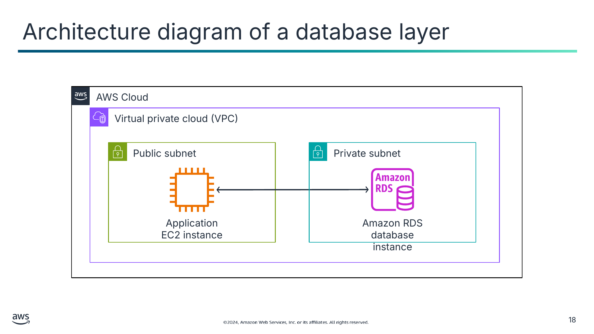

Текст зі схеми

AWS Cloud

Virtual private cloud (VPC) (Віртуальна приватна хмара (VPC))

Public subnet (Публічна підмережа)

Private subnet (Приватна підмережа)

Application EC2 instance (Екземпляр EC2 застосунку)

Amazon RDS database instance (Екземпляр бази даних Amazon RDS)

> **Нотатки:**
>
> |Номер слайда 18  
> |Нотатки для інструктора  
> |  
> |Нотатки для студента  
> Ця архітектурна схема показує екземпляр EC2 та екземпляр Amazon RDS усередині Amazon Virtual Private Cloud (Amazon VPC).  
>
> Віртуальна приватна хмара (VPC) — це ізольоване віртуальне середовище, у якому можна запускати ресурси AWS. Докладніше про VPC ви дізнаєтеся в іншому місці цього курсу.  
>
> У цьому модулі ви отримаєте практичний досвід створення рівня бази даних за допомогою Amazon RDS. Ви оберете рушій бази даних під час запуску бази даних.

---

## Слайд 19: Aurora

- Є системою керування реляційними базами даних (RDBMS), побудованою для хмари, з повною сумісністю з MySQL і PostgreSQL
- Керується Amazon RDS
- Забезпечує високу продуктивність і доступність за одну десяту вартості
- Забезпечує розгортання Multi-AZ із репліками Aurora (Aurora Replicas)

Aurora

> **Нотатки:**
>
> |Номер слайда 19  
> |Нотатки для інструктора  
> |  
> |Нотатки для студента  
> Aurora — це RDBMS, сумісна з MySQL і PostgreSQL, побудована для хмари:  
> Aurora до п’яти разів швидша за стандартні бази даних MySQL і до трьох разів швидша за стандартні бази даних PostgreSQL.  
> Вона забезпечує безпеку, доступність і надійність комерційних баз даних приблизно за одну десяту вартості.  
> Aurora повністю керується Amazon RDS, що автоматизує трудомісткі завдання адміністрування, як-от розгортання апаратного забезпечення, налаштування бази даних, встановлення виправлень і резервне копіювання.  
> Aurora має розподілену, відмовостійку систему зберігання з самовідновленням, що автоматично масштабується до 64 ТБ на екземпляр бази даних.  
> Вона забезпечує високу продуктивність і доступність із до 15 реплік для читання з низькою затримкою, відновленням на певний момент часу (point-in-time recovery), безперервним резервним копіюванням в Amazon Simple Storage Service (Amazon S3) і реплікацією між трьома зонами доступності.

---

## Слайд 20: Кластери баз даних Aurora

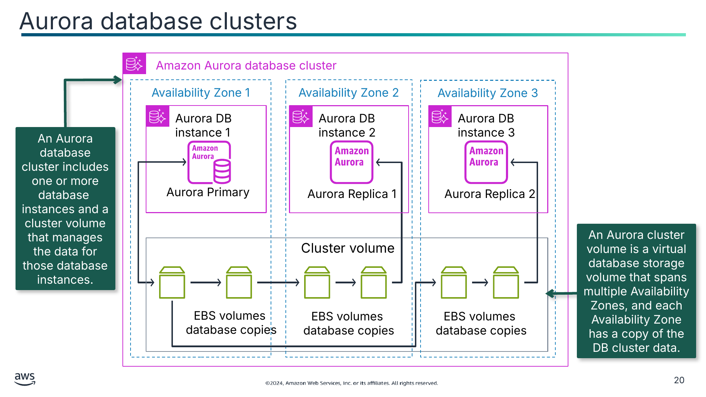

An Aurora database cluster includes one or more database  instances and a cluster volume that manages the data for those database instances. (Кластер бази даних Aurora включає один або кілька екземплярів бази даних і том кластера, що керує даними цих екземплярів бази даних.)

An Aurora cluster volume is a virtual database storage volume that spans multiple Availability Zones, and each Availability Zone has a copy of the DB cluster data. (Том кластера Aurora — це віртуальний том зберігання бази даних, що охоплює кілька зон доступності, і кожна зона доступності має копію даних кластера БД.)

Текст зі схеми

Amazon Aurora database cluster (Кластер бази даних Amazon Aurora)

Availability Zone 1 (Зона доступності 1)

Availability Zone 2 (Зона доступності 2)

Availability Zone 3 (Зона доступності 3)

Aurora DB instance 1 (Екземпляр БД Aurora 1)

Aurora DB instance 2 (Екземпляр БД Aurora 2)

Aurora DB instance 3 (Екземпляр БД Aurora 3)

Aurora Primary (Основний екземпляр Aurora)

Aurora Replica 1 (Репліка Aurora 1)

Aurora Replica 2 (Репліка Aurora 2)

Cluster volume (Том кластера)

EBS volumes

database copies (Томи EBS, копії бази даних)

EBS volumes

database copies

EBS volumes

database copies

> **Нотатки:**
>
> |Номер слайда 20  
> |Нотатки для інструктора  
> |  
> |Нотатки для студента  
> Опис зображення: кластер бази даних Amazon Aurora, що показує основний екземпляр у зоні доступності 1 і по одному екземпляру-репліці в зонах доступності 2 і 3. Кожен екземпляр підключається до набору томів EBS в тій самій зоні доступності. Основний екземпляр копіює свою базу даних на свої томи EBS, і вони копіюються на томи EBS для кожної з реплік бази даних. Томи EBS перебувають у томі кластера Aurora, що охоплює всі три зони доступності. Кінець опису.  
>
> Кластер бази даних Aurora складається з одного чи кількох екземплярів бази даних (DB) і тому кластера, що керує даними цих екземплярів бази даних. Том кластера Aurora — це віртуальний том зберігання бази даних, що охоплює кілька зон доступності, і кожна зона доступності має копію даних кластера бази даних. Кластер бази даних Aurora складається з двох типів екземплярів бази даних:  
> Основний екземпляр бази даних підтримує операції читання та запису й виконує всі зміни даних у томі кластера. Кожен кластер БД Aurora має один основний екземпляр БД.  
> Репліка Aurora підключається до того самого тому зберігання, що й основний екземпляр БД, і підтримує лише операції читання. Кожен кластер бази даних Aurora може мати до 15 реплік Aurora на додачу до основного екземпляра БД. Підтримуйте високу доступність, розміщуючи репліки Aurora в окремих зонах доступності. Aurora автоматично переходить на репліку Aurora (failover) у разі недоступності основного екземпляра БД. Ви можете вказати пріоритет відмовостійкого перемикання для реплік Aurora. Репліки Aurora також можуть розвантажувати робочі навантаження читання з основного екземпляра БД.

---

## Слайд 21: Aurora Serverless

- Є конфігурацією автоматичного масштабування за запитом для Aurora
- Забезпечує керування потужностями без втручання
- Забезпечує детальне масштабування
- Підходить для такого:
  - Змінні робочі навантаження
  - Нові застосунки
  - Розробка та тестування
  - Планування потужностей

> **Нотатки:**
>
> |Номер слайда 21  
> |Нотатки для інструктора  
> |  
> |Нотатки для студента  
> Amazon Aurora Serverless — це конфігурація автоматичного масштабування за запитом для Aurora, у якій база даних автоматично запускається, вимикається та масштабує потужність вгору чи вниз залежно від потреб вашого застосунку. Ця конфігурація допомагає керувати потужностями бази даних і розгортати їх.  
>
> З Aurora Serverless ви можете запускати свою базу даних у хмарі без керування будь-якими екземплярами бази даних. Ви також можете використовувати екземпляри Aurora Serverless v2 разом із виділеними (provisioned) екземплярами у ваших наявних чи нових кластерах баз даних.  
>
> Детальність масштабування в Aurora Serverless v2 допомагає точно підігнати потужність до потреб вашої бази даних.  
>
> Aurora Serverless v2 особливо корисний для таких сценаріїв використання:  
> Змінні робочі навантаження: ви запускаєте робочі навантаження, що мають раптові й непередбачувані зростання активності. З Aurora Serverless v2 ваша база даних автоматично масштабує потужність для задоволення потреб пікового навантаження застосунку й масштабує назад вниз, коли сплеск активності закінчується.  
> Нові застосунки: ви розгортаєте новий застосунок і не впевнені, який розмір екземпляра БД вам потрібен. Використовуючи Aurora Serverless v2, ви можете налаштувати кластер з одним чи багатьма екземплярами БД, і база даних автоматично масштабуватиметься до вимог застосунку щодо потужностей.  
> Розробка та тестування: з Aurora Serverless v2 ви можете створювати екземпляри БД із низькою мінімальною потужністю. Можна встановити максимальну потужність достатньо високою, щоб ці екземпляри БД усе ще могли запускати суттєві робочі навантаження без нестачі пам’яті. Коли базу даних не використовують, усі екземпляри БД масштабуються вниз, щоб уникнути непотрібних витрат.  
> Планування потужностей: припустімо, ви зазвичай коригуєте потужність вашої бази даних або перевіряєте оптимальну потужність бази даних для вашого робочого навантаження, змінюючи класи екземплярів БД усіх екземплярів БД у кластері. З Aurora Serverless v2 ви можете уникнути цих адміністративних накладних витрат. Ви можете визначити відповідну мінімальну й максимальну потужність, запустивши робоче навантаження й перевіривши, наскільки екземпляри БД фактично масштабуються. Ви можете змінювати наявні екземпляри БД із виділених на Aurora Serverless v2 або з Aurora Serverless v2 на виділені. У таких випадках не потрібно створювати новий кластер чи новий екземпляр БД.

---

## Слайд 22: Сценарій використання Amazon RDS: банківські транзакції

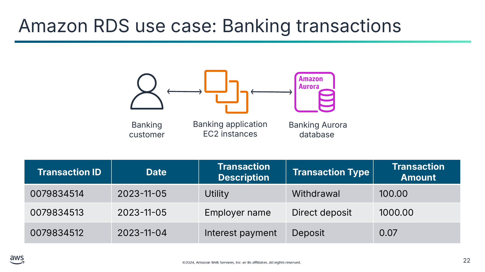

| Transaction ID (Ідентифікатор транзакції) | Date (Дата) | Transaction Description (Опис транзакції) | Transaction Type (Тип транзакції) | Transaction Amount (Сума транзакції) |
|---|---|---|---|---|
| 0079834514 | 2023-11-05 | Utility | Withdrawal | 100.00 |
| 0079834513 | 2023-11-05 | Employer name | Direct deposit | 1000.00 |
| 0079834512 | 2023-11-04 | Interest payment | Deposit | 0.07 |

Текст зі схеми

Banking application  
EC2 instances (Екземпляри EC2 банківського застосунку)

Banking customer (Банківський клієнт)

Banking Aurora database (Банківська база даних Aurora)

> **Нотатки:**
>
> |Номер слайда 22  
> |Нотатки для інструктора  
> |  
> |Нотатки для студента  
> Amazon RDS підходить для оперативної обробки транзакцій (OLTP). OLTP надійно й ефективно зберігає та оновлює транзакційні дані у великих обсягах.  
>
> Один зі сценаріїв використання Amazon RDS — для транзакційних таблиць даних: наприклад, банківські транзакції. Коли банківський клієнт робить внесок чи знімає кошти, він звертається до банківської бази даних Aurora, розміщеної на екземплярах EC2 банківського застосунку.  
>
> Таблиця показує кілька рядків поточного рахунку банківського клієнта. Кожна транзакція має унікальний ідентифікатор. Для кожної транзакції записуються такі дані, як дата транзакції, опис, тип і сума.

---

## Слайд 23: Типи та розміри екземплярів EC2 для Amazon RDS

- Загального призначення (T4g, T3, M6g і M5)
- Оптимізовані для пам’яті (R6g, R5, X2g і X1E)

| Тип екземпляра (Instance type) | Пам’ять (Memory, GiB) | vCPU |
|---|---|---|
| db.m6g.large | 8 | 2 |
| db.r6g.large | 16 | 2 |
| db.m6g.xlarge | 16 | 4 |
| db.r6g.xlarge | 32 | 4 |

Якщо m6g.large — екземпляр, який потребує оновлення, спершу визначте проблему.

Чи потрібно йому більше пам’яті або ЦП?

mg6.xlarge забезпечив би оновлення ЦП.

rg6.large забезпечив би оновлення пам’яті.

> **Нотатки:**
>
> |Номер слайда 23  
> |Нотатки для інструктора  
> |  
> |Нотатки для студента  
> Amazon RDS надає вибір типів екземплярів, оптимізованих для різних сценаріїв використання реляційних баз даних. Типи екземплярів складаються з різних комбінацій потужностей ЦП, пам’яті, сховища та мережі й дають вам гнучкість обрати відповідний набір ресурсів для вашої бази даних. Кожен тип екземпляра включає кілька розмірів екземпляра, що дає вам змогу масштабувати вашу базу даних до вимог цільового робочого навантаження. Не кожен тип екземпляра підтримується для кожного рушія бази даних, версії, редакції чи регіону:  
> Типи екземплярів Amazon RDS загального призначення підходять для робочих навантажень з інтенсивним використанням ЦП і робочих навантажень із помірним використанням ЦП, що мають тимчасові сплески використання. Сімейства T і M — типи екземплярів загального призначення.  
> Типи екземплярів Amazon RDS, оптимізовані для пам’яті, підходять для робочих навантажень з інтенсивними запитами або великою кількістю з’єднань. Сімейства R і X — типи екземплярів, оптимізовані для пам’яті.  
>
> Коли йдеться про оновлення типів екземплярів, спершу визначте, чи є робоче навантаження ресурсомістким за пам’яттю чи за обчисленнями. Визначте, який ресурс обмежений, і оновлюйте залежно від цього дефіциту.

---

## Слайд 24: Найкращі практики безпеки Amazon RDS

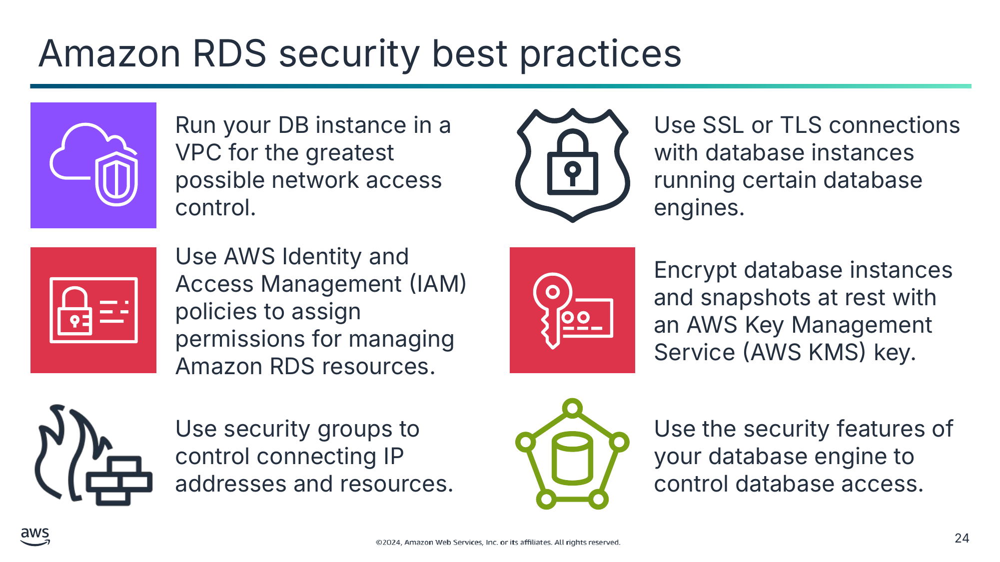

Run your DB instance in a VPC for the greatest possible network access control. (Запускайте свій екземпляр БД у VPC для найбільшого можливого контролю мережевого доступу.)

Use SSL or TLS connections with database instances running certain database engines. (Використовуйте з’єднання SSL чи TLS з екземплярами баз даних, на яких працюють певні рушії баз даних.)

Use AWS Identity and Access Management (IAM) policies to assign permissions for managing Amazon RDS resources. (Використовуйте політики AWS Identity and Access Management (IAM) для призначення дозволів на керування ресурсами Amazon RDS.)

Encrypt database instances and snapshots at rest with an AWS Key Management Service (AWS KMS) key. (Шифруйте екземпляри баз даних і знімки в стані спокою за допомогою ключа AWS Key Management Service (AWS KMS).)

Use security groups to control connecting IP addresses and resources. (Використовуйте групи безпеки для контролю IP-адрес і ресурсів, що підключаються.)

Use the security features of your database engine to control database access. (Використовуйте функції безпеки вашого рушія бази даних для контролю доступу до бази даних.)

> **Нотатки:**
>
> |Номер слайда 24  
> |Нотатки для інструктора  
> |  
> |Нотатки для студента  
> Безпека — це спільна відповідальність між вами та AWS. AWS відповідає за безпеку самої хмари, що означає, що AWS захищає інфраструктуру, на якій працює Amazon RDS. Водночас ви відповідаєте за безпеку в хмарі.  
>   
> Ви можете керувати доступом до ваших ресурсів Amazon RDS і ваших баз даних на екземплярі бази даних. Метод, який ви використовуєте для керування доступом, залежить від типу завдання, яке користувачу потрібно виконати з Amazon RDS. Нижче наведено рекомендовані найкращі практики безпеки:  
> Запускайте свій екземпляр БД у власній приватній VPC на основі сервісу Amazon VPC для найбільшого можливого контролю мережевого доступу.  
> Використовуйте політики AWS Identity and Access Management (IAM) для призначення дозволів, що визначають, кому дозволено керувати ресурсами Amazon RDS. Наприклад, можна використати IAM, щоб визначити, кому дозволено створювати, описувати, змінювати та видаляти екземпляри БД, тегувати ресурси чи змінювати групи безпеки.  
> Використовуйте групи безпеки для контролю того, які IP-адреси чи екземпляри EC2 можуть підключатися до ваших баз даних на екземплярі БД. Коли ви вперше створюєте екземпляр БД, його брандмауер запобігає будь-якому доступу до бази даних, окрім як через правила, указані в пов’язаній групі безпеки.  
> Використовуйте з’єднання SSL чи TLS з екземплярами БД, на яких працюють рушії баз даних MySQL, MariaDB, PostgreSQL, Oracle чи Microsoft SQL Server.  
> Використовуйте шифрування Amazon RDS для захисту ваших екземплярів баз даних і знімків у стані спокою. Шифрування Amazon RDS використовує галузевий стандартний алгоритм шифрування AES-256 для шифрування ваших даних на сервері, що розміщує ваш екземпляр БД. Для зашифрованого екземпляра бази даних Amazon RDS усі журнали, резервні копії та знімки зашифровано. Amazon RDS використовує ключ AWS Key Management Service (AWS KMS) для шифрування цих ресурсів.  
> Використовуйте функції безпеки вашого рушія бази даних для контролю того, хто може входити в бази даних на екземплярі бази даних. Ці функції працюють так, ніби база даних перебуває у вашій локальній мережі.

---

## Слайд 25: Ключові висновки: Amazon RDS

- Amazon RDS — це кероване обслуговування реляційних баз даних, що може розгортати знайомі рушії баз даних.
- Aurora — це кероване реляційне рішення (рушій) бази даних, побудований для хмари. Aurora Serverless забезпечує підтримку автоматичного масштабування Aurora за запитом.
- Amazon RDS надає вибір типів екземплярів, оптимізованих для різних сценаріїв використання реляційних баз даних.
- Відмінності в продуктивності, масштабованості, відмовостійкому перемиканні, сховищі, високій доступності, резервному копіюванні та версіях баз даних визначатимуть, яка реляційна база даних є оптимальним вибором.

> **Нотатки:**
>
> |Номер слайда 25  
> |Нотатки для інструктора  
> |  
> |Нотатки для студента

---

## Слайд 26: Покрокова лабораторна робота: створення бази даних Amazon RDS (Amazon RDS lab)

> **Нотатки:**
>
> |Номер слайда 26  
> |Нотатки для інструктора  
> |  
> |Нотатки для студента  
> Зараз ви виконаєте лабораторну роботу. Наступні слайди підсумовують, що ви робитимете в лабораторній роботі, а докладні інструкції ви знайдете в лабораторному середовищі.

---

## Слайд 27: Завдання лабораторної роботи «Amazon RDS»

- У цій лабораторній роботі ви виконаєте такі основні завдання:
  - Створите базу даних Amazon RDS.
  - Налаштуєте обмін даними вебзастосунку з екземпляром бази даних.
- Відкрийте ваше лабораторне середовище, щоб розпочати лабораторну роботу та дізнатися додаткові подробиці про завдання, які ви виконуватимете.

> **Нотатки:**
>
> |Номер слайда 27  
> |Нотатки для інструктора  
> |  
> |Нотатки для студента  
> Отримайте доступ до лабораторного середовища через ваш онлайн-курс, щоб дізнатися додаткові подробиці та виконати лабораторну роботу.

---

## Слайд 28: Підсумки лабораторної роботи: Amazon RDS

- Коли ви створювали свій екземпляр БД RDS, чому ви налаштували його як єдиний екземпляр бази даних без варіанта розгортання Multi-AZ?
- Що вам потрібно було зробити, щоб ваш застосунок міг підключитися до вашої бази даних?

> **Нотатки:**
>
> |Номер слайда 28  
> |Нотатки для інструктора  
> |Відповідні архітектурні схеми «до» та «після» включено до інструкцій кожної лабораторної роботи. Вам може бути корисно відкрити схеми лабораторної роботи під час підбиття підсумків цієї лабораторної роботи.  
> |Запропоновані відповіді на запитання 1: коли ви створювали свій екземпляр БД RDS, чому ви налаштували його як єдиний екземпляр бази даних без варіанта розгортання Multi-AZ?  
> |Варіант розгортання Multi-AZ автоматично створює репліку бази даних у другій зоні доступності для високої доступності. Однак у цій лабораторній роботі ви створювали лише екземпляр RDS для розробки (тестування). Тому ви використали єдиний екземпляр бази даних, оскільки висока доступність вам не була потрібна.  
> |Запропоновані відповіді на запитання 2: що вам потрібно було зробити, щоб ваш застосунок міг підключитися до вашої бази даних?  
> |Вам потрібно було отримати кінцеву точку бази даних (database endpoint), щоб застосунок знав, як підключитися до бази даних. Ви знайшли кінцеву точку бази даних у розділі Connectivity and Security вашого екземпляра БД RDS.  
> |Потім ви повернулися до вкладки браузера із застосунком Inventory і ввели кінцеву точку бази даних, початкове ім’я бази даних, ім’я користувача бази даних і пароль.  
> |  
> |Нотатки для студента  
> Ваш інструктор може розглянути ці запитання з вами, або ви можете розглянути їх самостійно. Скористайтеся цією нагодою, щоб поглибити своє мислення щодо завдань, які ви виконували під час лабораторної роботи.

---

## Слайд 29: Керування з’єднаннями Amazon RDS Proxy

Додавання рівня бази даних

> **Нотатки:**
>
> |Номер слайда 29  
> |Нотатки для інструктора  
> |  
> |Нотатки для студента  
> Цей розділ описує функції Amazon RDS Proxy і резервне копіювання даних для RDS.

---

## Слайд 30: Amazon RDS Proxy

Повністю кероване, високодоступне проксі бази даних для Amazon RDS

Більш масштабоване

Більш стійке

Більш безпечне

Об’єднує в пул і спільно використовує з’єднання з базою даних для кращого масштабування застосунків

Зменшує час відмовостійкого перемикання баз даних Aurora та Amazon RDS до 66 відсотків для баз даних Amazon RDS Multi-AZ

Забезпечує примусову автентифікацію IAM і зберігає облікові дані в AWS Secrets Manager

> **Нотатки:**
>
> |Номер слайда 30  
> |Нотатки для інструктора  
> |  
> |Нотатки для студента  
> Amazon RDS Proxy — це повністю кероване, високодоступне проксі бази даних для Amazon RDS. Він доступний для Aurora із сумісністю з MySQL, Aurora із сумісністю з PostgreSQL, RDS for MariaDB, RDS for MySQL, RDS for PostgreSQL та RDS for SQL Server. Вам не потрібно розгортати чи керувати будь-якою додатковою інфраструктурою, щоб розпочати використання RDS Proxy:  
> RDS Proxy дає змогу застосункам об’єднувати в пул і спільно використовувати з’єднання, встановлені з базою даних. Це робить застосунки більш масштабованими.  
> RDS Proxy зменшує час відмовостійкого перемикання баз даних Aurora та Amazon RDS. Це робить застосунки більш доступними та стійкими.  
> RDS Proxy забезпечує примусову автентифікацію IAM і зберігає облікові дані в AWS Secrets Manager. Це робить застосунки більш безпечними.

---

## Слайд 31: Об’єднання з’єднань у пул (connection pooling): покращена масштабованість

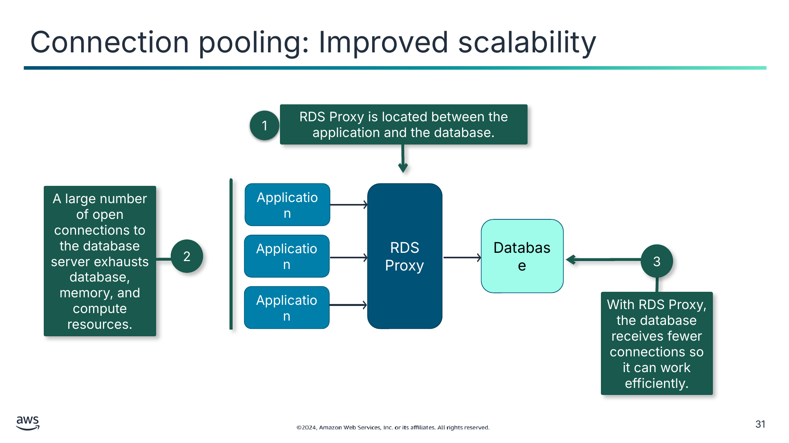

1

RDS Proxy розташовано між застосунком і базою даних.

2

3

З RDS Proxy база даних отримує менше з’єднань, тож може працювати ефективно.

Текст зі схеми

A large number of open connections to the database server exhausts database, memory, and compute resources. (Велика кількість відкритих з’єднань із сервером бази даних вичерпує ресурси бази даних, пам’яті та обчислень.)

Application (Застосунок)

RDS Proxy

Database (База даних)

Application

Application

> **Нотатки:**
>
> |Номер слайда 31  
> |Нотатки для інструктора  
> |  
> |Нотатки для студента  
> Ця схема — представлення того, як RDS Proxy зменшує кількість з’єднань застосунків, що досягають рівня бази даних.  
> RDS Proxy розташований посередині між застосунком і базою даних.  
> Багато застосунків, зокрема побудовані на сучасних безсерверних архітектурах, можуть мати тисячі відкритих з’єднань від застосунку до сервера бази даних. Не всі ці з’єднання постійно виконують транзакцію. RDS Proxy виявляє ці прогалини в операціях і повторно використовує з’єднання для обслуговування інших з’єднань застосунків.  
> За допомогою об’єднання з’єднань у пул RDS Proxy база даних отримує менше з’єднань, тож може працювати ефективно, не вичерпуючи пам’ять і обчислювальні ресурси бази даних.  
>
> Ви можете розглянути використання RDS Proxy у таких ситуаціях:  
> Будь-який екземпляр бази даних, що стикається з помилками щодо надто великої кількості з’єднань, — хороший кандидат для зв’язування з проксі. Проксі дає змогу застосункам відкривати багато клієнтських з’єднань, тоді як проксі керує меншою кількістю довгоживучих з’єднань із екземпляром бази даних.  
> Застосунки, що зазвичай відкривають і закривають велику кількість з’єднань із базою даних і не мають вбудованих механізмів об’єднання з’єднань у пул, — хороші кандидати для використання проксі.  
> Застосунки, що тримають відкритою велику кількість з’єднань протягом тривалого часу, зазвичай — хороші кандидати для використання проксі. Застосунки в таких галузях, як програмне забезпечення як послуга (SaaS) чи електронна комерція, часто мінімізують затримку запитів до бази даних, залишаючи з’єднання відкритими. З RDS Proxy застосунок може тримати відкритими більше з’єднань, ніж за прямого підключення до екземпляра бази даних.

---

## Слайд 32: Безшовне й швидке відмовостійке перемикання (failover): покращена доступність

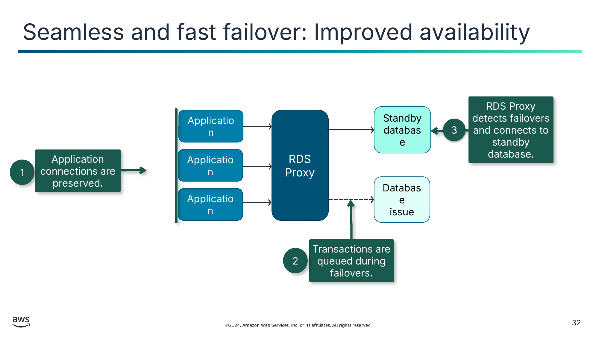

RDS Proxy виявляє відмови та підключається до резервної бази даних.

3

З’єднання застосунку зберігаються.

1

Транзакції ставляться в чергу під час відмовостійкого перемикання.

2

Текст зі схеми

Application (Застосунок)

RDS Proxy

Standby database (Резервна база даних)

Application

Database

issue (Проблема з базою даних)

Application

> **Нотатки:**
>
> |Номер слайда 32  
> |Нотатки для інструктора  
> |  
> |Нотатки для студента  
> RDS Proxy може допомогти зробити застосунки стійкішими та прозорішими до збоїв бази даних. RDS Proxy обходить кеші DNS, щоб зменшити час відмовостійкого перемикання до 66 відсотків для баз даних Amazon RDS Multi-AZ. RDS Proxy також автоматично маршрутизує трафік до нового екземпляра бази даних, зберігаючи з’єднання застосунків. Це робить відмовостійке перемикання прозорішим для застосунків.  
>
> Ця схема — представлення того, як RDS Proxy робить відмовостійке перемикання безшовним і швидким.  
> Коли відбувається відмовостійке перемикання, RDS Proxy негайно виявляє цю подію. RDS Proxy збереже будь-яке з’єднання, що не виконує транзакцію активно. Він також прийматиме нові з’єднання, що надходять.  
> Ви можете використовувати RDS Proxy, щоб поставити в чергу будь-яку транзакцію, яку ви можете надіслати під час відмовостійкого перемикання.  
> Щойно новий екземпляр стає доступним, він передає всі відкладені транзакції, що стоять у черзі.

---

## Слайд 33: Спрощена автентифікація: покращена безпека застосунків

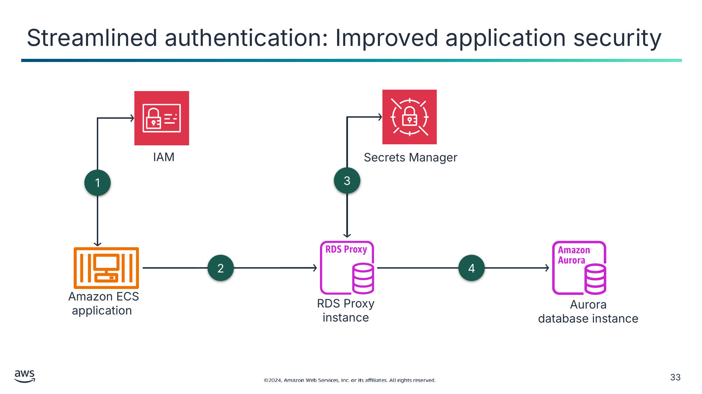

Текст зі схеми

IAM

Secrets Manager

1

3

2

4

Amazon ECS  
application (Застосунок Amazon ECS)

RDS Proxy instance (Екземпляр RDS Proxy)

Aurora  
database instance (Екземпляр бази даних Aurora)

> **Нотатки:**
>
> |Номер слайда 33  
> |Нотатки для інструктора  
> |  
> |Нотатки для студента  
> Коли ви використовуєте RDS Proxy, автентифікація IAM застосовується примусово, що покращує безпеку. Паролі, вбудовані в код, усуваються, що спрощує безпеку.  
>
> Наприклад, ви могли не запровадити автентифікацію IAM і Secrets Manager через складність налаштування такої автентифікації для всіх екземплярів баз даних. Якщо так, ви можете залишити наявні методи автентифікації та делегувати автентифікацію проксі. Проксі може примусово застосовувати політики автентифікації для клієнтських з’єднань для певних застосунків. Ви можете скористатися будь-якою автентифікацією IAM, яку вже маєте для функцій AWS Lambda, замість керування обліковими даними бази даних у коді вашого застосунку Lambda.  
>
> Ця схема — представлення того, як RDS Proxy включає IAM і Secrets Manager для спрощення автентифікації.  
> Застосунок запитує токен автентифікації в IAM. IAM повертає токен автентифікації контейнеру застосунку Elastic Container Service (Amazon ECS).  
> Застосунок надсилає запит до бази даних до RDS Proxy, підключаючись із перевіреним токеном IAM.  
> RDS Proxy викликає Secrets Manager для зіставленої ідентичності. Secrets Manager повертає секрет (ім’я користувача та пароль) до RDS Proxy.  
> RDS Proxy надсилає запит до бази даних до екземпляра бази даних Aurora, підключаючись із секретом.

---

## Слайд 34: Резервне копіювання даних в Amazon RDS

| Функції (Features) | Автоматичні резервні копії (Automated Backups) | Знімки бази даних (Database Snapshots) |
|---|---|---|
| Сценарій використання | Відновлення екземпляра бази даних на певний момент часу. | Резервне копіювання екземпляра бази даних у відомому стані з подальшим його відновленням до цього конкретного стану. |
| Частота резервного копіювання | Щодня протягом вашого вікна резервного копіювання (журнали транзакцій захоплюються кожні 5 хвилин) | Ініціюється користувачем (так часто, як обере користувач) |
| Період збереження | За замовчуванням 7 днів, але можна встановити до 35 днів. Резервні копії можна автоматично видаляти після будь-якого періоду збереження. | Зберігається, доки користувач явно його не видалить |
| Спільний доступ з іншими акаунтами AWS | Не можна поділитися (потрібно спершу скопіювати в ручний знімок) | Можна поділитися (спільні знімки можуть копіювати інші акаунти AWS) |

> **Нотатки:**
>
> |Номер слайда 34  
> |Нотатки для інструктора  
> |  
> |Нотатки для студента  
> Amazon RDS надає два різні варіанти резервного копіювання та відновлення екземплярів баз даних:  
> Автоматичні резервні копії (automated backups): коли автоматичні резервні копії ввімкнено для вашого екземпляра бази даних, Amazon RDS автоматично виконує повний щоденний знімок ваших даних протягом вашого бажаного вікна резервного копіювання та захоплює журнали транзакцій у міру внесення оновлень до вашого екземпляра бази даних. Коли ви ініціюєте відновлення на певний момент часу (point-in-time recovery), журнали транзакцій застосовуються до найдоречнішої щоденної резервної копії, щоб відновити ваш екземпляр бази даних до вказаного вами конкретного моменту часу.  
> Знімки бази даних (database snapshots): це резервні копії, ініційовані користувачем, які можна використовувати для відновлення вашого екземпляра бази даних до відомого стану так часто, як вам заманеться. Ці знімки зберігаються, доки ви явно не видалите їх.  
>
> Автоматичні резервні копії та ручні знімки зберігаються в бакетах S3, що належать сервісу Amazon RDS і керуються ним.  
>
> З Amazon RDS можна копіювати знімки баз даних і знімки кластерів баз даних. Можна копіювати автоматичні резервні копії чи ручні знімки. Після копіювання знімка копія стає ручним знімком.  
>   
> Знімок можна копіювати в межах того самого регіону AWS, можна копіювати знімок між регіонами AWS і можна копіювати знімок між акаунтами AWS.

---

## Слайд 35: Міжрегіональні резервні копії Amazon RDS (cross-region backups)

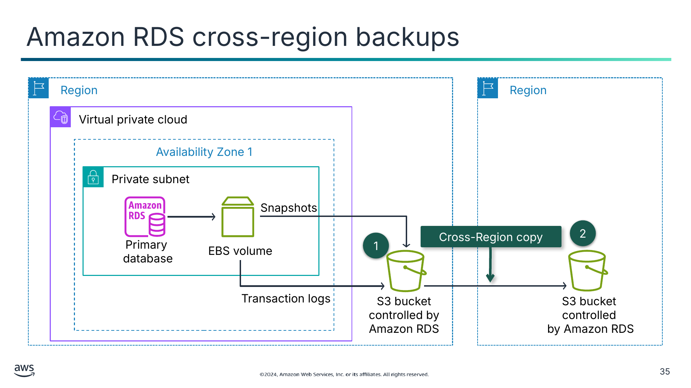

1

Cross-Region copy (Міжрегіональне копіювання)

2

Текст зі схеми

Region (Регіон)

Region

Virtual private cloud (Віртуальна приватна хмара)

Availability Zone 1 (Зона доступності 1)

Private subnet (Приватна підмережа)

Snapshots (Знімки)

Primary

database (Основна база даних)

EBS volume (Том EBS)

Transaction logs (Журнали транзакцій)

S3 bucket controlled by Amazon RDS (Бакет S3, яким керує Amazon RDS)

S3 bucket  
controlled  
by Amazon RDS

> **Нотатки:**
>
> |Номер слайда 35  
> |Нотатки для інструктора  
> |  
> |Нотатки для студента  
> Для додаткової можливості аварійного відновлення ви можете налаштувати свій екземпляр бази даних Amazon RDS на реплікацію знімків і журналів транзакцій до цільового регіону AWS на ваш вибір.  
> Знімки та журнали транзакцій з основної бази даних RDS зберігаються в бакеті S3, яким керує Amazon RDS.  
> Коли для екземпляра бази даних налаштовано реплікацію резервних копій, RDS ініціює міжрегіональне копіювання всіх знімків і журналів транзакцій екземпляра бази даних.  
> Ви можете вказати, щоб копіювалися автоматичні чи ручні знімки бази даних до другого регіону AWS або до окремих акаунтів AWS.  
>   
> Крім того, з Amazon RDS можна створити репліку для читання в іншому регіоні AWS, ніж вихідний екземпляр БД. Ви можете створити репліку для читання в іншому регіоні AWS, щоб виконати таке:  
> Покращити свої можливості аварійного відновлення.  
> Масштабувати операції читання в регіон AWS, ближчий до ваших користувачів.  
> Полегшити міграцію з центру обробки даних в одному регіоні AWS до центру обробки даних в іншому регіоні AWS.

---

## Слайд 36: Шифрування Amazon RDS для резервних копій

Amazon RDS може шифрувати ваші екземпляри БД RDS.

- Дані в стані спокою за допомогою AWS KMS
- Дані під час передавання за допомогою SSL/TLS

Кроки для резервного копіювання незашифрованої бази даних:

Створіть знімок наявного незашифрованого екземпляра бази даних.

Створіть копію знімка й увімкніть варіант шифрування.

Відновіть зашифрований знімок на новий екземпляр бази даних.

> **Нотатки:**
>
> |Номер слайда 36  
> |Нотатки для інструктора  
> |  
> |Нотатки для студента  
> Зашифровані екземпляри БД Amazon RDS забезпечують додатковий рівень захисту даних, захищаючи ваші дані від неавторизованого доступу до базового сховища.  
>
> Amazon RDS може шифрувати ваші екземпляри БД RDS:  
> Шифрування даних у стані спокою: Amazon RDS шифрує ваші бази даних за допомогою ключів, якими ви керуєте в AWS KMS. Для зашифрованого екземпляра бази даних Amazon RDS дані, що зберігаються в стані спокою в базовому сховищі, зашифровані, як і всі журнали, резервні копії та знімки.  
> Шифрування даних під час передавання: Amazon RDS створює сертифікат SSL і встановлює його на екземпляр БД під час розгортання екземпляра. Після встановлення зашифрованого з’єднання дані, що передаються між екземпляром БД і вашим застосунком, шифруватимуться під час передавання. Ви також можете вимагати, щоб ваш екземпляр БД приймав лише зашифровані з’єднання.  
>   
> Після шифрування ваших даних Amazon RDS обробляє автентифікацію доступу та розшифрування ваших даних прозоро з мінімальним впливом на продуктивність.  
>
> Щоб створити резервну копію незашифрованої бази даних, потрібно створити знімок, скопіювати його, зашифрувати копію, а потім побудувати зашифровану базу даних зі знімка.

---

## Слайд 37: Демонстрація: автоматичне резервне копіювання Amazon RDS і репліки для читання (Amazon RDS Automated Backup and Read Replicas)

- Ця демонстрація використовує Amazon RDS.
- У цій демонстрації ви побачите, як:
  - Створити розклад резервного копіювання бази даних.
  - Створити репліку бази даних для читання.

> **Нотатки:**
>
> |Номер слайда 37  
> |Нотатки для інструктора  
> |Ця демонстрація — файл .mp4 із субтитрами. Студенти отримують до неї доступ через онлайн-курс. Посібник інструктора містить тривалість кожної демонстрації.  
> |  
> |Нотатки для студента  
> Знайдіть цю записану демонстрацію у вашому онлайн-курсі як частину цього модуля.

---

## Слайд 38: Ключові висновки: керування з’єднаннями Amazon RDS Proxy

- RDS Proxy — це повністю кероване, високодоступне проксі бази даних для Amazon RDS.
- Використовуючи підхід Multi-AZ, Amazon RDS синхронно реплікує дані для забезпечення високої доступності. Відбувається автоматичне відмовостійке перемикання на резервний екземпляр.
- З репліками для читання Amazon RDS асинхронно реплікує дані для забезпечення високої масштабованості. Резервний екземпляр можна вручну підвищити до самостійного.
- Amazon RDS надає різні варіанти резервного копіювання та відновлення екземплярів баз даних: автоматичні резервні копії та знімки баз даних. Він пропонує шифрування даних у стані спокою та під час передавання.

> **Нотатки:**
>
> |Номер слайда 38  
> |Нотатки для інструктора  
> |  
> |Нотатки для студента

---

## Слайд 39: Amazon DynamoDB

Додавання рівня бази даних

> **Нотатки:**
>
> |Номер слайда 39  
> |Нотатки для інструктора  
> |  
> |Нотатки для студента  
> Цей розділ описує DynamoDB, його функції та те, як вторинне індексування використовується для отримання висновків із даних із максимальною гнучкістю.

---

## Слайд 40: DynamoDB

- Є повністю керованою, безсерверною базою даних NoSQL
- Підтримує моделі даних «ключ-значення» та документів
- Забезпечує продуктивність на рівні мілісекунд і може автоматично масштабувати таблиці для підлаштування під потужності
- Використовується для розробки застосунків і критично важливих робочих навантажень, що надають пріоритет швидкості, масштабованості та довговічності даних

DynamoDB

> **Нотатки:**
>
> |Номер слайда 40  
> |Нотатки для інструктора  
> |  
> |Нотатки для студента  
> DynamoDB — це повністю керована безсерверна база даних NoSQL. Вона підтримує і моделі даних «ключ-значення», і документів. DynamoDB має гнучку схему, тож кожен елемент може мати багато різних атрибутів. Гнучка схема дає вам змогу пристосовуватися в міру зміни ваших бізнес-вимог без тягаря необхідності перевизначати схему таблиці, як у реляційних базах даних.  
>
> DynamoDB може забезпечувати стабільний час відповіді в діапазоні одиниць мілісекунд. База даних автоматично масштабує таблиці для підлаштування під потужності й підтримує продуктивність без адміністрування. DynamoDB допомагає захищати ваші дані за допомогою шифрування та безперервно створює резервні копії ваших даних для захисту.

---

## Слайд 41: Сценарії використання DynamoDB

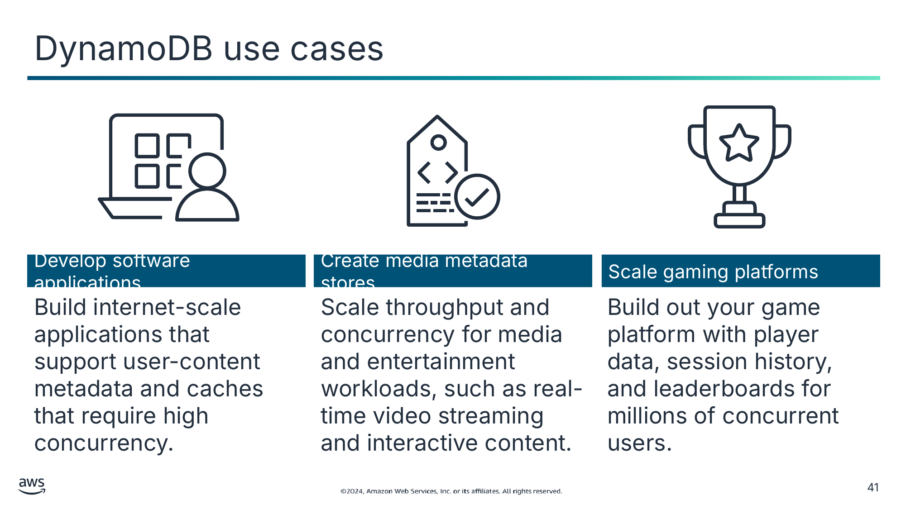

Develop software applications (Розробка програмних застосунків)

Create media metadata stores (Створення сховищ метаданих медіа)

Scale gaming platforms (Масштабування ігрових платформ)

Створюйте застосунки інтернет-масштабу, що підтримують метадані користувацького контенту й кеші, які потребують високої паралельності.

Масштабуйте пропускну здатність і паралельність для медійних та розважальних робочих навантажень, як-от потокове відео в реальному часі та інтерактивний контент.

Розбудовуйте свою ігрову платформу з даними гравців, історією сеансів і таблицями лідерів для мільйонів одночасних користувачів.

> **Нотатки:**
>
> |Номер слайда 41  
> |Нотатки для інструктора  
> |  
> |Нотатки для студента  
> Ось деякі сценарії використання, для яких DynamoDB підходить:  
> Розробка програмних застосунків: створюйте застосунки інтернет-масштабу, що підтримують метадані користувацького контенту й кеші, які потребують високої паралельності та кількості з’єднань для мільйонів користувачів і мільйонів запитів на секунду.  
> Створення сховищ метаданих медіа: масштабуйте пропускну здатність і паралельність для медійних та розважальних робочих навантажень, як-от потокове відео в реальному часі та інтерактивний контент, і забезпечуйте нижчу затримку за допомогою міжрегіональної реплікації між регіонами AWS.  
> Масштабування ігрових платформ: зосередьтеся на інноваціях без операційних накладних витрат. Розбудовуйте свою ігрову платформу з даними гравців, історією сеансів і таблицями лідерів для мільйонів одночасних користувачів.

---

## Слайд 42: Функції DynamoDB

Безсерверна продуктивність із необмеженою масштабованістю

- Вторинні індекси забезпечують гнучкість у способі доступу до ваших даних.
- Amazon DynamoDB Streams ідеально підходить для архітектури, керованої подіями.
- Міжрегіональна, мультиактивна реплікація даних за допомогою глобальних таблиць (global tables)

Вбудована безпека та надійність

- DynamoDB шифрує всі дані клієнтів у стані спокою за замовчуванням.
- Відновлення на певний момент часу захищає дані від випадкових операцій.
- DynamoDB дозволяє детальний контроль доступу.

> **Нотатки:**
>
> |Номер слайда 42  
> |Нотатки для інструктора  
> |Скористайтеся посиланням у переліку ресурсів для отримання посібника з налаштування DynamoDB.  
> |  
> |Нотатки для студента  
> Цей розділ докладніше розглядає деякі функції DynamoDB.  
>
> Безсерверна продуктивність із необмеженою масштабованістю  
> DynamoDB пропонує можливість створювати глобальні та локальні вторинні індекси, які можна використовувати для запитів до даних у таблиці за альтернативним ключем. Окрім надання максимальної гнучкості в способі доступу до ваших даних, ви можете виділити нижчу пропускну здатність запису з відмінною продуктивністю за нижчою вартістю.  
> Amazon DynamoDB Streams — це можливість захоплення змін даних (change data capture). Щоразу, коли застосунок створює, оновлює чи видаляє елементи в таблиці, DynamoDB Streams записує впорядковану за часом послідовність кожної зміни на рівні елемента майже в реальному часі, що робить його ідеальним для застосунків із архітектурою, керованою подіями, для споживання змін і реагування на них.  Застосунки також можуть отримувати доступ до цього журналу та переглядати елементи даних такими, якими вони були до та після змін, майже в реальному часі.  
> Глобальні таблиці DynamoDB забезпечують мультиактивну реплікацію ваших даних між регіонами AWS на ваш вибір. Глобальні таблиці мультиактивні, що означає, що ви можете записувати й читати з будь-якої репліки, а ваші глобально розподілені застосунки можуть отримувати доступ до даних локально у вибраних регіонах, щоб отримати продуктивність читання та запису на рівні одиниць мілісекунд. Глобальні таблиці також автоматично масштабують потужність для розміщення ваших міжрегіональних робочих навантажень.  
>
> Вбудована безпека та надійність  
> DynamoDB використовує IAM для автентифікації, створення ресурсів і доступу до них. Він шифрує всі дані клієнтів у стані спокою за замовчуванням.  
> Відновлення на певний момент часу (PITR) захищає дані в таблицях DynamoDB від випадкових операцій запису чи видалення. PITR забезпечує безперервні резервні копії даних вашої таблиці DynamoDB, і ви можете відновити цю таблицю до будь-якого моменту часу з точністю до секунди протягом попередніх 35 днів.  
> З DynamoDB немає імен користувачів чи паролів. DynamoDB використовує IAM для автентифікації, створення ресурсів і доступу до них. Ви можете вказати політики IAM та умови, що дозволяють детальний доступ, обмежуючи доступ на читання чи запис до окремих елементів і атрибутів у таблиці на основі ідентичності цього користувача. Ця функція дає змогу клієнтам примусово застосовувати політики безпеки на рівні коду.

---

## Слайд 43: Структура даних Amazon DynamoDB

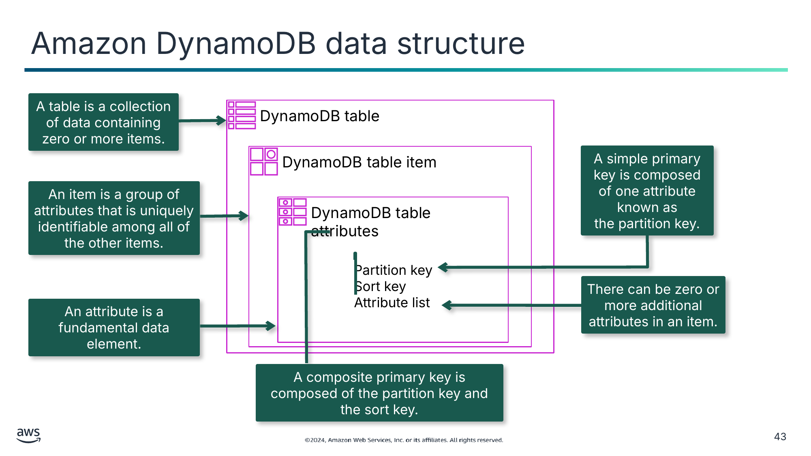

A table is a collection of data containing zero or more items. (Таблиця — це набір даних, що містить нуль або більше елементів.)

A simple primary key is composed of one attribute known as the partition key. (Простий первинний ключ складається з одного атрибута, відомого як ключ розділу.)

An item is a group of attributes that is uniquely identifiable among all of the other items. (Елемент — це група атрибутів, що однозначно ідентифікується серед усіх інших елементів.)

There can be zero or more additional attributes in an item. (В елементі може бути нуль або більше додаткових атрибутів.)

An attribute is a fundamental data element. (Атрибут — це фундаментальний елемент даних.)

A composite primary key is composed of the partition key and the sort key. (Складений первинний ключ складається з ключа розділу та ключа сортування.)

Текст зі схеми

DynamoDB table (Таблиця DynamoDB)

DynamoDB table item (Елемент таблиці DynamoDB)

DynamoDB table attributes (Атрибути таблиці DynamoDB)

Partition key (Ключ розділу)

Sort key (Ключ сортування)

Attribute list (Список атрибутів)

> **Нотатки:**
>
> |Номер слайда 43  
> |Нотатки для інструктора  
> |Сторінка документації, що пояснює основні компоненти Amazon DynamoDB, є в документі ресурсів курсу. Ви знайдете схему, що показує таблицю з назвою People з деякими прикладами елементів і атрибутів.  
> |  
> |Нотатки для студента  
> Розгляньте структуру даних Amazon DynamoDB, щоб краще зрозуміти функції, які він пропонує.  
> Таблиця — це набір даних. Таблиця унікальна для ідентифікатора акаунта та регіону. Кожна таблиця DynamoDB містить нуль або більше елементів.  
> Елемент DynamoDB — це група атрибутів, що однозначно ідентифікується серед усіх інших елементів. Кожен атрибут складається з пари «ключ-значення». (наприклад, Key = Name, Value = Sam)  
> Концептуально елемент подібний до рядка таблиці. Це основна одиниця даних у DynamoDB.  
> Кожен елемент складається з одного чи кількох атрибутів. Атрибут — це фундаментальний елемент даних, щось, що не потребує подальшого розбиття.  
> Атрибути в DynamoDB багато в чому подібні до полів чи стовпців в інших системах баз даних.  
> Усі елементи повинні мати ключ розділу (partition key), також відомий як ключ хешу (hash key). Простий первинний ключ складається з одного атрибута, відомого як ключ розділу.  
> Наявність ключа сортування необов’язкова. Ключ сортування (sort key) вказує, як елементи, що спільно використовують той самий ключ розділу, сортуються всередині розділу.  
> Ключами сортування можуть бути часові позначки, номери версій чи ідентифікатори журналу аудиту. Ключі сортування використовуються для створення групувань даних.  
> Складений первинний ключ — це комбінація ключа розділу та ключа сортування, що однозначно ідентифікуватиме елемент. Наявність первинного ключа забезпечує багаті можливості запитів.  
> В елементі може бути нуль або більше додаткових атрибутів.

---

## Слайд 44: Зразок базової таблиці Amazon DynamoDB

| Ключ розділу (Partition key) =  Device ID: 1 | • Ключ сортування (Sort key) = • Timestamp: 2023-11-20 15:42:00 | Атрибут (Attribute) = Temperature: 41.9 | • Атрибут (Attribute) = • Error Status: Low |
|---|---|---|---|
| Ключ розділу (Partition key) =  Device ID: 1 | • Ключ сортування (Sort key) = • Timestamp: 2023-11-20 15:42:30 | Атрибут (Attribute) = Temperature: 42 |  |
| Ключ розділу (Partition key) =  Device ID: 1 | • Ключ сортування (Sort key) = • Timestamp: 2023-11-20 15:43:00 | Атрибут (Attribute) = Temperature: 39 | • Атрибут (Attribute) = • Error Status: Low |
| Ключ розділу (Partition key) =  Device ID: 2 | • Ключ сортування (Sort key) = • Timestamp: 2023-11-20 15:42:00 | Атрибут (Attribute) = Temperature: 47 | • Атрибут (Attribute) = • Error Status: Low |
| Ключ розділу (Partition key) =  Device ID: 2 | • Ключ сортування (Sort key) = • Timestamp: 2023-11-20 15:42:30 | Атрибут (Attribute) = Temperature: 49 | • Атрибут (Attribute) = • Error Status: High |
| Ключ розділу (Partition key) =  Device ID: 2 | • Ключ сортування (Sort key) = Timestamp: • 2023-11-20 15:43:00 | Атрибут (Attribute) = Temperature: 46.9 |  |

> **Нотатки:**
>
> |Номер слайда 44  
> |Нотатки для інструктора  
> |  
> |Нотатки для студента  
> Це представлення базової таблиці DynamoDB з даними сенсорів IoT від двох пристроїв.  
> Ключ розділу — це ідентифікатор пристрою для пристроїв 1 і 2. Ключ сортування — це часова позначка зчитування кожного пристрою.  
> Показані елементи мають температуру як атрибут.  
> Елементи також мають атрибут стану помилки «low» і «high», коли зафіксована температура була в межах або поза межами оптимального діапазону.  
>
> Ця зразкова базова таблиця використовується для запиту на читання атрибутів, пов’язаних із пристроєм. Як варіант, усю таблицю можна прочитати, щоб отримати всі показання пристроїв за допомогою сканування таблиці.  
>
> Іноді ви хочете виконувати запит на основі атрибутів, відмінних від ключів розділу чи ключів сортування, без повного сканування таблиці. Щоб підтримувати альтернативні шаблони запитів у DynamoDB, можна використовувати вторинні індекси.

---

## Слайд 45: Альтернативна схема за допомогою глобального вторинного індексу (global secondary index)

Базова таблиця (Base table)

| Ключ розділу (Partition key) =  Device ID: 1 | • Ключ сортування (Sort key) = Timestamp: • 2023-11-20 15:42:00 | Атрибут (Attribute) = Temperature: 41.9 | • Атрибут (Attribute) = • Error Status: Low |
|---|---|---|---|
| Ключ розділу (Partition key) =  Device ID: 1 | • Ключ сортування (Sort key) = Timestamp: • 2023-11-20 15:42:30 | Атрибут (Attribute) = Temperature: 42 |  |
| Ключ розділу (Partition key) =  Device ID: 2 | • Ключ сортування (Sort key) = Timestamp: • 2023-11-20 15:42:30 | Атрибут (Attribute) = Temperature: 49 | • Атрибут (Attribute) = • Error Status: High |
| Ключ розділу (Partition key) =  Device ID: 2 | • Ключ сортування (Sort key) = Timestamp: • 2023-11-20 15:43:00 | Атрибут (Attribute) = Temperature: 46.9 |  |

**Запит 1 (Query 1):** для заданих ідентифікатора пристрою та часової позначки знайти пов’язану температуру та стан помилки.

Global Secondary Index (GSI)  
[Eventual consistency (Кінцева узгодженість)]

| • Ключ розділу (Partition key) = • Temperature: 49 | Ключ сортування (Sort key) =  Device ID: 2 | • Атрибут (Attribute) = Timestamp: • 2023-11-20 15:42:30 | Атрибут (Attribute) = Error Status: High |
|---|---|---|---|

**Запит 2 (Query 2):**

Для заданих температури та ідентифікатора пристрою знайти пов’язаний стан помилки та часову позначку.

Альтернативний ключ розділу порівняно з базовою таблицею

Альтернативний ключ сортування порівняно з базовою таблицею

> **Нотатки:**
>
> |Номер слайда 45  
> |Нотатки для інструктора  
> |  
> |Нотатки для студента  
> З глобальним вторинним індексом (GSI) DynamoDB створює копію базової таблиці лише для читання, у якій можна повертати дані навколо різних ключів розділу та сортування. Не потрібно включати до GSI кожен атрибут ваших елементів. Це забезпечує альтернативну схему у вашій базовій таблиці DynamoDB.  
>
> DynamoDB копіює дані з вашої базової таблиці в GSI асинхронно, і дані стають кінцево узгодженими (eventually consistent) з базовою таблицею. Типова поведінка: усі копії даних зазвичай досягають узгодженості протягом 1 секунди. Коли ви читаєте дані з GSI, відповідь може не відображати результатів нещодавно завершеної операції запису в базовій таблиці.  
>
> У наведеному вище прикладі показано базову таблицю, пояснену раніше. Базова таблиця використовується для отримання показань для заданих ідентифікатора пристрою та часової позначки.  
>
> Показано GSI тих самих даних. Указано альтернативний ключ розділу — температуру — та ключ сортування — ідентифікатор пристрою. З GSI можна виконувати запит на пов’язані показання для заданих температури та ідентифікатора пристрою.  
> І ключ розділу, і ключ сортування в GSI можуть відрізнятися від базової таблиці.  
> Ви можете створювати й видаляти GSI у будь-який час.  
> Обмежень розміру даних немає. Максимальна кількість GSI на таблицю DynamoDB — 20.  
> Для GSI виділяється окрема потужність.  
> Коли ви виконуєте запит до GSI, ви отримуєте читання з кінцевою узгодженістю.

---

## Слайд 46: Альтернативна схема за допомогою локального вторинного індексу (local secondary index)

Базова таблиця (Base table)

| Ключ розділу (Partition key) =  Device ID: 1 | • Ключ сортування (Sort key) = Timestamp: • 2023-11-20 15:42:00 | Атрибут (Attribute) = Temperature: 41.9 | • Атрибут (Attribute) = • Error Status: Low |
|---|---|---|---|
| Ключ розділу (Partition key) =  Device ID: 1 | • Ключ сортування (Sort key) = Timestamp: • 2023-11-20 15:42:30 | Атрибут (Attribute) = Temperature: 42 |  |
| Ключ розділу (Partition key) =  Device ID: 2 | • Ключ сортування (Sort key) = Timestamp: • 2023-11-20 15:42:30 | Атрибут (Attribute) = Temperature: 49 | • Атрибут (Attribute) = • Error Status: High |
| Ключ розділу (Partition key) =  Device ID: 2 | • Ключ сортування (Sort key) = Timestamp: • 2023-11-20 15:43:00 | Атрибут (Attribute) = Temperature: 46.9 |  |

**Запит 1 (Query 1):** для заданих ідентифікатора пристрою та часової позначки знайти пов’язану температуру та стан помилки.

Local Secondary Index (LSI)

[Eventual or strong consistency (Кінцева або сильна узгодженість)]

| Ключ розділу (Partition key) =  Device ID: 2 | Ключ сортування (Sort key) =  Error Status: High | Атрибут (Attribute) = Temperature: 49 | • Атрибут (Attribute) = Timestamp: • 2023-11-20 15:42:30 |
|---|---|---|---|

**Запит 2 (Query 2):**

Для заданих ідентифікатора пристрою та стану помилки знайти його температуру та часову позначку.

Той самий ключ розділу, що й у базовій таблиці

Альтернативний ключ сортування порівняно з базовою таблицею

> **Нотатки:**
>
> |Номер слайда 46  
> |Нотатки для інструктора  
> |  
> |Нотатки для студента  
> Ви можете отримувати дані з базової таблиці DynamoDB з кінцевою або сильною узгодженістю. Якщо ви запитуєте сильно узгоджене читання, DynamoDB повертає відповідь із найактуальнішими даними. Відповідь відображає оновлення від усіх попередніх успішних операцій запису.  
>
> Якщо ваш сценарій використання потребує сильно узгоджених читань, ви можете впровадити альтернативну схему з локальним вторинним індексом (LSI).  
>
> У наведеному вище прикладі показано базову таблицю, пояснену раніше. Вона надає пов’язану температуру та стан помилки для заданих ідентифікатора пристрою та часової позначки.  
>
> В LSI указано той самий ключ розділу й альтернативний ключ сортування порівняно з базовою таблицею. Це забезпечить температуру та часову позначку для заданих ідентифікатора пристрою та стану помилки.  
> Ключ розділу залишається таким самим, як у базовій таблиці, але ключ сортування в LSI може відрізнятися від базової таблиці.  
> LSI потрібно створювати разом із таблицею. Ви не можете додати чи видалити LSI пізніше.  
> Існують обмеження розміру даних. Максимальна кількість LSI на базову таблицю DynamoDB — п’ять.  
> Запити чи сканування LSI споживають потужність читання з базової таблиці.  
> Коли ви виконуєте запит до LSI, ви обираєте або кінцеву узгодженість, або сильну узгодженість.

---

## Слайд 47: Міжрегіональна реплікація: глобальні таблиці Amazon DynamoDB (global tables)

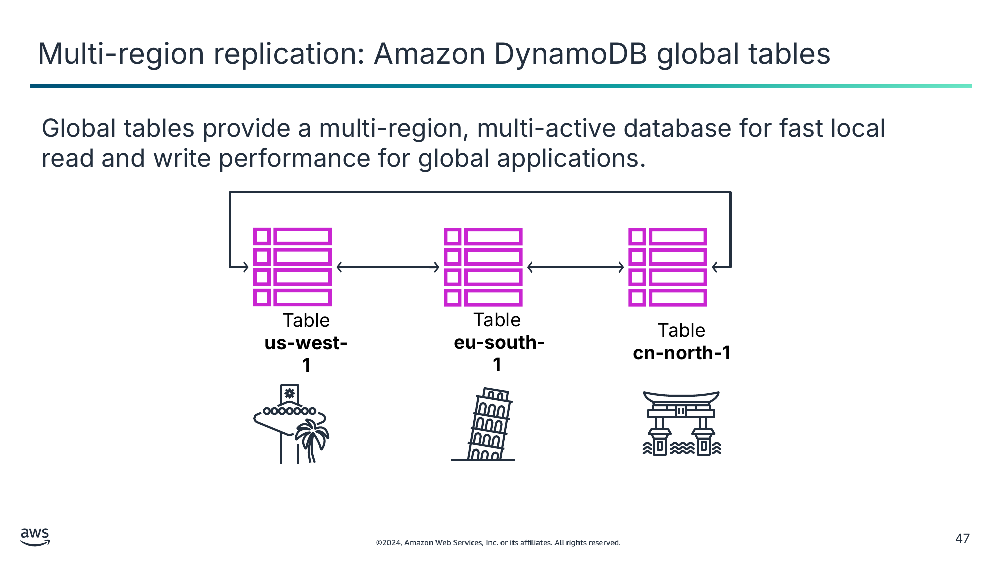

Глобальні таблиці забезпечують міжрегіональну, мультиактивну базу даних для швидкої локальної продуктивності читання та запису для глобальних застосунків.

Table (Таблиця)

**us-west-1**

Table

 **eu-south-1**

Table

**cn-north-1**

cn-north-1

> **Нотатки:**
>
> |Номер слайда 47  
> |Нотатки для інструктора  
> |  
> |Нотатки для студента  
> За замовчуванням Amazon DynamoDB реплікує ваші дані між кількома зонами доступності в одному регіоні. Однак можуть бути випадки, коли ви хочете реплікувати свої дані між кількома регіонами.  
>
> Глобальна таблиця — це набір однієї чи кількох таблиць-реплік, що належать одному акаунту AWS. Таблиця-репліка — це одна таблиця DynamoDB, що функціонує як частина глобальної таблиці. Кожна репліка зберігає той самий набір елементів даних. Ви можете додавати таблиці-репліки до глобальної таблиці, щоб вона була доступна в додаткових регіонах.  
>
> Глобальні таблиці Amazon DynamoDB забезпечують повністю кероване, безсерверне рішення для розгортання міжрегіональної, мультиактивної бази даних. Оскільки глобальні таблиці автоматично реплікують ваші таблиці Amazon DynamoDB між регіонами AWS на ваш вибір, ви можете досягти швидкої локальної продуктивності читання та запису. Глобальні таблиці також усувають складну роботу з реплікації даних між регіонами та розв’язання конфліктів оновлень для мультиактивних робочих навантажень. Крім того, глобальні таблиці дають змогу вашим застосункам залишатися високодоступними навіть у рідкісному випадку ізоляції чи погіршення роботи цілого регіону.  
>
> Сценарій: припустімо, у вас велика клієнтська база, розподілена між трьома географічними територіями — західним узбережжям США, півднем Європи та північчю Китаю. Клієнти мають оновлювати інформацію свого профілю, поки використовують ваш застосунок.  
> Рішення з глобальними таблицями Amazon DynamoDB: ви могли б створити глобальну таблицю, що складається з ваших трьох регіональних таблиць CustomerProfiles. Тоді DynamoDB автоматично реплікував би зміни даних між цими таблицями. Зміни даних CustomerProfiles в одному регіоні безшовно поширювалися б на інші регіони. Крім того, якщо один із регіонів AWS стане тимчасово недоступним, ваші клієнти все одно зможуть отримувати доступ до тих самих даних CustomerProfiles в інших регіонах.

---

## Слайд 48: Найкращі практики безпеки DynamoDB

Профілактичні (Preventative)

Виявлення (Detective)

- Використовуйте ролі IAM для автентифікації доступу.
- Використовуйте політики IAM для базової авторизації DynamoDB.
- Використовуйте умови політик IAM для детального контролю доступу.
- Використовуйте кінцеву точку VPC і політики для доступу до DynamoDB.

- Використовуйте AWS CloudTrail для моніторингу використання ключа AWS KMS, керованого AWS.
- Відстежуйте операції DynamoDB за допомогою CloudTrail.
- Відстежуйте конфігурацію DynamoDB за допомогою AWS Config.
- Відстежуйте відповідність вимогам DynamoDB за допомогою правил AWS Config.

> **Нотатки:**
>
> |Номер слайда 48  
> |Нотатки для інструктора  
> |  
> |Нотатки для студента  
> DynamoDB шифрує всі дані користувачів у стані спокою, що зберігаються в таблицях, індексах, потоках і резервних копіях, за допомогою ключів шифрування, що зберігаються в AWS KMS. Це забезпечує додатковий рівень захисту даних, захищаючи ваші дані від неавторизованого доступу до базового сховища.  
>
> Наведені нижче найкращі практики можуть допомогти передбачити й запобігти інцидентам безпеки в DynamoDB:  
> Використовуйте ролі IAM для автентифікації доступу: щоб користувачі, застосунки та інші сервіси AWS могли отримувати доступ до DynamoDB, вони повинні включати дійсні облікові дані AWS у свої запити AWS API.  
> Використовуйте політики IAM для базової авторизації DynamoDB: коли ви надаєте дозволи, ви вирішуєте, хто їх отримує, на які API DynamoDB вони отримують дозволи та які конкретні дії ви хочете дозволити для цих ресурсів. Впровадження принципу найменших привілеїв — ключ до зменшення ризику безпеки та впливу, що може бути наслідком помилок чи зловмисних намірів. Прикріплюйте політики дозволів до ідентичностей IAM (тобто користувачів, груп і ролей) і таким чином надавайте дозволи на виконання операцій над ресурсами DynamoDB.  
> Використовуйте умови політик IAM для детального контролю доступу: коли ви надаєте дозволи в DynamoDB, ви можете вказати умови, що визначають, як набуває чинності політика дозволів.  
> Використовуйте кінцеву точку VPC і політики для доступу до DynamoDB: якщо вам потрібен доступ до DynamoDB лише з VPC, слід використовувати кінцеву точку VPC, щоб обмежити доступ лише потрібною VPC. Це запобігає проходженню цього трафіку відкритим інтернетом і впливу цього середовища.  
>
> Наведені нижче найкращі практики для DynamoDB можуть допомогти виявити потенційні слабкі місця й інциденти безпеки:  
> Використовуйте AWS CloudTrail для моніторингу використання ключа AWS KMS, керованого AWS: якщо ви використовуєте ключ, керований AWS, для шифрування в стані спокою, використання цього ключа журналюється в CloudTrail. CloudTrail забезпечує видимість активності користувачів, записуючи дії, виконані у вашому акаунті.  
> Відстежуйте операції DynamoDB за допомогою CloudTrail: коли в DynamoDB відбувається активність, вона записується в подію CloudTrail разом з іншими подіями сервісів AWS в історії подій.  
> Відстежуйте конфігурацію DynamoDB за допомогою AWS Config: використовуючи AWS Config, ви можете безперервно відстежувати й записувати зміни конфігурації ваших ресурсів AWS. Також можна використовувати AWS Config для інвентаризації ваших ресурсів AWS.  
> Відстежуйте відповідність вимогам DynamoDB за допомогою правил AWS Config: AWS Config безперервно відстежує зміни конфігурації, що відбуваються серед ваших ресурсів. Він перевіряє, чи порушують ці зміни будь-які умови у ваших правилах. Якщо ресурс порушує правило, AWS Config позначає ресурс і правило як такі, що не відповідають вимогам. Використовуючи AWS Config для оцінювання конфігурацій ваших ресурсів, ви можете оцінити, наскільки добре конфігурації ваших ресурсів відповідають внутрішнім практикам, галузевим настановам і регуляціям.

---

## Слайд 49: Ключові висновки: Amazon DynamoDB

- DynamoDB — це повністю кероване безсерверне обслуговування баз даних NoSQL, що підтримує моделі даних «ключ-значення» та документів.
- DynamoDB пропонує глобальні та локальні вторинні індекси, щоб забезпечити гнучкість у способі доступу до ваших даних.
- Глобальні таблиці забезпечують міжрегіональну, мультиактивну базу даних для швидкої продуктивності глобальних застосунків.
- DynamoDB шифрує всі дані користувачів у стані спокою, що зберігаються в таблицях, індексах і потоках. Профілактичні та виявлювальні найкращі практики безпеки допомагають забезпечити захист даних.

> **Нотатки:**
>
> |Номер слайда 49  
> |Нотатки для інструктора  
> |  
> |Нотатки для студента

---

## Слайд 50: Спеціалізовані бази даних (Purpose-built databases)

Додавання рівня бази даних

> **Нотатки:**
>
> |Номер слайда 50  
> |Нотатки для інструктора  
> |  
> |Нотатки для студента  
> Цей розділ описує пропозицію реляційної бази даних Amazon Redshift і шість варіантів нереляційних баз даних, спеціалізованих для конкретних сценаріїв використання.

---

## Слайд 51: Еволюція спеціалізованих баз даних

| Можливість (Opportunity) | Еволюція баз даних (Database Evolution) | Приклади AWS (AWS Examples) |
|---|---|---|
| Покращити обмежені можливості ієрархічних баз даних щодо визначення зв’язків між даними. | Реляційні | Amazon RDS |
| Покращити продуктивність, відокремивши звітування з великою кількістю читань від транзакційної бази даних застосунку. | Сховище даних / OLAP | Amazon Redshift |
| Проаналізувати різноманітніші типи даних, що генеруються у великих обсягах в інтернеті. | Нереляційні | DynamoDB |
| Скористатися свободою хмарних обчислень масштабувати сховища даних вгору й вниз залежно від фактичного використання та простотою підключення різних мікросервісів до спеціалізованих сховищ даних. | • Спеціалізовані (Purpose-built): • Документні (Document) • Широкостовпцеві (Wide-column) • В пам’яті (In-memory) • Графові (Graph) • Часові ряди (Timeseries) • Реєстр (Ledger) | • Повністю керовані сервіси баз даних: • Amazon DocumentDB • Amazon Keyspaces • MemoryDB • Neptune • Timestream • Amazon QLDB |

> **Нотатки:**
>
> |Номер слайда 51  
> |Нотатки для інструктора  
> |  
> |Нотатки для студента  
> Архітектури застосунків за останні десятиліття значно змінилися. Кожен із головних зрушень був зосереджений на розділенні вашого застосунку для покращення масштабування та стійкості. Паралельно з еволюцією архітектури застосунків відбувається еволюція того, як ви зберігаєте дані й отримуєте до них доступ у дедалі спеціалізованіших рішеннях. Реляційні бази даних замінили ієрархічні, що мали обмежені можливості визначати зв’язки між даними. Сховища даних (data warehouses) еволюціонували як спосіб відокремити операційне звітування, що потребує запитів із великою кількістю читань по всьому набору даних, від транзакційної бази даних застосунку, зосередженої на швидких читаннях і записах у набагато меншому наборі записів. Сховища даних — усе ще реляційні бази даних, але це бази даних для оперативної аналітичної обробки (OLAP), оптимізовані для звітування та аналітики.  
>
> Із розквітом ери інтернету організації почали отримувати різноманітніші типи даних, які вони хотіли мати змогу аналізувати. Ця нова різноманітність даних була менш структурованою й потребувала менш жорстких правил. Ця зміна в типах даних призвела до розробки перших нереляційних баз даних наприкінці 90-х.  
>
> Хмарні обчислення дали організаціям свободу масштабувати сховища даних вгору й вниз на основі фактичного використання. У поєднанні з переходом до мікросервісів гнучкість хмари зробила привабливим підключення різних компонентів застосунку до різних баз даних замість покладання на єдину універсальну. З’явилися додаткові нереляційні спеціалізовані бази даних, щоб надати розробникам можливість оптимізувати сховище, підключене до компонента, відповідно до типу даних і обробки цього компонента. Наприклад, розробники могли б використовувати базу даних-реєстр (ledger) для фінансових транзакцій.  
>
> Інші розділи цього модуля докладніше розглядали Amazon RDS і DynamoDB. Цей розділ надає швидкий огляд Amazon Redshift і шести спеціалізованих баз даних, описаних на цьому слайді.

---

## Слайд 52: Amazon Redshift

- Є повністю керованим хмарним сервісом сховищ даних, призначеним для обробки аналітичних робочих навантажень петабайтного масштабу
- Досягає оптимальної продуктивності запитів завдяки стовпцевому зберіганню (columnar storage)
- Має варіант Amazon Redshift Serverless
- Використовується для оперативної аналітичної обробки (OLAP)

Amazon Redshift

> **Нотатки:**
>
> |Номер слайда 52  
> |Нотатки для інструктора  
> |  
> |Нотатки для студента  
> Сховища даних — це реляційні бази даних, оптимізовані для звітування та аналітики. Це передбачає читання великих обсягів даних для розуміння зв’язків і тенденцій у даних.  Сховище даних вимагає, щоб дані були організовані в табличному форматі, що потрібно для можливості використовувати SQL для запитів до даних. База даних використовується для захоплення й зберігання даних, як-от запис подробиць транзакції.  
>
> Сховище даних Amazon Redshift — це система запитів і керування реляційною базою даних корпоративного класу. Amazon Redshift підтримує клієнтські з’єднання з багатьма типами застосунків, зокрема інструментами бізнес-аналітики (BI), звітування, даних і аналітики. Amazon Redshift — це база даних із відкритим кодом, оптимізована для високої продуктивності та аналізу величезних наборів даних. Це доречний вибір, якщо вам насамперед потрібно зберігати й аналізувати величезні обсяги даних швидко й ефективно, що зазвичай задовольняється застосунком OLAP.  
> Amazon Redshift досягає ефективного зберігання та оптимальної продуктивності запитів завдяки поєднанню масово-паралельної обробки, стовпцевого зберігання даних і дуже ефективних цільових схем кодування стиснення даних. Стовпцеве зберігання для таблиць баз даних різко зменшує загальні вимоги до введення-виведення диска. Воно зменшує обсяг даних, які потрібно завантажувати з диска.  
> Amazon Redshift керує всією роботою з налаштування, експлуатації та масштабування сховища даних. Ці завдання включають розгортання потужностей, моніторинг і резервне копіювання кластера та застосування виправлень і оновлень до рушія Amazon Redshift.  
> Amazon Redshift Serverless розроблено для непередбачуваних робочих навантажень. Amazon Redshift Serverless коригує потужність за лічені секунди для забезпечення стабільно високої продуктивності.  
>
> Ось деякі сценарії використання Amazon Redshift:  
> Автоматично створюйте, навчайте та розгортайте моделі машинного навчання для покращення фінансових прогнозів і прогнозів попиту.  
> Безпечно діліться даними між акаунтами, організаціями та партнерами, будуючи застосунки поверх даних третіх сторін.  
> Підвищуйте продуктивність розробників, отримуючи спрощений доступ до даних без налаштування драйверів і керування з’єднаннями з базами даних.

---

## Слайд 53: Повністю керовані спеціалізовані варіанти баз даних AWS

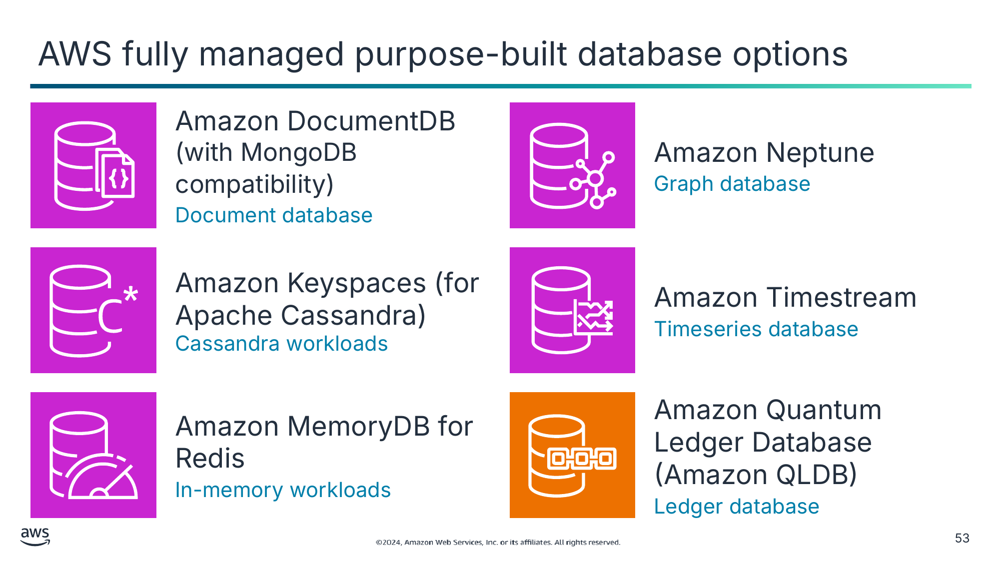

Amazon DocumentDB (with MongoDB compatibility)

Document database (Документна база даних)

Amazon Neptune

Graph database (Графова база даних)

Amazon Keyspaces (for Apache Cassandra)  
Cassandra workloads (Робочі навантаження Cassandra)

Amazon Timestream

Timeseries database (База даних часових рядів)

Amazon MemoryDB for Redis

In-memory workloads (Робочі навантаження в пам’яті)

Amazon Quantum Ledger Database (Amazon QLDB)

Ledger database (База даних-реєстр)

> **Нотатки:**
>
> |Номер слайда 53  
> |Нотатки для інструктора  
> |  
> |Нотатки для студента  
> Слайд підсумовує шість типів спеціалізованих баз даних AWS:  
> Amazon DocumentDB (із сумісністю з MongoDB) — швидкий, масштабований сервіс документних баз даних, що підтримує робочі навантаження MongoDB.  
> Amazon Keyspaces (for Apache Cassandra) — високодоступне кероване обслуговування баз даних, сумісне з Apache Cassandra.  
> Amazon MemoryDB for Redis — довговічний сервіс баз даних в пам’яті, сумісний із Redis, для надшвидкої продуктивності.  
> Amazon Neptune — швидкий, надійний, повністю кероване обслуговування графових баз даних, яке можна використовувати для побудови та запуску застосунків, що працюють із наборами даних із високим ступенем зв’язків.  
> Amazon Timestream — масштабований, повністю кероване, швидке обслуговування баз даних часових рядів для застосунків IoT і операційних застосунків.  
> Amazon Quantum Ledger Database (QLDB) — повністю керована база даних-реєстр, що відстежує кожну зміну даних застосунку й підтримує повну та перевірювану історію змін з часом.  
>
> Усі ці бази даних — повністю керовані хмарні сервіси, що допомагають обмежити час і вартість експериментування та підтримки різних типів баз даних.

---

## Слайд 54: Підбір бази даних під вашу бізнес-потребу

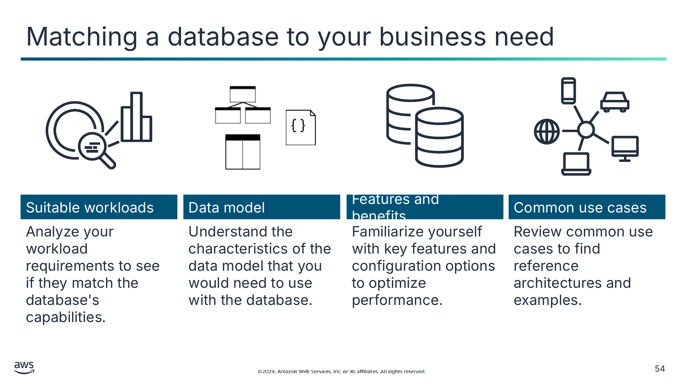

Suitable workloads (Придатні робочі навантаження)

Data model (Модель даних)

Features and benefits (Функції та переваги)

Common use cases (Поширені сценарії використання)

Проаналізуйте вимоги до вашого робочого навантаження, щоб побачити, чи відповідають вони можливостям бази даних.

Зрозумійте характеристики моделі даних, яку вам потрібно було б використовувати з базою даних.

Ознайомтеся з ключовими функціями та варіантами конфігурації для оптимізації продуктивності.

Перегляньте поширені сценарії використання, щоб знайти еталонні архітектури та приклади.

> **Нотатки:**
>
> |Номер слайда 54  
> |Нотатки для інструктора  
> |  
> |Нотатки для студента  
> Концепція наявності спеціалізованих баз даних тісно узгоджується з опорою ефективності продуктивності AWS Well-Architected Framework. Важливо обрати правильний інструмент для роботи. Цей розділ подає приклади баз даних AWS, що підходять для конкретних типів даних і робочих навантажень.  
>
> Як архітектору, що обирає базу даних, подумати про вимоги до робочого навантаження та модель даних, що відповідає цим вимогам, — важливий перший крок. Потім ви оцінюєте наявні варіанти баз даних, щоб обрати ту, що найкраще відповідає вашому сценарію використання. Скористайтеся функціями й конфігураціями обраних баз даних, щоб оптимізувати базу даних для вашого сценарію використання. Також корисно переглянути поширені сценарії використання, щоб дізнатися про перевірені способи виконання речей і знайти еталонні архітектури та приклади, що допоможуть спрямувати ваші архітектурні проєкти.  
>
> Решта слайдів у цьому розділі підсумовують кожну з шести баз даних, поданих на попередньому слайді, за такими чотирма елементами: придатні робочі навантаження, модель даних, ключові функції/переваги та поширені сценарії використання.

---

## Слайд 55: Amazon DocumentDB

Suitable workloads (Придатні робочі навантаження)

Data model (Модель даних)

Features and benefits (Функції та переваги)

Common use cases (Поширені сценарії використання)

- Потребують гнучкої схеми для швидкої ітеративної розробки
- Потребують зберігання даних із різними атрибутами та значеннями даних

- Використовує документну модель даних
- Зберігає документи та швидко отримує до них доступ
- Запити за будь-яким атрибутом

- Є документною базою даних JSON, сумісною з MongoDB
- Підходить для складних документів, що є динамічними та потребують одноразових запитів, індексування й агрегацій

- Система керування контентом (CMS)
- Профілі клієнтів
- Зберігання та керування операційними даними з будь-якого джерела

> **Нотатки:**
>
> |Номер слайда 55  
> |Нотатки для інструктора  
> |  
> |Нотатки для студента  
> Придатні робочі навантаження  
> Деяким організаціям потрібен спосіб зберігати дані з різними атрибутами та значеннями даних. Приклад — онлайн-профілі клієнтів, де різні користувачі надають різні типи інформації. Існує потреба в гнучкій схемі для ефективного зберігання профілю кожного користувача шляхом зберігання лише атрибутів, специфічних для кожного користувача. Коли користувач вирішує додати чи видалити інформацію зі свого профілю, дані мають бути замінені оновленою версією. Деякі робочі навантаження потребують такого рівня індивідуальності та плинності.  
>
> Модель даних  
> Ця база даних використовує документну модель даних. Документи часто використовуються для зберігання напівструктурованих даних у парах «поле-значення» і зазвичай зберігаються як файли JSON. Простий документ має одне чи кілька полів, що перебувають на одному рівні всередині документа. У наступному прикладі поля LName, FName і DOB — це рівноправні елементи в документі. Коли інформацію організовано в простому документі, кожне поле керується окремо. Щоб отримати повне ім’я особи, потрібно отримати LName і FName як окремі елементи даних.  
>
> {  
> "LName": "Rivera",  
> "FName": "Martha",  
> "DOB": "1992-11-16"  
> }  
>
> Документна база даних розроблена для зберігання та виконання запитів до даних як документів, подібних до JSON. Документні бази даних дають розробникам змогу зберігати дані в базі даних і виконувати до них запити, використовуючи той самий формат моделі документів, який вони використовують у коді своїх застосунків. Гнучка, напівструктурована та ієрархічна природа документів і документних баз даних дає їм змогу еволюціонувати разом із потребами застосунків. Документні бази даних забезпечують гнучке індексування, потужні одноразові запити й аналітику над колекціями документів.  
>
> Ключові функції/переваги  
> Amazon DocumentDB — це повністю керована документна база даних JSON, сумісна з MongoDB. Вона підходить для використання у високопродуктивних застосунках у великому масштабі, що потребують даних, представлених у форматі JSON. Amazon DocumentDB чудово підходить для складних документів, що є динамічними й можуть потребувати одноразових запитів, індексування й агрегацій. Нативні інтеграції з AWS Database Migration Service (AWS DMS) для міграції нереляційних баз даних MongoDB в Amazon DocumentDB роблять інтеграцію можливою практично без простою. Переважну більшість застосунків, драйверів та інструментів, які клієнти вже використовують сьогодні зі своєю нереляційною базою даних MongoDB із відкритим кодом, можна використовувати з Amazon DocumentDB. Ви можете контролювати доступ до операцій керування Amazon DocumentDB, як-от створення та зміна кластерів, екземплярів тощо, за допомогою користувачів, ролей і політик IAM.  
>
> Поширені сценарії використання  
> Щоб ефективно керувати контентом, потрібно мати змогу збирати й агрегувати контент із різних джерел, а потім доставляти його клієнту. Завдяки гнучкій схемі документні бази даних ідеально підходять для збирання та зберігання будь-якого типу даних. Їх можна використовувати для створення та включення нових типів контенту, зокрема контенту, створеного користувачами, як-от зображення, коментарі та відео. Ще один сценарій використання Amazon DocumentDB пов’язаний з великими даними в реальному часі. Історично можливість вилучати інформацію з операційних даних була ускладнена тим, що операційні й аналітичні бази даних підтримувалися в різних середовищах — операційному та бізнес-звітування відповідно. Можливість вилучати операційну інформацію в реальному часі критично важлива в середовищі високої конкуренції. Використовуючи документні бази даних, бізнес може зберігати й керувати операційними даними з будь-якого джерела та одночасно подавати дані до рушія бізнес-аналітики на вибір для аналізу. Немає вимоги мати два середовища.

---

## Слайд 56: Amazon Keyspaces

Suitable workloads

Data model

Features and benefits

Common use cases

- Можливість швидких запитів до великих обсягів даних
- Масштабованість і стабільна продуктивність за інтенсивних навантажень запису

- Використовує широкостовпцеву модель даних (wide column)
- Зберігає дані в гнучких стовпцях, що дозволяє даним еволюціонувати з часом
- Розділяє дані між розподіленими системами баз даних

Масштабоване, високодоступне та кероване обслуговування баз даних, сумісне з Apache Cassandra

Обробляйте дані на високих швидкостях для застосунків, що потребують затримки в мілісекундах:

- Обслуговування промислового обладнання
- Моніторинг торгів
- Оптимізація маршрутів

> **Нотатки:**
>
> |Номер слайда 56  
> |Нотатки для інструктора  
> |  
> |Нотатки для студента  
> Придатні робочі навантаження  
> Деякі організації мають великі обсяги даних, до яких потрібно швидко виконувати запити. Ці робочі навантаження зазвичай інтенсивні за записом або збалансовані за читанням/записом і мають вимоги до масштабованості та стабільної продуктивності.  
>
> Модель даних  
> Придатна модель даних — широкостовпцева (wide column). У цій моделі даних дані зберігаються в гнучких стовпцях, що дозволяє даним еволюціонувати з часом і розділятися між розподіленими системами баз даних. Широкостовпцева база даних використовує таблиці, рядки та стовпці, але на відміну від реляційної бази даних, назви й формати стовпців відрізняються від рядка до рядка в тій самій таблиці. Широкостовпцеве сховище можна інтерпретувати як двовимірне сховище «ключ-значення». Широкостовпцеві бази даних дозволяють додатковий вимір інформації порівняно зі стандартною базою даних «ключ-значення». Вона розширює базову модель даних «ключ-значення», що означає, що ви можете використовувати Cassandra Query Language (CQL) для ваших даних. Широкостовпцеві бази даних забезпечують величезну масштабованість і стабільну продуктивність за інтенсивних навантажень запису. Хоча стандартні бази даних «ключ-значення» добре працюють для робочих навантажень з інтенсивним читанням, широкостовпцеві бази даних добре працюють, коли читання/запис більш збалансовані або для інтенсивних операцій запису. Apache Cassandra — це широкостовпцеве сховище даних із відкритим кодом, розроблене для великомасштабних застосунків, що потребують швидкої продуктивності читання та запису.  
>
> Ключові функції/переваги  
> Amazon Keyspaces (for Apache Cassandra) — масштабоване, високодоступне та кероване обслуговування баз даних, сумісне з Apache Cassandra. Amazon Keyspaces дає вам продуктивність, еластичність і корпоративні функції, потрібні для експлуатації критично важливих для бізнесу робочих навантажень Cassandra у великому масштабі. Ви можете використовувати код CQL API, драйвери Cassandra та інструменти розробника без потреби керувати серверами, надгробками (tombstones) чи стратегіями ущільнення (compaction). Він усуває потребу в спеціалізованій експертизі для розгортання, налаштування та керування програмним забезпеченням Cassandra. Ви платите лише за ресурси, які використовуєте, а сервіс може автоматично масштабувати таблиці вгору й вниз у відповідь на трафік застосунку. Ви можете створювати безперервні резервні копії таблиць із сотнями терабайтів даних без впливу на продуктивність вашого застосунку й відновлюватися до будь-якого моменту часу протягом попередніх 35 днів.  
>
> Поширені сценарії використання  
> З Amazon Keyspaces ви можете перенести свої робочі навантаження Cassandra в хмару. Ви можете обробляти дані на високих швидкостях для застосунків, що потребують затримки в одиницях мілісекунд, як-от обслуговування промислового обладнання, моніторинг торгів, керування автопарком і оптимізація маршрутів.

---

## Слайд 57: MemoryDB

Suitable workloads

Data model

Features and benefits

Common use cases

- Робочі навантаження, чутливі до затримки
- Висока частота запитів
- Висока пропускна здатність даних
- Без втрати даних

- Є сервісом баз даних в пам’яті (in-memory)
- Спирається переважно на пам’ять для зберігання даних
- Мінімізує час відповіді, усуваючи потребу звертатися до дисків

Зберігає весь набір даних у пам’яті та використовує розподілений журнал транзакцій, щоб забезпечити таке:

- Швидкість і узгодженість рівня пам’яті
- Довговічність і відновлюваність даних

- Кешування
- Таблиці лідерів ігор
- Банківські транзакції користувачів

> **Нотатки:**
>
> |Номер слайда 57  
> |Нотатки для інструктора  
> |  
> |Нотатки для студента  
> Придатні робочі навантаження  
> Деяким організаціям потрібна основна база даних для їхніх робочих навантажень, чутливих до затримки та таких, що потребують надзвичайно низького часу відповіді, мають високу частоту запитів (до сотень мільйонів запитів на секунду), мають потреби у високій пропускній здатності даних (доступ на читання даних у ГБ на секунду) і мають високі потреби в довговічності.  
>
> Модель даних  
> Бази даних в пам’яті спираються переважно на пам’ять для зберігання даних на відміну від баз даних, що зберігають дані на диску чи SSD. Бази даних в пам’яті розроблені, щоб забезпечити мінімальний час відповіді, усуваючи потребу звертатися до дисків.  
>
> Ключові функції/переваги  
> Amazon MemoryDB for Redis — це сервіс баз даних в пам’яті. MemoryDB зберігає весь ваш набір даних у пам’яті й використовує розподілений журнал транзакцій, щоб забезпечити і швидкість рівня пам’яті, і довговічність, узгодженість та відновлюваність даних. Ви можете використовувати MemoryDB як повністю керовану основну базу даних для побудови високопродуктивних застосунків без необхідності окремо керувати кешем, довговічною базою даних чи потрібною базовою інфраструктурою. MemoryDB сумісна з Redis із відкритим кодом і підтримує ті самі типи даних, параметри й команди. Це означає, що ви можете використовувати з MemoryDB той самий код, застосунки, драйвери та інструменти, що й з Redis із відкритим кодом.  
>
> Поширені сценарії використання  
> Деякі галузеві сценарії використання — це профілі клієнтів у роздрібній торгівлі, таблиці лідерів в іграх і транзакції користувачів у банківській справі. Для сценаріїв, у яких потрібно виконувати кілька запитів одночасно або керувати високодинамічними даними без внесення додаткової затримки сховища, MemoryDB підійшла б, оскільки вона отримує доступ до даних безпосередньо з пам’яті.

---

## Слайд 58: Neptune

Suitable workloads

Data model

Features and benefits

Common use cases

- Знаходьте зв’язки чи шляхи в даних
- Поєднуйте дані зі складними зв’язками між «силосами» даних
- Навігуйте наборами даних із високим ступенем зв’язків і фільтруйте результати на основі певних змінних

- Використовує графову модель даних
- Зберігає дані та зв’язок цих даних з іншими даними як рівноважливі з самими даними
- Швидко створює й навігує зв’язки між даними

- Підтримує графові застосунки, що потребують графових запитів із високою пропускною здатністю та низькою затримкою
- Швидко створює та навігує зв’язки даних

- Рушії рекомендацій
- Виявлення шахрайства
- Графи знань
- Відкриття ліків
- Соціальні мережі

> **Нотатки:**
>
> |Номер слайда 58  
> |Нотатки для інструктора  
> |  
> |Нотатки для студента  
> Придатні робочі навантаження  
> Деякі організації мають набори даних із високим ступенем зв’язків і хочуть знаходити зв’язки у своїх даних. Їм потрібно мати змогу навігувати зв’язаними структурами даних і фільтрувати ці результати на основі певних змінних.  
>
> Модель даних  
> Уявіть реляційну базу даних. Вона зберігає дані на основі наперед визначеної схеми, що ґрунтується на бізнес-шаблонах. Вам потрібно навігувати зв’язками в базі даних за допомогою складних операцій JOIN. Це добре працює, коли відповідаєш на запитання про бізнес-процеси; однак відповідати на запитання про самі зв’язки часто складно. Для вимог до робочого навантаження, окреслених на попередньому кроці, потрібна графова модель даних для зберігання даних і зв’язку цих даних з іншими даними як рівноважливих з самими даними. Зі структурою вузлів і ребер (nodes and edges) ви можете швидко створювати й навігувати зв’язки між даними.  
>
> Ключові функції/переваги  
> Neptune — це високопродуктивний рушій графових баз даних. Він ефективно зберігає та навігує графові дані й використовує архітектуру з масштабуванням вгору, оптимізовану для пам’яті, щоб забезпечити швидке оцінювання запитів над великими графами. Він підтримує мови графових запитів Apache TinkerPop Gremlin, W3C SPARQL та openCypher для виконання потужних запитів, що добре працюють із зв’язаними даними. Ця можливість суттєво зменшує складність коду, щоб ви могли швидко створювати застосунки, що обробляють зв’язки. З підтримкою до 15 реплік для читання Neptune може підтримувати сотні тисяч запитів на секунду.  
>
> Поширені сценарії використання  
> Neptune забезпечує роботу графових сценаріїв використання, як-от рушії рекомендацій, виявлення шахрайства, графи знань, відкриття ліків і мережева безпека.

---

## Слайд 59: Timestream

Suitable workloads

Data model

Features and benefits

Common use cases

- Визначайте шаблони й тенденції з часом
- Визначайте цінність чи продуктивність з часом
- Спираються на ефективну обробку даних та аналітику
- Потребують простоти керування даними

- Використовує модель даних часових рядів (timeseries)
- Є послідовністю точок даних, записаних протягом інтервалу часу для вимірювання подій, що змінюються з часом

- Надає можливість збирати, зберігати й обробляти дані, впорядковані за часом
- Спрощує доступ до даних часових рядів
- Має вбудовані функції часових рядів для швидкого аналізу даних часових рядів за допомогою SQL

- Визначайте тенденції з даних, згенерованих застосунками Інтернету речей (IoT)
- Покращуйте продуктивність, аналізуючи дані вебтрафіку для ваших застосунків у реальному часі

> **Нотатки:**
>
> |Номер слайда 59  
> |Нотатки для інструктора  
> |  
> |Нотатки для студента  
> Придатні робочі навантаження  
> Деяким організаціям потрібно визначати тенденції з часом, щоб ухвалювати бізнес-рішення на основі даних. Наприклад, підприємствам фінансових послуг потрібно визначати свої показники та значення й розміщувати їх у послідовності часових позначок, щоб визначити циклічний аналіз тенденцій. Кол-центрам потрібно збирати дані про обсяг дзвінків протягом послідовності часових позначок, щоб точно масштабувати бізнес-процеси та визначати тенденції.  
>
> Модель даних  
> Дані часових рядів — це послідовність точок даних, записаних протягом інтервалу часу для вимірювання подій, що змінюються з часом. З моделлю даних часових рядів ви можете збирати, зберігати й обробляти дані, впорядковані за часом.  
>
> Ключові функції/переваги  
> Timestream — це безсерверна база даних, що спрощує доступ до даних і забезпечує довговічний та безпечний спосіб отримання висновків із даних часових рядів. Рушій запитів Timestream прозоро отримує доступ до даних між рівнями сховища та поєднує їх без потреби вказувати розташування даних. Ви можете швидко аналізувати дані часових рядів за допомогою SQL, використовуючи вбудовані функції часових рядів, які має Timestream для згладжування, апроксимації та інтерполяції. Timestream також підтримує розширені агрегати, віконні функції та складні типи даних, як-от масиви та рядки. Timestream допомагає забезпечити довговічність ваших даних, автоматично реплікуючи дані вашого сховища пам’яті та магнітного сховища між різними зонами доступності в межах одного регіону AWS.  
>
> Поширені сценарії використання  
> З Timestream ви можете аналізувати дані часових рядів, згенеровані застосунками IoT, використовуючи вбудовані аналітичні функції, щоб допомогти визначити тенденції та шаблони. Ви також можете збирати й аналізувати операційні метрики для моніторингу стану та використання й аналізувати дані в реальному часі для покращення продуктивності та доступності. Ви можете зберігати й обробляти дані вхідного та вихідного вебтрафіку для ваших застосунків і використовувати додаткові агрегатні функції для аналізу та висновків.

---

## Слайд 60: Amazon QLDB

Suitable workloads

Data model

Features and benefits

Common use cases

- Підтримуйте точну історію даних застосунку
- Відстежуйте історію фінансових транзакцій
- Перевіряйте походження даних (data lineage) заяв

- Є базою даних-реєстром (ledger)
- Забезпечує незмінну й перевірювану історію всіх змін даних застосунку

- Забезпечує прозорий, незмінний і криптографічно перевірюваний журнал транзакцій
- Забезпечує вбудовану цілісність даних
- Забезпечує узгоджене сховище подій

- Зберігання фінансових транзакцій
- Ведення історії заяв

> **Нотатки:**
>
> |Номер слайда 60  
> |Нотатки для інструктора  
> |  
> |Нотатки для студента  
> Придатні робочі навантаження  
> Багато організацій витрачають значні зусилля та кошти на виконання вимог аудиту та відповідності. Загалом аудит зосереджений на засобах контролю, що діють, щоб допомогти гарантувати, що дані піддаються перевірці, шляхом перегляду складних слідів аудиту та механізмів журналювання. Реєстри (ledgers) зазвичай використовуються для запису історії фінансової активності в організації. Багато організацій будують застосунки з функціональністю, подібною до реєстру, тому що хочуть підтримувати точну історію даних своїх застосунків. Наприклад, організація може хотіти відстежувати історію кредитів і дебетів у банківських транзакціях, перевіряти походження даних страхової заяви або простежувати переміщення предмета в мережі ланцюга постачання. Спроби впровадити функціональність реєстру за допомогою реляційних баз даних чи фреймворків блокчейну мають суттєві труднощі. Вимоги до робочого навантаження — точно підтримувати, відстежувати, перевіряти та простежувати дані. Приклад — можливість простежувати переміщення предмета в мережі ланцюга постачання.  
>
> Модель даних  
> База даних-реєстр — це база даних, що використовує різні методи, щоб допомогти гарантувати, що дані незмінні та криптографічно перевірювані. Бази даних-реєстри часто повільніші й тому не ідеальні для складних чи швидких читань і записів.  
>
> Ключові функції/переваги  
> Amazon Quantum Ledger Database (Amazon QLDB) — це повністю кероване база даних-реєстр, що забезпечує прозорий, незмінний і криптографічно перевірюваний журнал транзакцій.  
> Забезпечує вбудовану цілісність даних: з Amazon QLDB ви можете довіряти цілісності ваших даних завдяки вбудованій криптографічній перевірці, що уможливлює валідацію змін даних третьою стороною.  
> Забезпечує узгоджене сховище подій: ви можете відстежувати й підтримувати впорядковану історію кожної зміни даних застосунку за допомогою незмінного та прозорого журналу (journal). Ви можете будувати коректні системи, керовані подіями, за допомогою транзакцій ACID Amazon QLDB і підтримки потокової передачі в реальному часі в Amazon Kinesis.  
> Гнучкість використання: з Amazon QLDB ви маєте гнучкість документної бази даних і можете виконувати запити до даних за допомогою мови на основі SQL під назвою PartiQL.  
>
> Поширені сценарії використання  
> Ось деякі сценарії використання, для яких Amazon QLDB підійшла б:  
> Створення повного й точного запису всіх фінансових транзакцій, як-от кредитні й дебетові транзакції  
> Запис історії кожної транзакції та надання подробиць про кожну партію, виготовлену, відправлену, збережену та продану від об’єкта до магазину  
> Відстеження заяви протягом її життєвого циклу та криптографічна перевірка цілісності даних, щоб зробити застосунок стійким до помилок введення даних і маніпуляцій

---

## Слайд 61: Ключові висновки: спеціалізовані бази даних

- Amazon Redshift — це хмарний сервіс сховищ даних.
- Amazon DocumentDB — це документна база даних JSON, сумісна з MongoDB.
- Amazon Keyspaces — це сервіс широкостовпцевих баз даних, сумісний з Apache Cassandra.
- MemoryDB — це довговічний сервіс баз даних в пам’яті.
- Neptune — це високопродуктивний рушій графових баз даних.
- Timestream — це спеціалізована база даних для даних часових рядів.
- Amazon QLDB — це база даних-реєстр, що підтримує перевірюваний журнал змін даних.

> **Нотатки:**
>
> |Номер слайда 61  
> |Нотатки для інструктора  
> |  
> |Нотатки для студента

---

## Слайд 62: Міграція даних у бази даних AWS

Додавання рівня бази даних

> **Нотатки:**
>
> |Номер слайда 62  
> |Нотатки для інструктора  
> |  
> |Нотатки для студента  
> Цей розділ описує, як AWS Database Migration Service (AWS DMS) надає рішення для міграції та реплікації.

---

## Слайд 63: AWS DMS

- Є керованим сервісом міграції та реплікації
- Допомагає переносити наявні бази даних і аналітичні робочі навантаження до AWS і всередині AWS
- Підтримує найпоширеніші комерційні та відкриті бази даних
- Реплікує дані за запитом або за розкладом для реплікації змін із джерела

AWS DMS

> **Нотатки:**
>
> |Номер слайда 63  
> |Нотатки для інструктора  
> |  
> |Нотатки для студента  
> AWS DMS — це вебсервіс, який можна використовувати для міграції даних із вихідного сховища даних до цільового сховища даних. Ці два сховища даних називаються кінцевими точками (endpoints).  
> Ви можете мігрувати між вихідною та цільовою кінцевими точками, що використовують той самий рушій бази даних (однорідна міграція, homogenous migration), і мігрувати між вихідною та цільовою кінцевими точками, що використовують різні рушії баз даних (різнорідна міграція, heterogenous migration). Одна з ваших кінцевих точок має бути в сервісі AWS.  
> AWS DMS підтримує низку реляційних, NoSQL-, аналітичних джерел і цілей та джерел і цілей сховищ даних. Вихідна база даних залишається повністю працездатною під час міграції, мінімізуючи простій для застосунків, що спираються на базу даних.  
> Ви можете безперервно реплікувати дані з низькою затримкою з будь-якого підтримуваного джерела до будь-якої підтримуваної цілі за допомогою AWS DMS. Наприклад, ви можете реплікувати з кількох джерел до Amazon S3, щоб побудувати високодоступне й масштабоване рішення озера даних (data lake). Ви також можете консолідувати бази даних у сховище даних петабайтного масштабу, передаючи дані потоком до Amazon Redshift.  
> Ви не можете використовувати AWS DMS для міграції з локальної бази даних до іншої локальної бази даних.  
> Підтримувані вихідні бази даних включають Oracle, Microsoft SQL Server, MySQL, MariaDB, PostgreSQL, IBM Db2 LUW, SAP, MongoDB та Aurora. Цільові рушії баз даних включають Oracle, Microsoft SQL Server, PostgreSQL, MySQL, Amazon Redshift, SAP ASE, Amazon S3 та DynamoDB.

---

## Слайд 64: Однорідна міграція AWS DMS (homogeneous migration)

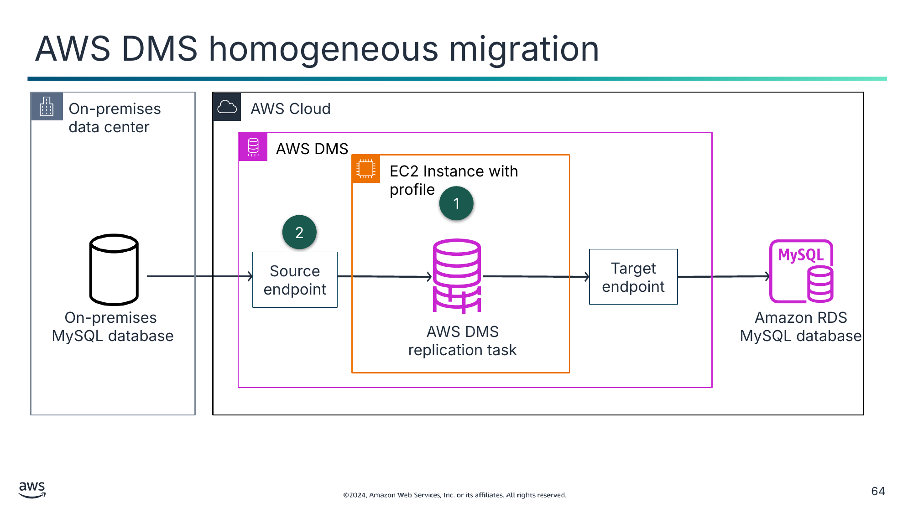

Текст зі схеми

On-premises data center (Локальний центр обробки даних)

AWS Cloud

AWS DMS

EC2 Instance with profile (Екземпляр EC2 із профілем)

1

2

Source endpoint (Вихідна кінцева точка)

Target endpoint (Цільова кінцева точка)

On-premises

MySQL database (Локальна база даних MySQL)

Amazon RDS  
MySQL database (База даних Amazon RDS MySQL)

AWS DMS

replication task (Завдання реплікації AWS DMS)

> **Нотатки:**
>
> |Номер слайда 64  
> |Нотатки для інструктора  
> |  
> |Нотатки для студента  
> Однорідні міграції даних в AWS DMS спрощують міграцію самокерованих локальних баз даних чи хмарних баз даних до еквівалентного рушія на Amazon RDS або Aurora.  
> Наприклад, ви можете використовувати однорідні реплікації даних для міграції локальної бази даних PostgreSQL до Amazon RDS for PostgreSQL чи Aurora PostgreSQL.  
>
> Однорідні міграції даних безсерверні, що означає, що AWS DMS автоматично масштабує ресурси, потрібні для вашої міграції. Для однорідних реплікацій даних AWS DMS використовує нативні інструменти баз даних для забезпечення високопродуктивних міграцій «подібне в подібне» (like-to-like). На високому рівні однорідні міграції даних працюють із профілями екземплярів (instance profiles), провайдерами даних (data providers) і проєктами реплікації (replication projects).  
>
> Цей приклад показує, що рушій бази даних однаковий для вихідної бази даних (локальна MySQL) і цільової бази даних (база даних Amazon RDS під керуванням MySQL).  
> Профіль екземпляра вказує мережеві налаштування та налаштування безпеки для керованого середовища, де працює ваш проєкт міграції. Коли ви створюєте проєкт міграції з сумісними вихідним і цільовим провайдерами даних одного типу, AWS DMS розгортає кероване середовище, де виконується ваша міграція даних.  
> Далі AWS DMS підключається до вихідної кінцевої точки даних, читає вихідні дані, вивантажує файли на диск і відновлює дані за допомогою нативних інструментів баз даних.

---

## Слайд 65: Інструменти для різнорідних міграцій баз даних (heterogeneous)

Інструмент виявлення баз даних (Database discovery tool)

Інструменти перетворення схем (Schema conversion tools)

**AWS DMS Fleet Advisor**

Автоматично інвентаризує та оцінює парк локальних баз даних і аналітичних серверів

**AWS Schema Conversion Tool (AWS SCT)**

Перетворює вашу вихідну схему та код SQL на еквівалентну цільову схему та код SQL

**AWS DMS Schema Conversion**

  
  
Є централізовано керованим сервісом для оцінювання та перетворення схем, доступним у робочих процесах AWS DMS

> **Нотатки:**
>
> |Номер слайда 65  
> |Нотатки для інструктора  
> |  
> |Нотатки для студента  
> Різнорідна міграція — це міграція між вихідною та цільовою кінцевими точками, що використовують різні рушії баз даних. Існує кілька рішень для спрощення міграцій баз даних шляхом автоматизації аналізу схем, рекомендацій і перетворення у великому масштабі. Три з них пояснюються тут.  
>
> AWS DMS Fleet Advisor — це інструмент виявлення баз даних, що автоматично інвентаризує й оцінює ваш парк локальних баз даних і аналітичних серверів та визначає потенційні шляхи міграції. AWS DMS Fleet Advisor може рекомендувати потенційні варіанти рушіїв баз даних та екземплярів для міграції в AWS. Цей інструмент видає результати за кілька годин замість тижнів чи навіть місяців без використання інструментів сторонніх розробників чи найму експертів з міграції.  
>
> AWS пропонує два рішення з перетворення схем, щоб зробити різнорідні міграції баз даних передбачуваними, швидкими та безпечними:  
> Завантажте програмне забезпечення AWS Schema Conversion Tool (AWS SCT) на ваш локальний диск.  
> Увійдіть у консоль AWS DMS, щоб ініціювати робочий процес AWS DMS Schema Conversion для повністю керованого досвіду.  
>
> Обидва варіанти автоматично оцінять і перетворять схему вихідної бази даних і більшість об’єктів коду бази даних у формат, сумісний із цільовою базою даних. Будь-які об’єкти, які не можна перетворити автоматично, чітко позначаються як пункти дій із приписаними інструкціями щодо перетворення, щоб їх можна було перетворити вручну для завершення міграції.

---

## Слайд 66: Різнорідна міграція AWS DMS за допомогою AWS SCT

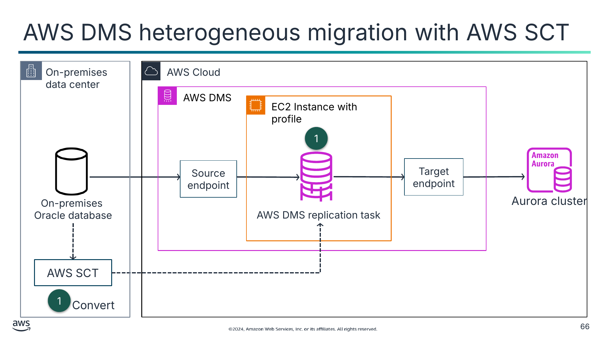

Aurora cluster (Кластер Aurora)

Текст зі схеми

On-premises data center (Локальний центр обробки даних)

AWS Cloud

AWS DMS

EC2 Instance with profile (Екземпляр EC2 із профілем)

1

Target endpoint (Цільова кінцева точка)

Source endpoint (Вихідна кінцева точка)

On-premises

Oracle database (Локальна база даних Oracle)

AWS DMS replication task (Завдання реплікації AWS DMS)

AWS SCT

1

Convert (Перетворення)

> **Нотатки:**
>
> |Номер слайда 66  
> |Нотатки для інструктора  
> |  
> |Нотатки для студента  
> Цей приклад ілюструє різнорідну міграцію AWS DMS за допомогою AWS Schema Conversion Tool (SCT):  
> Перетворення (Convert): AWS SCT працює разом з AWS DMS, коли ви переносите свою вихідну базу даних до іншої цільової бази даних, щоб перетворити всі об’єкти схеми та коду на цільовий рушій. AWS SCT автоматично перетворює схеми вашої вихідної бази даних і більшість об’єктів коду бази даних у формат, сумісний із цільовою базою даних. AWS SCT — це автономний застосунок, який потрібно завантажити на ваш локальний диск. Як варіант, завдання реплікації AWS DMS може використовувати функцію AWS DMS Schema Conversion замість AWS SCT.  
> Міграція схеми та коду (Migrate schema and code): ви створюєте міграцію AWS DMS, створюючи необхідні екземпляр реплікації, кінцеві точки та завдання в регіоні AWS.  Екземпляр реплікації AWS DMS — це керований екземпляр EC2, що розміщує одне чи кілька завдань реплікації. Одне чи кілька завдань міграції створюються для міграції даних між вихідним і цільовим сховищами даних.

---

## Слайд 67: AWS DMS реплікує дані з бази даних в озеро даних (data lake)

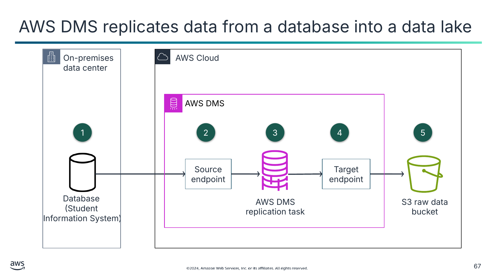

Текст зі схеми

On-premises

data center (Локальний центр обробки даних)

AWS Cloud

AWS DMS

1

2

3

4

5

Source endpoint (Вихідна кінцева точка)

Target endpoint (Цільова кінцева точка)

Database

(Student

Information System) (База даних (Студентська інформаційна система))

AWS DMS

replication task (Завдання реплікації AWS DMS)

S3 raw data bucket (Бакет S3 для необроблених даних)

> **Нотатки:**
>
> |Номер слайда 67  
> |Нотатки для інструктора  
> |  
> |Нотатки для студента  
> Ще один сценарій використання — реплікація даних в озеро даних. У цьому сценарії використання у вищій освіті AWS DMS використовується для реплікації даних із бази даних в озеро даних Amazon S3:  
> Дані студентської інформаційної системи (Student Information System, SIS) існують у локальній базі даних. Ці дані потрібно завантажити в озеро даних для аналітики.  
> Вихідну кінцеву точку AWS DMS підключено до даних SIS.  
> Запускається завдання реплікації AWS DMS для реплікації даних із демонстраційної бази даних SIS.  
> Цільова кінцева точка AWS DMS підключає завдання реплікації до бакета Amazon S3 для необроблених даних.  
> Доступ до даних можуть отримувати сервіси аналізу та візуалізації для отримання висновків із даних студентської інформації.

---

## Слайд 68: Ключові висновки: міграція даних у бази даних AWS

- AWS DMS — це керований сервіс міграції та реплікації, що допомагає швидко й безпечно переносити ваші бази даних і аналітичні робочі навантаження до AWS.
- Ви можете мігрувати між вихідною та цільовою кінцевими точками, що використовують той самий рушій бази даних (однорідна міграція), і мігрувати між вихідною та цільовою кінцевими точками, що використовують різні рушії баз даних (різнорідна міграція).
- AWS SCT і AWS DMS Schema Conversion — це інструменти для перетворення схем і  коду.

> **Нотатки:**
>
> |Номер слайда 68  
> |Нотатки для інструктора  
> |  
> |Нотатки для студента

---

## Слайд 69: Лабораторна робота кафе: міграція бази даних в Amazon RDS (Migration lab)

> **Нотатки:**
>
> |Номер слайда 69  
> |Нотатки для інструктора  
> |  
> |Нотатки для студента  
> Зараз ви виконаєте лабораторну роботу. Наступні слайди підсумовують, що ви робитимете в лабораторній роботі, а докладні інструкції ви знайдете в лабораторному середовищі.

---

## Слайд 70: Еволюція архітектури кафе: версія 3

| Версія архітектури (Architecture Version) | Бізнес-причина оновлення (Business Reason for Update) | Технічні вимоги та оновлення архітектури (Technical Requirements and Architecture Update) |
|---|---|---|
| V1 | Створити статичний вебсайт для малого бізнесу. | Розмістити вебсайт на Amazon S3. |
| V2 | Додати онлайн-замовлення. | Розгорнути вебзастосунок і базу даних на Amazon EC2. |
| V3 | Зменшити зусилля на обслуговування бази даних і захист її даних. | Розділити рівні вебу та бази даних. Перенести базу даних в Amazon RDS у приватній підмережі. |
| V4 | Підвищити безпеку вебзастосунку. | Використати функції Amazon VPC для налаштування та захисту публічних і приватних підмереж. |
| V5 | Створити окремі механізми доступу на основі ролі. | Додати групи IAM і прикріпити політики ресурсів до ресурсів застосунку. Додати користувачів IAM до груп на основі ролі. |
| V6 | Забезпечити, щоб вебсайт міг витримати очікуване зростання трафіку. | Додати балансувальник навантаження, впровадити автоматичне масштабування екземплярів EC2 і розподілити екземпляри обчислень і баз даних між двома зонами доступності. |

> **Нотатки:**
>
> |Нотатки для інструктора  
> |Поділіться файлом architectures.svg або покажіть його й виділіть розділи архітектури, які буде змінено чи додано в цій лабораторній роботі.  
> |Нотатки для студента  
> Адміністрування бази даних кафе стає складним для Софії та Нікіла. Наприклад, їм доводиться працювати понаднормово, коли кафе зачинене, щоб робити щотижневі резервні копії бази даних.  
>
> Крім того, нещодавно вони мали труднощі зі встановленням потрібного виправлення. Софія та Нікіл ледь не встигли виконати це у вікні вихідних поза робочим часом. Френк і Марта тепер розуміють, що ці завдання з обслуговування збільшують витрати бізнесу на оплату праці, адже вони мусять платити за понаднормові години, які відпрацьовують Софія та Нікіл.  
>
> Ракель (Raquel), архітекторка рішень AWS, — клієнтка кафе та подруга Софії. Софія згадала тему баз даних Олівії (Olivia) під час нещодавньої розмови. Олівія запропонувала мігрувати базу даних в Amazon RDS.  
>
> Це рішення зменшить тягар ручного виконання поширених завдань обслуговування баз даних, як-от резервне копіювання, встановлення виправлень і оновлення. Як повністю кероване обслуговування, Amazon RDS виконує ці завдання автоматично.

---

## Слайд 71: Завдання лабораторної роботи «Міграція» (Migration lab)

- У цій лабораторній роботі ви виконаєте такі основні завдання:
  - Створите екземпляр БД RDS.
  - Імпортуєте дані з екземпляра БД EC2 до екземпляра БД RDS.
  - Підключите застосунок кафе до нової бази даних.
- Відкрийте ваше лабораторне середовище, щоб розпочати лабораторну роботу та дізнатися додаткові подробиці про завдання, які ви виконуватимете.

> **Нотатки:**
>
> |Номер слайда 71  
> |Нотатки для інструктора  
> |  
> |Нотатки для студента  
> Отримайте доступ до лабораторного середовища через ваш онлайн-курс, щоб дізнатися додаткові подробиці та виконати лабораторну роботу.

---

## Слайд 72: Підсумки лабораторної роботи «Міграція»

- Коли ви створювали свою базу даних Amazon RDS MariaDB, чому ви не створили резервний екземпляр (standby)?
- Де ви отримали пароль, який використовували для підключення до бази даних MariaDB, що працює на екземплярі EC2?

> **Нотатки:**
>
> |Номер слайда 72  
> |Нотатки для інструктора  
> |Архітектурну схему для цієї лабораторної роботи включено до файлу CafeLabDiagrams.svg, що входить до каталогу файлів викладача. Поділіться цим файлом зі студентами, щоб вони могли наближати й віддаляти кожну фазу архітектури для повнішої картини під час підбиття підсумків лабораторної роботи.  
> |Проведіть із класом розмову про ключові висновки з лабораторної роботи. Використайте подробиці з попереднього розділу, щоб допомогти підбити підсумки лабораторної роботи зі студентами після її завершення. Підбиття підсумків лабораторної роботи наполегливо рекомендується. Воно допомагає студентам встановити зв’язки між їхнім практичним досвідом і концепціями, які ви обговорювали в лекції перед цією лабораторною роботою.  
> |Запропоновані відповіді на запитання 1: коли ви створювали свою базу даних Amazon RDS MariaDB, чому ви не створили резервний екземпляр (standby)?  
> |Шаблон, який ви обрали для створення вашої бази даних, був шаблоном dev/test. Рекомендується створювати резервний екземпляр лише для продуктивного використання.  
> |Запропоновані відповіді на запитання 2: де ви отримали пароль, який використовували для підключення до бази даних MariaDB, що працює на екземплярі EC2?  
> |У цій лабораторній роботі ви перейшли до Parameter Store — можливості AWS Systems Manager (AWS Systems Manager > Application Management > Parameter Store) — і скопіювали звідти пароль бази даних MariaDB. Щоб підключитися до бази даних MariaDB, що працює на екземплярі EC2, ви повернулися до вкладки браузера з терміналом bash. Коли термінал bash запросив пароль до бази даних, ви вставили значення параметра dbPassword, щоб підключитися до бази даних.  
> |  
> |Нотатки для студента  
> Ваш інструктор може розглянути ці запитання з вами, або ви можете розглянути їх самостійно. Скористайтеся цією нагодою, щоб поглибити своє мислення щодо завдань, які ви виконували під час лабораторної роботи.

---

## Слайд 73: Застосування принципів AWS Well-Architected Framework до рівня бази даних

**Додавання рівня бази даних**

> **Нотатки:**
>
> |Номер слайда 73  
> |Нотатки для інструктора  
> |  
> |Нотатки для студента  
> Цей розділ розглядає, як застосовувати принципи AWS Well-Architected Framework до вашого рівня бази даних.

---

## Слайд 74: Опори AWS Well-Architected Framework для бази даних

> **Нотатки:**
>
> |Номер слайда 74  
> |Нотатки для інструктора  
> |Решта слайдів у цьому розділі подають приклади, що підкреслюють, як матеріал цього модуля узгоджується з найкращими практиками Well-Architected Framework. За бажанням ви можете попросити студентів відвідати вебсайт Well-Architected Framework і знайти найкращі практики, які, на їхню думку, пов’язані з матеріалом, поданим у цьому модулі, використовуючи цей розділ як відправну точку.  
> |Нотатки для студента  
> AWS Well-Architected Framework має шість опор, і кожна опора включає найкращі практики та набір запитань, які слід враховувати під час проєктування хмарних рішень. Цей розділ виділяє кілька найкращих практик з опор, найактуальніших для цього модуля. Повний набір найкращих практик за опорами знайдіть на вебсайті Well-Architected Framework. Розділ ресурсів вмісту вашого онлайн-курсу містить посилання.  
>
> Встановлюючи зв’язки між опорами AWS Well-Architected Framework і рівнем бази даних, розгляньте свою роль як хмарного архітектора, що додає рівень бази даних:  
> Вам потрібно оцінити наявні варіанти баз даних, перш ніж обирати рішення для керування даними, щоб ви могли оптимізувати продуктивність.  
> Вам потрібно ефективно захистити свою інфраструктуру, щоб дані були довговічними та захищеними від загроз.

---

## Слайд 75: Підхід найкращих практик: вибір архітектури

**Найкращі практики**

Оцінюйте, як компроміси впливають на клієнтів і ефективність архітектури.

Використовуйте підхід, керований даними, для архітектурних виборів.

Враховуйте вартість в архітектурних рішеннях.

> **Нотатки:**
>
> |Номер слайда 75  
> |Нотатки для інструктора  
> |  
> |Нотатки для студента  
> Вибір архітектури бази даних — важлива найкраща практика в опорі ефективності продуктивності. Оптимальне рішення для бази даних для системи різниться залежно від вимог до доступності, узгодженості, стійкості до розділення (partition tolerance), затримки, довговічності, масштабованості та можливостей запитів. Багато систем використовують різні рішення для баз даних для різних підсистем і дозволяють різні функції для покращення продуктивності. Вибір неправильного рішення для бази даних і функцій для системи може призвести до нижчої ефективності продуктивності. Три важливі найкращі практики, пов’язані з вибором архітектури бази даних, включають розуміння характеристик даних, оцінювання наявних варіантів і вибір сховища даних на основі шаблонів доступу.  
>
> Оцінюйте, як компроміси впливають на клієнтів і ефективність архітектури: оцінюючи покращення, пов’язані з продуктивністю, визначте, які вибори впливають на ваших клієнтів і ефективність робочого навантаження. Наприклад, якщо використання сховища даних «ключ-значення» підвищує продуктивність системи, важливо оцінити, як кінцево узгоджена природа цієї зміни вплине на клієнтів. Вибираючи й впроваджуючи рішення для керування даними, ви повинні гарантувати, що характеристики запитів, масштабування та зберігання підтримують вимоги робочого навантаження до даних. Перш ніж впроваджувати рішення, дізнайтеся, як кожен наявний варіант відповідає вашим моделям даних і сценарію використання.  
>
> Використовуйте підхід, керований даними, для архітектурних виборів: визначте чіткий підхід, керований даними, для архітектурних виборів, щоб перевірити, що використовуються правильні хмарні сервіси та конфігурації для задоволення ваших конкретних бізнес-потреб. Використовуйте шаблони доступу робочого навантаження та вимоги застосунків, щоб вирішити, які оптимальні сервіси даних і технології використовувати. Розуміння того, коли використовувати репліки для читання, глобальні таблиці, партиціонування даних і кешування, допоможе вам зменшити операційні накладні витрати й масштабуватися залежно від потреб вашого робочого навантаження. Наприклад, слід визначити й задокументувати прогнозоване зростання даних і трафіку. Маючи цей шаблон на увазі, розгляньте наявні варіанти баз даних і конфігурації.  
> Документуйте характеристики даних робочого навантаження з достатньою деталізацією, щоб полегшити вибір і налаштування підтримуваних рішень для баз даних і надати розуміння потенційних альтернатив.  
>
> Коли ви достатньо розглянули характеристики даних робочого навантаження, щоб визначити альтернативи, оцініть і перевірте свої вибори та наявні варіанти конфігурації бази даних, що найкраще підходять вашому конкретному робочому навантаженню. Виконайте навантажувальні тести, щоб визначити ваші ключові метрики продуктивності та вузькі місця. Використовуйте ці характеристики й метрики для оцінювання варіантів баз даних та експериментуйте з різними конфігураціями. Не збільшуйте розмір екземпляра для покращення продуктивності, не розглянувши вплив наявних варіантів конфігурації. Оцініть прийнятний час виконання запитів, щоб переконатися, що обрані варіанти баз даних можуть відповідати вимогам. Наприклад, визначивши, наскільки ваше робоче навантаження інтенсивне за читанням, ви можете оцінити наявні рішення для розвантаження читань, як-от репліки для читання чи кешування.  
>
> Враховуйте вартість в архітектурних рішеннях: враховуйте вартість у ваших архітектурних рішеннях, щоб покращити використання ресурсів і ефективність продуктивності вашого хмарного робочого навантаження. Коли ви усвідомлюєте вплив вашого хмарного робочого навантаження на вартість, ви з більшою ймовірністю використовуватимете ефективні ресурси та зменшуватимете марнотратні практики.  
>
> У цьому модулі ви дізналися про низку рішень для баз даних і варіантів конфігурації, що узгоджуються з цими найкращими практиками. Ви дізналися, що AWS має різноманітні рішення для баз даних, щоб ви могли обрати те, що відповідає вимогам робочого навантаження та моделям даних для вашого сценарію використання. Наприклад, використовуйте Amazon RDS для реляційних даних, Amazon Redshift для сховища даних, DynamoDB для даних «ключ-значення», що потребують дуже низької затримки в дуже великому масштабі, або одну з інших спеціалізованих баз даних, розроблених для конкретних робочих навантажень.  
>
> Ви також дізналися про варіанти конфігурації, що оптимізують продуктивність для вашої обраної бази даних. Наприклад, з Amazon RDS можна налаштувати тип і розмір екземпляра, що підходить вашому робочому навантаженню. Ви можете налаштувати високу доступність і впровадити репліки для читання. Ви можете використовувати RDS Proxy для масштабування пулів з’єднань. DynamoDB автоматично масштабується горизонтально, і ви дізналися, як вторинні індекси та глобальні таблиці можуть покращити продуктивність залежно від структур ваших таблиць і шаблонів доступу.  
>
> Це лише кілька прикладів найкращих практик ефективності продуктивності на вашому рівні бази даних. З усіма варіантами та гнучкістю, доступними в хмарних базах даних, ви можете дотримуватися цих найкращих практик для будь-якого сценарію використання.

---

## Слайд 76: Підхід найкращих практик: захист даних — захист даних у стані спокою

**Найкраща практика**

Запровадьте безпечне керування ключами.

Забезпечте примусове шифрування в стані спокою.

> **Нотатки:**
>
> |Номер слайда 76  
> |Нотатки для інструктора  
> |  
> |Нотатки для студента  
> Захист даних, що перебувають у сховищі вашої бази даних, — критично важлива частина опори безпеки. Шифрування зберігає конфіденційність чутливих даних у разі неавторизованого доступу чи випадкового розкриття. Захист ваших даних у стані спокою зменшує ризик неавторизованого доступу, коли впроваджено шифрування та відповідні засоби контролю доступу. Дві важливі найкращі практики, пов’язані із захистом даних у стані спокою, — впровадження безпечного керування ключами та примусове шифрування в стані спокою.  
>   
> Запровадьте безпечне керування ключами: визначивши підхід до шифрування, що включає зберігання, ротацію та контроль доступу до ключів, ви можете допомогти забезпечити захист вашого контенту від неавторизованих користувачів і від непотрібного розкриття авторизованим користувачам. AWS KMS допомагає керувати ключами шифрування та інтегрується з багатьма сервісами AWS. Цей сервіс забезпечує довговічне, безпечне та надлишкове сховище для ваших ключів AWS KMS.  
>
> Забезпечте примусове шифрування в стані спокою: слід гарантувати, що єдиний спосіб зберігання даних — використання шифрування. AWS KMS безшовно інтегрується з багатьма сервісами AWS, щоб допомогти вам шифрувати всі ваші дані в стані спокою.  
>
> Ось приклади цих найкращих практик, про які ви дізналися в цьому модулі:  
> Бази даних Amazon, як-от Amazon RDS і DynamoDB, використовують AWS KMS для захисту даних.  
> DynamoDB шифрує всі дані користувачів у стані спокою, що зберігаються в таблицях, індексах, потоках і резервних копіях, за допомогою ключів шифрування, що зберігаються в AWS KMS.  
> Amazon RDS шифрує ваші бази даних за допомогою ключів, якими ви керуєте в AWS KMS. Для зашифрованого екземпляра бази даних Amazon RDS дані, що зберігаються в стані спокою в базовому сховищі, зашифровані, як і всі журнали, резервні копії та знімки. Після шифрування ваших даних Amazon RDS обробляє автентифікацію доступу та розшифрування ваших даних прозоро з мінімальним впливом на продуктивність.

---

## Слайд 77: Підхід найкращих практик: економічно ефективні ресурси — оберіть правильний тип, розмір і кількість ресурсів

**Найкраща практика**

Обирайте тип, розмір і кількість ресурсів на основі даних.

> **Нотатки:**
>
> |Номер слайда 77  
> |Нотатки для інструктора  
> |  
> |Нотатки для студента  
> Обираючи найкращий тип, розмір і кількість ресурсів бази даних, ви виконуєте технічні вимоги з ресурсом найнижчої вартості. Заходи з правильного підбору розміру (right-sizing) враховують усі ресурси робочого навантаження, усі атрибути кожного окремого ресурсу та зусилля, пов’язані з операцією підбору розміру. Правильний підбір розміру може бути ітеративним процесом, що ініціюється змінами шаблонів використання та зовнішніми чинниками, як-от зниження цін AWS чи нові типи ресурсів AWS. Центральне місце в цьому процесі — вибір типу, розміру та кількості ресурсів на основі даних.  
>
> Обирайте тип, розмір і кількість ресурсів на основі даних: обирайте розмір чи тип ресурсу на основі даних про робоче навантаження та характеристики ресурсів: наприклад, інтенсивне за обчисленнями, пам’яттю, пропускною здатністю чи записом. Цей вибір зазвичай робиться за допомогою попередньої (локальної) версії робочого навантаження, документації чи інших джерел інформації про робоче навантаження.  
>
> У цьому модулі ви дізналися, як різні ресурси баз даних можуть масштабуватися, і побачили приклади сценаріїв використання, що підходять для різних конфігурацій. Важливо знайти правильний баланс продуктивності та витрат, щоб правильно підібрати розмір ваших ресурсів. Наприклад, ви побачили, як Aurora може забезпечити кращу продуктивність і нижчу вартість, ніж стандартні рушії баз даних, і як Aurora Serverless можна використовувати для забезпечення масштабування за запитом, щоб уникнути надмірного виділення ресурсів.

---

## Слайд 78: Ключові висновки: застосування принципів AWS Well-Architected Framework до вашого рівня бази даних

- Щоб досягти та підтримувати ефективні робочі навантаження в хмарі, розгляньте найкращі практики в опорі ефективності продуктивності, як-от вибір на основі характеристик даних і шаблонів доступу.
- Щоб ефективно захистити свою інфраструктуру так, щоб дані були довговічними та захищеними від загроз, розгляньте найкращі практики в опорі безпеки, як-от впровадження безпечного керування ключами та захист даних у стані спокою.
- Щоб виконати технічні вимоги робочого навантаження з ресурсом найнижчої вартості, розгляньте найкращі практики в опорі оптимізації витрат, як-от вибір типу, розміру та кількості ресурсів на основі даних.

> **Нотатки:**
>
> |Номер слайда 78  
> |Нотатки для інструктора  
> |Це не вичерпний перелік найкращих практик, охоплених найкращими практиками AWS Well-Architected. Це ключові висновки для пояснення найкращих практик, розглянутих у модулі. Докладніше див. AWS Well-Architected Framework на сторінці ресурсів вмісту вашого онлайн-курсу.  
> |Нотатки для студента

---

## Слайд 79: Підсумки модуля

Додавання рівня бази даних

> **Нотатки:**
>
> |Номер слайда 79  
> |Нотатки для інструктора  
> |  
> |Нотатки для студента  
> Цей розділ підсумовує те, що ви дізналися, і завершує модуль.

---

## Слайд 80: Резюме модуля

Цей модуль підготував вас до такого:

- Порівнювати типи баз даних і сервіси, що пропонує Amazon Web Services (AWS).
- Пояснювати, коли використовувати Amazon Relational Database Service (Amazon RDS).
- Описувати розширені функції Amazon RDS.
- Пояснювати, коли використовувати Amazon DynamoDB.
- Визначати спеціалізовані сервіси баз даних AWS (purpose-built).
- Описувати, як мігрувати дані в бази даних AWS.
- Проєктувати й розгортати сервер бази даних.
- Використовувати принципи AWS Well-Architected Framework під час проєктування рівня бази даних.

> **Нотатки:**
>
> |Номер слайда 80  
> |Нотатки для інструктора  
> |  
> |Нотатки для студента

---

## Слайд 81: Цілі модуля

Цей модуль підготував вас до такого:

- Порівнювати типи баз даних і сервіси, що пропонує Amazon Web Services (AWS).
- Пояснювати, коли використовувати Amazon Relational Database Service (Amazon RDS).
- Описувати розширені функції Amazon RDS.
- Пояснювати, коли використовувати Amazon DynamoDB.
- Визначати спеціалізовані сервіси баз даних AWS (purpose-built).
- Описувати, як мігрувати дані в бази даних AWS.
- Проєктувати й розгортати сервер бази даних. Використовувати принципи Well-Architected Framework під час проєктування рівня бази даних.

> **Нотатки:**
>
> |Номер слайда 81  
> |Нотатки для інструктора  
> |  
> |Нотатки для студента

---

## Слайд 82: Міркування щодо кафе

- Обговоріть, як лабораторна робота кафе в цьому модулі відповіла на ключові запитання та рішення, подані на початку цього модуля для бізнесу кафе.

---

## Слайд 83: Перевірка знань модуля

- Перевірка знань проводиться онлайн у вашому курсі.
- Перевірка знань включає 10 запитань на основі матеріалу, поданого на слайдах і в нотатках до слайдів.
- Ви можете повторно проходити перевірку знань стільки разів, скільки захочете.

> **Нотатки:**
>
> |Номер слайда 83  
> |Нотатки для інструктора  
> |  
> |Нотатки для студента  
> Скористайтеся своїм онлайн-курсом, щоб отримати доступ до перевірки знань для цього модуля.

---

## Слайд 84: Зразок запитання іспиту

Застосунку потрібна високодоступна реляційна база даних із початковою потужністю сховища 8 ТБ. База даних зростатиме на 8 ГБ щодня. Для підтримки очікуваного трафіку знадобиться щонайменше вісім реплік для читання для обробки читань бази даних. Який варіант задовольнить ці вимоги?

Визначте ключові слова та фрази, перш ніж продовжувати.

Ось ключові слова та фрази:

- Високодоступна реляційна база даних
- Зростання на 8 ГБ щодня
- Репліки для читання

> **Нотатки:**
>
> |Номер слайда 84  
> |Нотатки для інструктора  
> |Розділ із ключовими словами налаштовано з анімацією для розкриття за клацанням.  
> |  
> |Нотатки для студента  
> Запитання вказує на високодоступну реляційну базу даних зі значним зростанням і потребою в репліках для читання.

---

## Слайд 85: Зразок запитання іспиту: варіанти відповідей

Застосунку потрібна високодоступна реляційна база даних із початковою потужністю сховища 8 ТБ. База даних зростатиме на 8 ГБ щодня. Для підтримки очікуваного трафіку знадобиться щонайменше вісім реплік для читання для обробки читань бази даних. Який варіант задовольнить ці вимоги?

**Варіант**

**Відповідь**

**A**

Amazon DynamoDB

**B**

Amazon Neptune

**C**

Amazon Aurora

**D**

Amazon Redshift

> **Нотатки:**
>
> |Номер слайда 85  
> |Нотатки для інструктора  
> |  
> |Нотатки для студента  
> Використайте ключові слова, які ви визначили на попередньому слайді, і розгляньте кожен із можливих варіантів відповіді, щоб визначити, який із них найкраще відповідає запитанню.

---

## Слайд 86: Зразок запитання іспиту: відповідь

Правильна відповідь — C.

**Варіант**

**Відповідь**

**A**

**B**

**C**

Amazon Aurora

**D**

> **Нотатки:**
>
> |Номер слайда 86  
> |Нотатки для інструктора  
> |  
> |Нотатки для студента  
> Відповідь A (Amazon DynamoDB) — нереляційна база даних, тож вона не відповідає вимозі.  
>   
> Відповідь B (Amazon Neptune) — спеціалізована графова база даних, тож вона не відповідає вимозі.  
>   
> Відповідь D (Amazon Redshift) не підтримує репліки для читання.  
>
> Правильна відповідь — C. Amazon Aurora — це повністю керована реляційна база даних, що може підтримувати до 15 реплік для читання. Сховище Aurora автоматично масштабується разом з даними у вашому томі кластера.

---

## Слайд 87: Дякуємо

Виправлення, відгуки чи інші запитання?

Зв’яжіться з нами за адресою [https://support.aws.amazon.com/#/contacts/aws-academy](https://support.aws.amazon.com/#/contacts/aws-academy).

> **Нотатки:**
>
> |Номер слайда 87  
> |Нотатки для інструктора  
> |  
> |Нотатки для студента  
> На цьому цей модуль завершено. Сторінка ресурсів вмісту вашого курсу містить посилання на додаткові ресурси, пов’язані з цим модулем.
