## Слайд 1: Створення мережевого середовища (Creating a Networking Environment)

AWS Academy Cloud Architecting

> **Нотатки:**
>
> |Нотатки для інструктора  
> |  
> |Нотатки для студента  
> Вітаємо в модулі «Створення мережевого середовища». Цей модуль описує використання клієнтом мережевого середовища AWS за допомогою сервісу Amazon Virtual Private Cloud (VPC).

---

## Слайд 2: Вступ

Створення мережевого середовища

> **Нотатки:**
>
> |Нотатки для інструктора  
> |  
> |Нотатки для студента  
> Цей вступний розділ описує вміст модуля.

---

## Слайд 3: Цілі модуля

Цей модуль готує вас до такого:

- Пояснювати роль віртуальної приватної хмари (VPC) в мережах хмари Amazon Web Services (AWS).
- Визначати компоненти у VPC, що можуть підключати мережеве середовище AWS до інтернету.
- Ізолювати та захищати ресурси у вашому мережевому середовищі AWS.
- Створювати та відстежувати VPC із підмережами, інтернет-шлюзом, таблицями маршрутизації та групою безпеки.
- Використовувати принципи AWS Well-Architected Framework під час створення та планування мережевого середовища.

> **Нотатки:**
>
> |Номер слайда 3  
> |Нотатки для інструктора  
> |  
> |Нотатки для студента

---

## Слайд 4: Огляд модуля

**Розділи презентації**

- Вступ до Amazon VPC
- Захист мережевих ресурсів
- Підключення до керованих сервісів AWS
- Моніторинг вашої мережі
- Застосування принципів AWS Well-Architected Framework до мережі

**Демонстрація**

- Створення Amazon VPC в AWS Management Console

**Практична вправа**

- Оберіть правильний тип підмережі (Choose the Right Type of Subnet)

**Перевірки знань**

- 10-запитальна перевірка знань
- Зразок запитання іспиту

> **Нотатки:**
>
> |Номер слайда 4  
> |Нотатки для інструктора  
> |Кожен модуль має вступ, розділи з вмістом і підсумок. Підсумок цього модуля містить зразок запитання іспиту для розбору зі студентами.  
> |  
> |Нотатки для студента  
> Цілі цього модуля розкриваються в кількох розділах.  
>
> Ви також переглянете демонстрацію, що показує, як створити VPC в AWS Management Console, і виконаєте вправу з вибору правильного типу підмережі для заданого сценарію використання.  
>
> Модуль завершується 10-запитальною перевіркою знань, що проводиться в онлайн-курсі, та зразком запитання іспиту для обговорення в класі.  
> Лабораторні роботи цього модуля описано на наступному слайді.

---

## Слайд 5: Практичні лабораторні роботи в цьому модулі

Покрокова лабораторна робота (Guided lab)

Лабораторна робота-виклик (кафе) (Challenge (Café) lab)

- Створення віртуальної приватної хмари (Creating a Virtual Private Cloud)

- Створення мережевого середовища VPC для кафе (Creating a VPC Networking Environment for the Café)

> **Нотатки:**
>
> |Номер слайда 5  
> |Нотатки для інструктора  
> |Цей модуль містить як самодостатню покрокову лабораторну роботу, так і лабораторну роботу кафе, що доповнює архітектуру кафе, що еволюціонує. Лабораторна робота кафе — це лабораторна робота-виклик, де від студентів очікується виконання завдань без надання кожного кроку. Вступи до кожної лабораторної роботи та сценарію кафе включено до розділів лабораторних робіт у межах модуля.  
> |  
> |Нотатки для студента  
> Цей модуль містить зазначені практичні лабораторні роботи. Є покрокова лабораторна робота, де вам надаються інструкції крок за кроком, і лабораторна робота кафе, де ви працюєте над оновленням архітектури кафе. Додаткова інформація про кожну лабораторну роботу міститься в посібнику студента там, де вона виконується, а докладні інструкції надаються в лабораторному середовищі.

---

## Слайд 6: Як хмарний архітектор, що проєктує мережеве середовище:

- Мені потрібно спроєктувати мережу, стійку до збоїв і здатну впоратися з очікуваним зростанням трафіку, щоб вона була доступна, коли потрібна.
- Мені потрібно ефективно захистити свою мережу так, щоб вона надавала доступ користувачам і застосункам, які мають його мати, і водночас запобігала небажаному трафіку.
- Мені потрібно розуміти, як рішення щодо проєкту мережі впливають на продуктивність і вартість, щоб я міг оптимізувати цінність мережі для бізнесу.


> **Нотатки:**
>
> |Номер слайда 6  
> |Нотатки для інструктора: цей слайд подає ключові наскрізні міркування проєктування, що мають спрямовувати ухвалення рішень для цього рівня хмарної архітектури. Підкресліть, що хмарний архітектор завжди має починати з бізнес-кейсу й рухатися у зворотному напрямку, щоб обрати найкращі компоненти для цього сценарію використання. Також нагадайте студентам, що рішення, імовірно, еволюціонуватимуть з часом, у міру зміни чи кращого розуміння потреб, для оптимізації вартості та продуктивності. Наприкінці модуля в підсумковому розділі включено необов’язкове обговорення, що спонукає студентів розглянути ці чинники в контексті сценарію з кафе.  
> |  
> |Нотатки для студента  
> Цей слайд просить вас прийняти перспективу хмарного архітектора, коли ви думаєте про те, як підходити до проєктування хмарної мережі. Тримайте ці міркування в голові, просуваючись цим модулем, пам’ятаючи, що хмарний архітектор має працювати у зворотному напрямку від бізнес-потреби, щоб спроєктувати найкращу архітектуру для конкретного сценарію використання. Просуваючись модулем, розглядайте сценарій з кафе, поданий у курсі, як приклад бізнес-потреби й думайте про те, як би ви відповіли на ці потреби для вигаданого бізнесу кафе.

---

## Слайд 7: Вступ до Amazon VPC

Створення мережевого середовища

> **Нотатки:**
>
> |Номер слайда 7  
> |Нотатки для інструктора  
> |  
> |Нотатки для студента  
> Цей розділ знайомить із сервісом Amazon Virtual Private Cloud (VPC) та його компонентами.

---

## Слайд 8: Фізична інфраструктура AWS

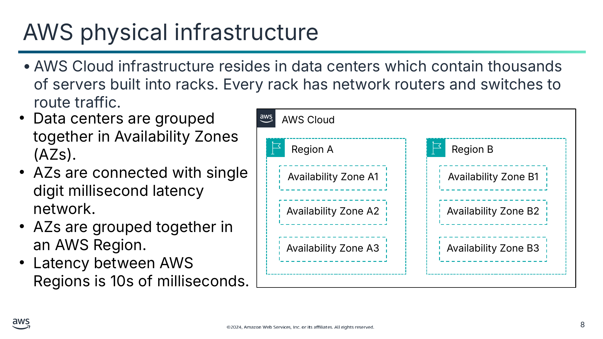

- Хмарна інфраструктура AWS розміщується в центрах обробки даних, що містять тисячі серверів, вбудованих у стійки. Кожна стійка має мережеві маршрутизатори та комутатори для маршрутизації трафіку.

- Центри обробки даних групуються в зони доступності (AZ).
- AZ з’єднані мережею із затримкою в одиниці мілісекунд.
- AZ групуються в регіон AWS.
- Затримка між регіонами AWS — десятки мілісекунд.

<details>
<summary>Текст зі схеми</summary>

AWS Cloud

Region A (Регіон A)

Region B (Регіон B)

Availability Zone A1 (Зона доступності A1)

Availability Zone B1 (Зона доступності B1)

Availability Zone A2

Availability Zone B2

Availability Zone A3

Availability Zone B3

</details>

> **Нотатки:**
>
> |Номер слайда 8  
> |Нотатки для інструктора  
> |  
> |Нотатки для студента  
> Коли ви проєктуєте свою мережу в AWS, потрібно розуміти компоненти та ієрархії фізичної інфраструктури AWS. Фізична інфраструктура AWS складається з кількох регіонів AWS. Кожен регіон AWS — це окрема географічна територія, розташована в країні.  
>
> Регіон AWS складається щонайменше з трьох ізольованих і фізично розділених розташувань, що називаються зонами доступності (AZ). Код AZ — це код її регіону, за яким іде літерний ідентифікатор. Наприклад, одна з AZ у регіоні Північна Вірджинія us-east-1 у США називається us-east-1a.  
>
> AZ складається з одного чи кількох центрів обробки даних із надлишковим живленням, мережею та підключенням у регіоні AWS. AZ з’єднані дротовою фізичною мережею з низькою затримкою, що дозволяє синхронну реплікацію даних між AZ. Усередині центру обробки даних є тисячі серверів і хостів, вбудованих у стійки. До кожної стійки підключено фізичні мережеві пристрої, як-от апаратні маршрутизатори, комутатори, брандмауери та балансувальники навантаження. Кожен пристрій у мережі має IP-адресу, яку маршрутизатори та комутатори можуть використовувати для досягнення пристрою.  
>
> Віртуальна мережа (іноді її називають оверлейною мережею, overlay network) створюється поверх фізичної мережі. Щоб розгорнути ресурс в AWS, ви обираєте або регіон, або AZ залежно від сервісу, який використовуєте. Центри обробки даних логічно не ідентифікуються.  
>
> Віртуальна мережа емулює фізичну мережу за допомогою програмно визначених мережевих компонентів, як-от комутатори, маршрутизатори, брандмауери та балансувальники навантаження. Ці компоненти створюються й керуються програмно. Це означає, що всі пристрої у віртуальній мережі логічно ізольовані за допомогою програмних визначень.  
>   
> Докладніше про глобальну інфраструктуру AWS див. у переліку довідкових джерел курсу.

---

## Слайд 9: Ізоляція ресурсів акаунта AWS

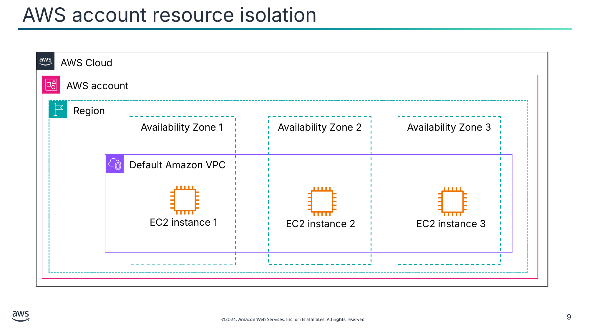

<details>
<summary>Текст зі схеми</summary>

AWS Cloud

AWS account (Акаунт AWS)

Region (Регіон)

Availability Zone 1 (Зона доступності 1)

Availability Zone 2 (Зона доступності 2)

Availability Zone 3 (Зона доступності 3)

Default Amazon VPC (Amazon VPC за замовчуванням)

EC2 instance 1 (Екземпляр EC2 1)

EC2 instance 2 (Екземпляр EC2 2)

EC2 instance 3 (Екземпляр EC2 3)

</details>

> **Нотатки:**
>
> |Номер слайда 9  
> |Нотатки для інструктора  
> |  
> |Нотатки для студента  
> Тепер, коли ви розумієте фізичну мережу AWS, що підтримує віртуальну мережу, ви можете почати будувати свою мережу програмно.  
>
> Коли ви запитуєте новий акаунт AWS, мережеві ресурси виділяються цьому акаунту. Акаунт AWS охоплює регіони AWS. Він містить віртуальну програмно визначену мережу за замовчуванням у кожному публічно доступному регіоні. Це називається віртуальною приватною хмарою Amazon (Amazon VPC). VPC належить до одного регіону й може охоплювати кілька AZ.  
>
> Коли ви створюєте нову VPC, вона логічно ізольована від інших віртуальних мереж у хмарі AWS та від інтернету. Це означає, що до неї не можна отримати доступ, доки ви не додасте конфігурацію, що дозволяє доступ.  
>
> Сервіси AWS, як-от Amazon Elastic Compute Cloud (Amazon EC2) і Amazon Relational Database Service (Amazon RDS), розроблені для роботи всередині VPC. Ці ресурси можна з’єднати з безсерверними сервісами AWS, як-от AWS Lambda та Amazon CloudWatch, що працюють поза VPC клієнта.  
>
> Оскільки VPC за замовчуванням уже має вбудовані конфігурації підключення, не слід використовувати VPC за замовчуванням для продуктивних робочих навантажень. Натомість визначте нову VPC із відповідними налаштуваннями безпеки та підключення для продуктивного робочого навантаження.

---

## Слайд 10: Amazon Virtual Private Cloud

- Програмно визначена, логічно ізольована віртуальна мережа, подібна до мережі традиційного центру обробки даних
- Належить до одного регіону
- Настроювана для контролю потоку трафіку до VPC і з неї
- Має розмір, що визначається діапазоном приватних IP-адрес, який називається блоком CIDR

Amazon VPC

> **Нотатки:**
>
> |Номер слайда 10  
> |Нотатки для інструктора:  
> |Докладніше про блоки CIDR і маски мережі (netmasks) див. «What are CIDR blocks» на сторінці ресурсів вмісту вашого курсу.  
> |  
> |Нотатки для студента  
> Коли ви хочете визначити свою віртуальну мережу хмари AWS у регіоні AWS, ви використовуватимете сервіс Amazon VPC. Ви можете програмно визначати, як ваша мережа відкрита для інтернету та корпоративних середовищ.  
>
> Щоб визначити розмір вашої VPC, ви виділяєте їй діапазон приватних IP-адрес. Діапазон IP-адрес визначає розмір VPC. Діапазон IP-адрес називається блоком безкласової міждоменної маршрутизації (Classless Inter-Domain Routing, CIDR). Важливо виділити достатню кількість IP-адрес для вашої VPC, оскільки додавати більше IP-адрес пізніше — довго й складно. Максимальний розмір VPC IPv4 — маска мережі /16 із 65 536 IP-адресами, а найменший — маска /28 із 16 IP-адресами. Докладніше про блоки CIDR і маски мережі див. «What are CIDR blocks» на сторінці ресурсів вмісту вашого курсу.  
>
> Коли ви створюєте VPC, ви можете вказати її IP-адреси як лише IPv4 або як подвійний стек (dual stack). VPC з подвійним стеком має і блок CIDR IPv4, і блок CIDR IPv6. Щоб ефективно планувати, відстежувати та моніторити ваші IP-адреси, ви можете використовувати функцію VPC Amazon VPC IP Address Manager (IPAM).  
>
> Вагома причина обрати IPv6 — IPv6 має великий адресний простір, де кожна IP-адреса має розмір 128 бітів. IP-адреси IPv4 — лише 32-бітні. IPv6 також загалом має кращу швидкісну продуктивність, ніж IPv4, оскільки не використовує NAT. Зверніть увагу, що з початку 2024 року діятиме погодинна плата за всі публічні адреси IPv4, незалежно від того, приєднані вони до сервісу чи ні.  
>
> Якщо ви розгортаєте свою VPC у кількох AZ, кількість IP-адрес слід рівномірно розподілити між кожною AZ.

---

## Слайд 11: Основна таблиця маршрутизації (main route table)

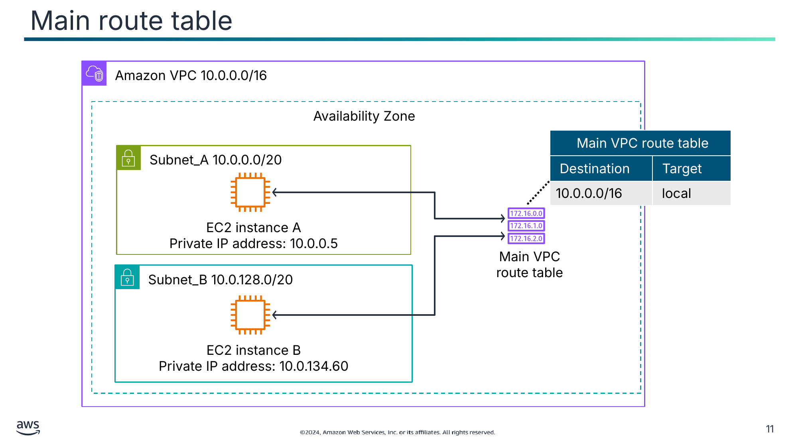

**Main VPC route table (Основна таблиця маршрутизації VPC)**

| Destination (Призначення) | Target (Ціль) |
|---|---|
| 10.0.0.0/16 | local |

<details>
<summary>Текст зі схеми</summary>

Amazon VPC 10.0.0.0/16

Availability Zone (Зона доступності)

Subnet_A 10.0.0.0/20 (Підмережа A)

EC2 instance A (Екземпляр EC2 A)

Private IP address: 10.0.0.5 (Приватна IP-адреса: 10.0.0.5)

Main VPC

route table (Основна таблиця маршрутизації VPC)

Subnet_B 10.0.128.0/20 (Підмережа B)

EC2 instance B (Екземпляр EC2 B)

Private IP address: 10.0.134.60 (Приватна IP-адреса: 10.0.134.60)

</details>

> **Нотатки:**
>
> |Номер слайда 11  
> |Нотатки для інструктора  
> |  
> |Нотатки для студента  
> Після створення VPC і забезпечення достатньої кількості IP-адрес наступний крок — вирішити, наскільки ізольованими мають бути ресурси у VPC. Чи має ресурс бути досяжним з інтернету, корпоративного середовища, інших VPC чи ні?  
>
> VPC автоматично постачається з маршрутизатором, що використовує основну таблицю маршрутизації VPC, яка містить набір правил маршрутизації, що називаються маршрутами. На схемі для маршрутизації трафіку IPv4 усередині VPC основна таблиця маршрутизації має правило маршруту за замовчуванням із призначенням 10.0.0.0/16 і ціллю local. Призначення 10.0.0.0/16 — це блок CIDR VPC. Це означає, що кожен ресурс у VPC досяжний для кожного іншого ресурсу у VPC. На схемі екземпляр EC2 A може отримати доступ до екземпляра EC2 B через основну таблицю маршрутизації VPC. Цей маршрут за замовчуванням видалити не можна.  
>
> VPC можна розділити на підмережі. Підмережа — це контейнер для політик маршрутизації, і вона належить до однієї AZ. Кожна підмережа — це сегмент діапазону IP-адрес VPC і має бути значно меншою за VPC. Блоки CIDR підмереж не можуть перетинатися.  
>
> Підмережі в прикладі мають маску мережі /20, що дозволяє 4096 IP-адрес.  
>
> AWS резервує перші чотири IP-адреси й останню IP-адресу в кожному блоці CIDR підмережі. Наприклад, у підмережі з блоком CIDR 10.0.0.0/20 AWS резервує такі п’ять IP-адрес для:  
> 10.0.0.0: адреса мережі  
> 10.0.0.1: локальний маршрутизатор VPC  
> 10.0.0.2: розв’язання імен DNS  
> 10.0.0.3: майбутнє використання  
> 10.0.15.254: широкомовна адреса мережі  
>
> Важливо виділити достатню кількість IP-адрес у підмережі.

---

## Слайд 12: Публічні підмережі (public subnets)

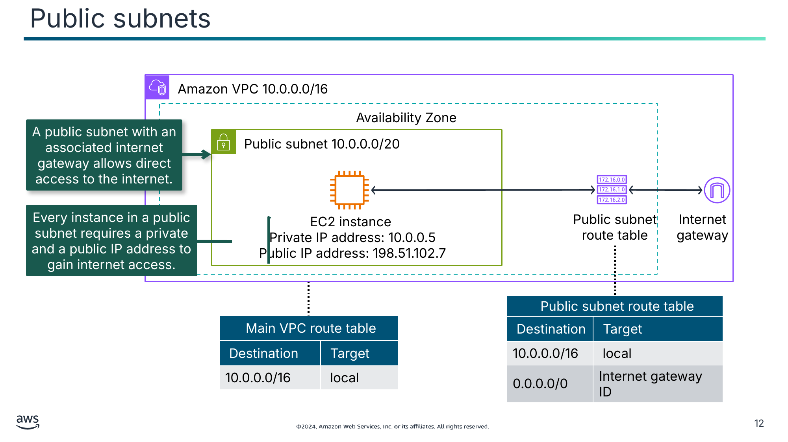

Публічна підмережа з пов’язаним інтернет-шлюзом дозволяє прямий доступ до інтернету.

**Public subnet route table (Таблиця маршрутизації публічної підмережі)**

| Destination (Призначення) | Target (Ціль) |
|---|---|
| 10.0.0.0/16 | local |
| 0.0.0.0/0 | Internet gateway ID |

**Main VPC route table (Основна таблиця маршрутизації VPC)**

| Destination (Призначення) | Target (Ціль) |
|---|---|
| 10.0.0.0/16 | local |

<details>
<summary>Текст зі схеми</summary>

Amazon VPC 10.0.0.0/16

Availability Zone (Зона доступності)

Public subnet 10.0.0.0/20 (Публічна підмережа)

EC2 instance (Екземпляр EC2)

Private IP address: 10.0.0.5 (Приватна IP-адреса: 10.0.0.5)

Public IP address: 198.51.102.7 (Публічна IP-адреса: 198.51.102.7)

Public subnet

route table (Таблиця маршрутизації публічної підмережі)

Internet gateway (Інтернет-шлюз)

Every instance in a public subnet requires a private and a public IP address to gain internet access. (Кожному екземпляру в публічній підмережі потрібні приватна та публічна IP-адреси для доступу до інтернету.)

</details>

> **Нотатки:**
>
> |Номер слайда 12  
> |Нотатки для інструктора  
> |  
> |Нотатки для студента  
> Щоб ізолювати ресурси, що мають однакові вимоги до маршрутизації, їх можна розмістити в публічних чи приватних підмережах. Для ресурсів, що мають бути досяжними з інтернету, створіть підмережу та інтернет-шлюз.  
>
> Інтернет-шлюз (internet gateway) — це компонент VPC, що забезпечує зв’язок між ресурсами у вашій VPC та інтернетом. Він горизонтально масштабований, надлишковий і високодоступний. Інтернет-шлюз підтримує трафік IPv4 та IPv6. Інтернет-шлюз виконує дві функції. По-перше, він надає ціль у таблицях маршрутизації вашої VPC для трафіку, що маршрутизується в інтернет. По-друге, інтернет-шлюз виконує NAT для екземплярів, яким призначено публічні адреси IPv4.  
>
> Щоб зробити вашу публічну підмережу досяжною з інтернету, створіть інтернет-шлюз і приєднайте його до VPC. Інтернет-шлюз — це регіональний ресурс, який можна приєднати лише до однієї VPC. Створіть екземпляр EC2 із публічною IP-адресою в публічній підмережі. Щоб надсилати трафік із підмережі через інтернет-шлюз в інтернет, створіть таблицю маршрутизації публічної підмережі. Додайте до таблиці маршрутизації публічної підмережі маршрут із призначенням 0.0.0.0/0, що позначає весь трафік, і ціллю з ідентифікатором інтернет-шлюзу. Основну таблицю маршрутизації VPC перевизначають маршрути таблиці маршрутизації публічної підмережі.  
>
> На схемі зверніть увагу, що екземпляр EC2 має мати публічну IP-адресу, щоб бути досяжним з інтернету. Публічні IP-адреси не пов’язані з акаунтом AWS і повертаються до AWS, коли не використовуються.

---

## Слайд 13: Еластичні IP-адреси (Elastic IP addresses)

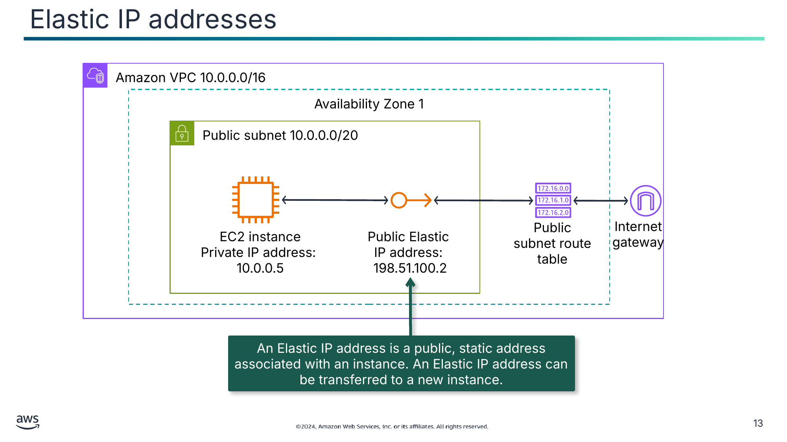

Еластична IP-адреса — це публічна статична адреса, пов’язана з екземпляром. Еластичну IP-адресу можна передати новому екземпляру.

<details>
<summary>Текст зі схеми</summary>

Amazon VPC 10.0.0.0/16

Availability Zone 1 (Зона доступності 1)

Public subnet 10.0.0.0/20 (Публічна підмережа)

Public subnet route table (Таблиця маршрутизації публічної підмережі)

Internet gateway (Інтернет-шлюз)

EC2 instance (Екземпляр EC2)

Private IP address:

10.0.0.5 (Приватна IP-адреса)

Public Elastic

IP address:

198.51.100.2 (Публічна еластична IP-адреса)

</details>

> **Нотатки:**
>
> |Номер слайда 13  
> |Нотатки для інструктора  
> |  
> |Нотатки для студента  
> Еластична IP-адреса — це статична публічна адреса IPv4, яку можна пов’язати з екземпляром EC2. Якщо стан здоров’я екземпляра EC2 погіршується, ви можете передати еластичну IP-адресу новому, справному екземпляру EC2. Приватна IP-адреса екземпляра EC2 динамічна, оскільки вивільняється, коли екземпляр завершують.  
>
> За першу еластичну IP-адресу, пов’язану з працюючим екземпляром EC2, плата не стягується. Ви нестимете витрати за будь-які додаткові еластичні IP-адреси, пов’язані з екземпляром, або якщо екземпляр зупинено. Якщо ви від’єднаєте еластичну IP-адресу від екземпляра й не пов’яжете її з іншим екземпляром, ви нестимете погодинні витрати.  
>
> Еластичні IP-адреси також можна пов’язати з балансувальником навантаження або мережевим інтерфейсом VPC.

---

## Слайд 14: Приватні підмережі (private subnets)

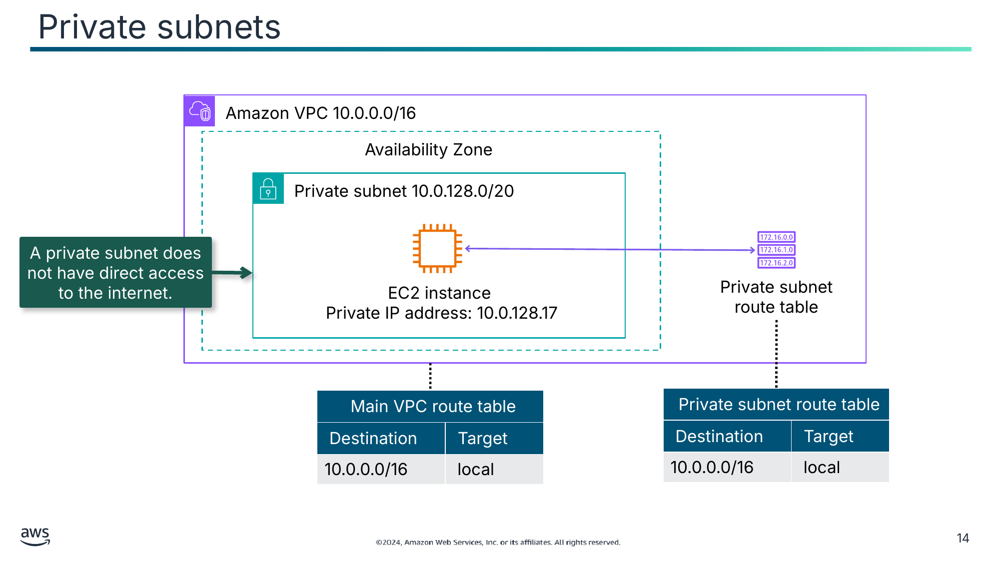

Приватна підмережа не має прямого доступу до інтернету.

**Main VPC route table (Основна таблиця маршрутизації VPC)**

| Destination (Призначення) | Target (Ціль) |
|---|---|
| 10.0.0.0/16 | local |

**Private subnet route table (Таблиця маршрутизації приватної підмережі)**

| Destination (Призначення) | Target (Ціль) |
|---|---|
| 10.0.0.0/16 | local |

<details>
<summary>Текст зі схеми</summary>

Amazon VPC 10.0.0.0/16

Availability Zone (Зона доступності)

Private subnet 10.0.128.0/20 (Приватна підмережа)

EC2 instance (Екземпляр EC2)

Private IP address: 10.0.128.17 (Приватна IP-адреса: 10.0.128.17)

Private subnet

route table (Таблиця маршрутизації приватної підмережі)

</details>

> **Нотатки:**
>
> |Номер слайда 14  
> |Нотатки для інструктора  
> |  
> |Нотатки для студента  
> Для ресурсів, що не мають бути доступними з інтернету, можна визначити приватну підмережу VPC. Усі ресурси в приватній підмережі недосяжні з інтернету й не мають прямого доступу до інтернету.  
>
> Найкраща практика — визначати власну таблицю маршрутизації для кожної підмережі з її власними маршрутами. На схемі таблиця маршрутизації приватної підмережі ідентична основній таблиці маршрутизації VPC. Екземпляр EC2 може досягти будь-якого ресурсу у VPC.  
>
> Коли з підмережею не пов’язано явної таблиці маршрутизації, за замовчуванням використовується основна таблиця маршрутизації VPC. Підмережа може бути пов’язана лише з однією таблицею маршрутизації одночасно, але з таблицею маршрутизації підмережі можна пов’язати кілька підмереж.

---

## Слайд 15: Зіставлення IP-адрес NAT (NAT IP mapping)

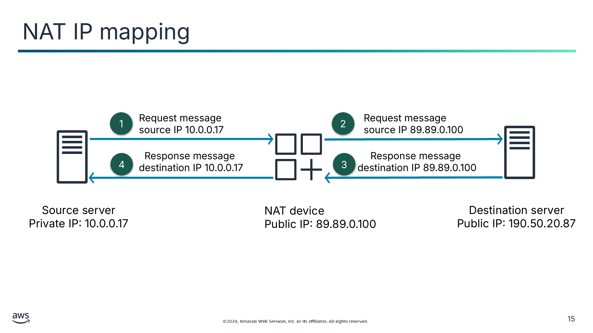

Request message

source IP 10.0.0.17 (Повідомлення-запит, IP-адреса джерела 10.0.0.17)

Request message

source IP 89.89.0.100 (Повідомлення-запит, IP-адреса джерела 89.89.0.100)

1

2

4

Response message

destination IP 10.0.0.17 (Повідомлення-відповідь, IP-адреса призначення 10.0.0.17)

3

Response message

destination IP 89.89.0.100 (Повідомлення-відповідь, IP-адреса призначення 89.89.0.100)

Source server

Private IP: 10.0.0.17 (Вихідний сервер, приватна IP-адреса: 10.0.0.17)

NAT device

Public IP: 89.89.0.100 (NAT-пристрій, публічна IP-адреса: 89.89.0.100)

Destination server

Public IP: 190.50.20.87 (Сервер призначення, публічна IP-адреса: 190.50.20.87)

> **Нотатки:**
>
> |Номер слайда 15  
> |Нотатки для інструктора  
> |  
> |Нотатки для студента  
> Коли ви не хочете розкривати IP-адресу сервера іншим мережам чи інтернету, корисно використовувати NAT-пристрій. NAT-пристрій замінює приватну IP-адресу ініціатора запиту власною публічною IP-адресою.  
>
> У прикладі на слайді відбувається така послідовність подій:  
>
> Вихідний сервер ініціює повідомлення-запит до NAT-пристрою зі своєю приватною IP-адресою 10.0.0.17 як IP-адресою джерела повідомлення.  
> NAT-пристрій зіставляє IP-адресу джерела повідомлення зі своєю публічною IP-адресою 89.89.0.100 і пересилає повідомлення на сервер призначення.  
> Сервер призначення відповідає NAT-пристрою, указуючи IP-адресу призначення 89.89.0.100.  
> NAT-пристрій зіставляє IP-адресу призначення повідомлення-відповіді з приватною IP-адресою вихідного сервера 10.0.0.17 і пересилає повідомлення на вихідний сервер.

---

## Слайд 16: Підключення приватних підмереж до інтернету

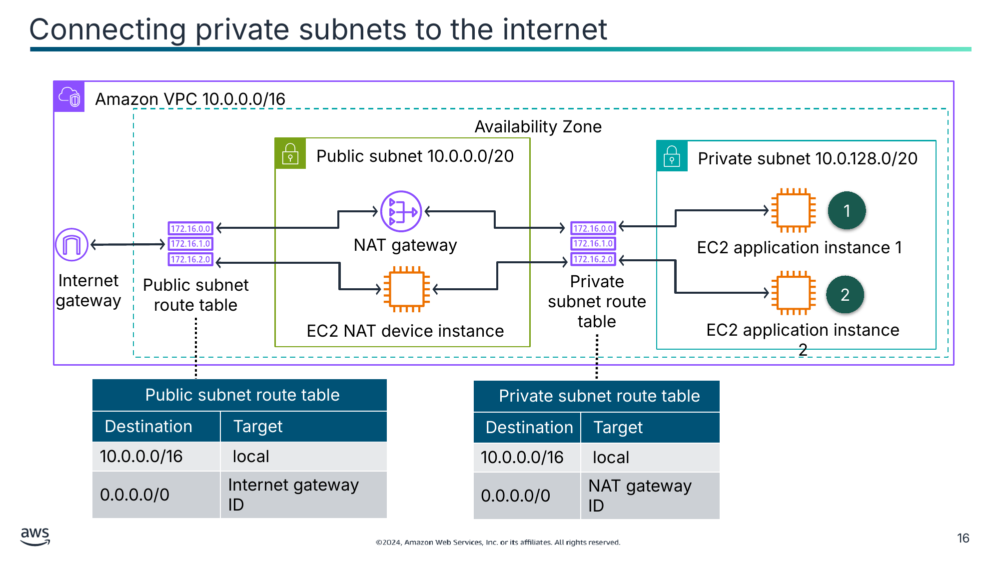

1

2

**Public subnet route table (Таблиця маршрутизації публічної підмережі)**

| Destination (Призначення) | Target (Ціль) |
|---|---|
| 10.0.0.0/16 | local |
| 0.0.0.0/0 | Internet gateway ID |

**Private subnet route table (Таблиця маршрутизації приватної підмережі)**

| Destination (Призначення) | Target (Ціль) |
|---|---|
| 10.0.0.0/16 | local |
| 0.0.0.0/0 | NAT gateway ID |

<details>
<summary>Текст зі схеми</summary>

Amazon VPC 10.0.0.0/16

Availability Zone (Зона доступності)

Public subnet 10.0.0.0/20 (Публічна підмережа)

Private subnet 10.0.128.0/20 (Приватна підмережа)

NAT gateway (NAT-шлюз)

EC2 application instance 1 (Екземпляр EC2 застосунку 1)

Internet gateway (Інтернет-шлюз)

Public subnet route table (Таблиця маршрутизації публічної підмережі)

Private subnet route table (Таблиця маршрутизації приватної підмережі)

EC2 NAT device instance (Екземпляр EC2 NAT-пристрою)

EC2 application instance 2 (Екземпляр EC2 застосунку 2)

</details>

> **Нотатки:**
>
> |Номер слайда 16  
> |Нотатки для інструктора  
> |  
> |Нотатки для студента  
> Існують сценарії, де потрібно, щоб ресурси в приватній підмережі підключалися до інтернету. Ресурси мають залишатися приватними й не виявлятися з інтернету. Наприклад, запит виправлень з інтернету для завантаження на екземпляр EC2.  
>
> Ви можете використовувати NAT-пристрій, щоб дозволити ресурсам у приватних підмережах підключатися до інтернету, інших VPC чи локальних мереж. Ці екземпляри можуть обмінюватися даними із сервісами поза VPC, але не можуть отримувати небажаних запитів на з’єднання.  
>
> AWS пропонує два типи рішень NAT-пристроїв. Ви можете використовувати кероване AWS NAT-пристрій, що пропонує AWS, — NAT-шлюз (NAT gateway) — або створити власний NAT-пристрій на екземплярі EC2, що називається екземпляром NAT (NAT instance). Оскільки NAT-шлюз — це кероване обслуговування AWS, воно спричиняє погодинні витрати. Екземпляр NAT-пристрою спричиняє витрати EC2.  
>
> 1. На зображенні вище екземпляр EC2 застосунку 1 ініціював запит до NAT-шлюзу за допомогою таблиці маршрутизації приватної підмережі. NAT-шлюз замінює вихідну адресу IPv4 екземпляра адресою NAT-шлюзу. NAT-шлюз надсилає запит до інтернет-шлюзу й отримує відповідь. Надсилаючи відповідь назад екземпляру, NAT-шлюз перетворює IP-адресу назад на приватну адресу IPv4 екземпляра EC2 застосунку 1.  
>
> 2. Так само екземпляр EC2 застосунку 2 ініціював запит до екземпляра NAT за допомогою таблиці маршрутизації приватної підмережі. Екземпляр NAT замінює вихідну адресу IPv4 екземпляра адресою екземпляра NAT. NAT-шлюз надсилає запит до інтернет-шлюзу й отримує відповідь. Надсилаючи трафік відповіді назад екземпляру, екземпляр NAT перетворює адреси назад на приватну адресу IPv4 екземпляра EC2 застосунку 2.  
>
> AWS рекомендує використовувати NAT-шлюзи замість екземплярів NAT, оскільки вони забезпечують кращу доступність і пропускну здатність та потребують менше зусиль адміністрування з вашого боку. Для стійкості під час використання кількох AZ розгорніть NAT-шлюз у кожній AZ.  
>
> Для приватних підмереж IPv6 використовуйте інтернет-шлюз лише для вихідного трафіку (egress-only internet gateway), щоб дозволити вихідний обмін даними через IPv6 в інтернет і заборонити інтернету ініціювати з’єднання IPv6 з вашими екземплярами.

---

## Слайд 17: Практична вправа: оберіть правильний тип підмережі (Choose the Right Type of Subnet)

- Вирішіть, чи слід розміщувати екземпляри в публічній чи приватній підмережі.


> **Нотатки:**
>
> |Номер слайда 17  
> |Нотатки для інструктора  
> |Це групова вправа класу, де студенти мають вирішити, який екземпляр бізнес-застосунку підходить для приватної чи публічної підмережі. Відповіді наведено на другому слайді.  
> |  
> |Нотатки для студента  
> Наступний слайд надає приклади для вашого розгляду.

---

## Слайд 18: Оберіть публічну чи приватну підмережу для кожного сценарію використання

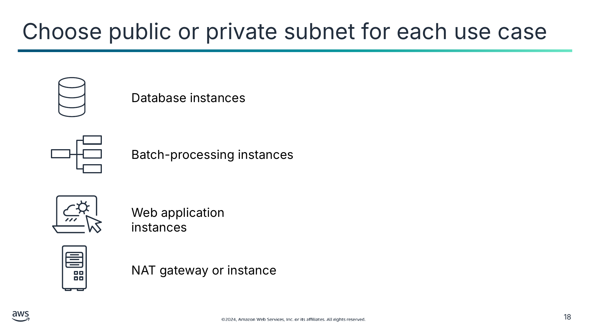

Database instances (Екземпляри баз даних)

Batch-processing instances (Екземпляри пакетної обробки)

Web application instances (Екземпляри вебзастосунків)

NAT gateway or instance (NAT-шлюз або екземпляр)

> **Нотатки:**
>
> |Номер слайда 18  
> |Нотатки для інструктора  
> |  
> |Нотатки для студента  
> Знайдіть хвилину, щоб подумати, чи слід розміщувати екземпляри в цих прикладах у публічній чи приватній підмережі.

---

## Слайд 19: Рекомендовані вибори підмережі для кожного сценарію використання

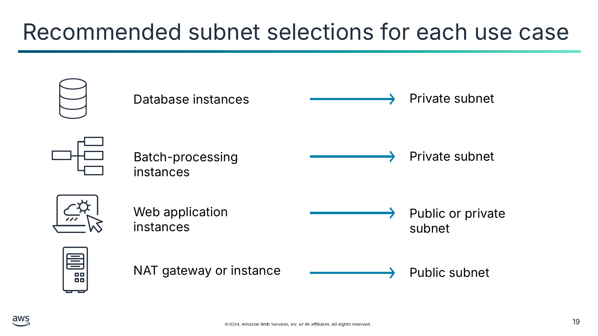

Database instances (Екземпляри баз даних)

Private subnet (Приватна підмережа)

Batch-processing instances (Екземпляри пакетної обробки)

Private subnet

Web application instances (Екземпляри вебзастосунків)

Public or private subnet (Публічна або приватна підмережа)

NAT gateway or instance (NAT-шлюз або екземпляр)

Public subnet (Публічна підмережа)

> **Нотатки:**
>
> |Номер слайда 19  
> |Нотатки для інструктора  
> |  
> |Нотатки для студента  
> Екземпляри сховищ даних і екземпляри пакетної обробки слід розміщувати в приватних підмережах. Екземпляри вебрівня можна розмістити в публічній підмережі. Однак AWS рекомендує розміщувати екземпляри вебрівня всередині приватних підмереж за балансувальником навантаження. У деяких середовищах потрібно приєднувати екземпляри вебзастосунків безпосередньо до еластичних IP-адрес (хоча еластичну IP-адресу можна приєднати й до балансувальника навантаження). У таких випадках екземпляри вебзастосунків мають бути в публічній підмережі. NAT-шлюз чи екземпляр потрібно розміщувати в публічній підмережі, щоб мати доступ до інтернет-шлюзу.

---

## Слайд 20: Ключові висновки: вступ до Amazon VPC

- Amazon VPC — це програмно визначена, логічно ізольована віртуальна мережа.
- Публічна підмережа з інтернет-шлюзом дозволяє прямий доступ до інтернету.
- Приватна підмережа не має прямого доступу до інтернету.
- NAT-шлюз дозволяє ресурсам у приватній підмережі підключатися до інтернету.
- Еластичну IP-адресу можна передати новому екземпляру.

> **Нотатки:**
>
> |Номер слайда 20  
> |Нотатки для інструктора  
> |  
> |Нотатки для студента

---

## Слайд 21: Захист мережевих ресурсів

Створення мережевого середовища

> **Нотатки:**
>
> |Номер слайда 21  
> |Нотатки для інструктора  
> |  
> |Нотатки для студента  
> Цей розділ розглядає, як захищати мережеві ресурси.

---

## Слайд 22: Рівні захисту безпеки (security layers of defense)

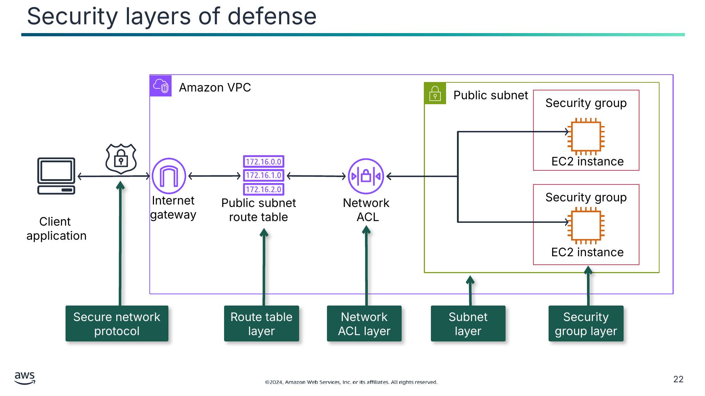

Secure network protocol (Захищений мережевий протокол)

Route table layer (Рівень таблиці маршрутизації)

Network ACL layer (Рівень мережевого ACL)

Subnet layer (Рівень підмережі)

Security group layer (Рівень групи безпеки)

<details>
<summary>Текст зі схеми</summary>

Amazon VPC

Public subnet (Публічна підмережа)

Security group (Група безпеки)

EC2 instance (Екземпляр EC2)

Security group

Internet gateway (Інтернет-шлюз)

Public subnet route table (Таблиця маршрутизації публічної підмережі)

Network  
ACL (Мережевий ACL)

Client

application (Клієнтський застосунок)

EC2 instance

</details>

> **Нотатки:**
>
> |Номер слайда 22  
> |Нотатки для інструктора  
> |  
> |Нотатки для студента  
> Опис зображення: потік мережевого трафіку від клієнтського застосунку, що використовує захищений мережевий протокол, до інтернет-шлюзу. Інтернет-шлюз пересилає мережевий трафік через рівень таблиці маршрутизації, рівень списку контролю доступу до мережі (мережевий ACL), рівень підмережі та рівень групи безпеки до екземпляра EC2. Кінець опису зображення.  
> Ізоляції ресурсів у публічній підмережі недостатньо для захисту ресурсів VPC. Тепер, коли ви знаєте, як проєктувати мережеве середовище й підключати його до інтернету, потрібно ізолювати ваші застосунки та робочі навантаження.  
>
> Як найкращу практику, слід захищати ресурси кількома рівнями захисту. Клієнтський застосунок може використовувати захищений мережевий протокол, як-от TLS і HTTPS, щоб шифрувати корисне навантаження даних під час передавання. Це гарантуватиме, що сторонні суб’єкти не зможуть прочитати чи підробити трафік.  
>   
> У VPC можна додавати і групи безпеки, і мережеві ACL, щоб додатково захистити ваші екземпляри EC2 в підмережі. Коли ви впроваджуєте і мережеві ACL, і групи безпеки як глибокоешелонований (defense-in-depth) спосіб контролю трафіку, помилка в конфігурації одного з цих засобів контролю не піддасть екземпляр небажаному трафіку.

---

## Слайд 23

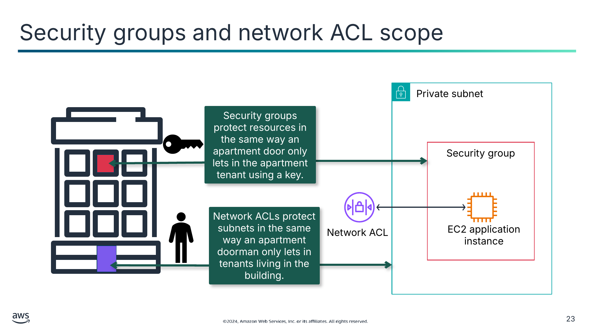

Групи безпеки та область дії мережевих ACL (Security groups and network ACL scope)

Групи безпеки захищають ресурси так само, як двері квартири впускають лише мешканця квартири за допомогою ключа.

Мережеві ACL захищають підмережі так само, як швейцар будинку впускає лише мешканців, що живуть у цьому будинку.

<details>
<summary>Текст зі схеми</summary>

Private subnet (Приватна підмережа)

Security group (Група безпеки)

EC2 application instance (Екземпляр EC2 застосунку)

Network ACL (Мережевий ACL)

</details>

> **Нотатки:**
>
> |Номер слайда 23  
> |Нотатки для інструктора  
> |  
> |Нотатки для студента  
> Групи безпеки та мережеві ACL — обидва є механізмами, що дозволяють визначати фільтри мережевого трафіку, які називаються правилами. Їх можна використовувати одночасно або лише один із них. Уявіть це як людину, що живе в багатоповерховому будинку у великому місті.  
>
> Щоб потрапити до власної квартири, вона спершу має увійти в будівлю. Швейцар захищає будівлю й впускає лише мешканців, що живуть у будинку. Так само мережеві ACL діють як брандмауер підмережі для підмереж VPC, впускаючи лише трафік, дозволений правилами ACL.  
>
> Після того як людина входить у будівлю, вона підходить до замкнених дверей своєї квартири, що захищають квартиру. Увійти до квартири вона може лише за допомогою свого ключа. Так само групи безпеки діють як брандмауер ресурсу для ресурсів, як-от екземпляри EC2. Вони визначають правила для фільтрації мережевого трафіку до ресурсу та від нього.

---

## Слайд 24: Групи безпеки (security groups)

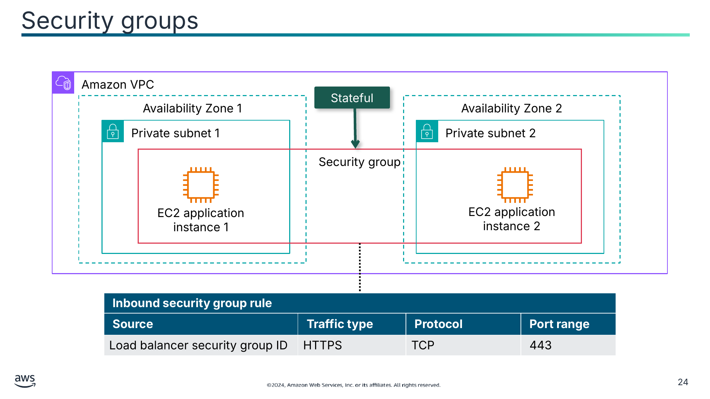

Stateful (Станний)

**Inbound security group rule (Вхідне правило групи безпеки)**

| Source (Джерело) | Traffic type (Тип трафіку) | Protocol (Протокол) | Port range (Діапазон портів) |
|---|---|---|---|
| Load balancer security group ID | HTTPS | TCP | 443 |

<details>
<summary>Текст зі схеми</summary>

Amazon VPC

Availability Zone 1 (Зона доступності 1)

Availability Zone 2 (Зона доступності 2)

Private subnet 1 (Приватна підмережа 1)

Private subnet 2 (Приватна підмережа 2)

Security group (Група безпеки)

EC2 application instance 1 (Екземпляр EC2 застосунку 1)

EC2 application instance 2 (Екземпляр EC2 застосунку 2)

</details>

> **Нотатки:**
>
> |Номер слайда 24  
> |Нотатки для інструктора  
> |  
> |Нотатки для студента  
> Групи безпеки — це брандмауери зі станом (stateful), що діють на рівні екземпляра чи мережевого інтерфейсу. Вони можуть охоплювати кілька AZ. Для кожної групи безпеки ви додаєте окремі набори правил для вхідного й вихідного трафіку. Ресурси з однаковими вимогами до безпеки слід групувати разом в одній групі безпеки. У цьому прикладі екземпляри бізнес-застосунку в кількох AZ пов’язано з тією самою групою безпеки.  
>
> Ви можете обирати порти та протоколи, що дозволяються для вхідного й вихідного трафіку. Можна вказувати правила дозволу, але не правила заборони. У наведеному вище прикладі група безпеки має вхідне правило групи безпеки, що дозволяє трафік HTTPS TCP від групи безпеки балансувальника навантаження на порту 443. Ви також можете визначати зв’язки між групами безпеки. Наприклад, екземпляри в групі безпеки рівня бази даних приймають трафік лише від екземплярів у рівні застосунку, за посиланням на групи безпеки, застосовані до задіяних екземплярів.  
>
> Групи безпеки є станними. Станний означає, що зворотний трафік автоматично дозволяється незалежно від будь-яких правил. Наприклад, припустімо, ви переглядаєте вебсайт зі свого домашнього комп’ютера. Він надсилає повідомлення-запит HTTPS до екземпляра EC2 застосунку 1 за протоколом TCP на порту 443. Оскільки вхідні правила групи безпеки дозволяють трафік HTTPS на порту 443, інформація про з’єднання відстежується. Трафік відповіді від екземпляра EC2 застосунку 1 не відстежується як новий запит. Натомість він відстежується як встановлене з’єднання. Відповіді дозволено виходити з екземпляра, навіть якщо ваші вихідні правила групи безпеки обмежують вихідний трафік HTTPS.  
>
> Коли ви вперше створюєте групу безпеки, вона не має вхідних правил. Тому вхідний трафік не дозволяється, доки ви не додасте вхідні правила до групи безпеки. Нова група безпеки має вихідне правило, що дозволяє весь вихідний трафік від ресурсу. Ви можете видалити це правило й додати вихідні правила, що дозволяють лише певний вихідний трафік. Якщо у вашої групи безпеки немає вихідних правил, жоден вихідний трафік не дозволяється.

---

## Слайд 25: Мережевий ACL (Network ACL)

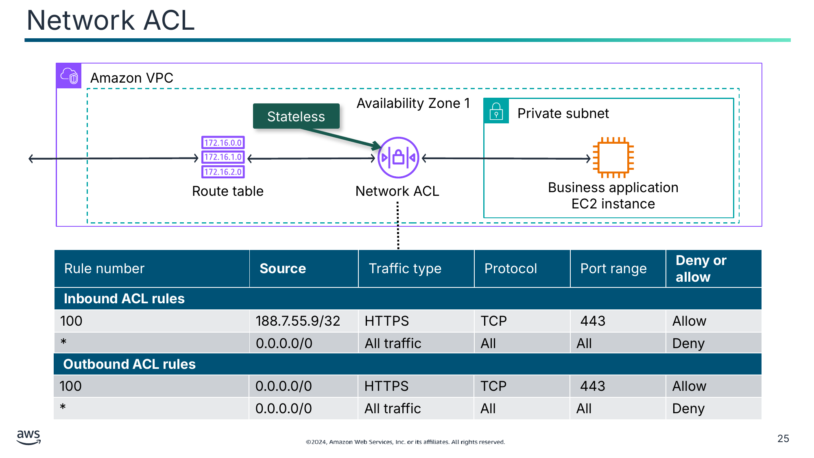

Stateless (Безстанний)

| Rule number (Номер правила) | Source (Джерело) | Traffic type (Тип трафіку) | Protocol (Протокол) | Port range (Діапазон портів) | Deny or allow (Заборона чи дозвіл) |
|---|---|---|---|---|---|
| Inbound ACL rules (Вхідні правила ACL) |  |  |  |  |  |
| 100 | 188.7.55.9/32 | HTTPS | TCP | 443 | Allow |
| * | 0.0.0.0/0 | All traffic | All | All | Deny |

**Outbound ACL rules (Вихідні правила ACL)**

| 100 | 0.0.0.0/0 | HTTPS | TCP | 443 | Allow |
|---|---|---|---|---|---|
| * | 0.0.0.0/0 | All traffic | All | All | Deny |

<details>
<summary>Текст зі схеми</summary>

Amazon VPC

Availability Zone 1 (Зона доступності 1)

Private subnet (Приватна підмережа)

Route table (Таблиця маршрутизації)

Network ACL (Мережевий ACL)

Business application EC2 instance (Екземпляр EC2 бізнес-застосунку)

</details>

> **Нотатки:**
>
> |Номер слайда 25  
> |Нотатки для інструктора  
> |  
> |Нотатки для студента  
> Список контролю доступу до мережі (мережевий ACL) — це необов’язковий рівень безпеки для вашої підмережі. Він діє як брандмауер для контролю трафіку, що входить в одну чи кілька підмереж і виходить з них. Щоб додати ще один рівень безпеки до вашої підмережі, можна налаштувати мережеві ACL із правилами так само, як налаштовуються правила груп безпеки.  
>
> Кожна підмережа у вашій VPC має бути пов’язана з мережевим ACL. Якщо ви явно не пов’язуєте підмережу з мережевим ACL, підмережа автоматично пов’язується з мережевим ACL за замовчуванням. Мережевий ACL можна пов’язати з кількома підмережами. Однак підмережа може бути пов’язана лише з одним мережевим ACL одночасно. Коли ви пов’язуєте мережевий ACL з підмережею, попередній зв’язок видаляється.  
>
> Мережевий ACL має окремі вхідні та вихідні правила, і кожне правило може або дозволяти, або забороняти трафік. Ваша VPC автоматично постачається з мережевим ACL за замовчуванням. Він дозволяє весь вхідний і вихідний трафік IPv4 та, за потреби, трафік IPv6. Він містить два вхідні правила для всього трафіку: правило 100, що дозволяє весь трафік на всіх портах, і правило із зірочкою (*), що забороняє весь трафік на всіх портах. Мета правила із зірочкою — перехоплювати будь-який трафік, спричинений неправильно налаштованими правилами. Так само вихідні правила дозволяють весь трафік на всіх портах правилом 100 і також мають правило із зірочкою, що забороняє весь трафік на всіх портах.  
>
> Якщо ви створюєте користувацький мережевий ACL, він включатиме правило із зірочкою «заборонити весь трафік» для вхідного й вихідного трафіку. Ви можете додавати пронумеровані правила для певних IP-адрес чи блоків CIDR, щоб дозволити або заборонити трафік для певного типу трафіку та порту. У наведеному вище прикладі вхідне правило ACL 100 дозволяє лише трафік HTTPS TCP від IP-адреси 188.7.55.9/32 на порту 443. Вхідне правило із зірочкою забороняє весь трафік на всіх портах. Вихідне правило ACL 100 дозволяє трафік HTTPS на порту 443, а правило із зірочкою забороняє весь трафік на всіх портах.  
>
> Мережеві ACL є безстанними, що означає, що жодна інформація про запит не зберігається після його обробки. Зворотний трафік має бути явно дозволений правилами.

---

## Слайд 26: Порівняння груп безпеки та мережевих ACL

| Групи безпеки (Security groups) | Мережеві ACL (Network ACLs) |
|---|---|
| Діють на рівні ресурсу. | Діють на рівні підмережі. |
| Визначають лише правила дозволу трафіку. | Визначають правила заборони та дозволу трафіку. |
| Правила є станними. | Правила є безстанними. |
| Усі правила оцінюються. | Правила оцінюються за порядком номерів, і оцінювання припиняється, якщо знайдено збіг. |
| У новій групі безпеки вхідний трафік за замовчуванням не дозволяється. | У новому мережевому ACL весь вхідний трафік за замовчуванням дозволяється. |
| У новій групі безпеки весь вихідний трафік за замовчуванням дозволяється. | У новому мережевому ACL весь вихідний трафік за замовчуванням дозволяється. |

Трафік відповіді завжди оцінюється за набором вхідних або вихідних правил.

Трафік відповіді автоматично дозволяється назад через групу безпеки.

> **Нотатки:**
>
> |Номер слайда 26  
> |Нотатки для інструктора  
> |  
> |Нотатки для студента  
> Важливо зауважити відмінності між групами безпеки та мережевими ACL. Групи безпеки діють на рівні ресурсу, тоді як мережеві ACL діють на рівні підмережі. Групи безпеки визначають лише правила дозволу трафіку, тоді як мережеві ACL визначають правила заборони та дозволу трафіку.  
>
> Правила груп безпеки станні, тому трафік відповіді автоматично дозволяється. Мережеві ACL безстанні, і трафік відповіді оцінюється за набором вхідних чи вихідних правил.  
>
> Усі вхідні чи вихідні правила в групі безпеки оцінюються під час виконання. У мережевих ACL вхідні та вихідні правила оцінюються за порядком номерів, і оцінювання припиняється, коли трафік відповідає правилу.  
>
> За замовчуванням групи безпеки не дозволяють жодного вхідного трафіку, але дозволяють весь вихідний трафік. Мережеві ACL за замовчуванням дозволяють весь вхідний і вихідний трафік. AWS рекомендує за можливості використовувати групи безпеки замість мережевих ACL для простоти обслуговування та гнучкості.

---

## Слайд 27: AWS Network Firewall

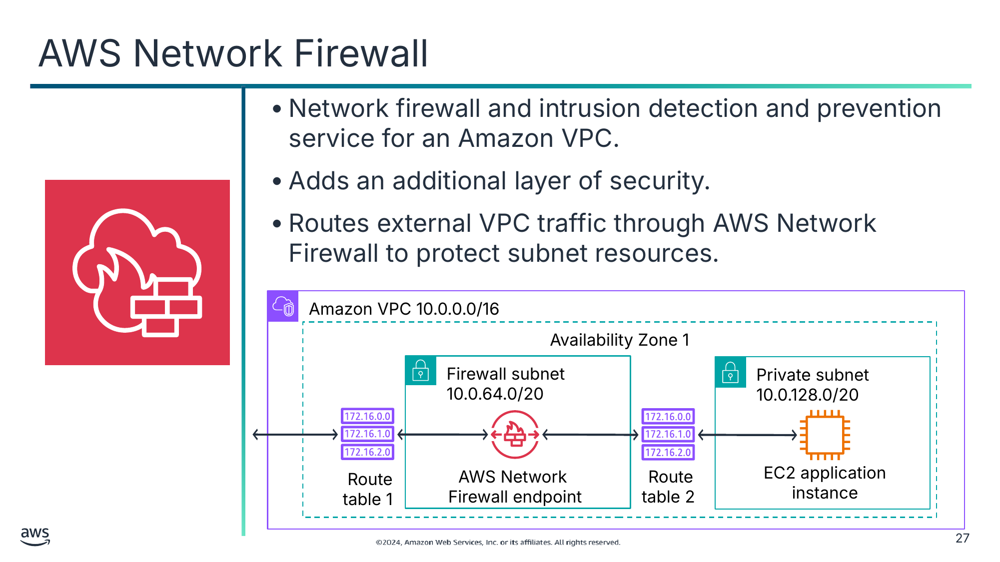

- Мережевий брандмауер і сервіс виявлення та запобігання вторгненням для Amazon VPC.
- Додає додатковий рівень безпеки.
- Маршрутизує зовнішній для VPC трафік через AWS Network Firewall для захисту ресурсів підмережі.

<details>
<summary>Текст зі схеми</summary>

Amazon VPC 10.0.0.0/16

Availability Zone 1 (Зона доступності 1)

Firewall subnet 10.0.64.0/20 (Підмережа брандмауера)

Private subnet 10.0.128.0/20 (Приватна підмережа)

Route

table 1 (Таблиця маршрутизації 1)

AWS Network

Firewall endpoint (Кінцева точка AWS Network Firewall)

Route

table 2 (Таблиця маршрутизації 2)

EC2 application instance (Екземпляр EC2 застосунку)

</details>

> **Нотатки:**
>
> |Номер слайда 27  
> |Нотатки для інструктора  
> |  
> |Нотатки для студента  
> Коли організації мають справу з чутливими даними або мають суворі вимоги відповідності, AWS Network Firewall доступний як ще один рівень безпеки на додачу до груп безпеки та мережевих ACL. AWS Network Firewall діє як буфер, щоб гарантувати, що трафік, надісланий до ресурсів VPC, не є зловмисним.  
>
> Це кероване станне обслуговування мережевого брандмауера та виявлення й запобігання вторгненням для VPC. Воно розгортається в підмережі брандмауера, що перевіряє весь вхідний трафік VPC для захисту підмереж VPC. Щоб впровадити кінцеву точку AWS Network Firewall, змініть таблиці маршрутизації Amazon VPC так, щоб надсилати ваш мережевий трафік через кінцеві точки брандмауера Network Firewall. Таблицю маршрутизації 1 і таблицю маршрутизації 2 змінюють для маршрутизації трафіку через кінцеву точку брандмауера. У прикладі весь трафік, зовнішній для VPC, потім маршрутизується спершу через таблицю маршрутизації 1 до кінцевої точки AWS Network Firewall, а потім через таблицю маршрутизації 2 до екземпляра EC2 застосунку в приватній підмережі VPC.  
>
> Таблицю маршрутизації 1 змінили б, щоб вона мала призначення «весь трафік» із зовнішньої цілі, як-от ідентифікатор інтернет-шлюзу. Таблиця маршрутизації 2 приймала б лише трафік із підмережі брандмауера з призначенням «весь трафік» і ціллю з ідентифікатором підмережі брандмауера.

---

## Слайд 28: Адміністрування ресурсів за допомогою бастіонних хостів (bastion hosts)

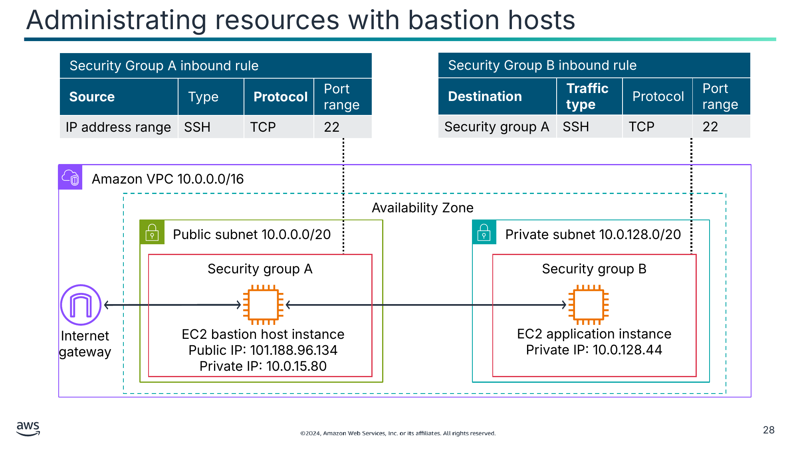

**Security Group A inbound rule (Вхідне правило групи безпеки A)**

| Source (Джерело) | Type (Тип) | Protocol (Протокол) | Port range (Діапазон портів) |
|---|---|---|---|
| IP address range | SSH | TCP | 22 |

**Security Group B inbound rule (Вхідне правило групи безпеки B)**

| Destination (Призначення) | Traffic type (Тип трафіку) | Protocol (Протокол) | Port range (Діапазон портів) |
|---|---|---|---|
| Security group A | SSH | TCP | 22 |

<details>
<summary>Текст зі схеми</summary>

Amazon VPC 10.0.0.0/16

Availability Zone (Зона доступності)

Public subnet 10.0.0.0/20 (Публічна підмережа)

Private subnet 10.0.128.0/20 (Приватна підмережа)

Security group A (Група безпеки A)

Security group B (Група безпеки B)

Internet gateway (Інтернет-шлюз)

EC2 bastion host instance (Екземпляр EC2 бастіонного хоста)

Public IP: 101.188.96.134 (Публічна IP-адреса)

Private IP: 10.0.15.80 (Приватна IP-адреса)

EC2 application instance (Екземпляр EC2 застосунку)

Private IP: 10.0.128.44

</details>

> **Нотатки:**
>
> |Номер слайда 28  
> |Нотатки для інструктора  
> |  
> |Нотатки для студента  
> Один з варіантів, які компанії використовують для адміністрування ресурсів у приватній підмережі VPC, — використання бастіонного хоста (bastion host) у публічній підмережі. Бастіонний хост — це сервер, що надає доступ для обслуговування приватної підмережі із зовнішньої мережі замість надання прямого доступу до екземпляра в приватній підмережі. Адміністратору надається доступ до бастіонного хоста за допомогою правила групи безпеки. До екземплярів EC2 бастіонного хоста прикріплено політики IAM для надання доступу до ресурсів у VPC. Ви можете використовувати бастіонний хост, щоб мінімізувати ймовірність потенційної атаки на ресурси у вашій приватній підмережі, водночас дозволяючи обмежений доступ для цілей адміністрування серверів.  
>
> Наприклад, припустімо, ви хочете дозволити підключення із зовнішньої мережі до екземплярів Linux у приватній підмережі вашої VPC через Secure Shell, або SSH. Ви можете використовувати бастіонний хост, щоб пом’якшити ризик дозволу цих зовнішніх з’єднань SSH до екземплярів у приватній підмережі.  
>
> У наведеному вище прикладі бастіонний хост — це екземпляр EC2 у публічній підмережі VPC. Користувач бастіонного хоста підключається з локального середовища до бастіонного хоста. Група безпеки A дозволяє адміністративний трафік за допомогою правила, що дозволяє трафік SSH TCP на порту 22 із зазначеного діапазону IP-адрес. Екземпляр EC2 застосунку в приватній підмережі в групі безпеки B дозволяє трафік SSH TCP на порту 22 від групи безпеки A. В ідеалі бастіонний хост має бути єдиним джерелом трафіку SSH до вашого екземпляра Linux у приватній підмережі.

---

## Слайд 29: Ключові висновки: захист мережевих ресурсів

- Захищайте інфраструктуру AWS кількома рівнями захисту.
- Група безпеки у VPC визначає, який трафік дозволено до ресурсів AWS чи від них. Вона станна.
- Мережевий ACL дозволяє або забороняє певний вхідний чи вихідний трафік на рівні підмережі. Він безстанний.
- Маршрутизуйте зовнішній для VPC трафік через AWS Network Firewall, щоб додати додатковий рівень безпеки трафіку.
- Використовуйте бастіонний хост для адміністрування ресурсів приватної підмережі з локального середовища.

> **Нотатки:**
>
> |Номер слайда 29  
> |Нотатки для інструктора  
> |  
> |Нотатки для студента

---

## Слайд 30: Демонстрація: створення Amazon VPC в AWS Management Console

- Ця демонстрація використовує функції Amazon VPC, групи безпеки та еластичну IP-адресу.
- У цій демонстрації ви побачите, як створити публічну та приватну підмережі у VPC, кожну з таблицею маршрутизації підмережі.
- Ви побачите, як створити інтернет-шлюз, приєднати його до VPC і налаштувати маршрути до інтернету.
- Створіть NAT-шлюз і призначте еластичну IP-адресу. Налаштуйте маршрути NAT-шлюзу.
- Створіть групу безпеки вебсервера.
- Створіть групу безпеки сервера бази даних.


> **Нотатки:**
>
> |Номер слайда 30  
> |Нотатки для інструктора  
> |Ця демонстрація записана як файл .MP4 із субтитрами. Студенти отримують до неї доступ через онлайн-курс. Тривалість кожної демонстрації вказано в посібнику інструктора.  
> |  
> |Нотатки для студента  
> Знайдіть цю записану демонстрацію у вашому курсі як частину цього модуля.

---

## Слайд 31: Підключення до керованих сервісів AWS

Створення мережевого середовища

> **Нотатки:**
>
> |Номер слайда 31  
> |Нотатки для інструктора  
> |  
> |Нотатки для студента  
> Цей розділ розглядає, як підключатися до керованих сервісів AWS із VPC.

---

## Слайд 32: Як підключатися до керованих сервісів AWS

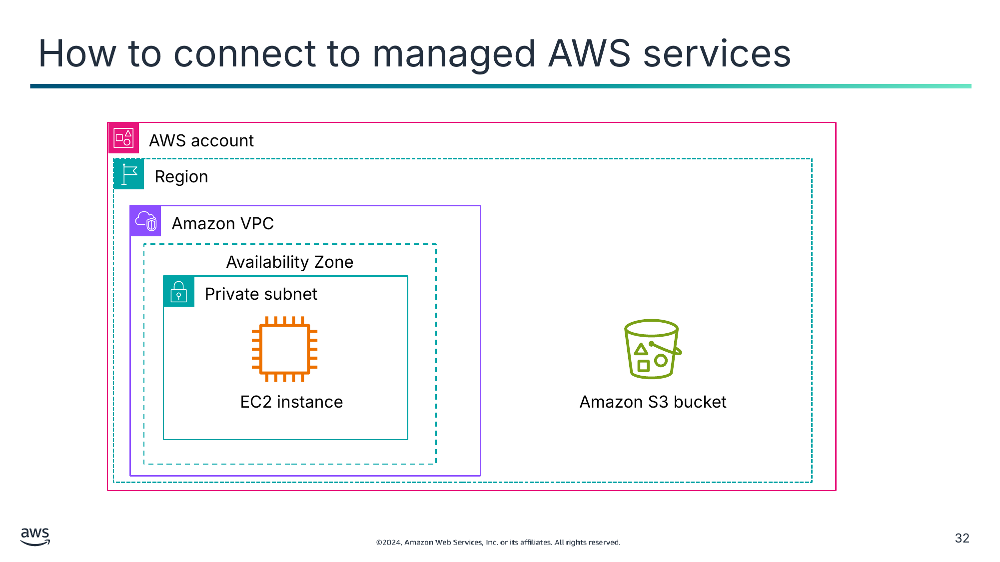

<details>
<summary>Текст зі схеми</summary>

AWS account (Акаунт AWS)

Region (Регіон)

Amazon VPC

Availability Zone (Зона доступності)

Private subnet (Приватна підмережа)

EC2 instance (Екземпляр EC2)

Amazon S3 bucket (Бакет Amazon S3)

</details>

> **Нотатки:**
>
> |Номер слайда 32  
> |Нотатки для інструктора  
> |  
> |Нотатки для студента  
> Опис зображення: архітектурна схема AWS VPC з екземпляром EC2 у приватній підмережі. Бакет Amazon S3 використовує окрему кінцеву точку Gateway VPC. Екземпляр EC2 може отримувати доступ до інших керованих сервісів AWS та Amazon S3 за допомогою кінцевої точки Interface VPC. Кінець опису зображення.  
>
> Припустімо, ви успішно розгорнули й налаштували своє робоче навантаження на екземплярі EC2 у приватній підмережі. Однак робочому навантаженню потрібен доступ до бакета Amazon Simple Storage Service (Amazon S3) у вашому акаунті AWS у тому самому регіоні AWS. Amazon S3 — це кероване обслуговування AWS, що працює поза вашою VPC. Прямого підключення від екземпляра EC2 у вашій VPC до бакета Amazon S3 немає.  
>
> Одне з рішень — те, що до бакетів Amazon S3 можна звертатися через публічну регіональну точку доступу з ресурсів VPC. Проблема в тому, що запит буде маршрутизовано через інтернет, що спричиняє витрати на передавання даних.

---

## Слайд 33: Кінцеві точки Interface VPC (interface VPC endpoints)

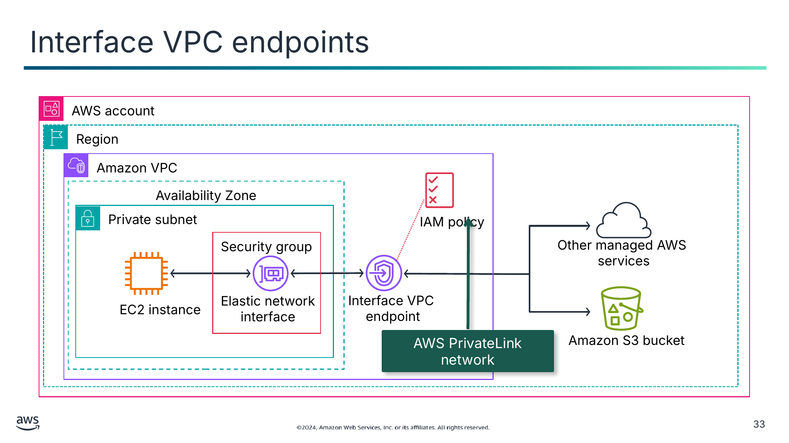

<details>
<summary>Текст зі схеми</summary>

AWS account (Акаунт AWS)

Region (Регіон)

Amazon VPC

Availability Zone (Зона доступності)

Private subnet (Приватна підмережа)

IAM policy (Політика IAM)

Security group (Група безпеки)

Other managed AWS

services (Інші керовані сервіси AWS)

Elastic network interface (Еластичний мережевий інтерфейс)

Interface VPC

endpoint (Кінцева точка Interface VPC)

EC2 instance (Екземпляр EC2)

Amazon S3 bucket (Бакет Amazon S3)

AWS PrivateLink network (Мережа AWS PrivateLink)

</details>

> **Нотатки:**
>
> |Номер слайда 33  
> |Нотатки для інструктора  
> |  
> |Нотатки для студента  
> Опис зображення: архітектурна схема AWS VPC із кінцевою точкою Interface VPC. VPC містить приватну підмережу з еластичним мережевим інтерфейсом. Екземпляр EC2 усередині приватної підмережі може отримувати доступ до інших керованих сервісів AWS та Amazon S3 за допомогою еластичного мережевого інтерфейсу, що належить кінцевій точці Interface VPC. До кінцевої точки Interface VPC прикріплено політику IAM. Кінець опису зображення.  
>
> Прямішим і безпечнішим рішенням для підключення екземпляра EC2 до бакета Amazon S3 є використання кінцевої точки VPC (VPC endpoint). Існують два типи кінцевих точок VPC: кінцеві точки Interface VPC і кінцеві точки Gateway VPC. Кінцеві точки Interface забезпечуються AWS PrivateLink. Сервіс AWS PrivateLink розроблено для розв’язання підключення між VPC і керованими сервісами AWS. Повний перелік сервісів AWS, що підтримуються AWS PrivateLink, див. у переліку ресурсів.  
>
> Кінцеві точки Interface VPC дають змогу приватно підключати вашу VPC до керованих сервісів AWS так, ніби вони перебувають у вашій VPC. У наведеному вище прикладі екземпляр EC2 може використовувати кінцеву точку Interface VPC для підключення до бакета Amazon S3 за допомогою мережі AWS PrivateLink.  
>
> Для кожної кінцевої точки Interface VPC AWS створює еластичний мережевий інтерфейс у кожній підмережі VPC і призначає йому приватну IP-адресу з діапазону адрес підмережі. Еластичний мережевий інтерфейс — це логічний мережевий компонент у VPC, що представляє віртуальну мережеву карту.  
>
> Щоб контролювати доступ користувачів чи застосунків до VPC, можна використовувати політику ресурсів AWS Identity and Access Management (IAM). Це окремо захистить кінцеву точку VPC і доступні ресурси. Кінцеві точки Interface VPC тарифікуються за погодинне використання кінцевої точки та обсяг даних, оброблених за місяць.

---

## Слайд 34: Як налаштувати кінцеву точку Interface VPC

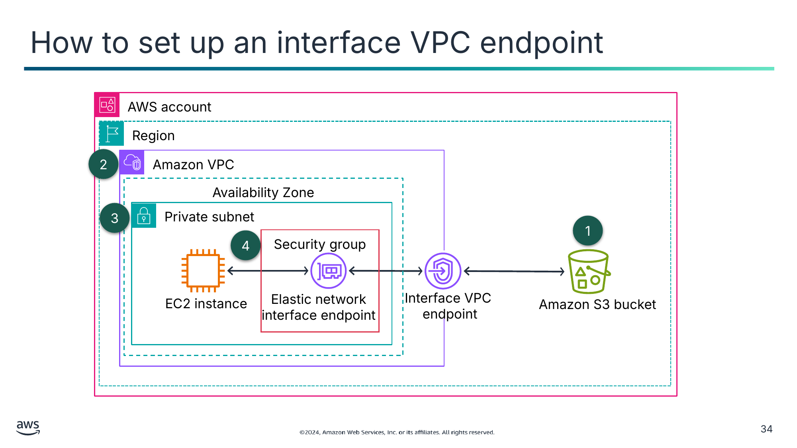

2

3

1

4

<details>
<summary>Текст зі схеми</summary>

AWS account (Акаунт AWS)

Region (Регіон)

Amazon VPC

Availability Zone (Зона доступності)

Private subnet (Приватна підмережа)

Security group (Група безпеки)

EC2 instance (Екземпляр EC2)

Elastic network interface endpoint (Кінцева точка еластичного мережевого інтерфейсу)

Interface VPC

endpoint (Кінцева точка Interface VPC)

Amazon S3 bucket (Бакет Amazon S3)

</details>

> **Нотатки:**
>
> |Номер слайда 34  
> |Нотатки для інструктора  
> |  
> |Нотатки для студента  
> Опис зображення: архітектурна схема AWS VPC із кінцевою точкою Interface VPC. VPC містить приватну підмережу з еластичним мережевим інтерфейсом. Екземпляр EC2 усередині приватної підмережі може отримувати доступ до Amazon S3 за допомогою мережевого інтерфейсу, що належить кінцевій точці Interface VPC. Кінець опису зображення.  
>
> Щоб налаштувати кінцеву точку Interface, виконайте такі загальні кроки в консолі Amazon VPC:  
> Вкажіть назву сервісу AWS, сервісу кінцевої точки чи сервісу AWS Marketplace, до якого ви хочете підключитися.  
> Оберіть VPC, де ви хочете створити кінцеву точку Interface. Ви можете вказати більше однієї підмережі в різних зонах доступності (AZ), якщо це підтримує сервіс. Це допомагає гарантувати, що ваша кінцева точка Interface стійка до збоїв AZ. У такому разі еластичний мережевий інтерфейс створюється в кожній підмережі, яку ви вказали.  
> Оберіть підмережу у вашій VPC, що використовуватиме кінцеву точку Interface. Коли ви створюєте кінцеву точку Interface для сервісу у вашій VPC, у вибраній підмережі створюється мережевий інтерфейс. Мережевий інтерфейс має приватну IP-адресу, що слугує точкою входу для трафіку, призначеного сервісу.  
> Вкажіть групи безпеки для зв’язування з мережевим інтерфейсом. Правила групи безпеки контролюють трафік до мережевого інтерфейсу від ресурсів у вашій VPC. Якщо ви не вкажете групу безпеки, використовується група безпеки VPC за замовчуванням.  
>
> Сервіси не можуть ініціювати запити до ресурсів у вашій VPC через кінцеву точку. Кінцева точка лише повертає відповіді на трафік, ініційований ресурсами у вашій VPC.

---

## Слайд 35: Кінцеві точки Gateway VPC (gateway VPC endpoints)

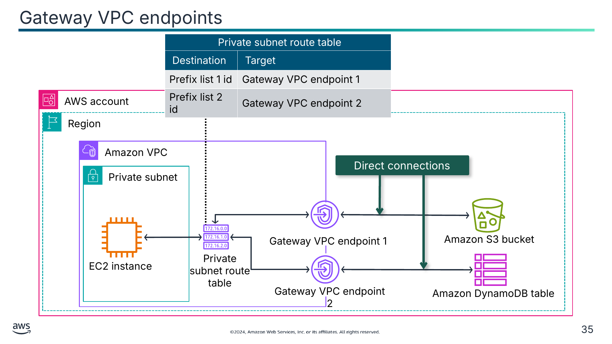

**Private subnet route table (Таблиця маршрутизації приватної підмережі)**

| Destination (Призначення) | Target (Ціль) |
|---|---|
| Prefix list 1 id | Gateway VPC endpoint 1 |
| Prefix list 2 id | Gateway VPC endpoint 2 |

Direct connections (Прямі з’єднання)

<details>
<summary>Текст зі схеми</summary>

AWS account (Акаунт AWS)

Region (Регіон)

Amazon VPC

Private subnet (Приватна підмережа)

Gateway VPC endpoint 1 (Кінцева точка Gateway VPC 1)

Amazon S3 bucket (Бакет Amazon S3)

Private subnet route table (Таблиця маршрутизації приватної підмережі)

EC2 instance (Екземпляр EC2)

Gateway VPC endpoint 2

Amazon DynamoDB table (Таблиця Amazon DynamoDB)

</details>

> **Нотатки:**
>
> |Номер слайда 35  
> |Нотатки для інструктора  
> |  
> |Нотатки для студента  
> Опис зображення: архітектурна схема AWS VPC із двома кінцевими точками Gateway VPC. Екземпляр EC2 у приватній підмережі може підключатися до Amazon DynamoDB та Amazon S3, кожного за допомогою окремої кінцевої точки Gateway VPC через таблицю маршрутизації приватної підмережі. Кінець опису зображення.  
>
> Ще один спосіб підключити екземпляр EC2 до бакета Amazon S3 — використати кінцеву точку Gateway VPC. Кінцева точка Gateway VPC підключається безпосередньо до Amazon S3 та Amazon DynamoDB за допомогою таблиць маршрутизації, не використовуючи AWS PrivateLink. Amazon S3 і DynamoDB — єдині сервіси, що підтримуються кінцевими точками Gateway VPC.  
>
> У прикладі на слайді екземпляр EC2 підключається до бакета Amazon S3 через кінцеву точку Gateway VPC 1. Маршрут, указаний у таблиці маршрутизації приватної підмережі, має призначення — ідентифікатор списку префіксів 1 — і ціль — кінцеву точку Gateway VPC 1. Список префіксів (prefix list) — це група блоків CIDR. Так само екземпляр EC2 може підключатися до таблиці DynamoDB через кінцеву точку Gateway VPC 2.  
>
> Amazon S3 підтримує і кінцеві точки Gateway, і кінцеві точки Interface. За використання кінцевих точок Gateway додаткова плата не стягується. Обмежень пропускної здатності за пакетами немає.

---

## Слайд 36: Міркування щодо кінцевих точок Amazon S3

| Чинник (Factor) | Кінцеві точки Interface VPC (Interface VPC endpoints) | Кінцеві точки Gateway VPC (Gateway VPC endpoints) |
|---|---|---|
| Точка доступу Amazon S3 | Приватні IP-адреси з підмережі VPC | Публічні IP-адреси Amazon S3 |
| Локальна мережа (On-premises) | Дозволяє доступ | Не дозволяє доступ |
| Інший регіон AWS | Дозволяє доступ | Не дозволяє доступ |
| Вартість | Тарифікується | Не тарифікується |
| Пропускна здатність | Пропускна здатність до 10 Гбіт/с на AZ, автоматично масштабується до 100 Гбіт/с. | Без обмежень |
| Розмір пакета | Максимальний підтримуваний розмір пакета — 8500 байтів. | Без обмежень |

> **Нотатки:**
>
> |Номер слайда 36  
> |Нотатки для інструктора  
> |  
> |Нотатки для студента  
> Щоб вирішити, обрати кінцеву точку Interface VPC чи кінцеву точку Gateway VPC для обміну даними з S3, візьміть до уваги такі пункти:  
>
> Чи можна отримувати доступ до об’єктів у бакеті Amazon S3 через публічну IP-адресу Amazon S3 чи безпечніше через приватну IP-адресу в підмережі VPC?  
> Чи має бакет Amazon S3 дозволяти локальний доступ?  
> Чи потрібен доступ з іншого регіону AWS?  
> Чи достатній бюджет для витрат на кінцеву точку Interface VPC?  
> Яка пропускна здатність потрібна?  
> Який максимальний розмір пакета мережевого трафіку потрібен?

---

## Слайд 37: Кінцева точка Gateway Load Balancer (Gateway Load Balancer endpoint)

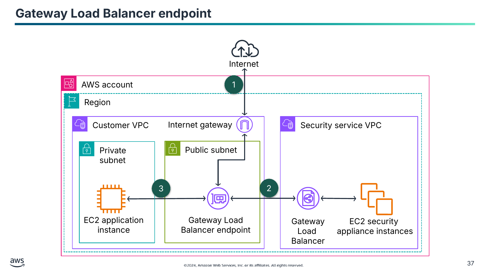

1

3

2

<details>
<summary>Текст зі схеми</summary>

Internet (Інтернет)

AWS account (Акаунт AWS)

Region (Регіон)

Customer VPC (VPC клієнта)

Internet gateway (Інтернет-шлюз)

Security service VPC (VPC сервісу безпеки)

Private subnet (Приватна підмережа)

Public subnet (Публічна підмережа)

EC2 application

instance (Екземпляр EC2 застосунку)

Gateway Load Balancer endpoint (Кінцева точка Gateway Load Balancer)

Gateway Load  
Balancer

EC2 security

appliance instances (Екземпляри EC2 пристроїв безпеки)

</details>

> **Нотатки:**
>
> |Номер слайда 37  
> |Нотатки для інструктора  
> |  
> |Нотатки для студента  
> Опис зображення: VPC 1 має приватну підмережу з екземпляром EC2 та публічну підмережу з приєднаною кінцевою точкою Gateway Load Balancer і інтернет-шлюзом. VPC 2 має Gateway Load Balancer та екземпляр EC2 пристрою безпеки. Кінець опису зображення.  
> Ще один спеціалізований тип кінцевої точки VPC — кінцева точка Gateway Load Balancer. У цьому прикладі кінцева точка Gateway Load Balancer — це кінцева точка VPC, що забезпечує приватне підключення між пристроями безпеки у VPC 2 та екземпляром застосунку у VPC 1. Gateway Load Balancer розгорнуто у VPC 2.  
>
> 1. Увесь трафік, що входить у VPC 1 через інтернет-шлюз, спершу маршрутизується до кінцевої точки Gateway Load Balancer у VPC 1.  
> 2. Потім трафік маршрутизується до Gateway Load Balancer у VPC 2. Gateway Load Balancer розподіляє трафік на пристрій безпеки EC2 для перевірки. Пристрій безпеки відповідає Gateway Load Balancer, що повертає перевірений трафік на кінцеву точку Gateway Load Balancer.  
> 3. Кінцева точка Gateway Load Balancer надсилає трафік на екземпляр EC2 застосунку.  
>
> Так само весь трафік, що виходить з екземпляра EC2 застосунку, проходить тим самим шляхом, що й вхідний трафік.

---

## Слайд 38: Ключові висновки: підключення до керованих сервісів AWS

- Ресурси VPC можуть отримувати доступ до керованих сервісів AWS за допомогою кінцевих точок VPC.
- Кінцева точка Interface VPC використовує AWS PrivateLink для доступу до керованих сервісів AWS. Вона спричиняє витрати та має обмеження пропускної здатності.
- Кінцева точка Gateway VPC інтегрується безпосередньо з Amazon S3 та Amazon DynamoDB. Вона не спричиняє витрат і не має обмежень пропускної здатності.
- Кінцеві точки Gateway Load Balancer використовуються з Gateway Load Balancer для перевірки трафіку пристроями безпеки.

> **Нотатки:**
>
> |Номер слайда 38  
> |Нотатки для інструктора  
> |  
> |Нотатки для студента

---

## Слайд 39: Моніторинг вашої мережі

Створення мережевого середовища

> **Нотатки:**
>
> |Номер слайда 39  
> |Нотатки для інструктора  
> |  
> |Нотатки для студента  
> Цей розділ розглядає, як моніторити вашу мережу в AWS.

---

## Слайд 40: Сценарії усунення несправностей мережі

- Час відповіді мого екземпляра EC2 дуже повільний.
- Я не можу отримати доступ до свого екземпляра EC2 через Secure Shell (SSH).
- Мій екземпляр бази даних EC2 не встановлює жодних виправлень.

> **Нотатки:**
>
> |Номер слайда 40  
> |Нотатки для інструктора  
> |  
> |Нотатки для студента  
> Коли ваша Amazon VPC налаштована й використовується з ресурсами, розгорнутими в підмережах, можуть виникати проблеми, що потребують додаткового розслідування. З цієї причини важливо моніторити вашу мережу та будувати автоматизовані процеси відновлення.  
>
> Один зі сценаріїв — з’ясувати, чому час відповіді екземпляра EC2 уповільнюється. Чи є непотрібний або небажаний трафік, що використовує ресурси екземпляра EC2? Наприклад, розподілені атаки «відмова в обслуговуванні» (DDoS) — це спам-боти, що генерують повідомлення для перевантаження мережі чи сервера до такої міри, що законний трафік користувачів не може досягти сервера чи бути успішно оброблений.  
>
> Коли трафік не досягає призначення, це може бути результатом груп безпеки з правилами, що не пропускають трафік. Це був би приклад проблеми конфігурації. Наприклад, якщо ви надсилаєте трафік SSH на порт 22 до екземпляра, а групу безпеки не налаштовано на дозвіл трафіку порту 22, це призведе до помилки підключення.  
>
> Якщо у вас є екземпляр бази даних EC2 у приватній підмережі й автоматичні виправлення не встановлюються, потрібно перевірити групу безпеки та конфігурації NAT-шлюзу таблиць маршрутизації.  
>
> Щоб отримати детальну інформацію про потік трафіку, можна використовувати журнали потоків Amazon VPC (flow logs) для усунення мережевих проблем.

---

## Слайд 41: Журнали потоків Amazon VPC (Amazon VPC flow logs)

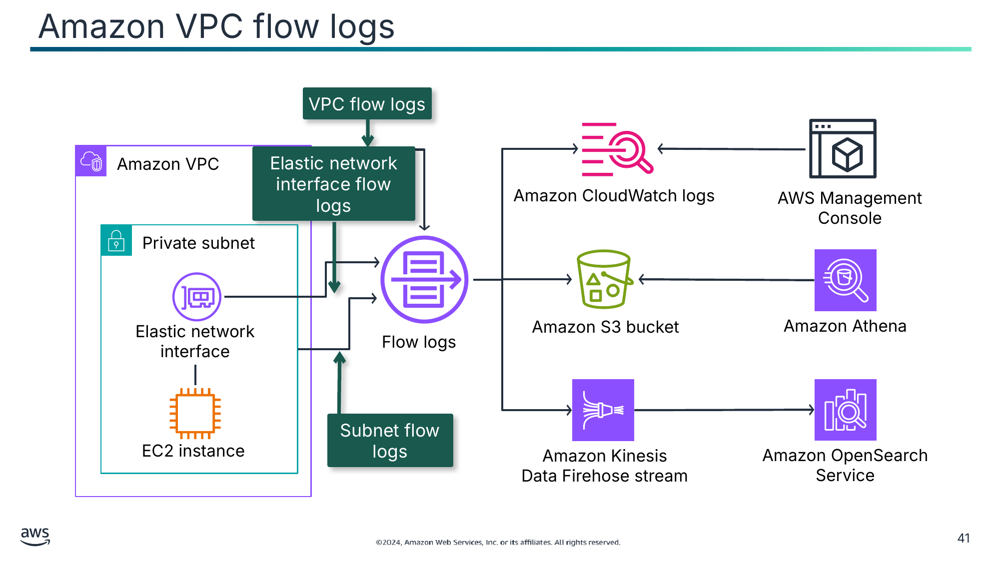

VPC flow logs (Журнали потоків VPC)

Elastic network interface flow logs (Журнали потоків еластичного мережевого інтерфейсу)

Subnet flow logs (Журнали потоків підмережі)

<details>
<summary>Текст зі схеми</summary>

Amazon VPC

Amazon CloudWatch logs (Журнали Amazon CloudWatch)

AWS Management Console

Private subnet (Приватна підмережа)

Elastic network interface (Еластичний мережевий інтерфейс)

Flow logs (Журнали потоків)

Amazon S3 bucket (Бакет Amazon S3)

Amazon Athena

EC2 instance (Екземпляр EC2)

Amazon Kinesis  
Data Firehose stream (Потік Amazon Kinesis Data Firehose)

Amazon OpenSearch Service

</details>

> **Нотатки:**
>
> |Номер слайда 41  
> |Нотатки для інструктора  
> |  
> |Нотатки для студента  
> Опис зображення: інформація про мережевий трафік збирається журналами потоків VPC (VPC Flow Logs) з Amazon VPC, приватної підмережі та еластичного мережевого інтерфейсу, приєднаного до екземпляра EC2. VPC Flow Logs доставляє мережевий трафік до журналів Amazon CloudWatch, бакетів Amazon S3 або потоків Amazon Kinesis Data Firehose. Для перегляду журналів користувачі можуть використовувати AWS Management Console для журналів Amazon CloudWatch та Amazon Athena для Amazon S3. Потоки Amazon Kinesis Data Firehose можуть доставляти журнали потоків до Amazon OpenSearch Service. Кінець опису зображення.  
>
> Коли ви хочете побачити детальну інформацію про трафік у вашій VPC, можна активувати VPC Flow Logs. Це функція Amazon VPC, яку можна використовувати для захоплення інформації на рівні пакетів про мережевий трафік у вашій VPC.  
>
> Створюючи журнал потоків, можна обрати захоплення всього трафіку, прийнятого трафіку або лише відхиленого трафіку. Ви також обираєте захоплення метаданих про всю VPC, певну підмережу чи еластичний мережевий інтерфейс.  
>
> Потім журнали потоків можна доставляти до призначення на ваш вибір. Якщо журнали потоків доставляються до Amazon CloudWatch, користувачі можуть використовувати AWS Management Console для фільтрації та перегляду журналів. Якщо журнали потоків доставляються до Amazon S3, користувачі можуть використовувати сервіси, як-от Amazon Athena, для інтерактивного виконання запитів до журналів. Журнали потоків в Amazon S3 можна публікувати як звичайний текст або Parquet.  
>
> Amazon Kinesis Data Firehose може доставляти журнали до сервісів AWS, як-от Amazon OpenSearch Service, що зробить журнали доступними через панель Amazon OpenSearch. Amazon Kinesis Data Firehose також може доставляти журнали до сторонніх рішень для журналів, як-от Splunk.  
>
> Журнали потоків працюють поза вашою мережею VPC і не впливатимуть на затримку та продуктивність вашої VPC.

---

## Слайд 42: Політика доступу IAM для журналів потоків

```json
{
  "Version": "2012-10-17",
  "Statement": [
    {
      "Effect": "Allow",
      "Action": [
        "ec2:CreateFlowLogs",
        "ec2:DescribeFlowLogs",
        "ec2:DeleteFlowLogs"
      ],
      "Resource": "*"
    }
  ]
}
```

Політика IAM надає користувачам дозволи на створення, опис і видалення журналів потоків.

> **Нотатки:**
>
> |Номер слайда 42  
> |Нотатки для інструктора  
> |  
> |Нотатки для студента  
> За замовчуванням користувачі не мають дозволу працювати з журналами потоків. Ви можете створити роль AWS Identity and Access Management (IAM) із прикріпленою політикою, що надає користувачам дозволи на створення, опис і видалення журналів потоків, як у наведеному вище прикладі. Прикріпіть роль до користувача IAM або групи користувачів, щоб дозволити доступ до журналів потоків.  
>
> У наведеному вище прикладі політика IAM має ефект, що дозволяє користувачу IAM виконувати такі дії: створювати, описувати й видаляти журнали потоків EC2 для будь-якого ресурсу AWS.

---

## Слайд 43: Приклад запису журналу потоків за замовчуванням (1 із 2)

| Назва поля (Field name) | Опис поля (Field description) | Приклад значення (Example value) |
|---|---|---|
| version | Версія VPC Flow Logs | 2 |
| account-id | Акаунт AWS власника мережі | 123456789010 |
| interface-id | Мережевий інтерфейс трафіку | eni-1235b8ca123456789 |
| srcaddr | Адреса джерела для вхідного трафіку або адреса мережевого інтерфейсу для вихідного трафіку | 172.31.16.139 |
| dstaddr | Адреса призначення для вихідного трафіку або адреса мережевого інтерфейсу для вхідного трафіку | 172.31.16.21 |
| srcport | Порт джерела трафіку | 20641 |
| dstport | Порт призначення трафіку | 22 |
| protocol | Номер протоколу IANA трафіку | 6 (TCP) |

> **Нотатки:**
>
> |Номер слайда 43  
> |Нотатки для інструктора  
> |  
> |Нотатки для студента  
> Опис зображення: кінець опису зображення.  
> Дані журналу потоків для відстежуваного мережевого інтерфейсу записуються як записи журналу потоків — події журналу, що складаються з полів, які описують потік трафіку. Запис журналу потоків складається з усіх потоків протягом інтервалу агрегації або вікна захоплення.  
>
> Журнали потоків мають номер версії залежно від полів, які ви обираєте для захоплення. Завжди включайте найвищий номер версії, використаний у всіх полях. Формат журналу потоків за замовчуванням, як у наведеному вище прикладі, використовує поля версії 2.  
>
> Також можна захоплювати інформацію про клієнта, як-от акаунт AWS та ідентифікатор мережевого інтерфейсу. Захоплені метадані трафіку включають такі дані, як IP-адреси джерела й призначення, порти джерела й призначення та номер протоколу Internet Assigned Numbers Authority (IANA).  
>
> У наведеному вище прикладі надано приклади значень для трафіку SSH із портом призначення 22 за протоколом TCP до мережевого інтерфейсу eni-1235b8ca123456789 в акаунті 123456789010. Це типовий приклад системного адміністратора, що надсилає запит до екземпляра EC2 у приватній підмережі з локального корпоративного мережевого середовища.

---

## Слайд 44: Приклад запису журналу потоків за замовчуванням (2 із 2)

| Назва поля (Field name) | Опис поля (Field description) | Приклад значення (Example value) |
|---|---|---|
| packets | Кількість переданих пакетів | 20 |
| bytes | Кількість переданих байтів | 4249 |
| start | Unix-час у секундах першого отриманого пакета | 1418530010 |
| end | Unix-час у секундах останнього отриманого пакета | 1418530070 |
| action | Індикатор прийняття чи відхилення успіху або невдачі маршрутизації трафіку | ACCEPT |
| log-status | Стан журналу потоків: OK, NODATA, SKIPDATA | OK |

> **Нотатки:**
>
> |Номер слайда 44  
> |Нотатки для інструктора  
> |  
> |Нотатки для студента  
> Додаткова інформація, доступна в журналах потоків за замовчуванням, — кількість переданих пакетів і байтів та час першого й останнього отриманого пакета.  
>
> Поле action вказує, чи було трафік прийнято чи відхилено. Приклад сценарію відхиленого трафіку може бути через правила групи безпеки чи мережевого ACL, що перешкоджають доставці трафіку. Ще одна причина відхилення трафіку — пакети, що надійшли після закриття з’єднання.  
>
> Щоб відстежувати, чи журналюються журнали потоків, можна використовувати поле log-status. Якщо воно має значення «OK», журналювання даних функціонує нормально до обраних призначень.  Якщо поле log-status має значення «NODATA», це означає, що протягом інтервалу агрегації не було мережевого трафіку до мережевого інтерфейсу чи від нього. Якщо поле log-status має значення «SKIPDATA», це означає, що деякі записи журналу потоків було пропущено протягом інтервалу агрегації через обмеження потужності чи помилку.

---

## Слайд 45: Додаткові інструменти усунення несправностей VPC

Reachability Analyzer

- Перевіряйте підключення між вихідним і цільовим ресурсами у VPC.

Network Access Analyzer

- Визначайте ненавмисний мережевий доступ до ваших ресурсів в AWS.

Traffic Mirroring

- Створюйте копію мережевого трафіку для надсилання на пристрої безпеки та моніторингу.

> **Нотатки:**
>
> |Номер слайда 45  
> |Нотатки для інструктора  
> |  
> |Нотатки для студента  
> Для розв’язання певних типів мережевих проблем Amazon VPC надає додаткові інструменти, що допомагають їх усунути.  
>
> Щоб перевірити, чи мають два ресурси у VPC підключення, можна використати функцію Reachability Analyzer. Коли призначення досяжне, Reachability Analyzer створює докладні відомості про віртуальний мережевий шлях між джерелом і призначенням крок за кроком (hop-by-hop). Коли призначення недосяжне, Reachability Analyzer визначає компонент, що блокує. Наприклад, шляхи можуть блокуватися проблемами конфігурації в групі безпеки, списку контролю доступу до мережі (мережевий ACL), таблиці маршрутизації чи балансувальнику навантаження. Щоб використовувати Reachability Analyzer, ви вказуєте шлях для трафіку від джерела до призначення. Наприклад, ви можете вказати інтернет-шлюз як джерело, екземпляр EC2 як призначення, 22 як порт призначення та TCP як протокол. Це дає змогу перевірити, що ви можете підключитися до екземпляра EC2 через інтернет-шлюз за допомогою SSH.  
>
> Щоб визначити ненавмисний мережевий доступ до ресурсів у вашому акаунті AWS, можна використати функцію Network Access Analyzer. Ви можете використовувати Network Access Analyzer, щоб розуміти, перевіряти та покращувати свій стан мережевої безпеки (security posture), усуваючи ненавмисний мережевий доступ. Це також корисно для демонстрації того, що ваша мережа в AWS відповідає вашим вимогам відповідності. Наприклад, ви можете перевірити, що для систем, які обробляють інформацію про кредитні картки, використовується окрема логічна мережа й що вона ізольована від решти вашого середовища AWS.  
>
> Щоб перевіряти та відстежувати трафік, можна використовувати функцію Amazon VPC Traffic Mirroring. Вона дає змогу створити копію вашого мережевого трафіку для надсилання на ваші пристрої безпеки та моніторингу. Це забезпечує глибше розуміння мережевого трафіку, дозволяючи аналізувати фактичний вміст трафіку, зокрема фактичне корисне навантаження повідомлень. Це корисно для сценаріїв використання, коли потрібно аналізувати фактичні пакети, щоб визначити першопричину проблеми з продуктивністю, виконати зворотну інженерію складної мережевої атаки або виявити й зупинити внутрішні зловживання чи скомпрометовані робочі навантаження. Наприклад, ви можете захотіти дзеркалювати вхідний трафік TCP і UDP на окремі пристрої безпеки для перевірки пакетів.

---

## Слайд 46: Ключові висновки: моніторинг вашої мережі

- Використовуйте VPC Flow Logs, щоб захоплювати інформацію про мережевий трафік у вашій VPC.
- Записи журналу потоків складаються з усіх потоків протягом інтервалу агрегації.
- Використовуйте Reachability Analyzer, щоб перевірити, чи мають два ресурси у VPC підключення.
- Використовуйте Network Access Analyzer, щоб визначити ненавмисний мережевий доступ до ресурсів у вашому акаунті AWS.
- Використовуйте Traffic Mirroring, щоб створити копію вашого мережевого трафіку для надсилання на пристрої безпеки та моніторингу.

> **Нотатки:**
>
> |Номер слайда 46  
> |Нотатки для інструктора  
> |  
> |Нотатки для студента

---

## Слайд 47: Застосування принципів Well-Architected Framework до мережі

Створення мережевого середовища

> **Нотатки:**
>
> |Номер слайда 47  
> |Нотатки для інструктора  
> |  
> |Нотатки для студента  
> Цей розділ розглядає, як застосовувати принципи AWS Well-Architected Framework до вашої мережі VPC.

---

## Слайд 48: Опори AWS Well-Architected Framework для мережі


> **Нотатки:**
>
> |Номер слайда 48  
> |Нотатки для інструктора  
> |Хоча AWS Well-Architected Framework має шість опор, цей розділ зосереджений на чотирьох опорах, що стосуються найкращих практик, пов’язаних з мережею, які розглядаються в цьому модулі. Розглянуті найкращі практики не є вичерпним переліком.  
> |  
> |Нотатки для студента  
> Проєктуючи мережу VPC, слід враховувати всі майбутні заплановані робочі навантаження у VPC. Як забезпечити, щоб робоче навантаження було стійким, безпечним, продуктивним і економічно ефективним, коли його розгорнуто у VPC? Проєкт вашої мережі підтримує робочі навантаження, відповідаючи тим самим стандартам. Ваша мережа VPC також має бути стійкою, безпечною, продуктивною та економічно ефективною.  
>
> AWS Well-Architected Framework надає найкращі практики для проєктування, експлуатації та обслуговування робочих навантажень. Він допомагає зрозуміти плюси й мінуси рішень, які ви ухвалюєте під час побудови робочих навантажень в AWS. Це набір основоположних запитань, що допомагають зрозуміти, чи конкретна архітектура добре узгоджується з найкращими практиками хмари.  
>
> Наступні кілька слайдів виділяють деякі найкращі практики проєктування та підтримки вашої мережі за допомогою опор «Надійність» (Reliability), «Безпека» (Security), «Ефективність продуктивності» (Performance Efficiency) та «Оптимізація витрат» (Cost Optimization). Деякі з них можуть здаватися знайомими, оскільки вони розглядалися раніше в модулі.

---

## Слайд 49: Основи: плануйте топологію вашої мережі


**Найкраща практика**

Переконайтеся, що розподіл IP-підмереж враховує розширення та доступність.

> **Нотатки:**
>
> |Нотатки для інструктора  
> |  
> |Нотатки для студента  
> Стійкість (resiliency) є частиною опори надійності AWS Well-Architected Framework. Про опору надійності слід думати так: вона використовується для вимірювання здатності робочого навантаження правильно та стабільно виконувати свою призначену функцію, коли від нього цього очікують. Це означає, що ваша мережа, що підтримує робоче навантаження, також має функціонувати правильно та стабільно, коли від неї цього очікують. Ваша мережа має передбачати можливі мережеві збої й вміщувати майбутнє зростання трафіку. В AWS усі робочі навантаження працюють у мережі AWS, а деякі робочі навантаження працюють у вашій VPC. Тож стійкість — це спільна відповідальність між AWS і вами. AWS відповідає за стійкість хмарної інфраструктури, тоді як ви відповідаєте за впровадження стійкості в хмарі.  
>
> Переконайтеся, що розподіл IP-підмереж враховує розширення та доступність. Виділяючи блок CIDR адреси VPC, AWS рекомендує дотримуватися таких найкращих практик:  
> Усередині VPC залишайте простір блоку CIDR для кількох підмереж, що охоплюють кілька зон доступності (AZ).  
> Завжди виділяйте невикористаний простір блоку CIDR у межах VPC для майбутнього розширення.  
> Беріть до уваги, що кожен блок CIDR підмережі має п’ять зарезервованих IP-адрес для використання AWS.  
> Пам’ятайте про сервіси, що виділяють додаткові IP-адреси, як-от контейнерні сервіси.  
> Розгортайте великі блоки CIDR VPC, оскільки блок CIDR не можна змінити чи видалити після створення. До VPC можна додавати додаткові блоки CIDR без перетину.  
> Ретельно плануйте діапазони блоків CIDR підмереж, оскільки CIDR IPv4 підмереж змінити не можна.

---

## Слайд 50: Захист інфраструктури: захист мереж


**Найкращі практики**

Створюйте мережеві рівні.

Впроваджуйте перевірку та захист.

Контролюйте трафік на всіх рівнях.

> **Нотатки:**
>
> |Номер слайда 50  
> |Нотатки для інструктора  
> |  
> |Нотатки для студента  
> Користувачі, що використовують робочі навантаження у вашій мережі, можуть перебувати де завгодно. У традиційних моделях безпеки, як правило, надто багато дозволів на доступ до мережі. AWS рекомендує застосовувати підхід нульової довіри (Zero Trust), щоб застосувати принцип безпеки на всіх рівнях. Безпека нульової довіри — це модель, де компоненти застосунку вважаються окремими один від одного, і жоден компонент не довіряє жодному іншому компоненту. Ретельне планування та керування проєктом вашої мережі формує основу того, як ви забезпечуєте ізоляцію та межі для ресурсів у вашому робочому навантаженні. Оскільки багато ресурсів у вашому робочому навантаженні працюють у VPC і успадковують властивості безпеки, критично важливо, щоб проєкт підтримувався механізмами перевірки та захисту.  
>
> Створюйте мережеві рівні: AWS рекомендує логічно групувати компоненти робочого навантаження, що мають однакову вимогу до чутливості, разом в один рівень. Наприклад, база даних у VPC, якій не потрібен доступ до інтернету, має розміщуватися в підмережах без маршруту до інтернету чи з нього. Трафік має надходити лише від суміжного наступного, менш чутливого ресурсу.  
>
> Контролюйте трафік на всіх рівнях: AWS рекомендує застосовувати кілька засобів контролю безпеки за підходом глибокоешелонованого захисту (defense in depth) для вхідного та вихідного трафіку. Визначайте дозволені шляхи трафіку у VPC за допомогою груп безпеки, мережевих ACL, підмереж, таблиць маршрутизації, інтернет-шлюзів і NAT-шлюзів.  
>
> Впроваджуйте перевірку та захист: AWS рекомендує перевіряти та фільтрувати ваш трафік на кожному рівні. Наприклад, ви можете перевіряти конфігурації вашої VPC на потенційний ненавмисний доступ за допомогою VPC Network Access Analyzer.

---

## Слайд 51: Вибір: вибір мережевої архітектури


**Найкращі практики**

Розумійте, як мережі впливають на продуктивність.

Оцінюйте наявні мережеві функції.

Обирайте мережеві протоколи для покращення продуктивності.

> **Нотатки:**
>
> |Номер слайда 51  
> |Нотатки для інструктора  
> |  
> |Нотатки для студента  
> Опора ефективності продуктивності розглядає найкращі практики керування продуктивними середовищами. Ви хочете уникати сценаріїв, коли робоче навантаження в мережі використовує надто багато мережевої пропускної здатності. Кожне робоче навантаження, що ви розгортаєте у VPC, має різні вимоги до затримки, пропускної здатності, обсягу дозволеного джитера (jitter) і смуги пропускання. Джитер виникає, коли є часова затримка, спричинена мережевим затором чи змінами маршрутів.  
>
> Наступні найкращі практики опори ефективності продуктивності можуть допомогти оптимізувати проєкт вашої мережі:  
>
> Розумійте, як мережі впливають на продуктивність: аналізуйте та розумійте, як мережеві рішення впливають на продуктивність робочого навантаження. Наприклад, впровадження синхронної реплікації баз даних між регіонами AWS неможливе через затримку в десятки мілісекунд чи більше між регіонами. Оскільки затримка між AZ вимірюється в одиницях мілісекунд, ви можете впровадити синхронну реплікацію баз даних між AZ.  
>
> Оцінюйте наявні мережеві функції: проводьте еталонне тестування (benchmark) метрик продуктивності вашого робочого навантаження, зокрема мережевих метрик. Слід постійно оцінювати робоче навантаження на предмет галузей для покращення, як-от усунення вузьких місць продуктивності. Ви можете використовувати Network Access Analyzer, щоб допомогти визначити мережеві шляхи та маршрути.  
>
> Обирайте мережеві протоколи для покращення продуктивності: обирайте мережеві протоколи, що оптимізують продуктивність вашого робочого навантаження. Наприклад, не використовуйте TCP для всіх робочих навантажень незалежно від вимог до продуктивності. Як альтернативу, використовуйте разом і TCP, і UDP для робочих навантажень інфраструктури віртуальних робочих столів. Це може скористатися надійністю TCP для критичних даних і швидкістю UDP для даних у реальному часі.

---

## Слайд 52: Оберіть найкращу модель ціноутворення


**Найкраща практика**

Обирайте регіони на основі вартості.

> **Нотатки:**
>
> |Номер слайда 52  
> |Нотатки для інструктора  
> |  
> |Нотатки для студента  
> Робоче навантаження в мережі має повністю використовувати всі ресурси, досягати результатів за найнижчою можливою ціною та відповідати функціональним вимогам. Мережеві витрати слід включати до еталонного показника вартості робочого навантаження. Ключ до економії витрат — обрати найкращу модель ціноутворення з відповідними мережевими конфігураціями для ваших робочих навантажень.  
>
> Впроваджуйте регіони на основі вартості: AWS рекомендує використовувати регіон AWS, що забезпечує найкраще загальне глобальне рішення за вартістю. Кожен регіон AWS працює в межах місцевих ринкових умов. Ціни на ресурси відрізняються в кожному регіоні через відмінності, як-от вартість землі, оптоволокна, електроенергії та податків. Оберіть конкретний регіон для експлуатації компонента вашого цілого рішення, щоб працювати за найнижчою можливою ціною глобально. Проєктуючи свої рішення, найкраща практика — прагнути розміщувати обчислювальні ресурси ближче до користувачів, щоб забезпечити нижчу затримку та сильний суверенітет даних. Обирайте географічне розташування на основі ваших вимог бізнесу, конфіденційності даних, продуктивності та безпеки. Для застосунків із глобальними кінцевими користувачами використовуйте кілька розташувань.

---

## Слайд 53: Сценарій проблеми з проєктом мережі

Визначте помилки проєктування мережі, допущені в такому сценарії:

- Компанія A продає спортивне взуття та розташована в Європі. Клієнтська база компанії — у Сполучених Штатах.
- Компанія розгорнула свої вебсервери та сервери баз даних у регіоні AWS Ireland в одній VPC з однією публічною підмережею.
- VPC має маску мережі /27 із 32 IP-адресами. Підмережа має маску мережі /28 із 16 доступними IP-адресами.
- Група безпеки, прикріплена до вебсерверів і серверів баз даних, дозволяє інтернет-трафік до серверів. Компанія A прогнозує стрімке зростання найближчим часом.

> **Нотатки:**
>
> |Номер слайда 53  
> |Нотатки для інструктора  
> |Мета цього слайда — виявити проблеми проєкту або антишаблони (anti-patterns), щоб підкреслити використання найкращих практик. Розв’язання подано на наступному слайді.  
> |Нотатки для студента  
> Мета — щоб ви визначили проблеми проєкту чи антишаблони й запропонували кращу альтернативу (шаблон). Антишаблони — це погані проєкти, що привносять у рішення внутрішні проблеми. Вони протилежні шаблонам найкращих практик і їх слід уникати. AWS Well-Architected Framework описує антишаблони, щоб протиставити найкращим практикам.

---

## Слайд 54: Поширені антишаблони та шаблони

Мала VPC з малими підмережами

Дозвільні групи безпеки

Прямий доступ до баз даних

Регіон AWS далеко від клієнтів

Anti-pattern 1 (Антишаблон 1)

Anti-pattern 2

Anti-pattern 3

Anti-pattern 4

Великі VPC з великими публічними та приватними підмережами

Суворі групи безпеки, розшаровані за використанням сервера

Без прямого доступу до баз даних

Регіон AWS поблизу клієнтів

Pattern 4 (Шаблон 4)

Pattern 1

Pattern 2

Pattern 3

> **Нотатки:**
>
> |Номер слайда 54  
> |Нотатки для інструктора  
> |  
> |Нотатки для студента  
> У сценарії виявлено чотири основні мережеві проблеми. Вони відповідають антишаблонам, показаним на цьому слайді.  
> Компанії A не слід використовувати єдину малу VPC з обмеженою кількістю IP-адрес, а краще великі VPC з достатньою кількістю IP-адрес для майбутнього зростання.  
> Вебсервери мають мати власну групу безпеки з дозволеним доступом до інтернету в публічній підмережі. Сервери баз даних мають мати власну групу безпеки, що дозволяє доступ від групи безпеки вебсервера та підтримку баз даних.  
> Сервери баз даних слід розміщувати в приватній підмережі. Прямий доступ з інтернету до серверів баз даних не повинен дозволятися. Доступ для обслуговування можна налаштувати в групі безпеки бази даних і дозволити встановлення виправлень на сервери з доступом до NAT-шлюзу.  
> Замість використання регіону AWS у Європі слід використовувати регіон AWS у США, ближчий до клієнтської бази, для нижчої затримки та сильного суверенітету даних.

---

## Слайд 55: Ключові висновки: застосування принципів Well-Architected Framework до вашої мережі

- Переконайтеся, що розподіл IP-підмереж враховує розширення та доступність.
- Створюйте мережеві рівні та контролюйте трафік на всіх рівнях.
- Розумійте, як мережі впливають на продуктивність.
- Обирайте мережеві протоколи для покращення продуктивності.
- Впроваджуйте регіони на основі вартості, забезпечуючи низьку затримку та сильний суверенітет даних.

> **Нотатки:**
>
> |Номер слайда 55  
> |Нотатки для інструктора  
> |Це не вичерпний перелік найкращих практик, охоплених найкращими практиками AWS Well-Architected. Це ключові висновки для пояснення найкращих практик, розглянутих у модулі.  
> |Нотатки для студента

---

## Слайд 56: Покрокова лабораторна робота: створення віртуальної приватної хмари (Creating a Virtual Private Cloud, VPC lab)

> **Нотатки:**
>
> |Номер слайда 56  
> |Нотатки для інструктора  
> |  
> |Нотатки для студента  
> Зараз ви виконаєте покрокову лабораторну роботу. Наступний слайд підсумовує, що ви робитимете в лабораторній роботі, а докладні інструкції ви знайдете в лабораторному середовищі.

---

## Слайд 57: Завдання лабораторної роботи «VPC» (VPC lab)

- Створити мережеве середовище хмари AWS за допомогою сервісу Amazon VPC.
- Створити Amazon VPC із публічною та приватною підмережами. Розмістити екземпляр EC2 сервера застосунку в публічній підмережі.
- Налаштувати інтернет-шлюз, таблицю маршрутизації та групу безпеки, щоб дозволити інтернет-трафік до сервера застосунку.
- Відкрийте ваше лабораторне середовище, щоб розпочати лабораторну роботу та дізнатися додаткові подробиці про завдання, які ви виконуватимете.


> **Нотатки:**
>
> |Номер слайда 57  
> |Нотатки для інструктора  
> |  
> |Нотатки для студента  
> Отримайте доступ до лабораторного середовища через ваш онлайн-курс, щоб дізнатися додаткові подробиці та виконати лабораторну роботу.

---

## Слайд 58: Підсумки лабораторної роботи «VPC»

- Які рівні ізоляції ви забезпечили у вашій VPC?
- Які конфігурації ви застосували до функцій AWS VPC, щоб визначити потік трафіку з інтернету до сервера застосунку?

> **Нотатки:**
>
> |Номер слайда 58  
> |Нотатки для інструктора  
> |Відповідні архітектурні схеми «до» та «після» включено до інструкцій кожної лабораторної роботи. Вам може бути корисно відкрити схеми лабораторної роботи під час підбиття підсумків цієї лабораторної роботи.  
>
> |Запропоновані відповіді на запитання 1: які рівні ізоляції ви забезпечили у вашій VPC?  
> |  
> |VPC, яку ви створили, мала і публічну, і приватну підмережі. Публічна підмережа використовуватиметься для ресурсів, що виходять в інтернет. Вона має доступ до інтернету через інтернет-шлюз. Вона з’єднана з інтернет-шлюзом через таблиці маршрутизації.  
> |  
> |Приватна підмережа використовуватиметься для ресурсів, що мають бути ізольовані від інтернету. Вона не має доступу до інтернет-шлюзу.  
> |  
> |Запропоновані відповіді на запитання 2: які конфігурації ви застосували до функцій VPC, щоб визначити потік трафіку з інтернету до сервера застосунку?  
> |  
> |У цій лабораторній роботі ви створили групу безпеки, що дає користувачам змогу отримувати доступ до вашого сервера застосунку через HTTP. Ви зробили це, змінивши вхідні правила групи безпеки, щоб дозволити трафік HTTP на порту 80.  
> |  
> |Групи безпеки діють як віртуальний брандмауер для екземплярів, що контролює вхідний і вихідний трафік. Групи безпеки діють на рівні екземпляра, а не на рівні підмережі. Тому кожен екземпляр може мати власний брандмауер, що контролює трафік. Якщо ви не вкажете певну групу безпеки під час запуску, екземпляр автоматично призначається до групи безпеки VPC за замовчуванням  
> |  
> |Нотатки для студента  
> Ваш інструктор може розглянути ці запитання з вами, або ви можете розглянути їх самостійно. Скористайтеся цією нагодою, щоб поглибити своє мислення щодо завдань, які ви виконували під час лабораторної роботи.

---

## Слайд 59: Лабораторна робота кафе: створення мережевого середовища VPC для кафе (Café VPC lab)

> **Нотатки:**
>
> |Номер слайда 59  
> |Нотатки для інструктора  
> |  
> |Нотатки для студента  
> Зараз ви виконаєте лабораторну роботу-виклик. Наступний слайд підсумовує, що ви робитимете в лабораторній роботі, а докладні інструкції ви знайдете в лабораторному середовищі.

---

## Слайд 60: Еволюція архітектури кафе (версія 4)

| Версія архітектури (Architecture Version) | Бізнес-причина оновлення (Business reason for update) | Опис архітектури чи оновлень (Description of architecture or updates) |
|---|---|---|
| V1 | Статичний вебсайт для малого бізнесу | Вебсайт розміщено на Amazon S3. |
| V2 | Додати онлайн-замовлення | Вебзастосунок і базу даних розгорнуто на EC2. |
| V3 | Зменшити зусилля на обслуговування бази даних і захист її даних | Розділено рівні вебу та бази даних. Базу даних перенесено в Amazon RDS у приватній підмережі. |
| V4 | Підвищити безпеку вебзастосунку | Використати функції Amazon VPC для налаштування та захисту публічних і приватних підмереж. |
| V5 | Створити окремі механізми доступу на основі ролі | Додати групи IAM і прикріпити політики ресурсів до ресурсів застосунку. Додати користувачів IAM до груп на основі ролі. |
| V6 | Забезпечити, щоб вебсайт міг витримати очікуване зростання трафіку | Додати балансувальник навантаження, впровадити автоматичне масштабування екземплярів EC2 і розподілити екземпляри обчислень і баз даних між двома зонами доступності. |

> **Нотатки:**
>
> |Нотатки для інструктора  
> |Поділіться файлом architectures.svg або покажіть його й виділіть розділи архітектури, які буде змінено чи додано в цій лабораторній роботі.  
> |  
> |Нотатки для студента  
> Бізнес кафе стабільно зростає. Софія та Нікіл потоваришували з кількома постійними відвідувачами кафе, які є консультантами AWS, і почали обговорювати поточну архітектуру кафе. Олівія (Olivia), одна з постійних відвідувачок і архітекторка рішень AWS, визначила потребу в масштабуванні онлайн-бізнесу кафе. Масштабування потребуватиме додаткових серверів для запуску застосунку онлайн-замовлень, але поточний розмір підмережі надто малий і не може підтримати це зростання. Тому їм потрібно буде переробити деякі аспекти мережі, в якій працює застосунок.  
>
> Під час подальшого перегляду архітектури кафе Олівія також помітила вразливість: порт TCP, що використовується для адміністрування сервера застосунку, доступний з інтернету. Софія пояснила, що вона й Нікіл мають мати змогу керувати сервером і підтримувати його. Олівія радить налаштувати бастіонний хост, щоб зменшити публічний доступ до сервера й зробити його безпечнішим.  
>
> У цій лабораторній роботі ви оновите архітектуру кафе, щоб підвищити безпеку вебзастосунку за допомогою функцій Amazon VPC для налаштування приватних і публічних підмереж.

---

## Слайд 61: Завдання лабораторної роботи «VPC кафе» (Café VPC lab)

У цій лабораторній роботі ви виконаєте таке:

- Зробите сервер застосунку безпечнішим.
- Перемістите екземпляр застосунку в приватну підмережу. Налаштуєте бастіонний екземпляр у публічній підмережі, щоб дозволити тестовому екземпляру доступ до сервера застосунку. Налаштуєте групу безпеки для кожного екземпляра.
- Дозволите серверу застосунку завантажувати виправлення з інтернету, налаштувавши NAT-шлюз у публічній підмережі.
- Підвищите безпеку, додавши правила мережевого ACL.

Відкрийте ваше лабораторне середовище, щоб розпочати лабораторну роботу та дізнатися додаткові подробиці про завдання, які ви виконуватимете.


> **Нотатки:**
>
> |Номер слайда 61  
> |Нотатки для інструктора  
> |  
> |Нотатки для студента  
> Отримайте доступ до лабораторного середовища через ваш онлайн-курс, щоб дізнатися додаткові подробиці та виконати лабораторну роботу.

---

## Слайд 62: Підсумки лабораторної роботи «VPC кафе»

- Що ви налаштували, щоб до екземпляра застосунку можна було отримати доступ через бастіонний екземпляр?
- Які конфігурації ви застосували, щоб визначити потік трафіку з інтернету до сервера застосунку?

> **Нотатки:**
>
> |Номер слайда 62  
> |Нотатки для інструктора  
> | Архітектурну схему для цієї лабораторної роботи включено до файлу CafeLabDiagrams.svg, що входить до каталогу файлів викладача. Поділіться цим файлом зі студентами, щоб вони могли наближати й віддаляти кожну фазу архітектури для повнішої картини під час підбиття підсумків лабораторної роботи.  
> |Запропоновані відповіді на запитання 1: що ви налаштували, щоб до екземпляра застосунку можна було отримати доступ через бастіонний екземпляр?  
> |  
> |Щоб зробити бастіонний хост доступним для вашого екземпляра застосунку, ви виділили еластичну IP-адресу й призначили її бастіонному хосту.  
> |  
> |Коли ви створили бастіонний хост, за замовчуванням до нього не можна дістатися з інтернету. Це тому, що він не має публічної адреси IPv4 чи еластичної IP-адреси, пов’язаної з його приватною адресою IPv4. Однак ви можете виділити еластичну IP-адресу й зробити його досяжним з інтернету через IPv4, пов’язавши її з вашим бастіонним хостом.  
> |  
> |Якщо екземпляр завершують і замість нього запускають новий екземпляр, наявну еластичну IP-адресу повторно пов’язують з новим екземпляром. За такої поведінки завжди використовується та сама довірена еластична IP-адреса.  
> |  
> |Запропоновані відповіді на запитання 2: які конфігурації ви застосували, щоб визначити потік трафіку з інтернету до сервера застосунку?  
> |  
> |У цій лабораторній роботі ви створили й налаштували мережу VPC для контролю мережевого потоку. Ви зробили це, безпечно підключивши бастіонний хост у публічній підмережі до сервера застосунку в приватній підмережі. Ви також створили NAT-шлюз, щоб ваш сервер застосунку в приватній підмережі міг отримувати доступ до інтернету для оновлень виправлень.  
> |Щоб безпечно підключитися з бастіонного хоста в публічній підмережі до сервера застосунку в приватній підмережі, ви зробили таке:  
>
> |Створили бастіонний хост у публічній підмережі  
> |Налаштували групу безпеки бастіонного хоста з вхідними правилами, що дозволяють трафік SSH (порт 22) з вашої IP-адреси  
> |Приєднали еластичну IP-адресу до бастіонного хоста  
> |Прикріпили групу безпеки до бастіонного хоста, що прийматиме трафік SSH від групи безпеки бастіонного хоста  
> |  
> |Щоб ваш сервер застосунку в приватній підмережі міг отримувати доступ до інтернету для оновлень виправлень, ви зробили таке:  
> |  
> |Створили NAT-шлюз у вашій публічній підмережі  
> |Створили нову таблицю маршрутизації, прикріплену до приватної підмережі, з призначенням 0.0.0.0/0 і ціллю, пов’язаною з вашим NAT-шлюзом  
> |  
> |Нотатки для студента  
> Ваш інструктор може розглянути ці запитання з вами, або ви можете розглянути їх самостійно. Скористайтеся цією нагодою, щоб поглибити своє мислення щодо завдань, які ви виконували під час лабораторної роботи.

---

## Слайд 63: Міркування щодо кафе

- Обговоріть, як занепокоєння хмарного архітектора, подані у вступі до модуля, відображені у VPC, яку ви створили в лабораторній роботі кафе.


---

## Слайд 64: Підсумки модуля

Створення мережевого середовища

> **Нотатки:**
>
> |Номер слайда 64  
> |Нотатки для інструктора  
> |  
> |Нотатки для студента  
> Цей розділ підсумовує те, що ви дізналися, і завершує модуль.

---

## Слайд 65: Резюме модуля

Цей модуль підготував вас до такого:

- Пояснювати роль віртуальної приватної хмари (VPC) в мережах хмари Amazon Web Services (AWS).
- Визначати компоненти у VPC, що можуть підключати мережеве середовище AWS до інтернету.
- Ізолювати та захищати ресурси у вашому мережевому середовищі AWS.
- Створювати та відстежувати VPC із підмережами, інтернет-шлюзом, таблицями маршрутизації та групою безпеки.
- Використовувати принципи AWS Well-Architected Framework під час створення та планування мережевого середовища.

> **Нотатки:**
>
> |Номер слайда 65  
> |Нотатки для інструктора  
> |  
> |Нотатки для студента

---

## Слайд 66: Перевірка знань модуля

- Перевірка знань проводиться онлайн у вашому курсі.
- Перевірка знань включає 10 запитань на основі матеріалу, поданого на слайдах і в нотатках до слайдів.
- Ви можете повторно проходити перевірку знань стільки разів, скільки захочете.

> **Нотатки:**
>
> |Номер слайда 66  
> |Нотатки для інструктора  
> |  
> |Нотатки для студента  
> Скористайтеся своїм онлайн-курсом, щоб отримати доступ до перевірки знань для цього модуля.

---

## Слайд 67: Зразок запитання іспиту

Компанія запускає публічний триярусний вебзастосунок у віртуальній приватній хмарі (VPC) у кількох зонах доступності (AZ). Екземпляри Amazon Elastic Compute Cloud (Amazon EC2) для рівня застосунку, що працюють у приватних підмережах, мають завантажувати виправлення програмного забезпечення з інтернету. Однак екземпляри EC2 не можуть бути безпосередньо доступними з інтернету.

Які дії слід виконати, щоб екземпляри EC2 могли завантажити потрібні виправлення? (Оберіть ДВА варіанти.)

Визначте ключові слова та фрази, перш ніж продовжувати.

Ось ключові слова та фрази:

- Публічний вебзастосунок
- Потрібно завантажувати виправлення програмного забезпечення з інтернету
- Не може бути безпосередньо доступним з інтернету

> **Нотатки:**
>
> |Номер слайда 67  
> |Нотатки для інструктора  
> |Розділ із ключовими словами налаштовано з анімацією для розкриття за клацанням.  
> |  
> |Нотатки для студента  
> Ключові елементи запитання включають те, що вебзастосунок публічний, виправлення потрібно завантажувати з інтернету, а екземпляри EC2, де працює застосунок, не можуть бути безпосередньо доступними.

---

## Слайд 68: Зразок запитання іспиту: варіанти відповідей

Компанія запускає **публічний** триярусний вебзастосунок у віртуальній приватній хмарі (VPC) у кількох зонах доступності (AZ). Екземпляри Amazon Elastic Compute Cloud (Amazon EC2) для рівня застосунку, що працюють у приватних **підмережах, мають завантажувати виправлення програмного забезпечення з інтернету**. Однак екземпляри EC2 **не можуть бути безпосередньо доступними з інтернету**.

Які дії слід виконати, щоб екземпляри EC2 могли завантажити потрібні виправлення? (Оберіть ДВА варіанти.)

**Варіант**

**Відповідь**

**A**

Налаштувати NAT-шлюз у публічній підмережі.

**B**

Налаштувати екземпляр NAT у приватній підмережі.

**C**

Визначити користувацьку таблицю маршрутизації з маршрутом до інтернет-шлюзу для інтернет-трафіку та пов’язати її з

приватними підмережами для рівня застосунку.

**D**

Визначити користувацьку таблицю маршрутизації з маршрутом до NAT-шлюзу для інтернет-трафіку та пов’язати її з

приватними підмережами для рівня застосунку.

**E**

Призначити еластичні IP-адреси екземплярам EC2.

> **Нотатки:**
>
> |Номер слайда 68  
> |Нотатки для інструктора  
> |  
> |Нотатки для студента  
> Використайте ключові слова, які ви визначили на попередньому слайді, і розгляньте кожен із можливих варіантів відповіді, щоб визначити, які два найкраще відповідають запитанню.

---

## Слайд 69: Зразок запитання іспиту: відповідь

Правильні відповіді — A і D.

**Варіант**

**Відповідь**

**A**

Налаштувати NAT-шлюз у публічній підмережі.

**D**

Визначити користувацьку таблицю маршрутизації з маршрутом до NAT-шлюзу для інтернет-трафіку та пов’язати її з

приватними підмережами для рівня застосунку.

> **Нотатки:**
>
> |Номер слайда 69  
> |Нотатки для інструктора  
> |  
> |Нотатки для студента  
> Варіанти B, C і E не були б доречним способом підключення екземплярів EC2 у приватній підмережі до інтернету.  
>
> NAT-шлюз у публічній підмережі пересилає трафік від екземплярів EC2 у приватній підмережі в інтернет чи до інших сервісів AWS, а потім надсилає відповідь назад до екземплярів.  
>
> Після створення NAT-шлюзу таблиці маршрутизації для приватних підмереж потрібно оновити, щоб спрямувати інтернет-трафік до NAT-шлюзу.

---

## Слайд 70: Дякуємо

Виправлення, відгуки чи інші запитання?

Зв’яжіться з нами за адресою [https://support.aws.amazon.com/#/contacts/aws-academy](https://support.aws.amazon.com/#/contacts/aws-academy).

> **Нотатки:**
>
> |Номер слайда 70  
> |Нотатки для інструктора  
> |  
> |Нотатки для студента  
> На цьому цей модуль завершено. Сторінка ресурсів вмісту вашого курсу містить посилання на додаткові ресурси, пов’язані з цим модулем.
