## Слайд 1: З’єднання мереж (Connecting Networks)

AWS Academy Cloud Architecting

> **Нотатки:**
>
> |Нотатки для інструктора  
> |  
> |Нотатки для студента  
> Вітаємо в модулі «З’єднання мереж». Цей модуль зосереджений на з’єднанні мереж віртуальних приватних хмар (VPC), а також на підключенні локальних мереж до VPC.

---

## Слайд 2: Вступ

З’єднання мереж

> **Нотатки:**
>
> |Нотатки для інструктора  
> |  
> |Нотатки для студента  
> Цей вступний розділ описує вміст модуля.

---

## Слайд 3: Цілі модуля

Цей модуль готує вас до такого:

- Описувати, як підключити локальну мережу до хмари Amazon Web Services (AWS).
- Описувати, як з’єднати кілька віртуальних приватних хмар (VPC) у хмарі AWS.
- З’єднувати VPC у хмарі AWS за допомогою пірингу VPC (VPC peering).
- Описувати, як масштабувати VPC у хмарі AWS.
- Використовувати принципи AWS Well-Architected Framework під час з’єднання мереж.

> **Нотатки:**
>
> |Номер слайда 3  
> |Нотатки для інструктора  
> |  
> |Нотатки для студента

---

## Слайд 4: Огляд модуля

**Розділи презентації**

- Масштабування вашої мережі VPC за допомогою AWS Transit Gateway
- З’єднання VPC в AWS за допомогою пірингу VPC
- Підключення до вашої віддаленої мережі за допомогою AWS Site-to-Site VPN
- Підключення до вашої віддаленої мережі за допомогою AWS Direct Connect
- Застосування AWS Well-Architected Framework до мережевого підключення

**Практична вправа**

- Налаштування маршрутів AWS Transit Gateway (Configure AWS Transit Gateway Routes)

**Перевірки знань**

- 10-запитальна перевірка знань
- Зразок запитання іспиту

> **Нотатки:**
>
> |Номер слайда 4  
> |Нотатки для інструктора  
> |Кожен модуль має вступ, розділи з вмістом і підсумок. Підсумок цього модуля містить зразок запитання іспиту для розбору зі студентами.  
> |  
> |Нотатки для студента  
> Цілі цього модуля розкриваються в кількох розділах.  
>
> У практичній вправі цього модуля ви налаштуєте таблиці маршрутизації для VPC, які хочете з’єднати між собою.  
>
> Модуль завершується 10-запитальною перевіркою знань, що проводиться в онлайн-курсі, та зразком запитання іспиту для обговорення в класі.  
>
> Наступний слайд описує лабораторну роботу цього модуля.

---

## Слайд 5: Практичні лабораторні роботи в цьому модулі

Покрокова лабораторна робота (Guided lab)

- Створення з’єднання пірингу VPC (Creating a VPC Peering Connection)

> **Нотатки:**
>
> |Номер слайда 5  
> |Нотатки для інструктора  
> |Цей модуль містить покрокову лабораторну роботу. Такі лабораторні роботи надають інструкції крок за кроком і є самодостатніми. Вони не залежать від сценарію з кафе чи пов’язаної архітектури. Вступи до кожної лабораторної роботи включено до розділів лабораторних робіт у межах модуля.  
> |  
> |Нотатки для студента  
> Цей модуль містить зазначену покрокову лабораторну роботу. У цій лабораторній роботі ви створюєте й налаштовуєте з’єднання пірингу між двома VPC. Додаткова інформація про цю лабораторну роботу міститься в посібнику студента там, де вона виконується, а лабораторне середовище надає докладні інструкції.

---

## Слайд 6: Як хмарний архітектор, що проєктує з’єднані мережі:

- Мені потрібно проєктувати з можливістю відмовостійкого перемикання (failover) та достатньою пропускною здатністю для розміщення застосунків, розгорнутих локально, в хмарі чи як гібридне рішення, щоб мої мережі працювали, як потрібно.
- Мені потрібно обирати мережеві компоненти, що оптимізують продуктивність і зменшують витрати на передавання даних між мережами, щоб я міг максимізувати бізнес-цінність.
- Мені потрібно захищати дані під час передавання між мережами, щоб я міг виконувати вимоги відповідності щодо безпеки даних.

> **Нотатки:**
>
> |Номер слайда 6  
> |Нотатки для інструктора: цей слайд подає ключові наскрізні міркування проєктування, що мають спрямовувати ухвалення рішень для цього рівня хмарної архітектури. Підкресліть, що хмарний архітектор завжди має починати з бізнес-кейсу й рухатися у зворотному напрямку, щоб обрати найкращі компоненти для цього сценарію використання. Також нагадайте студентам, що рішення, імовірно, еволюціонуватимуть з часом, у міру зміни чи кращого розуміння потреб, для оптимізації вартості та продуктивності. Наприкінці модуля в підсумковому розділі включено необов’язкове обговорення, що спонукає студентів розглянути ці чинники в контексті сценарію з кафе.  
> |  
> |Нотатки для студента  
> Цей слайд просить вас прийняти перспективу хмарного архітектора, коли ви думаєте про те, як підходити до проєктування хмарної мережі. Тримайте ці міркування в голові, просуваючись цим модулем, пам’ятаючи, що хмарний архітектор має працювати у зворотному напрямку від бізнес-потреби, щоб спроєктувати найкращу архітектуру для конкретного сценарію використання. Просуваючись модулем, розглядайте сценарій з кафе, поданий у курсі, як приклад бізнес-потреби й думайте про те, як би ви відповіли на ці потреби для вигаданого бізнесу кафе.

---

## Слайд 7: Масштабування вашої мережі VPC за допомогою AWS Transit Gateway

З’єднання мереж

> **Нотатки:**
>
> |Номер слайда 7  
> |Нотатки для інструктора  
> |  
> |Нотатки для студента  
> Цей розділ розглядає з’єднання кількох VPC за допомогою AWS Transit Gateway.

---

## Слайд 8: Проєкт мережі з кількома VPC

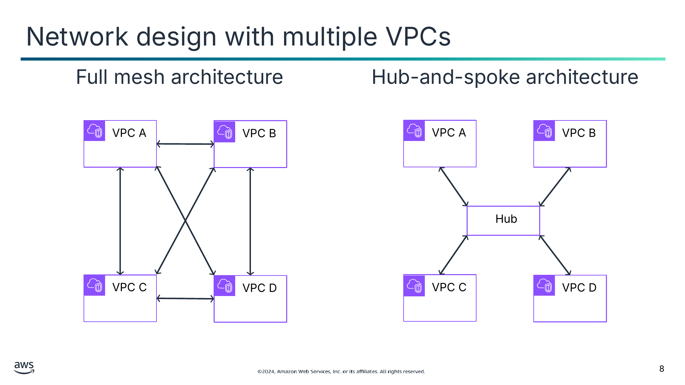

Full mesh architecture (Архітектура «повна сітка»)

Hub-and-spoke architecture (Архітектура «хаб і промені»)

Текст зі схеми

VPC A

VPC B

VPC C

VPC D

VPC A

VPC B

Hub (Хаб)

VPC C

VPC D

> **Нотатки:**
>
> |Номер слайда 8  
> |Нотатки для інструктора  
> |  
> |Нотатки для студента  
> Тепер, коли ви знаєте, як створити VPC та її компоненти, слід розширити проєкт вашої мережі до кількох мереж. Наприклад, коли ваш бізнес чи архітектура розширюється, вам може знадобитися розділити логічні елементи з міркувань безпеки, архітектурних цілей чи простоти керування. Однак багато середовищ VPC потребують підключення до інших мережевих середовищ. Багато корпоративних організацій розгортають сотні VPC, що потребують підключення одна до одної.  
>
> Коли ваша архітектура потребує кількох VPC, ви можете спроєктувати кожну VPC так, щоб вона підключалася до кожної з інших потрібних VPC. Цей проєкт називається архітектурою «повна сітка» (full mesh), де кожен вузол безпосередньо підключений до кожного іншого вузла. Цей проєкт добре працює для мереж із невеликою кількістю VPC, що потребують високих мережевих швидкостей з невеликою мережевою затримкою. У прикладі на цьому слайді чотири VPC з’єднані шістьма з’єднаннями. Кількість ліній з’єднання, потрібних для заданої кількості вузлів (N), можна розрахувати як N * (N – 1) / 2. Тому для 100 вузлів потрібно буде налаштувати 100 * 99 / 2 = 4950 з’єднань. Ця архітектура створює значні операційні та обслуговувальні зусилля для мережевих інженерів.  
>
> Інший підхід — використання архітектури «хаб і промені» (hub-and-spoke), де є центральний проміжний хаб для керування підключенням. Кожному вузлу потрібне лише одне з’єднання з хабом. У прикладі на цьому слайді чотирьом VPC потрібні чотири з’єднання, щоб обмінюватися даними через хаб. Для 100 вузлів потрібно буде налаштувати 100 з’єднань. Ця архітектура суттєво спрощує керування та зменшує операційні зусилля. Цей проєкт добре працює для мереж із великою кількістю VPC, що можуть допустити додану затримку на обробку хабом.

---

## Слайд 9: AWS Transit Gateway

- Є централізованим регіональним маршрутизатором для з’єднання VPC і локальних мереж на основі архітектури «хаб і промені»
- Є керованим сервісом AWS, що автоматично масштабується залежно від обсягу мережевого трафіку
- Може бути з’єднаний (peered) з іншими шлюзами Transit Gateway в інших регіонах і акаунтах AWS
- Спричиняє витрати залежно від кількості з’єднань і пропускної здатності трафіку
- Має функцію Transit Gateway Flow Logs для публікації журналів трафіку шлюзу Transit Gateway

Transit Gateway

> **Нотатки:**
>
> |Номер слайда 9  
> |Нотатки для інструктора:  
> |  
> |Нотатки для студента  
> Transit Gateway — це кероване обслуговування AWS, яке можна використовувати для підключення ваших VPC і локальних мереж до єдиного шлюзу, що називається шлюзом Transit Gateway (transit gateway). З сервісом Transit Gateway ви створюєте й керуєте лише одним з’єднанням від центрального шлюзу до кожної VPC, локального центру обробки даних чи віддаленого офісу у вашій мережі. Transit Gateway спрощує керування мережею та масштабування в міру розширення робочих навантажень, оскільки він автоматично масштабується залежно від пропускної здатності трафіку. Ви можете використовувати його для підключення тисяч VPC і локальних мереж. Transit Gateway тарифікується погодинно за кількість з’єднань, які ви робите зі шлюзом, і обсяг трафіку, що проходить через шлюз. Докладніше див. посилання «Transit Gateway pricing» у переліку ресурсів.  
>
> Transit Gateway використовує архітектуру «хаб і промені». Будь-яка нова VPC, підключена до шлюзу Transit Gateway, автоматично стає доступною для кожної іншої мережі, підключеної до цього шлюзу. Transit Gateway підтримує динамічну та статичну маршрутизацію між приєднаними VPC. Статичні маршрути налаштовуються до того, як мережевий трафік можна маршрутизувати. Динамічна маршрутизація вимагає, щоб маршрутизатори обмінювалися інформацією про маршрути з іншими маршрутизаторами для виявлення шляхів маршрутизації під час маршрутизації трафіку. Transit Gateway підтримує трафік і IPv4, і IPv6.  
>
> Шлюзи Transit Gateway можна з’єднувати між собою (peering) в межах того самого регіону AWS або між різними регіонами AWS. Трафік Transit Gateway завжди залишається в глобальній магістральній інфраструктурі AWS і ніколи не проходить через публічний інтернет. Це зменшує вектори загроз, як-от поширені експлойти й розподілені атаки «відмова в обслуговуванні» (DDoS).  
>
> Transit Gateway Flow Logs — це функція, яку можна використовувати для захоплення інформації про IP-трафік до ваших шлюзів Transit Gateway і від них. Дані журналу потоків можна публікувати в Amazon CloudWatch Logs, Amazon Simple Storage Service (Amazon S3) або Amazon Kinesis Data Firehose.

---

## Слайд 10: Централізований шаблон маршрутизації VPC

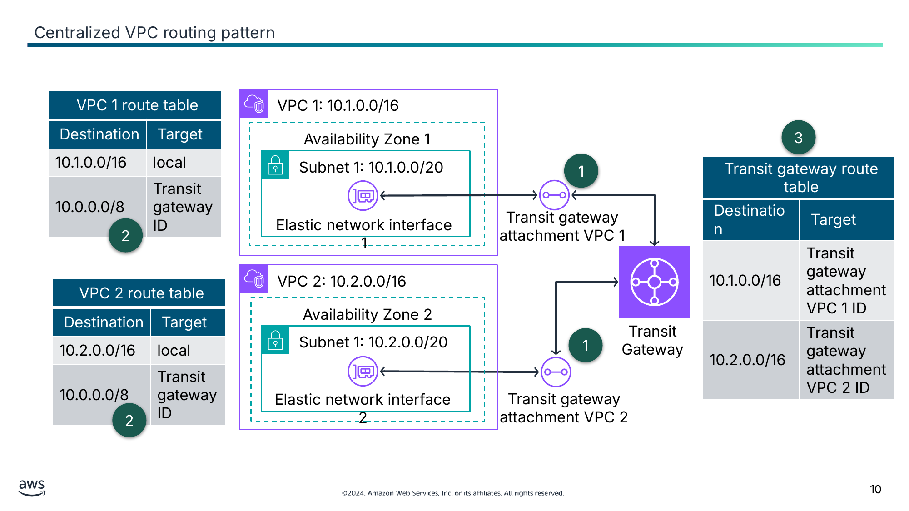

**VPC 1 route table (Таблиця маршрутизації VPC 1)**

| Destination (Призначення) | Target (Ціль) |
|---|---|
| 10.1.0.0/16 | local |
| 10.0.0.0/8 | Transit gateway ID |

3

1

**Transit gateway route table (Таблиця маршрутизації шлюзу Transit Gateway)**

| Destination (Призначення) | Target (Ціль) |
|---|---|
| 10.1.0.0/16 | • Transit gateway • attachment VPC 1 ID |
| 10.2.0.0/16 | • Transit gateway • attachment VPC 2 ID |

2

**VPC 2 route table (Таблиця маршрутизації VPC 2)**

| Destination (Призначення) | Target (Ціль) |
|---|---|
| 10.2.0.0/16 | local |
| 10.0.0.0/8 | Transit gateway ID |

1

2

Текст зі схеми

VPC 1: 10.1.0.0/16

Availability Zone 1 (Зона доступності 1)

Subnet 1: 10.1.0.0/20 (Підмережа 1)

Elastic network interface 1 (Еластичний мережевий інтерфейс 1)

Transit gateway

attachment VPC 1 (Приєднання шлюзу Transit Gateway до VPC 1)

VPC 2: 10.2.0.0/16

Availability Zone 2 (Зона доступності 2)

Transit Gateway

Subnet 1: 10.2.0.0/20

Elastic network interface 2

Transit gateway

attachment VPC 2

> **Нотатки:**
>
> |Номер слайда 10  
> |Нотатки для інструктора  
> |  
> |Нотатки для студента  
> Щоб зрозуміти, як з’єднати кілька VPC за допомогою Transit Gateway, розгляньте цей сценарій. Ви хочете повністю з’єднати кілька VPC у вашій мережі, і кожна VPC має мати повний доступ до ресурсів усіх інших VPC. У цьому сценарії ви дізнаєтеся, як розгорнути Transit Gateway і VPC з непересічним адресним простором IP в одному регіоні. Потім ви дізнаєтеся, як приєднати шлюз Transit Gateway до VPC. Кожна нова VPC, додана до шлюзу Transit Gateway, буде доступна з наявних VPC:  
> Створіть приєднання VPC (VPC attachment) за допомогою Transit Gateway. Цей крок з’єднає шлюз Transit Gateway з VPC через еластичний мережевий інтерфейс, розгорнутий у підмережах. Потрібно забезпечити, щоб у кожній зоні доступності у VPC був мережевий інтерфейс для підключення VPC до шлюзу Transit Gateway. Це можна зробити, обравши щонайменше одну підмережу з кожної зони доступності для мережевого інтерфейсу.  
> Додайте маршрут шлюзу Transit Gateway до кожної таблиці маршрутизації VPC, щоб надсилати трафік, призначений для всіх інших VPC у мережі, до шлюзу Transit Gateway. У цьому прикладі другий рядок таблиці маршрутизації VPC 1 показує, що трафік, призначений для мережі 10.0.0.0/8, надсилається до шлюзу Transit Gateway. Цей маршрут дає змогу будь-якому трафіку з VPC 1, що йде до інших VPC, надсилатися до шлюзу Transit Gateway. Це відбувається тому, що блок безкласової міждоменної маршрутизації (CIDR) 10.0.0.0/8 включає блоки CIDR 10.X.0.0/16, які використовуються окремими VPC. Це блок CIDR маршрутизації із символом підстановки (wild card) і він не те саме, що блок CIDR VPC, максимальний діапазон якого — /16.  
> Налаштуйте таблицю маршрутизації шлюзу Transit Gateway для маршрутизації трафіку до підключених VPC. Коли ви створюєте шлюз Transit Gateway, створюється таблиця маршрутизації шлюзу за замовчуванням. Кожен маршрут у таблиці маршрутизації шлюзу Transit Gateway дає шлюзу змогу надсилати трафік, призначений для однієї з VPC, до відповідного приєднання (attachment), що є посиланням на мережевий інтерфейс, приєднаний до самої VPC. У цьому прикладі в таблиці маршрутизації шлюзу Transit Gateway є маршрут, що надсилає будь-який трафік, призначений для мережі 10.1.0.0/16, до приєднання шлюзу Transit Gateway до VPC 1. Так само будь-який трафік, призначений для мережі VPC 2, надсилається до приєднання шлюзу Transit Gateway до VPC 2. Шлюз Transit Gateway може мати кілька таблиць маршрутизації, і приєднання пов’язуються з певною таблицею маршрутизації.  
>
> Ви можете розширити цей приклад, включивши сотні VPC у межах маршрутизованого діапазону IP-адрес 10.0.0.0/8.

---

## Слайд 11: Централізований шаблон маршрутизації для вихідного трафіку

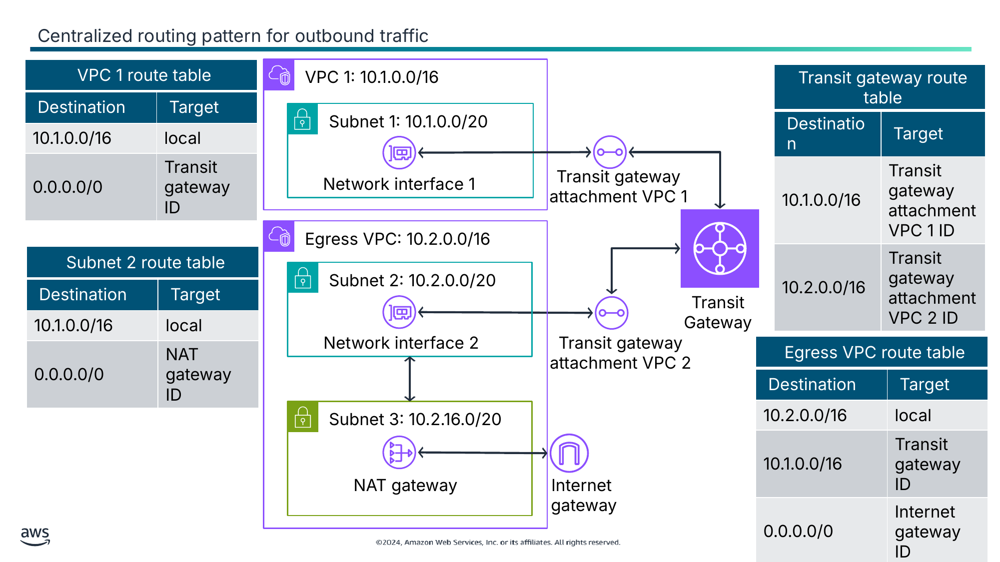

**VPC 1 route table (Таблиця маршрутизації VPC 1)**

| Destination (Призначення) | Target (Ціль) |
|---|---|
| 10.1.0.0/16 | local |
| 0.0.0.0/0 | Transit gateway ID |

**Transit gateway route table (Таблиця маршрутизації шлюзу Transit Gateway)**

| Destination (Призначення) | Target (Ціль) |
|---|---|
| 10.1.0.0/16 | • Transit gateway • attachment VPC 1 ID |
| 10.2.0.0/16 | • Transit gateway • attachment VPC 2 ID |

**Subnet 2 route table (Таблиця маршрутизації підмережі 2)**

| Destination (Призначення) | Target (Ціль) |
|---|---|
| 10.1.0.0/16 | local |
| 0.0.0.0/0 | NAT gateway ID |

**Egress VPC route table (Таблиця маршрутизації VPC для вихідного трафіку)**

| Destination (Призначення) | Target (Ціль) |
|---|---|
| 10.2.0.0/16 | local |
| 10.1.0.0/16 | Transit gateway ID |
| 0.0.0.0/0 | Internet gateway ID |

Текст зі схеми

VPC 1: 10.1.0.0/16

Subnet 1: 10.1.0.0/20 (Підмережа 1)

Transit gateway

attachment VPC 1 (Приєднання шлюзу Transit Gateway до VPC 1)

Network interface 1 (Мережевий інтерфейс 1)

Egress VPC: 10.2.0.0/16 (VPC для вихідного трафіку)

Subnet 2: 10.2.0.0/20

Transit Gateway

Network interface 2

Transit gateway

attachment VPC 2

Subnet 3: 10.2.16.0/20

NAT gateway (NAT-шлюз)

Internet

gateway (Інтернет-шлюз)

> **Нотатки:**
>
> |Номер слайда 11  
> |Нотатки для інструктора  
> |Нотатки для студента  
> Ви можете спроєктувати виділену VPC для обробки вихідного інтернет-трафіку (egress) для додаткової безпеки вихідної мережі. Цей шаблон називається централізованою вихідною маршрутизацією і маршрутизуватиме будь-який інтернет-трафік з VPC 1 до VPC для вихідного трафіку, що містить NAT-шлюз. У прикладі на цьому слайді застосункам у VPC 1 потрібен доступ до інтернету лише для вихідного трафіку. VPC 1 уже з’єднана з VPC для вихідного трафіку за допомогою Transit Gateway на основі централізованого шаблону маршрутизації VPC. Таблицю маршрутизації підмережі 2 VPC для вихідного трафіку налаштовано вказувати на NAT-шлюз у публічній підмережі 3 VPC для вихідного трафіку. Таблиця маршрутизації VPC для вихідного трафіку має правило маршрутизації всього трафіку до інтернет-шлюзу. Цей шаблон забезпечує централізований шлюз для вихідного трафіку з метою моніторингу та безпеки. Це також економічно ефективно — експлуатувати NAT-шлюзи в одній VPC замість NAT-шлюзу для кожної VPC. Для надлишковості експлуатуйте NAT-шлюз для кожної зони доступності у VPC для вихідного трафіку.  
>
> Ви також можете використовувати цей проєкт для централізації доступу до спільних сервісів, як-от перевірка трафіку чи доступ до кінцевої точки Interface VPC. Одна VPC — це призначена VPC сервісів, яку використовують усі інші VPC. Ця централізація спрощує складність керування цими ресурсами в кількох VPC і забезпечує кращий контроль доступу.  
>
> Підключення шлюзу Transit Gateway до локальних мереж обговорюється пізніше в модулі.

---

## Слайд 12: Піринг шлюзів Transit Gateway (transit gateway peering)

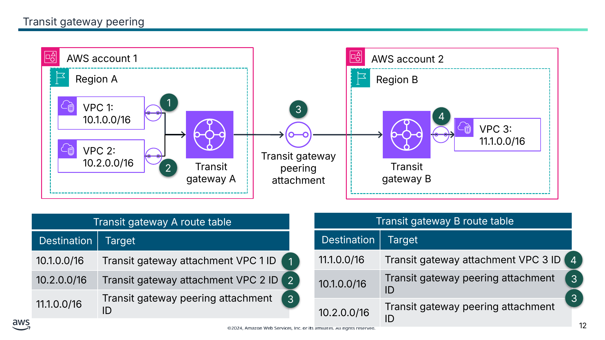

**Transit gateway A route table (Таблиця маршрутизації шлюзу Transit Gateway A)**

| Destination (Призначення) | Target (Ціль) |
|---|---|
| 10.1.0.0/16 | Transit gateway attachment VPC 1 ID |
| 10.2.0.0/16 | Transit gateway attachment VPC 2 ID |
| 11.1.0.0/16 | Transit gateway peering attachment ID |

**Transit gateway B route table (Таблиця маршрутизації шлюзу Transit Gateway B)**

| Destination (Призначення) | Target (Ціль) |
|---|---|
| 11.1.0.0/16 | Transit gateway attachment VPC 3 ID |
| 10.1.0.0/16 | Transit gateway peering attachment ID |
| 10.2.0.0/16 | Transit gateway peering attachment ID |

1

4

2

3

3

3

Текст зі схеми

AWS account 1 (Акаунт AWS 1)

AWS account 2 (Акаунт AWS 2)

Region A (Регіон A)

Region B (Регіон B)

VPC 1: 10.1.0.0/16

1

3

4

VPC 3: 11.1.0.0/16

VPC 2: 10.2.0.0/16

Transit gateway A (Шлюз Transit Gateway A)

Transit gateway peering

attachment (Приєднання пірингу шлюзів Transit Gateway)

Transit gateway B (Шлюз Transit Gateway B)

2

> **Нотатки:**
>
> |Номер слайда 12  
> |Нотатки для інструктора  
> |  
> |Нотатки для студента  
> Опис зображення: у прикладі на цьому слайді шлюз Transit Gateway A має два приєднання VPC та одне приєднання пірингу шлюзів Transit Gateway, позначене як 3. Приєднання шлюзу Transit Gateway до VPC 1 позначено як 1. Приєднання шлюзу Transit Gateway до VPC 2 позначено як 2. Шлюз Transit Gateway B має одне приєднання VPC. Приєднання шлюзу Transit Gateway до VPC 3 позначено як 4. Мережевий трафік з підмереж VPC 1 і VPC 2, призначений для VPC 3, спершу маршрутизується через шлюз Transit Gateway A, потім через шлюз Transit Gateway B, а потім до VPC 3. Кінець опису зображення.  
>
> Якщо вам потрібно, щоб мережевий трафік проходив між регіонами AWS чи різними акаунтами AWS, можна створити з’єднання пірингу шлюзів Transit Gateway між шлюзами. Потім можна маршрутизувати трафік між приєднаннями кожного зі шлюзів Transit Gateway.  
>
> Щоб забезпечити потік трафіку між двома шлюзами Transit Gateway, створіть приєднання пірингу шлюзів Transit Gateway на вашому шлюзі та вкажіть цільовий шлюз Transit Gateway. Цільовий шлюз може бути у вашому акаунті чи в іншому акаунті AWS. Після створення запиту на приєднання пірингу власник цільового шлюзу Transit Gateway (також званого шлюзом-приймачем, accepter) має прийняти запит. Щоб маршрутизувати трафік між шлюзами Transit Gateway, додайте статичний маршрут до таблиці маршрутизації шлюзу, що вказує на приєднання пірингу шлюзів Transit Gateway.  
>
> У прикладі на цьому слайді блоки CIDR кожної VPC поширюються до таблиць маршрутизації шлюзів Transit Gateway за замовчуванням. Поширені маршрути позначено як 1, 2 і 4 у таблицях маршрутизації шлюзів Transit Gateway. Кожна таблиця маршрутизації шлюзу Transit Gateway має статичний маршрут, що вказує на приєднання пірингу шлюзів Transit Gateway, позначене як 3 у таблицях маршрутизації.  
>
> З’єднаний шлюз Transit Gateway може перебувати в іншому регіоні AWS чи акаунті AWS, ніж початковий шлюз. Це забезпечує безшовний обмін даними між VPC, розташованими в різних акаунтах чи регіонах AWS, роблячи передавання даних ефективним і надійним. Трафік між регіонами безпечний, оскільки він не проходить через публічний інтернет.

---

## Слайд 13: Сценарій використання: група підрозділів компанії

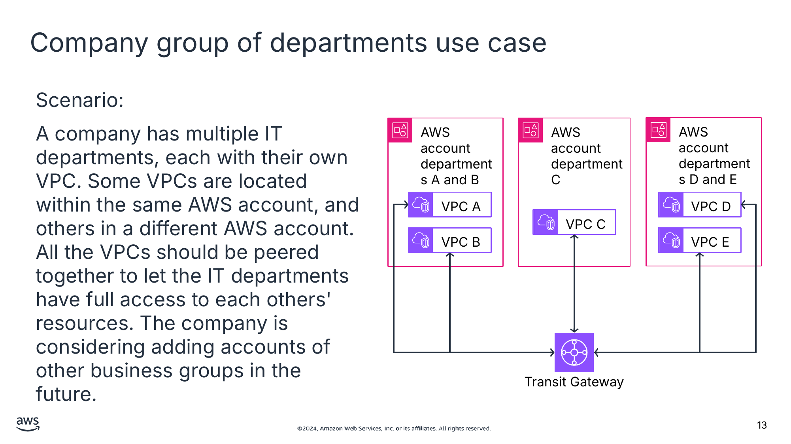

Сценарій:

Компанія має кілька ІТ-підрозділів, кожен зі своєю VPC. Деякі VPC розташовані в тому самому акаунті AWS, а інші — в іншому акаунті AWS. Усі VPC мають бути з’єднані (peered) між собою, щоб ІТ-підрозділи мали повний доступ до ресурсів одне одного. Компанія розглядає можливість додати акаунти інших бізнес-груп у майбутньому.

Текст зі схеми

AWS account departments A and B (Акаунт AWS підрозділів A і B)

AWS account department C (Акаунт AWS підрозділу C)

AWS account departments D and E (Акаунт AWS підрозділів D і E)

VPC A

VPC D

VPC C

VPC B

VPC E

Transit Gateway

> **Нотатки:**
>
> |Номер слайда 13  
> |Нотатки для інструктора  
> |  
> |Нотатки для студента  
> Рішення, що потребує найменшого обслуговування та зусиль для вашої компанії, — підключення VPC кожного підрозділу до шлюзу Transit Gateway. Це рішення забезпечило б достатню потужність для майбутнього зростання.  
>
> Як варіант, якщо одній VPC потрібен доступ лише до однієї іншої VPC, таблиці маршрутизації можна оновити, щоб обмежити трафік указаним діапазоном IP-адрес цільової VPC.

---

## Слайд 14: Практична вправа: налаштування маршрутів AWS Transit Gateway (Configure AWS Transit Gateway Routes)

- Налаштуйте маршрути для п’яти VPC, які ви хочете з’єднати між собою через Transit Gateway.
- Налаштуйте маршрути в таблицях маршрутизації VPC.
- Налаштуйте маршрути в таблиці маршрутизації шлюзу Transit Gateway.

> **Нотатки:**
>
> |Номер слайда 14  
> |Нотатки для інструктора  
> |Вправа для студентів складається з двох слайдів, які слід розглядати як ціле. Наступні слайди надають розв’язання.  
> |  
> |Нотатки для студента

---

## Слайд 15: Налаштування таблиць маршрутизації VPC

Які маршрути потрібно додати до кожної з таблиць маршрутизації VPC, щоб забезпечити повне підключення між усіма п’ятьма VPC?

| VPC ID (Ідентифікатор VPC) | VPC CIDR | Transit gateway VPC attachment ID (Ідентифікатор приєднання VPC до шлюзу Transit Gateway) | VPC route table ID (Ідентифікатор таблиці маршрутизації VPC) | VPC route table destination (Призначення в таблиці маршрутизації VPC) | VPC route table target (Ціль у таблиці маршрутизації VPC) |
|---|---|---|---|---|---|
| vpc-a | 10.1.0.0/16 | tgw-attach-vpc-a | rtb-vpc-a | ? | ? |
| vpc-b | 10.2.0.0/16 | tgw-attach-vpc-b | rtb-vpc-a | ? | ? |
| vpc-c | 10.3.0.0/16 | tgw-attach-vpc-c | rtb-vpc-a | ? | ? |
| vpc-d | 10.4.0.0/16 | tgw-attach-vpc-d | rtb-vpc-a | ? | ? |
| vpc-e | 10.5.0.0/16 | tgw-attach-vpc-e | rtb-vpc-a | ? | ? |

> **Нотатки:**
>
> |Номер слайда 15  
> |Нотатки для інструктора  
> |Вправа для студентів складається з двох слайдів, які слід розглядати як ціле. Наступні слайди надають розв’язання.  
> |Нотатки для студента  
> Для кожної таблиці маршрутизації VPC вкажіть призначення та ціль, щоб дозволити трафіку проходити з VPC до шлюзу Transit Gateway tgw-1. Ідентифікатор шлюзу Transit Gateway — tgw-1. Маршрутизацію до всіх VPC можна забезпечити блоком CIDR 10.0.0.0/8.  
>
> Нижче наведено визначення термінів у стовпцях таблиці:  
> • VPC ID: унікальний ідентифікатор кожної VPC.  
> • VPC CIDR: діапазон IP-адрес VPC.  
> • Transit gateway attachment ID: цей ідентифікатор позначає з’єднання між VPC і шлюзом Transit Gateway.  
> • VPC route table ID: кожна VPC має таблицю маршрутизації, і цей ідентифікатор однозначно ідентифікує таблицю маршрутизації.  
> • Destination: діапазон IP-адрес, до якого таблиця маршрутизації спрямовує трафік.  
> • Target: куди спрямовується трафік.

---

## Слайд 16: Налаштування таблиці маршрутизації шлюзу Transit Gateway tgw-1

Які маршрути потрібно додати до таблиці маршрутизації шлюзу Transit Gateway tgw-1, щоб забезпечити повне підключення між усіма п’ятьма VPC?

| Transit gateway route table destination (Призначення в таблиці маршрутизації шлюзу Transit Gateway) | Transit gateway route table target (Ціль у таблиці маршрутизації шлюзу Transit Gateway) |
|---|---|
| ? | ? |
| ? | ? |
| ? | ? |
| ? | ? |
| ? | ? |

> **Нотатки:**
>
> |Номер слайда 16  
> |Нотатки для інструктора  
> |  
> |Нотатки для студента  
> Вкажіть призначення та ціль маршруту для таблиці маршрутизації шлюзу Transit Gateway tgw-1 для кожної VPC із попереднього слайда, щоб завершити конфігурацію маршрутів вашого шлюзу Transit Gateway.  
>
> Нижче наведено визначення термінів у стовпцях таблиці:  
> • Transit gateway route table destination: цільовий CIDR для маршрутизації.  
> • Transit gateway route table target: цільове приєднання для маршрутизації.

---

## Слайд 17: Розв’язання: таблиці маршрутизації VPC

| VPC ID (Ідентифікатор VPC) | VPC CIDR | Transit gateway VPC attachment ID (Ідентифікатор приєднання VPC до шлюзу Transit Gateway) | VPC route table ID (Ідентифікатор таблиці маршрутизації VPC) | VPC route table destination (Призначення в таблиці маршрутизації VPC) | VPC route table target (Ціль у таблиці маршрутизації VPC) |
|---|---|---|---|---|---|
| vpc-a | 10.1.0.0/16 | tgw-attach-vpc-a | rtb-vpc-a | 10.0.0.0/8 | tgw-1 |
| vpc-b | 10.2.0.0/16 | tgw-attach-vpc-b | rtb-vpc-a | 10.0.0.0/8 | tgw-1 |
| vpc-c | 10.3.0.0/16 | tgw-attach-vpc-c | rtb-vpc-a | 10.0.0.0/8 | tgw-1 |
| vpc-d | 10.4.0.0/16 | tgw-attach-vpc-d | rtb-vpc-a | 10.0.0.0/8 | tgw-1 |
| vpc-e | 10.5.0.0/16 | tgw-attach-vpc-e | rtb-vpc-a | 10.0.0.0/8 | tgw-1 |

> **Нотатки:**
>
> |Номер слайда 17  
> |Нотатки для інструктора  
> |  
> |Нотатки для студента  
> Для кожної таблиці маршрутизації VPC вкажіть призначення та ціль, щоб забезпечити потік трафіку з VPC до шлюзу Transit Gateway tgw-1. Ідентифікатор шлюзу Transit Gateway — tgw-1. Маршрутизацію до всіх VPC можна забезпечити блоком CIDR 10.0.0.0/8. Хоча можна було б використати 0.0.0.0/0 для всього трафіку, краще обмежити маршрутизацію лише діапазонами CIDR між VPC.

---

## Слайд 18: Розв’язання: таблиця маршрутизації шлюзу Transit Gateway tgw-1

| Transit gateway route table destination (Призначення в таблиці маршрутизації шлюзу Transit Gateway) | Transit gateway route table target (Ціль у таблиці маршрутизації шлюзу Transit Gateway) |
|---|---|
| 10.1.0.0/16 | tgw-attach-vpc-a |
| 10.2.0.0/16 | tgw-attach-vpc-b |
| 10.3.0.0/16 | tgw-attach-vpc-c |
| 10.4.0.0/16 | tgw-attach-vpc-d |
| 10.5.0.0/16 | tgw-attach-vpc-e |

> **Нотатки:**
>
> |Номер слайда 18  
> |Нотатки для інструктора  
> |  
> |Нотатки для студента  
> Призначення в таблиці маршрутизації шлюзу Transit Gateway — це блок CIDR VPC, а ціль — ідентифікатор приєднання VPC до шлюзу Transit Gateway.

---

## Слайд 19: Ключові висновки: масштабування вашої мережі VPC за допомогою Transit Gateway

- Transit Gateway — це централізований регіональний маршрутизатор для з’єднання VPC.
- Transit Gateway може бути з’єднаний (peered) з іншими шлюзами Transit Gateway в інших регіонах AWS і акаунтах AWS.
- Transit Gateway підтримує тисячі приєднань.
- Transit Gateway тарифікується погодинно за кількість з’єднань, які ви робите зі шлюзом, і обсяг трафіку, що проходить через шлюз.

> **Нотатки:**
>
> |Номер слайда 19  
> |Нотатки для інструктора  
> |  
> |Нотатки для студента

---

## Слайд 20: З’єднання VPC в AWS за допомогою пірингу VPC (VPC peering)

З’єднання мереж

> **Нотатки:**
>
> |Номер слайда 20  
> |Нотатки для інструктора  
> |Тепер фокус переходить до з’єднання кількох мереж у середовищі AWS і налаштування відповідних маршрутів.  
> |Нотатки для студента  
> Цей розділ розглядає з’єднання кількох VPC в AWS за допомогою функції пірингу VPC.

---

## Слайд 21: Архітектура «сітка» за допомогою пірингу VPC

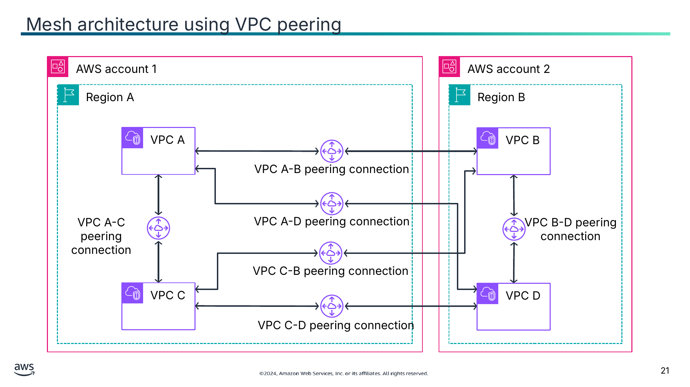

Текст зі схеми

AWS account 1 (Акаунт AWS 1)

AWS account 2 (Акаунт AWS 2)

Region A (Регіон A)

Region B (Регіон B)

VPC A

VPC B

VPC A-B peering connection (З’єднання пірингу VPC A-B)

VPC A-C peering connection (З’єднання пірингу VPC A-C)

VPC A-D peering connection (З’єднання пірингу VPC A-D)

VPC B-D peering connection (З’єднання пірингу VPC B-D)

VPC C-B peering connection (З’єднання пірингу VPC C-B)

VPC C

VPC D

VPC C-D peering connection (З’єднання пірингу VPC C-D)

> **Нотатки:**
>
> |Номер слайда 21  
> |Нотатки для інструктора  
> |  
> |Нотатки для студента  
> Коли у вас невелика кількість VPC або ваш мережевий бюджет обмежений оплатою шлюзу Transit Gateway, можна використовувати функцію пірингу VPC для встановлення мережевого з’єднання «один до одного» між двома VPC. Піринг VPC — це функція сервісу Amazon Virtual Private Cloud (Amazon VPC), і створення з’єднання пірингу VPC не спричиняє витрат. Оскільки це піринг «точка-точка», мережеві накладні витрати дуже малі, а мережева затримка низька.  
>
> Піринг VPC дає змогу екземплярам Amazon Elastic Compute Cloud (Amazon EC2) у двох VPC обмінюватися даними між собою за допомогою приватних IP-адрес так, ніби вони в одній мережі. Ви можете створити з’єднання пірингу VPC між власними VPC, з VPC в іншому акаунті AWS або з VPC в іншому регіоні AWS. Міжрегіональний піринг VPC (inter-Region VPC peering) забезпечує економічно ефективний спосіб ділитися ресурсами між регіонами чи реплікувати дані для географічної надлишковості. Дані, що передаються через міжрегіональні чи міжзональні з’єднання пірингу VPC, тарифікуються за стандартними тарифами передавання даних.  
>
> З’єднання пірингу VPC не ділять трафік з іншими з’єднаннями пірингу VPC, а трафік залишається в приватному адресному просторі IP. Трафік також завжди залишається в глобальній магістралі AWS. Це означає, що трафік ніколи не проходить через публічний інтернет, що зменшує загрози, як-от поширені експлойти й DDoS-атаки. Весь міжрегіональний трафік шифрується, і немає єдиної точки відмови чи вузьких місць пропускної здатності.  
>
> З’єднання пірингу VPC допомагає полегшити передавання даних. Наприклад, якщо у вас більше одного акаунта AWS, ви можете з’єднати VPC між цими акаунтами, щоб створити мережу спільного доступу до файлів. Ви також можете використовувати з’єднання пірингу VPC, щоб дати іншим VPC змогу отримувати доступ до ресурсів, які у вас є в одній із ваших VPC.

---

## Слайд 22: Встановлення пірингу VPC

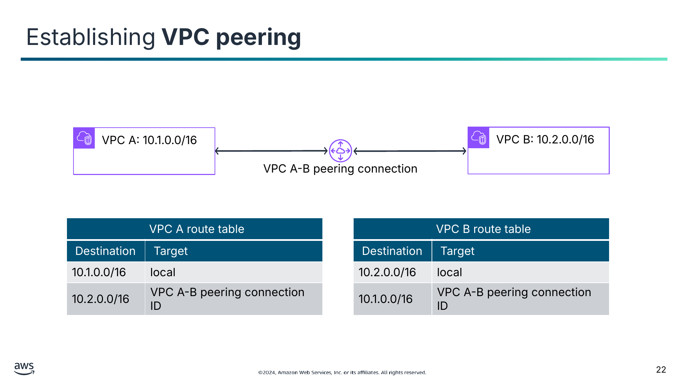

**VPC A route table (Таблиця маршрутизації VPC A)**

| Destination (Призначення) | Target (Ціль) |
|---|---|
| 10.1.0.0/16 | local |
| 10.2.0.0/16 | VPC A-B peering connection ID |

**VPC B route table (Таблиця маршрутизації VPC B)**

| Destination (Призначення) | Target (Ціль) |
|---|---|
| 10.2.0.0/16 | local |
| 10.1.0.0/16 | VPC A-B peering connection ID |

Текст зі схеми

VPC A: 10.1.0.0/16

VPC B: 10.2.0.0/16

VPC A-B peering connection (З’єднання пірингу VPC A-B)

> **Нотатки:**
>
> |Номер слайда 22  
> |Нотатки для інструктора  
> |  
> |Нотатки для студента  
> У прикладі на цьому слайді потрібне з’єднання пірингу VPC між VPC A і VPC B. Власник VPC A надсилає запит на піринг власнику VPC B. Щоб активувати з’єднання пірингу, власник VPC B має прийняти запит на з’єднання пірингу VPC A. Блок CIDR VPC A не може перетинатися з блоком CIDR VPC B.  
>
> Щоб забезпечити потік трафіку між партнерами VPC за допомогою приватних IP-адрес, власник VPC A має додати маршрут до таблиці маршрутизації VPC A. Призначення цього маршруту — діапазон IP-адрес VPC B 10.2.0.0/16. Ціль маршруту — ідентифікатор з’єднання пірингу VPC A-B. Власник VPC B також має додати маршрут до таблиці маршрутизації VPC B. Призначення цього маршруту — діапазон IP-адрес VPC A 10.1.0.0/16. Ціль маршруту — ідентифікатор з’єднання пірингу VPC A-B.  
>
> Власникам VPC A і VPC B також може знадобитися оновити правила груп безпеки, пов’язаних з екземплярами VPC, щоб трафік до рівноправної VPC та від неї не обмежувався.  
>
> Практичне застосування пірингу VPC — два стартапи, що співпрацюють над проєктом. Вони можуть встановити піринг VPC, щоб безпечно ділитися ресурсами. Це налаштування дає їм змогу обмінюватися даними через приватну мережеву інфраструктуру AWS, що допомагає забезпечити швидший і безпечніший обмін даними без відкриття їхніх ресурсів публічному інтернету.

---

## Слайд 23: Піринг VPC не підтримує транзитивного пірингу (transitive peering)

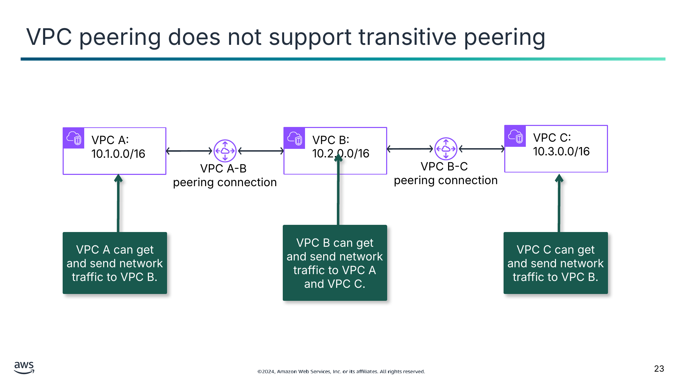

VPC A може отримувати й надсилати мережевий трафік до VPC B.

VPC B може отримувати й надсилати мережевий трафік до VPC A і VPC C.

VPC C може отримувати й надсилати мережевий трафік до VPC B.

Текст зі схеми

VPC A: 10.1.0.0/16

VPC B: 10.2.0.0/16

VPC C: 10.3.0.0/16

VPC A-B

peering connection (З’єднання пірингу VPC A-B)

VPC B-C

peering connection (З’єднання пірингу VPC B-C)

> **Нотатки:**
>
> |Номер слайда 23  
> |Нотатки для інструктора  
> |  
> |Нотатки для студента  
> Транзитивний піринг не підтримується пірингом VPC. Це робить піринг безпечним і керованим, щоб ізолювати помилки та обмежити радіус ураження (blast radius) мережевих атак.  
>
> Наприклад, на схемі VPC A і VPC B з’єднані (peered), а VPC B і VPC C з’єднані. Однак це не означає, що VPC A підключена до VPC C. За замовчуванням піринг VPC не дозволяє VPC A підключатися до VPC C, доки вони явно не встановлені як рівноправні. Тому ви контролюєте, які VPC можуть обмінюватися даними між собою, а які VPC слід ізолювати з мінімальним доступом.  
>
> Ось інші обмеження з’єднання пірингу VPC:  
> Піринг VPC неможливий між VPC, що мають однакові або такі, що перетинаються, блоки CIDR.  
> Якщо будь-яка з VPC має інтернет- чи NAT-шлюз, що перебуває у з’єднанні пірингу, VPC не має доступу до інтернет- чи NAT-шлюзу, що розташований в іншій VPC.  
> Лише власники VPC можуть працювати зі своїми з’єднаннями пірингу VPC.

---

## Слайд 24: Конфігурації пірингу VPC із конкретними маршрутами

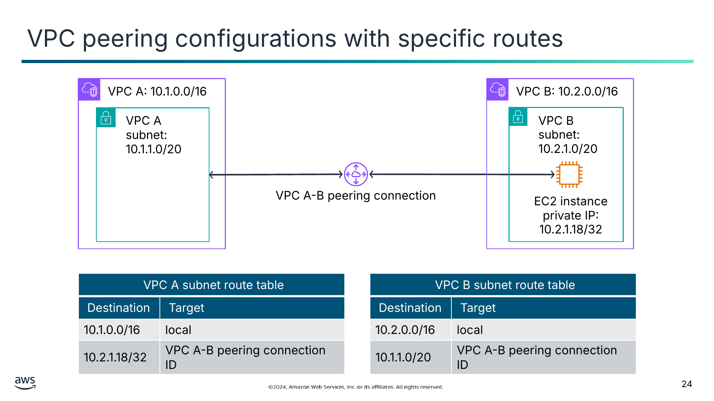

**VPC A subnet route table (Таблиця маршрутизації підмережі VPC A)**

| Destination (Призначення) | Target (Ціль) |
|---|---|
| 10.1.0.0/16 | local |
| 10.2.1.18/32 | VPC A-B peering connection ID |

**VPC B subnet route table (Таблиця маршрутизації підмережі VPC B)**

| Destination (Призначення) | Target (Ціль) |
|---|---|
| 10.2.0.0/16 | local |
| 10.1.1.0/20 | VPC A-B peering connection ID |

Текст зі схеми

VPC A: 10.1.0.0/16

VPC B: 10.2.0.0/16

VPC A subnet:

10.1.1.0/20 (Підмережа VPC A)

VPC B subnet:

10.2.1.0/20 (Підмережа VPC B)

VPC A-B peering connection (З’єднання пірингу VPC A-B)

EC2 instance

private IP: 10.2.1.18/32 (Екземпляр EC2, приватна IP-адреса)

> **Нотатки:**
>
> |Номер слайда 24  
> |Нотатки для інструктора  
> |  
> |Нотатки для студента  
> Ви можете налаштувати таблиці маршрутизації для з’єднання пірингу VPC, щоб обмежити доступ до блоку CIDR підмережі, певного блоку CIDR, якщо VPC має кілька блоків CIDR, або конкретної IP-адреси ресурсу в рівноправній VPC.  
>
> У прикладі на цьому слайді таблиця маршрутизації підмережі VPC A має маршрут, визначений до екземпляра EC2 у VPC B. Призначення в таблиці маршрутизації — приватна IP-адреса екземпляра EC2 10.2.1.18/32 з ціллю — з’єднання пірингу VPC A-B. Таблиця маршрутизації підмережі VPC B має маршрут, визначений до підмережі VPC A. Призначення в таблиці маршрутизації — блок CIDR підмережі VPC A 10.1.1.0/20 з ціллю — з’єднання пірингу VPC A-B.

---

## Слайд 25: Сценарії використання: піринг з однією VPC для доступу до централізованих ресурсів

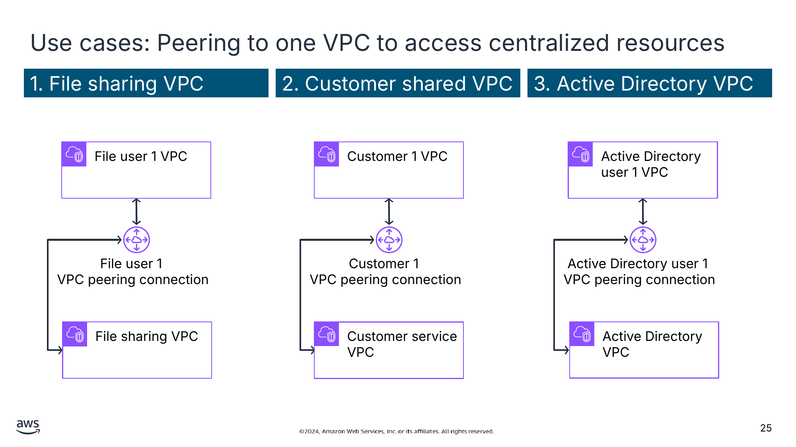

1. VPC для спільного доступу до файлів

2. Спільна клієнтська VPC

3. VPC Active Directory

Текст зі схеми

File user 1 VPC (VPC користувача файлів 1)

File user 1 (Користувач файлів 1)

VPC peering connection (З’єднання пірингу VPC)

File sharing VPC (VPC для спільного доступу до файлів)

Customer 1 VPC (VPC клієнта 1)

Customer 1 (Клієнт 1)

VPC peering connection

Customer service VPC (VPC обслуговування клієнтів)

Active Directory user 1 VPC (VPC користувача Active Directory 1)

Active Directory user 1 (Користувач Active Directory 1)

VPC peering connection

Active Directory VPC (VPC Active Directory)

> **Нотатки:**
>
> |Номер слайда 25  
> |Нотатки для інструктора  
> |  
> |Нотатки для студента  
> Ось приклади центральної VPC, що надає сервіс для доступу інших VPC:  
> ІТ-відділ вашої компанії має VPC для спільного доступу до файлів. Ви хочете з’єднати (peer) інші VPC із цією центральною VPC; однак ви не хочете, щоб інші VPC надсилали трафік одна одній.  
> У вашої компанії є VPC, до якої ви хочете надати спільний доступ своїм клієнтам. Кожен клієнт може створити з’єднання пірингу VPC з вашою VPC; однак ваші клієнти не можуть маршрутизувати трафік до інших VPC, з’єднаних з вашою, і не знають про маршрути інших клієнтів.  
> У вас є центральна VPC, що використовується для сервісів Active Directory. Певні екземпляри в рівноправних VPC надсилають запити до серверів Active Directory й потребують повного доступу до центральної VPC. Центральна VPC не потребує повного доступу до рівноправних VPC; їй потрібно лише маршрутизувати трафік відповіді до певних екземплярів.

---

## Слайд 26: Підключення VPC за допомогою архітектури AWS PrivateLink

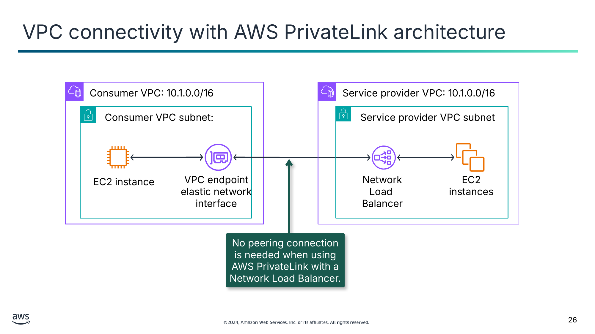

Під час використання AWS PrivateLink із Network Load Balancer з’єднання пірингу не потрібне.

Текст зі схеми

Consumer VPC: 10.1.0.0/16 (VPC споживача)

Service provider VPC: 10.1.0.0/16 (VPC постачальника сервісу)

Consumer VPC subnet: (Підмережа VPC споживача)

Service provider VPC subnet (Підмережа VPC постачальника сервісу)

EC2 instance (Екземпляр EC2)

VPC endpoint

elastic network interface (Еластичний мережевий інтерфейс кінцевої точки VPC)

Network Load  
Balancer

EC2 instances (Екземпляри EC2)

> **Нотатки:**
>
> |Номер слайда 26  
> |Нотатки для інструктора  
> |  
> |Нотатки для студента  
> До цього моменту ви з’єднували VPC на мережевому рівні, але що, якщо ви хочете з’єднати VPC на рівні застосунку? Або що, якщо ви хочете підключитися до VPC із діапазонами IP-адрес, що перетинаються?  
>
> Ви можете використовувати AWS PrivateLink для приватного підключення до сервісу чи застосунку, що перебуває у VPC постачальника сервісу, з VPC споживачів у межах регіону AWS. Перевага цієї архітектури в тому, що лише VPC споживачів ініціюють з’єднання з VPC постачальника сервісу.  
>
> У прикладі на цьому слайді VPC постачальника сервісу має Network Load Balancer з екземплярами EC2 як цілями. Власник VPC споживача створює кінцеву точку еластичного мережевого інтерфейсу VPC до кінцевої точки балансувальника навантаження мережі. У цьому сценарії VPC споживача та постачальника сервісу можуть мати діапазони IP-адрес, що перетинаються, — 10.1.0.0/16.

---

## Слайд 27: Ключові висновки: з’єднання VPC в AWS за допомогою пірингу VPC

- Піринг VPC встановлює мережеве з’єднання пірингу «один до одного» між двома VPC для забезпечення приватних маршрутів мережевого трафіку.
- Піринг VPC не спричиняє витрат, але передавання даних між зонами доступності та регіонами спричиняє.
- Піринг VPC може забезпечувати потік мережевого трафіку між різними акаунтами AWS і регіонами AWS.
- Піринг VPC не підтримує транзитивних відносин пірингу VPC.
- Якщо блоки безкласової міждоменної маршрутизації (CIDR) VPC перетинаються, використовуйте PrivateLink із Network Load Balancer для встановлення підключення VPC.

> **Нотатки:**
>
> |Номер слайда 27  
> |Нотатки для інструктора  
> |  
> |Нотатки для студента

---

## Слайд 28: Покрокова лабораторна робота: створення з’єднання пірингу VPC (VPC Peering Lab)

> **Нотатки:**
>
> |Номер слайда 28  
> |Нотатки для інструктора  
> |  
> |Нотатки для студента  
> Зараз ви виконаєте лабораторну роботу. Наступні слайди підсумовують, що ви робитимете в лабораторній роботі, а докладні інструкції ви знайдете в лабораторному середовищі.

---

## Слайд 29: Завдання лабораторної роботи «Піринг VPC» (VPC Peering Lab)

- У цій лабораторній роботі ви виконаєте такі основні завдання:
  - Створите з’єднання пірингу між двома VPC.
  - Налаштуєте таблиці маршрутизації для надсилання трафіку до з’єднання пірингу.
  - Протестуєте з’єднання пірингу.
- Відкрийте ваше лабораторне середовище, щоб розпочати лабораторну роботу та дізнатися додаткові подробиці про завдання, які ви виконуватимете.

> **Нотатки:**
>
> |Номер слайда 29  
> |Нотатки для інструктора  
> |  
> |Нотатки для студента  
> Отримайте доступ до лабораторного середовища через ваш онлайн-курс, щоб дізнатися додаткові подробиці та виконати лабораторну роботу.

---

## Слайд 30: Підсумки лабораторної роботи «Піринг VPC»

- Що ви дізналися про процес з’єднання пірингу VPC?
- Як вам вдалося підтвердити, що піринг VPC працював?

> **Нотатки:**
>
> |Номер слайда 30  
> |Відповідні архітектурні схеми «до» та «після» включено до інструкцій кожної лабораторної роботи. Вам може бути корисно відкрити схеми лабораторної роботи під час підбиття підсумків цієї лабораторної роботи.  
> |Нотатки для інструктора  
> |Запропоновані відповіді на запитання 1: що ви дізналися про процес з’єднання пірингу VPC?  
> |Цільова VPC має прийняти запит на з’єднання.  
> |Таблиці маршрутизації в обох VPC-партнерах потрібно оновити для надсилання трафіку.  
> |Коли створюється з’єднання пірингу VPC, цільова VPC має прийняти запит на з’єднання. Цільова VPC має прийняти запит, оскільки вона може належати іншому акаунту. Як варіант, користувач, що створює з’єднання пірингу, може не мати дозволу приймати запит на з’єднання для цільової VPC. Після налаштування з’єднання потрібно оновити таблиці маршрутизації в обох VPC, щоб надсилати трафік з однієї VPC в іншу.  
> |  
> |Запропоновані відповіді на запитання 2: як вам вдалося підтвердити, що піринг VPC працював?  
>   
> |З’єднання пірингу VPC було встановлено, оскільки Shared VPC не має інтернет-шлюзу. Єдиний спосіб для Lab VPC отримати доступ до бази даних — через з’єднання пірингу VPC.  
> |Нотатки для студента  
> Ваш інструктор може розглянути ці запитання з вами, або ви можете розглянути їх самостійно. Скористайтеся цією нагодою, щоб поглибити своє мислення щодо завдань, які ви виконували під час лабораторної роботи.

---

## Слайд 31: Підключення до вашої віддаленої мережі за допомогою AWS Site-to-Site VPN

З’єднання мереж

> **Нотатки:**
>
> |Номер слайда 31  
> |Нотатки для інструктора  
> |  
> |Нотатки для студента  
> Цей розділ розглядає, як підключитися до віртуальної приватної хмари Amazon (VPC) з локальної віддаленої мережі.

---

## Слайд 32: Підключення локальних середовищ до VPC

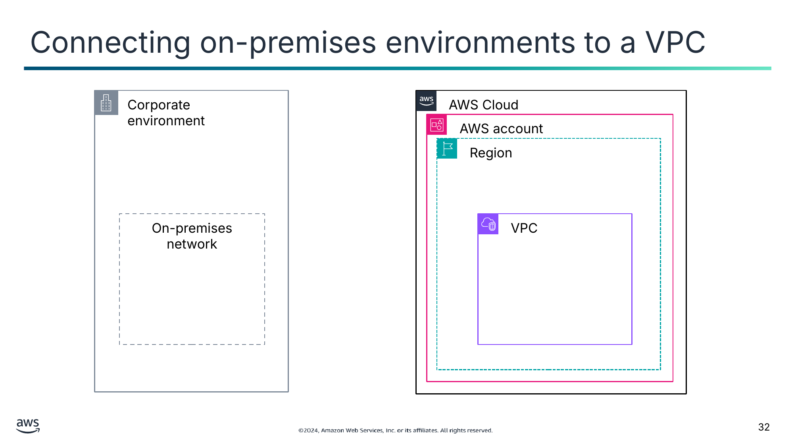

Текст зі схеми

Corporate

environment (Корпоративне середовище)

AWS Cloud

AWS account (Акаунт AWS)

Region (Регіон)

On-premises network (Локальна мережа)

VPC

> **Нотатки:**
>
> |Номер слайда 32  
> |Нотатки для інструктора  
> |  
> |Нотатки для студента  
> Тепер, коли ви можете з’єднувати VPC між собою, як підключитися до вашої VPC з локального корпоративного середовища? За замовчуванням екземпляри, що ви запускаєте у VPC в AWS, не можуть обмінюватися даними з вашою локальною мережею.

---

## Слайд 33: AWS Site-to-Site VPN

- Створює захищене з’єднання між локальним шлюзом клієнта (customer gateway) та віртуальним приватним шлюзом AWS (virtual private gateway; або шлюзом Transit Gateway) для доступу до VPC
- Створює два зашифровані тунелі VPN IPsec для кожного з’єднання через кілька зон доступності
- Тарифікується за кожну годину з’єднання VPN

Site-to-Site VPN

> **Нотатки:**
>
> |Номер слайда 33  
> |Нотатки для інструктора  
> |  
> |Нотатки для студента  
> Ви можете використовувати AWS Site-to-Site VPN, щоб безпечно підключити ваше локальне середовище до вашої VPC. Кожне з’єднання Site-to-Site VPN використовує з’єднання протоколу інтернет-безпеки (internet protocol security, IPsec) для створення зашифрованих тунелів віртуальної приватної мережі (VPN) між двома розташуваннями. Тунель VPN — це зашифроване з’єднання, де дані можуть передаватися з мережі клієнта в AWS чи з AWS публічним інтернетом. Site-to-Site VPN можна налаштувати відносно швидко, і він може бути доступним за години.  
>
> Локальна сторона з’єднання — це шлюз клієнта (customer gateway). Сторона AWS — це віртуальний приватний шлюз (virtual private gateway). Замість віртуального приватного шлюзу також можна створити з’єднання Site-to-Site VPN як приєднання до шлюзу Transit Gateway.  
>
> З’єднання Site-to-Site VPN забезпечує два тунелі VPN через кілька зон доступності, які можна використовувати одночасно для високої доступності. Ви можете передавати основний трафік через перший тунель і використовувати другий тунель для надлишковості. Якщо один тунель вийде з ладу, трафік усе одно доставлятиметься до вашої VPC.  
>
> Якщо ви створюєте з’єднання Site-to-Site VPN до вашої VPC, з вас стягується плата за кожну годину з’єднання VPN, протягом якої ваше з’єднання VPN розгорнуте та доступне.

---

## Слайд 34: Створення з’єднання Site-to-Site VPN

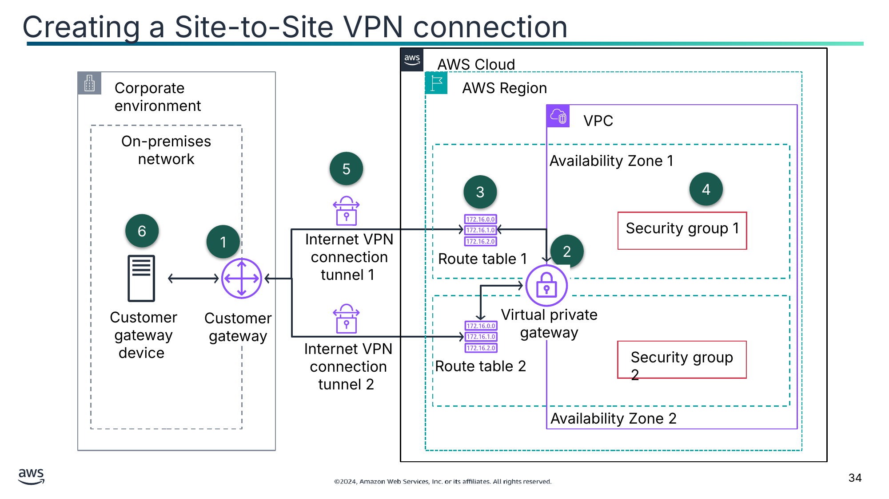

5

3

4

6

1

2

Текст зі схеми

AWS Cloud

Corporate

environment (Корпоративне середовище)

AWS Region (Регіон AWS)

VPC

On-premises network (Локальна мережа)

Availability Zone 1 (Зона доступності 1)

Security group 1 (Група безпеки 1)

Internet VPN connection

tunnel 1 (Тунель 1 інтернет-з’єднання VPN)

Route table 1 (Таблиця маршрутизації 1)

Customer

gateway device (Пристрій шлюзу клієнта)

Customer gateway (Шлюз клієнта)

Virtual private

gateway (Віртуальний приватний шлюз)

Internet VPN connection

tunnel 2 (Тунель 2 інтернет-з’єднання VPN)

Security group 2 (Група безпеки 2)

Route table 2 (Таблиця маршрутизації 2)

Availability Zone 2 (Зона доступності 2)

> **Нотатки:**
>
> |Номер слайда 34  
> |Нотатки для інструктора  
> |  
> |Нотатки для студента  
> Щоб створити з’єднання Site-to-Site VPN, виконайте такі кроки:  
> Створіть шлюз клієнта VPC (customer gateway). Коли ви створюєте з’єднання Site-to-Site VPN із вашої локальної мережі до вашої VPC, шлюз клієнта VPC представляє пристрій шлюзу клієнта. Пристроєм шлюзу клієнта може бути фізичний пристрій або програмний застосунок, що перебуває в локальній мережі. Призначте шлюзу клієнта номер автономної системи (ASN) Border Gateway Protocol (BGP), якщо пристрій шлюзу клієнта підтримує BGP.  
> Створіть віртуальний приватний шлюз і вкажіть користувацький приватний ASN BGP або використайте ASN Amazon за замовчуванням. Цей ASN має відрізнятися від ASN, указаного для шлюзу клієнта. Як альтернативне рішення замість віртуального приватного шлюзу можна використати Transit Gateway.  
> Налаштуйте маршрутизацію, щоб екземпляри у вашій VPC могли досягати вашого шлюзу клієнта. Потрібно налаштувати вашу таблицю маршрутизації, включивши маршрути, що використовує ваше з’єднання VPN, і спрямувавши їх на ваш віртуальний приватний шлюз. Можна активувати поширення маршрутів (route propagation) для вашої таблиці маршрутизації, щоб автоматично поширювати маршрути Site-to-Site VPN. У прикладі на цьому слайді кожен тунель з’єднання VPN маршрутизується до іншої зони доступності для забезпечення високої доступності.  
> Оновіть групи безпеки, щоб дозволити доступ із локальної мережі за протоколами Secure Shell (SSH), Remote Desktop Protocol (RDP), Internet Control Message Protocol (ICMP) чи іншими бажаними протоколами.  
> Створіть з’єднання Site-to-Site VPN, що міститиме шлюз клієнта, віртуальний приватний шлюз і з’єднання VPN із двома тунелями, що підключаються до окремих зон доступності. Важливо зазначити, що VPN використовує підключення до інтернету для тунелів з’єднання VPN, і його доступність не гарантується.  
> Завантажте файл конфігурації та використайте його для налаштування пристрою шлюзу клієнта.  
>
> VPN підтримує динамічну та статичну маршрутизацію залежно від марки й моделі пристрою шлюзу клієнта. Якщо пристрій підтримує BGP, вкажіть динамічну маршрутизацію. Динамічна маршрутизація використовує BGP для оголошення маршрутів віртуальному приватному шлюзу. Якщо пристрій не підтримує BGP, вкажіть статичну маршрутизацію. Статична маршрутизація вимагає, щоб ви вказали маршрути з префіксами IP для вашої мережі, що мають передаватися віртуальному приватному шлюзу. AWS надасть потрібну інформацію про з’єднання та конфігурацію тунелю для вказаного пристрою шлюзу клієнта. AWS рекомендує пристрої з підтримкою BGP, оскільки BGP пропонує надійні перевірки стану, що допомагають відмовостійкому перемиканню на інший тунель з’єднання VPN.

---

## Слайд 35: З’єднання кількох локальних мереж за допомогою AWS VPN CloudHub

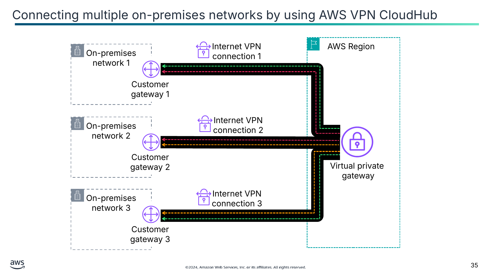

Текст зі схеми

On-premises network 1 (Локальна мережа 1)

Internet VPN connection 1 (Інтернет-з’єднання VPN 1)

AWS Region (Регіон AWS)

Customer gateway 1 (Шлюз клієнта 1)

On-premises network 2

Internet VPN connection 2

Customer gateway 2

Virtual private

gateway (Віртуальний приватний шлюз)

On-premises network 3

Internet VPN connection 3

Customer gateway 3

> **Нотатки:**
>
> |Номер слайда 35  
> |Нотатки для інструктора  
> |  
> |Нотатки для студента  
> Великі корпоративні організації зазвичай мають кілька локальних мережевих середовищ, що можуть фізично розташовуватися в різних приміщеннях далеко одне від одного. Якщо середовищам потрібне основне чи резервне підключення до кожного з інших середовищ, потрібен централізований хаб для полегшення підключення.  
>
> Спираючись на описані раніше варіанти VPN, керовані AWS, ви можете безпечно обмінюватися даними з одного середовища в інше за допомогою AWS VPN CloudHub. AWS VPN CloudHub працює за простою моделлю «хаб і промені», яку можна використовувати з сервісом Amazon VPC або без нього. У прикладі на цьому слайді інтернет-з’єднання VPN 1 переносить трафік з локальної мережі 1 до локальних мереж 2 і 3 і назад. Так само інтернет-з’єднання VPN 2 і 3 переносять трафік до інших локальних мереж і від них.  
>
> AWS VPN CloudHub використовує віртуальний приватний шлюз з кількома шлюзами клієнта, кожен з яких використовує унікальні ASN BGP. Шлюзи клієнта оголошують відповідні маршрути через свої з’єднання VPN. Ці оголошення маршрутизації отримуються й повторно оголошуються кожному партнеру BGP, щоб кожен майданчик міг надсилати дані в інші середовища та отримувати дані з них. Віддалені майданчики не повинні мати діапазонів IP-адрес, що перетинаються.

---

## Слайд 36: Прискорення з’єднань Site-to-Site VPN

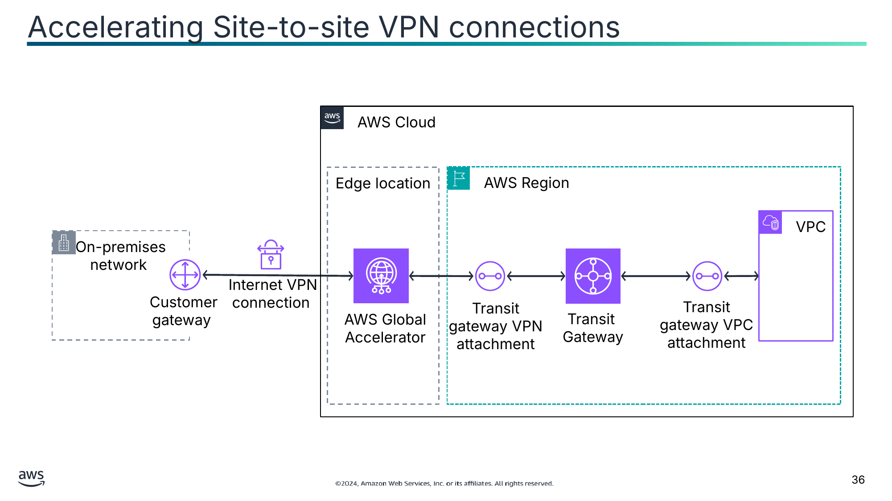

Текст зі схеми

AWS Cloud

AWS Region (Регіон AWS)

Edge location (Периферійна локація)

VPC

On-premises network (Локальна мережа)

Internet VPN connection (Інтернет-з’єднання VPN)

Customer gateway (Шлюз клієнта)

Transit gateway VPN attachment (Приєднання VPN до шлюзу Transit Gateway)

Transit gateway VPC attachment (Приєднання VPC до шлюзу Transit Gateway)

AWS Global Accelerator

Transit

Gateway

> **Нотатки:**
>
> |Номер слайда 36  
> |Нотатки для інструктора  
> |Щоб продемонструвати різницю між часом публічного інтернету та AWS Global Accelerator з різних регіонів до вашого розташування, див. посилання на Global Accelerator Speed Test у вашому переліку ресурсів.  
> |  
> |Нотатки для студента  
> Оскільки трафік публічного інтернету може мати потенційні мережеві перебої, можна використовувати AWS Global Accelerator для прискорення вашого з’єднання Site-to-Site VPN. Прискорене з’єднання VPN використовує Global Accelerator для маршрутизації трафіку з вашої локальної мережі до периферійної локації AWS, найближчої до вашого пристрою шлюзу клієнта. Мережевий трафік тепер використовує магістральну інфраструктуру AWS для ефективної маршрутизації трафіку з периферійної локації до шлюзу Transit Gateway з кращим часом відповіді. Зверніть увагу, що прискорення підтримується лише для з’єднань VPN, приєднаних до шлюзу Transit Gateway, а не до віртуального приватного шлюзу.  
>
> У прикладі на цьому слайді локальна мережа має з’єднання VPN, що підключається до Global Accelerator. Global Accelerator підключений до Transit Gateway через приєднання VPN до шлюзу Transit Gateway. Transit Gateway підключається до VPC через приєднання VPC до шлюзу Transit Gateway.  
>
> Щоб перевірити різницю між швидкостями публічного інтернету та Global Accelerator з різних регіонів до вашого розташування, див. AWS Global Accelerator Speed Comparison у посиланнях на ресурси.

---

## Слайд 37: Ізоляція VPC із повним доступом VPN за допомогою Transit Gateway

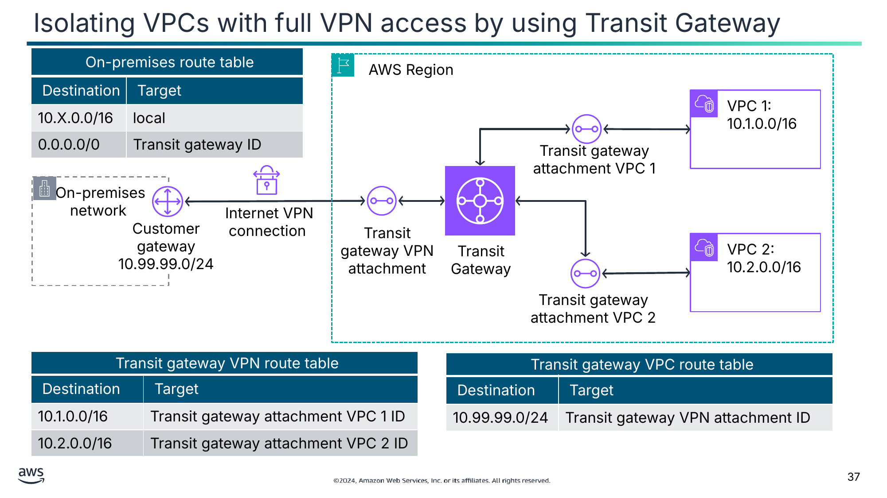

**On-premises route table (Таблиця маршрутизації локальної мережі)**

| Destination (Призначення) | Target (Ціль) |
|---|---|
| 10.X.0.0/16 | local |
| 0.0.0.0/0 | Transit gateway ID |

**Transit gateway VPN route table (Таблиця маршрутизації VPN шлюзу Transit Gateway)**

| Destination (Призначення) | Target (Ціль) |
|---|---|
| 10.1.0.0/16 | Transit gateway attachment VPC 1 ID |
| 10.2.0.0/16 | Transit gateway attachment VPC 2 ID |

**Transit gateway VPC route table (Таблиця маршрутизації VPC шлюзу Transit Gateway)**

| Destination (Призначення) | Target (Ціль) |
|---|---|
| 10.99.99.0/24 | Transit gateway VPN attachment ID |

Текст зі схеми

AWS Region (Регіон AWS)

VPC 1: 10.1.0.0/16

Transit gateway

attachment VPC 1 (Приєднання шлюзу Transit Gateway до VPC 1)

On-premises network (Локальна мережа)

Internet VPN connection (Інтернет-з’єднання VPN)

Customer gateway (Шлюз клієнта)

10.99.99.0/24

Transit gateway VPN attachment (Приєднання VPN до шлюзу Transit Gateway)

Transit Gateway

VPC 2: 10.2.0.0/16

Transit gateway

attachment VPC 2

> **Нотатки:**
>
> |Номер слайда 37  
> |Нотатки для інструктора  
> |  
> |Нотатки для студента  
> Досі ви дізналися, як створити мережу, призначену для повного спільного використання всіх ресурсів у всіх підключених середовищах. А що, якщо вимога — щоб локальна мережа мала повний доступ до VPC, але VPC були ізольовані одна від одної?  
>
> На щастя, ви можете налаштувати свій шлюз Transit Gateway як кілька ізольованих маршрутизаторів. Це подібно до використання кількох шлюзів Transit Gateway, але забезпечує більшу гнучкість у випадках, коли маршрути та приєднання можуть змінюватися. Для одного шлюзу Transit Gateway можна створити кілька таблиць маршрутизації. Кожне приєднання шлюзу Transit Gateway пов’язується з таблицею маршрутизації. Приєднання, пов’язані з однією ізольованою таблицею маршрутизації, можуть маршрутизувати пакети одне одному, але не можуть маршрутизувати пакети до приєднань іншого ізольованого маршрутизатора чи отримувати від них пакети.  
>
> У прикладі на цьому слайді кожна VPC має таблицю маршрутизації з ідентифікатором шлюзу Transit Gateway як ціллю для всього трафіку. Шлюз Transit Gateway має дві таблиці маршрутизації. Таблицю маршрутизації VPN шлюзу Transit Gateway пов’язано з приєднанням VPN до шлюзу Transit Gateway. Таблицю маршрутизації VPC шлюзу Transit Gateway пов’язано з приєднаннями VPC до шлюзу Transit Gateway. Мережевий трафік з VPC 1 і VPC 2, призначений для локальної мережі, маршрутизується до шлюзу Transit Gateway, а потім до інтернет-з’єднання VPN для надходження в локальну мережу. Мережевий трафік з VPC 1, що має призначенням підмережу у VPC 2 10.2.0.0, маршрутизується через шлюз Transit Gateway, де він блокується, оскільки в таблиці маршрутизації VPC шлюзу Transit Gateway немає маршруту.

---

## Слайд 38: Ключові висновки: підключення до вашої віддаленої мережі за допомогою Site-to-Site VPN

- Site-to-Site VPN створює захищене з’єднання між локальним шлюзом клієнта та віртуальним приватним шлюзом AWS (або шлюзом Transit Gateway) для доступу до VPC.
- Ви можете підключити кілька локальних мереж до одного віртуального приватного шлюзу.
- Використовуйте Global Accelerator для прискорення з’єднань Site-to-Site VPN.
- Налаштуйте кілька таблиць маршрутизації Transit Gateway, щоб ізолювати VPC і забезпечити повний доступ VPN.

> **Нотатки:**
>
> |Номер слайда 38  
> |Нотатки для інструктора  
> |  
> |Нотатки для студента

---

## Слайд 39: Підключення до вашої віддаленої мережі за допомогою AWS Direct Connect

З’єднання мереж

> **Нотатки:**
>
> |Номер слайда 39  
> |Нотатки для інструктора  
> |  
> |Нотатки для студента  
> Цей розділ розглядає, як підключитися до віртуальної приватної хмари Amazon (VPC) з локальної віддаленої мережі за допомогою AWS Direct Connect.

---

## Слайд 40: AWS Direct Connect

- Є виділеним приватним з’єднанням віртуальної локальної мережі (VLAN), що розширює локальну мережу, щоб включити ресурси AWS
- Забезпечує стабільний мережевий досвід із передбачуваною продуктивністю та збільшеною пропускною здатністю

Direct Connect

> **Нотатки:**
>
> |Номер слайда 40  
> |Нотатки для інструктора  
> |  
> |Нотатки для студента  
> Як ви дізналися, Site-to-Site VPN — один із варіантів підключення вашої локальної мережі до глобальної мережі AWS. Дані передаються зашифрованими тунелями через публічний інтернет.  
>
> Direct Connect — це ще одне рішення, що виходить за межі підключення через інтернет. Direct Connect використовує віртуальні локальні мережі (VLAN), щоб ви могли встановити виділене приватне мережеве з’єднання з вашої локальної мережі до AWS. Це приватне з’єднання розширює вашу приватну мережу, щоб включити ресурси AWS. Переваги використання Direct Connect — збільшена пропускна здатність і стабільніший мережевий досвід, ніж за з’єднань через інтернет.

---

## Слайд 41: Сценарії використання Direct Connect

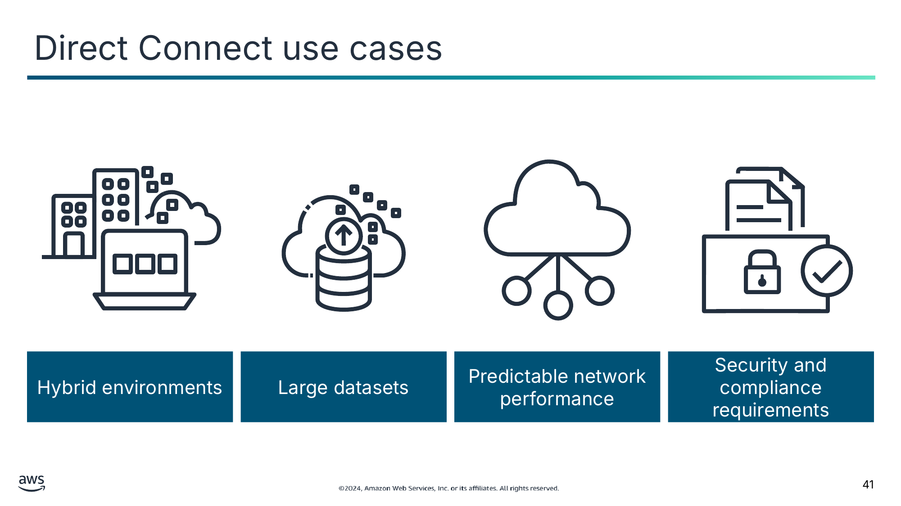

Гібридні середовища

Великі набори даних

Передбачувана мережева продуктивність

Вимоги до безпеки та відповідності

> **Нотатки:**
>
> |Номер слайда 41  
> |Нотатки для інструктора  
> |  
> |Нотатки для студента  
> Direct Connect корисний для кількох сценаріїв, як-от такі:  
> Для застосунків, що потребують доступу до наявного обладнання центру обробки даних, як-от локальна база даних, Direct Connect дає вам змогу створити гібридне середовище, щоб ви могли скористатися еластичністю та економічними перевагами AWS.  
> Для застосунків, що працюють із великими наборами даних, як-от застосунки високопродуктивних обчислень (HPC), передавання великих наборів даних через інтернет між вашим центром обробки даних і хмарою AWS може бути тривалим і дорогим. Для таких застосунків підключення до хмари AWS за допомогою Direct Connect — гарне рішення з таких причин:  
> Мережеві передавання не конкуруватимуть за пропускну здатність інтернету у вашому центрі обробки даних.  
> Канал із високою пропускною здатністю зменшує ймовірність мережевого перевантаження й погіршення продуктивності застосунків.  
> Обмеживши пропускну здатність інтернету, яку використовують ваші застосунки, ви можете зменшити мережеві платежі, які ви сплачуєте вашому інтернет-провайдеру (ISP), і уникнути необхідності платити за збільшені зобов’язання щодо пропускної здатності інтернету чи нові контракти. Крім того, усі дані, що передаються через Direct Connect, тарифікуються за зниженим тарифом передавання даних Direct Connect замість тарифів передавання даних через інтернет, що може зменшити ваші мережеві витрати.  
> Для застосунків, що потребують передбачуваної мережевої продуктивності, Direct Connect — гарне рішення. Приклади включають застосунки, що працюють з потоками даних у реальному часі, як-от аудіо- чи відеопотоки. У таких випадках виділене мережеве з’єднання може забезпечувати стабільнішу мережеву продуктивність, ніж стандартне підключення до інтернету.  
> Для корпоративних політик безпеки чи регуляторних політик, що іноді вимагають, щоб до застосунків, розміщених у хмарі AWS, отримували доступ лише через приватні мережеві канали. Direct Connect — рішення цієї вимоги, оскільки трафік між вашим центром обробки даних і вашим застосунком проходить через виділене приватне мережеве з’єднання.

---

## Слайд 42: Розширення локальної мережі до AWS за допомогою Direct Connect

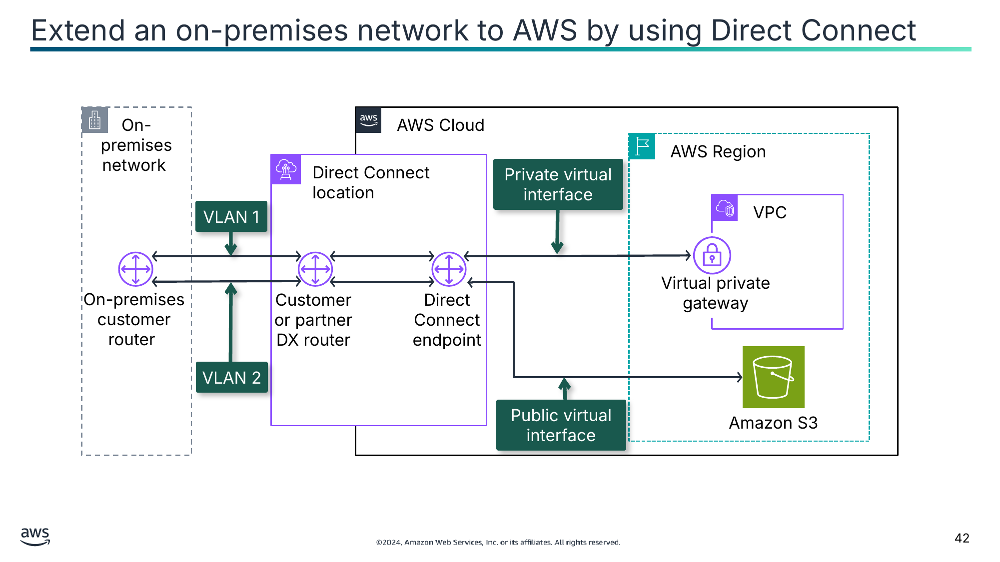

Private virtual interface (Приватний віртуальний інтерфейс)

VLAN 1

VLAN 2

Public virtual interface (Публічний віртуальний інтерфейс)

Текст зі схеми

On-premises network (Локальна мережа)

AWS Cloud

AWS Region (Регіон AWS)

Direct Connect location (Локація Direct Connect)

VPC

Virtual private

gateway (Віртуальний приватний шлюз)

On-premises customer router (Локальний маршрутизатор клієнта)

Customer or partner DX router (Маршрутизатор DX клієнта чи партнера)

Direct Connect endpoint (Кінцева точка Direct Connect)

Amazon S3

> **Нотатки:**
>
> |Номер слайда 42  
> |Нотатки для інструктора  
> |  
> |Нотатки для студента  
> Direct Connect (DX) використовує локації Direct Connect, щоб розширити вашу локальну мережу до AWS за допомогою галузево стандартних VLAN 802.1Q. За замовчуванням ці локації пов’язані з регіоном AWS. Однак ви можете отримувати доступ до будь-якої VPC чи публічного сервісу AWS у будь-якому регіоні (окрім Китаю) з будь-якої підтримуваної локації Direct Connect.  
>
> З Direct Connect ви маєте вибір із двох типів з’єднань до локації Direct Connect: виділені (dedicated) або розміщені (hosted) з’єднання. Виділене з’єднання — це коли фізичний оптоволоконний кабель Ethernet виділяється для ексклюзивного використання клієнтом. Локальний маршрутизатор клієнта буде підключено з’єднанням Ethernet до маршрутизатора клієнта в локації Direct Connect. Розміщене з’єднання — це коли фізичний оптоволоконний кабель Ethernet виділяється партнером Direct Connect і розподіляється з клієнтом. Це надає клієнту більше варіантів пропускної здатності з меншими кроками, ніж виділене з’єднання. Маршрутизатор Direct Connect клієнта підключено до кінцевої точки Direct Connect у локації Direct Connect для підключення до сервісів AWS, зокрема VPC. З’єднання Direct Connect потребує планування та фізичних ресурсів, тож час впровадження зазвичай охоплює кілька тижнів.  
>
> З’єднанням Direct Connect можна створити три типи віртуальних інтерфейсів: публічний, приватний і транзитний (transit):  
> Публічний віртуальний інтерфейс забезпечує доступ до публічних сервісів AWS, як-от Amazon S3. У прикладі на цьому слайді публічний віртуальний інтерфейс позначено зеленими стрілками.  
> Приватний віртуальний інтерфейс забезпечує доступ до вашої VPC за допомогою віртуального приватного шлюзу.  
> Транзитний віртуальний інтерфейс забезпечує доступ до вашої VPC за допомогою шлюзу Transit Gateway.  
>
> У прикладі на цьому слайді з’єднання VLAN 1 встановлюється з локального маршрутизатора клієнта до маршрутизатора Direct Connect клієнта в локації Direct Connect і кінцевої точки Direct Connect. Кінцева точка Direct Connect підключається до віртуального приватного шлюзу VPC через приватний віртуальний інтерфейс. З’єднання VLAN 2 встановлюється з локального маршрутизатора клієнта до маршрутизатора Direct Connect клієнта в локації Direct Connect і кінцевої точки Direct Connect. Кінцева точка Direct Connect підключається до Amazon S3 через публічний віртуальний інтерфейс.  
>
> Докладніше див. «AWS Direct Connect Locations» на сторінці ресурсів вмісту вашого онлайн-курсу.

---

## Слайд 43: Direct Connect за допомогою Transit Gateway

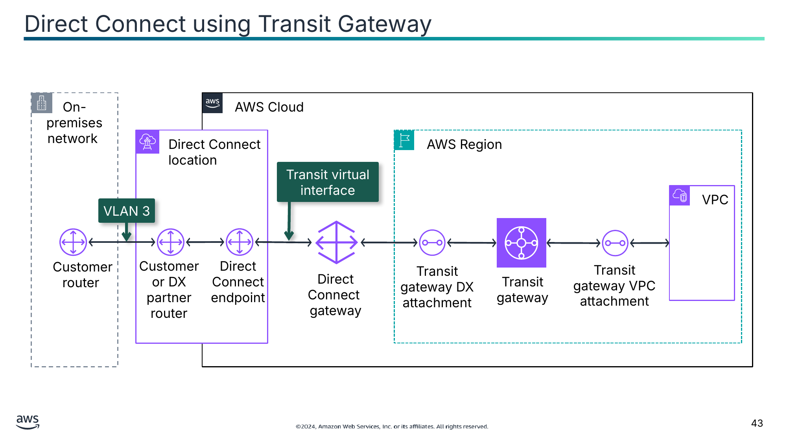

Transit virtual interface (Транзитний віртуальний інтерфейс)

VLAN 3

Текст зі схеми

On-premises network (Локальна мережа)

AWS Cloud

Direct Connect location (Локація Direct Connect)

AWS Region (Регіон AWS)

VPC

Customer router (Маршрутизатор клієнта)

Customer or DX partner router (Маршрутизатор клієнта чи партнера DX)

Direct Connect endpoint (Кінцева точка Direct Connect)

Transit gateway DX attachment (Приєднання DX до шлюзу Transit Gateway)

Transit gateway VPC attachment (Приєднання VPC до шлюзу Transit Gateway)

Direct Connect

gateway (Шлюз Direct Connect)

Transit gateway (Шлюз Transit Gateway)

> **Нотатки:**
>
> |Номер слайда 43  
> |Нотатки для інструктора  
> |  
> |Нотатки для студента  
> Ви також можете використовувати Direct Connect для підключення до шлюзу Transit Gateway замість віртуального приватного шлюзу, щоб спростити маршрутизацію між локальною мережею та кількома VPC. Шлюз Transit Gateway має приєднання Direct Connect до шлюзу Transit Gateway, що вказує на шлюз Direct Connect (Direct Connect gateway). Ви можете використовувати шлюз Direct Connect для підключення до кількох шлюзів Transit Gateway. Рішення використовує транзитний віртуальний інтерфейс для обміну даними з локації Direct Connect до шлюзу Direct Connect.  
>
> У прикладі на цьому слайді з’єднання VLAN 3 встановлюється з локального маршрутизатора клієнта до маршрутизатора Direct Connect клієнта в локації Direct Connect і кінцевої точки Direct Connect. Кінцева точка Direct Connect підключається до кінцевої точки шлюзу Direct Connect через транзитний віртуальний інтерфейс. Шлюз Direct Connect з’єднано зі шлюзом Transit Gateway через приєднання Direct Connect до шлюзу Transit Gateway. Transit Gateway підключено до VPC через приєднання VPC до шлюзу Transit Gateway.

---

## Слайд 44: Сценарій використання: висока доступність Direct Connect і резервний VPN

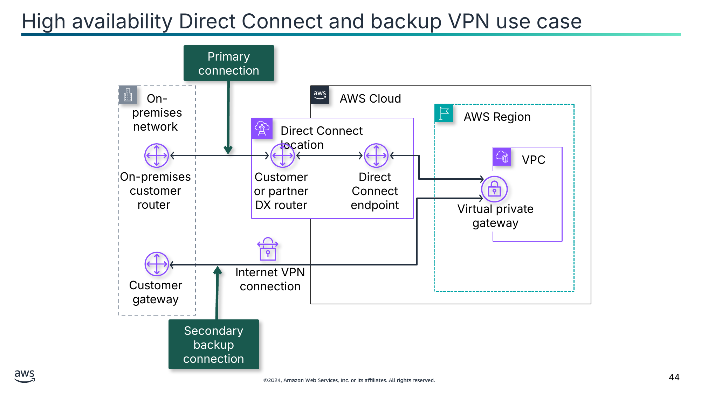

Primary connection (Основне з’єднання)

Secondary backup connection (Вторинне резервне з’єднання)

Текст зі схеми

On-premises network (Локальна мережа)

AWS Cloud

AWS Region (Регіон AWS)

Direct Connect location (Локація Direct Connect)

VPC

On-premises customer router (Локальний маршрутизатор клієнта)

Customer or partner DX router (Маршрутизатор DX клієнта чи партнера)

Direct Connect endpoint (Кінцева точка Direct Connect)

Virtual private

gateway (Віртуальний приватний шлюз)

Internet VPN connection (Інтернет-з’єднання VPN)

Customer gateway (Шлюз клієнта)

> **Нотатки:**
>
> |Номер слайда 44  
> |Нотатки для інструктора  
> |  
> |Нотатки для студента  
> Ви можете впровадити високодоступне підключення між вашими центрами обробки даних і вашою VPC, поєднавши одне чи кілька з’єднань Direct Connect, які ви використовуєте для основного підключення, з дешевшим резервним з’єднанням VPN.  
>
> У цьому прикладі конфігурація складається з двох динамічно маршрутизованих з’єднань — одне використовує Direct Connect, а інше — з’єднання VPN — від двох різних пристроїв клієнта. AWS надає приклади конфігурацій маршрутизаторів, щоб допомогти вам встановити і Direct Connect, і динамічно маршрутизовані з’єднання VPN. За замовчуванням AWS завжди віддаватиме перевагу надсиланню трафіку через ваше з’єднання Direct Connect, тож вам не потрібні додаткові конфігурації, специфічні для AWS, щоб визначити основне й резервне з’єднання. Однак слід налаштувати поширення внутрішніх маршрутів, специфічне для Direct Connect і VPN, щоб допомогти гарантувати, що внутрішні системи обирають відповідні шляхи.  
>
> За цього підходу ви можете обрати основний мережевий шлях і мережевого провайдера для вашого трафіку AWS з можливістю використання іншого провайдера для резервного з’єднання VPN. Обирайте мережевих провайдерів і локації Direct Connect, що відповідають толерантності вашої організації до ризиків, фінансовим очікуванням і політикам підключення центрів обробки даних.  
>
> Існує багато способів підвищити доступність вашої мережі. Ви можете використовувати кілька каналів Direct Connect і кілька тунелів VPN між окремо розгорнутими приватними адресними просторами IP. Ви також можете використовувати кілька локацій Direct Connect для високої доступності. Якщо ви використовуєте кілька регіонів AWS, вам також знадобляться кілька локацій Direct Connect щонайменше у двох регіонах. Ви можете захотіти оцінити пристрої AWS Marketplace, що вимикають VPN.

---

## Слайд 45: Висока стійкість із кількома локаціями Direct Connect

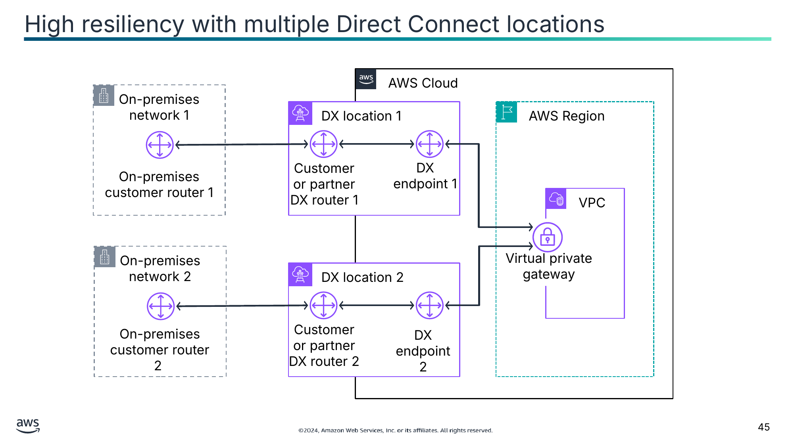

Текст зі схеми

AWS Cloud

On-premises network 1 (Локальна мережа 1)

DX location 1 (Локація DX 1)

AWS Region (Регіон AWS)

Customer or partner DX router 1 (Маршрутизатор DX клієнта чи партнера 1)

DX endpoint 1 (Кінцева точка DX 1)

On-premises customer router 1 (Локальний маршрутизатор клієнта 1)

VPC

On-premises network 2

Virtual private

gateway (Віртуальний приватний шлюз)

DX location 2

On-premises customer router 2

Customer or partner DX router 2

DX endpoint 2

> **Нотатки:**
>
> |Номер слайда 45  
> |Нотатки для інструктора  
> |  
> |Нотатки для студента  
> Для критично важливих продуктивних робочих навантажень, що потребують високої стійкості, AWS рекомендує мати одне з’єднання в кількох локаціях. Як показує архітектурна схема, така топологія допомагає гарантувати стійкість до збоїв підключення через апаратну відмову чи повну відмову локації. У прикладі на цьому слайді локальна мережа 1 підключається до віртуального приватного шлюзу через локацію Direct Connect 1. Якщо локація Direct Connect 1 виходить з ладу або виникають проблеми з локальною мережею 1, то локальна мережа 2 усе ще може підключитися до віртуального приватного шлюзу через локацію Direct Connect 2.  
>
> Високостійкі, відмовостійкі мережеві з’єднання — ключ до добре спроєктованої системи. AWS рекомендує підключатися з кількох центрів обробки даних для фізичної надлишковості розташування. Проєктуючи віддалені з’єднання, розгляньте використання надлишкового апаратного забезпечення та телекомунікаційних провайдерів.  
>
> Крім того, найкраща практика — використовувати динамічно маршрутизовані з’єднання «активний/активний» для автоматичного балансування навантаження та відмовостійкого перемикання між надлишковими мережевими з’єднаннями. Забезпечте достатню мережеву потужність, щоб відмова одного мережевого з’єднання не перевантажила й не погіршила роботу надлишкових з’єднань.

---

## Слайд 46: Ключові висновки: підключення до вашої віддаленої мережі за допомогою Direct Connect

- Direct Connect — це виділене приватне з’єднання VLAN, що розширює локальну мережу, щоб включити ресурси AWS.
  - Використовуйте приватний віртуальний інтерфейс для підключення локації Direct Connect до віртуального приватного шлюзу.
  - Використовуйте публічний віртуальний інтерфейс для підключення локації Direct Connect до підтримуваних сервісів AWS.
  - Використовуйте транзитний віртуальний інтерфейс для підключення локації Direct Connect до шлюзу Transit Gateway через шлюз Direct Connect.
- Зробіть свою мережу високодоступною, використовуючи Direct Connect як основне з’єднання та VPN як резервне з’єднання.
- Зробіть свою мережу високостійкою, підключаючись з кількох локальних мереж до AWS за допомогою кількох локацій Direct Connect.

> **Нотатки:**
>
> |Номер слайда 46  
> |Нотатки для інструктора  
> |  
> |Нотатки для студента

---

## Слайд 47: Застосування принципів AWS Well-Architected Framework до мережевого підключення

З’єднання мереж

> **Нотатки:**
>
> |Номер слайда 47  
> |Нотатки для інструктора  
> |  
> |Нотатки для студента  
> Цей розділ розглядає, як застосовувати принципи опор AWS Well-Architected Framework до вашого мережевого підключення.

---

## Слайд 48: Опори AWS Well-Architected Framework для мережі

> **Нотатки:**
>
> |Номер слайда 48  
> |Нотатки для інструктора  
> |Решта слайдів у цьому розділі подають приклади, що підкреслюють, як матеріал цього модуля узгоджується з найкращими практиками Well-Architected Framework. За бажанням ви можете попросити студентів відвідати вебсайт Well-Architected Framework і знайти найкращі практики, які, на їхню думку, пов’язані з матеріалом, поданим у цьому модулі, використовуючи цей розділ як відправну точку.  
> |  
> |Нотатки для студента  
> AWS Well-Architected Framework має шість опор, і кожна опора включає найкращі практики та набір запитань, які слід враховувати під час проєктування хмарних рішень. Цей розділ виділяє кілька найкращих практик з опор, найактуальніших для цього модуля. Докладніше про найкращі практики за опорами див. посилання на вебсайт AWS Well-Architected у ресурсах курсу.  
>
> Проєктуючи підключення до кількох мереж, слід враховувати всі майбутні заплановані робочі навантаження у ваших локальних і хмарних середовищах. Як забезпечити, щоб робоче навантаження було стійким, безпечним, високопродуктивним і економічно ефективним, коли його розгорнуто в кількох мережах? На рівні інфраструктури ви починаєте з проєктування вашої мережі так, щоб вона була стійкою, безпечною, високопродуктивною та економічно ефективною.

---

## Слайд 49: Підхід найкращих практик: основи — плануйте топологію вашої мережі

**Найкращі практики**

Забезпечте надлишкове підключення між приватними мережами в хмарі та в локальних середовищах.

Віддавайте перевагу топологіям «хаб і промені» над сіткою «багато до багатьох».

> **Нотатки:**
>
> |Номер слайда 49  
> |Нотатки для інструктора  
> |  
> |Нотатки для студента  
> Проєктуючи свою мережу, слід планувати стійку топологію мережі. Стійкість означає, що робочі навантаження вашої мережі мають функціонувати правильно та стабільно, коли від них цього очікують. Ваша мережа має передбачати можливі мережеві збої й вміщувати майбутнє зростання трафіку, щоб робочі навантаження могли працювати в локальних мережах і мережах AWS. Це означає, що стійкість — спільна відповідальність між AWS і вами. AWS відповідає за стійкість магістралі хмарної мережі, а ви відповідаєте за впровадження стійкості локально та в хмарі AWS.  
>
> Забезпечте надлишкове підключення між приватними мережами в хмарі та в локальних середовищах: AWS рекомендує мати механізми відмовостійкого перемикання мережі локально та в хмарі на випадок перебою. Коли ви підключаєте свою VPC до локального центру обробки даних через VPN, слід враховувати вимоги до стійкості та пропускної здатності, які вам потрібні. Якщо ви використовуєте пристрій VPN, що не є стійким у своїй реалізації, слід мати надлишкове з’єднання через другий пристрій. Якщо ви обираєте підключення вашої VPC до центру обробки даних за допомогою з’єднання Direct Connect і вам потрібно, щоб це з’єднання було високодоступним, впровадьте надлишкові з’єднання Direct Connect від кожного центру обробки даних. Надлишкове з’єднання має використовувати друге з’єднання Direct Connect з іншої локації, ніж перше. Якщо у вас кілька центрів обробки даних, переконайтеся, що з’єднання вказують на різні локації. Також можна використовувати VPN як резервне з’єднання для Direct Connect.  
>
> Віддавайте перевагу топологіям «хаб і промені» над сіткою «багато до багатьох»: AWS рекомендує використовувати топології «хаб і промені», як-от Transit Gateway, а не сітку «багато до багатьох», як-от піринг Amazon VPC. Transit Gateway забезпечує модель «хаб і промені», що маршрутизує трафік у ваших мережах. Уникайте використання пірингу Amazon VPC для з’єднання більш ніж двох VPC. Не встановлюйте кілька сеансів BGP для кожної VPC для створення підключення до кількох VPC у кількох регіонах AWS.  
>
> У цьому модулі ви дізналися про низку мережевих сервісів AWS, що підтримують ці найкращі практики, зокрема такі:  
> Впровадьте відмовостійке перемикання з’єднання VPN, якщо Direct Connect між локальними мережами та мережами AWS VPC недоступний.  
> Для кількох VPC впровадьте модель «хаб і промені» для меншого обслуговування з’єднань і простоти використання.  
>
> Докладніше про найкращі практики надійності див. посилання «AWS Well-Architected Reliability Pillar» у ресурсах курсу.

---

## Слайд 50: Підхід найкращих практик: захист інфраструктури — захист мереж

**Найкраща практика**

Контролюйте трафік на всіх рівнях.

> **Нотатки:**
>
> |Номер слайда 50  
> |Нотатки для інструктора  
> |  
> |Нотатки для студента  
> AWS рекомендує застосовувати підхід нульової довіри (zero trust), щоб застосувати принцип безпеки на всіх рівнях. Ретельне планування та керування проєктом вашої мережі формує основу того, як ви забезпечуєте ізоляцію та межі для ресурсів у вашому гібридному робочому навантаженні, що працює локально та в хмарі AWS.  
>
> Контролюйте трафік на всіх рівнях: AWS рекомендує встановлювати приватний мережевий трафік, впроваджуючи Direct Connect або Site-to-Site VPN для захисту обміну даними. Site-to-Site VPN створює захищене з’єднання з тунелями для проходження публічним інтернетом з локального розташування в хмару AWS. Direct Connect встановлює виділену приватну лінію з локального розташування до локації Direct Connect.  
>
> У цьому модулі ви дізналися про низку мережевих сервісів AWS, що підтримують ці найкращі практики, зокрема такі:  
> Впровадьте Site-to-Site VPN для приватного мережевого трафіку через інтернет.  
> Впровадьте Direct Connect для приватної, виділеної лінії до AWS.  
>
> Докладніше про найкращі практики безпеки див. посилання «AWS Well-Architected Security Pillar» у ресурсах курсу.

---

## Слайд 51: Підхід найкращих практик: захист даних — захист даних під час передавання

**Найкраща практика**

Автентифікуйте мережевий обмін даними.

Примусово забезпечуйте шифрування під час передавання.

> **Нотатки:**
>
> |Номер слайда 51  
> |Нотатки для інструктора  
> |  
> |Нотатки для студента  
> Дані під час передавання (data in transit) — це будь-які дані, що надсилаються з однієї системи в іншу. Це включає обмін даними між ресурсами у вашому робочому навантаженні та обмін даними між іншими сервісами й вашими кінцевими користувачами. Забезпечуючи належний рівень захисту ваших даних під час передавання, ви захищаєте конфіденційність і цілісність даних вашого робочого навантаження.  
>
> Автентифікуйте мережевий обмін даними: AWS рекомендує перевіряти ідентичність обміну даними за допомогою протоколів, що підтримують автентифікацію, як-от TLS чи IPsec. Використання мережевих протоколів, що підтримують автентифікацію, встановлює довіру між сторонами. Це доповнює шифрування, що використовується в протоколі, щоб зменшити ризик зміни чи перехоплення обміну даними. Поширені протоколи, що впроваджують автентифікацію, включають TLS, який використовується в багатьох сервісах AWS, та IPsec, що використовується у VPN AWS.  
>
> Примусово забезпечуйте шифрування під час передавання: AWS рекомендує використовувати протоколи з шифруванням під час передавання чутливих даних за межі вашої VPC. Шифрування допомагає зберігати конфіденційність даних, навіть коли дані проходять через недовірені мережі. Усі дані слід шифрувати під час передавання за допомогою протоколів TLS і наборів шифрів. AWS рекомендує використовувати TLS версії 1.3. Мережевий трафік між вашими ресурсами та інтернетом має бути зашифрований, щоб пом’якшити неавторизований доступ до даних. Розгляньте захист трафіку між мережами за допомогою VPN IPsec або Direct Connect, щоб забезпечити приватний мережевий трафік.  
>
> У цьому модулі ви дізналися про низку мережевих сервісів AWS, що підтримують ці найкращі практики, зокрема такі:  
> Впровадьте Site-to-Site VPN за допомогою протоколу IPsec для автентифікації трафіку, щоб встановити зашифровані тунелі VPN до AWS.  
> Впровадьте шифрування й використовуйте Direct Connect для приватної, виділеної лінії до AWS.  
>
> Докладніше про найкращі практики безпеки див. посилання «AWS Well-Architected Security Pillar» у ресурсах курсу.

---

## Слайд 52: Підхід найкращих практик: вибір — вибір мережевої архітектури

**Найкращі практики**

Обирайте виділене підключення чи VPN відповідного розміру для гібридних робочих навантажень.

Обирайте розташування вашого робочого навантаження на основі мережевих вимог.

> **Нотатки:**
>
> |Номер слайда 52  
> |Нотатки для інструктора  
> |  
> |Нотатки для студента  
> Оптимальне рішення для конкретного робочого навантаження різниться, і рішення часто поєднують кілька підходів. Добре спроєктовані (well-architected) робочі навантаження використовують кілька рішень і включають різні функції для покращення продуктивності.  
>
> Обирайте виділене підключення чи VPN відповідного розміру для гібридних робочих навантажень: AWS рекомендує оцінювати розмір трафіку робочого навантаження, якому знадобиться гібридна мережа. Є кілька варіантів конфігурації підключення на вибір, як-от виділене з’єднання чи VPN. Обирайте відповідний тип з’єднання для кожного робочого навантаження, переконуючись, що ви маєте достатню пропускну здатність і вимоги до шифрування між вашим розташуванням і хмарою. Оцініть вимоги до пропускної здатності та затримки для вашого гібридного робочого навантаження. Ці цифри визначатимуть вимоги до розміру ваших варіантів підключення.  
>
> Обирайте розташування вашого робочого навантаження на основі мережевих вимог: AWS рекомендує оцінювати варіанти розміщення ресурсів, щоб зменшити мережеву затримку та покращити пропускну здатність, забезпечуючи оптимальний користувацький досвід шляхом скорочення часу завантаження сторінок і передавання даних. Якщо у вас є застосунки чи користувачі локально, вам може бути корисне виділене мережеве з’єднання між вашою мережею та хмарою. Виділене мережеве з’єднання, що надається Direct Connect, може зменшити ймовірність зіткнення з перевантаженням публічного інтернету чи несподіваним збільшенням затримки. Якщо ви налаштовуєте Site-to-Site VPN для підключення до ваших ресурсів в AWS, можна за бажанням увімкнути прискорення. Прискорене з’єднання Site-to-Site VPN використовує Global Accelerator для маршрутизації трафіку з вашої локальної мережі до периферійної локації AWS, найближчої до вашого пристрою шлюзу клієнта.  
>
> У цьому модулі ви дізналися про низку мережевих сервісів AWS, що підтримують ці найкращі практики, зокрема такі:  
> Оцінюйте робочі навантаження, щоб оцінити вимоги до пропускної здатності та шифрування між розташуванням робочого навантаження й AWS.  
> Якщо у вас є користувачі чи застосунки локально, впровадьте Direct Connect для передбачуваної продуктивності.  
>
> Докладніше про найкращі практики ефективності продуктивності див. посилання «AWS Well-Architected Performance Efficiency Pillar» у ресурсах курсу.

---

## Слайд 53: Підхід найкращих практик: економічно ефективні ресурси — плануйте передавання даних

**Найкращі практики**

Обирайте компоненти для оптимізації вартості передавання даних.

Впроваджуйте сервіси для зменшення витрат на передавання даних.

> **Нотатки:**
>
> |Номер слайда 53  
> |Нотатки для інструктора  
> |  
> |Нотатки для студента  
> Робоче навантаження в мережі має повністю використовувати всі ресурси, досягати результатів за найнижчою можливою ціною та відповідати функціональним вимогам. Мережеві витрати слід включати до еталонного показника вартості робочого навантаження. Ключ до економії витрат — обрати найкращу модель ціноутворення з відповідними мережевими конфігураціями для ваших робочих навантажень.  
>
> Обирайте компоненти для оптимізації вартості передавання даних: AWS рекомендує проєктувати передавання даних так, щоб мінімізувати витрати на передавання даних. Це може включати використання мереж доставки контенту для розміщення даних ближче до користувачів або використання виділеного мережевого з’єднання з ваших локальних мереж до AWS, як-от Direct Connect. Також можна використовувати оптимізацію WAN і оптимізацію застосунків, щоб зменшити обсяг даних, що передаються між компонентами.  
>
> Впроваджуйте сервіси для зменшення витрат на передавання даних: AWS рекомендує впроваджувати сервіси для зменшення передавання даних. За допомогою моделювання передавання даних подивіться, де найбільші витрати й найвищі обсяги потоків. Перегляньте сервіси AWS. Оцініть, чи є сервіс, що зменшує або усуває передавання, зокрема мережеві сервіси та доставка контенту. AWS віддає перевагу тому, щоб клієнти використовували Direct Connect замість VPN для підключення до AWS, оскільки Direct Connect забезпечує передбачуване підключення.  
>
> У цьому модулі ви дізналися, як використовувати виділене мережеве з’єднання, як-от Direct Connect, з локального середовища до VPC у вашому акаунті AWS, щоб оптимізувати вартість передавання даних і забезпечити передбачувані витрати на передавання даних.  
>
> Докладніше про найкращі практики оптимізації витрат див. посилання «AWS Well-Architected Cost Optimization» у ресурсах курсу.

---

## Слайд 54: Ключові висновки: застосування принципів Well-Architected Framework до вашої мережі

- Забезпечте надлишкове підключення між приватними мережами в хмарі та в локальних середовищах.
- Віддавайте перевагу топологіям «хаб і промені» над сіткою «багато до багатьох».
- Контролюйте трафік на всіх рівнях.
- Автентифікуйте мережевий обмін даними.
- Примусово забезпечуйте шифрування даних під час передавання.
- Обирайте компоненти для оптимізації та зменшення вартості передавання даних.
- Обирайте виділене підключення чи VPN відповідного розміру для гібридних робочих навантажень.
- Обирайте розташування вашого робочого навантаження на основі мережевих вимог.

> **Нотатки:**
>
> |Номер слайда 54  
> |Нотатки для інструктора  
> |Це не вичерпний перелік найкращих практик, охоплених найкращими практиками опор AWS Well-Architected. Це ключові висновки для пояснення найкращих практик, розглянутих у модулі.  
> |Нотатки для студента

---

## Слайд 55: Підсумки модуля

З’єднання мереж

> **Нотатки:**
>
> |Номер слайда 55  
> |Нотатки для інструктора  
> |  
> |Нотатки для студента  
> Цей розділ підсумовує те, що ви дізналися, і завершує модуль.

---

## Слайд 56: Резюме модуля

Цей модуль підготував вас до такого:

- Описувати, як підключити локальну мережу до хмари AWS.
- Описувати, як з’єднати кілька VPC у хмарі AWS.
- З’єднувати VPC у хмарі AWS за допомогою пірингу VPC.
- Описувати, як масштабувати VPC у хмарі AWS.
- Використовувати принципи AWS Well-Architected Framework під час з’єднання мереж.

> **Нотатки:**
>
> |Номер слайда 56  
> |Нотатки для інструктора  
> |  
> |Нотатки для студента

---

## Слайд 57: Міркування щодо кафе

- Обговоріть, як ви, як хмарний архітектор, могли б порадити кафе на основі ключових занепокоєнь хмарного архітектора, поданих на початку цього модуля.

---

## Слайд 58: Перевірка знань модуля

- Перевірка знань проводиться онлайн у вашому курсі.
- Перевірка знань включає 10 запитань на основі матеріалу, поданого на слайдах і в нотатках до слайдів.
- Ви можете повторно проходити перевірку знань стільки разів, скільки захочете.

> **Нотатки:**
>
> |Номер слайда 58  
> |Нотатки для інструктора  
> |  
> |Нотатки для студента  
> Скористайтеся своїм онлайн-курсом, щоб отримати доступ до перевірки знань для цього модуля.

---

## Слайд 59: Зразок запитання іспиту

Застосунок, що працює на екземплярах Amazon EC2 у віртуальній приватній хмарі (VPC), обробляє чутливу інформацію, що зберігається в Amazon S3. Доступ до інформації здійснюється через публічну регіональну кінцеву точку Amazon S3 через інтернет. Команда безпеки стурбована тим, що підключення до Amazon S3 через інтернет є ризиком безпеки. Яке рішення вирішить проблему безпеки найефективнішим мережевим маршрутом?

Визначте ключові слова та фрази, перш ніж продовжувати.

Ось ключові слова та фрази:

- Екземпляри EC2 у VPC
- Чутлива інформація
- Підключення до Amazon S3 через інтернет є ризиком безпеки
- Найефективніший мережевий маршрут

> **Нотатки:**
>
> |Номер слайда 59  
> |Нотатки для інструктора  
> |Розділ із ключовими словами налаштовано з анімацією для розкриття за клацанням.  
> |  
> |Нотатки для студента  
> Запитання просить вас враховувати безпеку та ефективність під час вибору найкращого рішення.

---

## Слайд 60: Зразок запитання іспиту: варіанти відповідей

Застосунок, що працює на екземплярах Amazon EC2 у віртуальній приватній хмарі (VPC), обробляє чутливу інформацію, що зберігається в Amazon S3. Доступ до інформації здійснюється через публічну регіональну кінцеву точку Amazon S3 через інтернет. Команда безпеки стурбована тим, що підключення до Amazon S3 через інтернет є ризиком безпеки. Яке рішення вирішить проблему безпеки найефективнішим мережевим маршрутом?

**Варіант**

**Відповідь**

**A**

Отримувати доступ до даних через інтернет-шлюз.

**B**

Отримувати доступ до даних через з’єднання віртуальної приватної мережі (VPN).

**C**

Отримувати доступ до даних через NAT-шлюз.

**D**

Отримувати доступ до даних через кінцеву точку VPC для Amazon S3.

> **Нотатки:**
>
> |Номер слайда 60  
> |Нотатки для інструктора  
> |  
> |Нотатки для студента  
> Використайте ключові слова, які ви визначили на попередньому слайді, і розгляньте кожен із можливих варіантів відповіді, щоб визначити, який із них найкраще відповідає запитанню.

---

## Слайд 61: Зразок запитання іспиту: відповідь

Правильна відповідь — D.

**Варіант**

**Відповідь**

**A**

**B**

**C**

**D**

Отримувати доступ до даних через кінцеву точку VPC для Amazon S3.

> **Нотатки:**
>
> |Номер слайда 61  
> |Нотатки для інструктора  
> |  
> |Нотатки для студента  
> Варіант A (отримувати доступ до даних через інтернет-шлюз) можна виключити, оскільки трафік усе одно проходитиме через інтернет і це не найефективніший маршрут.  
>
> Варіант B (отримувати доступ до даних через з’єднання віртуальної приватної мережі [VPN]) також можна виключити, оскільки до Amazon S3 не можна підключитися через VPN.  
>
> Варіант C (отримувати доступ до даних через NAT-шлюз) не є найефективнішим способом маршрутизації від екземпляра EC2 до бакета S3, оскільки NAT-шлюз використовує додаткові мережеві вузли під час проходження магістральною мережею AWS у регіоні.  
>
> Варіант D — найкращий вибір. Використовуйте кінцеву точку Gateway VPC для рішення без додаткових витрат і без обмежень пропускної здатності та розміру пакета.

---

## Слайд 62: Дякуємо

Виправлення, відгуки чи інші запитання?

Зв’яжіться з нами за адресою [https://support.aws.amazon.com/#/contacts/aws-academy](https://support.aws.amazon.com/#/contacts/aws-academy).

> **Нотатки:**
>
> |Номер слайда 62  
> |Нотатки для інструктора  
> |  
> |Нотатки для студента  
> На цьому цей модуль завершено. Сторінка ресурсів вмісту вашого курсу містить посилання на додаткові ресурси, пов’язані з цим модулем.
