## Слайд 1: Securing User, Application, and Data Access

AWS Academy Cloud Architecting

> **Нотатки:**
>
> |Slide number 1  
> |Instructor notes  
> |  
> |Student notes  
> Welcome to the Securing User, Application, and Data Access module.

---

## Слайд 2: Introduction

Securing User, Application, and Data Access

> **Нотатки:**
>
> |Slide number 2  
> |Instructor notes: This module extends the foundational security principles introduced in module 3.  
> |  
> |Student notes  
> This introduction section describes the content of this module.

---

## Слайд 3: Module objectives

This module prepares you to do the following:

- Use AWS Identity and Access Management (IAM) users, groups, and roles to manage permissions.
- Implement user federation within an architecture to increase security.
- Describe how to manage multiple AWS accounts.
- Recognize how AWS Organizations service control policies (SCPs) increase security within an architecture.
- Encrypt data at rest by using AWS Key Management Service (AWS KMS).
- Identify appropriate AWS security services based on a given use case.

> **Нотатки:**
>
> |Slide number 3  
> |Instructor notes  
> |  
> |Student notes

---

## Слайд 4: Module overview

**Presentation sections**

- Managing permissions
- Federating users
- Managing access to multiple accounts
- Encrypting data at rest
- AWS security services for securing user, application, and data access

**Knowledge checks**

- 10-question knowledge check
- Sample exam question

> **Нотатки:**
>
> |Slide number 4  
> |Instructor notes  
> |Each module has an introduction, content sections, and a wrap-up. The wrap-up for this module contains a sample exam question for you to review with the students.  
> |  
> |Student notes  
> The objectives of this module are presented across multiple sections. The module wraps up with a 10-question knowledge check delivered in the online course, and a sample exam question to discuss in class. The labs in this module are described on the next slide.

---

## Слайд 5: Hands-on labs in this module

Guided labs

- Securing Applications by Using Amazon Cognito
- Encrypting Data at Rest by Using AWS Encryption Options

> **Нотатки:**
>
> |Slide number 5  
> |Instructor notes  
> |This module includes guided labs. These labs provide step-by-step instructions and are stand-alone labs. They do not depend on the café scenario or related architecture. Introductions to each lab are include in the lab sections within the module.  
> |  
> |Student notes  
> This module includes the guided labs listed. Additional information about each lab is included in the student guide where the lab takes place, and detailed instructions are provided in the lab environment.

---

## Слайд 6: As a cloud architect designing for application security

- I need to design permissions schemes for users, applications, and data that align to security best practices and are scalable.
- I need to prevent unauthorized access to data and applications and protect the data that’s being stored within the application architecture.
- I need to evaluate purpose-built AWS security services to select options that optimize the security of my applications with less undifferentiated lifting by our internal security team.


> **Нотатки:**
>
> |Slide number 6  
> |Instructor notes: This slide presents key overarching design considerations that should guide decision making for this layer of a cloud architecture. Emphasize how a cloud architect must always start with the business case and work backwards to choose the best components for that use case. Also remind students that the decisions are likely to evolve over time as needs change or are better understood to optimize cost and performance. At the end of the module, there’s an optional discussion included in the wrap-up section to prompt the students to consider these factors in the context of the café scenario.  
> |  
> |Student notes  
> This slide asks you to take the perspective of a cloud architect as you think about how to approach cloud network design. Keep these considerations in mind as you progress through this module, remembering that the cloud architect should work backwards from the business need to design the best architecture for a specific use case. As you progress through the module, consider the café scenario presented in the course as an example business need and think about how you would address these needs for the fictional café business.

---

## Слайд 7: Managing permissions

Securing User, Application, and Data Access

> **Нотатки:**
>
> |Slide number 7  
> |Instructor notes  
> |  
> |Student notes

---

## Слайд 8: Challenge of managing permissions

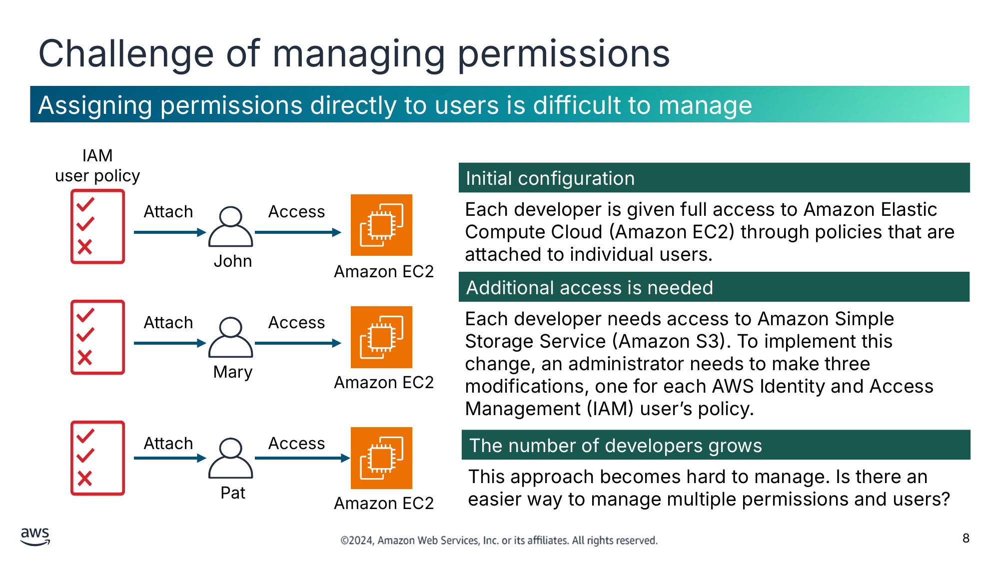

Assigning permissions directly to users is difficult to manage

Initial configuration

Each developer is given full access to Amazon Elastic Compute Cloud (Amazon EC2) through policies that are attached to individual users.

Additional access is needed

Each developer needs access to Amazon Simple Storage Service (Amazon S3). To implement this change, an administrator needs to make three modifications, one for each AWS Identity and Access Management (IAM) user’s policy.

The number of developers grows

This approach becomes hard to manage. Is there an easier way to manage multiple permissions and users?

<details>
<summary>Текст зі схеми</summary>

IAM

user policy

Attach

Access

 John

Amazon EC2

Attach

Access

 Mary

Amazon EC2

Attach

Access

 Pat

Amazon EC2

</details>

> **Нотатки:**
>
> |Slide number 8  
> |Instructor notes  
> |This example shows the challenges of adding the same policy to multiple users. Ask the students whether there’s an easier way to manage multiple permissions and users. The next slide explains the solution, IAM groups.  
> |  
> |Student notes  
> Image description: The diagram shows three users, John, Mary, and Pat, each with their own IAM policy attachment. These policies give each user individually the permission to access Amazon EC2. End description.  
>
> Assigning permissions directly to users is difficult to manage. In this example, there are three users that have policies attached to them to access Amazon Elastic Compute Cloud (Amazon EC2). To implement a change, an administrator needs to make modifications to each individual user policy. Imagine you have 100 developers in the group; this becomes difficult to manage.

---

## Слайд 9: Use IAM groups to attach permissions to multiple users

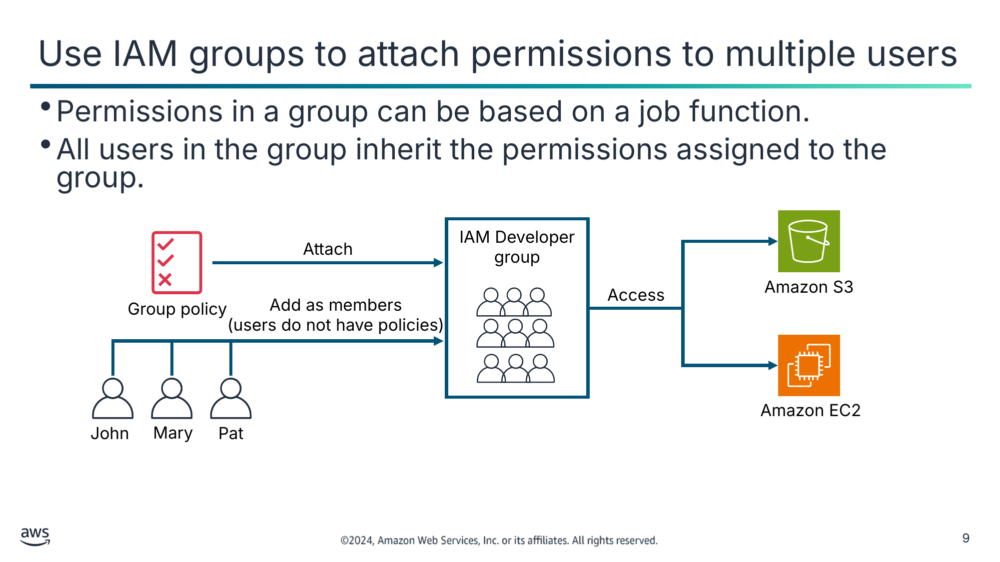

- Permissions in a group can be based on a job function.
- All users in the group inherit the permissions assigned to the group.

<details>
<summary>Текст зі схеми</summary>

IAM Developer group

Attach

Amazon S3

Group policy

Add as members  
(users do not have policies)

Access

Amazon EC2

 John

 Mary

 Pat

</details>

> **Нотатки:**
>
> |Slide number 9  
> |Instructor notes  
> |Communicate that the solution is to create AWS Identity and Access Management (IAM) groups. IAM groups is a collection of IAM users. User groups let you specify permissions for multiple users, which can make it easier to manage the permissions for those users. John, Mary, and Pat now become members of the IAM developer group, and you manage one policy for the group.  
> |  
> |Student notes  
> In the example on the slide, an AWS Identity and Access Management (IAM) group is created to group all users that are developers. A single IAM policy is attached to the group to grant all the permissions that a developer requires. When John, Mary, and Pat are added to the group, they automatically inherit the permissions for the group. When a new permission needs to be granted to all developers, for example to access Amazon Simple Storage Service (Amazon S3), only one change is required: either add the new permission to the existing policy, or create a new policy with the new permission and attach the policy to the group.  
>
> An IAM group is a collection of IAM users. Groups are a convenience that makes it easier to manage permissions for a collection of users, instead of managing permissions for each individual user.  
>
> The characteristics of an IAM group include the following:  
> You can add users to a group or remove them from a group.  
> A user can belong to multiple groups.  
> Groups cannot belong to other groups.  
> Groups can be granted permissions by using access control policies.  
> Groups do not have security credentials and cannot access web services directly. They exist solely to make it easier to manage user permissions.

---

## Слайд 10: Example: Using IAM groups to reflect job role

If a new developer (Pat) is hired, add them to the developers group. Pat will immediately inherit the same access that’s granted to other developers.

If Ana takes on the new role of developer, do the following:

- Remove her from the test group.
- Add her to the developers group.

Users can belong to more than one group, but groups cannot be nested.

Permissions in policies directly attached to a user (user policies) override permissions in group policies if they are more restrictive.

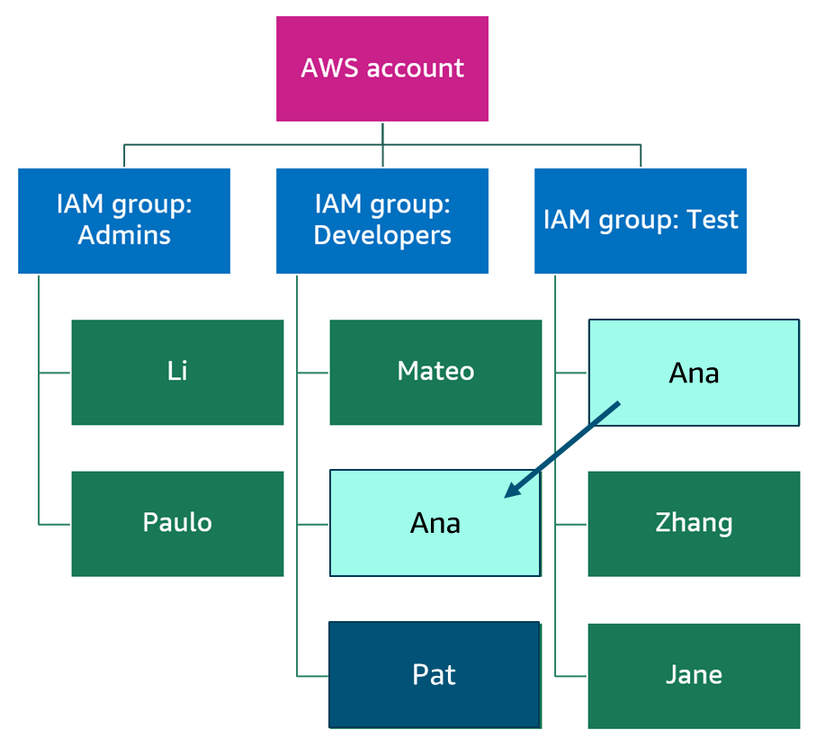

> **Нотатки:**
>
> |Slide number 10  
> |Instructor notes  
> |  
> |Student notes  
> Image description: An AWS account has three IAM groups named admins, developers, and test. The admins group has two members: Li and Paulo. The Developers group has Mateo, Shirley and Sofia. The test group has Ana, Zhang, and Jane. End description.  
>
> Typically, you want to create groups that reflect job functions. For example, you can create one group for administrators, another group for developers, and another group for the team that performs testing functions.  
>
> Then, you attach one or more policy files to each group and add users to the groups. Users have the access rights that are assigned to the group or groups that they are in because of their group membership.  
>
> If a new developer is hired, you can add them to the existing developers group. They will get the same access that the other developers already have.  
>
> If a person, such as Ana (shown in the example) takes on a new role in the organization, you can remove her from the test group and add her to the developers group. Or, if Ana will perform both functions, you can leave her in the test group and add her to the developers group.  
>
> If you discover that developers need access to some additional resource in the account, you can update or add a policy to the developers group. All members of the group will gain that additional level of access. Groups make it easier to maintain consistent access rights across teams.

---

## Слайд 11: Example: Using a user policy and group policy together

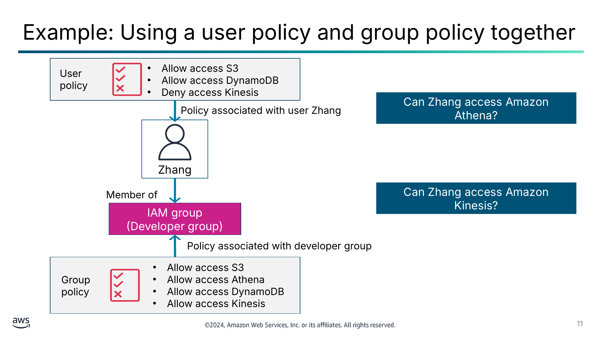

Can Zhang access Amazon Athena?

Can Zhang access Amazon Kinesis?

<details>
<summary>Текст зі схеми</summary>

- Allow access S3
- Allow access DynamoDB
- Deny access Kinesis

User policy

Policy associated with user Zhang

Zhang

Member of

IAM group

(Developer group)

Policy associated with developer group

- Allow access S3
- Allow access Athena
- Allow access DynamoDB
- Allow access Kinesis

Group policy

</details>

> **Нотатки:**
>
> |Slide number 11  
> |Instructor notes  
> |Review each question with students and discuss answers on following slide.  
> |  
> |Student notes  
> This example illustrates a case where a user has permission information derived from both a user policy and a group policy. In this example, Zhang has a user policy that allows access to Amazon S3 and Amazon DynamoDB, but it denies access to Amazon Kinesis. Zhang is also a member of an IAM group called Developer that allows access to S3, Amazon Athena, DynamoDB, and Kinesis. What are the results of these two policies on Zhang's access?

---

## Слайд 12: Example: Resulting permissions

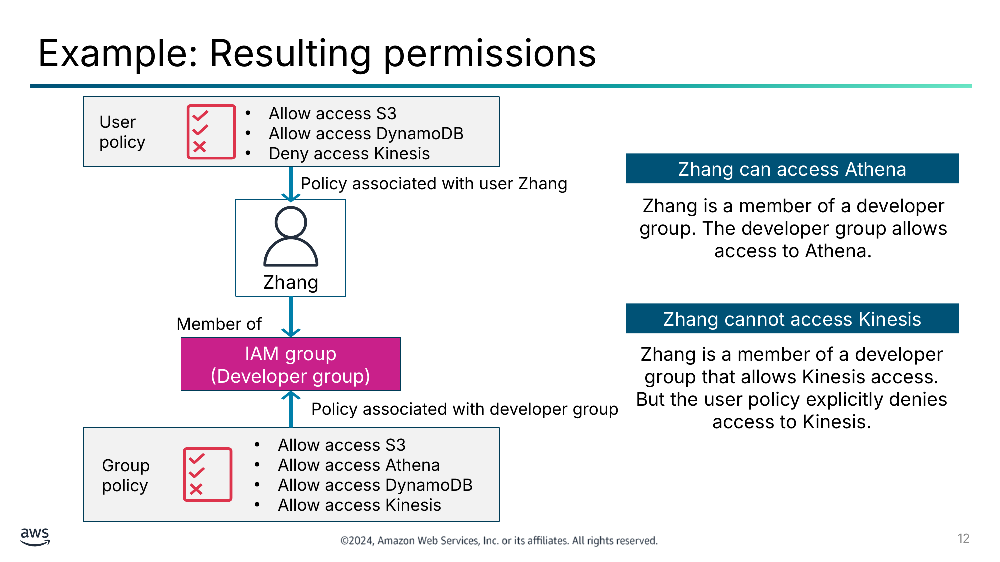

Zhang can access Athena

Zhang is a member of a developer group. The developer group allows access to Athena.

Zhang cannot access Kinesis

Zhang is a member of a developer group that allows Kinesis access. But the user policy explicitly denies access to Kinesis.

<details>
<summary>Текст зі схеми</summary>

- Allow access S3
- Allow access DynamoDB
- Deny access Kinesis

User policy

Policy associated with user Zhang

Zhang

Member of

IAM group

(Developer group)

Policy associated with developer group

- Allow access S3
- Allow access Athena
- Allow access DynamoDB
- Allow access Kinesis

Group policy

</details>

> **Нотатки:**
>
> |Slide number 12  
> |Instructor notes  
> |Review each answer with students.  
> |  
> |Student notes  
> Zhang can access Athena even though the user policy doesn’t mention Athena. Zhang can’t access Kinesis because of the explicit deny in the user policy. Remember that an explicit deny in an IAM policy overrides an explicit allow, so the explicit deny overrides the allow Kinesis access in the group policy.

---

## Слайд 13: Challenges of scaling with role-based access control (RBAC)

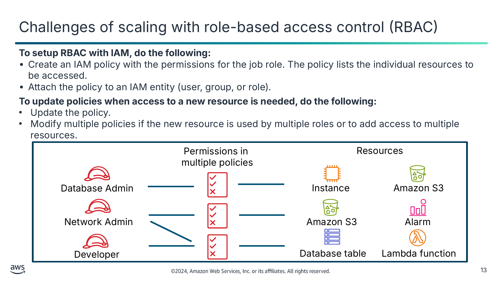

**To setup RBAC with IAM, do the following:**

- Create an IAM policy with the permissions for the job role. The policy lists the individual resources to be accessed.
- Attach the policy to an IAM entity (user, group, or role).

**To update policies when access to a new resource is needed, do the following:**

- Update the policy.
- Modify multiple policies if the new resource is used by multiple roles or to add access to multiple resources.

<details>
<summary>Текст зі схеми</summary>

Permissions in  
multiple policies

Resources

Database Admin

Instance

Amazon S3

Network Admin

Amazon S3

Alarm

Developer

Database table

Lambda function

</details>

> **Нотатки:**
>
> |Slide number 13  
> |Instructor notes  
> |  
> |Student notes  
> As illustrated in the previous example, traditionally, permissions are defined based on job function. This is known as role-based access control (RBAC).  
>
> The disadvantage to using the traditional RBAC model is that you have to maintain multiple policies. When new resources are added, you must update multiple policies to allow access to those resources. Updating polices can become time-consuming.

---

## Слайд 14: Using attribute-based access control (ABAC)

ABAC

Benefits

- This authorization strategy defines permissions based on attributes.
- Attributes are a key or a key-value pair.
- In AWS, these attributes are called tags.
- Tags can apply to IAM resources (users or roles) and AWS resources.

- It’s more flexible than policies that require you to list each individual resource.
- Granular permissions are possible *without* a permissions update for every new user or resource.
- It’s a highly scalable approach to access control.
- It’s fully auditable.

> **Нотатки:**
>
> |Slide number 14  
> |Instructor notes  
> |  
> |Student notes  
> This slide summarizes what attribute-based access control (ABAC) is and how it can benefit your permissions management approach.  
>
> Using ABAC, writing permissions is relatively straightforward. The policy checks whether an attribute that’s applied to the IAM user is also applied to the resource that they want to access. When you create new IAM users and new account resources, you apply the correct tags to the users and to the resources.  
>
> Using ABAC, you can grant developers access to their project resources, but you do not need to specify resources in the policy file. This is far more scalable than role-based access.  
>
> For more information, see What is ABAC for AWS? on the content resources page of your online course.

---

## Слайд 15: Tagging in AWS

- Tags are resource metadata consisting of a key/value pair.
- Tags can apply to resources across AWS accounts and IAM users or roles.
- Customers can create user-defined tags.
  - Many different AWS API operations return tag keys and values.
  - Tags have multiple practical uses like billing, filtered views, and access control.

Example tags applied to an EC2 instance

| Key | Value |
|---|---|
| Name | Web server |
| Project | Unicorn |
| Env | Dev |

> **Нотатки:**
>
> |Slide number 15  
> |Instructor notes  
> | Review the following key information for tagging:  
> |  - The maximum number of tags that you can assign to a resource is 50.  
> |  - The maximum key length is 128 Unicode characters.  
> |  - The maximum value length is 256 Unicode characters.  
> |  - Valid characters for a tag key and value are: a-z, A-Z, 0-9, space, and the following characters: _ . : / = + - and @  
> |  - Keys and values are case sensitive.  
> |  - Don't use aws: as a prefix for keys; it's reserved for AWS use.  
> |  
> |Student notes  
> Before you consider the attribute-based approach to permissions controls, you should understand the tagging feature in AWS.  
>
> AWS enables customers to assign metadata to their AWS resources and identities in the form of tags. Each tag is a simple label that consists of a customer-defined key and an optional value. Tags can make it easier to manage, search for, and filter resources.  
>
> Tags have many practical uses. For example, you can create technical tags to identify that a resource is a web server, part of a specific project, part of a specific environment (test, development, or production), among others. You can also create business tags to identify the department or cost center that should be billed for this resource or the project that this resource is a part of. Finally, you can also set security tags, such as an identifier for the specific data-confidentiality level that a resource supports.  
>
> You can create up to 50 tags per resource. For each resource, each tag key must be unique, and each tag key can have only one value. Tag keys and values are case-sensitive.  
>
> You can also add tags to IAM users and IAM roles. Tags are an important part of the second access-control method.

---

## Слайд 16: Example: Using ABAC to grant permissions in one policy

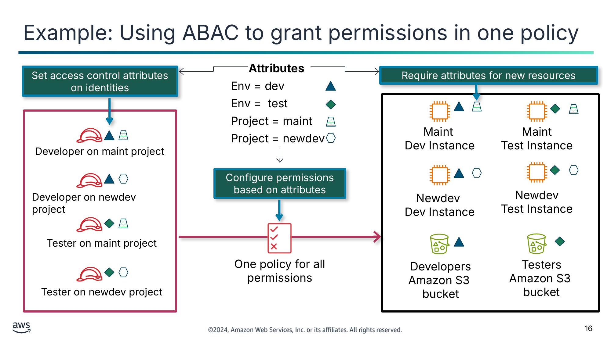

Set access control attributes on identities

Require attributes for new resources

Configure permissions based on attributes

One policy for all permissions

<details>
<summary>Текст зі схеми</summary>

**Attributes**

Env = dev

Env =  test

Project = maint

Project = newdev

Maint  
Dev Instance

Maint  
Test Instance

Newdev  
Dev Instance

Newdev  
Test Instance

Developers  
Amazon S3  
bucket

Testers  
Amazon S3  
bucket

Developer on maint project

Developer on newdev project

Tester on maint project

Tester on newdev project

</details>

> **Нотатки:**
>
> |Slide number 16  
> |Instructor notes  
> |Reinforce that ABAC refers to attribute-based access control and that it’s an authorization strategy that defines permissions based on attributes. This is a simplified example. If you want to go deeper, you might take the students through the tutorial that’s linked in the course resources.  
> |  
> |Student notes  
> In this example, the development organization is using attributes to identify the team (development or test) and the project (maintenance or new development). They have four IAM roles: one for developers on the maintenance project, one for developers on the new development project, one for testers on the maintenance project, and one for testers on the new development project.  
>
> Each project has two EC2 instances. One is tagged for the dev environment, and the other is tagged for test. There’s also an Amazon S3 bucket tagged for developers and an Amazon S3 bucket tagged for testers.  
>
> Using the attributes, they can set up a single policy that says which tags have access to which resources. This gives them flexibility as they add new resources or roles, and it limits the number of individual permissions that are needed. If a new EC2 instance is added, for example, they can just add the appropriate tag to the new instance and the roles that should have access will have it without any other changes.  
>
> To apply ABAC to your organization, the first step is to create identities, such as IAM users or IAM roles. These identities must have the attributes that will be used for access control purposes. For example, you can apply the Env = Dev and Project = Maint tags to the role for maintenance developers.  
>
> Next, require attributes for new resources. You should create policies that enforce the rule at the time of resource creation. For example, you could require that a Project attribute and a Team attribute must be applied to any resource when it is created.  
>
> With attributes in place for roles and resources, configure access permissions based on the attributes. For example, the policy would allow roles with the dev and maintenance tags to access the EC2 dev maintenance instance and the developer Amazon S3 bucket. Roles with the dev and newdev tags would be granted access to the EC2 dev newdev instance and the developer Amazon S3 bucket. The policy would deny access to roles without the appropriate tags.  
>
> Test your configuration. For example, a user could try to add an additional EC2 instance without the required tags. The attempt should fail. Try creating the instance again with the required tags. This time, they should be able to create the resource successfully. After verifying that resources can’t be created without the desired tags, have users with each role try to access the resources they should and should not have access to.  
>
> For a detailed tutorial that demonstrates how to use ABAC in AWS, see the link in your courses resources for this tutorial titled IAM tutorial: Define permissions to access AWS resources based on tags.

---

## Слайд 17: Key takeaways: Managing permissions

- Use IAM groups to grant the same access rights to multiple users. Create groups that reflect job functions.
- Use ABAC rather than RBAC to scale permissions management.
- ABAC is an authorization strategy that defines permissions based on attributes. It simplifies access control management by combining permissions into a single policy.
- Attributes are key value pairs. AWS enables customers to assign attributes to their AWS resources and identities in the form of tags.

> **Нотатки:**
>
> |Slide number 17  
> |Instructor notes  
> |  
> |Student notes  
> Here are a few key points to summarize this section.

---

## Слайд 18: Federating users

Securing User, Application, and Data Access

> **Нотатки:**
>
> |Slide number 18  
> |Instructor notes  
> |  
> |Student notes  
> This section covers federating users and conveying information needed to authorize access to resources.

---

## Слайд 19: Identity federation

A system of trust between two parties to authenticate users and convey information that’s needed to authorize access to resources

- Identity provider (IdP) is responsible for user authentication.
- Examples:
  - OpenID connect (OIDC) IdPs like Login with Amazon, Facebook, and Google
  - Security Assertion Markup Language (SAML) IdPs like Shibboleth or Active Directory Federation Services

- Service provider (SP) is responsible for controlling access to its resources.
- Examples
  - AWS services
  - Social media platforms
  - Online bank

> **Нотатки:**
>
> |Slide number 19  
> |Instructor notes  
> |  
> |Student notes  
> Identity federation is a system of trust between two parties to authenticate users and convey information that’s needed to authorize access to resources. Identity providers (IdPs) are responsible for user authentication. Service providers (SPs), such as services or applications, are responsible for controlling access to resources. Through administrative agreement and configuration, the SP trusts the IdP to authenticate users and grants them access to the requested resources.  
>
> For more information, see the Identity Federation link that’s provided on the course resource page.

---

## Слайд 20: AWS services that support identity federation

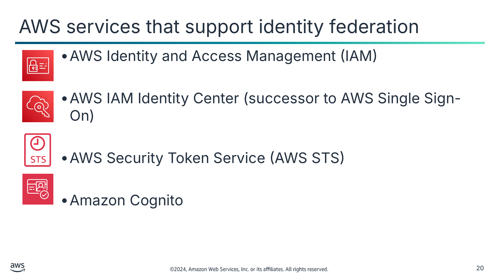

- AWS Identity and Access Management (IAM)
- AWS IAM Identity Center (successor to AWS Single Sign-On)
- AWS Security Token Service (AWS STS)
- Amazon Cognito

> **Нотатки:**
>
> |Slide number 20  
> |Instructor notes  
> |  
> |Student notes  
> You can use two AWS services to federate your workforce into AWS accounts and business applications: AWS Identity and Access Management (IAM) or AWS IAM Identity Center (successor to AWS SSO).  
>
> You can enable federated access to AWS accounts using IAM. The flexibility of IAM allows you to enable a separate Security Assertion Markup Language (SAML) 2.0 or an Open ID Connect (OIDC) IdP for each AWS account and use federated user attributes for access control. With IAM, you can pass user attributes, such as cost center, title, or locale, from your IdPs to AWS, and implement fine-grained access permissions based on these attributes. IAM helps you define permissions once, and then grant, revoke, or modify AWS access by simply changing the attributes in the IdP. You can apply the same federated access policy to multiple AWS accounts by implementing reusable customer managed IAM policies.  
>
> AWS Identity Center makes it easy to centrally manage federated access to multiple AWS accounts and business applications and provide users with single sign-on access to all their assigned accounts and applications from one place. You can use AWS IAM Identity Center for identities in the AWS IAM Identity Center’s user directory, your existing corporate directory, or external IdP.  
>
> AWS IAM Identity Center works with an IdP of your choice, such as Okta Universal Directory or Azure Active Directory (AD) through the SAML 2.0 protocol. IAM Identity Center seamlessly leverages IAM permissions and policies for federated users and roles to help you manage federated access centrally across all AWS accounts in your AWS organization. With IAM Identity Center, you can assign permissions based on the group membership in your IdP’s directory, and then control the access for your users by simply modifying users and groups in the IdP.  
>
> AWS Security Token Service (AWS STS) is a web service that provides temporary AWS credentials. This service enables an IAM user, federated user, or application to assume an IAM role.  
>
> You can also add federation support to your customer-facing web and mobile applications using Amazon Cognito. It helps you add user sign-up, sign-in, and access control to your mobile and web apps quickly and easily. Amazon Cognito scales to millions of users and supports sign-in with social identity providers, such as Apple, Facebook, Google, and Amazon, and enterprise identity providers using SAML 2.0.  
>
> The next few slides look at how these services support identity federation in a bit more detail. For additional information on these services and how they work together, see the links provided on the course resource page.

---

## Слайд 21: Workforce identity federation

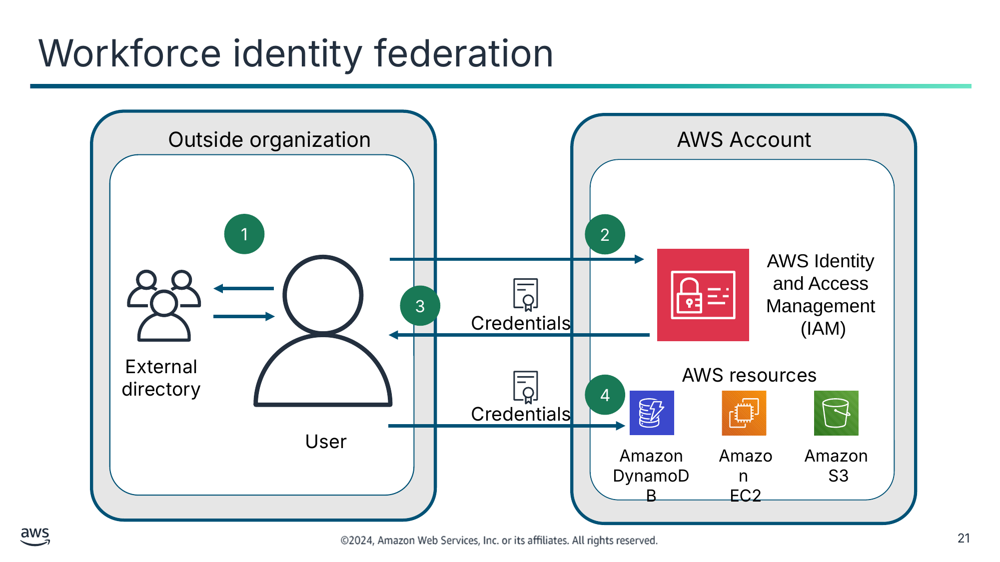

<details>
<summary>Текст зі схеми</summary>

Outside organization

AWS Account

User

1

2

AWS Identity  
and Access  
Management  
(IAM)

3

Credentials

External

directory

4

AWS resources

Credentials

User

Amazon DynamoDB

Amazon

EC2

Amazon

S3

</details>

> **Нотатки:**
>
> |Slide number 21  
> |Instructor notes  
> |  
> |Student notes  
> Human users (as compared to application or service users) who are members of your organization are also known as workforce identities or workforce users. Workforce identity federation refers to those human users.  
>
> If users in your organization already have a way to be authenticated, such as by signing in to your corporate network, you can federate those user identities into AWS using either IAM or AWS IAM Identity Center.  
>
> The diagram shows how a user outside of AWS can access protected AWS resources by using an external directory to gain temporary AWS security credentials.  
>
> A user authenticates against a local user directory with ID and password.  
> An outside system presents user authentication information to IAM.  
> IAM returns the temporary authentication credentials token back to the user using AWS STS.  
> The user accesses the protected resources using temporary credentials.  
>
> See the link provided on the course resources page for additional information on federating existing users.

---

## Слайд 22: AWS IAM Identity Center

- Successor to AWS Single Sign-On
- Can create or connect identities once and manage access centrally across your AWS accounts
- Provides a unified administration experience to define, customize, and assign fine-grained access
- Provides a user portal to access all assigned AWS accounts or cloud applications
- Used optionally in conjunction with IAM

IAM Identity Center

> **Нотатки:**
>
> |Slide number 22  
> |Instructor notes  
> |Review the key points and note that AWS IAM Identity Center is successor to AWS Single Sign-On. You can manage sign-in security for your workforce identities, also known as workforce users. IAM Identity Center provides one place where you can create or connect workforce users and centrally manage their access across all their AWS accounts and applications.  
> |  
> |Student notes  
> With IAM Identity Center, you can create or connect identities once in AWS and centrally manage access across your AWS accounts. IAM Identity Center provides a unified administration experience to define, customize, and assign fine-grained permissions based on common job functions.  
>
> Users in your IAM Identity Center environment can use their directory credentials to access their user portal. Users can access all their assigned AWS accounts or cloud applications. You can flexibly configure access to run parallel to or replace AWS account access management by using IAM. IAM Identity Center supports commonly used cloud applications such as Microsoft 365 and Salesforce. The service provides application integration instructions that eliminate the need for administrators to learn the configuration nuances of each cloud application.  
>
> See the link on the resources guide for more information on AWS IAM Identity Center.

---

## Слайд 23: AWS Security Token Service (AWS STS)

- AWS STS is a web service (API) that enables you to request temporary, limited-privilege credentials.
- The credentials can be used by IAM users, federated users, or applications.

AWS STS

> **Нотатки:**
>
> |Slide number 23  
> |Instructor notes  
> |  
> |Student notes  
> AWS STS is a web service that provides temporary AWS credentials.  
> When the AssumeRole operation of the AWS STS API is successfully invoked, the web service returns the temporary, limited-privilege credentials that were requested by the IAM user or the user that was authenticated through federation. Typically, the AssumeRole operation is used for cross-account access or for federation.  
>
> The next slides looks at how AWS STS provides temporary credentials as part of identity federation.

---

## Слайд 24: Identity federation to AWS with an identity broker

User signs in with existing credentials for their IdP

Identity broker acts as an intermediary between IdP and SP

AWS STS generates temporary credentials dynamically

Identity broker passes temporary credentials to application

- Users sign in using an identity that is already known by an IdP (for example their Amazon.com ID or a corporate login).

- The identity broker requests temporary credentials from AWS STS.

- The credentials last from a few minutes to several hours and are not recognized after the credentials expire.

- AWS STS returns the temporary credentials to the identity broker.
- The identity broker passes them to the application for the user.

> **Нотатки:**
>
> |Slide number 24  
> |Instructor notes  
> |  
> |Student notes  
> As noted on the prior slide, AWS STS provides temporary security credentials. When (or even before) the temporary security credentials expire, the user can request new credentials as long as the user requesting them still has permissions to do so.  
> To request temporary security credentials, use AWS STS operations in the AWS API. These include operations to create and provide trusted users with temporary security credentials that can control access to your AWS resources.  
>
> The slide shows the four general steps that occur during identity federation to access AWS services using temporary credentials generated by AWS STS. An Identity Broker is an intermediary proxy service that connects multiple SPs with multiple dPs.  The identity broker facilitates the communication between an external IdP and the SP, in this example AWS services.

---

## Слайд 25: Example: Identity federation for AWS Management Console access

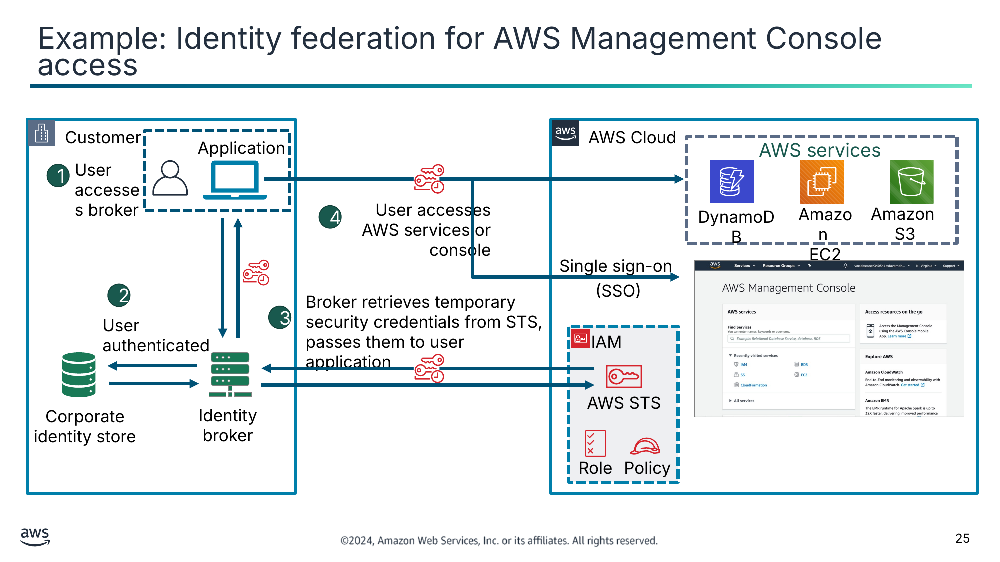

<details>
<summary>Текст зі схеми</summary>

Customer

AWS Cloud

Application

1

User accesses broker

4

User accesses AWS services or console

Single sign-on  
(SSO)

2

Broker retrieves temporary security credentials from STS, passes them to user application

User authenticated

3

IAM

AWS STS

Corporate identity store

Identity broker

Role

Policy

AWS services

DynamoDB

Amazon

EC2

Amazon

S3

</details>

> **Нотатки:**
>
> |Slide number 25  
> |Instructor notes  
> |Communicate that users might already have identities outside of AWS, such as a corporate directory. If those users need to work with AWS resources (or work with applications that access those resources), then those users also need AWS security credentials. You can use an IAM role to specify permissions for users whose identity is federated from their organization or a third-party IdP.  
> |  
> |Student notes  
> This slide illustrates the more detailed steps that occur when using an OIDC-based IdP with an identity broker for identity federation. In this example, a corporate identity store is used to authenticate users who need to access the AWS Management Console.  
> A user accesses an application that prompts them for a user ID and password, and then submits their request.  
> The identity broker receives the authentication request. It then communicates with the corporate identity store, which might be Microsoft Active Directory or a Lightweight Directory Access Protocol (LDAP) server.  
> If the authentication request is successful, the identity broker makes a request to AWS STS. The request is to retrieve temporary AWS security credentials for the user application.  
> The user application receives the temporary AWS security credentials and redirects the user to the AWS Management Console. The user did not need to sign directly in to AWS with a different set of credentials. This process is an example of a single-sign on (SSO) implementation. The user application can also use these same temporary AWS security credentials to access AWS services if the IAM policy document allows it.

---

## Слайд 26: Example: Identity federation for AWS Management Console using SAML

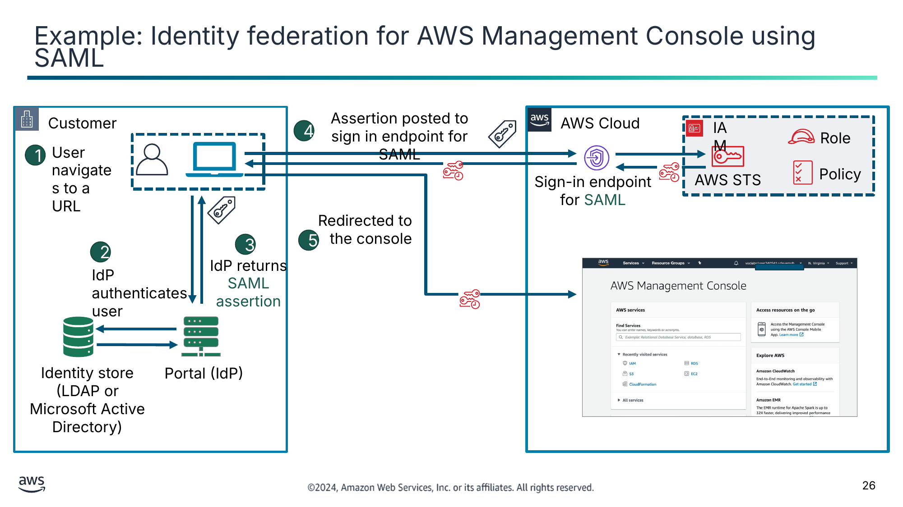

<details>
<summary>Текст зі схеми</summary>

Customer

Assertion posted to sign in endpoint for SAML

AWS Cloud

IAM

4

Role

1

User navigates to a URL

AWS STS

Policy

Sign-in endpoint for SAML

Redirected to the console

3

5

2

IdP authenticates user

IdP returns SAML assertion

Identity store (LDAP or Microsoft Active Directory)

Portal (IdP)

</details>

> **Нотатки:**
>
> |Slide number 26  
> |Instructor notes  
> |Communicate to students that AWS supports identity federation with SAML 2.0, an open standard that many IdPs use. This feature enables federated SSO, so users can log into the AWS Management Console or call the AWS API operations without having to create an IAM user for everyone in their organization.  
> |  
> |Student notes  
> This example shows the use of SAML for exchanging authentication and authorization data between IdPs and service providers. If your corporate directory is compatible with SAML 2.0, you can configure your corporate directory to provide SSO access to the AWS Management Console for your users.  
>
> Here are the steps for this identity federation flow. They are similar to the previous slide, but they are specific to the features of SAML.  
>
> A user in your organization navigates to an internal portal in your network. The portal also functions as the IdP that handles the SAML trust between your organization and AWS.  
> The IdP authenticates the user’s identity against the identity store, which might be an LDAP server or Microsoft Active Directory.  
> The portal receives the authentication response as a SAML assertion from the IdP.  
> The client posts the SAML assertion to the AWS sign-in endpoint for SAML. The endpoint communicates with AWS STS, and it invokes the AssumeRoleWithSAML operation to request temporary security credentials and construct a sign-in URL.  
> The client receives the temporary AWS security credentials. The client is redirected to the AWS Management Console and is authenticated with the temporary AWS security credentials.  
>
> See the link on the resources guide for more information on SAML 2.0.

---

## Слайд 27: Amazon Cognito

A fully managed service that provides the following services and features:

  - Authentication, authorization, and user management for web and mobile applications
- Federated identities for sign in with social identity providers (Amazon, Facebook, Google) or with SAML
- User pools that maintain a directory with user profiles authentication tokens
- Identity pools that enable the creation of unique identities and permissions assignment for users

Amazon Cognito

> **Нотатки:**
>
> |Slide number 27  
> |Instructor notes  
> |The preferred way to use web identity federation is to use Amazon Cognito.  
> |  
> |Student notes  
> The final identity federation option is using Amazon Cognito. Amazon Cognito is a fully managed service that provides authentication, authorization, and user management for web and mobile applications. Users can sign in directly with a username and password or through a third party, such as Facebook, Amazon, or Google.  
>
> The two main components of Amazon Cognito are user pools and identity pools.  
>
> A user pool is a user directory in Amazon Cognito. With a user pool, users can sign into a web or mobile application through Amazon Cognito. They can also federate through a third-party IdP. All members of the user pool have a directory profile that can be accessed through an SDK.  
>
> Identity pools enable the creation of unique identities and permissions assignment for users. With an identity pool, users can obtain temporary AWS credentials to access AWS services or resources. Identity pools can communicate with Amazon Cognito user pools’ social sign-in with Facebook, Google, and Login with Amazon and OIDC providers. Identity pools use AWS STS behind the scenes.

---

## Слайд 28: Application access identity federation

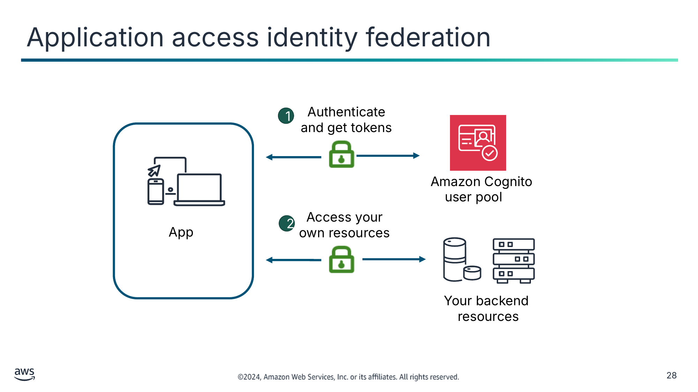

<details>
<summary>Текст зі схеми</summary>

Authenticate and get tokens

1

Amazon Cognito

user pool

Access your own resources

App

2

Your backend  
resources

</details>

> **Нотатки:**
>
> |Slide number 28  
> |Instructor notes  
> |Information on user pools can be located on following slide.  
> |  
> |Student notes  
> Remember, you can also add federation support to your customer-facing web and mobile applications using Amazon Cognito. It helps you add user sign-up, sign-in, and access control to your mobile and web apps quickly.  
>
> The diagram shows accessing server-side resources with a user pool.  
>
> 1. After a successful user pool sign-in, your web or mobile app will receive user pool tokens from Amazon Cognito.  
> 2. You can use those tokens to control access to your server-side resources. You can also create user pool groups to manage permissions and to represent different types of users.  
>
> After you configure a domain for your user pool, Amazon Cognito provisions a hosted web UI that allows you to add sign-up and sign-in pages to your app. Using this OAuth 2.0 foundation, you can create your own resource server to enable your users to access protected resources.  
>
> See the link on the course resources page for more information on accessing your server-side resources with a user pool.

---

## Слайд 29: Amazon Cognito example

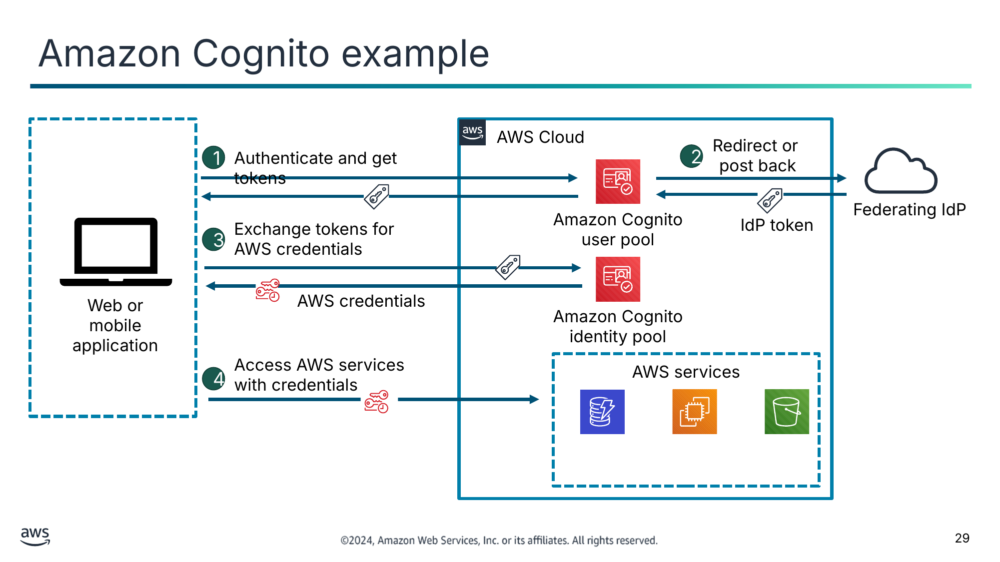

<details>
<summary>Текст зі схеми</summary>

AWS Cloud

Redirect or

post back

1

Authenticate and get tokens

2

Amazon Cognito user pool

IdP token

Federating IdP

3

Exchange tokens for

AWS credentials

AWS credentials

Web or mobile application

Amazon Cognito identity pool

Access AWS services

with credentials

AWS services

4

</details>

> **Нотатки:**
>
> |Slide number 29  
> |Instructor notes  
> |This is an Amazon Cognito example with direct end device to service. This is one approach. The other approach would be to not use identity pool and have the service manage sessions.  
> |  
> |Student notes  
> In this diagram, the goal is to authenticate a user using Amazon Cognito and then grant that user access to another AWS service.  
>
> An app user signs in through an Amazon Cognito user pool.  
> After successfully authenticating, the user receives user pool tokens.  
> The app exchanges the user pool tokens for AWS credentials through an Amazon Cognito identity pool.  
> The app user uses those AWS credentials to access other AWS services.

---

## Слайд 30: Amazon Cognito user pools

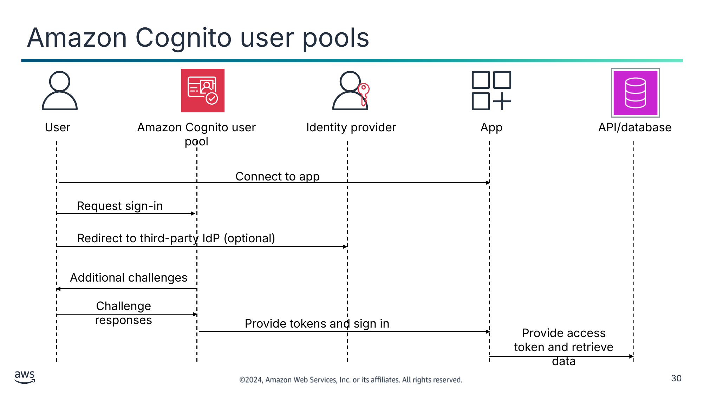

<details>
<summary>Текст зі схеми</summary>

User

Amazon Cognito user pool

Identity provider

App

API/database

Connect to app

Request sign-in

Redirect to third-party IdP (optional)

Additional challenges

Challenge responses

Provide tokens and sign in

Provide access token and retrieve data

</details>

> **Нотатки:**
>
> |Slide number 30  
> |Instructor notes  
> |  
> |Student notes  
> Image description: Diagram of Amazon Cognito user pools including connection to a user, identity provider, app, and API/database. Arrows showing user connecting to app, user requests to sign into Amazon Cognito user pool, user redirected to third party identity provider (optional), additional challenges, and challenge responses between user and Amazon Cognito user pool, Amazon Cognito user pool provides token and sign in to app, and app providing access token and retrieving data to API/database. End description  
>
> An Amazon Cognito user pool is a user directory. With a user pool, your users can sign into your web or mobile app through Amazon Cognito or federate through a third-party IdP. Federated and local users have a user profile in your user pool.  
>
> Local users are those who signed up or who you created directly in your user pool. You can manage and customize these user profiles in the AWS Management Console, an AWS SDK, or the AWS Command Line Interface (AWS CLI).  
>
> Amazon Cognito user pools accept tokens and assertions from third-party IdPs and collect the user attributes into a JSON web token (JWT) that it issues to your app. You can standardize your app on one set of JWTs while Amazon Cognito handles the interactions with IdPs, mapping their claims to a central token format.  
>
> An Amazon Cognito user pool can be a standalone IdP. Amazon Cognito draws from the OIDC standard to generate JWTs for authentication and authorization. When you sign in local users, your user pool is authoritative for those users. You have access to the following features when you authenticate local users.  
>
> See the link on the resources guide for more information on Amazon Cognito user pools.

---

## Слайд 31: Amazon Cognito user pools features

| Feature | Description |
|---|---|
| Sign-up | • Let users enter their information in your app and create a user profile that’s native to your user pool.<br>• Redirect users to a third-party IdP that they can authorize to pass their information to Amazon Cognito.<br>• Create users based on a data source or schema. |
| Sign-in | Use as a standalone user directory and IdP to your app. |
| Federate third-party identities | Let the user pool manage the overhead of handling the tokens that are returned from social sign-in through Facebook, Google, Amazon, and Apple, and from OIDC and SAML IdPs. |
| Hosted UI for sign-up and sign-in | Present users with customized Amazon Cognito hosted web pages for sign-up, sign-in, multi-factor authentication (MFA), and password reset. |
| Support for JWTs | Use JWT tokens to access server-side resources or exchange them for temporary AWS credentials to access other AWS services. JWT is an open standard that defines a compact, self-contained way to securely transmit information between parties as a JSON object. |
| User pool groups | Use groups to create collections of users to manage their permissions or to represent different types of users. For example, create separate groups for users who are readers, contributors, and editors of your website and app. |

> **Нотатки:**
>
> |Slide number 31  
> |Instructor notes  
> |  
> |Student notes  
> This slide highlights a few of the features of Amazon Cognito pools for supporting authentication and identity federation.  
>
> See the link on the resources guide for more information on Amazon Cognito user pool features.

---

## Слайд 32: Key takeaways: Federating users

- Identity federation is a system of trust between IdPs and SPs.
  - AWS IAM Identity Center provides a unified administration experience to define, customize, and assign fine-grained permissions based on common job functions.
- AWS STS is a web service that provides temporary AWS credentials and allows an IAM user, federated user, or application to assume an IAM role.
- An identity broker facilitates federation when users already have identities outside of AWS, such as a corporate directory.
- Amazon Cognito is a fully managed service that provides authentication, authorization, and user management for web and mobile applications. Users can sign in directly or through a third party, such as Facebook, Amazon, or Google.

> **Нотатки:**
>
> |Slide number 32  
> |Instructor notes  
> |  
> |Student notes  
> These key takeaways summarize this section.

---

## Слайд 33: Guided lab: Securing Applications by Using Amazon Cognito (Amazon Cognito lab)

> **Нотатки:**
>
> |Slide number 33  
> |Instructor notes  
> |  
> |Student notes  
> You will now complete a lab. The next slide summarizes what you will do in the lab, and you will find the detailed instructions in the lab environment.

---

## Слайд 34: Lab introduction: Amazon Cognito lab

- In this lab, you use the Amazon Cognito service to authenticate users of a web application.
- The tasks that you perform include the following:
  - Creating an Amazon Cognito user pool to store and manage the application users
  - Configuring a user pool to provide a hosted UI for the application
  - Using the user pool to authenticate access to a protected application function
- Open your lab environment to start the lab and find additional details about the tasks that you will perform.


> **Нотатки:**
>
> |Slide number 34  
> |Instructor notes  
> |  
> |Student notes  
> Access the lab environment through your online course to get additional details and complete the lab.

---

## Слайд 35: Debrief: Amazon Cognito lab

- What did you do to create users and manage user passwords for the Birds website?
- In this lab, you used Amazon Cognito to set up an identity pool. Why did you need an identity pool?

> **Нотатки:**
>
> |Slide number 35  
> |Instructor notes  
> |Relevant before and after architectural diagrams are included in the lab instructions for each lab. You might find it helpful to pull the lab diagrams up as part of debriefing this lab.  
> |  
> |Lead the class in a conversation about the key takeaways from the lab. Use the details from the previous section to help you debrief the lab with the students after they have completed it. Debriefing the lab is strongly encouraged. It helps the students make connections between their hands-on experience and the concepts that you discussed in the lecture before this lab.  
> |During the debrief, you can ask the students the questions shown on this slide. The following are the answers:  
> |  
> |When configuring the user pool’s sign-up feature, what are the contact methods that Amazon Cognito offered to verify a user’s identity? You can either specify an email address or a phone number as the contact method that Cognito uses to verify a user’s identity when they sign up. Where does the web application that presents the pages for signing in run? The web application that presents the sign-in page runs inside of Amazon Cognito. With Cognito’s hosted UI feature, you don’t need to provide or provision an instance to run the sign-up or sign-in web pages.  
> |Suggested responses for question 1: What did you do to create users and manage user passwords for the Birds website? In this lab, you used Amazon Cognito to create a user pool. An Amazon Cognito user pool is an identity provider that |can create users and manage user passwords. The Birds web application used the tokens generated by an Amazon Cognito user pool to ensure that users have authenticated and have a valid session before they can access a protected page or |perform a protected action.  
> |Use a user pool when you need to do the following:  
> |- Design sign-up and sign-in webpages for your app.  
> |- Access and manage user data.  
> |- Track your user device, location, and IP address, and adapt to sign-in requests of different risk levels.  
> |- Use a custom authentication flow for your app.  
> |Suggested responses for question 2: In this lab, you used Amazon Cognito to set up an identity pool. Why did you need an identity pool? Identity pools are for authorization to AWS services. You used an identity pool to give users access to |the DynamoDB table.  
> |Use a user pool when you need to do the following:  
> |- Give your users access to AWS resources, such as an S3 bucket or a DynamoDB table.  
> |- Generate temporary AWS credentials for unauthenticated users.  
> |  
> |Student notes  
> Your instructor might review these questions with you, or you might review them on your own. Use this opportunity to extend your thinking about the tasks that you performed during the lab.

---

## Слайд 36: Managing access to multiple accounts

Securing User, Application, and Data Access

> **Нотатки:**
>
> |Slide number 36  
> |Instructor notes  
> |  
> |Student notes  
> This section focuses on managing access to multiple accounts with AWS Organizations.

---

## Слайд 37: Two common patterns for separating resource access

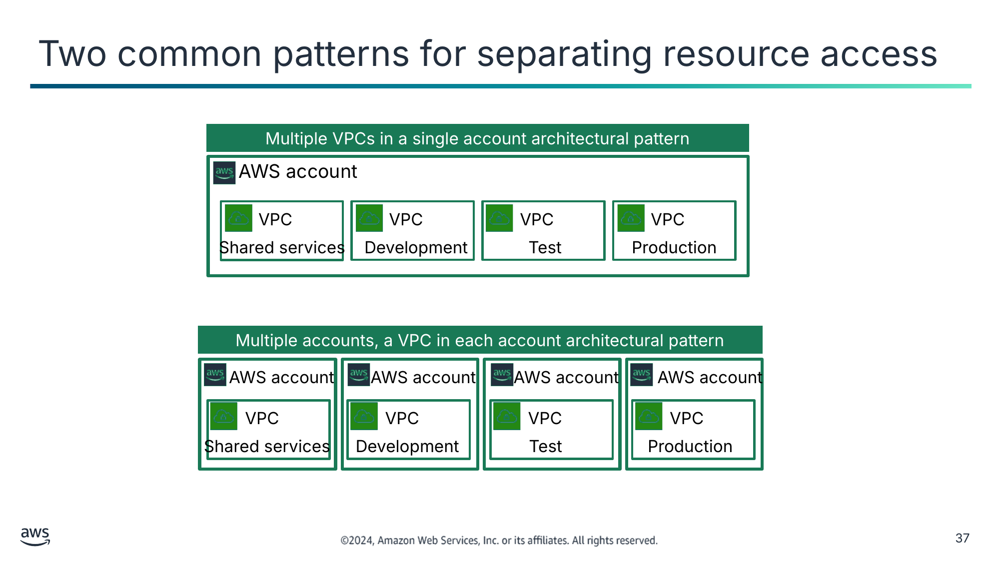

<details>
<summary>Текст зі схеми</summary>

Multiple VPCs in a single account architectural pattern

AWS account

VPC

VPC

VPC

VPC

Shared services

Development

Test

Production

Multiple accounts, a VPC in each account architectural pattern

AWS account

AWS account

AWS account

AWS account

VPC

VPC

VPC

VPC

Shared services

Development

Test

Production

</details>

> **Нотатки:**
>
> |Slide number 37  
> |Instructor notes  
> |  
> |Student notes  
> When you use AWS to support the different teams and departments in an organization, you can choose between two general architectural patterns to isolate and separate the resources that each team uses.  
>
> The first pattern is to define multiple virtual private clouds (VPCs) in a single AWS account. If you prefer centralized information security management with minimum overhead, you can choose to use a single AWS account.  
>
> The second pattern is to create multiple AWS accounts and define a VPC in each account. In practice, large and small organizations tend to create multiple accounts for their organizations. For example, they might create individual accounts for various business units. They can also create separate accounts for their development, test, and production resources.

---

## Слайд 38: Advantages and challenges of multiple accounts

Advantages

Challenges

- Isolation by business units or departments
- Isolation by environment (for example, development, test, and production)
- Isolation of auditing and recovery data
- Separation of accounts for regulated workloads
- Ease of creating cost alerts for each  
business unit's consumption
- Cost savings (bulk/volume pricing across accounts)

- Security management across accounts
- Manual processes involved in creating many new accounts
- Determination of which organization should be billed
- Need for centralized governance to ensure compliance and consistency

> **Нотатки:**
>
> |Slide number 38  
> |Instructor notes  
> |  
> |Student notes  
> When customers use separate AWS accounts (usually with consolidated billing) for development and production resources, it enables them to cleanly separate different types of resources. It can also provide some security benefits.  
>
> Alternatively, if your business maintains separate environments for production, development, and testing, you can configure three AWS accounts and have one account for each environment. Also, if you have multiple autonomous departments, you can also create separate AWS accounts for each autonomous part of the organization.  
>
> When you use multiple accounts, a more efficient strategy is to create a single AWS account for common project resources. Common resources might include DNS services, Microsoft Active Directory, and content management systems (CMSs). You can also separate accounts for the autonomous projects or departments. This strategy enables you to assign permissions and policies under each department or project account and grant access to resources across accounts.  
>
> Although most organizations choose to use multiple AWS accounts, that choice comes with some challenges.  
> First, you must determine how to effectively manage security across all your accounts. If you replicate the IAM policies that you defined across all accounts to ensure consistency, it could involve custom automation, manual effort, or both.  
>
> Also, you might be constantly asked to create more accounts. It takes time to manually create these accounts. It also might be difficult to track all the accounts and the purpose of each account.  
>
> It can also be a challenge to determine which cost center in the organization should be billed for which resources in which accounts.  
>
> And finally, you might also want to achieve the centralized governance that is needed to ensure consistency.

---

## Слайд 39: AWS Organizations

- Account management service that you can use to consolidate multiple AWS accounts into a centrally managed organization
- Tier pricing discounts available
- Includes account creation and management and consolidated billing capabilities
- Provides for hierarchical grouping of accounts
- Supports centralized policy control over AWS services and API actions using service control policies (SCPs)

AWS

Organizations

> **Нотатки:**
>
> |Slide number 39  
> |Instructor notes  
> |Communicate to students that AWS Organizations includes account management and consolidated billing capabilities that enable you to better meet the budgetary, security, and compliance needs of your business. As an administrator of an organization, you can create accounts in your organization and invite existing accounts to join the organization. It’s also important to point out that tier pricing discounts is big advantage.  
> |  
> |Student notes  
> AWS Organizations is an account management service that you can use to create an organization where you can consolidate multiple accounts and centrally manage them. AWS Organizations provides centralized account creation and management and consolidated billing capabilities. With these features, you can manage your security, compliance, and budgetary needs more efficiently.  
>
> Organizations also provides the ability to hierarchically group your accounts in organizational units (OUs) and attach different access policies to each. This provides the ability to create and customize fine-grained policies, which you can target to a single OU or attach to multiple OUs. You can nest OUs within other OUs up to a depth of five levels, which helps you to structure your hierarchy as you prefer.  
>
> Another key feature of Organizations is the use of service control policies (SCPs) to specify the maximum permissions for member accounts in your organization. This helps you ensure that your accounts stay within your organization's access control guidelines.  
>
> Organizations builds upon AWS Identity and Access Management (IAM) by expanding the granular control that IAM provides to the account level. It does this by giving you control over what users and roles in an account or a group of accounts can do. This additional layer of control ensures that users can access only what both Organizations and IAM policies allow. If either service blocks an operation, the user will not be able to access that operation.  
>
> See the link provided on the course resources page for more information on AWS Organizations.

---

## Слайд 40: AWS Organizations: Create organizational units

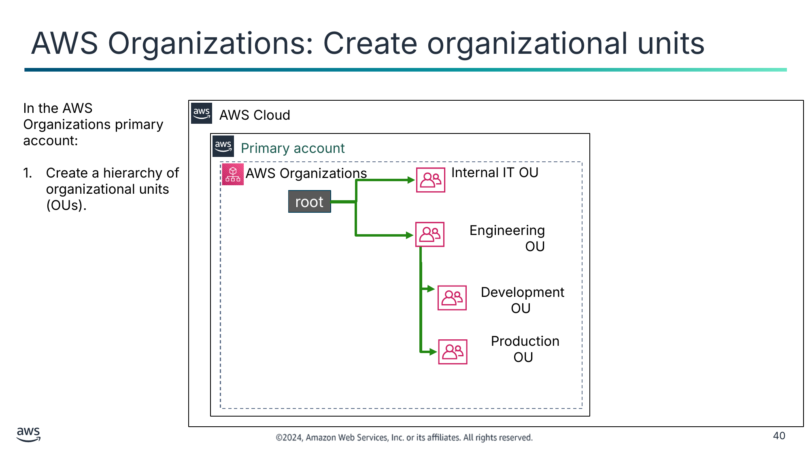

In the AWS Organizations primary account:

1. Create a hierarchy of organizational units (OUs).

<details>
<summary>Текст зі схеми</summary>

AWS Cloud

Primary account

AWS Organizations

Internal IT OU

root

Engineering OU

 Development OU

 Production OU

</details>

> **Нотатки:**
>
> |Slide number 40  
> |Instructor notes  
> | Walk through each step on the next 4 slides. Each slide will build off the previous slide to help students better understand the flow.  
> |  
> |Student notes  
> Here is an example AWS organization. It’s defined inside a regular AWS account that’s referred to on the slide as the primary account because the AWS organization is defined in it.  
>
> Step 1: Create a hierarchy of OUs. When you create an organization in the primary account, the organization automatically creates a parent container that is called root. Under each root in the organization, you can then define OUs.

---

## Слайд 41: AWS Organizations: Assign accounts

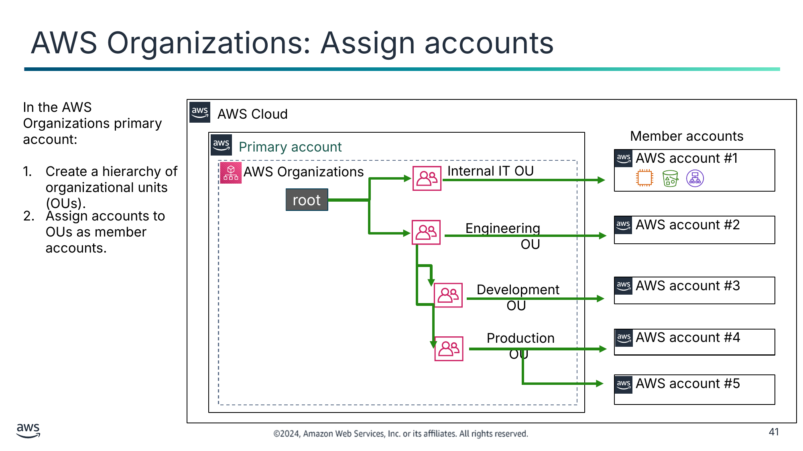

2. Assign accounts to OUs as member accounts.

<details>
<summary>Текст зі схеми</summary>

In the AWS Organizations primary account:

1. Create a hierarchy of organizational units (OUs).

AWS Cloud

Primary account

Member accounts

AWS account #1

AWS Organizations

Internal IT OU

root

Engineering OU

AWS account #2

 Development OU

AWS account #3

 Production OU

AWS account #4

AWS account #5

</details>

> **Нотатки:**
>
> |Slide number 41  
> |Instructor notes  
> | Mention that the member accounts are assigned to an OU.  
> |  
> |Student notes  
> Step 2: Assign accounts to OUs as member accounts. Each of the member accounts are assigned the following:  
> Member account, AWS account #1 is assigned to internal IT OU  
> Member account, AWS account #2 is assigned to engineering OU  
> Member account, AWS account #3 is assigned to development OU  
> Member account, AWS account #4 is assigned to production OU  
> Member account, AWS account #5 is assigned to production OU

---

## Слайд 42: AWS Organizations: Define SCPs

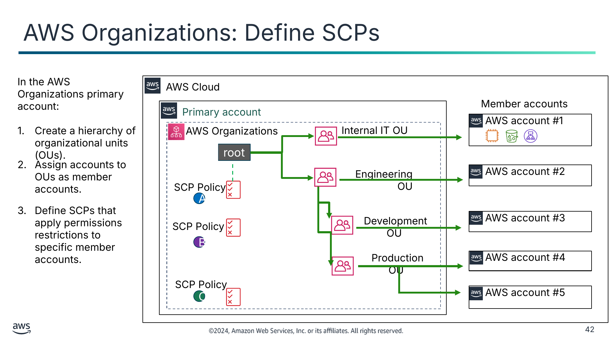

3. Define SCPs that apply permissions restrictions to specific member accounts.

<details>
<summary>Текст зі схеми</summary>

In the AWS Organizations primary account:

1. Create a hierarchy of organizational units (OUs).

2. Assign accounts to OUs as member accounts.

AWS Cloud

Primary account

AWS account #1

AWS Organizations

Internal IT OU

root

Engineering OU

AWS account #2

SCP Policy

A

SCP Policy

 Development OU

AWS account #3

B

 Production OU

AWS account #4

SCP Policy

AWS account #5

C

Member accounts

</details>

> **Нотатки:**
>
> |Slide number 42  
> |Instructor notes  
> |Note that SCPs enable you to control which services are accessible to IAM users in member accounts.  
> |  
> |Student notes  
> Step 3: To configure access controls across accounts, you then define SCPs. In this example, there is SCP a, b, and c.

---

## Слайд 43: Organizations SCPs

- Offer central control over the maximum available permissions for all accounts in your organization.
- Enable control of which services are accessible to IAM users in member accounts.
- Define permissions that affect an entire account.
- Define guardrails, or sets limits, on the actions that the account's administrator can delegate to the IAM users and roles in the affected accounts. IAM policies that are defined in individual accounts still apply.
- SCPs cannot be overridden by the local administrator.

Best practice

It’s easier to define policies across multiple accounts in an SCP than to replicate these permissions settings into IAM policy documents in each account.

> **Нотатки:**
>
> |Slide number 43  
> |Instructor notes  
> |  
> |Student notes  
> Organizations SCPs: SCPs enable you to control which services are accessible to IAM users in member accounts. Say that you have specific policies that you want to apply across multiple accounts. It’s easier to define these policies in an SCP than to replicate these permissions settings into IAM policy documents in each account.  
>
> Permissions defined in an SCP affect an entire account. They limit permissions for every request made by a principal within the account. An IAM entity (user or role) can make a request that is affected by an SCP, a permissions boundary, and an identity-based policy. In this case, the request is allowed only if all three policy types allow it. The effective permissions are the intersection of all three policy types. An explicit deny in any of these policies overrides the allow.  
>
> SCPs alone are not sufficient in granting permissions to the accounts in your organization. No permissions are granted by an SCP. An SCP defines a guardrail, or sets limits, on the actions that the account's administrator can delegate to the IAM users and roles in the affected accounts.  
>
> SCPs should be used with IAM policies that are defined in each individual account. You can think of the SCPs as providing general boundaries around the services and general permissions that users should be allowed (based on the guardrails, or limits set) or denied access to. Then, you can use IAM policies to set more granular access controls that are specific to individual accounts.

---

## Слайд 44: Examples of scenarios defined in SCPs

- Block service access or specific actions. For example, deny users from disabling AWS CloudTrail in all member accounts.
- Enforce the tagging of resources. For example, do not allow users to launch an Amazon Elastic Compute Cloud (Amazon EC2) Amazon Machine Image (AMI) unless it has a specific tag on it.
- Prevent member accounts from leaving the organization.

> **Нотатки:**
>
> |Slide number 44  
> |Instructor notes  
> |  
> |Student notes  
> This slide lists a few common examples for using SCPs to control access and behaviors within an account.

---

## Слайд 45: Example SCP

Prevent member accounts from leaving the organization:

```json
{ 
  "Version": "2023-06-17", 
  "Statement": [ 
    {
      "Effect": "Deny", 
      "Action": [ "organizations:LeaveOrganization"], 
      "Resource": "*" 
    } 
  ] 
}
```

> **Нотатки:**
>
> |Slide number 45  
> |Instructor notes  
> |  
> |Student notes  
> This SCP example prevents member accounts from leaving the organization. The effect of the policy statement is to explicitly deny the organizations:LeaveOrganization action, which prevents member accounts from leaving.  
>
> See the link provided on the course resources page for more information on SCPs in AWS Organizations.

---

## Слайд 46: AWS Organizations: Attach SCPs

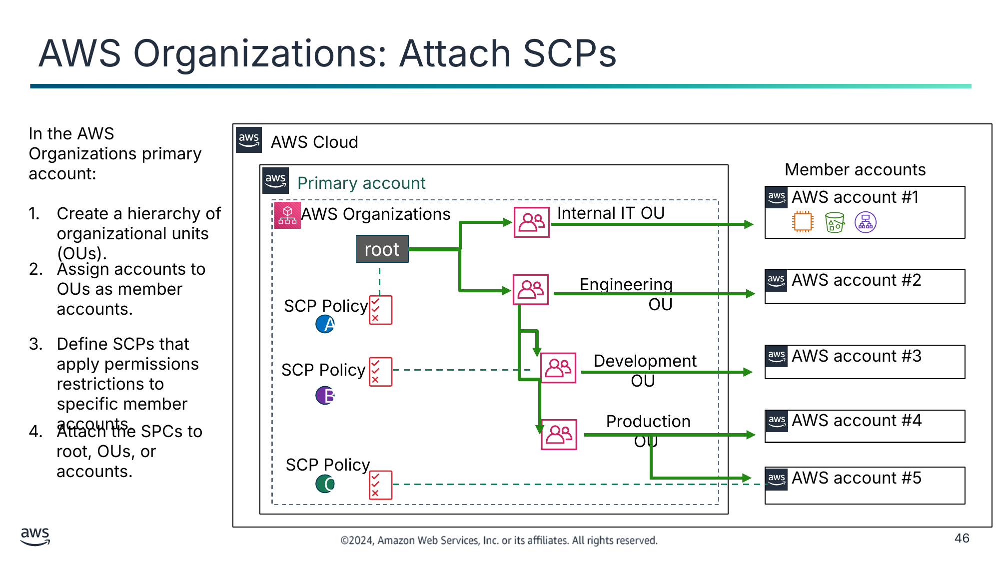

4. Attach the SPCs to root, OUs, or accounts.

<details>
<summary>Текст зі схеми</summary>

In the AWS Organizations primary account:

1. Create a hierarchy of organizational units (OUs).

2. Assign accounts to OUs as member accounts.

AWS Cloud

Primary account

AWS account #1

AWS Organizations

Internal IT OU

root

Engineering OU

AWS account #2

SCP Policy

A

SCP Policy

 Development OU

AWS account #3

B

 Production OU

AWS account #4

SCP Policy

AWS account #5

C

Member accounts

3. Define SCPs that apply permissions restrictions to specific member accounts.

</details>

> **Нотатки:**
>
> |Slide number 46  
> |Instructor notes  
> |This slide pulls it all together. It’s important to note that the policy flows out away from the root and it affects all OUs and accounts beneath it.  
> |  
> |Student notes  
> After the SCPs are created, the final step is attaching each policy to the appropriate place in the hierarchy of OUs and accounts.  
>
> The policy flows out away from the root and it affects all the OUs and accounts beneath it. If a policy is attached to the root, it affects all OUs and accounts in the hierarchy. Therefore, if you apply an SCP to the root (like SCP Policy A in the example), it will apply to all OUs and accounts in the organization. You can attach a SCP to the root, to any OU, or to an individual account.  
>
> Remember that like IAM policies, SCPs will only grant access if it is both explicitly allowed and is not explicitly denied by any other SCP or IAM policy that applies to the user. For example, say that SCP Policy A, which is applied to the root of the organization, sets more restrictions on a particular service or set of resources than SCP Policy C. Then, users in Account 5 are subject to the more restrictive permissions set by Policy A. Similarly, if any IAM policies at the individual account level explicitly deny any actions for the user, these IAM policies override any permissions in the SCPs that are granted to the account.

---

## Слайд 47: Combining SCPs with IAM identity-based policies

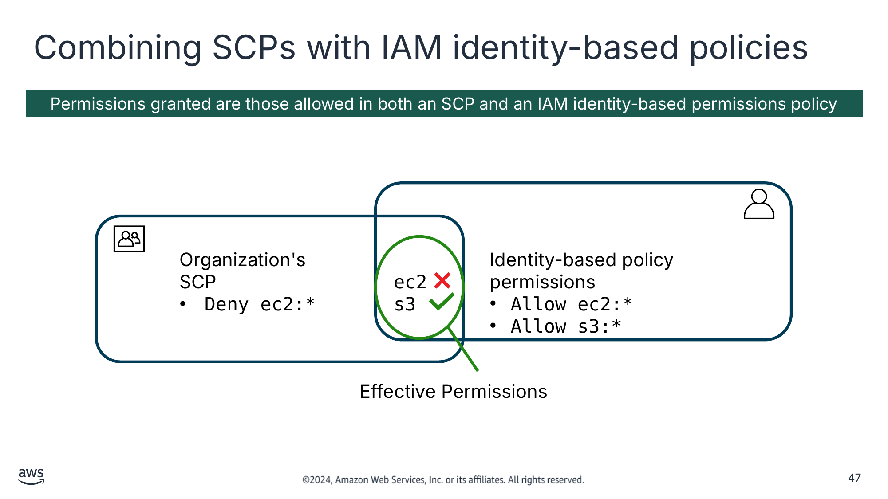

Permissions granted are those allowed in both an SCP and an IAM identity-based permissions policy

<details>
<summary>Текст зі схеми</summary>

Organization's SCP

- `Deny ec2:*`

Identity-based policy permissions

- `Allow ec2:*`
- `Allow s3:*`

```
ec2
s3
```

Effective Permissions

</details>

> **Нотатки:**
>
> |Slide number 47  
> |Instructor notes  
> |Note the intersection and that an explicit deny in any of these policies overrides the allow. Emphasize that an SCP is used to restrict the permissions that users can have. It specifies the maximum permissions in member accounts in the organization.  
> |  
> |Student notes  
> Users or groups can have multiple policies attached to them that grant different permissions. In that case, the permissions for the users are calculated based on the combination of policies. But the basic principle still applies: If the user has not been granted an explicit permission for an action and a resource, the user does not have those permissions.  
>
> Attach identity-based or resource-based policies to IAM users or to the resources in your organization's accounts. Attach an SCP to an Organizations entity (root, OU, or account) to define a guardrail. The SCP sets limits upon the actions that the IAM users and roles in the affected accounts can perform.  
>
> Organizations SCPs are applied to an entire AWS account. They limit permissions for every request made by a principal within the account. An IAM entity (user or role) can make a request that is affected by an SCP or an identity-based policy. In this case, the request is allowed only if both policy types allow it. The effective permissions are the intersection of the policies. An explicit deny in any of these policies overrides the allow.  
>
> The permissions allowed (center) are only the ones that are allowed both in the IAM identity-based permissions policy and the Organizations SCP. In this case, because the SCP does not deny access to Amazon Simple Storage Service (Amazon S3), the allow s3* in the identity-based policy grants the permission to access Amazon S3.

---

## Слайд 48: Permissions boundaries set limits on IAM entities

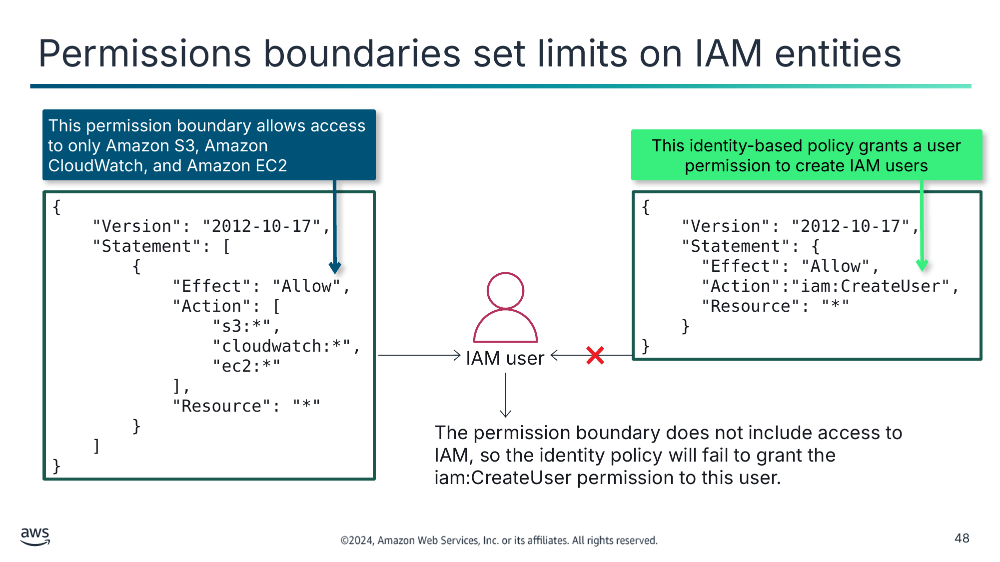

This permission boundary allows access to only Amazon S3, Amazon CloudWatch, and Amazon EC2

This identity-based policy grants a user permission to create IAM users

```json
{    
    "Version": "2012-10-17",
    "Statement": [
        {
            "Effect": "Allow",
            "Action": [
                "s3:*",
                "cloudwatch:*", 
                "ec2:*"
            ],
            "Resource": "*"
        }
    ]
}
```

```json
{  
    "Version": "2012-10-17",
    "Statement": {
      "Effect": "Allow", 
      "Action":"iam:CreateUser",
      "Resource": "*"  
    }
}
```

IAM user

The permission boundary does not include access to IAM, so the identity policy will fail to grant the iam:CreateUser permission to this user.

> **Нотатки:**
>
> |Slide number 48  
> |Instructor notes  
> |  
> |Student notes  
> AWS supports permissions boundaries for IAM entities (users or roles). A permissions boundary is an advanced feature for using a managed policy to set the maximum permissions that an identity-based policy can grant to an IAM entity. An entity's permissions boundary allows it to perform only the actions that are allowed by both its identity-based policies and its permissions boundaries.  
>
> You can use an AWS managed policy or a customer managed policy to set the boundary for an IAM entity (user or role). That policy limits the maximum permissions for the user or role.  
>
> When you use a policy to set the permissions boundary for a user, it limits the user's permissions but does not provide permissions on its own. In this example, the policy sets the maximum permissions of an IAM user as all operations in Amazon S3, Amazon CloudWatch, and Amazon Elastic Compute Cloud (Amazon EC2). This IAM user can never perform operations in any other service, including IAM, even if they have a permissions policy that allows it.

---

## Слайд 49: Permissions must be allowed by both policy types

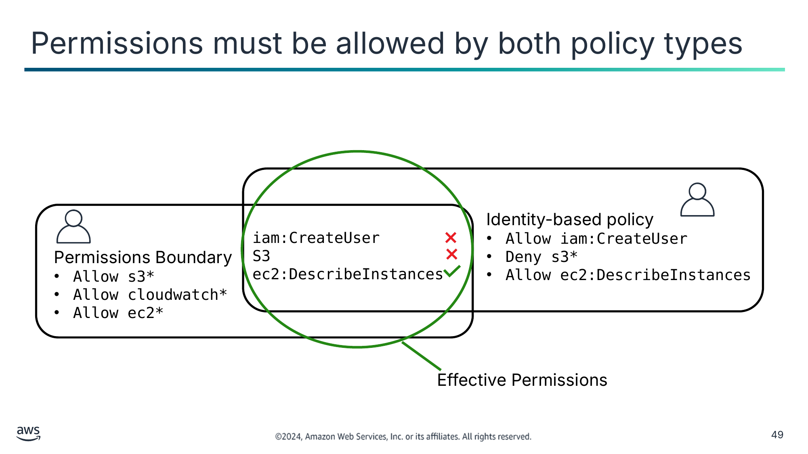

<details>
<summary>Текст зі схеми</summary>

```
Identity-based policy
Allow iam:CreateUser
Deny s3*
Allow ec2:DescribeInstances
```

```
iam:CreateUser
S3
ec2:DescribeInstances
```

```
Permissions Boundary
Allow s3*
Allow cloudwatch*
Allow ec2*
```

Effective Permissions

</details>

> **Нотатки:**
>
> |Slide number 49  
> |Instructor notes  
> | Note the intersection and the effective permissions. You might note that with a permission boundary, the user cannot access services that aren't explicitly allowed. So this user cannot access IAM even though there’s not an explicit deny in place on IAM. The permission boundary had the impact of denying anything not listed.  
> |  
> |Student notes  
> As illustrated in the example on the previous slide, the permissions boundary for an IAM entity (user or role) sets the maximum permissions that the entity can have. This can change the effective permissions for that user or role. Identity-based policies are inline or managed policies that are attached to a user, group of users, or role. Identity-based policies grant permission to the entity, and permissions boundaries limit those permissions. The effective permissions are the intersection of both policy types.  
>
> An explicit deny in either of these policies overrides the allow. So, although the permissions boundary includes Amazon S3, the IAM identity-based policy denies it, and that explicit deny prevents this user from accessing Amazon S3. Because the permissions boundary allows ec2* and the identity-policy allows ec2: DescribeInstances, this IAM user would be able to use EC2 describe instances.

---

## Слайд 50: How multiple policy types impact permissions

**SCP attached to test OU**

- `Deny ec2*`
- `Deny sqs*`

```
Identity-based IAM policy
Allow ec2:DescribeInstances 
Allow kms*
Allow s3*
Allow sqs:SendMessage
```

**Permission boundary**

- `Allow s3*`
- `Allow sqs*`

IAM user in test OU

| Resource or permission | Allowed? | Rationale |
|---|---|---|
| EC2 describe instances | No | Explicit deny to EC2 in SCP overrides allow in IAM policy. |
| AWS Key Management Service (AWS KMS) | No | There is no explicit deny, but this service is not within the permission boundary. |
| Amazon S3 | Yes | S3 is within the permission boundary and there is no explicit deny in the SCP. The IAM policy grants access. |
| Amazon Simple Queue Service (Amazon SQS) send message | No | Explicit deny in SCP overrides the allow in the permission boundary and IAM policy. |

> **Нотатки:**
>
> |Slide number 50  
> |Instructor notes  
> | Note the intersection and the effective permissions.  
> |  
> |Student notes  
> Within an account, the permissions for an entity can be affected by identity-based policies, resource-based policies, permissions boundaries, Organizations SCPs, or session policies.  
>
> If any one of these policy types explicitly denies access for an operation, then the request is denied. The permissions granted to an entity by multiple permissions types are more complex. This example shows the impact of using all three of the permissions types discussed in this section: an SCP on the organization, and both a permissions boundary and an identity-based policy on an IAM user.  
>
> For more details about how AWS evaluates policies, see the policy evaluation logic link provided on the course resource page.

---

## Слайд 51: Comparing permission boundaries and SCPs

| Permission boundary | Organizational SCP |
|---|---|
| Applies to an IAM entity (user or role) | Applies to all members of an organization or OU |
| Defines the maximum permissions that the associated identity-based policies can grant to an entity | Defines the maximum permissions for account members of an organization or organizational unit (OU) |
| Does not grant permissions | Does not grant permissions |
| Typically used to scope which resources a user or role is allowed to access | Typically used to deny access to a set of resources |
| • Example: Allow the IAM role developer to access EC2, Amazon S3, and Amazon CloudWatch.<br>• Result: The developer role can only access EC2, Amazon S3, and CloudWatch regardless of other policies associated with their role. | • Example: Deny access to Amazon Relational Database Service (Amazon RDS) to all members of the Internal IT OU.<br>• Result: All members of the Internal IT OU will be denied access to Amazon RDS regardless of other policies associated with their identity. |

> **Нотатки:**
>
> |Slide number 51  
> |Instructor notes  
> |  
> |Student notes  
> Both permissions boundaries and organizational SCPs let you limit the scope of access that will be granted. Key distinctions are that the permission boundary is associated to a user or role, while the SCP is applied across an organization. Neither permissions boundaries or SCPs actually grant permissions on their own. In practice, permissions boundaries are often used to explicitly allow a subset of services, preventing access to anything not in that allow list. For example, when a role needs access to only a small subset of AWS services, you can put those in a permission boundary. SCPs by contrast are often used to deny specific services. For example, you have an organization that needs to use a variety of AWS services and resources, but you want to prevent them from accessing a particular type of resource such as Amazon Relational Database Service (Amazon RDS).

---

## Слайд 52: AWS Control Tower

- AWS Control Tower facilitates the set up and governance of a secure, multi-account AWS environment.
- AWS Control Tower benefits include the following:
  - Automated set up of a new well-architected multi-account environment based on best practices blueprints
  - Governance of AWS workloads with rules for security, operations, and internal compliance
  - Prescriptive guidance to govern your AWS environment at scale

AWS Control Tower

> **Нотатки:**
>
> |Slide number 52  
> |Instructor notes  
> |  
> |Student notes  
> AWS Control Tower offers a simple way to set up and govern a secure, multi-account AWS environment. It establishes a landing zone that’s based on best practices blueprints, and it enables governance using guardrails you can choose from a pre-packaged list. A guardrail, also called a control, is a high-level rule that provides ongoing governance for your overall AWS environment. It's expressed in plain language.  
>
> The landing zone is a well-architected, multi-account baseline that follows AWS best practices. Guardrails implement governance rules for security, compliance, and operations.  
>
> If you want to create or manage your multi-account AWS environment with best practices, use AWS Control Tower. It offers prescriptive guidance to govern your AWS environment at scale. It gives you control over your environment without sacrificing the speed and agility AWS provides for builders. You will benefit if you are building a new AWS environment, starting out on your journey on AWS, starting a new cloud initiative, are completely new to AWS, or if you have an existing multi-account AWS environment but prefer a solution with built-in blueprints and guardrails.  
>
> For more information, see AWS Control Tower on the content resources page of your online course.

---

## Слайд 53: Key takeaways: Managing access to multiple accounts

- Most organizations choose to create multiple AWS accounts and define a VPC in each account.
- Multiple accounts allow for billing consolidation to help save money by grouping together with tiered pricing. It also enables organizations to cleanly separate different types of resources while providing some security benefits.
- AWS Organizations allows you to consolidate multiple AWS accounts into a centrally managed organization.
- SCPs allow you to set limits on permissions across an organization, while permissions boundaries let you set limits on IAM entities (users and roles).
- Users or groups can have multiple policies attached to them that grant different permissions. If a user isn’t granted an explicit permission for an action and a resource, the user doesn’t have those permissions.

> **Нотатки:**
>
> |Slide number 53  
> |Instructor notes  
> |  
> |Student notes  
> These key takeaways summarize this section.

---

## Слайд 54: Encrypting data at rest

Securing User, Application, and Data Access

> **Нотатки:**
>
> |Slide number 54  
> |Instructor notes  
> |  
> |Student notes  
> This section focuses on encrypting data at rest using the AWS Key Management Service (AWS KMS).

---

## Слайд 55: Why protect data at rest?

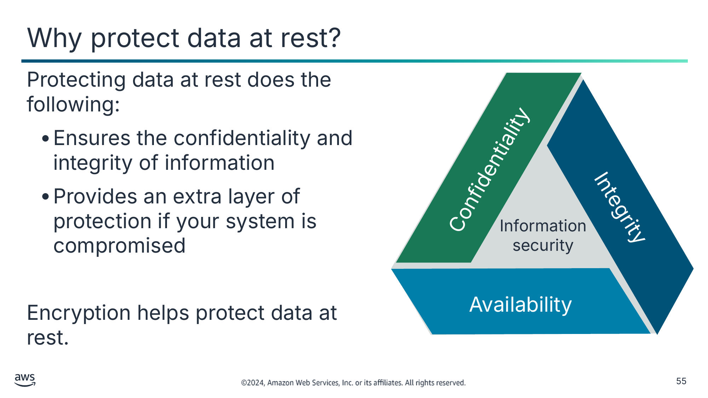

Protecting data at rest does the following:

- Ensures the confidentiality and integrity of information
- Provides an extra layer of protection if your system is compromised

Encryption helps protect data at rest.

<details>
<summary>Текст зі схеми</summary>

Confidentiality

Integrity

Information security

Availability

</details>

> **Нотатки:**
>
> |Slide number 55  
> |Instructor notes  
> |  
> |Student notes  
> Sensitive data can be protected at multiple layers, including while in transit and while at rest.  
>
> You protect data while it's traveling from network to network or being transferred. You also protect data when it resides in a local storage device or cloud storage device.  
>
> This section looks at protecting data at rest.  
>
> The confidentiality, integrity, and availability (CIA) triad is a widely used model to implement data security in enterprises. Confidentiality aims at keeping personal data safe and hidden from non-authorized people. Integrity consists of ensuring that data isn’t modified or altered throughout the process in which it is used. Finally, availability ensures that data stays available when needed for the right person.  
>
> Protecting data at rest contributes to the confidentiality and integrity of information. It ensures the security of the data even if an unauthorized party gains access to it. Encrypting data at rest makes it much more difficult for attackers to compromise data, even if they can compromise an endpoint. Also, you might need to protect your data at rest due to business or compliance requirements.

---

## Слайд 56: What is data encryption?

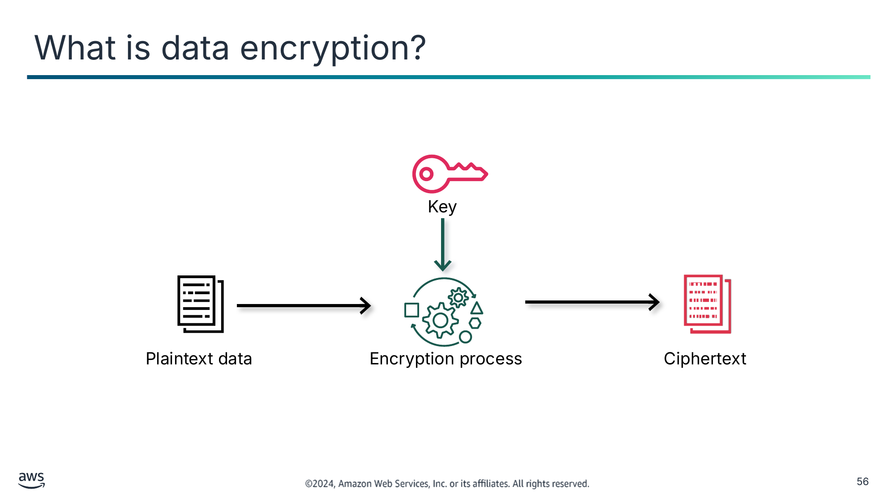

<details>
<summary>Текст зі схеми</summary>

Key

Plaintext data

Encryption process

Ciphertext

</details>

> **Нотатки:**
>
> |Slide number 56  
> |Instructor notes  
> |Review the definition of encryption. Point out that the key can be a series of numbers and letters that the algorithm uses to encrypt and decrypt data. Protecting and managing keys becomes a critical part of any encryption solution.  
> |  
> |Student notes  
> Encryption is the process of using a code, called a cipher, to turn readable data into unreadable data for another party. The cipher contains both algorithms to encrypt and to decrypt the data. A key is a series of numbers and letters that the algorithm uses to encrypt and decrypt data.  
>
> Encryption works by using an algorithm with a key to convert plaintext data into unreadable data (ciphertext) that can only become readable again with the right key. For example, a simple phrase such as “Hello World!” might look like “1c28df2b595b4e30b7b07500963dc7c” when encrypted.  
>
> Several different encryption algorithms exist, all using different types of keys. A strong encryption algorithm relies on mathematical properties to produce ciphertext that can’t be decrypted by using any practically available amount of computing power without also having the necessary key. Therefore, protecting and managing the keys becomes a critical part of any encryption solution.  
>
> There are two types of encryption: symmetric encryption and asymmetric encryption. Both types can be used for encrypting data in transit or data at rest.  
>
> Envelope encryption uses both symmetric and asymmetric encryption together. For example, the TLS (SSL) protocol performs envelope encryption by combining the use of both symmetric and asymmetric encryption.

---

## Слайд 57: Symmetric encryption

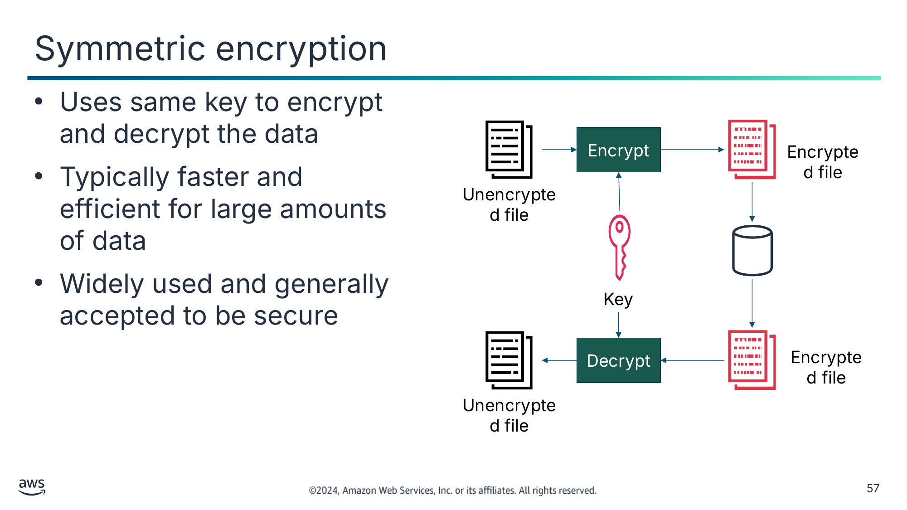

- Uses same key to encrypt and decrypt the data
- Typically faster and efficient for large amounts of data
- Widely used and generally accepted to be secure

<details>
<summary>Текст зі схеми</summary>

Encrypt

Encrypted file

Unencrypted file

Key

Decrypt

Encrypted file

Unencrypted file

</details>

> **Нотатки:**
>
> |Slide number 57  
> |Instructor notes  
> |Review the diagram with students. Point out that the same key is used to encrypt and decrypt the data.  
> |  
> |Student notes  
> Symmetric encryption uses the same key to encrypt and decrypt the data. The key is a shared secret between the sender and the receiver.  
>
> As illustrated in the diagram, the key is used to encrypt the file before it is stored, and then it must be decrypted using the same key before it can be retrieved and read.  
>
> This type of encryption is typically faster and is, therefore, efficient for large amounts of data. This type of encryption is widely used and generally accepted to be secure. Because a single key is used for both encryption and decryption, a best practice is to change the key frequently to prevent an unauthorized person from obtaining it.  
>
> For example, the TLS protocol uses symmetric encryption for data exchange.

---

## Слайд 58: When to use symmetric encryption

- If speed, cost, and lower computational overhead are a priority
- If you’re encrypting a large amount of data
- If encrypted data isn’t leaving the boundaries of the organization’s network

> **Нотатки:**
>
> |Slide number 58  
> |Instructor notes  
> | Review the definition of symmetric encryption and discuss when to use it.  
> |  
> |Student notes  
> See the link provided on the course resources page for more information about when symmetric encryption is recommended.

---

## Слайд 59: Asymmetric encryption

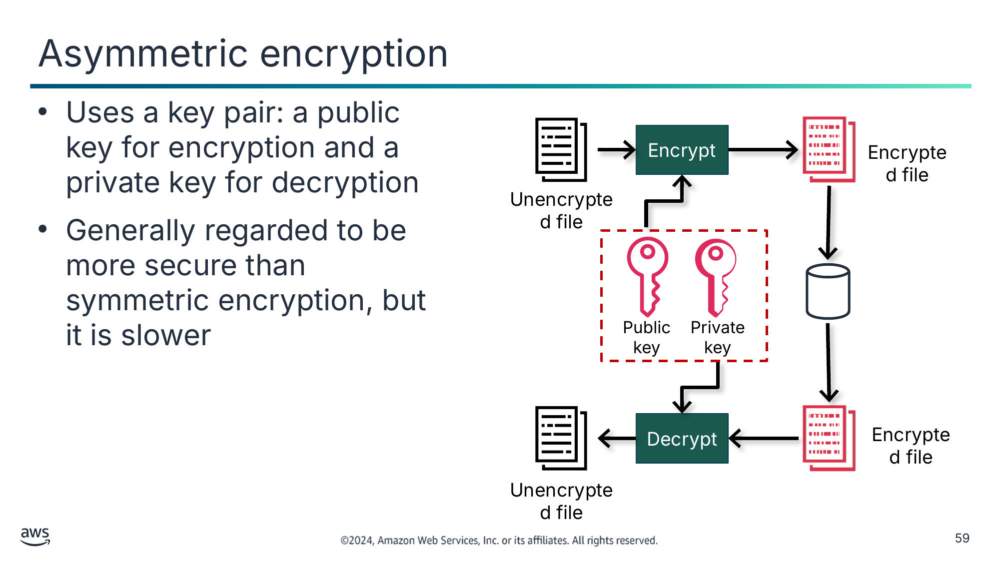

- Uses a key pair: a public key for encryption and a private key for decryption
- Generally regarded to be more secure than symmetric encryption, but it is slower

<details>
<summary>Текст зі схеми</summary>

Encrypt

Encrypted file

Unencrypted file

Public key

Private key

Decrypt

Encrypted file

Unencrypted file

</details>

> **Нотатки:**
>
> |Slide number 59  
> |Instructor notes  
> |Review the diagram with students. Point out that different keys are used to encrypt and decrypt the data.  
> |  
> |Student notes  
> Asymmetric encryption uses both a public key and a private key (a key pair) to encrypt and decrypt the data. Every user in the conversation has a key pair. Asymmetric encryption is more complex and much slower than symmetric encryption. However, it provides more capabilities in the way that keys are managed.  
>
> In the diagram that is shown on the slide, you can see that the file is encrypted with a public key. After it’s encrypted, the only way to retrieve and read the file is to use the private key associated to this public key to decrypt the message.

---

## Слайд 60: When to use asymmetric encryption

- If you’re sharing the data outside of the organization
- If regulations or governance prohibit sharing the key
- If non-repudiation is required (Non-repudiation prevents a user from denying prior commitments or actions)
- If you’re strictly segregating access to encryption keys based on organization roles

> **Нотатки:**
>
> |Slide number 60  
> |Instructor notes  
> |Review the definition of asymmetric encryption and discuss when to use it.  
> |  
> |Student notes  
> Asymmetric encryption uses a pair of keys: a public key for encryption and a private key for decryption. You can share the public key because it isn’t used for decryption, but access to the private key should be highly restricted. Asymmetric encryption is generally regarded to be more secure than symmetric encryption, but it’s slower because it uses longer key lengths and requires more complex encryption calculations.  
>
> Asymmetric encryption can also provide non-repudiation, which means that the sender of a message cannot later deny sending it. This is because the message was encrypted with the sender's private key, which can only be decrypted with their public key.  
>
> See the link provided on the course resources page for more information about creating and using asymmetric AWS Key Management Service (AWS KMS) keys.

---

## Слайд 61: Applying envelope encryption

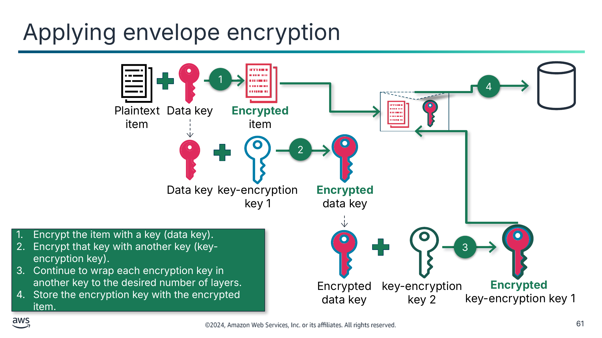

1. Encrypt the item with a key (data key).
2. Encrypt that key with another key (key-encryption key).
3. Continue to wrap each encryption key in another key to the desired number of layers.
4. Store the encryption key with the encrypted item.

<details>
<summary>Текст зі схеми</summary>

1

4

Plaintext item

Data key

**Encrypted** item

2

Data key

key-encryption key 1

**Encrypted** data key

3

Encrypted data key

key-encryption key 2

**Encrypted**  
key-encryption key 1

</details>

> **Нотатки:**
>
> |Slide number 61  
> |Instructor notes  
> |Review the definition of envelope encryption and when to use.  
> |  
> |Student notes  
> Consider the analogy of locking your valuables in a safe. But what if someone finds your safe key? To add additional protection, you can lock the safe key in your safety deposit box at the bank. You can continue to add layers of security by locking away each key, reducing the risk that someone could get to the key they need to unlock your safe.  
>
> Envelope encryption is the practice of encrypting the key that you used to encrypt your data. You can even encrypt the data encryption key under another encryption key, and encrypt that encryption key under another encryption key.  
>
> See the link provided on the course resources page for more information about envelope encryption.

---

## Слайд 62: Methods of applying encryption to data at rest

| Client-side encryption (CSE) | Server-side encryption (SSE) |
|---|---|
| The application encrypts data before sending it to AWS. | AWS encrypts data on your behalf after receiving it. |
| Create and manage your own encryption keys. | Services transparently encrypt your data before writing it to disk and transparently decrypt the data when you access it. |
| The keys and algorithms are known only to you. | The keys can be managed by AWS. |

> **Нотатки:**
>
> |Slide number 62  
> |Instructor notes  
> |Review both client-side and server-side encryption, and discuss the benefits of each.  
> |  
> |Student notes  
> Depending on your security requirements, you can use client-side encryption (CSE) or server-side encryption (SSE) to encrypt your data. The approaches differ in when, where, and who encrypts and decrypts the data. The approach doesn't necessarily define how the data is encrypted. In addition, the approaches are not exclusive—you can often use CSE and SSE on the same data for an enhanced security profile. Each approach has advantages.  
>
> With CSE, your applications encrypt data locally before submitting it to AWS and decrypt data after receiving it from AWS. You create and manage your own encryption keys. Data is stored in an encrypted form, with keys and algorithms known only to you.  
>
> With SSE, data is encrypted at its destination by the application or service that receives it. For example, if you use SSE with Amazon Simple Storage Service (Amazon S3), the service encrypts your data at the object level as it writes to disks in AWS data centers and decrypts the data for you when you access it. The encryption process is transparent to the user.  
>
> AWS supports both CSE and SSE. Most AWS services that store or manage customer data offer an SSE option or perform SSE on your data by default. These services transparently encrypt your data before writing it to disk and transparently decrypt the data when you access it. Most AWS services that support SSE are integrated with AWS KMS to protect the encryption keys that protect your data. You will learn more about AWS KMS later in this module.  
>
> See the link provided on the course resources page for more information on protecting data using encryption.

---

## Слайд 63: Client-side encryption example

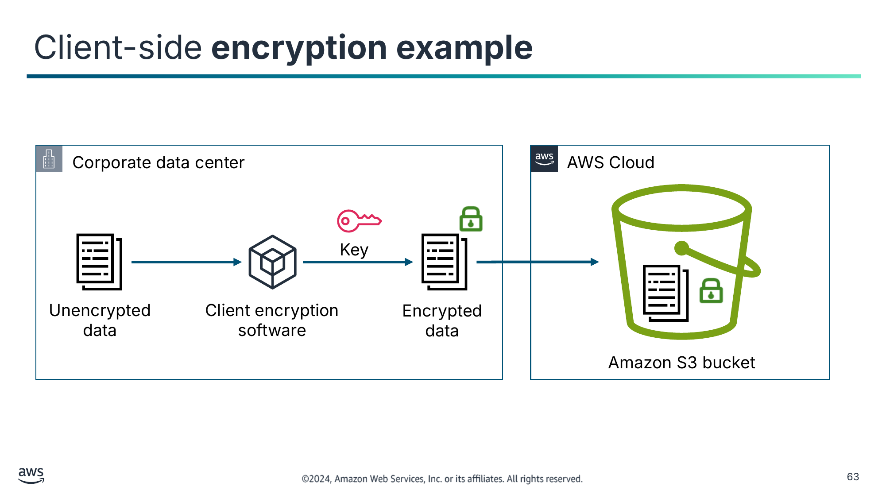

<details>
<summary>Текст зі схеми</summary>

Corporate data center

AWS Cloud

Key

Unencrypted data

Client encryption

software

Encrypted

data

Amazon S3 bucket

</details>

> **Нотатки:**
>
> |Slide number 63  
> |Instructor notes  
> |Review the diagram with students. Note that client-side encryption takes place before data is submitted to AWS.  
> |  
> |Student notes  
> Client-side encryption takes place before data is submitted to AWS, and decryption occurs after data is retrieved from AWS. In this example, the unencrypted data is encrypted in the corporate data center, and then Amazon S3 receives your encrypted data but does not play a role in encrypting or decrypting it.  
>
> To enable client-side encryption, you can use a key that’s stored in AWS KMS or a key that you store within your application.  
>
> AWS supports client-side encryption libraries such as the AWS Encryption SDK, Amazon DynamoDB Encryption Client, and Amazon S3 encryption clients.

---

## Слайд 64: Server-side encryption example

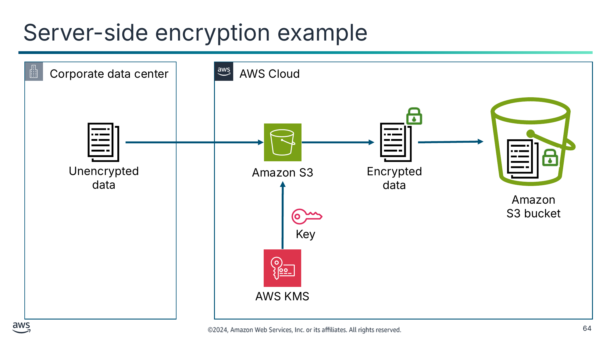

<details>
<summary>Текст зі схеми</summary>

Corporate data center

AWS Cloud

Unencrypted data

Amazon S3

Encrypted

data

Amazon S3 bucket

Key

AWS KMS

</details>

> **Нотатки:**
>
> |Slide number 64  
> |Instructor notes  
> |Review the diagram with students. Note that server-side encryption is the encryption of data at its destination by the application or service that receives it.  
> |  
> |Student notes  
> Server-side encryption is the encryption of data at its destination by the application or service that receives it.  
>
> In this example, your unencrypted source data comes from systems in your data center. You can upload that data over an HTTPS connection to Amazon S3 which encrypts the data before storing it in the Amazon S3 bucket. The service endpoint will handle the encryption and key management processes for you.

---

## Слайд 65: AWS Key Management Service (AWS KMS)

- Provides the ability to create and manage cryptographic keys
- Uses hardware security modules (HSMs) to protect your keys
- Integrates with other AWS services
- Provides the ability to set usage policies to determine which users can use keys

AWS KMS

> **Нотатки:**
>
> |Slide number 65  
> |Instructor notes  
> |  
> |Student notes  
> AWS KMS is a managed service that provides the ability to create and control the keys that are used to encrypt your data. You can create data keys with unique aliases and descriptions for better management, automatically rotate your keys on a scheduled basis, and disable or delete keys so that no one can use them. You can also import your own keys instead of using AWS-generated keys.  
>
> The service uses FIPS 140-2 validated hardware security modules (HSMs) to protect keys. AWS KMS is integrated with other AWS services to help you protect the data that you store with these services. Integrated AWS services use envelope encryption to help protect your encryption keys.  
>
> With AWS KMS, you can centrally manage and securely store your keys. You can use the keys within your applications and supported AWS Cloud services to protect your data, but the keys never leave AWS KMS. This reduces the risk of having your data key compromised. You submit data to AWS KMS to be encrypted or decrypted under keys that you control.  
>
> You can set usage policies on these keys to determine which users can use them. All requests to use these keys are logged in AWS CloudTrail so that you can understand who used which key and when. CloudTrail logs all AWS KMS operations, including read-only operations, operations that manage KMS keys, and cryptographic operations.  
>
> See the links provided on the course resources page for more information on AWS KMS.

---

## Слайд 66: AWS KMS features

Keys

Cryptographic operations

- Customer managed
- KMS managed
- Data key (symmetric)
- Data key pair (asymmetric)

- Encrypt
- Decrypt
- GenerateDataKey
- GenerateDataKeyPair

> **Нотатки:**
>
> |Slide number 66  
> |Instructor notes  
> |  
> |Student notes  
> AWS KMS keys are the primary resource in AWS KMS. You can use an AWS KMS key to encrypt, decrypt, and re-encrypt data. It can also generate data keys that you can use outside of AWS KMS.  
>
> Important AWS KMS features include the following:  
> Customer managed: The KMS keys that you create are customer managed keys. Customer managed keys are KMS keys in your AWS account that you create, own, and manage.  
> KMS managed: AWS owned keys are a collection of KMS keys that an AWS service owns and manages for use in multiple AWS accounts. Although AWS owned keys are not in your AWS account, an AWS service can use an AWS owned key to protect the resources in your account. AWS managed keys are KMS keys in your account that are created, managed, and used on your behalf by an AWS service integrated with AWS KMS.  
> Data key (Symmetric): Data keys are symmetric keys you can use to encrypt data, including large amounts of data and other data encryption keys. Unlike symmetric KMS keys, which can't be downloaded, data keys are returned to you for use outside of AWS KMS.  
> Data key pair (Asymmetric): You can create asymmetric KMS keys in AWS KMS. An asymmetric KMS key represents a mathematically related public key and private key pair. The private key never leaves AWS KMS unencrypted.  
>
> In AWS KMS, cryptographic operations are API operations that use KMS keys to protect data. Because KMS keys remain within AWS KMS, you must call AWS KMS to use a KMS key in a cryptographic operation.  
>
> Additional terms to understand include the following:  
> Encrypt: Encrypts plaintext of up to 4,096 bytes using a KMS key. You can use a symmetric or asymmetric KMS key with a KeyUsage of ENCRYPT_DECRYPT. You can use this operation to encrypt small amounts of arbitrary data, such as a personal identifier, database password, or other sensitive information.  
> Decrypt: Decrypts ciphertext that was encrypted by a KMS key using any of the following operations: Encrypt, GenerateDataKey, GenerateDataKeyPair, GenerateDataKeyWithoutPlaintext, GenerateDataKeyPairWithoutPlaintext.  
>   
> You can use this operation to decrypt ciphertext that was encrypted under a symmetric encryption KMS key or an asymmetric encryption KMS key. When the KMS key is asymmetric, you must specify the KMS key and the encryption algorithm that was used to encrypt the ciphertext.  
>
> GenerateDataKey: Returns a unique symmetric data key for use outside of AWS KMS. This operation returns a plaintext copy of the data key and a copy that is encrypted under a symmetric encryption KMS key that you specify.  
> GenerateDataKeyPair: Returns a unique asymmetric data key pair for use outside of AWS KMS. This operation returns a plaintext public key, a plaintext private key, and a copy of the private key that is encrypted under the symmetric encryption KMS key that you specify.  
>
> See the link provided on the course resources page for more information on AWS KMS features.

---

## Слайд 67: AWS KMS integration with other AWS services

- Amazon Simple Storage Service (Amazon S3)
- Amazon Elastic Block Store (Amazon EBS)

**Important**

AWS services that are integrated with AWS KMS use only symmetric encryption KMS keys to encrypt your data. These services do not support encryption with asymmetric KMS keys.

> **Нотатки:**
>
> |Slide number 67  
> |Instructor notes  
> | There are a number of AWS services that integrate with AWS KMS. We will review Amazon S3 and Amazon EBS in more detail as this will help with the lab exercise.  
> |  
> |Student notes  
> Many AWS services use AWS KMS to support encryption of your data. When an AWS service is integrated with AWS KMS, you can use the AWS KMS keys in your account to protect the data that the service receives, stores, or manages for you. For the complete list of AWS services integrated with AWS KMS, see the link provided on the content resources page.  
>
> We will look at the following two services in more detail.  
>
> Amazon S3 is an object storage service that stores data as objects within buckets. Buckets and the objects in them are private and can be accessed only if you explicitly grant access permissions.  
>   
> Amazon S3 integrates with AWS KMS to provide server-side encryption of Amazon S3 objects. Amazon S3 uses KMS keys to encrypt your Amazon S3 objects. The encryption keys that protect your objects never leave AWS KMS unencrypted. This integration also enables you to set permissions on the KMS key and audit the operations that generate, encrypt, and decrypt the data keys that protect your secrets.  
>
> Amazon Elastic Block Store (Amazon EBS): When you attach an encrypted Amazon EBS volume to a supported Amazon Elastic Compute Cloud (Amazon EC2) instance type, data stored at rest on the volume, disk I/O, and snapshots created from the volume are all encrypted. The encryption occurs on the servers that host Amazon EC2 instances.  
>
> This feature is supported on all Amazon EBS volume types. You access encrypted volumes the same way you access other volumes. Encryption and decryption are handled transparently, and they require no additional action from you, your EC2 instance, or your application. Snapshots of encrypted volumes are automatically encrypted, and volumes that are created from encrypted snapshots are also automatically encrypted.

---

## Слайд 68: AWS KMS encryption example with Amazon S3

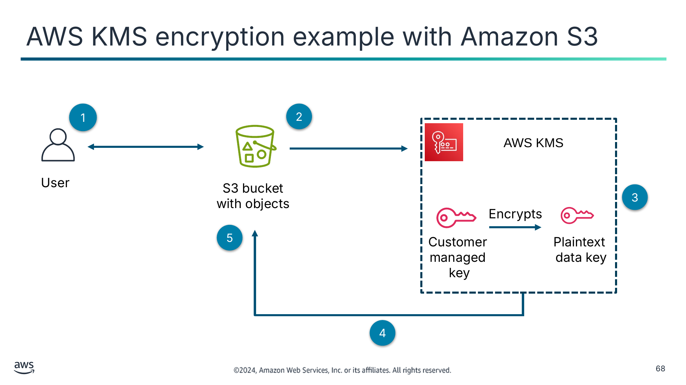

<details>
<summary>Текст зі схеми</summary>

1

2

AWS KMS

User

S3 bucket with objects

3

Encrypts

5

Customer

managed

key

Plaintext

data key

4

</details>

> **Нотатки:**
>
> |Slide number 68  
> |Instructor notes  
> |Review each step of the AWS KMS encryption example with Amazon S3.  
> |  
> |Student notes  
> In this scenario, AMS KMS is used to encrypt data at rest (SSE-KMS). The user creates a KMS key and uses it to encrypt objects that are stored in Amazon S3.  
>
> This diagram explains how encryption happens when uploading a file to Amazon S3.  
> You request to upload a file and store it as an encrypted object in an S3 bucket.  
> Amazon S3 requests a data key from AWS KMS to use to encrypt the file.  
> AWS KMS generates a plaintext data key and encrypts the data key by using the customer managed key. Data keys are used to encrypt data locally in the AWS service or your application.  
> AWS KMS sends both copies of the data key to Amazon S3.  
> Amazon S3 encrypts the object by using the plaintext data key, stores the object, and then deletes the plaintext data key. The encrypted key is kept in the object metadata.

---

## Слайд 69: AWS KMS decryption example with Amazon S3

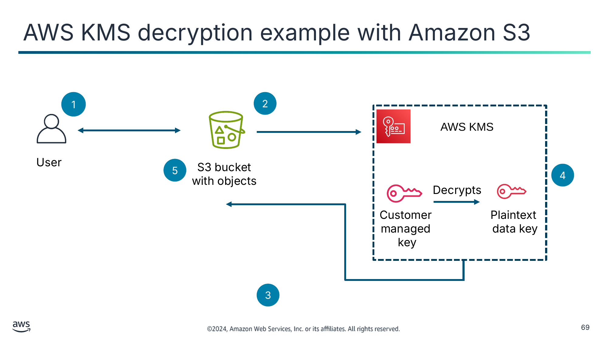

<details>
<summary>Текст зі схеми</summary>

1

2

AWS KMS

User

5

S3 bucket with objects

Decrypts

Customer

managed

key

Plaintext

data key

3

4

</details>

> **Нотатки:**
>
> |Slide number 69  
> |Instructor notes  
> |Review each step of the AWS KMS decryption example with Amazon S3.  
> |  
> |Student notes  
> Now, this diagram explains what happens in the same scenario (SSE-KMS) when the user requests to open an encrypted object that is stored in Amazon S3.  
> You request to open the object.  
> Amazon S3 sends the encrypted data key to AWS KMS in a decrypt request.  
> AWS KMS decrypts the data key by using the customer managed key (which never leaves the AWS KMS service).  
> AWS KMS  sends the plaintext data key back to Amazon S3.  
> Finally, Amazon S3 decrypts the ciphertext of the data object, allows you to open the object, and deletes the plaintext copy of the data key.

---

## Слайд 70: AWS KMS example with Amazon EBS

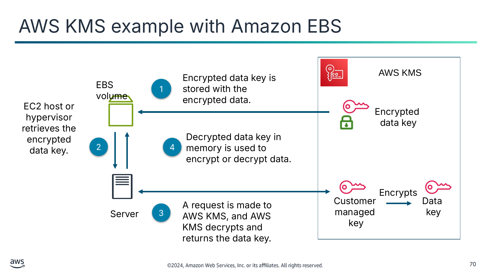

<details>
<summary>Текст зі схеми</summary>

Encrypted data key is stored with the encrypted data.

AWS KMS

EBS volume

1

EC2 host or hypervisor retrieves the encrypted data key.

Encrypted  
data key

Decrypted data key in memory is used to encrypt or decrypt data.

2

4

Encrypts

A request is made to AWS KMS, and AWS KMS decrypts and returns the data key.

Customer

managed

key

Data

key

Server

3

</details>

> **Нотатки:**
>
> |Slide number 70  
> |Instructor notes  
> |Review each step of AWS KMS example with Amazon EBS.  
> |  
> |Student notes  
> Amazon EBS encryption is a straight-forward encryption solution for EBS resources that are associated with your EC2 instances. With Amazon EBS encryption, you aren't required to build, maintain, and secure your own key management infrastructure.  
>
> Amazon EBS encryption uses KMS keys when creating encrypted volumes and snapshots. Each volume is encrypted using AES-256-XTS. This requires two 256-bit keys, which you can think of as one 512-bit key. The data key is encrypted under a KMS key in your account. For Amazon EBS to encrypt a volume for you, it must have access to a customer managed key in the account. You do this by providing a grant for Amazon EBS to the customer managed key to create data keys and to encrypt and decrypt these data keys.  
>
> The following are the basic steps to encrypt and decrypt EBS volume data:  
> Amazon EBS obtains an encrypted data key under a customer managed key through AWS KMS and stores the encrypted key with the encrypted data.  
> The servers that host EC2 instances retrieve the encrypted data key from storage.  
> A call is made to AWS KMS over TLS to decrypt the encrypted data key. AWS KMS identifies the KMS key, makes an internal request to an HSM in the fleet to decrypt the data key, and returns the key to the customer over the TLS session.  
> The decrypted data key is stored in memory and used to encrypt and decrypt all data going to and from the attached EBS volume. Amazon EBS retains the encrypted data key for later use in case the data key in memory is no longer available.  
>
> The Advanced Encryption Standard (AES) is an algorithm established by the US National Institute of Standards and Technology (NIST) that uses symmetric encryption.

---

## Слайд 71: Key takeaways: Encrypting data at rest

- Encrypting data at rest makes it more difficult for attackers to compromise data, even if they can compromise an endpoint.
- Symmetric encryption uses the same key to encrypt and decrypt the data.
- Asymmetric encryption uses a pair of keys: a public key for encryption and a private key for decryption.
- Envelope encryption is the practice of encrypting plaintext data with a data key, and then encrypting the data key under another key.
- With CSE, your applications encrypt data locally before submitting it to AWS and decrypt data after receiving it from AWS.
- With SSE, data is encrypted at its destination by the application or service that receives it.
- AWS KMS keys are the primary resource in AWS KMS. Use an AWS KMS key to encrypt, decrypt, and re-encrypt data.

> **Нотатки:**
>
> |Slide number 71  
> |Instructor notes  
> |  
> |Student notes  
> Here are a few key points to summarize this section.

---

## Слайд 72: Guided lab: Encrypting Data at Rest by Using AWS Encryption Options (AWS KMS lab)

> **Нотатки:**
>
> |Slide number 72  
> |Instructor notes  
> |  
> |Student notes  
> You will now complete a lab. The next slide summarizes what you will do in the lab, and you will find the detailed instructions in the lab environment.

---

## Слайд 73: Lab introduction: AWS KMS lab

- In this lab, you use the AWS Key Management Service (AMS KMS) to encrypt data at rest.
- The tasks that you perform include the following:
  - Creating an AWS KMS key
  - Encrypting an object stored in Amazon Simple Storage Service (Amazon S3)
  - Encrypting an Amazon Elastic Block Store (Amazon EBS) volume
  - Auditing AWS KMS key usage using AWS CloudTrail
- Open your lab environment to start the lab and find additional details about the tasks that you will perform.


> **Нотатки:**
>
> |Slide number 73  
> |Instructor notes  
> |<Add directions to find the lab guide information.>  
> |  
> |Student notes  
> Access the lab environment through your online course to get additional details and complete the lab.

---

## Слайд 74: Debrief: AWS KMS lab

- In this lab, you created an AWS KMS key. What are the differences between a key administrator and a key user?
- Why was it necessary to detach the encrypted EBS volume from the instance to see how disabling the AWS KMS key would affect the volume?

> **Нотатки:**
>
> |Slide number 74  
> |Instructor notes  
> |Relevant before and after architectural diagrams are included in the lab instructions for each lab. You might find it helpful to pull the lab diagrams up as part of debriefing this lab.  
> |  
> |Lead the class in a conversation about the key takeaways from the lab. Use the details from the previous section to help you debrief the lab with the students after they have completed it. Debriefing the lab is strongly encouraged. It helps the students make connections between their hands-on experience and the concepts that you discussed in the lecture before this lab.  
> |During the debrief, you can ask the students the questions shown on this slide. The following are the answers:  
> |  
> |What is the significance of using a symmetric key when encrypting and decrypting an object?  
> |With a symmetric key, you use the same key to encrypt and decrypt an object.  
> |Which types of AWS KMS activity did you audit with AWS CloudTrail?  
> |You audited the generation of a key (GenerateDataKey event) and the decryption of an S3 object (Decrypt event) in the AWS CloudTrail Event History log.  
> |Which type of intermediary artifact did you need to create when encrypting the root EBS volume of the EC2 instance?  
> |You had to create a snapshot of the unencrypted root volume, which you then used to create the encrypted volume.  
> |  
> |Suggested responses for question 1: In this lab, you created an AWS KMS key. What are the differences between a key administrator and a key user? Key administrators are users or roles that manage access to the encryption key.  
> |Key users are users or roles that can use the key to encrypt and decrypt data.  
> |Key administrators have permissions to manage the AWS KMS key but do not have default permissions to use the AWS KMS key to encrypt and decrypt data. However, the key administrator can list themselves as a key user. In that case, they |can use the key to encrypt and decrypt data. A key user cannot give other users permissions to use the key unless the key user also happens to be a key administrator.  
> |  
> |Suggested responses for question 2: Why was it necessary to detach the encrypted EBS volume from the instance to see how disabling the AWS KMS key would affect the volume?  
> |The encrypted data key is stored in memory and used to encrypt and decrypt all data going to and from the attached EBS volume. Amazon EBS retains the encrypted data key for later use in case the data key in memory is no longer available.  
> |  
> |Student notes  
> Your instructor might review these questions with you, or you might review them on your own. Use this opportunity to extend your thinking about the tasks that you performed during the lab.

---

## Слайд 75: AWS security services for securing user, application, and data access

Securing User, Application, and Data Access

> **Нотатки:**
>
> |Slide number 75  
> |Instructor notes  
> |  
> |Student notes  
> This section highlights additional examples of security services designed to improve your ability to follow security best practices and secure all layers of your applications.

---

## Слайд 76: AWS Services for Security, Identity, and Compliance

| Category | Category description | Examples |
|---|---|---|
| Identity and access management | Securely manage identities, resources, and permissions at scale. | • AWS Identity and Access Management (IAM)<br>• AWS IAM Identity Center<br>• Amazon Cognito<br>• AWS Organizations |
| Detection and response | Enhance security posture and streamline security operations across an entire AWS environment. | • AWS CloudTrail<br>• Amazon Detective<br>• Amazon Inspector<br>• AWS Security Hub |
| Network and application protection | Enforce fine-grained security policies at network control points across an organization. | • AWS Network Firewall<br>• AWS Shield<br>• AWS WAF |
| Data protection | Protect data, accounts, and workloads from unauthorized access. | • AWS Key Management System (AWS KMS)<br>• AWS Secrets Manager<br>• Amazon Macie |
| Compliance | Get a comprehensive view of compliance status and continuously monitor using automated checks based on AWS best practices and industry standards. | • AWS Artifact<br>• AWS Audit Manager |

Find the complete list and links to service pages at: [https://aws.amazon.com/products/security/](https://aws.amazon.com/products/security/)

> **Нотатки:**
>
> |Slide number 76  
> |Instructor notes  
> |  
> |Student notes  
> AWS has a set of services specifically designed to help you address security across your cloud infrastructure. This slide shows the categories of services and lists examples, some of which you learned about in this course. See Security, Identity, and Compliance on AWS in your course resources for a more detailed description of each category and for links that take you deeper into each category and individual service.  
>
> Earlier sections of this module looked at many of the identity and access management services that support protecting access, and the previous section talked about services that support protecting data at rest. The following slides describe a few additional services as examples of the types of features that are available when architecting your application's security.

---

## Слайд 77: Examples: AWS security services for defense in depth

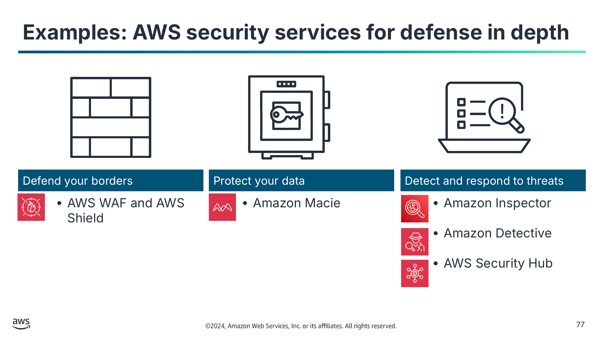

Defend your borders

Protect your data

Detect and respond to threats

- AWS WAF and AWS Shield

- Amazon Macie

- Amazon Inspector
- Amazon Detective
- AWS Security Hub

> **Нотатки:**
>
> |Slide number 77  
> |Instructor notes  
> |  
> |Student notes  
> A key part of the AWS Well-Architected Security pillar is applying security at all layers and implementing a defense in depth approach. Limiting access is one important layer that you learned about in this module. Additional layers of security include keeping out unwanted traffic, adding additional data protection mechanisms (for example, to protect sensitive and personally identifiable data), and automating your ability to detect and respond to vulnerabilities and security events. AWS security services reduce the burden of writing code to handle these levels of security.  
>
> The next few slides look at these services in a bit more detail.

---

## Слайд 78: AWS WAF

Description

Features

Example use cases

- A web application firewall that lets you monitor the HTTP and HTTPS requests that are forwarded to your protected web application resources

- Use managed or custom rules.
- Allow or block requests based on things like IP address, country of origin, or header values.
- Use AWS Shield (included at no additional cost) to help minimize the impact of distributed denial of service (DDoS) attacks.

- Block requests that are missing the HTTP User-Agent header.
- Detect and manage malicious account creation attempts on the application's sign-up page.

> **Нотатки:**
>
> |Slide number 78  
> |Instructor notes  
> |  
> |Student notes  
> AWS WAF is a web application firewall that lets you monitor the HTTP and HTTPS requests that are forwarded to your protected web application resources.  
>
> AWS Shield provides protection against distributed denial of service (DDoS) attacks for AWS resources, at the network and transport layers (layer 3 and 4), and the application layer (layer 7).  
>
> See the link provided on the course recourses page for more information on AWS WAF, AWS Shield, and AWS Firewall Manager.

---

## Слайд 79: Amazon Macie

Description

Features

Example use case

- A data security service that discovers sensitive data stored in Amazon Simple Storage Service (Amazon S3) by using machine learning and pattern matching, provides visibility into data security risks, and enables automated protection against those risks

- Perform automated sensitive data discovery.
- Create and run sensitive data discovery jobs.
- Use built-in or custom data identifiers.
- Review, analyze, and manage findings.

- Use Macie to identify sensitive data being migrated into Amazon S3. Notify an administrator to review the data and decide whether to allow process to continue putting the objects into Amazon S3.

> **Нотатки:**
>
> |Slide number 79  
> |Instructor notes  
> |  
> |Student notes  
> Amazon Macie is a data protection service that uses machine learning.  
>
> Amazon Macie is a security service that uses machine learning to automatically discover, classify, and protect sensitive data in AWS. Macie recognizes personally identifiable information (PII) such as passport numbers, medical ID numbers, and tax ID numbers. Macie also recognizes financial information, encryption keys, and credentials. Macie also allows you to add custom-defined data types using regular expressions to enable Macie to discover proprietary or unique sensitive data for your business.  
>
> Currently, Macie protects data stored in Amazon Simple Storage Service (Amazon S3) only and is available in most AWS Regions. Macie has dashboards and alerts that give visibility into data access by analyzing Amazon S3 resource-based policies and access control lists (ACLs) during sensitive data recovery. The service continuously monitors data and generates detailed alerts when it detects risk of unauthorized access or inadvertent data leaks.  
>
> With Macie, you have full control of the service through the Macie API set, and you can centrally manage Macie for multiple accounts. Macie integrates with AWS Organizations, which means that you can manage as many as 5,000 Macie accounts for a single AWS organization. You can also continue to use native Macie features for managing multiple accounts, which enables you to manage as many as 1,000 member accounts with a single Macie administrator account.  
>
> See the link provided on the course recourses page for more information on Amazon Macie.

---

## Слайд 80: Amazon Inspector

Description

Features

Example use case

- A vulnerability management service that continuously scans your AWS workloads for software vulnerabilities and unintended network exposure
- Discovers and scans running Amazon Elastic Compute Cloud (Amazon EC2) instances, container images in Amazon Elastic Container Registry (Amazon ECR), and AWS Lambda functions

- Centrally manage your environment through a single account by using AWS Organizations.
- Assess vulnerabilities accurately with the Amazon Inspector Risk score.
- Identify high-impact findings with the Amazon Inspector dashboard.
- Publish findings to Amazon EventBridge to support integration with other services.

- Scan EC2 Amazon Machine Images (AMIs) and generate Amazon Inspector finding reports to help ensure that your AMIs are scanned for known vulnerabilities and updated prior to deployment.

> **Нотатки:**
>
> |Slide number 5  
> |Instructor notes  
> |  
> |Student notes  
> One of the more popular detection services is Amazon Inspector.  
>
> Amazon Inspector is a vulnerability management service that continuously scans your AWS workloads for vulnerabilities. Amazon Inspector automatically discovers and scans Amazon Elastic Compute Cloud (Amazon EC2) instances and container images that reside in Amazon Elastic Container Registry (Amazon ECR) for software vulnerabilities and unintended network exposure.  
>
> When Amazon Inspector discovers a software vulnerability or network issue, the service creates a finding. A finding describes the vulnerability, identifies the affected resource, rates the severity of the vulnerability, and provides remediation guidance.  
>
> See the link provided on the course recourses page for more information on Amazon Inspector.

---

## Слайд 81: Amazon Detective

Description

Features

Example use case

- Helps analyze, investigate, and quickly identify the root cause of security findings or suspicious activities
- Automatically collects log data from AWS resources and uses machine learning, statistical analysis, and graph theory to generate visualizations that support faster and more efficient security investigations

- View data organized into a pre-built graph model with security-related relationships. The model summarizes contextual and behavioral insights.
- Quickly validate, compare, and correlate the data to reach conclusions.
- Automatically ingest and process relevant data from all enabled accounts.

- Triage a potential issue by finding all activity related to a specific IAM entity.

> **Нотатки:**
>
> |Slide number 81  
> |Instructor notes  
> |  
> |Student notes  
> Amazon Detective falls under the incidence response category.  
>
> Detective helps you analyze, investigate, and quickly identify the root cause of security findings or suspicious activities. Detective automatically collects log data from your AWS resources. It then uses machine learning, statistical analysis, and graph theory to generate visualizations that help you to conduct faster and more efficient security investigations. The Detective prebuilt data aggregations, summaries, and context help you to quickly analyze and determine the nature and extent of possible security issues.  
>
> With Detective, you can access up to a year of historical event data. This data is available through a set of visualizations that show changes in the type and volume of activity over a selected time window. Detective links these changes to GuardDuty findings.  
>
> See the link provided on the course recourses page for more information on Detective.

---

## Слайд 82: AWS Security Hub

Description

Features

Example use case

- Collects security data across AWS accounts, AWS services, and supported third-party products
- Helps you analyze your security trends and identify the highest priority security issues

- Supports multiple security standards including the AWS Foundational Security Best Practices (FSBP) and external compliance frameworks
- Receives findings from other AWS services including Amazon Macie and Amazon Inspector
- Uses automation rules to automatically update critical findings when a security check fails

- Better prioritize the response and remediation efforts of security teams by searching, correlating, and aggregating diverse security findings by accounts and resources.

> **Нотатки:**
>
> |Slide number 82  
> |Instructor notes  
> |Use AWS Security Hub to automate security best practice checks, aggregate security alerts into a single place and format, and understand your overall security posture across all of your AWS accounts.  
> |  
> |Student notes  
> AWS Security Hub is a great place to start when discussing AWS services for security, identity, and compliance.  
>
> Security Hub is a service that helps you monitor your cloud security posture through the use of automated, continuous security best practice checks against your AWS resources. Security Hub aggregates security alerts from various AWS services and third-party partner products and presents them in a standardized format, making it easier for you to act on the alerts. You can also use Security Hub to create automated response, remediation, and enrichment workflows by taking advantage of Security Hub integration with EventBridge. Security Hub provides a security score for each enabled standard and a total score for all accounts associated with your administrator account. This information can help you monitor your overall security posture.  
>
> See the link provided on the course resources page for more information on Security Hub.

---

## Слайд 83: Using AWS Security Hub with AWS Trusted Advisor

- It provides recommendations based on five categories of AWS best practices: cost optimization, security, fault tolerance, service limits, and performance improvement.
- It evaluates your account to suggest improvements and optimizations for your resources.
- Access Trusted Advisor through the AWS Management Console, and it’s available to all support tiers.
- After enabling Security Hub for your AWS account, view your security controls and findings in the Trusted Advisor console.

Trusted Advisor

> **Нотатки:**
>
> |Slide number 83  
> |Instructor notes  
> |  
> |Student notes  
> AWS Trusted Advisor is not specific to security, but it provides security recommendations as part of its data. AWS Trusted Advisor is a service that provides recommendations that help you follow AWS best practices.  
>
> These best practices were learned from serving hundreds of thousands of AWS customers. Trusted Advisor evaluates your account by using checks based on five categories of AWS best practices. The checks identify ways to optimize your AWS infrastructure, improve security and performance, reduce costs, and monitor service quotas.  
>
> Assume you're the administrator of your organization's AWS account. You're looking for ways to optimize your account resources and improve your overall security posture, but the time it would take to do so manually would be prohibitive. Trusted Advisor can automate this process for you, providing you with recommendations for actions you can take to improve these areas. You can then follow the recommendations to optimize your resources and security posture.  
>
> Trusted Advisor is available in all AWS Support plans. AWS Basic Support and AWS Developer Support customers can access core security checks and all checks for service quotas. AWS Business Support and AWS Enterprise Support customers can access all checks, including cost optimization, security, fault tolerance, performance, and service quotas.  
>
> See the link provided on the course recourses page for more information on Trusted Advisor.

---

## Слайд 84: Key takeaways: AWS security services

- AWS security services help you implement a defense in depth strategy to your AWS workloads.
- Security services examples include the following:
  - AWS WAF to monitor web requests
  - Amazon Macie to identify sensitive data in Amazon S3
  - Amazon Inspector to identify vulnerabilities on EC2 instances, containers, and AWS Lambda functions
  - Amazon Detective to analyze, investigate, and quickly identify the root cause of security findings or suspicious activities
  - AWS Security Hub to automatically consolidate findings and help you monitor your cloud security posture against best practices
- AWS Trusted Advisor inspects your AWS environment and then makes recommendations when opportunities exist to  help close security gaps. AWS Security Hub recommendations are included in Trusted Advisor.

> **Нотатки:**
>
> |Slide number 84  
> |Instructor notes  
> |  
> |Student notes  
> These key takeaways summarize this section.

---

## Слайд 85: Module wrap-up

Securing User, Application, and Data Access

> **Нотатки:**
>
> |Slide number 85  
> |Instructor notes  
> |  
> |Student notes  
> This section summarizes what you have learned and brings the module to a close.

---

## Слайд 86: Module summary

This module prepared you to do the following:

- Use AWS Identity and Access Management (IAM) users, groups, and roles to manage permissions.
- Implement user federation within an architecture to increase security.
- Describe how to manage multiple AWS accounts.
- Recognize how AWS Organizations service control policies (SCPs) increase security within an architecture.
- Encrypt data at rest by using AWS Key Management Service (AWS KMS).
- Identify appropriate AWS security services based on a given use case.

> **Нотатки:**
>
> |Slide number 86  
> |Instructor notes  
> |  
> |Student notes

---

## Слайд 87: Module knowledge check

- The knowledge check is delivered online within your course.
- The knowledge check includes 10 questions based on material that was presented on the slides and in the slide notes.
- You can retake the knowledge check as many times as you like.

> **Нотатки:**
>
> |Slide number 87  
> |Instructor notes  
> |  
> |Student notes  
> Use your online course to access the knowledge check for this module.

---

## Слайд 88: Sample exam question

A company has two separate AWS accounts for testing workloads: one for performance testing and the other for integration testing. The accounts are grouped into an AWS Organizations organizational unit, and each account has a Tester role defined. The company wants to enforce the following security rules on users in the Tester role (testers) in both accounts:

- Testers can only access the Amazon EC2 and Amazon RDS services.
- Testers can only start and stop EC2 instances.
- Testers have read and write permissions to RDS databases.

Which tasks does a system administrator need to perform to implement these requirements? (Select TWO).

Identify the key words and phrases before continuing.

The following are the key words and phrases:

- The accounts are grouped into an AWS Organizations organizational unit.
- Each account has a Tester role.
- Enforce the following security rules on users in the Tester role (testers) in both accounts.
- Testers can only access the Amazon EC2 and Amazon RDS services.

> **Нотатки:**
>
> |Slide number 88  
> |Instructor notes  
> |The key words section is animated to be revealed on click.  
> |  
> |Student notes

---

## Слайд 89: Sample exam question: Response choices

A company has two separate AWS accounts for testing workloads: one for performance testing and the other for integration testing. The accounts are grouped into an AWS Organizations organizational unit, and each account has a Tester role defined. The company wants to enforce the following security rules on users in the Tester role (testers) in both accounts: Testers can only access the Amazon EC2 and Amazon RDS services, testers can only start and stop EC2 instances, and testers have read and write permissions to RDS databases.

Which tasks does a system administrator need to perform to implement these requirements? (Select TWO).

**Choice**

**Response**

**A**

Create a service control policy (SCP) to deny all actions on all AWS services except for the Amazon EC2 and Amazon RDS services, and attach it to the Tester role in both accounts.

**B**

Create an AWS Identity and Access Management (IAM) policy with the required EC2 and RDS permissions, and attach it to the organizational unit.

**C**

Create a service control policy (SCP) to deny all actions on all AWS services except for the Amazon EC2 and Amazon RDS services, and attach it to the organizational unit.

**D**

Create an AWS Identity and Access Management (IAM) policy in both accounts with the required EC2 and RDS permissions, and attach it to the Tester role.

**E**

Create a service control policy (SCP) in both accounts with the required EC2 and RDS permissions, and attach it to the Tester role.

> **Нотатки:**
>
> |Slide number 89  
> |Instructor notes  
> |  
> |Student notes  
> Use the key words that you identified on the previous slide, and review each of the possible responses to determine which one best addresses the question.

---

## Слайд 90: Sample exam question: Answer

The correct answers are C and D.

**Choice**

**Response**

**C**

Create a service control policy (SCP) to deny all actions on all AWS services except for the Amazon EC2 and Amazon RDS services, and attach it to the organizational unit.

**D**

Create an AWS Identity and Access Management (IAM) policy in both accounts with the required EC2 and RDS permissions, and attach it to the Tester role.

> **Нотатки:**
>
> |Slide number 90  
> |Instructor notes  
> |  
> |Student notes  
> Choice A is not correct. SCPs cannot be attached to a role.  
>
> Choice B is incorrect. An IAM policy cannot be attached to an organizational unit.  
>
> Choice E is incorrect. SCPs cannot be created in a member account and cannot be attached to a role.  
>
> Choice C is correct. The SCP limits the list of services available to testers to Amazon EC2 and Amazon RDS.  
>
> Choice D is correct. The IAM policy grants the specific permissions for each of the two services.

---

## Слайд 91: Thank you

Corrections, feedback, or other questions?

Contact us at [https://support.aws.amazon.com/#/contacts/aws-academy](https://support.aws.amazon.com/#/contacts/aws-academy).

> **Нотатки:**
>
> |Slide number 91  
> |Instructor notes  
> |  
> |Student notes  
> That concludes this module. The Content Resources page of your course includes links to additional resources that are related to this module.
