## Слайд 1: Захист доступу користувачів, застосунків і даних (Securing User, Application, and Data Access)

AWS Academy Cloud Architecting

> **Нотатки:**
>
> |Номер слайда 1  
> |Нотатки для інструктора  
> |  
> |Нотатки для студента  
> Вітаємо в модулі «Захист доступу користувачів, застосунків і даних».

---

## Слайд 2: Вступ

Захист доступу користувачів, застосунків і даних

> **Нотатки:**
>
> |Номер слайда 2  
> |Нотатки для інструктора: цей модуль розширює основні принципи безпеки, подані в модулі 3.  
> |  
> |Нотатки для студента  
> Цей вступний розділ описує вміст модуля.

---

## Слайд 3: Цілі модуля

Цей модуль готує вас до такого:

- Використовувати користувачів, групи та ролі AWS Identity and Access Management (IAM) для керування дозволами.
- Впроваджувати федерацію користувачів в архітектурі для підвищення безпеки.
- Описувати, як керувати кількома акаунтами AWS.
- Розпізнавати, як політики контролю служб (SCP) AWS Organizations підвищують безпеку в архітектурі.
- Шифрувати дані в стані спокою за допомогою AWS Key Management Service (AWS KMS).
- Визначати відповідні сервіси безпеки AWS на основі заданого сценарію використання.

> **Нотатки:**
>
> |Номер слайда 3  
> |Нотатки для інструктора  
> |  
> |Нотатки для студента

---

## Слайд 4: Огляд модуля

**Розділи презентації**

- Керування дозволами
- Федерація користувачів
- Керування доступом до кількох акаунтів
- Шифрування даних у стані спокою
- Сервіси безпеки AWS для захисту доступу користувачів, застосунків і даних

**Перевірки знань**

- 10-запитальна перевірка знань
- Зразок запитання іспиту

> **Нотатки:**
>
> |Номер слайда 4  
> |Нотатки для інструктора  
> |Кожен модуль має вступ, розділи з вмістом і підсумок. Підсумок цього модуля містить зразок запитання іспиту для розбору зі студентами.  
> |  
> |Нотатки для студента  
> Цілі цього модуля розкриваються в кількох розділах. Модуль завершується 10-запитальною перевіркою знань, що проводиться в онлайн-курсі, та зразком запитання іспиту для обговорення в класі. Лабораторні роботи цього модуля описано на наступному слайді.

---

## Слайд 5: Практичні лабораторні роботи в цьому модулі

Покрокові лабораторні роботи (Guided labs)

- Захист застосунків за допомогою Amazon Cognito (Securing Applications by Using Amazon Cognito)
- Шифрування даних у стані спокою за допомогою варіантів шифрування AWS (Encrypting Data at Rest by Using AWS Encryption Options)

> **Нотатки:**
>
> |Номер слайда 5  
> |Нотатки для інструктора  
> |Цей модуль містить покрокові лабораторні роботи. Такі лабораторні роботи надають інструкції крок за кроком і є самодостатніми. Вони не залежать від сценарію з кафе чи пов’язаної архітектури. Вступи до кожної лабораторної роботи включено до розділів лабораторних робіт у межах модуля.  
> |  
> |Нотатки для студента  
> Цей модуль містить зазначені покрокові лабораторні роботи. Додаткова інформація про кожну лабораторну роботу міститься в посібнику студента там, де вона виконується, а докладні інструкції надаються в лабораторному середовищі.

---

## Слайд 6: Як хмарний архітектор, що проєктує безпеку застосунків

- Мені потрібно проєктувати схеми дозволів для користувачів, застосунків і даних, що відповідають найкращим практикам безпеки та є масштабованими.
- Мені потрібно запобігати неавторизованому доступу до даних і застосунків та захищати дані, що зберігаються в архітектурі застосунку.
- Мені потрібно оцінювати спеціалізовані сервіси безпеки AWS (purpose-built), щоб обирати варіанти, що оптимізують безпеку моїх застосунків із меншою кількістю рутинної роботи (undifferentiated lifting) для нашої внутрішньої команди безпеки.


> **Нотатки:**
>
> |Номер слайда 6  
> |Нотатки для інструктора: цей слайд подає ключові наскрізні міркування проєктування, що мають спрямовувати ухвалення рішень для цього рівня хмарної архітектури. Підкресліть, що хмарний архітектор завжди має починати з бізнес-кейсу й рухатися у зворотному напрямку, щоб обрати найкращі компоненти для цього сценарію використання. Також нагадайте студентам, що рішення, імовірно, еволюціонуватимуть з часом, у міру зміни чи кращого розуміння потреб, для оптимізації вартості та продуктивності. Наприкінці модуля в підсумковому розділі включено необов’язкове обговорення, що спонукає студентів розглянути ці чинники в контексті сценарію з кафе.  
> |  
> |Нотатки для студента  
> Цей слайд просить вас прийняти перспективу хмарного архітектора, коли ви думаєте про те, як підходити до проєктування хмарної мережі. Тримайте ці міркування в голові, просуваючись цим модулем, пам’ятаючи, що хмарний архітектор має працювати у зворотному напрямку від бізнес-потреби, щоб спроєктувати найкращу архітектуру для конкретного сценарію використання. Просуваючись модулем, розглядайте сценарій з кафе, поданий у курсі, як приклад бізнес-потреби й думайте про те, як би ви відповіли на ці потреби для вигаданого бізнесу кафе.

---

## Слайд 7: Керування дозволами

Захист доступу користувачів, застосунків і даних

> **Нотатки:**
>
> |Номер слайда 7  
> |Нотатки для інструктора  
> |  
> |Нотатки для студента

---

## Слайд 8: Проблема керування дозволами

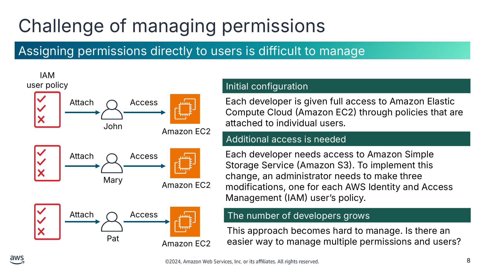

Призначення дозволів безпосередньо користувачам важко контролювати

Початкова конфігурація

Кожному розробнику надано повний доступ до Amazon Elastic Compute Cloud (Amazon EC2) через політики, прикріплені до окремих користувачів.

Потрібен додатковий доступ

Кожному розробнику потрібен доступ до Amazon Simple Storage Service (Amazon S3). Щоб упровадити цю зміну, адміністратор має внести три модифікації — по одній для політики кожного користувача AWS Identity and Access Management (IAM).

Кількість розробників зростає

Цей підхід стає важким для керування. Чи є простіший спосіб керувати кількома дозволами та користувачами?

<details>
<summary>Текст зі схеми</summary>

IAM

user policy (Політика користувача IAM)

Attach (Прикріпити)

Access (Доступ)

 John (Джон)

Amazon EC2

Attach

Access

 Mary (Марія)

Amazon EC2

Attach

Access

 Pat (Пет)

Amazon EC2

</details>

> **Нотатки:**
>
> |Номер слайда 8  
> |Нотатки для інструктора  
> |Цей приклад показує проблеми додавання тієї самої політики кільком користувачам. Запитайте студентів, чи є простіший спосіб керувати кількома дозволами та користувачами. Наступний слайд пояснює рішення — групи IAM.  
> |  
> |Нотатки для студента  
> Опис зображення: схема показує трьох користувачів — Джона, Марію та Пет — кожен із власним прикріпленням політики IAM. Ці політики окремо надають кожному користувачу дозвіл на доступ до Amazon EC2. Кінець опису.  
>
> Призначення дозволів безпосередньо користувачам важко контролювати. У цьому прикладі є три користувачі, до яких прикріплено політики для доступу до Amazon Elastic Compute Cloud (Amazon EC2). Щоб упровадити зміну, адміністратор має внести модифікації до кожної окремої політики користувача. Уявіть, що у групі 100 розробників; це стає важким для керування.

---

## Слайд 9: Використання груп IAM для прикріплення дозволів до кількох користувачів

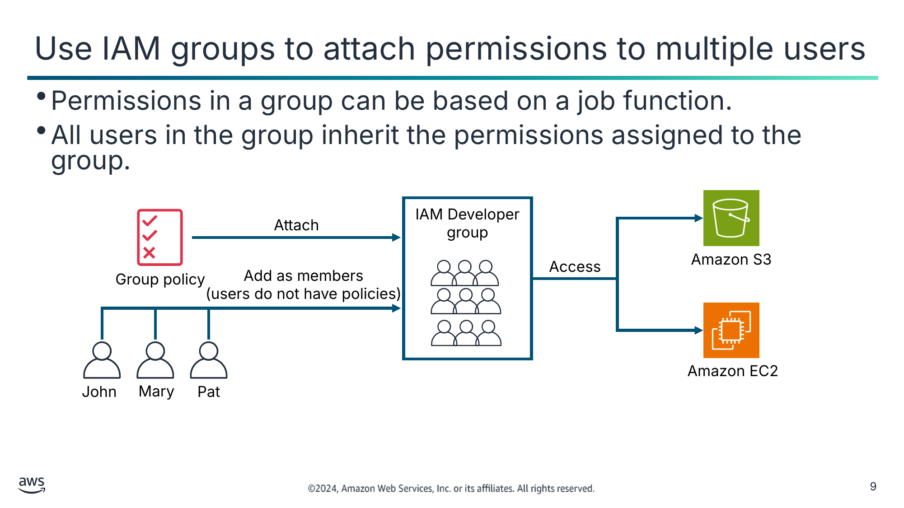

- Дозволи в групі можуть ґрунтуватися на посадовій функції.
- Усі користувачі в групі успадковують дозволи, призначені групі.

<details>
<summary>Текст зі схеми</summary>

IAM Developer group (Група розробників IAM)

Attach (Прикріпити)

Amazon S3

Group policy (Політика групи)

Add as members  
(users do not have policies) (Додати як членів (у користувачів немає політик))

Access (Доступ)

Amazon EC2

 John (Джон)

 Mary (Марія)

 Pat (Пет)

</details>

> **Нотатки:**
>
> |Номер слайда 9  
> |Нотатки для інструктора  
> |Повідомте, що рішення — створити групи AWS Identity and Access Management (IAM). Група IAM — це набір користувачів IAM. Групи користувачів дають змогу вказати дозволи для кількох користувачів, що може полегшити керування дозволами цих користувачів. Джон, Марія та Пет тепер стають членами групи розробників IAM, і ви керуєте однією політикою для групи.  
> |  
> |Нотатки для студента  
> У прикладі на слайді створюється група AWS Identity and Access Management (IAM), щоб згрупувати всіх користувачів, які є розробниками. До групи прикріплюється єдина політика IAM, щоб надати всі дозволи, які потрібні розробнику. Коли Джона, Марію та Пет додають до групи, вони автоматично успадковують дозволи групи. Коли потрібно надати новий дозвіл усім розробникам, наприклад на доступ до Amazon Simple Storage Service (Amazon S3), потрібна лише одна зміна: або додати новий дозвіл до наявної політики, або створити нову політику з новим дозволом і прикріпити політику до групи.  
>
> Група IAM — це набір користувачів IAM. Групи — це зручність, що полегшує керування дозволами для набору користувачів замість керування дозволами для кожного окремого користувача.  
>
> Характеристики групи IAM включають такі:  
> Ви можете додавати користувачів до групи або вилучати їх з групи.  
> Користувач може належати до кількох груп.  
> Групи не можуть належати до інших груп.  
> Групам можна надавати дозволи за допомогою політик контролю доступу.  
> Групи не мають облікових даних безпеки й не можуть безпосередньо отримувати доступ до вебсервісів. Вони існують виключно для полегшення керування дозволами користувачів.

---

## Слайд 10: Приклад: використання груп IAM для відображення посадової ролі

Якщо наймають нового розробника (Пет), додайте його до групи розробників. Пет одразу успадкує той самий доступ, що й надано іншим розробникам.

Якщо Ана бере на себе нову роль розробника, виконайте таке:

- Вилучіть її з групи тестування.
- Додайте її до групи розробників.

Користувачі можуть належати до кількох груп, але групи не можна вкладати одна в одну.

Дозволи в політиках, прикріплених безпосередньо до користувача (політики користувача), перевизначають дозволи в політиках групи, якщо вони більш обмежувальні.

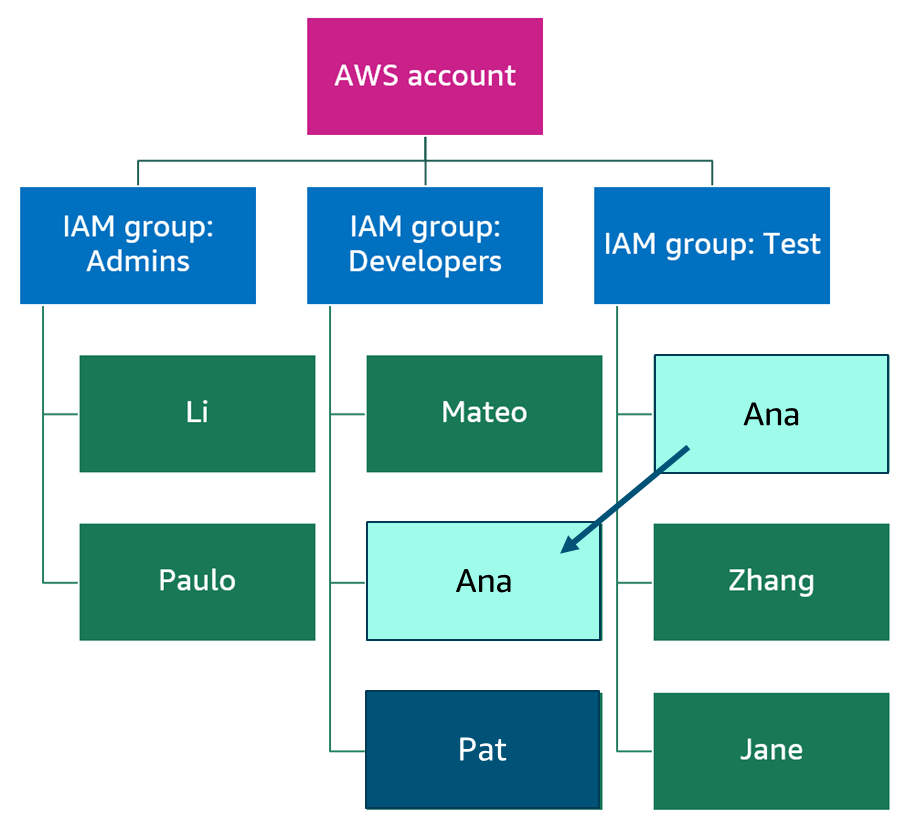

> **Нотатки:**
>
> |Номер слайда 10  
> |Нотатки для інструктора  
> |  
> |Нотатки для студента  
> Опис зображення: акаунт AWS має три групи IAM з назвами admins, developers і test. Група admins має двох членів: Лі (Li) та Паулу (Paulo). Група Developers має Матео (Mateo), Ширлі (Shirley) і Софію (Sofia). Група test має Ану (Ana), Чжана (Zhang) і Джейн (Jane). Кінець опису.  
>
> Зазвичай ви хочете створювати групи, що відображають посадові функції. Наприклад, можна створити одну групу для адміністраторів, іншу групу для розробників і ще одну для команди, що виконує функції тестування.  
>
> Потім ви прикріплюєте один чи кілька файлів політик до кожної групи й додаєте користувачів до груп. Користувачі мають права доступу, призначені групі чи групам, до яких вони належать, завдяки своєму членству в групі.  
>
> Якщо наймають нового розробника, ви можете додати його до наявної групи розробників. Він отримає той самий доступ, що вже мають інші розробники.  
>
> Якщо людина, як-от Ана (показана в прикладі), бере на себе нову роль в організації, ви можете вилучити її з групи тестування й додати до групи розробників. Або, якщо Ана виконуватиме обидві функції, ви можете залишити її в групі тестування й додати до групи розробників.  
>
> Якщо ви виявите, що розробникам потрібен доступ до якогось додаткового ресурсу в акаунті, ви можете оновити політику групи розробників або додати до неї політику. Усі члени групи отримають цей додатковий рівень доступу. Групи полегшують підтримку узгоджених прав доступу в командах.

---

## Слайд 11: Приклад: спільне використання політики користувача та політики групи

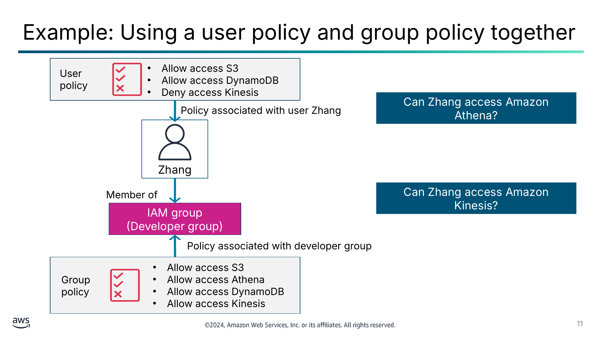

Чи може Чжан отримати доступ до Amazon Athena?

Чи може Чжан отримати доступ до Amazon Kinesis?

<details>
<summary>Текст зі схеми</summary>

- Allow access S3 (Дозволити доступ до S3)
- Allow access DynamoDB (Дозволити доступ до DynamoDB)
- Deny access Kinesis (Заборонити доступ до Kinesis)

User policy (Політика користувача)

Policy associated with user Zhang (Політика, пов’язана з користувачем Zhang)

Zhang (Чжан)

Member of (Член)

IAM group

(Developer group) (Група IAM (група розробників))

Policy associated with developer group (Політика, пов’язана з групою розробників)

- Allow access S3
- Allow access Athena
- Allow access DynamoDB
- Allow access Kinesis

Group policy (Політика групи)

</details>

> **Нотатки:**
>
> |Номер слайда 11  
> |Нотатки для інструктора  
> |Розгляньте кожне запитання зі студентами й обговоріть відповіді на наступному слайді.  
> |  
> |Нотатки для студента  
> Цей приклад ілюструє випадок, коли користувач має інформацію про дозволи, отриману і з політики користувача, і з політики групи. У цьому прикладі Чжан має політику користувача, що дозволяє доступ до Amazon S3 та Amazon DynamoDB, але забороняє доступ до Amazon Kinesis. Чжан також є членом групи IAM з назвою Developer, що дозволяє доступ до S3, Amazon Athena, DynamoDB і Kinesis. Які результати цих двох політик для доступу Чжана?

---

## Слайд 12: Приклад: підсумкові дозволи

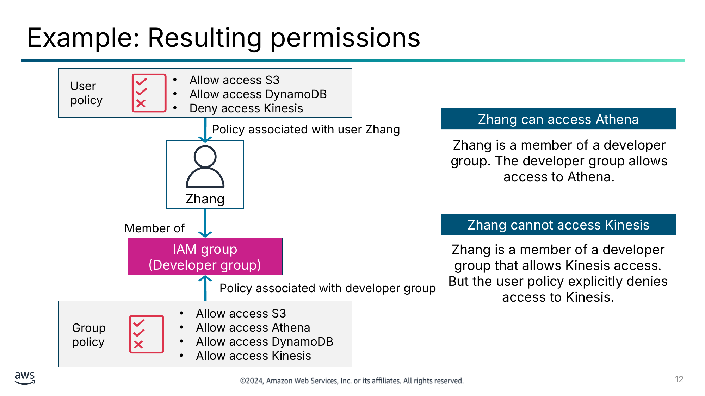

Чжан може отримати доступ до Athena

Чжан є членом групи розробників. Група розробників дозволяє доступ до Athena.

Чжан не може отримати доступ до Kinesis

Чжан є членом групи розробників, що дозволяє доступ до Kinesis. Але політика користувача явно забороняє доступ до Kinesis.

<details>
<summary>Текст зі схеми</summary>

- Allow access S3 (Дозволити доступ до S3)
- Allow access DynamoDB (Дозволити доступ до DynamoDB)
- Deny access Kinesis (Заборонити доступ до Kinesis)

User policy (Політика користувача)

Policy associated with user Zhang (Політика, пов’язана з користувачем Zhang)

Zhang (Чжан)

Member of (Член)

IAM group

(Developer group) (Група IAM (група розробників))

Policy associated with developer group (Політика, пов’язана з групою розробників)

- Allow access S3
- Allow access Athena
- Allow access DynamoDB
- Allow access Kinesis

Group policy (Політика групи)

</details>

> **Нотатки:**
>
> |Номер слайда 12  
> |Нотатки для інструктора  
> |Розгляньте кожну відповідь зі студентами.  
> |  
> |Нотатки для студента  
> Чжан може отримати доступ до Athena, хоча політика користувача не згадує Athena. Чжан не може отримати доступ до Kinesis через явну заборону в політиці користувача. Пам’ятайте, що явна заборона в політиці IAM перевизначає явний дозвіл, тож явна заборона перевизначає дозвіл на доступ до Kinesis у політиці групи.

---

## Слайд 13: Проблеми масштабування за допомогою керування доступом на основі ролей (RBAC)

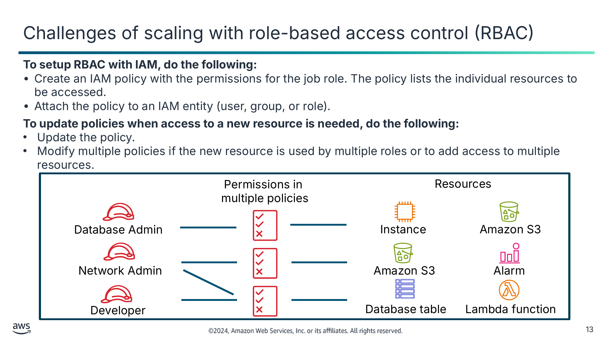

**Щоб налаштувати RBAC за допомогою IAM, виконайте таке:**

- Створіть політику IAM із дозволами для посадової ролі. Політика перелічує окремі ресурси, до яких надається доступ.
- Прикріпіть політику до сутності IAM (користувача, групи чи ролі).

**Щоб оновити політики, коли потрібен доступ до нового ресурсу, виконайте таке:**

- Оновіть політику.
- Змініть кілька політик, якщо новий ресурс використовується кількома ролями або щоб додати доступ до кількох ресурсів.

<details>
<summary>Текст зі схеми</summary>

Permissions in  
multiple policies (Дозволи в кількох політиках)

Resources (Ресурси)

Database Admin (Адміністратор баз даних)

Instance (Екземпляр)

Amazon S3

Network Admin (Мережевий адміністратор)

Amazon S3

Alarm (Сигнал)

Developer (Розробник)

Database table (Таблиця бази даних)

Lambda function (Функція Lambda)

</details>

> **Нотатки:**
>
> |Номер слайда 13  
> |Нотатки для інструктора  
> |  
> |Нотатки для студента  
> Як проілюстровано в попередньому прикладі, традиційно дозволи визначаються на основі посадової функції. Це називається керуванням доступом на основі ролей (role-based access control, RBAC).  
>
> Недолік використання традиційної моделі RBAC у тому, що потрібно підтримувати кілька політик. Коли додаються нові ресурси, потрібно оновлювати кілька політик, щоб дозволити доступ до цих ресурсів. Оновлення політик може стати трудомістким.

---

## Слайд 14: Використання керування доступом на основі атрибутів (ABAC)

ABAC

Переваги

- Ця стратегія авторизації визначає дозволи на основі атрибутів.
- Атрибути — це ключ або пара «ключ-значення».
- В AWS ці атрибути називаються тегами.
- Теги можна застосовувати до ресурсів IAM (користувачів чи ролей) і ресурсів AWS.

- Він гнучкіший за політики, що вимагають перелічувати кожен окремий ресурс.
- Детальні дозволи можливі *без* оновлення дозволів для кожного нового користувача чи ресурсу.
- Це високомасштабований підхід до керування доступом.
- Він повністю піддається аудиту.

> **Нотатки:**
>
> |Номер слайда 14  
> |Нотатки для інструктора  
> |  
> |Нотатки для студента  
> Цей слайд підсумовує, що таке керування доступом на основі атрибутів (attribute-based access control, ABAC) і як воно може принести користь вашому підходу до керування дозволами.  
>
> Використовуючи ABAC, написання дозволів відносно просте. Політика перевіряє, чи атрибут, застосований до користувача IAM, також застосований до ресурсу, до якого він хоче отримати доступ. Коли ви створюєте нових користувачів IAM і нові ресурси акаунта, ви застосовуєте правильні теги до користувачів і до ресурсів.  
>
> Використовуючи ABAC, ви можете надати розробникам доступ до ресурсів їхніх проєктів, але вам не потрібно вказувати ресурси у файлі політики. Це набагато масштабованіше, ніж доступ на основі ролей.  
>
> Докладніше див. «What is ABAC for AWS?» на сторінці ресурсів вмісту вашого онлайн-курсу.

---

## Слайд 15: Тегування в AWS (tagging)

- Теги — це метадані ресурсу, що складаються з пари «ключ/значення».
- Теги можна застосовувати до ресурсів у різних акаунтах AWS і до користувачів чи ролей IAM.
- Клієнти можуть створювати користувацькі теги.
  - Багато різних операцій API AWS повертають ключі та значення тегів.
  - Теги мають кілька практичних застосувань, як-от виставлення рахунків, відфільтровані подання та керування доступом.

Приклад тегів, застосованих до екземпляра EC2

| Ключ (Key) | Значення (Value) |
|---|---|
| Name | Web server |
| Project | Unicorn |
| Env | Dev |

> **Нотатки:**
>
> |Номер слайда 15  
> |Нотатки для інструктора  
> | Перегляньте таку ключову інформацію про тегування:  
> |  - Максимальна кількість тегів, які можна призначити ресурсу, — 50.  
> |  - Максимальна довжина ключа — 128 символів Unicode.  
> |  - Максимальна довжина значення — 256 символів Unicode.  
> |  - Допустимі символи для ключа та значення тегу: a-z, A-Z, 0-9, пробіл і такі символи: _ . : / = + - та @  
> |  - Ключі та значення чутливі до регістру.  
> |  - Не використовуйте aws: як префікс для ключів; він зарезервований для використання AWS.  
> |  
> |Нотатки для студента  
> Перш ніж розглядати підхід на основі атрибутів до керування дозволами, слід зрозуміти функцію тегування в AWS.  
>
> AWS дає клієнтам змогу призначати метадані своїм ресурсам і ідентичностям AWS у вигляді тегів. Кожен тег — це проста мітка, що складається з визначеного клієнтом ключа та необов’язкового значення. Теги можуть полегшити керування ресурсами, їх пошук і фільтрацію.  
>
> Теги мають багато практичних застосувань. Наприклад, можна створювати технічні теги, щоб указати, що ресурс є вебсервером, частиною певного проєкту, частиною певного середовища (тестування, розробка чи продуктивне середовище) тощо. Також можна створювати бізнес-теги, щоб указати відділ чи центр витрат, з якого слід стягувати плату за цей ресурс, або проєкт, частиною якого є цей ресурс. Нарешті, можна встановлювати теги безпеки, як-от ідентифікатор конкретного рівня конфіденційності даних, який підтримує ресурс.  
>
> Можна створити до 50 тегів на ресурс. Для кожного ресурсу кожен ключ тегу має бути унікальним, а кожен ключ тегу може мати лише одне значення. Ключі та значення тегів чутливі до регістру.  
>
> Також можна додавати теги до користувачів IAM і ролей IAM. Теги — важлива частина другого методу керування доступом.

---

## Слайд 16: Приклад: використання ABAC для надання дозволів в одній політиці

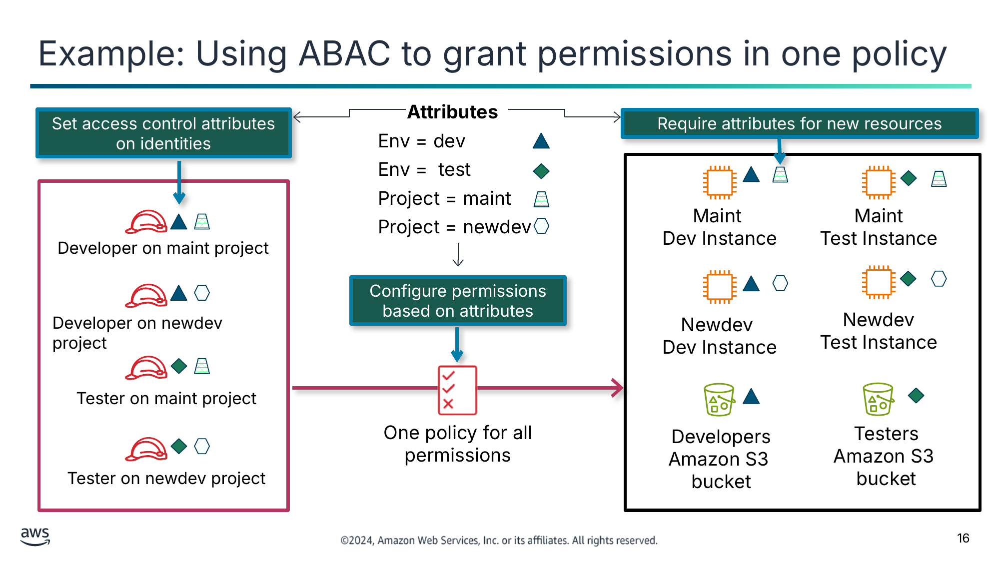

Установіть атрибути керування доступом для ідентичностей

Вимагайте атрибути для нових ресурсів

Налаштуйте дозволи на основі атрибутів

Одна політика для всіх дозволів

<details>
<summary>Текст зі схеми</summary>

**Attributes (Атрибути)**

Env = dev

Env =  test

Project = maint

Project = newdev

Maint  
Dev Instance

Maint  
Test Instance

Newdev  
Dev Instance

Newdev  
Test Instance

Developers  
Amazon S3  
bucket

Testers  
Amazon S3  
bucket

Developer on maint project (Розробник проєкту maint)

Developer on newdev project (Розробник проєкту newdev)

Tester on maint project (Тестувальник проєкту maint)

Tester on newdev project (Тестувальник проєкту newdev)

</details>

> **Нотатки:**
>
> |Номер слайда 16  
> |Нотатки для інструктора  
> |Підкресліть, що ABAC означає керування доступом на основі атрибутів і що це стратегія авторизації, яка визначає дозволи на основі атрибутів. Це спрощений приклад. Якщо хочете заглибитися, можна провести студентів через навчальний посібник, посилання на який наведено в ресурсах курсу.  
> |  
> |Нотатки для студента  
> У цьому прикладі організація розробки використовує атрибути для визначення команди (розробка чи тестування) та проєкту (супровід чи нова розробка). Вони мають чотири ролі IAM: одну для розробників проєкту супроводу, одну для розробників проєкту нової розробки, одну для тестувальників проєкту супроводу та одну для тестувальників проєкту нової розробки.  
>
> Кожен проєкт має два екземпляри EC2. Один позначено тегом для середовища розробки (dev), а інший — для тестування (test). Також є бакет Amazon S3 з тегом для розробників і бакет Amazon S3 з тегом для тестувальників.  
>
> За допомогою атрибутів вони можуть налаштувати єдину політику, що вказує, які теги мають доступ до яких ресурсів. Це дає їм гнучкість, коли вони додають нові ресурси чи ролі, і обмежує кількість окремих дозволів, які потрібні. Якщо, наприклад, додається новий екземпляр EC2, вони можуть просто додати відповідний тег до нового екземпляра, і ролі, що мають мати доступ, отримають його без жодних інших змін.  
>
> Щоб застосувати ABAC до вашої організації, перший крок — створити ідентичності, як-от користувачі IAM чи ролі IAM. Ці ідентичності повинні мати атрибути, що використовуватимуться для цілей керування доступом. Наприклад, можна застосувати теги Env = Dev і Project = Maint до ролі розробників супроводу.  
>
> Далі вимагайте атрибути для нових ресурсів. Слід створити політики, що примусово застосовують правило під час створення ресурсу. Наприклад, можна вимагати, щоб атрибут Project і атрибут Team були застосовані до будь-якого ресурсу під час його створення.  
>
> Маючи атрибути для ролей і ресурсів, налаштуйте дозволи доступу на основі атрибутів. Наприклад, політика дозволила б ролям із тегами dev і maintenance отримувати доступ до екземпляра EC2 dev maintenance і бакета Amazon S3 розробників. Ролям із тегами dev і newdev було б надано доступ до екземпляра EC2 dev newdev і бакета Amazon S3 розробників. Політика забороняла б доступ ролям без відповідних тегів.  
>
> Протестуйте свою конфігурацію. Наприклад, користувач міг би спробувати додати додатковий екземпляр EC2 без потрібних тегів. Спроба має завершитися невдачею. Спробуйте створити екземпляр знову з потрібними тегами. Цього разу вони мають мати змогу успішно створити ресурс. Переконавшись, що ресурси не можна створити без бажаних тегів, нехай користувачі з кожною роллю спробують отримати доступ до ресурсів, до яких вони мають і не мають мати доступу.  
>
> Докладний навчальний посібник, що демонструє, як використовувати ABAC в AWS, див. за посиланням у ресурсах вашого курсу для цього посібника, що має назву «IAM tutorial: Define permissions to access AWS resources based on tags».

---

## Слайд 17: Ключові висновки: керування дозволами

- Використовуйте групи IAM, щоб надавати однакові права доступу кільком користувачам. Створюйте групи, що відображають посадові функції.
- Використовуйте ABAC, а не RBAC, щоб масштабувати керування дозволами.
- ABAC — це стратегія авторизації, що визначає дозволи на основі атрибутів. Вона спрощує керування доступом, об’єднуючи дозволи в єдину політику.
- Атрибути — це пари «ключ-значення». AWS дає клієнтам змогу призначати атрибути своїм ресурсам і ідентичностям AWS у вигляді тегів.

> **Нотатки:**
>
> |Номер слайда 17  
> |Нотатки для інструктора  
> |  
> |Нотатки для студента  
> Ось кілька ключових моментів, що підсумовують цей розділ.

---

## Слайд 18: Федерація користувачів (federating users)

Захист доступу користувачів, застосунків і даних

> **Нотатки:**
>
> |Номер слайда 18  
> |Нотатки для інструктора  
> |  
> |Нотатки для студента  
> Цей розділ охоплює федерацію користувачів і передавання інформації, потрібної для авторизації доступу до ресурсів.

---

## Слайд 19: Федерація ідентичності (identity federation)

Система довіри між двома сторонами для автентифікації користувачів і передавання інформації, потрібної для авторизації доступу до ресурсів

- Постачальник ідентичності (identity provider, IdP) відповідає за автентифікацію користувачів.
- Приклади:
  - IdP OpenID Connect (OIDC), як-от Login with Amazon, Facebook і Google
  - IdP Security Assertion Markup Language (SAML), як-от Shibboleth або Active Directory Federation Services

- Постачальник сервісу (service provider, SP) відповідає за контроль доступу до своїх ресурсів.
- Приклади
  - Сервіси AWS
  - Платформи соціальних мереж
  - Онлайн-банк

> **Нотатки:**
>
> |Номер слайда 19  
> |Нотатки для інструктора  
> |  
> |Нотатки для студента  
> Федерація ідентичності — це система довіри між двома сторонами для автентифікації користувачів і передавання інформації, потрібної для авторизації доступу до ресурсів. Постачальники ідентичності (IdP) відповідають за автентифікацію користувачів. Постачальники сервісів (SP), як-от сервіси чи застосунки, відповідають за контроль доступу до ресурсів. Через адміністративну домовленість і конфігурацію SP довіряє IdP автентифікацію користувачів і надає їм доступ до запитаних ресурсів.  
>
> Докладніше див. посилання «Identity Federation», наведене на сторінці ресурсів курсу.

---

## Слайд 20: Сервіси AWS, що підтримують федерацію ідентичності

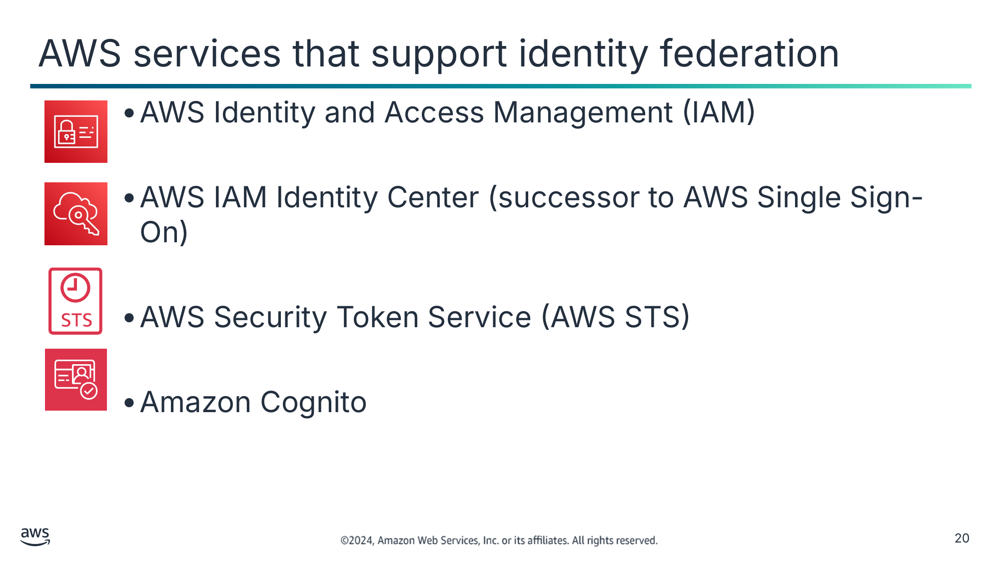

- AWS Identity and Access Management (IAM)
- AWS IAM Identity Center (наступник AWS Single Sign-On)
- AWS Security Token Service (AWS STS)
- Amazon Cognito

> **Нотатки:**
>
> |Номер слайда 20  
> |Нотатки для інструктора  
> |  
> |Нотатки для студента  
> Ви можете використовувати два сервіси AWS для федерації вашої робочої сили в акаунти AWS і бізнес-застосунки: AWS Identity and Access Management (IAM) або AWS IAM Identity Center (наступник AWS SSO).  
>
> Ви можете увімкнути федеративний доступ до акаунтів AWS за допомогою IAM. Гнучкість IAM дає змогу ввімкнути окремий IdP Security Assertion Markup Language (SAML) 2.0 або Open ID Connect (OIDC) для кожного акаунта AWS і використовувати атрибути федеративних користувачів для керування доступом. За допомогою IAM можна передавати атрибути користувачів, як-от центр витрат, посада чи локаль, від ваших IdP до AWS і впроваджувати детальні дозволи на доступ на основі цих атрибутів. IAM допомагає визначити дозволи один раз, а потім надавати, скасовувати чи змінювати доступ AWS простою зміною атрибутів в IdP. Ви можете застосувати ту саму політику федеративного доступу до кількох акаунтів AWS, впровадивши багаторазові політики IAM, якими керує клієнт.  
>
> AWS Identity Center спрощує централізоване керування федеративним доступом до кількох акаунтів AWS і бізнес-застосунків і надає користувачам доступ із єдиним входом (single sign-on) до всіх призначених їм акаунтів і застосунків в одному місці. Ви можете використовувати AWS IAM Identity Center для ідентичностей у каталозі користувачів AWS IAM Identity Center, вашому наявному корпоративному каталозі або зовнішньому IdP.  
>
> AWS IAM Identity Center працює з IdP на ваш вибір, як-от Okta Universal Directory чи Azure Active Directory (AD), через протокол SAML 2.0. IAM Identity Center безшовно використовує дозволи та політики IAM для федеративних користувачів і ролей, щоб допомогти централізовано керувати федеративним доступом у всіх акаунтах AWS вашої організації AWS. З IAM Identity Center можна призначати дозволи на основі членства в групі у каталозі вашого IdP, а потім контролювати доступ ваших користувачів простою зміною користувачів і груп в IdP.  
>
> AWS Security Token Service (AWS STS) — це вебсервіс, що надає тимчасові облікові дані AWS. Цей сервіс дає змогу користувачу IAM, федеративному користувачу чи застосунку приймати роль IAM.  
>
> Ви також можете додати підтримку федерації до ваших вебзастосунків і мобільних застосунків, орієнтованих на клієнтів, за допомогою Amazon Cognito. Він допомагає швидко й легко додати реєстрацію користувачів, вхід і керування доступом до ваших мобільних і вебзастосунків. Amazon Cognito масштабується до мільйонів користувачів і підтримує вхід через соціальних постачальників ідентичності, як-от Apple, Facebook, Google і Amazon, та корпоративних постачальників ідентичності за допомогою SAML 2.0.  
>
> Наступні кілька слайдів докладніше розглядають, як ці сервіси підтримують федерацію ідентичності. Додаткову інформацію про ці сервіси та їх спільну роботу див. за посиланнями на сторінці ресурсів курсу.

---

## Слайд 21: Федерація ідентичності робочої сили (workforce identity federation)

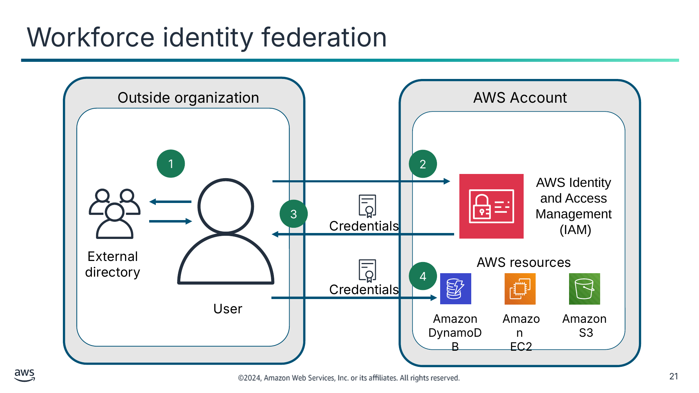

<details>
<summary>Текст зі схеми</summary>

Outside organization (Поза організацією)

AWS Account (Акаунт AWS)

User (Користувач)

1

2

AWS Identity  
and Access  
Management  
(IAM)

3

Credentials (Облікові дані)

External

directory (Зовнішній каталог)

4

AWS resources (Ресурси AWS)

Credentials

User

Amazon DynamoDB

Amazon

EC2

Amazon

S3

</details>

> **Нотатки:**
>
> |Номер слайда 21  
> |Нотатки для інструктора  
> |  
> |Нотатки для студента  
> Користувачі-люди (на відміну від користувачів-застосунків чи сервісів), що є членами вашої організації, також відомі як ідентичності робочої сили (workforce identities) або користувачі робочої сили. Федерація ідентичності робочої сили стосується цих користувачів-людей.  
>
> Якщо користувачі у вашій організації вже мають спосіб автентифікації, наприклад вхід у вашу корпоративну мережу, ви можете федерувати ці ідентичності користувачів в AWS за допомогою IAM або AWS IAM Identity Center.  
>
> Схема показує, як користувач поза AWS може отримати доступ до захищених ресурсів AWS, використовуючи зовнішній каталог для отримання тимчасових облікових даних безпеки AWS.  
>
> Користувач автентифікується в локальному каталозі користувачів за допомогою ідентифікатора та пароля.  
> Зовнішня система подає інформацію про автентифікацію користувача до IAM.  
> IAM повертає токен тимчасових облікових даних автентифікації користувачу за допомогою AWS STS.  
> Користувач отримує доступ до захищених ресурсів за допомогою тимчасових облікових даних.  
>
> Додаткову інформацію про федерацію наявних користувачів див. за посиланням на сторінці ресурсів курсу.

---

## Слайд 22: AWS IAM Identity Center

- Наступник AWS Single Sign-On
- Може створювати або підключати ідентичності один раз і централізовано керувати доступом у ваших акаунтах AWS
- Забезпечує уніфікований досвід адміністрування для визначення, налаштування та призначення детального доступу
- Надає користувацький портал для доступу до всіх призначених акаунтів AWS чи хмарних застосунків
- Використовується за бажанням разом з IAM

IAM Identity Center

> **Нотатки:**
>
> |Номер слайда 22  
> |Нотатки для інструктора  
> |Розгляньте ключові моменти й зауважте, що AWS IAM Identity Center — наступник AWS Single Sign-On. Ви можете керувати безпекою входу для ідентичностей вашої робочої сили, також відомих як користувачі робочої сили. IAM Identity Center надає одне місце, де можна створювати або підключати користувачів робочої сили й централізовано керувати їхнім доступом у всіх їхніх акаунтах AWS і застосунках.  
> |  
> |Нотатки для студента  
> З IAM Identity Center ви можете один раз створити або підключити ідентичності в AWS і централізовано керувати доступом у ваших акаунтах AWS. IAM Identity Center забезпечує уніфікований досвід адміністрування для визначення, налаштування та призначення детальних дозволів на основі поширених посадових функцій.  
>
> Користувачі у вашому середовищі IAM Identity Center можуть використовувати свої облікові дані каталогу для доступу до свого користувацького порталу. Користувачі можуть отримувати доступ до всіх призначених їм акаунтів AWS чи хмарних застосунків. Ви можете гнучко налаштувати доступ так, щоб він працював паралельно з керуванням доступом до акаунтів AWS за допомогою IAM або замість нього. IAM Identity Center підтримує поширені хмарні застосунки, як-от Microsoft 365 і Salesforce. Сервіс надає інструкції з інтеграції застосунків, що усувають потребу в адміністраторів вивчати нюанси конфігурації кожного хмарного застосунку.  
>
> Докладніше про AWS IAM Identity Center див. посилання в довіднику ресурсів.

---

## Слайд 23: AWS Security Token Service (AWS STS)

- AWS STS — це вебсервіс (API), що дає змогу запитувати тимчасові облікові дані з обмеженими привілеями.
- Облікові дані можуть використовуватися користувачами IAM, федеративними користувачами чи застосунками.

AWS STS

> **Нотатки:**
>
> |Номер слайда 23  
> |Нотатки для інструктора  
> |  
> |Нотатки для студента  
> AWS STS — це вебсервіс, що надає тимчасові облікові дані AWS.  
> Коли операцію AssumeRole API AWS STS успішно викликано, вебсервіс повертає тимчасові облікові дані з обмеженими привілеями, запитані користувачем IAM або користувачем, автентифікованим через федерацію. Зазвичай операція AssumeRole використовується для міжакаунтного доступу чи для федерації.  
>
> Наступні слайди розглядають, як AWS STS надає тимчасові облікові дані як частину федерації ідентичності.

---

## Слайд 24: Федерація ідентичності в AWS за допомогою брокера ідентичності (identity broker)

Користувач входить за допомогою наявних облікових даних свого IdP

Брокер ідентичності діє як посередник між IdP і SP

AWS STS динамічно генерує тимчасові облікові дані

Брокер ідентичності передає тимчасові облікові дані застосунку

- Користувачі входять за допомогою ідентичності, відомої IdP (наприклад, їхній ідентифікатор Amazon.com чи корпоративний логін).

- Брокер ідентичності запитує тимчасові облікові дані в AWS STS.

- Облікові дані діють від кількох хвилин до кількох годин і не розпізнаються після їх завершення.

- AWS STS повертає тимчасові облікові дані брокеру ідентичності.
- Брокер ідентичності передає їх застосунку для користувача.

> **Нотатки:**
>
> |Номер слайда 24  
> |Нотатки для інструктора  
> |  
> |Нотатки для студента  
> Як зазначалося на попередньому слайді, AWS STS надає тимчасові облікові дані безпеки. Коли (або навіть до того, як) термін дії тимчасових облікових даних безпеки спливає, користувач може запитати нові облікові дані, доки користувач, що їх запитує, усе ще має дозволи на це.  
> Щоб запитати тимчасові облікові дані безпеки, використовуйте операції AWS STS в API AWS. Вони включають операції для створення та надання довіреним користувачам тимчасових облікових даних безпеки, що можуть контролювати доступ до ваших ресурсів AWS.  
>
> Слайд показує чотири загальні кроки, що відбуваються під час федерації ідентичності для доступу до сервісів AWS за допомогою тимчасових облікових даних, згенерованих AWS STS. Брокер ідентичності (Identity Broker) — це проміжний проксі-сервіс, що з’єднує кілька SP з кількома IdP. Брокер ідентичності полегшує обмін даними між зовнішнім IdP і SP, у цьому прикладі сервісами AWS.

---

## Слайд 25: Приклад: федерація ідентичності для доступу до AWS Management Console

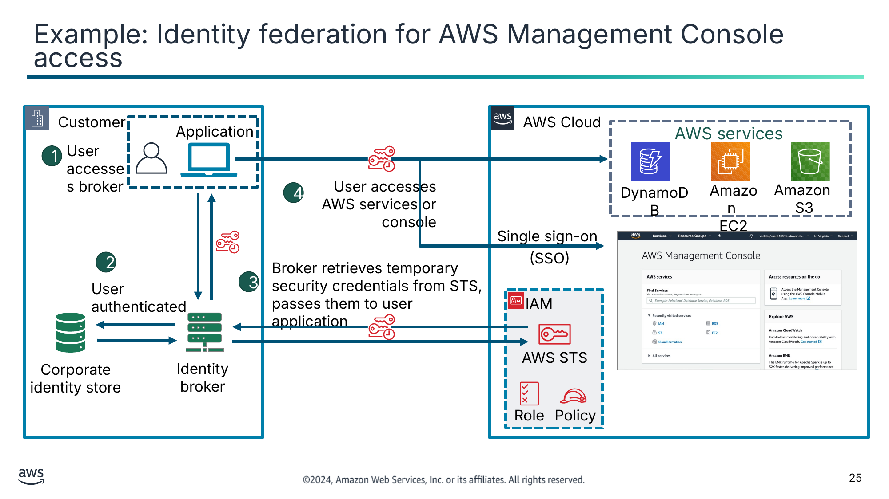

<details>
<summary>Текст зі схеми</summary>

Customer (Клієнт)

AWS Cloud

Application (Застосунок)

1

User accesses broker (Користувач звертається до брокера)

4

User accesses AWS services or console (Користувач звертається до сервісів AWS чи консолі)

Single sign-on  
(SSO) (Єдиний вхід)

2

Broker retrieves temporary security credentials from STS, passes them to user application (Брокер отримує тимчасові облікові дані безпеки від STS і передає їх застосунку користувача)

User authenticated (Користувача автентифіковано)

3

IAM

AWS STS

Corporate identity store (Корпоративне сховище ідентичностей)

Identity broker (Брокер ідентичності)

Role (Роль)

Policy (Політика)

AWS services (Сервіси AWS)

DynamoDB

Amazon

EC2

Amazon

S3

</details>

> **Нотатки:**
>
> |Номер слайда 25  
> |Нотатки для інструктора  
> |Повідомте, що користувачі можуть уже мати ідентичності поза AWS, як-от корпоративний каталог. Якщо ці користувачі мають працювати з ресурсами AWS (або з застосунками, що отримують доступ до цих ресурсів), то їм також потрібні облікові дані безпеки AWS. Ви можете використовувати роль IAM, щоб указати дозволи для користувачів, чия ідентичність федерована з їхньої організації чи стороннього IdP.  
> |  
> |Нотатки для студента  
> Цей слайд ілюструє докладніші кроки, що відбуваються під час використання IdP на основі OIDC із брокером ідентичності для федерації ідентичності. У цьому прикладі корпоративне сховище ідентичностей використовується для автентифікації користувачів, яким потрібен доступ до AWS Management Console.  
> Користувач звертається до застосунку, що запитує в нього ідентифікатор користувача та пароль, а потім надсилає свій запит.  
> Брокер ідентичності отримує запит на автентифікацію. Потім він обмінюється даними з корпоративним сховищем ідентичностей, яким може бути Microsoft Active Directory або сервер Lightweight Directory Access Protocol (LDAP).  
> Якщо запит на автентифікацію успішний, брокер ідентичності робить запит до AWS STS. Запит — отримати тимчасові облікові дані безпеки AWS для застосунку користувача.  
> Застосунок користувача отримує тимчасові облікові дані безпеки AWS і перенаправляє користувача до AWS Management Console. Користувачу не потрібно було входити безпосередньо в AWS з іншим набором облікових даних. Цей процес є прикладом реалізації єдиного входу (single sign-on, SSO). Застосунок користувача також може використовувати ці самі тимчасові облікові дані безпеки AWS для доступу до сервісів AWS, якщо це дозволяє документ політики IAM.

---

## Слайд 26: Приклад: федерація ідентичності для AWS Management Console за допомогою SAML

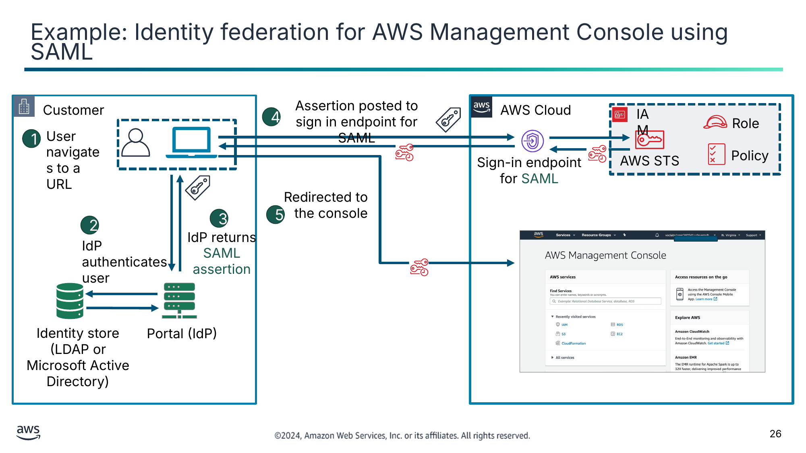

<details>
<summary>Текст зі схеми</summary>

Customer (Клієнт)

Assertion posted to sign in endpoint for SAML (Твердження надіслано на кінцеву точку входу SAML)

AWS Cloud

IAM

4

Role (Роль)

1

User navigates to a URL (Користувач переходить за URL-адресою)

AWS STS

Policy (Політика)

Sign-in endpoint for SAML (Кінцева точка входу SAML)

Redirected to the console (Перенаправлено до консолі)

3

5

2

IdP authenticates user (IdP автентифікує користувача)

IdP returns SAML assertion (IdP повертає твердження SAML)

Identity store (LDAP or Microsoft Active Directory) (Сховище ідентичностей (LDAP або Microsoft Active Directory))

Portal (IdP) (Портал (IdP))

</details>

> **Нотатки:**
>
> |Номер слайда 26  
> |Нотатки для інструктора  
> |Повідомте студентам, що AWS підтримує федерацію ідентичності з SAML 2.0 — відкритим стандартом, який використовують багато IdP. Ця функція забезпечує федеративний SSO, тож користувачі можуть входити в AWS Management Console чи викликати операції API AWS, не створюючи користувача IAM для кожного в їхній організації.  
> |  
> |Нотатки для студента  
> Цей приклад показує використання SAML для обміну даними автентифікації та авторизації між IdP і постачальниками сервісів. Якщо ваш корпоративний каталог сумісний із SAML 2.0, ви можете налаштувати свій корпоративний каталог для надання доступу SSO до AWS Management Console для ваших користувачів.  
>
> Ось кроки для цього потоку федерації ідентичності. Вони подібні до попереднього слайда, але специфічні для функцій SAML.  
>
> Користувач у вашій організації переходить на внутрішній портал у вашій мережі. Портал також функціонує як IdP, що обробляє довіру SAML між вашою організацією та AWS.  
> IdP автентифікує ідентичність користувача в сховищі ідентичностей, яким може бути сервер LDAP або Microsoft Active Directory.  
> Портал отримує відповідь автентифікації як твердження SAML (SAML assertion) від IdP.  
> Клієнт надсилає твердження SAML на кінцеву точку входу AWS для SAML. Кінцева точка обмінюється даними з AWS STS і викликає операцію AssumeRoleWithSAML, щоб запитати тимчасові облікові дані безпеки та побудувати URL-адресу входу.  
> Клієнт отримує тимчасові облікові дані безпеки AWS. Клієнта перенаправляють до AWS Management Console, і він автентифікується за допомогою тимчасових облікових даних безпеки AWS.  
>
> Докладніше про SAML 2.0 див. посилання в довіднику ресурсів.

---

## Слайд 27: Amazon Cognito

Повністю кероване обслуговування, що надає такі сервіси та функції:

  - Автентифікація, авторизація та керування користувачами для вебзастосунків і мобільних застосунків
- Федеративні ідентичності для входу через соціальних постачальників ідентичності (Amazon, Facebook, Google) або за допомогою SAML
- Пули користувачів (user pools), що підтримують каталог із профілями користувачів і токенами автентифікації
- Пули ідентичності (identity pools), що дають змогу створювати унікальні ідентичності та призначати дозволи користувачам

Amazon Cognito

> **Нотатки:**
>
> |Номер слайда 27  
> |Нотатки для інструктора  
> |Бажаний спосіб використання федерації вебідентичності — використовувати Amazon Cognito.  
> |  
> |Нотатки для студента  
> Останній варіант федерації ідентичності — використання Amazon Cognito. Amazon Cognito — це повністю кероване обслуговування, що надає автентифікацію, авторизацію та керування користувачами для вебзастосунків і мобільних застосунків. Користувачі можуть входити безпосередньо за допомогою імені користувача та пароля або через третю сторону, як-от Facebook, Amazon чи Google.  
>
> Два основні компоненти Amazon Cognito — пули користувачів і пули ідентичності.  
>
> Пул користувачів — це каталог користувачів в Amazon Cognito. З пулом користувачів користувачі можуть входити у вебзастосунок чи мобільний застосунок через Amazon Cognito. Вони також можуть федеруватися через стороннього IdP. Усі члени пулу користувачів мають профіль каталогу, до якого можна отримати доступ через SDK.  
>
> Пули ідентичності дають змогу створювати унікальні ідентичності та призначати дозволи користувачам. З пулом ідентичності користувачі можуть отримувати тимчасові облікові дані AWS для доступу до сервісів чи ресурсів AWS. Пули ідентичності можуть обмінюватися даними з соціальним входом пулів користувачів Amazon Cognito через Facebook, Google та Login with Amazon і постачальниками OIDC. Пули ідентичності за лаштунками використовують AWS STS.

---

## Слайд 28: Федерація ідентичності для доступу до застосунку

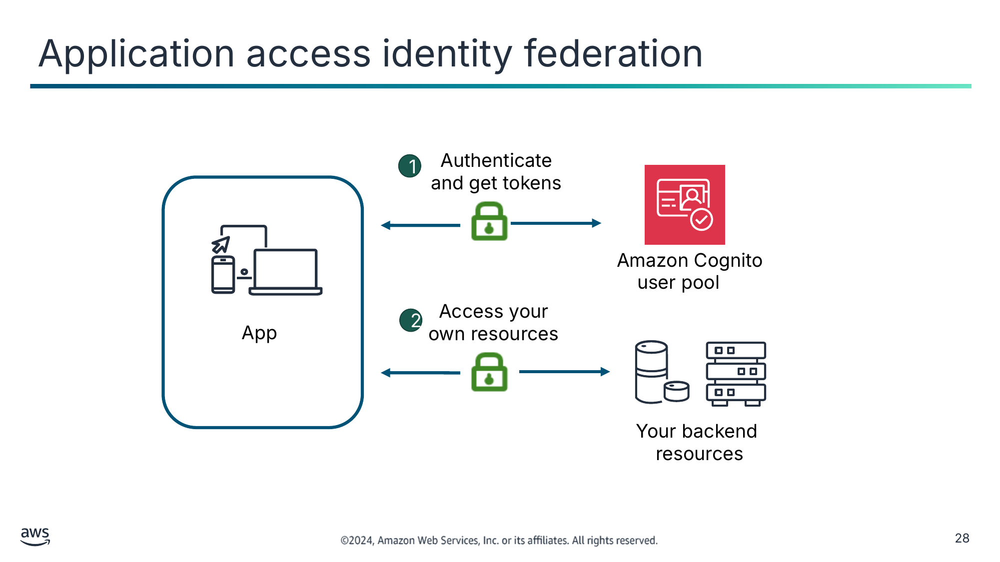

<details>
<summary>Текст зі схеми</summary>

Authenticate and get tokens (Автентифікація та отримання токенів)

1

Amazon Cognito

user pool (Пул користувачів Amazon Cognito)

Access your own resources (Доступ до ваших власних ресурсів)

App (Застосунок)

2

Your backend  
resources (Ваші бекенд-ресурси)

</details>

> **Нотатки:**
>
> |Номер слайда 28  
> |Нотатки для інструктора  
> |Інформацію про пули користувачів можна знайти на наступному слайді.  
> |  
> |Нотатки для студента  
> Пам’ятайте, що ви також можете додати підтримку федерації до ваших вебзастосунків і мобільних застосунків, орієнтованих на клієнтів, за допомогою Amazon Cognito. Він допомагає швидко додати реєстрацію користувачів, вхід і керування доступом до ваших мобільних і вебзастосунків.  
>
> Схема показує доступ до серверних ресурсів за допомогою пулу користувачів.  
>
> 1. Після успішного входу в пул користувачів ваш вебзастосунок чи мобільний застосунок отримає токени пулу користувачів від Amazon Cognito.  
> 2. Ви можете використовувати ці токени для контролю доступу до ваших серверних ресурсів. Також можна створювати групи пулу користувачів для керування дозволами та для представлення різних типів користувачів.  
>
> Після налаштування домену для вашого пулу користувачів Amazon Cognito розгортає розміщений вебінтерфейс (hosted web UI), що дає змогу додати сторінки реєстрації та входу до вашого застосунку. Використовуючи цю основу OAuth 2.0, ви можете створити власний сервер ресурсів, щоб дозволити вашим користувачам доступ до захищених ресурсів.  
>
> Докладніше про доступ до ваших серверних ресурсів за допомогою пулу користувачів див. посилання на сторінці ресурсів курсу.

---

## Слайд 29: Приклад Amazon Cognito

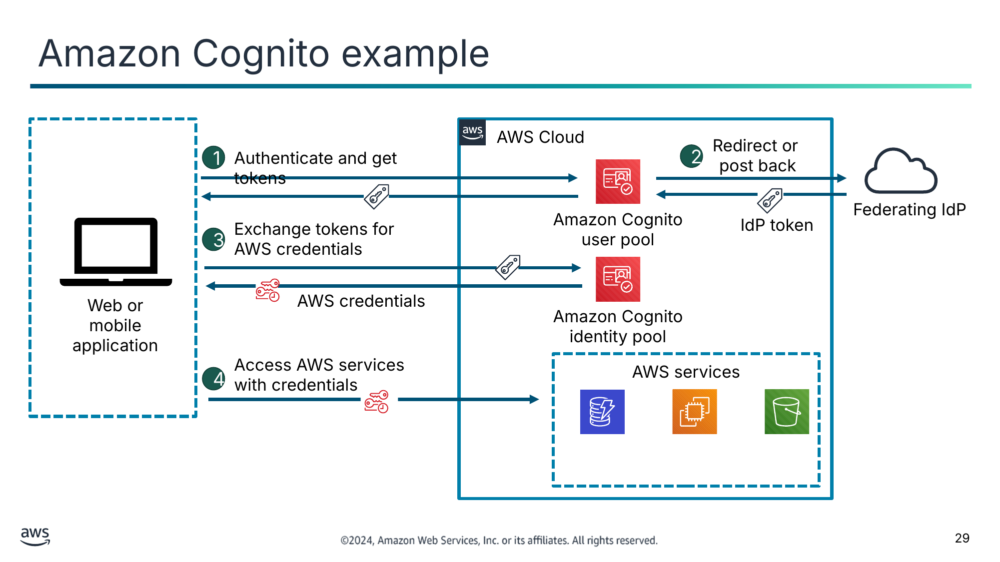

<details>
<summary>Текст зі схеми</summary>

AWS Cloud

Redirect or

post back (Перенаправлення або зворотне надсилання)

1

Authenticate and get tokens (Автентифікація та отримання токенів)

2

Amazon Cognito user pool (Пул користувачів Amazon Cognito)

IdP token (Токен IdP)

Federating IdP (Федеративний IdP)

3

Exchange tokens for

AWS credentials (Обмін токенів на облікові дані AWS)

AWS credentials (Облікові дані AWS)

Web or mobile application (Вебзастосунок чи мобільний застосунок)

Amazon Cognito identity pool (Пул ідентичності Amazon Cognito)

Access AWS services

with credentials (Доступ до сервісів AWS за допомогою облікових даних)

AWS services (Сервіси AWS)

4

</details>

> **Нотатки:**
>
> |Номер слайда 29  
> |Нотатки для інструктора  
> |Це приклад Amazon Cognito із прямим доступом від кінцевого пристрою до сервісу. Це один із підходів. Інший підхід — не використовувати пул ідентичності, а покласти керування сеансами на сервіс.  
> |  
> |Нотатки для студента  
> На цій схемі мета — автентифікувати користувача за допомогою Amazon Cognito, а потім надати цьому користувачу доступ до іншого сервісу AWS.  
>
> Користувач застосунку входить через пул користувачів Amazon Cognito.  
> Після успішної автентифікації користувач отримує токени пулу користувачів.  
> Застосунок обмінює токени пулу користувачів на облікові дані AWS через пул ідентичності Amazon Cognito.  
> Користувач застосунку використовує ці облікові дані AWS для доступу до інших сервісів AWS.

---

## Слайд 30: Пули користувачів Amazon Cognito (user pools)

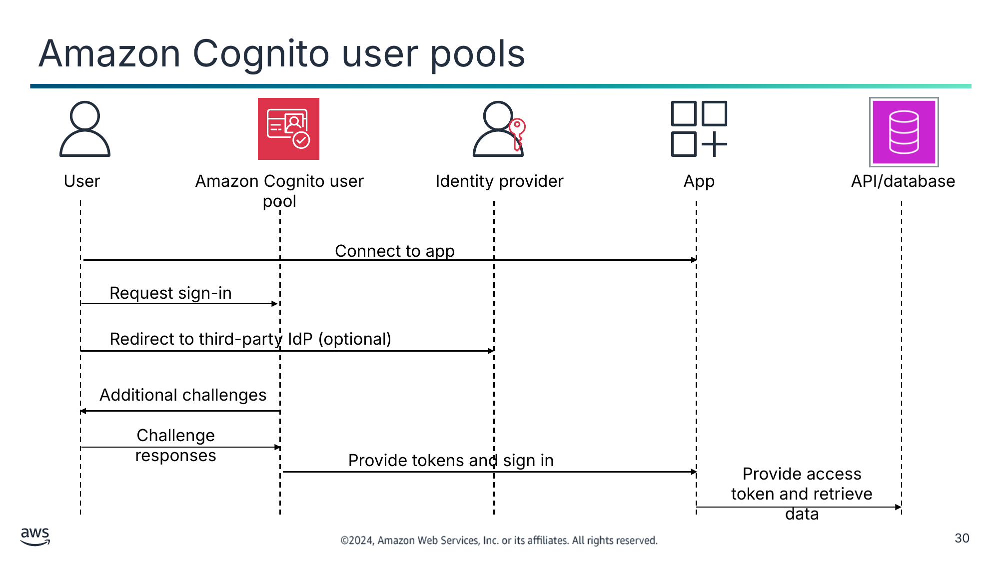

<details>
<summary>Текст зі схеми</summary>

User (Користувач)

Amazon Cognito user pool (Пул користувачів Amazon Cognito)

Identity provider (Постачальник ідентичності)

App (Застосунок)

API/database (API/база даних)

Connect to app (Підключення до застосунку)

Request sign-in (Запит на вхід)

Redirect to third-party IdP (optional) (Перенаправлення до стороннього IdP (необов’язково))

Additional challenges (Додаткові запити)

Challenge responses (Відповіді на запити)

Provide tokens and sign in (Надання токенів і вхід)

Provide access token and retrieve data (Надання токена доступу та отримання даних)

</details>

> **Нотатки:**
>
> |Номер слайда 30  
> |Нотатки для інструктора  
> |  
> |Нотатки для студента  
> Опис зображення: схема пулів користувачів Amazon Cognito, що включає підключення до користувача, постачальника ідентичності, застосунку та API/бази даних. Стрілки показують підключення користувача до застосунку, запити користувача на вхід у пул користувачів Amazon Cognito, перенаправлення користувача до стороннього постачальника ідентичності (необов’язково), додаткові запити й відповіді на запити між користувачем і пулом користувачів Amazon Cognito, надання пулом користувачів Amazon Cognito токена та вхід у застосунок, а також надання застосунком токена доступу й отримання даних до API/бази даних. Кінець опису  
>
> Пул користувачів Amazon Cognito — це каталог користувачів. З пулом користувачів ваші користувачі можуть входити у ваш вебзастосунок чи мобільний застосунок через Amazon Cognito або федеруватися через стороннього IdP. Федеративні й локальні користувачі мають профіль користувача у вашому пулі користувачів.  
>
> Локальні користувачі — це ті, хто зареєструвався або кого ви створили безпосередньо у вашому пулі користувачів. Ви можете керувати цими профілями користувачів і налаштовувати їх в AWS Management Console, AWS SDK чи AWS Command Line Interface (AWS CLI).  
>
> Пули користувачів Amazon Cognito приймають токени та твердження від сторонніх IdP і збирають атрибути користувача у веб-токен JSON (JSON web token, JWT), який вони видають вашому застосунку. Ви можете стандартизувати свій застосунок на одному наборі JWT, тоді як Amazon Cognito обробляє взаємодії з IdP, зіставляючи їхні твердження (claims) із центральним форматом токена.  
>
> Пул користувачів Amazon Cognito може бути самостійним IdP. Amazon Cognito спирається на стандарт OIDC для генерування JWT для автентифікації та авторизації. Коли ви виконуєте вхід локальних користувачів, ваш пул користувачів є авторитетним для цих користувачів. Ви маєте доступ до таких функцій, коли автентифікуєте локальних користувачів.  
>
> Докладніше про пули користувачів Amazon Cognito див. посилання в довіднику ресурсів.

---

## Слайд 31: Функції пулів користувачів Amazon Cognito

| Функція (Feature) | Опис (Description) |
|---|---|
| Реєстрація (Sign-up) | • Дозвольте користувачам вводити свою інформацію у вашому застосунку й створювати профіль користувача, нативний для вашого пулу користувачів.<br>• Перенаправляйте користувачів до стороннього IdP, якому вони можуть дозволити передавати свою інформацію до Amazon Cognito.<br>• Створюйте користувачів на основі джерела даних чи схеми. |
| Вхід (Sign-in) | Використовуйте як самостійний каталог користувачів і IdP для вашого застосунку. |
| Федерація сторонніх ідентичностей (Federate third-party identities) | Дозвольте пулу користувачів керувати накладними витратами на обробку токенів, що повертаються із соціального входу через Facebook, Google, Amazon і Apple, а також від IdP OIDC і SAML. |
| Розміщений інтерфейс для реєстрації та входу (Hosted UI) | Показуйте користувачам настроєні розміщені вебсторінки Amazon Cognito для реєстрації, входу, багатофакторної автентифікації (MFA) і скидання пароля. |
| Підтримка JWT (Support for JWTs) | Використовуйте токени JWT для доступу до серверних ресурсів або обмінюйте їх на тимчасові облікові дані AWS для доступу до інших сервісів AWS. JWT — це відкритий стандарт, що визначає компактний, самодостатній спосіб безпечного передавання інформації між сторонами як об’єкта JSON. |
| Групи пулу користувачів (User pool groups) | Використовуйте групи для створення колекцій користувачів, щоб керувати їхніми дозволами чи представляти різні типи користувачів. Наприклад, створіть окремі групи для користувачів, що є читачами, учасниками та редакторами вашого вебсайту й застосунку. |

> **Нотатки:**
>
> |Номер слайда 31  
> |Нотатки для інструктора  
> |  
> |Нотатки для студента  
> Цей слайд виділяє кілька функцій пулів Amazon Cognito для підтримки автентифікації та федерації ідентичності.  
>
> Докладніше про функції пулу користувачів Amazon Cognito див. посилання в довіднику ресурсів.

---

## Слайд 32: Ключові висновки: федерація користувачів

- Федерація ідентичності — це система довіри між IdP і SP.
  - AWS IAM Identity Center забезпечує уніфікований досвід адміністрування для визначення, налаштування та призначення детальних дозволів на основі поширених посадових функцій.
- AWS STS — це вебсервіс, що надає тимчасові облікові дані AWS і дозволяє користувачу IAM, федеративному користувачу чи застосунку приймати роль IAM.
- Брокер ідентичності полегшує федерацію, коли користувачі вже мають ідентичності поза AWS, як-от корпоративний каталог.
- Amazon Cognito — це повністю кероване обслуговування, що надає автентифікацію, авторизацію та керування користувачами для вебзастосунків і мобільних застосунків. Користувачі можуть входити безпосередньо або через третю сторону, як-от Facebook, Amazon чи Google.

> **Нотатки:**
>
> |Номер слайда 32  
> |Нотатки для інструктора  
> |  
> |Нотатки для студента  
> Ці ключові висновки підсумовують цей розділ.

---

## Слайд 33: Покрокова лабораторна робота: захист застосунків за допомогою Amazon Cognito (Amazon Cognito lab)

> **Нотатки:**
>
> |Номер слайда 33  
> |Нотатки для інструктора  
> |  
> |Нотатки для студента  
> Зараз ви виконаєте лабораторну роботу. Наступний слайд підсумовує, що ви робитимете в лабораторній роботі, а докладні інструкції ви знайдете в лабораторному середовищі.

---

## Слайд 34: Вступ до лабораторної роботи «Amazon Cognito»

- У цій лабораторній роботі ви використовуєте сервіс Amazon Cognito для автентифікації користувачів вебзастосунку.
- Завдання, які ви виконуєте, включають такі:
  - Створення пулу користувачів Amazon Cognito для зберігання та керування користувачами застосунку
  - Налаштування пулу користувачів для надання розміщеного інтерфейсу для застосунку
  - Використання пулу користувачів для автентифікації доступу до захищеної функції застосунку
- Відкрийте ваше лабораторне середовище, щоб розпочати лабораторну роботу та дізнатися додаткові подробиці про завдання, які ви виконуватимете.


> **Нотатки:**
>
> |Номер слайда 34  
> |Нотатки для інструктора  
> |  
> |Нотатки для студента  
> Отримайте доступ до лабораторного середовища через ваш онлайн-курс, щоб дізнатися додаткові подробиці та виконати лабораторну роботу.

---

## Слайд 35: Підсумки лабораторної роботи «Amazon Cognito»

- Що ви зробили, щоб створити користувачів і керувати паролями користувачів для вебсайту Birds?
- У цій лабораторній роботі ви використали Amazon Cognito для налаштування пулу ідентичності. Навіщо вам був потрібен пул ідентичності?

> **Нотатки:**
>
> |Номер слайда 35  
> |Нотатки для інструктора  
> |Відповідні архітектурні схеми «до» та «після» включено до інструкцій кожної лабораторної роботи. Вам може бути корисно відкрити схеми лабораторної роботи під час підбиття підсумків цієї лабораторної роботи.  
> |  
> |Проведіть із класом розмову про ключові висновки з лабораторної роботи. Використайте подробиці з попереднього розділу, щоб допомогти підбити підсумки лабораторної роботи зі студентами після її завершення. Підбиття підсумків лабораторної роботи наполегливо рекомендується. Воно допомагає студентам встановити зв’язки між їхнім практичним досвідом і концепціями, які ви обговорювали в лекції перед цією лабораторною роботою.  
> |Під час підбиття підсумків можна поставити студентам запитання, показані на цьому слайді. Ось відповіді:  
> |  
> |Під час налаштування функції реєстрації пулу користувачів, які способи зв’язку запропонував Amazon Cognito для перевірки ідентичності користувача? Ви можете вказати або адресу електронної пошти, або номер телефону як спосіб зв’язку, який Cognito використовує для перевірки ідентичності користувача під час реєстрації. Де працює вебзастосунок, що показує сторінки для входу? Вебзастосунок, що показує сторінку входу, працює всередині Amazon Cognito. З функцією розміщеного інтерфейсу (hosted UI) Cognito вам не потрібно надавати чи розгортати екземпляр для запуску вебсторінок реєстрації чи входу.  
> |Запропоновані відповіді на запитання 1: що ви зробили, щоб створити користувачів і керувати паролями користувачів для вебсайту Birds? У цій лабораторній роботі ви використали Amazon Cognito для створення пулу користувачів. Пул користувачів Amazon Cognito — це постачальник ідентичності, що |може створювати користувачів і керувати паролями користувачів. Вебзастосунок Birds використовував токени, згенеровані пулом користувачів Amazon Cognito, щоб гарантувати, що користувачі автентифіковані й мають дійсний сеанс, перш ніж вони зможуть отримати доступ до захищеної сторінки чи |виконати захищену дію.  
> |Використовуйте пул користувачів, коли вам потрібно виконати таке:  
> |- Спроєктувати вебсторінки реєстрації та входу для вашого застосунку.  
> |- Отримувати доступ до даних користувачів і керувати ними.  
> |- Відстежувати пристрій, розташування та IP-адресу вашого користувача й адаптуватися до запитів на вхід різних рівнів ризику.  
> |- Використовувати користувацький потік автентифікації для вашого застосунку.  
> |Запропоновані відповіді на запитання 2: у цій лабораторній роботі ви використали Amazon Cognito для налаштування пулу ідентичності. Навіщо вам був потрібен пул ідентичності? Пули ідентичності призначені для авторизації до сервісів AWS. Ви використали пул ідентичності, щоб надати користувачам доступ |до таблиці DynamoDB.  
> |Використовуйте пул користувачів, коли вам потрібно виконати таке:  
> |- Надати вашим користувачам доступ до ресурсів AWS, як-от бакет S3 чи таблиця DynamoDB.  
> |- Генерувати тимчасові облікові дані AWS для неавтентифікованих користувачів.  
> |  
> |Нотатки для студента  
> Ваш інструктор може розглянути ці запитання з вами, або ви можете розглянути їх самостійно. Скористайтеся цією нагодою, щоб поглибити своє мислення щодо завдань, які ви виконували під час лабораторної роботи.

---

## Слайд 36: Керування доступом до кількох акаунтів

Захист доступу користувачів, застосунків і даних

> **Нотатки:**
>
> |Номер слайда 36  
> |Нотатки для інструктора  
> |  
> |Нотатки для студента  
> Цей розділ зосереджений на керуванні доступом до кількох акаунтів за допомогою AWS Organizations.

---

## Слайд 37: Два поширені шаблони розділення доступу до ресурсів

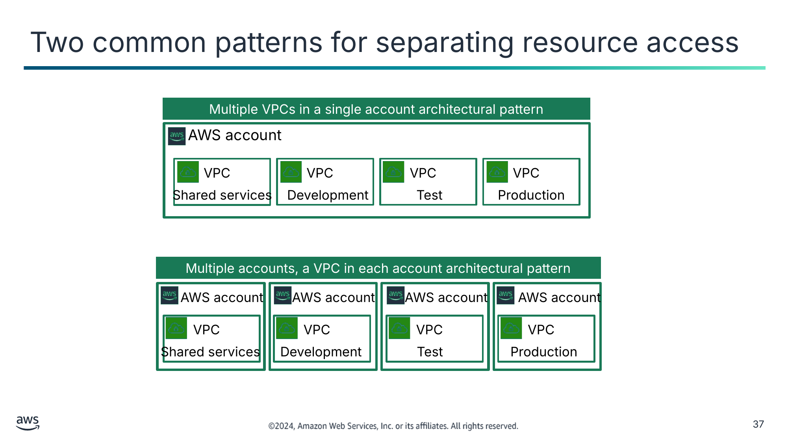

<details>
<summary>Текст зі схеми</summary>

Multiple VPCs in a single account architectural pattern (Архітектурний шаблон: кілька VPC в одному акаунті)

AWS account (Акаунт AWS)

VPC

VPC

VPC

VPC

Shared services (Спільні сервіси)

Development (Розробка)

Test (Тестування)

Production (Продуктивне середовище)

Multiple accounts, a VPC in each account architectural pattern (Архітектурний шаблон: кілька акаунтів, по VPC в кожному акаунті)

AWS account

AWS account

AWS account

AWS account

VPC

VPC

VPC

VPC

Shared services

Development

Test

Production

</details>

> **Нотатки:**
>
> |Номер слайда 37  
> |Нотатки для інструктора  
> |  
> |Нотатки для студента  
> Коли ви використовуєте AWS для підтримки різних команд і відділів в організації, можна обирати між двома загальними архітектурними шаблонами, щоб ізолювати та розділити ресурси, які використовує кожна команда.  
>
> Перший шаблон — визначити кілька віртуальних приватних хмар (VPC) в одному акаунті AWS. Якщо ви надаєте перевагу централізованому керуванню інформаційною безпекою з мінімальними накладними витратами, можна обрати використання одного акаунта AWS.  
>
> Другий шаблон — створити кілька акаунтів AWS і визначити VPC у кожному акаунті. На практиці великі та малі організації, як правило, створюють кілька акаунтів для своїх організацій. Наприклад, вони можуть створювати окремі акаунти для різних бізнес-підрозділів. Вони також можуть створювати окремі акаунти для своїх ресурсів розробки, тестування та продуктивного середовища.

---

## Слайд 38: Переваги та проблеми кількох акаунтів

Переваги

Проблеми

- Ізоляція за бізнес-підрозділами чи відділами
- Ізоляція за середовищем (наприклад, розробка, тестування та продуктивне середовище)
- Ізоляція даних аудиту та відновлення
- Розділення акаунтів для регульованих робочих навантажень
- Простота створення сповіщень про витрати для споживання кожного  
бізнес-підрозділу
- Економія коштів (оптова/обсягова ціна між акаунтами)

- Керування безпекою між акаунтами
- Ручні процеси, пов’язані зі створенням багатьох нових акаунтів
- Визначення того, яка організація має отримувати рахунок
- Потреба в централізованому управлінні (governance) для забезпечення відповідності та узгодженості

> **Нотатки:**
>
> |Номер слайда 38  
> |Нотатки для інструктора  
> |  
> |Нотатки для студента  
> Коли клієнти використовують окремі акаунти AWS (зазвичай із консолідованим виставленням рахунків) для ресурсів розробки та продуктивного середовища, це дає змогу чітко розділити різні типи ресурсів. Це також може забезпечити певні переваги безпеки.  
>
> Як варіант, якщо ваш бізнес підтримує окремі середовища для продуктивного використання, розробки та тестування, можна налаштувати три акаунти AWS і мати по одному акаунту для кожного середовища. Також, якщо у вас є кілька автономних відділів, можна створити окремі акаунти AWS для кожної автономної частини організації.  
>
> Коли ви використовуєте кілька акаунтів, ефективнішою стратегією є створення єдиного акаунта AWS для спільних ресурсів проєкту. Спільні ресурси можуть включати сервіси DNS, Microsoft Active Directory і системи керування контентом (CMS). Також можна розділити акаунти для автономних проєктів чи відділів. Ця стратегія дає змогу призначати дозволи та політики під акаунтом кожного відділу чи проєкту й надавати доступ до ресурсів між акаунтами.  
>
> Хоча більшість організацій обирають використання кількох акаунтів AWS, цей вибір пов’язаний із певними проблемами.  
> По-перше, потрібно визначити, як ефективно керувати безпекою в усіх ваших акаунтах. Якщо ви реплікуєте політики IAM, які визначили, у всіх акаунтах для забезпечення узгодженості, це може потребувати користувацької автоматизації, ручних зусиль або й того, й іншого.  
>
> Також вас можуть постійно просити створювати більше акаунтів. Ручне створення цих акаунтів потребує часу. Також може бути складно відстежувати всі акаунти та призначення кожного акаунта.  
>
> Також може бути проблемою визначити, який центр витрат в організації має платити за які ресурси в яких акаунтах.  
>
> І нарешті, ви також можете захотіти досягти централізованого управління (governance), що потрібне для забезпечення узгодженості.

---

## Слайд 39: AWS Organizations

- Сервіс керування акаунтами, який можна використовувати для консолідації кількох акаунтів AWS в організацію з централізованим керуванням
- Доступні знижки за рівнями ціноутворення (tier pricing)
- Включає створення акаунтів і керування ними та можливості консолідованого виставлення рахунків
- Забезпечує ієрархічне групування акаунтів
- Підтримує централізований контроль політик над сервісами AWS і діями API за допомогою політик контролю служб (SCP)

AWS

Organizations

> **Нотатки:**
>
> |Номер слайда 39  
> |Нотатки для інструктора  
> |Повідомте студентам, що AWS Organizations включає керування акаунтами та можливості консолідованого виставлення рахунків, що дають змогу краще відповідати бюджетним потребам, потребам безпеки та відповідності вашого бізнесу. Як адміністратор організації, ви можете створювати акаунти у вашій організації та запрошувати наявні акаунти приєднатися до організації. Також важливо вказати, що знижки за рівнями ціноутворення — велика перевага.  
> |  
> |Нотатки для студента  
> AWS Organizations — це сервіс керування акаунтами, який можна використовувати для створення організації, де можна консолідувати кілька акаунтів і централізовано керувати ними. AWS Organizations забезпечує централізоване створення акаунтів і керування ними та можливості консолідованого виставлення рахунків. З цими функціями ви можете ефективніше керувати своїми потребами безпеки, відповідності та бюджету.  
>
> Organizations також забезпечує можливість ієрархічно групувати ваші акаунти в організаційні одиниці (OU) і прикріплювати різні політики доступу до кожної. Це дає змогу створювати й налаштовувати детальні політики, які можна спрямувати на одну OU або прикріпити до кількох OU. Ви можете вкладати OU в інші OU до глибини п’яти рівнів, що допомагає структурувати вашу ієрархію так, як вам подобається.  
>
> Ще одна ключова функція Organizations — використання політик контролю служб (SCP) для вказання максимальних дозволів для акаунтів-членів у вашій організації. Це допомагає забезпечити, щоб ваші акаунти залишалися в межах настанов контролю доступу вашої організації.  
>
> Organizations спирається на AWS Identity and Access Management (IAM), розширюючи детальний контроль, що надає IAM, до рівня акаунта. Він робить це, надаючи вам контроль над тим, що можуть робити користувачі та ролі в акаунті чи групі акаунтів. Цей додатковий рівень контролю гарантує, що користувачі можуть отримувати доступ лише до того, що дозволяють і політики Organizations, і політики IAM. Якщо будь-який із сервісів блокує операцію, користувач не зможе отримати доступ до цієї операції.  
>
> Докладніше про AWS Organizations див. посилання на сторінці ресурсів курсу.

---

## Слайд 40: AWS Organizations: створення організаційних одиниць (OU)

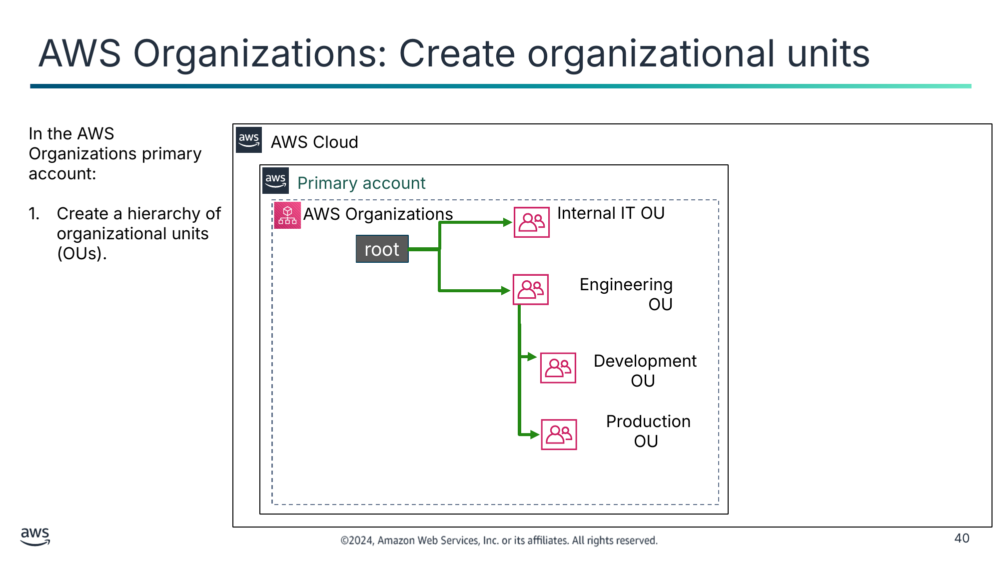

В основному акаунті AWS Organizations:

1. Створіть ієрархію організаційних одиниць (OU).

<details>
<summary>Текст зі схеми</summary>

AWS Cloud

Primary account (Основний акаунт)

AWS Organizations

Internal IT OU (OU внутрішнього ІТ)

root (корінь)

Engineering OU (OU інженерії)

 Development OU (OU розробки)

 Production OU (OU продуктивного середовища)

</details>

> **Нотатки:**
>
> |Номер слайда 40  
> |Нотатки для інструктора  
> | Пройдіться по кожному кроку на наступних 4 слайдах. Кожен слайд будується на попередньому, щоб допомогти студентам краще зрозуміти потік.  
> |  
> |Нотатки для студента  
> Ось приклад організації AWS. Вона визначена всередині звичайного акаунта AWS, що на слайді називається основним акаунтом, оскільки в ньому визначено організацію AWS.  
>
> Крок 1: створіть ієрархію OU. Коли ви створюєте організацію в основному акаунті, організація автоматично створює батьківський контейнер, що називається коренем (root). Під кожним коренем в організації можна визначати OU.

---

## Слайд 41: AWS Organizations: призначення акаунтів

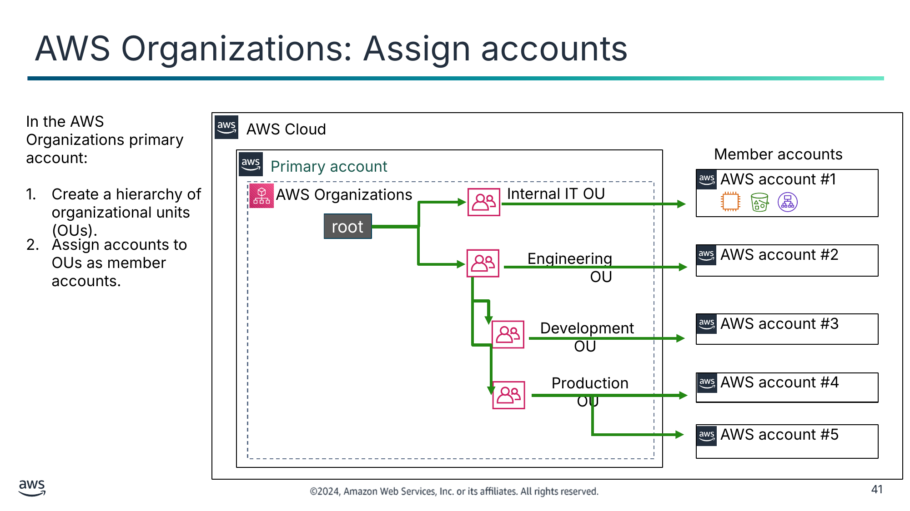

2. Призначте акаунти OU як акаунти-члени.

<details>
<summary>Текст зі схеми</summary>

In the AWS Organizations primary account: (В основному акаунті AWS Organizations:)

1. Create a hierarchy of organizational units (OUs). (Створіть ієрархію організаційних одиниць (OU).)

AWS Cloud

Primary account (Основний акаунт)

Member accounts (Акаунти-члени)

AWS account #1 (Акаунт AWS №1)

AWS Organizations

Internal IT OU (OU внутрішнього ІТ)

root (корінь)

Engineering OU (OU інженерії)

AWS account #2

 Development OU (OU розробки)

AWS account #3

 Production OU (OU продуктивного середовища)

AWS account #4

AWS account #5

</details>

> **Нотатки:**
>
> |Номер слайда 41  
> |Нотатки для інструктора  
> | Зазначте, що акаунти-члени призначаються до OU.  
> |  
> |Нотатки для студента  
> Крок 2: призначте акаунти OU як акаунти-члени. Кожному з акаунтів-членів призначено таке:  
> Акаунт-член, акаунт AWS №1, призначено OU внутрішнього ІТ  
> Акаунт-член, акаунт AWS №2, призначено OU інженерії  
> Акаунт-член, акаунт AWS №3, призначено OU розробки  
> Акаунт-член, акаунт AWS №4, призначено OU продуктивного середовища  
> Акаунт-член, акаунт AWS №5, призначено OU продуктивного середовища

---

## Слайд 42: AWS Organizations: визначення SCP

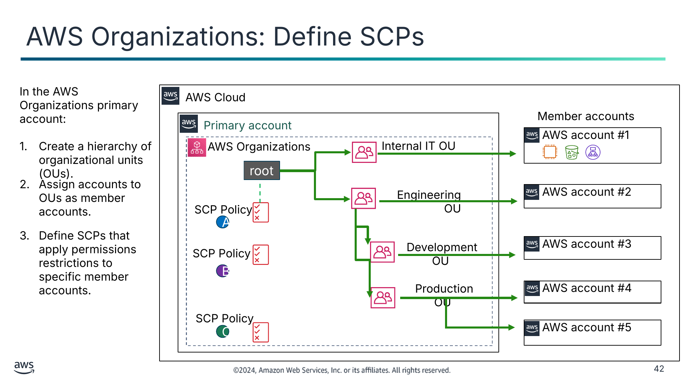

3. Визначте SCP, що застосовують обмеження дозволів до конкретних акаунтів-членів.

<details>
<summary>Текст зі схеми</summary>

In the AWS Organizations primary account: (В основному акаунті AWS Organizations:)

1. Create a hierarchy of organizational units (OUs). (Створіть ієрархію організаційних одиниць (OU).)

2. Assign accounts to OUs as member accounts. (Призначте акаунти OU як акаунти-члени.)

AWS Cloud

Primary account (Основний акаунт)

AWS account #1 (Акаунт AWS №1)

AWS Organizations

Internal IT OU (OU внутрішнього ІТ)

root (корінь)

Engineering OU (OU інженерії)

AWS account #2

SCP Policy (Політика SCP)

A

SCP Policy

 Development OU (OU розробки)

AWS account #3

B

 Production OU (OU продуктивного середовища)

AWS account #4

SCP Policy

AWS account #5

C

Member accounts (Акаунти-члени)

</details>

> **Нотатки:**
>
> |Номер слайда 42  
> |Нотатки для інструктора  
> |Зауважте, що SCP дають змогу контролювати, які сервіси доступні користувачам IAM в акаунтах-членах.  
> |  
> |Нотатки для студента  
> Крок 3: щоб налаштувати засоби контролю доступу між акаунтами, ви визначаєте SCP. У цьому прикладі є SCP A, B і C.

---

## Слайд 43: SCP в Organizations

- Пропонують центральний контроль над максимальними доступними дозволами для всіх акаунтів у вашій організації.
- Дають змогу контролювати, які сервіси доступні користувачам IAM в акаунтах-членах.
- Визначають дозволи, що впливають на весь акаунт.
- Визначають запобіжні обмеження (guardrails), тобто встановлюють межі для дій, які адміністратор акаунта може делегувати користувачам і ролям IAM у відповідних акаунтах. Політики IAM, визначені в окремих акаунтах, усе ще застосовуються.
- SCP не може бути перевизначена локальним адміністратором.

Найкраща практика

Простіше визначити політики для кількох акаунтів у SCP, ніж реплікувати ці налаштування дозволів у документи політик IAM у кожному акаунті.

> **Нотатки:**
>
> |Номер слайда 43  
> |Нотатки для інструктора  
> |  
> |Нотатки для студента  
> SCP в Organizations: SCP дають змогу контролювати, які сервіси доступні користувачам IAM в акаунтах-членах. Припустімо, у вас є конкретні політики, які ви хочете застосувати до кількох акаунтів. Простіше визначити ці політики в SCP, ніж реплікувати ці налаштування дозволів у документи політик IAM у кожному акаунті.  
>
> Дозволи, визначені в SCP, впливають на весь акаунт. Вони обмежують дозволи для кожного запиту, зробленого принципалом в акаунті. Сутність IAM (користувач чи роль) може зробити запит, на який впливають SCP, межа дозволів (permissions boundary) і політика на основі ідентичності. У цьому разі запит дозволяється лише якщо всі три типи політик його дозволяють. Підсумкові дозволи — це перетин усіх трьох типів політик. Явна заборона в будь-якій із цих політик перевизначає дозвіл.  
>
> Самих SCP недостатньо для надання дозволів акаунтам у вашій організації. SCP не надає жодних дозволів. SCP визначає запобіжне обмеження (guardrail), тобто встановлює межі для дій, які адміністратор акаунта може делегувати користувачам і ролям IAM у відповідних акаунтах.  
>
> SCP слід використовувати разом із політиками IAM, визначеними в кожному окремому акаунті. SCP можна розглядати як такі, що забезпечують загальні межі навколо сервісів і загальних дозволів, до яких користувачам має бути дозволено чи заборонено доступ (на основі запобіжних обмежень, або встановлених меж). Потім можна використовувати політики IAM, щоб встановити детальніші засоби контролю доступу, специфічні для окремих акаунтів.

---

## Слайд 44: Приклади сценаріїв, визначених у SCP

- Блокування доступу до сервісу чи певних дій. Наприклад, заборона користувачам вимикати AWS CloudTrail у всіх акаунтах-членах.
- Примусове застосування тегування ресурсів. Наприклад, не дозволяйте користувачам запускати образ Amazon Machine Image (AMI) для Amazon Elastic Compute Cloud (Amazon EC2), якщо він не має певного тегу.
- Запобігання виходу акаунтів-членів з організації.

> **Нотатки:**
>
> |Номер слайда 44  
> |Нотатки для інструктора  
> |  
> |Нотатки для студента  
> Цей слайд перелічує кілька поширених прикладів використання SCP для контролю доступу та поведінки в акаунті.

---

## Слайд 45: Приклад SCP

Запобігання виходу акаунтів-членів з організації:

```json
{ 
  "Version": "2023-06-17", 
  "Statement": [ 
    {
      "Effect": "Deny", 
      "Action": [ "organizations:LeaveOrganization"], 
      "Resource": "*" 
    } 
  ] 
}
```

> **Нотатки:**
>
> |Номер слайда 45  
> |Нотатки для інструктора  
> |  
> |Нотатки для студента  
> Цей приклад SCP запобігає виходу акаунтів-членів з організації. Ефект інструкції політики — явно заборонити дію organizations:LeaveOrganization, що не дає акаунтам-членам вийти.  
>
> Докладніше про SCP в AWS Organizations див. посилання на сторінці ресурсів курсу.

---

## Слайд 46: AWS Organizations: прикріплення SCP

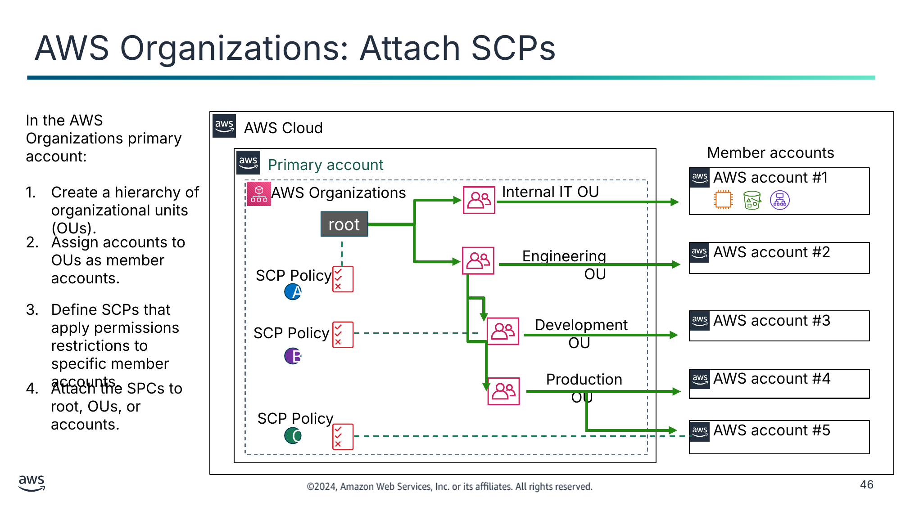

4. Прикріпіть SCP до кореня, OU чи акаунтів.

<details>
<summary>Текст зі схеми</summary>

In the AWS Organizations primary account: (В основному акаунті AWS Organizations:)

1. Create a hierarchy of organizational units (OUs). (Створіть ієрархію організаційних одиниць (OU).)

2. Assign accounts to OUs as member accounts. (Призначте акаунти OU як акаунти-члени.)

AWS Cloud

Primary account (Основний акаунт)

AWS account #1 (Акаунт AWS №1)

AWS Organizations

Internal IT OU (OU внутрішнього ІТ)

root (корінь)

Engineering OU (OU інженерії)

AWS account #2

SCP Policy (Політика SCP)

A

SCP Policy

 Development OU (OU розробки)

AWS account #3

B

 Production OU (OU продуктивного середовища)

AWS account #4

SCP Policy

AWS account #5

C

Member accounts (Акаунти-члени)

3. Define SCPs that apply permissions restrictions to specific member accounts. (Визначте SCP, що застосовують обмеження дозволів до конкретних акаунтів-членів.)

</details>

> **Нотатки:**
>
> |Номер слайда 46  
> |Нотатки для інструктора  
> |Цей слайд збирає все докупи. Важливо зауважити, що політика поширюється від кореня й впливає на всі OU та акаунти під ним.  
> |  
> |Нотатки для студента  
> Після створення SCP останній крок — прикріпити кожну політику до відповідного місця в ієрархії OU та акаунтів.  
>
> Політика поширюється від кореня й впливає на всі OU та акаунти під ним. Якщо політику прикріплено до кореня, вона впливає на всі OU та акаунти в ієрархії. Тому, якщо ви застосовуєте SCP до кореня (як-от SCP Policy A у прикладі), вона застосовуватиметься до всіх OU та акаунтів в організації. Можна прикріпити SCP до кореня, до будь-якої OU чи до окремого акаунта.  
>
> Пам’ятайте, що, як і політики IAM, SCP надаватимуть доступ лише якщо він і явно дозволений, і не заборонений явно жодною іншою SCP чи політикою IAM, що застосовується до користувача. Наприклад, припустімо, що SCP Policy A, застосована до кореня організації, встановлює більше обмежень для певного сервісу чи набору ресурсів, ніж SCP Policy C. Тоді користувачі в акаунті 5 підпадають під суворіші дозволи, встановлені політикою A. Так само, якщо будь-які політики IAM на рівні окремого акаунта явно забороняють будь-які дії для користувача, ці політики IAM перевизначають будь-які дозволи в SCP, надані акаунту.

---

## Слайд 47: Поєднання SCP з політиками IAM на основі ідентичності

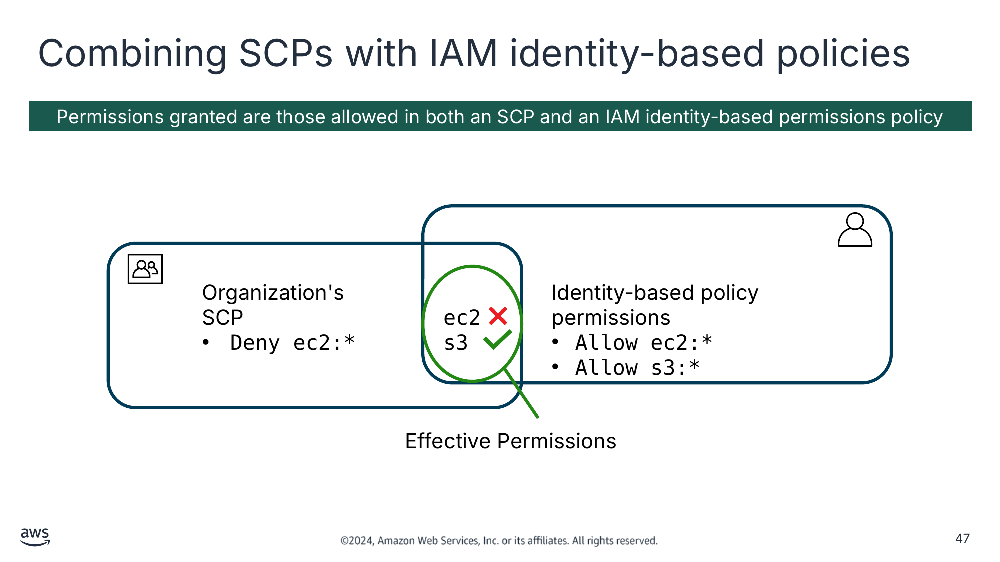

Надані дозволи — це ті, що дозволені і в SCP, і в політиці дозволів IAM на основі ідентичності

<details>
<summary>Текст зі схеми</summary>

Organization's SCP (SCP організації)

- `Deny ec2:*`

Identity-based policy permissions (Дозволи політики на основі ідентичності)

- `Allow ec2:*`
- `Allow s3:*`

```
ec2
s3
```

Effective Permissions (Підсумкові дозволи)

</details>

> **Нотатки:**
>
> |Номер слайда 47  
> |Нотатки для інструктора  
> |Зверніть увагу на перетин і на те, що явна заборона в будь-якій із цих політик перевизначає дозвіл. Підкресліть, що SCP використовується для обмеження дозволів, які можуть мати користувачі. Вона вказує максимальні дозволи в акаунтах-членах організації.  
> |  
> |Нотатки для студента  
> Користувачі чи групи можуть мати кілька політик, прикріплених до них, що надають різні дозволи. У такому разі дозволи для користувачів обчислюються на основі комбінації політик. Але базовий принцип усе одно застосовується: якщо користувачу не надано явного дозволу на дію та ресурс, користувач не має цих дозволів.  
>
> Прикріплюйте політики на основі ідентичності чи ресурсу до користувачів IAM або до ресурсів в акаунтах вашої організації. Прикріпіть SCP до сутності Organizations (кореня, OU чи акаунта), щоб визначити запобіжне обмеження (guardrail). SCP встановлює межі для дій, які можуть виконувати користувачі та ролі IAM у відповідних акаунтах.  
>
> SCP Organizations застосовуються до всього акаунта AWS. Вони обмежують дозволи для кожного запиту, зробленого принципалом в акаунті. Сутність IAM (користувач чи роль) може зробити запит, на який впливає SCP або політика на основі ідентичності. У цьому разі запит дозволяється лише якщо обидва типи політик його дозволяють. Підсумкові дозволи — це перетин політик. Явна заборона в будь-якій із цих політик перевизначає дозвіл.  
>
> Дозволені дозволи (центр) — це лише ті, що дозволені і в політиці дозволів IAM на основі ідентичності, і в SCP Organizations. У цьому разі, оскільки SCP не забороняє доступ до Amazon Simple Storage Service (Amazon S3), дозвіл s3* у політиці на основі ідентичності надає дозвіл на доступ до Amazon S3.

---

## Слайд 48: Межі дозволів задають обмеження для сутностей IAM

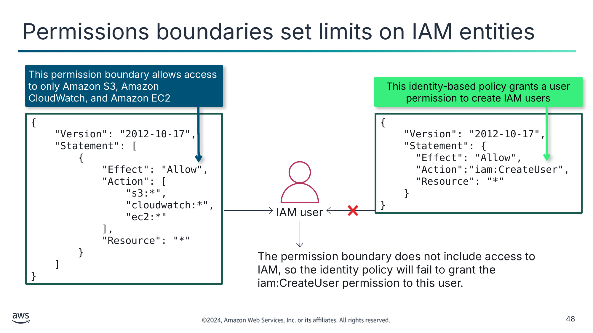

Ця межа дозволів дозволяє доступ лише до Amazon S3, Amazon CloudWatch і Amazon EC2

Ця політика на основі ідентичності надає користувачу дозвіл на створення користувачів IAM

```json
{    
    "Version": "2012-10-17",
    "Statement": [
        {
            "Effect": "Allow",
            "Action": [
                "s3:*",
                "cloudwatch:*", 
                "ec2:*"
            ],
            "Resource": "*"
        }
    ]
}
```

```json
{  
    "Version": "2012-10-17",
    "Statement": {
      "Effect": "Allow", 
      "Action":"iam:CreateUser",
      "Resource": "*"  
    }
}
```

IAM user (Користувач IAM)

Межа дозволів не включає доступу до IAM, тож політика ідентичності не зможе надати цьому користувачу дозвіл iam:CreateUser.

> **Нотатки:**
>
> |Номер слайда 48  
> |Нотатки для інструктора  
> |  
> |Нотатки для студента  
> AWS підтримує межі дозволів (permissions boundaries) для сутностей IAM (користувачів чи ролей). Межа дозволів — це розширена функція використання керованої політики для встановлення максимальних дозволів, які політика на основі ідентичності може надати сутності IAM. Межа дозволів сутності дозволяє їй виконувати лише ті дії, що дозволені і її політиками на основі ідентичності, і її межами дозволів.  
>
> Ви можете використовувати керовану AWS політику або політику, якою керує клієнт, щоб встановити межу для сутності IAM (користувача чи ролі). Ця політика обмежує максимальні дозволи для користувача чи ролі.  
>
> Коли ви використовуєте політику для встановлення межі дозволів для користувача, вона обмежує дозволи користувача, але сама не надає дозволів. У цьому прикладі політика встановлює максимальні дозволи користувача IAM як усі операції в Amazon S3, Amazon CloudWatch та Amazon Elastic Compute Cloud (Amazon EC2). Цей користувач IAM ніколи не зможе виконувати операції в жодному іншому сервісі, зокрема в IAM, навіть якщо він має політику дозволів, що це дозволяє.

---

## Слайд 49: Дозволи мають бути дозволені обома типами політик

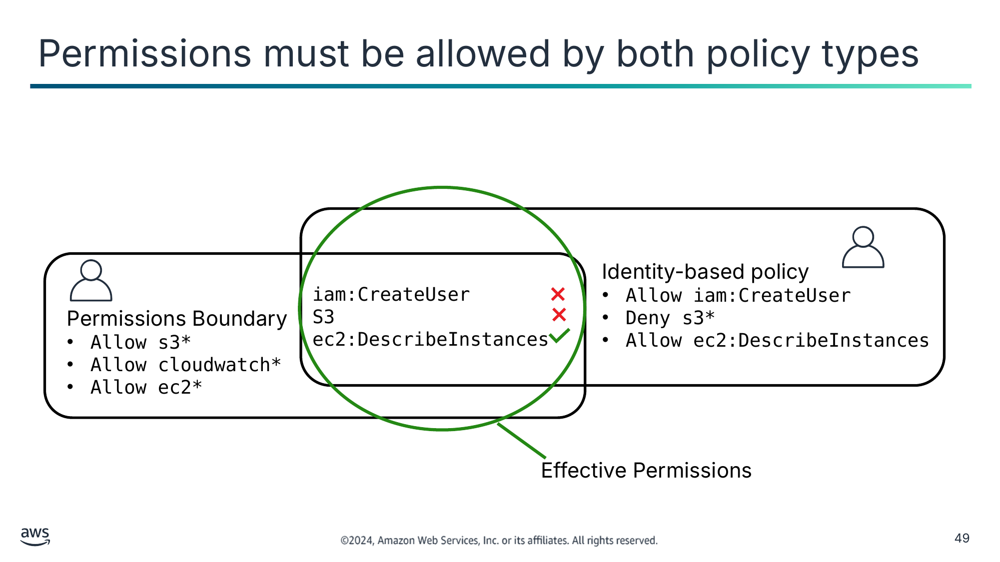

<details>
<summary>Текст зі схеми</summary>

```
Identity-based policy
Allow iam:CreateUser
Deny s3*
Allow ec2:DescribeInstances
```

```
iam:CreateUser
S3
ec2:DescribeInstances
```

```
Permissions Boundary
Allow s3*
Allow cloudwatch*
Allow ec2*
```

Effective Permissions (Підсумкові дозволи)

</details>

> **Нотатки:**
>
> |Номер слайда 49  
> |Нотатки для інструктора  
> | Зверніть увагу на перетин і підсумкові дозволи. Можна зауважити, що з межею дозволів користувач не може отримати доступ до сервісів, які явно не дозволені. Тому цей користувач не може отримати доступ до IAM, навіть якщо немає явної заборони для IAM. Межа дозволів мала ефект заборони всього, що не перелічено.  
> |  
> |Нотатки для студента  
> Як проілюстровано в прикладі на попередньому слайді, межа дозволів для сутності IAM (користувача чи ролі) встановлює максимальні дозволи, які може мати сутність. Це може змінити підсумкові дозволи для цього користувача чи ролі. Політики на основі ідентичності — це вбудовані (inline) або керовані політики, прикріплені до користувача, групи користувачів чи ролі. Політики на основі ідентичності надають дозвіл сутності, а межі дозволів обмежують ці дозволи. Підсумкові дозволи — це перетин обох типів політик.  
>
> Явна заборона в будь-якій із цих політик перевизначає дозвіл. Тому, хоча межа дозволів включає Amazon S3, політика IAM на основі ідентичності забороняє його, і ця явна заборона не дає цьому користувачу отримати доступ до Amazon S3. Оскільки межа дозволів дозволяє ec2*, а політика ідентичності дозволяє ec2: DescribeInstances, цей користувач IAM зміг би використовувати опис екземплярів EC2.

---

## Слайд 50: Як кілька типів політик впливають на дозволи

**SCP, прикріплена до OU тестування**

- `Deny ec2*`
- `Deny sqs*`

```
Identity-based IAM policy
Allow ec2:DescribeInstances 
Allow kms*
Allow s3*
Allow sqs:SendMessage
```

**Межа дозволів**

- `Allow s3*`
- `Allow sqs*`

Користувач IAM в OU тестування

| Ресурс або дозвіл (Resource or permission) | Дозволено? (Allowed?) | Обґрунтування (Rationale) |
|---|---|---|
| Опис екземплярів EC2 | Ні (No) | Явна заборона EC2 у SCP перевизначає дозвіл у політиці IAM. |
| AWS Key Management Service (AWS KMS) | Ні | Немає явної заборони, але цей сервіс не входить до межі дозволів. |
| Amazon S3 | Так (Yes) | S3 входить до межі дозволів, і в SCP немає явної заборони. Політика IAM надає доступ. |
| Надсилання повідомлення в Amazon Simple Queue Service (Amazon SQS) | Ні | Явна заборона в SCP перевизначає дозвіл у межі дозволів і політиці IAM. |

> **Нотатки:**
>
> |Номер слайда 50  
> |Нотатки для інструктора  
> | Зверніть увагу на перетин і підсумкові дозволи.  
> |  
> |Нотатки для студента  
> У межах акаунта на дозволи сутності можуть впливати політики на основі ідентичності, політики на основі ресурсів, межі дозволів, SCP Organizations або політики сеансу (session policies).  
>
> Якщо будь-який із цих типів політик явно забороняє доступ для операції, запит відхиляється. Дозволи, надані сутності кількома типами дозволів, складніші. Цей приклад показує вплив використання всіх трьох типів дозволів, обговорених у цьому розділі: SCP на організацію та й межі дозволів, і політики на основі ідентичності для користувача IAM.  
>
> Докладніше про те, як AWS оцінює політики, див. посилання на логіку оцінювання політик, наведене на сторінці ресурсів курсу.

---

## Слайд 51: Порівняння меж дозволів і SCP

| Межа дозволів (Permission boundary) | SCP організації (Organizational SCP) |
|---|---|
| Застосовується до сутності IAM (користувача чи ролі) | Застосовується до всіх членів організації чи OU |
| Визначає максимальні дозволи, які пов’язані політики на основі ідентичності можуть надати сутності | Визначає максимальні дозволи для акаунтів-членів організації або організаційної одиниці (OU) |
| Не надає дозволів | Не надає дозволів |
| Зазвичай використовується для обмеження того, до яких ресурсів користувачу чи ролі дозволено доступ | Зазвичай використовується для заборони доступу до набору ресурсів |
| • Приклад: дозволити ролі IAM розробника доступ до EC2, Amazon S3 і Amazon CloudWatch.<br>• Результат: роль розробника може отримувати доступ лише до EC2, Amazon S3 і CloudWatch незалежно від інших політик, пов’язаних з її роллю. | • Приклад: заборонити доступ до Amazon Relational Database Service (Amazon RDS) усім членам OU внутрішнього ІТ.<br>• Результат: усім членам OU внутрішнього ІТ буде відмовлено в доступі до Amazon RDS незалежно від інших політик, пов’язаних з їхньою ідентичністю. |

> **Нотатки:**
>
> |Номер слайда 51  
> |Нотатки для інструктора  
> |  
> |Нотатки для студента  
> І межі дозволів, і SCP організації дають змогу обмежити обсяг доступу, що буде надано. Ключові відмінності в тому, що межа дозволів пов’язана з користувачем чи роллю, тоді як SCP застосовується до всієї організації. Ні межі дозволів, ні SCP самі по собі фактично не надають дозволів. На практиці межі дозволів часто використовуються для явного дозволу підмножини сервісів, запобігаючи доступу до всього, чого немає в цьому списку дозволів. Наприклад, коли ролі потрібен доступ лише до невеликої підмножини сервісів AWS, ви можете помістити їх у межу дозволів. SCP, навпаки, часто використовуються для заборони певних сервісів. Наприклад, у вас є організація, якій потрібно використовувати різноманітні сервіси та ресурси AWS, але ви хочете запобігти їхньому доступу до певного типу ресурсів, як-от Amazon Relational Database Service (Amazon RDS).

---

## Слайд 52: AWS Control Tower

- AWS Control Tower полегшує налаштування та управління (governance) безпечним багатоакаунтним середовищем AWS.
- Переваги AWS Control Tower включають такі:
  - Автоматизоване налаштування нового добре спроєктованого багатоакаунтного середовища на основі шаблонів найкращих практик
  - Управління робочими навантаженнями AWS за допомогою правил безпеки, експлуатації та внутрішньої відповідності
  - Приписові настанови для управління вашим середовищем AWS у великому масштабі

AWS Control Tower

> **Нотатки:**
>
> |Номер слайда 52  
> |Нотатки для інструктора  
> |  
> |Нотатки для студента  
> AWS Control Tower пропонує простий спосіб налаштувати й керувати безпечним багатоакаунтним середовищем AWS. Він створює посадкову зону (landing zone), що ґрунтується на шаблонах найкращих практик, і забезпечує управління за допомогою запобіжних обмежень (guardrails), які можна обрати зі списку попередньо підготовлених. Запобіжне обмеження, також зване контролем (control), — це високорівневе правило, що забезпечує постійне управління вашим загальним середовищем AWS. Воно виражене простою мовою.  
>
> Посадкова зона — це добре спроєктована багатоакаунтна основа, що дотримується найкращих практик AWS. Запобіжні обмеження впроваджують правила управління для безпеки, відповідності та експлуатації.  
>
> Якщо ви хочете створити чи керувати своїм багатоакаунтним середовищем AWS за найкращими практиками, використовуйте AWS Control Tower. Він пропонує приписові настанови для управління вашим середовищем AWS у великому масштабі. Він дає вам контроль над вашим середовищем без втрати швидкості та гнучкості, які AWS надає розробникам. Ви отримаєте користь, якщо будуєте нове середовище AWS, починаєте свій шлях в AWS, розпочинаєте нову хмарну ініціативу, повністю новачок в AWS або якщо у вас є наявне багатоакаунтне середовище AWS, але ви віддаєте перевагу рішенню зі вбудованими шаблонами та запобіжними обмеженнями.  
>
> Докладніше див. AWS Control Tower на сторінці ресурсів вмісту вашого онлайн-курсу.

---

## Слайд 53: Ключові висновки: керування доступом до кількох акаунтів

- Більшість організацій обирають створення кількох акаунтів AWS і визначення VPC в кожному акаунті.
- Кілька акаунтів дозволяють консолідувати виставлення рахунків, щоб допомогти заощадити кошти, об’єднуючи їх за рівнями ціноутворення. Це також дає організаціям змогу чітко розділити різні типи ресурсів, водночас забезпечуючи певні переваги безпеки.
- AWS Organizations дає змогу консолідувати кілька акаунтів AWS в організацію з централізованим керуванням.
- SCP дають змогу встановлювати обмеження дозволів у всій організації, тоді як межі дозволів дають змогу встановлювати обмеження для сутностей IAM (користувачів і ролей).
- Користувачі чи групи можуть мати кілька політик, прикріплених до них, що надають різні дозволи. Якщо користувачу не надано явного дозволу на дію та ресурс, користувач не має цих дозволів.

> **Нотатки:**
>
> |Номер слайда 53  
> |Нотатки для інструктора  
> |  
> |Нотатки для студента  
> Ці ключові висновки підсумовують цей розділ.

---

## Слайд 54: Шифрування даних у стані спокою

Захист доступу користувачів, застосунків і даних

> **Нотатки:**
>
> |Номер слайда 54  
> |Нотатки для інструктора  
> |  
> |Нотатки для студента  
> Цей розділ зосереджений на шифруванні даних у стані спокою за допомогою AWS Key Management Service (AWS KMS).

---

## Слайд 55: Навіщо захищати дані в стані спокою?

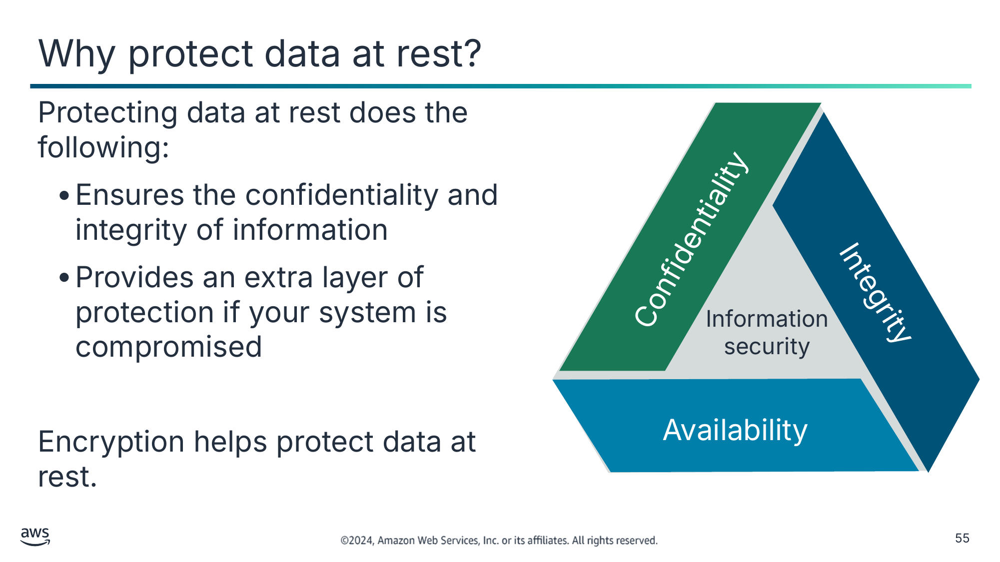

Захист даних у стані спокою забезпечує таке:

- Гарантує конфіденційність і цілісність інформації
- Забезпечує додатковий рівень захисту, якщо вашу систему скомпрометовано

Шифрування допомагає захищати дані в стані спокою.

<details>
<summary>Текст зі схеми</summary>

Confidentiality (Конфіденційність)

Integrity (Цілісність)

Information security (Інформаційна безпека)

Availability (Доступність)

</details>

> **Нотатки:**
>
> |Номер слайда 55  
> |Нотатки для інструктора  
> |  
> |Нотатки для студента  
> Чутливі дані можна захищати на кількох рівнях, зокрема під час передавання та в стані спокою.  
>
> Ви захищаєте дані, поки вони рухаються від мережі до мережі чи передаються. Ви також захищаєте дані, коли вони перебувають на локальному пристрої зберігання чи пристрої хмарного зберігання.  
>
> Цей розділ розглядає захист даних у стані спокою.  
>
> Тріада «конфіденційність, цілісність і доступність» (confidentiality, integrity, availability, CIA) — широко використовувана модель для впровадження безпеки даних на підприємствах. Конфіденційність спрямована на збереження персональних даних у безпеці та прихованими від неавторизованих осіб. Цілісність полягає в забезпеченні того, щоб дані не змінювалися й не спотворювалися протягом процесу, у якому вони використовуються. Нарешті, доступність гарантує, що дані залишаються доступними, коли вони потрібні належній особі.  
>
> Захист даних у стані спокою сприяє конфіденційності та цілісності інформації. Він гарантує безпеку даних, навіть якщо неавторизована сторона отримає до них доступ. Шифрування даних у стані спокою значно ускладнює зловмисникам компрометацію даних, навіть якщо вони можуть скомпрометувати кінцеву точку. Також вам може знадобитися захищати свої дані в стані спокою через бізнес-вимоги чи вимоги відповідності.

---

## Слайд 56: Що таке шифрування даних?

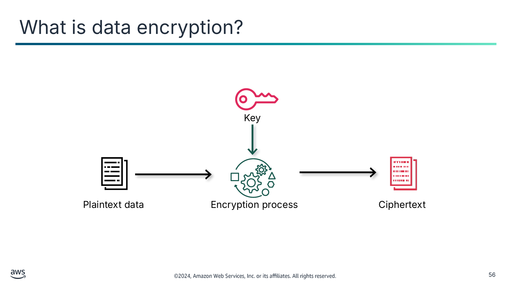

<details>
<summary>Текст зі схеми</summary>

Key (Ключ)

Plaintext data (Дані у відкритому вигляді)

Encryption process (Процес шифрування)

Ciphertext (Шифротекст)

</details>

> **Нотатки:**
>
> |Номер слайда 56  
> |Нотатки для інструктора  
> |Розгляньте визначення шифрування. Зазначте, що ключ може бути послідовністю цифр і літер, яку алгоритм використовує для шифрування та розшифрування даних. Захист ключів і керування ними стає критично важливою частиною будь-якого рішення для шифрування.  
> |  
> |Нотатки для студента  
> Шифрування — це процес використання коду, що називається шифром (cipher), щоб перетворити дані, що читаються, на дані, нечитабельні для іншої сторони. Шифр містить і алгоритми для шифрування, і для розшифрування даних. Ключ — це послідовність цифр і літер, яку алгоритм використовує для шифрування та розшифрування даних.  
>
> Шифрування працює за допомогою алгоритму з ключем, що перетворює дані у відкритому вигляді (plaintext) на нечитабельні дані (шифротекст, ciphertext), які знову стають читабельними лише з правильним ключем. Наприклад, проста фраза «Hello World!» у зашифрованому вигляді може виглядати як «1c28df2b595b4e30b7b07500963dc7c».  
>
> Існує кілька різних алгоритмів шифрування, і всі вони використовують різні типи ключів. Надійний алгоритм шифрування спирається на математичні властивості, щоб створювати шифротекст, який неможливо розшифрувати за допомогою будь-якого практично доступного обсягу обчислювальної потужності без наявності необхідного ключа. Тому захист і керування ключами стають критично важливою частиною будь-якого рішення для шифрування.  
>
> Існує два типи шифрування: симетричне шифрування та асиметричне шифрування. Обидва типи можна використовувати для шифрування даних під час передавання чи в стані спокою.  
>
> Конвертне шифрування (envelope encryption) використовує разом і симетричне, і асиметричне шифрування. Наприклад, протокол TLS (SSL) виконує конвертне шифрування, поєднуючи використання і симетричного, і асиметричного шифрування.

---

## Слайд 57: Симетричне шифрування (symmetric encryption)

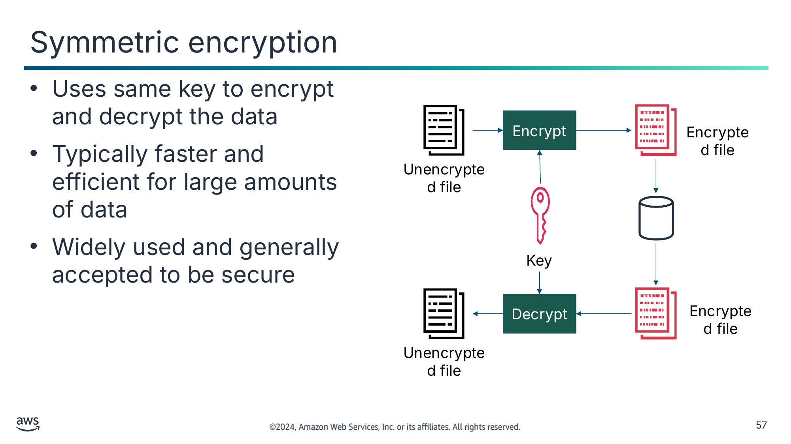

- Використовує той самий ключ для шифрування та розшифрування даних
- Зазвичай швидше й ефективніше для великих обсягів даних
- Широко використовується й загалом визнається безпечним

<details>
<summary>Текст зі схеми</summary>

Encrypt (Шифрування)

Encrypted file (Зашифрований файл)

Unencrypted file (Незашифрований файл)

Key (Ключ)

Decrypt (Розшифрування)

Encrypted file

Unencrypted file

</details>

> **Нотатки:**
>
> |Номер слайда 57  
> |Нотатки для інструктора  
> |Розгляньте схему зі студентами. Зазначте, що той самий ключ використовується для шифрування та розшифрування даних.  
> |  
> |Нотатки для студента  
> Симетричне шифрування використовує той самий ключ для шифрування та розшифрування даних. Ключ — це спільний секрет між відправником і одержувачем.  
>
> Як проілюстровано на схемі, ключ використовується для шифрування файлу перед його збереженням, а потім його потрібно розшифрувати за допомогою того самого ключа, перш ніж його можна буде отримати й прочитати.  
>
> Цей тип шифрування зазвичай швидший і тому ефективний для великих обсягів даних. Цей тип шифрування широко використовується й загалом визнається безпечним. Оскільки єдиний ключ використовується і для шифрування, і для розшифрування, найкраща практика — часто змінювати ключ, щоб не дати неавторизованій особі отримати його.  
>
> Наприклад, протокол TLS використовує симетричне шифрування для обміну даними.

---

## Слайд 58: Коли використовувати симетричне шифрування

- Якщо пріоритетом є швидкість, вартість і менші обчислювальні накладні витрати
- Якщо ви шифруєте великий обсяг даних
- Якщо зашифровані дані не залишають меж мережі організації

> **Нотатки:**
>
> |Номер слайда 58  
> |Нотатки для інструктора  
> | Розгляньте визначення симетричного шифрування й обговоріть, коли його використовувати.  
> |  
> |Нотатки для студента  
> Докладніше про те, коли рекомендовано симетричне шифрування, див. посилання на сторінці ресурсів курсу.

---

## Слайд 59: Асиметричне шифрування (asymmetric encryption)

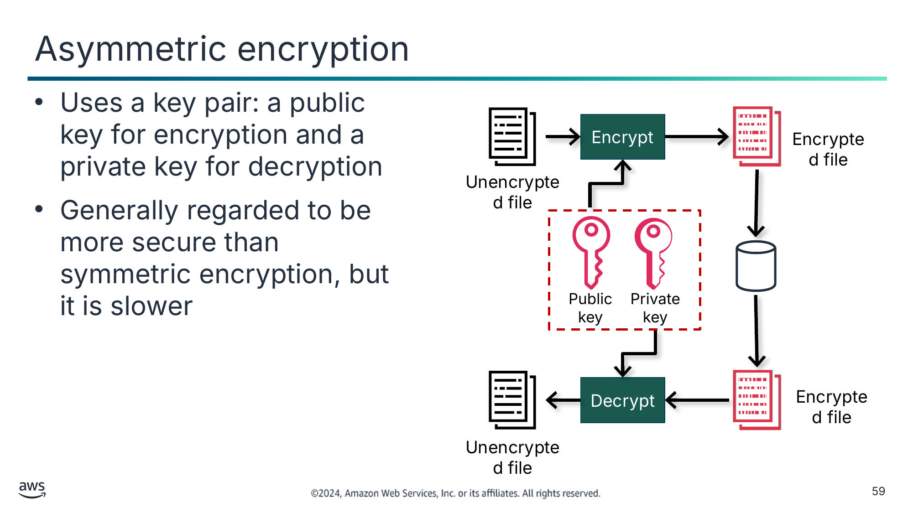

- Використовує пару ключів: відкритий ключ для шифрування та закритий ключ для розшифрування
- Загалом вважається безпечнішим за симетричне шифрування, але повільнішим

<details>
<summary>Текст зі схеми</summary>

Encrypt (Шифрування)

Encrypted file (Зашифрований файл)

Unencrypted file (Незашифрований файл)

Public key (Відкритий ключ)

Private key (Закритий ключ)

Decrypt (Розшифрування)

Encrypted file

Unencrypted file

</details>

> **Нотатки:**
>
> |Номер слайда 59  
> |Нотатки для інструктора  
> |Розгляньте схему зі студентами. Зазначте, що для шифрування та розшифрування даних використовуються різні ключі.  
> |  
> |Нотатки для студента  
> Асиметричне шифрування використовує і відкритий ключ, і закритий ключ (пару ключів) для шифрування та розшифрування даних. Кожен користувач у розмові має пару ключів. Асиметричне шифрування складніше й набагато повільніше за симетричне. Однак воно надає більше можливостей щодо способу керування ключами.  
>
> На схемі, показаній на слайді, видно, що файл шифрується відкритим ключем. Після шифрування єдиний спосіб отримати й прочитати файл — використати закритий ключ, пов’язаний із цим відкритим ключем, щоб розшифрувати повідомлення.

---

## Слайд 60: Коли використовувати асиметричне шифрування

- Якщо ви ділитеся даними за межами організації
- Якщо регуляції чи управління забороняють спільне використання ключа
- Якщо потрібна неспростовність (non-repudiation) (неспростовність не дає користувачу заперечувати попередні зобов’язання чи дії)
- Якщо ви суворо розділяєте доступ до ключів шифрування на основі ролей в організації

> **Нотатки:**
>
> |Номер слайда 60  
> |Нотатки для інструктора  
> |Розгляньте визначення асиметричного шифрування й обговоріть, коли його використовувати.  
> |  
> |Нотатки для студента  
> Асиметричне шифрування використовує пару ключів: відкритий ключ для шифрування та закритий ключ для розшифрування. Відкритим ключем можна ділитися, оскільки він не використовується для розшифрування, але доступ до закритого ключа має бути дуже обмеженим. Асиметричне шифрування загалом вважається безпечнішим за симетричне, але воно повільніше, оскільки використовує довші ключі та потребує складніших обчислень шифрування.  
>
> Асиметричне шифрування також може забезпечувати неспростовність, що означає, що відправник повідомлення не може пізніше заперечити його надсилання. Це тому, що повідомлення було зашифровано закритим ключем відправника, який можна розшифрувати лише його відкритим ключем.  
>
> Докладніше про створення та використання асиметричних ключів AWS Key Management Service (AWS KMS) див. посилання на сторінці ресурсів курсу.

---

## Слайд 61: Застосування конвертного шифрування (envelope encryption)

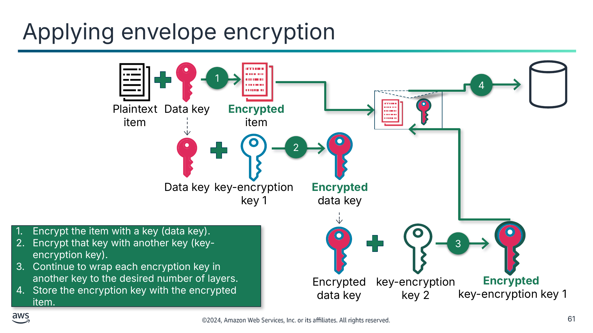

1. Зашифруйте елемент ключем (ключем даних, data key).
2. Зашифруйте цей ключ іншим ключем (ключем шифрування ключів, key-encryption key).
3. Продовжуйте обгортати кожен ключ шифрування в інший ключ до потрібної кількості рівнів.
4. Зберігайте ключ шифрування разом із зашифрованим елементом.

<details>
<summary>Текст зі схеми</summary>

1

4

Plaintext item (Елемент у відкритому вигляді)

Data key (Ключ даних)

**Encrypted** item (**Зашифрований** елемент)

2

Data key

key-encryption key 1 (ключ шифрування ключів 1)

**Encrypted** data key (**Зашифрований** ключ даних)

3

Encrypted data key

key-encryption key 2 (ключ шифрування ключів 2)

**Encrypted**  
key-encryption key 1 (**Зашифрований** ключ шифрування ключів 1)

</details>

> **Нотатки:**
>
> |Номер слайда 61  
> |Нотатки для інструктора  
> |Розгляньте визначення конвертного шифрування та коли його використовувати.  
> |  
> |Нотатки для студента  
> Розгляньте аналогію із зачиненням ваших цінностей у сейфі. Але що, якщо хтось знайде ключ від вашого сейфа? Щоб додати додатковий захист, ви можете зачинити ключ від сейфа у вашій банківській скриньці. Ви можете продовжувати додавати рівні безпеки, замикаючи кожен ключ, зменшуючи ризик того, що хтось зможе дістатися ключа, потрібного для відмикання вашого сейфа.  
>
> Конвертне шифрування — це практика шифрування ключа, яким ви зашифрували свої дані. Ви навіть можете зашифрувати ключ шифрування даних під іншим ключем шифрування, а цей ключ шифрування зашифрувати під ще одним ключем шифрування.  
>
> Докладніше про конвертне шифрування див. посилання на сторінці ресурсів курсу.

---

## Слайд 62: Методи застосування шифрування до даних у стані спокою

| Шифрування на стороні клієнта (CSE) | Серверне шифрування (SSE) |
|---|---|
| Застосунок шифрує дані перед надсиланням їх до AWS. | AWS шифрує дані від вашого імені після їх отримання. |
| Створюйте власні ключі шифрування та керуйте ними. | Сервіси прозоро шифрують ваші дані перед записом на диск і прозоро розшифровують дані, коли ви до них звертаєтеся. |
| Ключі та алгоритми відомі лише вам. | Ключами може керувати AWS. |

> **Нотатки:**
>
> |Номер слайда 62  
> |Нотатки для інструктора  
> |Розгляньте і шифрування на стороні клієнта, і серверне шифрування та обговоріть переваги кожного.  
> |  
> |Нотатки для студента  
> Залежно від ваших вимог до безпеки, для шифрування даних можна використовувати шифрування на стороні клієнта (CSE) або серверне шифрування (SSE). Підходи відрізняються тим, коли, де та хто шифрує й розшифровує дані. Підхід не обов’язково визначає, як саме шифруються дані. Крім того, підходи не є взаємовиключними — часто можна використовувати CSE і SSE для одних і тих самих даних для підвищеного профілю безпеки. Кожен підхід має переваги.  
>
> З CSE ваші застосунки шифрують дані локально перед відправленням їх до AWS і розшифровують дані після отримання з AWS. Ви створюєте власні ключі шифрування та керуєте ними. Дані зберігаються в зашифрованому вигляді, з ключами й алгоритмами, відомими лише вам.  
>
> З SSE дані шифруються в місці призначення застосунком чи сервісом, що їх отримує. Наприклад, якщо ви використовуєте SSE з Amazon Simple Storage Service (Amazon S3), сервіс шифрує ваші дані на рівні об’єктів під час запису на диски в центрах обробки даних AWS і розшифровує дані для вас, коли ви до них звертаєтеся. Процес шифрування прозорий для користувача.  
>
> AWS підтримує і CSE, і SSE. Більшість сервісів AWS, що зберігають чи обробляють дані клієнтів, пропонують варіант SSE або виконують SSE ваших даних за замовчуванням. Ці сервіси прозоро шифрують ваші дані перед записом на диск і прозоро розшифровують їх, коли ви до них звертаєтеся. Більшість сервісів AWS, що підтримують SSE, інтегровано з AWS KMS для захисту ключів шифрування, які захищають ваші дані. Про AWS KMS ви дізнаєтеся більше пізніше в цьому модулі.  
>
> Докладніше про захист даних за допомогою шифрування див. посилання на сторінці ресурсів курсу.

---

## Слайд 63: Приклад шифрування на стороні клієнта

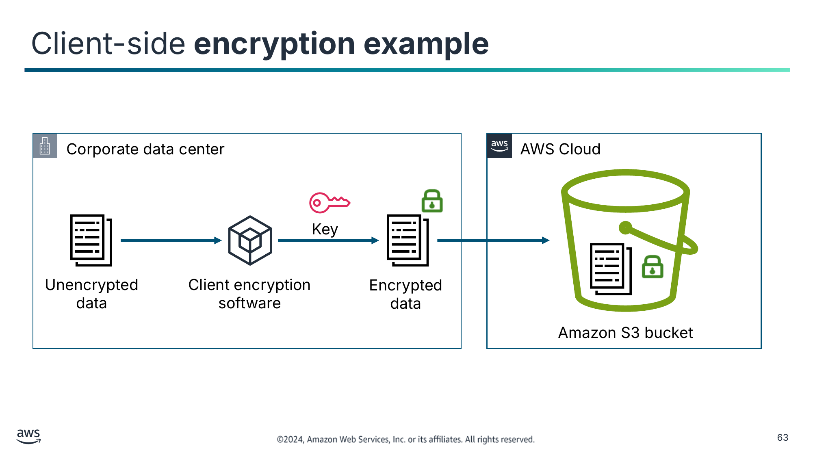

<details>
<summary>Текст зі схеми</summary>

Corporate data center (Корпоративний центр обробки даних)

AWS Cloud

Key (Ключ)

Unencrypted data (Незашифровані дані)

Client encryption

software (Клієнтське програмне забезпечення шифрування)

Encrypted

data (Зашифровані дані)

Amazon S3 bucket (Бакет Amazon S3)

</details>

> **Нотатки:**
>
> |Номер слайда 63  
> |Нотатки для інструктора  
> |Розгляньте схему зі студентами. Зазначте, що шифрування на стороні клієнта відбувається до надсилання даних до AWS.  
> |  
> |Нотатки для студента  
> Шифрування на стороні клієнта відбувається до надсилання даних до AWS, а розшифрування — після отримання даних з AWS. У цьому прикладі незашифровані дані шифруються в корпоративному центрі обробки даних, а потім Amazon S3 отримує ваші зашифровані дані, але не бере участі в їх шифруванні чи розшифруванні.  
>
> Щоб увімкнути шифрування на стороні клієнта, можна використовувати ключ, що зберігається в AWS KMS, або ключ, який ви зберігаєте у своєму застосунку.  
>
> AWS підтримує бібліотеки шифрування на стороні клієнта, як-от AWS Encryption SDK, Amazon DynamoDB Encryption Client та клієнти шифрування Amazon S3.

---

## Слайд 64: Приклад серверного шифрування

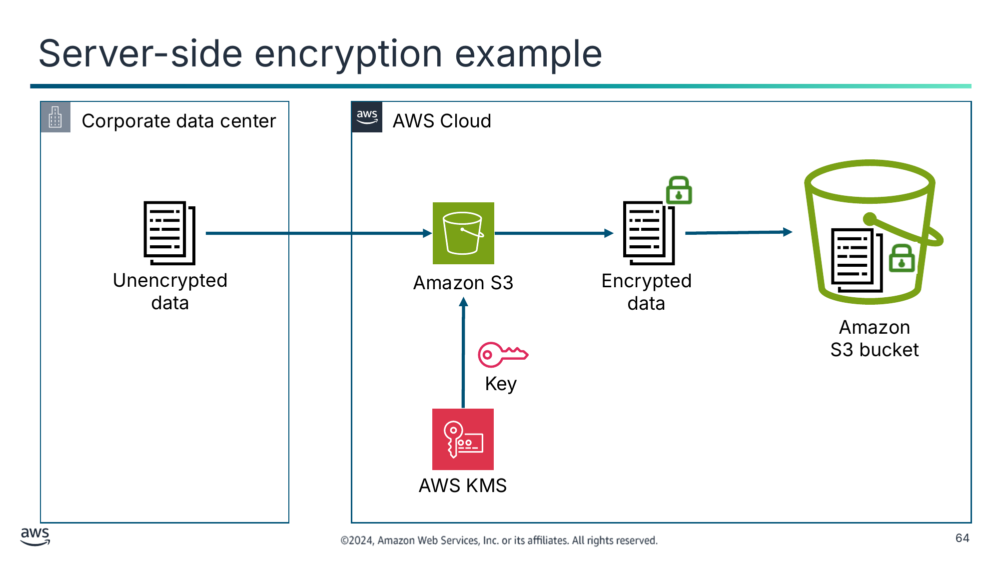

<details>
<summary>Текст зі схеми</summary>

Corporate data center (Корпоративний центр обробки даних)

AWS Cloud

Unencrypted data (Незашифровані дані)

Amazon S3

Encrypted

data (Зашифровані дані)

Amazon S3 bucket (Бакет Amazon S3)

Key (Ключ)

AWS KMS

</details>

> **Нотатки:**
>
> |Номер слайда 64  
> |Нотатки для інструктора  
> |Розгляньте схему зі студентами. Зазначте, що серверне шифрування — це шифрування даних у місці призначення застосунком чи сервісом, що їх отримує.  
> |  
> |Нотатки для студента  
> Серверне шифрування — це шифрування даних у місці призначення застосунком чи сервісом, що їх отримує.  
>
> У цьому прикладі ваші незашифровані вихідні дані надходять із систем у вашому центрі обробки даних. Ви можете завантажити ці дані через з’єднання HTTPS до Amazon S3, що шифрує дані перед збереженням їх у бакеті Amazon S3. Кінцева точка сервісу виконає процеси шифрування та керування ключами за вас.

---

## Слайд 65: AWS Key Management Service (AWS KMS)

- Надає можливість створювати криптографічні ключі й керувати ними
- Використовує апаратні модулі безпеки (HSM) для захисту ваших ключів
- Інтегрується з іншими сервісами AWS
- Надає можливість встановлювати політики використання, що визначають, які користувачі можуть використовувати ключі

AWS KMS

> **Нотатки:**
>
> |Номер слайда 65  
> |Нотатки для інструктора  
> |  
> |Нотатки для студента  
> AWS KMS — це кероване обслуговування, що надає можливість створювати ключі, які використовуються для шифрування ваших даних, і контролювати їх. Ви можете створювати ключі даних з унікальними псевдонімами й описами для кращого керування, автоматично змінювати ключі (ротація) за розкладом і вимикати чи видаляти ключі, щоб ніхто не міг ними користуватися. Також можна імпортувати власні ключі замість використання ключів, згенерованих AWS.  
>
> Сервіс використовує апаратні модулі безпеки (HSM), перевірені за стандартом FIPS 140-2, для захисту ключів. AWS KMS інтегровано з іншими сервісами AWS, щоб допомогти захищати дані, які ви зберігаєте за допомогою цих сервісів. Інтегровані сервіси AWS використовують конвертне шифрування, щоб допомогти захистити ваші ключі шифрування.  
>
> З AWS KMS ви можете централізовано керувати своїми ключами та безпечно їх зберігати. Ви можете використовувати ключі у своїх застосунках і підтримуваних хмарних сервісах AWS для захисту даних, але ключі ніколи не залишають AWS KMS. Це зменшує ризик компрометації вашого ключа даних. Ви надсилаєте дані в AWS KMS для шифрування чи розшифрування за допомогою ключів, які ви контролюєте.  
>
> Для цих ключів можна встановити політики використання, що визначають, які користувачі можуть ними користуватися. Усі запити на використання цих ключів журналюються в AWS CloudTrail, щоб ви могли зрозуміти, хто використовував який ключ і коли. CloudTrail журналює всі операції AWS KMS, зокрема операції лише на читання, операції керування ключами KMS і криптографічні операції.  
>
> Докладніше про AWS KMS див. посилання на сторінці ресурсів курсу.

---

## Слайд 66: Функції AWS KMS

Ключі

Криптографічні операції

- Керовані клієнтом (customer managed)
- Керовані KMS (KMS managed)
- Ключ даних (симетричний)
- Пара ключів даних (асиметрична)

- Encrypt
- Decrypt
- GenerateDataKey
- GenerateDataKeyPair

> **Нотатки:**
>
> |Номер слайда 66  
> |Нотатки для інструктора  
> |  
> |Нотатки для студента  
> Ключі AWS KMS — це основний ресурс в AWS KMS. Ви можете використовувати ключ AWS KMS для шифрування, розшифрування й повторного шифрування даних. Він також може генерувати ключі даних, які можна використовувати поза AWS KMS.  
>
> Важливі функції AWS KMS включають такі:  
> Керовані клієнтом (Customer managed): ключі KMS, які ви створюєте, — це ключі, керовані клієнтом. Ключі, керовані клієнтом, — це ключі KMS у вашому акаунті AWS, які ви створюєте, якими володієте й керуєте.  
> Керовані KMS (KMS managed): ключі, що належать AWS (AWS owned keys), — це набір ключів KMS, якими володіє та керує сервіс AWS для використання в кількох акаунтах AWS. Хоча ключі, що належать AWS, не перебувають у вашому акаунті AWS, сервіс AWS може використовувати ключ, що належить AWS, для захисту ресурсів у вашому акаунті. Ключі, якими керує AWS (AWS managed keys), — це ключі KMS у вашому акаунті, що створюються, керуються й використовуються від вашого імені сервісом AWS, інтегрованим з AWS KMS.  
> Ключ даних (симетричний): ключі даних — це симетричні ключі, які можна використовувати для шифрування даних, зокрема великих обсягів даних та інших ключів шифрування даних. На відміну від симетричних ключів KMS, які не можна завантажити, ключі даних повертаються вам для використання поза AWS KMS.  
> Пара ключів даних (асиметрична): в AWS KMS можна створювати асиметричні ключі KMS. Асиметричний ключ KMS представляє математично пов’язану пару відкритого та закритого ключів. Закритий ключ ніколи не залишає AWS KMS у незашифрованому вигляді.  
>
> В AWS KMS криптографічні операції — це операції API, що використовують ключі KMS для захисту даних. Оскільки ключі KMS залишаються в AWS KMS, потрібно викликати AWS KMS, щоб використати ключ KMS у криптографічній операції.  
>
> Додаткові терміни, які слід розуміти, включають такі:  
> Encrypt: шифрує відкритий текст завдовжки до 4096 байтів за допомогою ключа KMS. Можна використовувати симетричний чи асиметричний ключ KMS із KeyUsage ENCRYPT_DECRYPT. Цю операцію можна використовувати для шифрування невеликих обсягів довільних даних, як-от персональний ідентифікатор, пароль бази даних чи інша чутлива інформація.  
> Decrypt: розшифровує шифротекст, зашифрований ключем KMS за допомогою будь-якої з таких операцій: Encrypt, GenerateDataKey, GenerateDataKeyPair, GenerateDataKeyWithoutPlaintext, GenerateDataKeyPairWithoutPlaintext.  
>   
> Цю операцію можна використовувати для розшифрування шифротексту, зашифрованого симетричним ключем шифрування KMS або асиметричним ключем шифрування KMS. Коли ключ KMS асиметричний, потрібно вказати ключ KMS і алгоритм шифрування, що використовувався для шифрування шифротексту.  
>
> GenerateDataKey: повертає унікальний симетричний ключ даних для використання поза AWS KMS. Ця операція повертає копію ключа даних у відкритому вигляді та копію, зашифровану симетричним ключем шифрування KMS, який ви вкажете.  
> GenerateDataKeyPair: повертає унікальну асиметричну пару ключів даних для використання поза AWS KMS. Ця операція повертає відкритий ключ у відкритому вигляді, закритий ключ у відкритому вигляді та копію закритого ключа, зашифровану симетричним ключем шифрування KMS, який ви вкажете.  
>
> Докладніше про функції AWS KMS див. посилання на сторінці ресурсів курсу.

---

## Слайд 67: Інтеграція AWS KMS з іншими сервісами AWS

- Amazon Simple Storage Service (Amazon S3)
- Amazon Elastic Block Store (Amazon EBS)

**Важливо**

Сервіси AWS, інтегровані з AWS KMS, використовують лише симетричні ключі шифрування KMS для шифрування ваших даних. Ці сервіси не підтримують шифрування асиметричними ключами KMS.

> **Нотатки:**
>
> |Номер слайда 67  
> |Нотатки для інструктора  
> | Існує низка сервісів AWS, що інтегруються з AWS KMS. Ми докладніше розглянемо Amazon S3 та Amazon EBS, оскільки це допоможе з вправою лабораторної роботи.  
> |  
> |Нотатки для студента  
> Багато сервісів AWS використовують AWS KMS для підтримки шифрування ваших даних. Коли сервіс AWS інтегровано з AWS KMS, ви можете використовувати ключі AWS KMS у вашому акаунті для захисту даних, які сервіс отримує, зберігає чи обробляє для вас. Повний перелік сервісів AWS, інтегрованих з AWS KMS, див. за посиланням на сторінці ресурсів вмісту.  
>
> Ми докладніше розглянемо такі два сервіси.  
>
> Amazon S3 — це сервіс об’єктного сховища, що зберігає дані як об’єкти в бакетах. Бакети та об’єкти в них приватні й доступні лише якщо ви явно надасте дозволи на доступ.  
>   
> Amazon S3 інтегрується з AWS KMS для забезпечення серверного шифрування об’єктів Amazon S3. Amazon S3 використовує ключі KMS для шифрування ваших об’єктів Amazon S3. Ключі шифрування, що захищають ваші об’єкти, ніколи не залишають AWS KMS у незашифрованому вигляді. Ця інтеграція також дає змогу встановлювати дозволи для ключа KMS і перевіряти (audit) операції, що генерують, шифрують і розшифровують ключі даних, які захищають ваші секрети.  
>
> Amazon Elastic Block Store (Amazon EBS): коли ви приєднуєте зашифрований том Amazon EBS до підтримуваного типу екземпляра Amazon Elastic Compute Cloud (Amazon EC2), дані, що зберігаються в стані спокою на томі, введення-виведення диска та знімки, створені з тому, — усе зашифровано. Шифрування відбувається на серверах, що розміщують екземпляри Amazon EC2.  
>
> Ця функція підтримується для всіх типів томів Amazon EBS. Ви отримуєте доступ до зашифрованих томів так само, як до інших томів. Шифрування та розшифрування обробляються прозоро й не потребують додаткових дій від вас, вашого екземпляра EC2 чи вашого застосунку. Знімки зашифрованих томів автоматично шифруються, а томи, створені зі зашифрованих знімків, також автоматично шифруються.

---

## Слайд 68: Приклад шифрування AWS KMS з Amazon S3

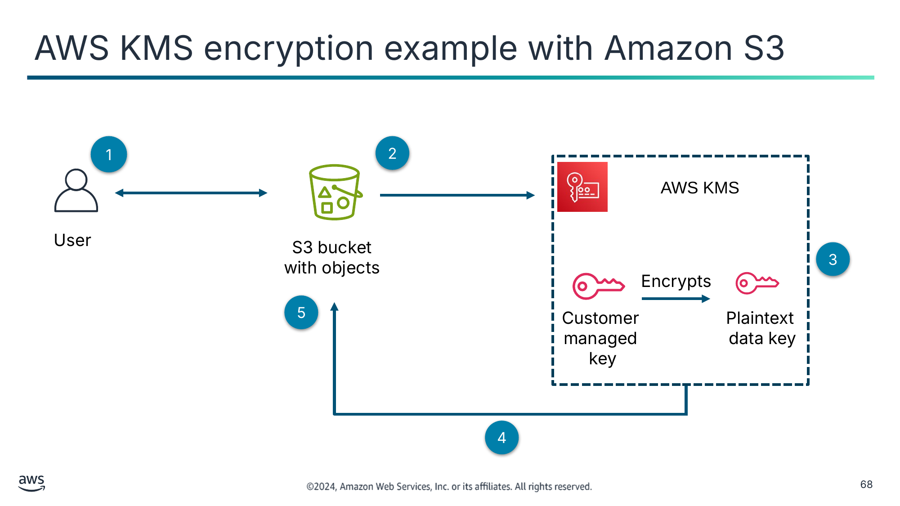

<details>
<summary>Текст зі схеми</summary>

1

2

AWS KMS

User (Користувач)

S3 bucket with objects (Бакет S3 з об’єктами)

3

Encrypts (Шифрує)

5

Customer

managed

key (Ключ, яким керує клієнт)

Plaintext

data key (Ключ даних у відкритому вигляді)

4

</details>

> **Нотатки:**
>
> |Номер слайда 68  
> |Нотатки для інструктора  
> |Розгляньте кожен крок прикладу шифрування AWS KMS з Amazon S3.  
> |  
> |Нотатки для студента  
> У цьому сценарії AWS KMS використовується для шифрування даних у стані спокою (SSE-KMS). Користувач створює ключ KMS і використовує його для шифрування об’єктів, що зберігаються в Amazon S3.  
>
> Ця схема пояснює, як відбувається шифрування під час завантаження файлу в Amazon S3.  
> Ви надсилаєте запит на завантаження файлу та збереження його як зашифрованого об’єкта в бакеті S3.  
> Amazon S3 запитує в AWS KMS ключ даних для шифрування файлу.  
> AWS KMS генерує ключ даних у відкритому вигляді та шифрує ключ даних за допомогою ключа, яким керує клієнт. Ключі даних використовуються для локального шифрування даних у сервісі AWS чи вашому застосунку.  
> AWS KMS надсилає обидві копії ключа даних в Amazon S3.  
> Amazon S3 шифрує об’єкт за допомогою ключа даних у відкритому вигляді, зберігає об’єкт, а потім видаляє ключ даних у відкритому вигляді. Зашифрований ключ зберігається в метаданих об’єкта.

---

## Слайд 69: Приклад розшифрування AWS KMS з Amazon S3

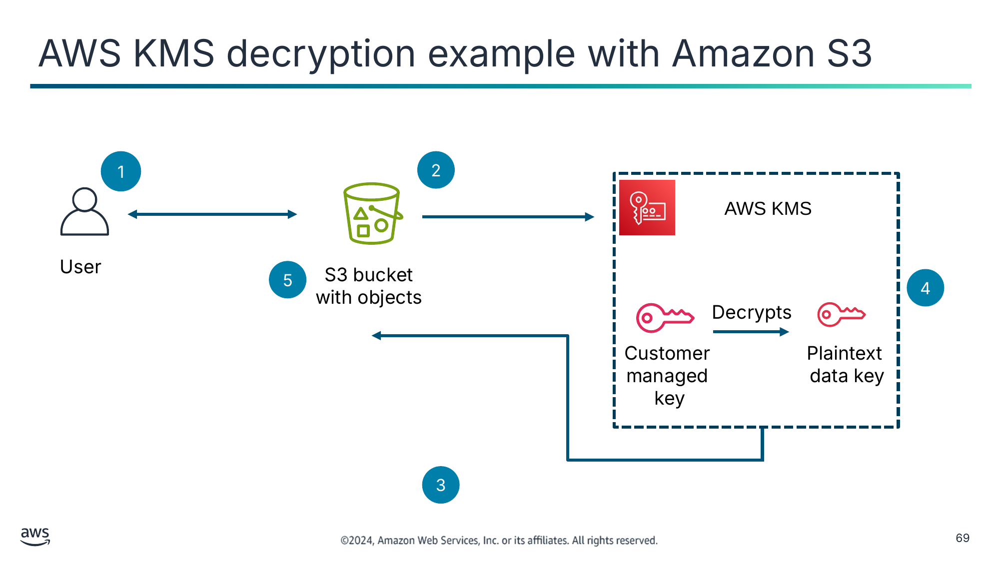

<details>
<summary>Текст зі схеми</summary>

1

2

AWS KMS

User (Користувач)

5

S3 bucket with objects (Бакет S3 з об’єктами)

Decrypts (Розшифровує)

Customer

managed

key (Ключ, яким керує клієнт)

Plaintext

data key (Ключ даних у відкритому вигляді)

3

4

</details>

> **Нотатки:**
>
> |Номер слайда 69  
> |Нотатки для інструктора  
> |Розгляньте кожен крок прикладу розшифрування AWS KMS з Amazon S3.  
> |  
> |Нотатки для студента  
> Тепер ця схема пояснює, що відбувається в тому самому сценарії (SSE-KMS), коли користувач запитує відкрити зашифрований об’єкт, що зберігається в Amazon S3.  
> Ви запитуєте відкриття об’єкта.  
> Amazon S3 надсилає зашифрований ключ даних в AWS KMS у запиті на розшифрування.  
> AWS KMS розшифровує ключ даних за допомогою ключа, яким керує клієнт (який ніколи не залишає сервіс AWS KMS).  
> AWS KMS надсилає ключ даних у відкритому вигляді назад в Amazon S3.  
> Нарешті, Amazon S3 розшифровує шифротекст об’єкта даних, дозволяє вам відкрити об’єкт і видаляє копію ключа даних у відкритому вигляді.

---

## Слайд 70: Приклад AWS KMS з Amazon EBS

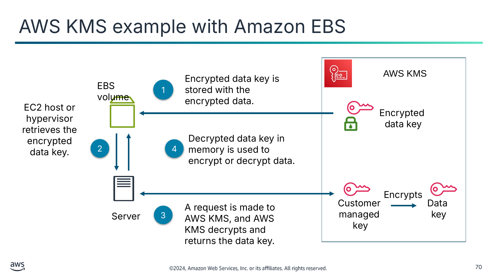

<details>
<summary>Текст зі схеми</summary>

Encrypted data key is stored with the encrypted data. (Зашифрований ключ даних зберігається разом із зашифрованими даними.)

AWS KMS

EBS volume (Том EBS)

1

EC2 host or hypervisor retrieves the encrypted data key. (Хост EC2 або гіпервізор отримує зашифрований ключ даних.)

Encrypted  
data key (Зашифрований ключ даних)

Decrypted data key in memory is used to encrypt or decrypt data. (Розшифрований ключ даних у пам’яті використовується для шифрування чи розшифрування даних.)

2

4

Encrypts (Шифрує)

A request is made to AWS KMS, and AWS KMS decrypts and returns the data key. (Виконується запит до AWS KMS, і AWS KMS розшифровує та повертає ключ даних.)

Customer

managed

key (Ключ, яким керує клієнт)

Data

key (Ключ даних)

Server (Сервер)

3

</details>

> **Нотатки:**
>
> |Номер слайда 70  
> |Нотатки для інструктора  
> |Розгляньте кожен крок прикладу AWS KMS з Amazon EBS.  
> |  
> |Нотатки для студента  
> Шифрування Amazon EBS — це зрозуміле рішення для шифрування ресурсів EBS, пов’язаних з вашими екземплярами EC2. З шифруванням Amazon EBS вам не потрібно будувати, підтримувати й захищати власну інфраструктуру керування ключами.  
>
> Шифрування Amazon EBS використовує ключі KMS під час створення зашифрованих томів і знімків. Кожен том шифрується за допомогою AES-256-XTS. Для цього потрібні два 256-бітні ключі, які можна розглядати як один 512-бітний ключ. Ключ даних шифрується ключем KMS у вашому акаунті. Щоб Amazon EBS міг зашифрувати том для вас, він повинен мати доступ до ключа, яким керує клієнт, в акаунті. Це робиться шляхом надання Amazon EBS гранту (grant) на ключ, яким керує клієнт, щоб створювати ключі даних та шифрувати й розшифровувати ці ключі даних.  
>
> Нижче наведено основні кроки шифрування та розшифрування даних тому EBS:  
> Amazon EBS отримує зашифрований ключ даних під ключем, яким керує клієнт, через AWS KMS і зберігає зашифрований ключ разом із зашифрованими даними.  
> Сервери, що розміщують екземпляри EC2, отримують зашифрований ключ даних зі сховища.  
> Виконується виклик AWS KMS через TLS для розшифрування зашифрованого ключа даних. AWS KMS визначає ключ KMS, робить внутрішній запит до HSM у парку, щоб розшифрувати ключ даних, і повертає ключ клієнтові через сеанс TLS.  
> Розшифрований ключ даних зберігається в пам’яті й використовується для шифрування та розшифрування всіх даних, що надходять до приєднаного тому EBS і з нього. Amazon EBS зберігає зашифрований ключ даних для подальшого використання на випадок, якщо ключ даних у пам’яті більше недоступний.  
>
> Advanced Encryption Standard (AES) — це алгоритм, встановлений Національним інститутом стандартів і технологій США (NIST), що використовує симетричне шифрування.

---

## Слайд 71: Ключові висновки: шифрування даних у стані спокою

- Шифрування даних у стані спокою ускладнює зловмисникам компрометацію даних, навіть якщо вони можуть скомпрометувати кінцеву точку.
- Симетричне шифрування використовує той самий ключ для шифрування та розшифрування даних.
- Асиметричне шифрування використовує пару ключів: відкритий ключ для шифрування та закритий ключ для розшифрування.
- Конвертне шифрування — це практика шифрування даних у відкритому вигляді ключем даних, а потім шифрування ключа даних іншим ключем.
- З CSE ваші застосунки шифрують дані локально перед відправленням їх до AWS і розшифровують дані після отримання з AWS.
- З SSE дані шифруються в місці призначення застосунком чи сервісом, що їх отримує.
- Ключі AWS KMS — це основний ресурс в AWS KMS. Використовуйте ключ AWS KMS для шифрування, розшифрування й повторного шифрування даних.

> **Нотатки:**
>
> |Номер слайда 71  
> |Нотатки для інструктора  
> |  
> |Нотатки для студента  
> Ось кілька ключових моментів, що підсумовують цей розділ.

---

## Слайд 72: Покрокова лабораторна робота: шифрування даних у стані спокою за допомогою варіантів шифрування AWS (Encrypting Data at Rest by Using AWS Encryption Options, AWS KMS lab)

> **Нотатки:**
>
> |Номер слайда 72  
> |Нотатки для інструктора  
> |  
> |Нотатки для студента  
> Зараз ви виконаєте лабораторну роботу. Наступний слайд підсумовує, що ви робитимете в лабораторній роботі, а докладні інструкції ви знайдете в лабораторному середовищі.

---

## Слайд 73: Вступ до лабораторної роботи «AWS KMS»

- У цій лабораторній роботі ви використовуєте AWS Key Management Service (AWS KMS) для шифрування даних у стані спокою.
- Завдання, які ви виконуєте, включають такі:
  - Створення ключа AWS KMS
  - Шифрування об’єкта, що зберігається в Amazon Simple Storage Service (Amazon S3)
  - Шифрування тому Amazon Elastic Block Store (Amazon EBS)
  - Аудит використання ключа AWS KMS за допомогою AWS CloudTrail
- Відкрийте ваше лабораторне середовище, щоб розпочати лабораторну роботу та дізнатися додаткові подробиці про завдання, які ви виконуватимете.


> **Нотатки:**
>
> |Номер слайда 73  
> |Нотатки для інструктора  
> |<Add directions to find the lab guide information.>  
> |  
> |Нотатки для студента  
> Отримайте доступ до лабораторного середовища через ваш онлайн-курс, щоб дізнатися додаткові подробиці та виконати лабораторну роботу.

---

## Слайд 74: Підсумки лабораторної роботи «AWS KMS»

- У цій лабораторній роботі ви створили ключ AWS KMS. Які відмінності між адміністратором ключа та користувачем ключа?
- Чому було потрібно від’єднати зашифрований том EBS від екземпляра, щоб побачити, як вимкнення ключа AWS KMS вплине на том?

> **Нотатки:**
>
> |Номер слайда 74  
> |Нотатки для інструктора  
> |Відповідні архітектурні схеми «до» та «після» включено до інструкцій кожної лабораторної роботи. Вам може бути корисно відкрити схеми лабораторної роботи під час підбиття підсумків цієї лабораторної роботи.  
> |  
> |Проведіть із класом розмову про ключові висновки з лабораторної роботи. Використайте подробиці з попереднього розділу, щоб допомогти підбити підсумки лабораторної роботи зі студентами після її завершення. Підбиття підсумків лабораторної роботи наполегливо рекомендується. Воно допомагає студентам встановити зв’язки між їхнім практичним досвідом і концепціями, які ви обговорювали в лекції перед цією лабораторною роботою.  
> |Під час підбиття підсумків можна поставити студентам запитання, показані на цьому слайді. Ось відповіді:  
> |  
> |Яке значення має використання симетричного ключа під час шифрування й розшифрування об’єкта?  
> |З симетричним ключем ви використовуєте той самий ключ для шифрування й розшифрування об’єкта.  
> |Які типи активності AWS KMS ви перевіряли (audit) за допомогою AWS CloudTrail?  
> |Ви перевіряли генерування ключа (подія GenerateDataKey) і розшифрування об’єкта S3 (подія Decrypt) у журналі історії подій AWS CloudTrail.  
> |Який тип проміжного артефакта вам потрібно було створити під час шифрування кореневого тому EBS екземпляра EC2?  
> |Вам довелося створити знімок незашифрованого кореневого тому, який ви потім використали для створення зашифрованого тому.  
> |  
> |Запропоновані відповіді на запитання 1: у цій лабораторній роботі ви створили ключ AWS KMS. Які відмінності між адміністратором ключа та користувачем ключа? Адміністратори ключа — це користувачі чи ролі, що керують доступом до ключа шифрування.  
> |Користувачі ключа — це користувачі чи ролі, що можуть використовувати ключ для шифрування та розшифрування даних.  
> |Адміністратори ключа мають дозволи на керування ключем AWS KMS, але не мають дозволів за замовчуванням на використання ключа AWS KMS для шифрування та розшифрування даних. Однак адміністратор ключа може внести себе до списку користувачів ключа. У такому разі він |може використовувати ключ для шифрування та розшифрування даних. Користувач ключа не може надавати іншим користувачам дозволів на використання ключа, якщо користувач ключа випадково не є також адміністратором ключа.  
> |  
> |Запропоновані відповіді на запитання 2: чому було потрібно від’єднати зашифрований том EBS від екземпляра, щоб побачити, як вимкнення ключа AWS KMS вплине на том?  
> |Зашифрований ключ даних зберігається в пам’яті й використовується для шифрування та розшифрування всіх даних, що надходять до приєднаного тому EBS і з нього. Amazon EBS зберігає зашифрований ключ даних для подальшого використання на випадок, якщо ключ даних у пам’яті більше недоступний.  
> |  
> |Нотатки для студента  
> Ваш інструктор може розглянути ці запитання з вами, або ви можете розглянути їх самостійно. Скористайтеся цією нагодою, щоб поглибити своє мислення щодо завдань, які ви виконували під час лабораторної роботи.

---

## Слайд 75: Сервіси безпеки AWS для захисту доступу користувачів, застосунків і даних

Захист доступу користувачів, застосунків і даних

> **Нотатки:**
>
> |Номер слайда 75  
> |Нотатки для інструктора  
> |  
> |Нотатки для студента  
> Цей розділ виділяє додаткові приклади сервісів безпеки, призначених для покращення вашої здатності дотримуватися найкращих практик безпеки та захищати всі рівні ваших застосунків.

---

## Слайд 76: Сервіси AWS для безпеки, ідентичності та відповідності вимогам

| Категорія (Category) | Опис категорії (Category description) | Приклади (Examples) |
|---|---|---|
| Керування ідентичністю та доступом | Безпечно керуйте ідентичностями, ресурсами та дозволами у великому масштабі. | • AWS Identity and Access Management (IAM)<br>• AWS IAM Identity Center<br>• Amazon Cognito<br>• AWS Organizations |
| Виявлення та реагування | Покращуйте стан безпеки (security posture) і спрощуйте операції безпеки в усьому середовищі AWS. | • AWS CloudTrail<br>• Amazon Detective<br>• Amazon Inspector<br>• AWS Security Hub |
| Захист мережі та застосунків | Застосовуйте детальні політики безпеки в точках мережевого контролю в усій організації. | • AWS Network Firewall<br>• AWS Shield<br>• AWS WAF |
| Захист даних | Захищайте дані, акаунти та робочі навантаження від неавторизованого доступу. | • AWS Key Management System (AWS KMS)<br>• AWS Secrets Manager<br>• Amazon Macie |
| Відповідність вимогам | Отримуйте комплексний вигляд статусу відповідності та безперервно відстежуйте за допомогою автоматизованих перевірок на основі найкращих практик AWS і галузевих стандартів. | • AWS Artifact<br>• AWS Audit Manager |

Повний перелік і посилання на сторінки сервісів: [https://aws.amazon.com/products/security/](https://aws.amazon.com/products/security/)

> **Нотатки:**
>
> |Номер слайда 76  
> |Нотатки для інструктора  
> |  
> |Нотатки для студента  
> AWS має набір сервісів, спеціально розроблених, щоб допомогти вам розв’язувати питання безпеки у вашій хмарній інфраструктурі. Цей слайд показує категорії сервісів і перелічує приклади, про деякі з яких ви дізналися в цьому курсі. Докладніший опис кожної категорії та посилання, що ведуть глибше в кожну категорію й окремий сервіс, див. «Security, Identity, and Compliance on AWS» у ресурсах вашого курсу.  
>
> Попередні розділи цього модуля розглядали багато сервісів керування ідентичністю та доступом, що підтримують захист доступу, а попередній розділ розповідав про сервіси, що підтримують захист даних у стані спокою. Наступні слайди описують кілька додаткових сервісів як приклади типів функцій, доступних під час проєктування безпеки вашого застосунку.

---

## Слайд 77: Приклади: сервіси безпеки AWS для глибокоешелонованого захисту (defense in depth)

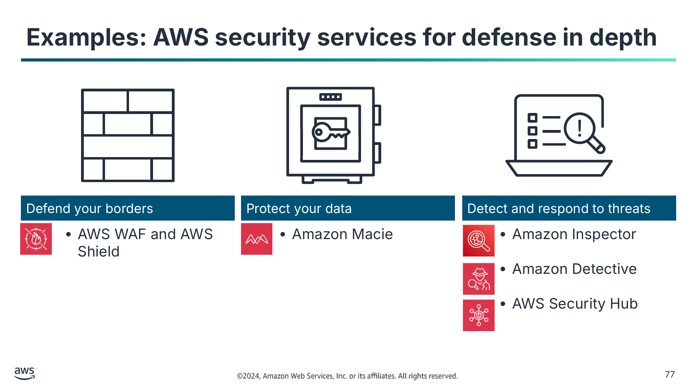

Захищайте свої межі

Захищайте свої дані

Виявляйте загрози та реагуйте на них

- AWS WAF і AWS Shield

- Amazon Macie

- Amazon Inspector
- Amazon Detective
- AWS Security Hub

> **Нотатки:**
>
> |Номер слайда 77  
> |Нотатки для інструктора  
> |  
> |Нотатки для студента  
> Ключова частина опори безпеки AWS Well-Architected — застосування безпеки на всіх рівнях і впровадження підходу глибокоешелонованого захисту. Обмеження доступу — один важливий рівень, про який ви дізналися в цьому модулі. Додаткові рівні безпеки включають недопущення небажаного трафіку, додавання додаткових механізмів захисту даних (наприклад, для захисту чутливих і персональних ідентифікаційних даних) та автоматизацію вашої здатності виявляти вразливості й події безпеки та реагувати на них. Сервіси безпеки AWS зменшують тягар написання коду для обробки цих рівнів безпеки.  
>
> Наступні кілька слайдів розглядають ці сервіси докладніше.

---

## Слайд 78: AWS WAF

Опис

Функції

Приклади сценаріїв використання

- Брандмауер вебзастосунків, що дає змогу відстежувати запити HTTP і HTTPS, які пересилаються до ресурсів вашого захищеного вебзастосунку

- Використовуйте кероване або власні правила.
- Дозволяйте чи блокуйте запити на основі таких речей, як IP-адреса, країна походження чи значення заголовків.
- Використовуйте AWS Shield (включено без додаткової плати), щоб допомогти мінімізувати вплив розподілених атак «відмова в обслуговуванні» (DDoS).

- Блокуйте запити, у яких відсутній заголовок HTTP User-Agent.
- Виявляйте зловмисні спроби створення акаунтів на сторінці реєстрації застосунку й керуйте ними.

> **Нотатки:**
>
> |Номер слайда 78  
> |Нотатки для інструктора  
> |  
> |Нотатки для студента  
> AWS WAF — це брандмауер вебзастосунків, що дає змогу відстежувати запити HTTP і HTTPS, які пересилаються до ресурсів вашого захищеного вебзастосунку.  
>
> AWS Shield забезпечує захист від розподілених атак «відмова в обслуговуванні» (DDoS) для ресурсів AWS на мережевому та транспортному рівнях (рівні 3 і 4) і рівні застосунку (рівень 7).  
>
> Докладніше про AWS WAF, AWS Shield та AWS Firewall Manager див. посилання на сторінці ресурсів курсу.

---

## Слайд 79: Amazon Macie

Опис

Функції

Приклад сценарію використання

- Сервіс безпеки даних, що за допомогою машинного навчання та зіставлення зі зразками виявляє чутливі дані, збережені в Amazon Simple Storage Service (Amazon S3), забезпечує видимість ризиків безпеки даних і дає змогу автоматично захищатися від цих ризиків

- Виконуйте автоматизоване виявлення чутливих даних.
- Створюйте та запускайте завдання виявлення чутливих даних.
- Використовуйте вбудовані або користувацькі ідентифікатори даних.
- Переглядайте, аналізуйте результати (findings) та керуйте ними.

- Використовуйте Macie, щоб виявляти чутливі дані, які мігрують в Amazon S3. Сповістіть адміністратора, щоб переглянути дані й вирішити, чи дозволяти процесу продовжувати розміщення об’єктів в Amazon S3.

> **Нотатки:**
>
> |Номер слайда 79  
> |Нотатки для інструктора  
> |  
> |Нотатки для студента  
> Amazon Macie — це сервіс захисту даних, що використовує машинне навчання.  
>
> Amazon Macie — це сервіс безпеки, що використовує машинне навчання для автоматичного виявлення, класифікації та захисту чутливих даних в AWS. Macie розпізнає персональні ідентифікаційні дані (PII), як-от номери паспортів, номери медичних посвідчень і податкові ідентифікаційні номери. Macie також розпізнає фінансову інформацію, ключі шифрування та облікові дані. Також Macie дає змогу додавати користувацькі визначені типи даних за допомогою регулярних виразів, щоб Macie міг виявляти пропрієтарні чи унікальні чутливі дані вашого бізнесу.  
>
> Наразі Macie захищає лише дані, що зберігаються в Amazon Simple Storage Service (Amazon S3), і доступний у більшості регіонів AWS. Macie має панелі та сповіщення, що дають прозорість доступу до даних, аналізуючи політики на основі ресурсів Amazon S3 та списки контролю доступу (ACL) під час відновлення чутливих даних. Сервіс безперервно відстежує дані та генерує детальні сповіщення, коли виявляє ризик неавторизованого доступу чи ненавмисного витоку даних.  
>
> З Macie ви маєте повний контроль над сервісом через набір API Macie і можете централізовано керувати Macie для кількох акаунтів. Macie інтегрується з AWS Organizations, що означає, що ви можете керувати до 5000 акаунтів Macie для однієї організації AWS. Ви також можете й надалі використовувати вбудовані функції Macie для керування кількома акаунтами, що дає змогу керувати до 1000 акаунтів-членів за допомогою єдиного акаунта адміністратора Macie.  
>
> Докладніше про Amazon Macie див. посилання на сторінці ресурсів курсу.

---

## Слайд 80: Amazon Inspector

Опис

Функції

Приклад сценарію використання

- Сервіс керування вразливостями, що безперервно сканує ваші робочі навантаження AWS на вразливості програмного забезпечення та ненавмисну мережеву вразливість до впливу
- Виявляє та сканує працюючі екземпляри Amazon Elastic Compute Cloud (Amazon EC2), образи контейнерів в Amazon Elastic Container Registry (Amazon ECR) і функції AWS Lambda

- Керуйте своїм середовищем централізовано через єдиний акаунт за допомогою AWS Organizations.
- Точно оцінюйте вразливості за допомогою оцінки ризику Amazon Inspector (Risk score).
- Визначайте результати з високим впливом за допомогою панелі Amazon Inspector.
- Публікуйте результати в Amazon EventBridge для підтримки інтеграції з іншими сервісами.

- Скануйте образи Amazon Machine Images (AMI) EC2 і генеруйте звіти про результати Amazon Inspector, щоб допомогти гарантувати, що ваші AMI скановано на відомі вразливості й оновлено до розгортання.

> **Нотатки:**
>
> |Номер слайда 5  
> |Нотатки для інструктора  
> |  
> |Нотатки для студента  
> Один із популярніших сервісів виявлення — Amazon Inspector.  
>
> Amazon Inspector — це сервіс керування вразливостями, що безперервно сканує ваші робочі навантаження AWS на вразливості. Amazon Inspector автоматично виявляє та сканує екземпляри Amazon Elastic Compute Cloud (Amazon EC2) і образи контейнерів, що розміщені в Amazon Elastic Container Registry (Amazon ECR), на вразливості програмного забезпечення та ненавмисну мережеву вразливість до впливу.  
>
> Коли Amazon Inspector виявляє вразливість програмного забезпечення чи мережеву проблему, сервіс створює результат (finding). Результат описує вразливість, визначає постраждалий ресурс, оцінює серйозність вразливості та надає вказівки щодо усунення.  
>
> Докладніше про Amazon Inspector див. посилання на сторінці ресурсів курсу.

---

## Слайд 81: Amazon Detective

Опис

Функції

Приклад сценарію використання

- Допомагає аналізувати, розслідувати й швидко визначати першопричину результатів безпеки чи підозрілої активності
- Автоматично збирає дані журналів з ресурсів AWS і використовує машинне навчання, статистичний аналіз і теорію графів для генерування візуалізацій, що підтримують швидші та ефективніші розслідування безпеки

- Переглядайте дані, організовані у попередньо побудовану графову модель із зв’язками, пов’язаними з безпекою. Модель підсумовує контекстні й поведінкові висновки.
- Швидко перевіряйте, порівнюйте та корелюйте дані, щоб дійти висновків.
- Автоматично приймайте й обробляйте відповідні дані з усіх ввімкнених акаунтів.

- Сортуйте (triage) потенційну проблему, знаходячи всю активність, пов’язану з певною сутністю IAM.

> **Нотатки:**
>
> |Номер слайда 81  
> |Нотатки для інструктора  
> |  
> |Нотатки для студента  
> Amazon Detective належить до категорії реагування на інциденти.  
>
> Detective допомагає аналізувати, розслідувати й швидко визначати першопричину результатів безпеки чи підозрілої активності. Detective автоматично збирає дані журналів з ваших ресурсів AWS. Потім він використовує машинне навчання, статистичний аналіз і теорію графів для генерування візуалізацій, що допомагають проводити швидші й ефективніші розслідування безпеки. Попередньо побудовані агрегації даних, підсумки та контекст Detective допомагають швидко аналізувати й визначати природу та обсяг можливих проблем безпеки.  
>
> З Detective ви можете отримати доступ до даних про історичні події за рік. Ці дані доступні через набір візуалізацій, що показують зміни в типі та обсязі активності протягом вибраного часового вікна. Detective пов’язує ці зміни з результатами GuardDuty.  
>
> Докладніше про Detective див. посилання на сторінці ресурсів курсу.

---

## Слайд 82: AWS Security Hub

Опис

Функції

Приклад сценарію використання

- Збирає дані безпеки з акаунтів AWS, сервісів AWS і підтримуваних продуктів сторонніх постачальників
- Допомагає аналізувати тенденції безпеки та визначати проблеми безпеки з найвищим пріоритетом

- Підтримує кілька стандартів безпеки, зокрема AWS Foundational Security Best Practices (FSBP) і зовнішні фреймворки відповідності
- Отримує результати від інших сервісів AWS, зокрема Amazon Macie та Amazon Inspector
- Використовує правила автоматизації для автоматичного оновлення критичних результатів, коли перевірка безпеки не проходить

- Краще визначайте пріоритети зусиль команд безпеки з реагування та усунення, шукаючи, корелюючи й агрегуючи різноманітні результати безпеки за акаунтами та ресурсами.

> **Нотатки:**
>
> |Номер слайда 82  
> |Нотатки для інструктора  
> |Використовуйте AWS Security Hub для автоматизації перевірок найкращих практик безпеки, агрегування сповіщень безпеки в одному місці й форматі та розуміння вашого загального стану безпеки (security posture) у всіх ваших акаунтах AWS.  
> |  
> |Нотатки для студента  
> AWS Security Hub — чудове місце для початку, коли обговорюються сервіси AWS для безпеки, ідентичності та відповідності вимогам.  
>
> Security Hub — це сервіс, що допомагає відстежувати стан безпеки вашої хмари за допомогою автоматизованих безперервних перевірок найкращих практик безпеки для ваших ресурсів AWS. Security Hub агрегує сповіщення безпеки з різних сервісів AWS і продуктів сторонніх партнерів та подає їх у стандартизованому форматі, що полегшує вам реагування на сповіщення. Також можна використовувати Security Hub для створення автоматизованих робочих процесів реагування, усунення та збагачення (enrichment), скориставшись інтеграцією Security Hub з EventBridge. Security Hub надає оцінку безпеки для кожного ввімкненого стандарту та загальну оцінку для всіх акаунтів, пов’язаних з вашим акаунтом адміністратора. Ця інформація може допомогти вам відстежувати ваш загальний стан безпеки.  
>
> Докладніше про Security Hub див. посилання на сторінці ресурсів курсу.

---

## Слайд 83: Використання AWS Security Hub з AWS Trusted Advisor

- Він надає рекомендації на основі п’яти категорій найкращих практик AWS: оптимізація витрат, безпека, відмовостійкість, ліміти сервісів і покращення продуктивності.
- Він оцінює ваш акаунт, щоб запропонувати покращення та оптимізації для ваших ресурсів.
- Отримуйте доступ до Trusted Advisor через AWS Management Console; він доступний для всіх рівнів підтримки.
- Після ввімкнення Security Hub для вашого акаунта AWS переглядайте свої засоби контролю безпеки та результати в консолі Trusted Advisor.

Trusted Advisor

> **Нотатки:**
>
> |Номер слайда 83  
> |Нотатки для інструктора  
> |  
> |Нотатки для студента  
> AWS Trusted Advisor не є специфічним для безпеки, але він надає рекомендації з безпеки як частину своїх даних. AWS Trusted Advisor — це сервіс, що надає рекомендації, які допомагають дотримуватися найкращих практик AWS.  
>
> Ці найкращі практики були засвоєні під час обслуговування сотень тисяч клієнтів AWS. Trusted Advisor оцінює ваш акаунт за допомогою перевірок, що ґрунтуються на п’яти категоріях найкращих практик AWS. Перевірки визначають способи оптимізувати вашу інфраструктуру AWS, покращити безпеку та продуктивність, знизити витрати й відстежувати квоти сервісів.  
>
> Припустімо, ви адміністратор акаунта AWS вашої організації. Ви шукаєте способи оптимізувати ресурси акаунта й покращити загальний стан безпеки (security posture), але час, потрібний для цього вручну, був би непомірним. Trusted Advisor може автоматизувати цей процес, надаючи вам рекомендації щодо дій, які можна вжити для покращення цих областей. Потім ви можете дотримуватися рекомендацій, щоб оптимізувати свої ресурси й стан безпеки.  
>
> Trusted Advisor доступний в усіх планах AWS Support. Клієнти AWS Basic Support та AWS Developer Support можуть отримати доступ до основних перевірок безпеки та всіх перевірок квот сервісів. Клієнти AWS Business Support та AWS Enterprise Support можуть отримати доступ до всіх перевірок, зокрема оптимізації витрат, безпеки, відмовостійкості, продуктивності й квот сервісів.  
>
> Докладніше про Trusted Advisor див. посилання на сторінці ресурсів курсу.

---

## Слайд 84: Ключові висновки: сервіси безпеки AWS

- Сервіси безпеки AWS допомагають впровадити стратегію глибокоешелонованого захисту (defense in depth) для ваших робочих навантажень AWS.
- Приклади сервісів безпеки включають такі:
  - AWS WAF для відстеження вебзапитів
  - Amazon Macie для виявлення чутливих даних в Amazon S3
  - Amazon Inspector для виявлення вразливостей на екземплярах EC2, у контейнерах і функціях AWS Lambda
  - Amazon Detective для аналізу, розслідування та швидкого визначення першопричини результатів безпеки чи підозрілої активності
  - AWS Security Hub для автоматичної консолідації результатів і допомоги в моніторингу стану безпеки вашої хмари відносно найкращих практик
- AWS Trusted Advisor перевіряє ваше середовище AWS, а потім надає рекомендації, коли є можливості допомогти закрити прогалини в безпеці. Рекомендації AWS Security Hub включено до Trusted Advisor.

> **Нотатки:**
>
> |Номер слайда 84  
> |Нотатки для інструктора  
> |  
> |Нотатки для студента  
> Ці ключові висновки підсумовують цей розділ.

---

## Слайд 85: Підсумки модуля

Захист доступу користувачів, застосунків і даних

> **Нотатки:**
>
> |Номер слайда 85  
> |Нотатки для інструктора  
> |  
> |Нотатки для студента  
> Цей розділ підсумовує те, що ви дізналися, і завершує модуль.

---

## Слайд 86: Резюме модуля

Цей модуль підготував вас до такого:

- Використовувати користувачів, групи та ролі AWS Identity and Access Management (IAM) для керування дозволами.
- Впроваджувати федерацію користувачів в архітектурі для підвищення безпеки.
- Описувати, як керувати кількома акаунтами AWS.
- Розпізнавати, як політики контролю служб (SCP) AWS Organizations підвищують безпеку в архітектурі.
- Шифрувати дані в стані спокою за допомогою AWS Key Management Service (AWS KMS).
- Визначати відповідні сервіси безпеки AWS на основі заданого сценарію використання.

> **Нотатки:**
>
> |Номер слайда 86  
> |Нотатки для інструктора  
> |  
> |Нотатки для студента

---

## Слайд 87: Перевірка знань модуля

- Перевірка знань проводиться онлайн у вашому курсі.
- Перевірка знань включає 10 запитань на основі матеріалу, поданого на слайдах і в нотатках до слайдів.
- Ви можете повторно проходити перевірку знань стільки разів, скільки захочете.

> **Нотатки:**
>
> |Номер слайда 87  
> |Нотатки для інструктора  
> |  
> |Нотатки для студента  
> Скористайтеся своїм онлайн-курсом, щоб отримати доступ до перевірки знань для цього модуля.

---

## Слайд 88: Зразок запитання іспиту

Компанія має два окремі акаунти AWS для тестування робочих навантажень: один для тестування продуктивності, інший — для інтеграційного тестування. Акаунти згруповано в організаційну одиницю AWS Organizations, і в кожному акаунті визначено роль Tester. Компанія хоче примусово застосувати такі правила безпеки до користувачів із роллю Tester (тестувальників) в обох акаунтах:

- Тестувальники можуть отримувати доступ лише до сервісів Amazon EC2 та Amazon RDS.
- Тестувальники можуть лише запускати й зупиняти екземпляри EC2.
- Тестувальники мають дозволи на читання та запис до баз даних RDS.

Які завдання потрібно виконати системному адміністратору, щоб упровадити ці вимоги? (Оберіть ДВА варіанти.)

Визначте ключові слова та фрази, перш ніж продовжувати.

Ось ключові слова та фрази:

- Акаунти згруповано в організаційну одиницю AWS Organizations.
- Кожен акаунт має роль Tester.
- Примусово застосувати такі правила безпеки до користувачів із роллю Tester (тестувальників) в обох акаунтах.
- Тестувальники можуть отримувати доступ лише до сервісів Amazon EC2 та Amazon RDS.

> **Нотатки:**
>
> |Номер слайда 88  
> |Нотатки для інструктора  
> |Розділ із ключовими словами налаштовано з анімацією для розкриття за клацанням.  
> |  
> |Нотатки для студента

---

## Слайд 89: Зразок запитання іспиту: варіанти відповідей

Компанія має два окремі акаунти AWS для тестування робочих навантажень: один для тестування продуктивності, інший — для інтеграційного тестування. Акаунти згруповано в організаційну одиницю AWS Organizations, і в кожному акаунті визначено роль Tester. Компанія хоче примусово застосувати такі правила безпеки до користувачів із роллю Tester (тестувальників) в обох акаунтах: тестувальники можуть отримувати доступ лише до сервісів Amazon EC2 та Amazon RDS, тестувальники можуть лише запускати й зупиняти екземпляри EC2, а тестувальники мають дозволи на читання та запис до баз даних RDS.

Які завдання потрібно виконати системному адміністратору, щоб упровадити ці вимоги? (Оберіть ДВА варіанти.)

**Варіант**

**Відповідь**

**A**

Створити політику контролю служб (SCP), що забороняє всі дії для всіх сервісів AWS, окрім сервісів Amazon EC2 та Amazon RDS, і прикріпити її до ролі Tester в обох акаунтах.

**B**

Створити політику AWS Identity and Access Management (IAM) із потрібними дозволами EC2 і RDS і прикріпити її до організаційної одиниці.

**C**

Створити політику контролю служб (SCP), що забороняє всі дії для всіх сервісів AWS, окрім сервісів Amazon EC2 та Amazon RDS, і прикріпити її до організаційної одиниці.

**D**

Створити політику AWS Identity and Access Management (IAM) в обох акаунтах із потрібними дозволами EC2 і RDS і прикріпити її до ролі Tester.

**E**

Створити політику контролю служб (SCP) в обох акаунтах із потрібними дозволами EC2 і RDS і прикріпити її до ролі Tester.

> **Нотатки:**
>
> |Номер слайда 89  
> |Нотатки для інструктора  
> |  
> |Нотатки для студента  
> Використайте ключові слова, які ви визначили на попередньому слайді, і розгляньте кожен із можливих варіантів відповіді, щоб визначити, який із них найкраще відповідає запитанню.

---

## Слайд 90: Зразок запитання іспиту: відповідь

Правильні відповіді — C і D.

**Варіант**

**Відповідь**

**C**

Створити політику контролю служб (SCP), що забороняє всі дії для всіх сервісів AWS, окрім сервісів Amazon EC2 та Amazon RDS, і прикріпити її до організаційної одиниці.

**D**

Створити політику AWS Identity and Access Management (IAM) в обох акаунтах із потрібними дозволами EC2 і RDS і прикріпити її до ролі Tester.

> **Нотатки:**
>
> |Номер слайда 90  
> |Нотатки для інструктора  
> |  
> |Нотатки для студента  
> Варіант A неправильний. SCP не можна прикріпити до ролі.  
>
> Варіант B неправильний. Політику IAM не можна прикріпити до організаційної одиниці.  
>
> Варіант E неправильний. SCP не можна створити в акаунті-члені й не можна прикріпити до ролі.  
>
> Варіант C правильний. SCP обмежує перелік сервісів, доступних тестувальникам, до Amazon EC2 та Amazon RDS.  
>
> Варіант D правильний. Політика IAM надає конкретні дозволи для кожного з двох сервісів.

---

## Слайд 91: Дякуємо

Виправлення, відгуки чи інші запитання?

Зв’яжіться з нами за адресою [https://support.aws.amazon.com/#/contacts/aws-academy](https://support.aws.amazon.com/#/contacts/aws-academy).

> **Нотатки:**
>
> |Номер слайда 91  
> |Нотатки для інструктора  
> |  
> |Нотатки для студента  
> На цьому цей модуль завершено. Сторінка ресурсів вмісту вашого курсу містить посилання на додаткові ресурси, пов’язані з цим модулем.
