## Слайд 1: Implementing Monitoring, Elasticity, and High Availability

AWS Academy Cloud Architecting

> **Нотатки:**
>
> |Instructor notes  
> |  
> |Student notes

---

## Слайд 2: Introduction

Implementing Monitoring, Elasticity, and High Availability

> **Нотатки:**
>
> |Instructor notes  
> |  
> |Student notes  
> This introduction section describes the content of this module.

---

## Слайд 3: Module objectives

This module prepares you to do the following:

- Examine how reactive architectures use Amazon CloudWatch and Amazon EventBridge to monitor metrics and facilitate notification events.
- Use Amazon EC2 Auto Scaling within an architecture to promote elasticity and create a highly available environment.
- Determine how to scale your database resources.
- Identify a load balancing strategy to create a highly available environment.
- Use Amazon Route 53 for DNS failover.
- Use the AWS Well-Architected Framework  principles when designing highly available systems.

> **Нотатки:**
>
> |Slide number 3  
> |Instructor notes  
> |  
> |Student notes

---

## Слайд 4: Module overview

Presentation sections

- Monitoring your resources
- Scaling your compute resources
- Scaling your databases
- Using load balancers to create highly available environments
- Using Route 53 to create highly available environments
- Applying AWS Well-Architected Framework principles to highly available systems

Demos

- Creating Scaling Policies for Amazon EC2 Auto Scaling
- Creating a Highly Available Application
- Amazon Route 53: Simple Routing
- Amazon Route 53: Failover Routing
- Amazon Route 53: Geolocation Routing

Knowledge checks

- 10-question knowledge check
- Sample exam question

> **Нотатки:**
>
> |Slide number 4  
> |Instructor notes  
> |Each module has an introduction, content sections, and a wrap-up. The wrap-up for this module contains a sample exam question for you to review with the students.  
> |  
> |Student notes  
> The objectives of this module are presented across multiple sections.  
>
> You will also view the demonstrations listed to highlight the services and features discussed in this module.  
>
> The module wraps up with a 10-question knowledge check delivered in the online course and a sample exam question to discuss in class.  
>
> The next slide describes the labs in this module.

---

## Слайд 5: Hands-on labs in this module

Guided lab

Challenge (Café) lab

- Creating a Highly Available Environment

- Creating a Scalable and Highly Available Environment for the Café

> **Нотатки:**
>
> |Slide number 5  
> |Instructor notes  
> |This module includes both a stand-alone guided lab and a café labs that adds to the evolving architecture of the café. The café lab is a challenge lab where students are expected to complete tasks without every step being provided. Introductions to each lab are include in the lab sections within the module.  
> |  
> |Student notes  
> This module includes the hands-on labs listed. There is a guided lab where you will be provided step-by-step instructions and a café (challenge) lab where you will work on updating the architecture for the café. Additional information about each lab is included in the student guide where the lab takes place, and the lab environment provides detailed instructions.

---

## Слайд 6: As a cloud architect building architectures that perform as needed:

- I need to design workload monitoring across distributed components to provide a complete picture of workload performance.
- I need to understand how to automate the scaling of cloud compute and database resources to ensure high availability for my workloads.
- I need to design workload failover mechanisms by using load balancers and network routing to ensure high availability in case of failures.

> **Нотатки:**
>
> |Slide number 6  
> |Instructor notes: This slide presents key overarching design considerations that should guide decision making for this layer of a cloud architecture. Emphasize how a cloud architect must always start with the business case and work backward to choose the best components for that use case. Also remind students that the decisions are likely to evolve over time as needs change or are better understood to optimize cost and performance. At the end of the module, there is an optional discussion included in the wrap-up section to prompt the students to consider these factors in the context of the café scenario.  
> |  
> |Student notes  
> This slide asks you to take the perspective of a cloud architect as you think about how to approach cloud network design. Keep these considerations in mind as you progress through this module, remembering that the cloud architect should work backward from the business need to design the best architecture for a specific use case. As you progress through the module, consider the café scenario presented in the course as an example business need and think about how you would address these needs for the fictional café business.

---

## Слайд 7: Monitoring your resources

Implementing Monitoring, Elasticity, and High Availability

> **Нотатки:**
>
> |Slide number 7  
> |Instructor notes  
> |AWS uses monitoring metrics to implement elasticity and highly available systems. Use this section as an introduction to monitoring and event notifications.  
> |  
> |Student notes  
> This section looks at how to monitor resources in AWS.

---

## Слайд 8: Monitoring distributed application components

Operational health

Resource utilization

Application performance

> **Нотатки:**
>
> |Slide number 8  
> |Instructor notes  
> |  
> |Student notes  
> A responsive system or application means that distributed components respond in a timely manner even under a heavy load. To meet this requirement, special attention must be paid to latency.  
>
> A good example of this would be synchronous, distributed application services that have to respond within a certain time period. This means that when something goes wrong, you need a low-latency error-handling mechanism to report the problem so that remedial action can be taken. A distributed application that passes messages between services for communication is also hard to debug. This is because it is not always possible to reproduce the exact state of the complete application and replay events to reproduce issues.  
>
> The solution is for each separate log file for each service to be consolidated in a central service that will provide a complete log of the whole application. The consolidation service can then aggregate the metrics from the logs. Alarms can also be set for metric thresholds that have been exceeded.  
>
> Metrics that can be monitored for an application include operational health metrics, resource utilization metrics, and application performance metrics. Operational health metrics monitor the application infrastructure to ensure that the runtime environment is running well. Resource utilization metrics measure the use of the application components and make sure that the components are not being over- or underutilized. Application performance metrics measure if the application demand is being met.

---

## Слайд 9: CloudWatch

- Collects and tracks metrics for AWS services across Regions in a metric repository
- Collects logs by using Amazon CloudWatch Logs
- Supports built-in AWS service metrics or custom metrics
- Calculates statistics from metrics and and displays graphs of the metric statistics
- Provides alarms for responsive event-driven architectures
- Provides notifications to make changes to monitored resources

CloudWatch

> **Нотатки:**
>
> |Slide number 9  
> |Instructor notes  
> |  
> |Student notes  
> Amazon CloudWatch is an AWS service metrics and logs repository. You can use Amazon CloudWatch Logs to monitor, store, and access your log files from Amazon Elastic Compute Cloud (Amazon EC2) instances, AWS CloudTrail, Amazon Route 53, and other AWS services.  
>
> An AWS service such as Amazon EC2 puts metrics into the repository, and you retrieve statistics based on those metrics. If you put your own custom metrics into the repository, you can also retrieve statistics on these metrics. Statistics are metric data aggregations over specified periods of time. Metrics are stored separately in Regions, but you can use CloudWatch cross-Region functionality to aggregate statistics from different Regions. You can use a CloudWatch console dashboard to display graphs of the metric statistics.  
>
> You can use an alarm to automatically initiate actions on your behalf. An alarm watches a single metric over a specified time period and performs one or more specified actions based on the value of the metric relative to a threshold over time. You can also add alarms to dashboards.  
>
> CloudWatch also supports data querying from multiple sources, giving you the ability to gain visibility across your hybrid and multicloud metrics in a single dashboard view and set alarms accordingly.

---

## Слайд 10: CloudWatch metric and log collection

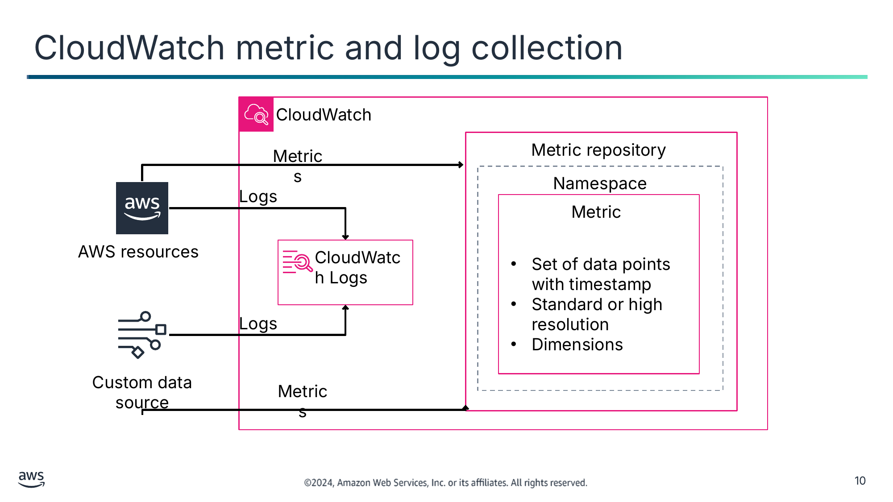

Текст зі схеми

CloudWatch

Metric repository

Metrics

Namespace

Logs

Metric

AWS resources

CloudWatch Logs

- Set of data points with timestamp
- Standard or high resolution
- Dimensions

Logs

Custom data source

Metrics

> **Нотатки:**
>
> |Slide number 10  
> |Instructor notes  
> |  
> |Student notes  
> AWS resources have the capability to send operational logs to CloudWatch Logs. You can use CloudWatch Logs to monitor, store, and access your log files from sources such as EC2 instances, AWS CloudTrail, Route 53, Amazon Virtual Private Cloud (Amazon VPC), and other AWS services. CloudWatch Logs gives you the ability to centralize the logs from all of the systems, applications, and AWS services that you use in a single, highly scalable service. You can then view logs, search them for specific error codes or patterns, filter them based on specific fields, or archive them securely for future analysis. With CloudWatch Logs, you can see all of your logs, regardless of their source, as a single and consistent flow of events ordered by time. CloudWatch Logs also supports querying your logs with a powerful query language, auditing and masking sensitive data in logs, and generating metrics from logs by using filters or an embedded log format. You can send custom data from other sources to CloudWatch Logs and the metric repository.  
>
> The metrics are stored in the metrics repository in a namespace container. Metrics in different namespaces are isolated from each other so that metrics from different applications are not mistakenly aggregated into the same statistics. The AWS namespaces typically use the following naming convention: AWS/service. For example, Amazon EC2 uses the AWS/EC2 namespace.  
>
> A metric is a time-ordered set of data points with a unit of measurement such as bytes, seconds, count, and percentage. You can think of a metric as a variable to monitor, and the data points as representing the values of that variable over time. For example, the percent CPU usage of a particular EC2 instance is one metric that Amazon EC2 provides. You would be able to see the value of CPU usage over time for each data point timestamp. A metric can be either standard resolution or high resolution. Standard resolution means data points have 1-minute granularity. High resolution means that data points have 1-second granularity.  
>
> You can optionally configure a metric dimension. A dimension is a name and value pair specifying a metric characteristic. For example, many Amazon EC2 metrics publish InstanceId as a dimension name, and the actual instance ID as the value for that dimension. This ID dimension can be used to filter the metrics when searching for a specific instance metrics.

---

## Слайд 11: CloudWatch alarms

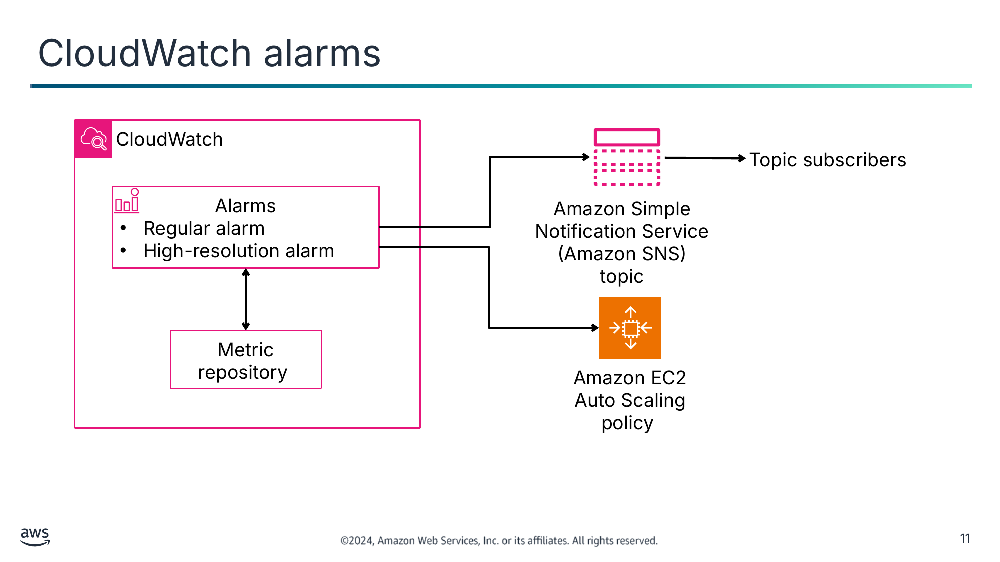

Текст зі схеми

CloudWatch

Topic subscribers

Alarms

- Regular alarm
- High-resolution alarm

Amazon Simple Notification Service (Amazon SNS)

topic

Metric repository

Amazon EC2  
Auto Scaling policy

> **Нотатки:**
>
> |Slide number 11  
> |Instructor notes  
> |  
> |Student notes  
> You can use a CloudWatch alarm to automatically initiate actions on your behalf. An alarm watches a single metric over a specified time period and performs one or more specified actions based on the value of the metric relative to a threshold over time. The action is a notification sent to an Amazon Simple Notification Service (Amazon SNS) topic or an Auto Scaling policy. You can also add alarms to dashboards.  
>
> Alarms invoke actions for sustained state changes only. CloudWatch alarms do not invoke actions because they are in a particular state. The state must have changed and been maintained for a specified number of periods. For example, an alarm is activated when the CPUUtilization metric is greater than 70 percent for 5 minutes. The alarm invokes an action, such as adding an instance to the Auto Scaling policy or sending a notification to the development team.  
>
> When you create an alarm to monitor a specific metric, you are asking CloudWatch to compare that metric to the threshold value that you specified. You have extensive control over how CloudWatch makes that comparison. Not only can you specify the period over which the comparison is made, but you can also specify how many evaluation periods are used to arrive at a conclusion. For example, if you specify three evaluation periods, CloudWatch compares a window of three data points. CloudWatch notifies you only if the oldest data point is breaching and the others are breaching or missing.  
>
> If you set an alarm on a high-resolution metric, you can specify a high-resolution alarm with a period of 10 seconds or 30 seconds, or you can set a regular alarm with a period of any multiple of 60 seconds. There is a higher charge for high-resolution alarms. You can set regular alarms for standard resolution metrics.

---

## Слайд 12: CloudWatch dashboards

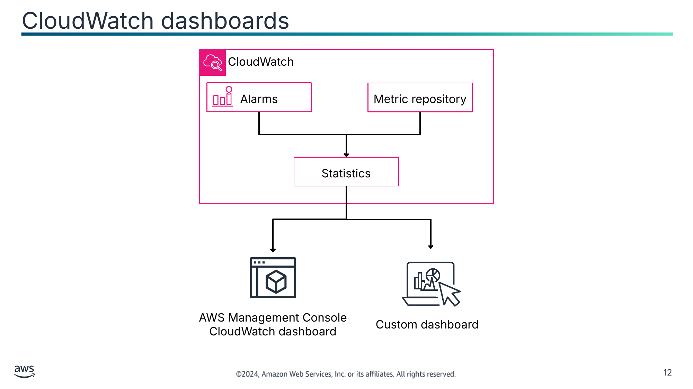

Текст зі схеми

CloudWatch

Alarms

Metric repository

Statistics

AWS Management Console CloudWatch dashboard

Custom dashboard

> **Нотатки:**
>
> |Slide number 12  
> |Instructor notes  
> |  
> |Student notes  
> While having metrics and alarms are good, you sometimes would like to compare metrics or view alarms that could be located in different Regions. You can use CloudWatch dashboards to create customized dashboards or view automatic dashboards. These dashboards are customizable home pages in the CloudWatch console that you can use to monitor your resources in a single view, even those resources that are spread across different Regions. You can use CloudWatch dashboards to create customized views of the metrics and alarms for your AWS resources.  
>
> A metric that breaks a threshold every second should not be acted on every second. For that reason, metrics should be aggregated over time so that one action can solve the problem. CloudWatch provides statistics based on the metric data points. Statistics are metric data aggregations over specified periods of time. CloudWatch provides statistics based on the metric data points provided by your custom data or provided by other AWS services to CloudWatch. You can specify a specific time period, and CloudWatch will calculate the aggregations by using the namespace, metric name, dimensions, and the data point unit of measure.  
>
> With dashboards, you can create a single view for selected metrics and alarms to help you assess the health of your resources and applications across one or more Regions. You can select the color used for each metric on each graph so that you can track the same metric across multiple graphs. You can create an operational playbook that provides guidance for team members during operational events about how to respond to specific incidents. You can create a common view of critical resource and application measurements that team members can share for faster communication flow during operational events.  
>
> If you do not want to use the AWS Management Console, you can query CloudWatch statistics to import the data into a custom dashboard.

---

## Слайд 13: EventBridge

- Processes events with an event bus or a pipe
  - Pipes are point-to-point integrations between one source and one target.
  - Event buses are routers that receive events and optionally delivers them to one or multiple targets.
- Makes routing decisions with configurable rules
  - Rules run based on matching an event pattern or on a schedule with Amazon EventBridge Scheduler.
  - Targets can be in another AWS account, in another Region, or in both.

EventBridge

> **Нотатки:**
>
> |Instructor notes  
> |  
> |Student notes  
> When CloudWatch alarms are breached, the event needs to be published so that automated or manual correction actions can be implemented. In AWS, Amazon EventBridge is an event bus used to route events.  
>
> EventBridge is a serverless service that uses events to connect application components together, helping you to build scalable event-driven applications. Event-driven architecture is a style of building loosely coupled software systems that work together by emitting and responding to events.  
>
> EventBridge uses event buses and pipes to process events. Event buses are routers that receive events and deliver them to zero or more targets. Amazon EventBridge Pipes is intended for point-to-point integrations. Each pipe receives events from a single source for processing and delivery to a single target. Pipes also include support for advanced transformations and enrichment of events prior to delivery to a target.  
>
> Event buses use rules to match incoming events and send them to targets for processing. A single rule can send an event to multiple targets, which then run in parallel. Rules are based either on an event pattern or a schedule. An event pattern defines the event structure and the fields that a rule matches. Rules that are based on a schedule perform an action at regular intervals.  
>
> For more information, see “What Is Amazon EC2 Auto Scaling?” on the content resources page of your online course.

---

## Слайд 14: EventBridge event bus

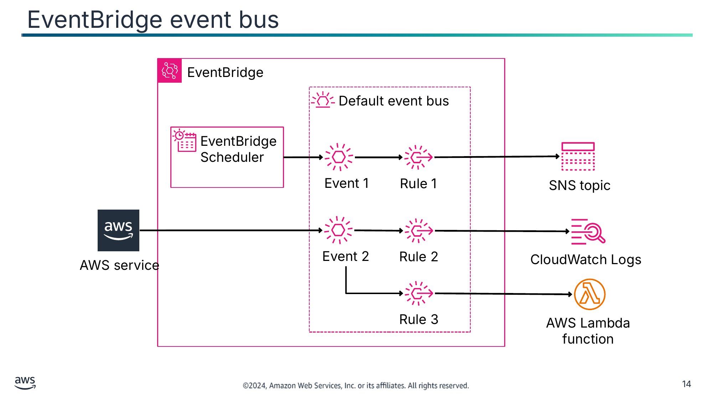

Текст зі схеми

EventBridge

Default event bus

EventBridge Scheduler

Event 1

Rule 1

SNS topic

Event 2

Rule 2

CloudWatch Logs

AWS service

Rule 3

AWS Lambda function

> **Нотатки:**
>
> |Slide number 14  
> |Instructor notes  
> |  
> |Student notes  
> An event bus is a router that receives events and delivers them to zero or more destinations, or targets. Use an event bus when you need to route events from many sources to many targets with optional transformation of events prior to delivery to a target.  
>
> A common use case for event buses is as a broker between different workloads, services, or systems. You can use multiple event buses in your applications to divide the event traffic: for example, creating a bus to process events containing personally identifiable information (PII) and creating another bus for events that don’t. You can use event buses to aggregate events by sending events from multiple event buses to a centralized event bus. This centralized bus can be in the same account as the other buses but can also be in a different account or Region.  
>
> A rule receives incoming events and sends them as appropriate to targets for processing. You can specify how each rule invokes its target or targets based on an event pattern or a schedule. An event pattern contains one or more filters to match events. A schedule will invoke a target or targets at regular intervals. EventBridge offers Amazon EventBridge Scheduler, a serverless scheduler that you can use to create, run, and manage tasks from one central, managed service.  
>
> A target is a resource or endpoint that EventBridge sends an event to when the event matches the event pattern defined for a rule. The rule processes the event data and sends the pertinent information to the target. You can define up to five targets for each rule. EventBridge supports multiple AWS services and API destinations.  
>
> In the example on this slide, EventBridge Scheduler sends Event 1 to the default event bus, which invokes Rule 1. Rule 1 matches the event successfully and routes the event to an SNS topic. An AWS service sends Event 2 to the default event bus, which invokes Rule 2 and Rule 3 in parallel. Rule 2 passes and sends the event to CloudWatch Logs while Rule 3 also passes and sends the event to an AWS Lambda function.  
>
> The following is an example of an event pattern that processes all EC2 instance-termination events:  
>
> {  
> "source": ["aws.ec2"],  
> "detail-type": ["EC2 Instance State-change Notification"],  
> "detail": {  
> "state": ["terminated"]  
> }  
> }

---

## Слайд 15: Monitoring your resource costs

AWS Cost Explorer

AWS Budgets

AWS Cost and Usage Report

> **Нотатки:**
>
> |Slide number 15  
> |Instructor notes  
> |  
> |Student notes  
> Monitoring can also help you to understand and manage the cost of your AWS infrastructure. AWS provides monitoring and reporting tools, including the following:  
> AWS Cost Explorer helps you visualize, understand, and manage your AWS costs and usage with daily or monthly granularity. You can use it to view data up to the last 13 months, which helps you see patterns in how you spend AWS resources over time.  
> AWS Budgets helps you set custom budgets that alert you when your costs or usage exceeds (or are forecasted to exceed) your budgeted amount.  
> AWS Cost and Usage Report contains the most comprehensive set of AWS cost and usage data available, including additional metadata about AWS services, pricing, and reservations.

---

## Слайд 16: Key takeaways: Monitoring your resources

- CloudWatch alarms can send notifications to Amazon EC2 Auto Scaling and SNS topics.
- CloudWatch collects logs and metrics from AWS services across Regions.
- You can use CloudWatch dashboards to visualize metrics and alarms.
- EventBridge processes and routes event with an event bus or a pipe.
- AWS Cost Explorer, AWS Budgets, and AWS Cost and Usage Report can help you understand and manage the cost of your AWS infrastructure.

> **Нотатки:**
>
> |Slide number 16  
> |Instructor notes  
> |  
> |Student notes

---

## Слайд 17: Scaling your compute resources

Implementing Monitoring, Elasticity, and High Availability

> **Нотатки:**
>
> |Slide number 17  
> |Instructor notes  
> |This section focuses on scaling a production system well and highlights the need for reactive architectures.  
> |  
> |Student notes  
> This section looks at how to scale your compute resources in a virtual private cloud (VPC).

---

## Слайд 18: The need for reactive architectures

Applications need to handle large amounts of data with sub-second response times while having close to 100 percent uptime.

Elastic

Responsive

Resilient

Message-driven

> **Нотатки:**
>
> |Slide number 18  
> |Instructor notes  
> |  
> |Student notes  
> So far, you have learned about application components, environments, and ways to secure access to applications. When designing an application, you must also ensure that it will run optimally under various conditions and will not need manual intervention to recover from failures.  
>
> Many modern applications are expected to handle petabytes of data, require close to 100 percent uptime, and deliver sub-second response time to users. A growing number of enterprises have adopted reactive architectures and reactive systems because it is necessary to design applications in a highly scalable and responsive way. To meet these requirements, you can implement a reactive application that is elastic, resilient, responsive, and message-driven.  
>
> Elastic scaling is a mechanism to scale an application’s resources dynamically. This type of scaling will add or remove resources to react to changes and avoid downtime or traffic bottlenecks.  
>
> Responsive means that applications should respond in a timely manner with the lowest latency possible. A reactive application remains responsive under varying workloads.  
>
> A resilient application stays responsive in the face of failure. A resilient application has the capability to recover when stressed by load, attacks, and failure of any component in the workload's components.  
>
> Being message-driven is perhaps the most important characteristic of reactive systems. To establish boundaries between services, reactive applications rely on asynchronous message-passing to help ensure loose coupling, isolation, and location transparency. Location transparency is the access of data without the explicit knowledge of the data location.

---

## Слайд 19: Achieve elasticity with scaling

Elasticity is the ability of infrastructure to expand and contract as capacity requirements change.

Scaling is the ability to increase or decrease the compute capacity of your application.

- Vertical scaling replaces a resource with a different-sized resource.
- Horizontal scaling adds or removes resources available to the application.

> **Нотатки:**
>
> |Slide number 19  
> |Instructor notes  
> |  
> |Student notes  
> One characteristic of a reactive architecture is elasticity. Elasticity means that the infrastructure can expand and contract when capacity requirements change. You can acquire resources when you need them and release resources when you do not. For example, you can increase the number of web servers when traffic to your application spikes or lower the write capacity on your database when traffic goes down.  
>
> Scaling is the ability to increase or decrease the compute capacity of your application. Scaling is a technique that is used to achieve elasticity.  
>
> Vertical scaling is where you increase or decrease the specifications of an individual resource. For example, you could upgrade to a new server with a larger hard drive or a faster CPU. Typically the application and data has to be transferred to a new resource, which can lead to application downtime. For example, with Amazon EC2, you can stop an instance and resize it to an instance type that has more RAM, CPU, I/O, or networking capabilities. AWS will transfer the instance data to the new instance for you. Vertical scaling can eventually reach a limit because it is hardware bound, and it is not always a cost-efficient or a highly available approach.  
>
> Horizontal scaling is where you add or remove resources available to the application. For example, you might need to add more hard drives to a storage array or add more servers to support an application. Adding resources is referred to as scaling out, and ending resources is referred to as scaling in. Horizontal scaling is a good way to build internet-scale applications that take advantage of the elasticity of cloud computing. Applications, data, or both are automatically transferred to added resources.

---

## Слайд 20: Amazon EC2 Auto Scaling

- Manages a logical collection of Amazon Elastic Compute Cloud (Amazon EC2) instances called an Amazon EC2 Auto Scaling group across Availability Zones
- Launches or retires EC2 instances configured by launch templates
- Resizes based on events from scaling policies, load balancer health check notifications, or schedule actions
- Integrates with Elastic Load Balancing (ELB) to send new instances registrations and receive health notifications
- Balances the number of instances across Availability Zones
- Is available free of charge

Amazon EC2 Auto Scaling

> **Нотатки:**
>
> |  
> |Instructor notes  
> |Launch configurations are no longer supported by Amazon EC2 Auto Scaling with Amazon EC2 instance types dated after December 2022. Launch templates are the preferred mechanism to use with Amazon EC2 Auto Scaling groups.  
> |  
> |Student notes  
> In the cloud, scaling can be handled automatically. Amazon EC2 Auto Scaling does this by grouping EC2 instances in a management group called an Amazon EC2 Auto Scaling group. The group can span across Availability Zones. An Amazon EC2 Auto Scaling group can automatically add or remove EC2 instances according to user-defined scaling policies, schedule actions, and Elastic Load Balancing (ELB) health checks. When a new EC2 instance is added to the group, a launch template or launch configuration that specifies the instance configuration is used.  
>
> Amazon EC2 Auto Scaling integrates with ELB. It automatically registers new instances with load balancers to distribute incoming traffic across the instances in the group. Amazon EC2 Auto Scaling can receive notifications of an unhealthy instance to remove from the group. The group can also balance the number of instances across Availability Zones so that the number of instances is similar for each Availability Zone.  
>
> With Amazon EC2 Auto Scaling, your applications gain the following benefits:  
> Better fault tolerance: Amazon EC2 Auto Scaling can detect when an instance is unhealthy, terminate it, and launch an instance to replace it. You can also configure Amazon EC2 Auto Scaling to use multiple Availability Zones. If one Availability Zone becomes unavailable, Amazon EC2 Auto Scaling can launch instances in another one to compensate.  
> Better availability: Amazon EC2 Auto Scaling helps ensure that your application always has the right amount of capacity to handle the current traffic demand.  
> Better cost management: Amazon EC2 Auto Scaling can dynamically increase and decrease capacity as needed. Because you pay for the EC2 instances you use, you save money by launching instances when they are needed and terminating them when they aren’t.  
>
> For more information, see the AWS Well-Architected Framework on the content resources page of your online course.

---

## Слайд 21: Amazon EC2 Auto Scaling group components

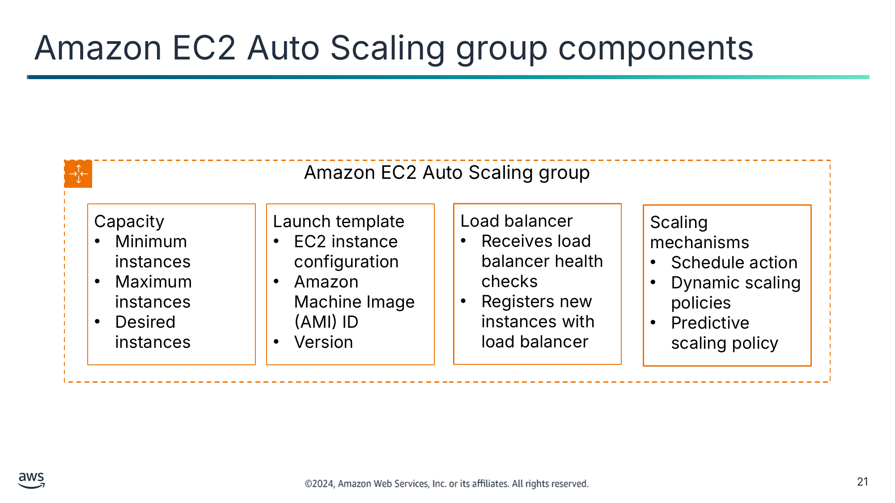

Текст зі схеми

Amazon EC2 Auto Scaling group

Capacity

- Minimum instances
- Maximum instances
- Desired instances

Launch template

- EC2 instance configuration
- Amazon Machine Image (AMI) ID
- Version

Load balancer

- Receives load balancer health checks
- Registers new instances with load balancer

Scaling mechanisms

- Schedule action
- Dynamic scaling policies
- Predictive scaling policy

> **Нотатки:**
>
> |Slide number 21  
> |Instructor notes  
> |  
> |Student notes  
> Amazon EC2 Auto Scaling uses Amazon EC2 Auto Scaling groups to manage a collection of EC2 instances. The number of instances in the group is determined by the capacity settings. Minimum capacity is the smallest number of instances needed to run the application, and maximum capacity is the largest number of instances permitted for the group. Desired capacity is the optimal number of instances needed to run the application under normal circumstances. When demand or environment changes, then desired capacity is adjusted.  
>
> You can adjust the group size to meet demand, either manually or by using automatic scaling. In both cases, you cannot exceed the group capacity minimum or maximum settings. With manual scaling, you specify a new value for the maximum, minimum, or desired capacity of the group.  
>
> Scaling starts with an event, or scaling action, which instructs an Amazon EC2 Auto Scaling group to either launch or end EC2 instances. To launch an EC2 instance, the group needs to know which type of EC2 instances to initiate. The group launch template is used to specify the EC2 instance configuration details, such as the instance type and the Amazon Machine Image (AMI) ID. You can also specify what percentage of the desired capacity should be fulfilled with On-Demand Instances, Reserved Instances, and Spot Instances. Amazon EC2 Auto Scaling then provisions the lowest price combination of instances to meet the desired capacity based on these preferences. On-Demand and Reserved Instances are immediately available, but Spot Instances might or might not be available at a specific time. A launch template can be versioned.  
>
> Usually, an Amazon EC2 Auto Scaling group works with a load balancer to assist with scaling. The group can opt to receive load balancer instance health check notifications in addition to the group’s own instance health checks. The group can register new instances with the load balancer.  
>
> A new Amazon EC2 Auto Scaling group has no scaling mechanisms. You can add scaling mechanisms, such as schedule actions, dynamic scaling policies, and a predictive scaling policy.

---

## Слайд 22: Horizontal scaling with Amazon EC2 Auto Scaling groups

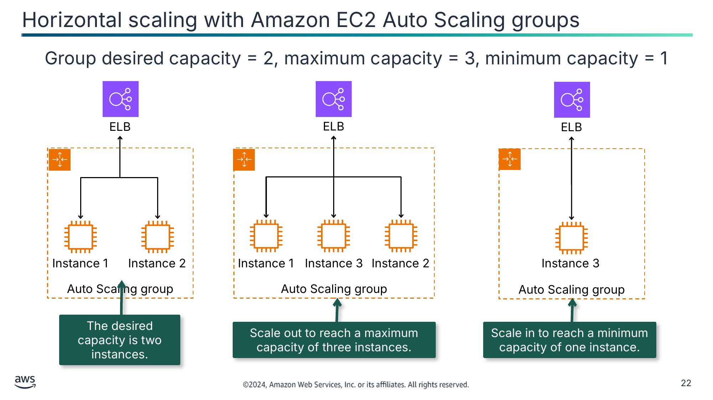

Group desired capacity = 2, maximum capacity = 3, minimum capacity = 1

The desired capacity is two instances.

Scale out to reach a maximum capacity of three instances.

Scale in to reach a minimum capacity of one instance.

Текст зі схеми

ELB

ELB

ELB

Auto Scaling group

Auto Scaling group

Auto Scaling group

Instance 1

Instance 2

Instance 1

Instance 3

Instance 2

Instance 3

> **Нотатки:**
>
> |Slide number 22  
> |Instructor notes  
> |  
> |Student notes  
> In the example on this slide, automatic scaling is used. The group starts by launching enough instances to meet its desired capacity, which is two instances: instances 1 and 2. If an unhealthy instance is reported by the load balancer, the Amazon EC2 Auto Scaling group will end the unhealthy instance and replace it with a new instance.  
>
> You can use scaling policies to increase the number of instances in your group dynamically to meet changing conditions. In the example on this slide, the Amazon EC2 Auto Scaling group tracks a metric from an AWS service such as CloudWatch or Amazon Simple Queue Service (Amazon SQS) to scale out. By using a launch template, the Amazon EC2 Auto Scaling group scales out by adding instance 3 to the group to reach the maximum capacity of three instances. The Amazon EC2 Auto Scaling group will make sure that the maximum capacity will not be exceeded even if another scaling out notification is received.  
>
> Likewise, you can use scaling policies to decrease the number of instances in your Amazon EC2 Auto Scaling group. In the example on this slide, a scheduled scaling policy activates to reduce the Amazon EC2 Auto Scaling group capacity to the minimum number of instances in off-peak hours. The Amazon EC2 Auto Scaling group scales in by ending instances 1 and 2 to reach a minimum capacity of one instance with instance 3 running.

---

## Слайд 23: Amazon EC2 Auto Scaling mechanisms

Scheduled actions

Dynamic policies

Predictive policy

- Scale based on a date and time
- Are for predictable workloads

- Scale based on tracked metrics
- Are for moderately spiky workloads

- Scales based on previous traffic patterns with machine learning
- Is for workload traffic that can be predicted with a pattern

> **Нотатки:**
>
> |Instructor notes  
> |  
> |Student notes  
> Amazon EC2 Auto Scaling policies provide several ways to adjust scaling to best meet the compute requirements of your applications.  
>
> With scheduled scaling, scaling actions are performed automatically as a function of a date and time. This feature is useful for predictable workloads when you know exactly when to increase or decrease the number of instances in your group. For example, suppose that every week, the traffic to your web application starts to increase on Wednesday, remains high on Thursday, and starts to decrease on Friday. You can plan your scaling actions based on the predictable traffic patterns of your web application. To implement scheduled scaling, you create a schedule action.  
>
> Dynamic, on-demand scaling is a more advanced way to scale your resources. You can use it to define parameters that control the scaling process. For example, you have a web application that currently runs on two EC2 instances. You want the CPU utilization of the Auto Scaling group to stay close to 50 percent when the load on the application changes. This option is useful for scaling in response to changing conditions, when you don't know when those conditions are going to change. Dynamic scaling gives you extra capacity to handle traffic spikes without maintaining an excessive number of idle resources.  
>
> You can configure your Amazon EC2 Auto Scaling group to scale dynamically with different scaling policy types.  
>
> Target tracking scaling policies increase or decrease the current capacity of the group based on a target value for a specific metric. This type of scaling is similar to the way that your thermostat maintains the temperature of your home: you select a temperature, and the thermostat does the rest. With target tracking scaling policies, you select a scaling metric and set a target value. Amazon EC2 Auto Scaling creates and manages the CloudWatch alarms that invokes the scaling policy and calculates the scaling adjustment based on the metric and the target value. For example, you can create a target tracking scaling policy that targets an average CPU utilization of 50 percent. Then, your Auto Scaling group scales the number of instances to keep the actual metric value at or near 50 percent.  
>
> With step scaling and simple scaling policies, you choose scaling metrics and threshold values for the CloudWatch alarms that invoke the scaling process. Simple scaling will wait for scaling to finish when an alarm is reported ignoring subsequent alarms. Step scaling will adjust the scaling to match the size of the alarm breach.  
>
> You can use Amazon EC2 Auto Scaling to implement a predictive scaling policy where your capacity scales based on predicted demand. Predictive scaling works by analyzing historical load data to detect daily or weekly patterns in traffic flows. It uses this information to forecast future capacity needs so that Amazon EC2 Auto Scaling can proactively increase the capacity of your Auto Scaling group to match the anticipated load. Predictive scaling is well suited for situations where you have the following:  
> Cyclical traffic, such as high use of resources during regular business hours and low use of resources during evenings and weekends  
> Recurring on-and-off workload patterns, such as batch processing, testing, or periodic data analysis  
> Applications that take a long time to initialize, causing a noticeable latency impact on application performance during scale-out events  
>
> You can use dynamic scaling and predictive scaling together to optimally scale your infrastructure.

---

## Слайд 24: Scaling with a step scaling policy

| Metric value | Less than 30% | 30–39% | 40–60% | 61–70% | 71–100% |
|---|---|---|---|---|---|
| Percentage capacity change | -30% | -10% | No change | +10% | +30% |

Remove 30% of current capacity

Remove 10% of current capacity

Add 10% of current capacity

Add 30% of current capacity

> **Нотатки:**
>
> |Slide number 24  
> |Instructor notes  
> |  
> |Student notes  
> Step scaling policies increase or decrease the current capacity of a scalable target based on a set of scaling adjustments, known as step adjustments. The adjustments vary based on the size of the alarm breach. The policy continues to respond to additional alarms while a scaling activity is in progress. Therefore, all alarms that are breached are evaluated by AWS Application Auto Scaling as it receives the alarm messages.  
>
> When you create a step scaling policy, you specify one or more step adjustments that automatically scale the capacity of the target dynamically based on the size of the alarm breach. Each step adjustment specifies a lower bound for the metric value, an upper bound for the metric value, and the amount by which to scale based on the scaling adjustment type.  
>
> CloudWatch aggregates metric data points based on the statistic for the metric associated with your CloudWatch alarm. When the alarm is breached, the appropriate scaling policy is activated.  
>
> For a complete example of step scaling, please see “Overview of Step Scaling Policies” on the content resources page of your online course.

---

## Слайд 25: More AWS scaling options

	AWS Auto Scaling

- Use a scaling plan to configure auto scaling for multiple resources.
- Scale multiple AWS services:
  - Amazon Aurora
  - Amazon EC2 Auto Scaling
  - Amazon Elastic Container Service (Amazon ECS)
  - Amazon DynamoDB

 AWS Application Auto Scaling

- Scale multiple resources with target tracking, step scaling, or scheduled scaling.
- Scale multiple AWS services:
  - AWS Auto Scaling services
  - AWS Lambda functions
  - Amazon SageMaker
  - Amazon ElastiCache for Redis

> **Нотатки:**
>
> |Instructor notes  
> |  
> |Student notes  
> When you want to scale, AWS Auto Scaling uses a scaling plan to configure auto scaling for related or associated scalable resources in a matter of minutes. For example, you can use tags to group resources in categories such as production, testing, or development. Then, you can search for and set up scaling plans for scalable resources that belong to each category.  
>
> AWS Auto Scaling supports the use of scaling plans for the following services and resources:  
> Amazon Aurora: Increase or decrease the number of Aurora read replicas that are provisioned for an Aurora DB cluster.  
> Amazon EC2 Auto Scaling: Launch or terminate EC2 instances by increasing or decreasing the desired capacity of an Auto Scaling group.  
> Amazon Elastic Container Service (Amazon ECS): Increase or decrease the desired task count in Amazon ECS.  
> Amazon DynamoDB: Increase or decrease the provisioned read and write capacity of a DynamoDB table or a global secondary index.  
>
> Application Auto Scaling is a web service for developers and system administrators who need a solution for automatically scaling their scalable resources for individual AWS services beyond Amazon EC2. Application Auto Scaling is similar to Amazon EC2 Auto Scaling groups in that you can use Application Auto Scaling to automatically scale with target tracking, step, and scheduled scaling policies. It supports AWS Auto Scaling services.

---

## Слайд 26: Demo: Creating Scaling Policies for Amazon EC2 Auto Scaling

- This demonstration uses Amazon EC2 Auto Scaling.
- In this demonstration, you will see how to do the following:
  - Create and launch an EC2 instance.
  - Create an Auto Scaling group.
  - Create a scaling policy.

> **Нотатки:**
>
> |Slide number 26  
> |Instructor notes  
> |This demo is an .mp4 file with captions. Students access it through the online course. The instructor guide includes the duration for each demo.  
> |  
> |Student notes  
> Find this recorded demo in your online course as part of this module.

---

## Слайд 27: Key takeaways: Scaling your compute resources

- With Amazon EC2 Auto Scaling, you can create a group to manage a logical collection of EC2 instances, called an Amazon EC2 Auto Scaling group.
- A group has capacity settings that specify the minimum, maximum, and desired number of instances required to run an application.
- Group size can be scaled in and out with schedule actions, dynamic policies, and predictive policies.
- To scale more services than EC2 instances, use AWS Auto Scaling or Application Auto Scaling.

> **Нотатки:**
>
> |Slide number 27  
> |Instructor notes  
> |  
> |Student notes

---

## Слайд 28: Scaling your databases

Implementing Monitoring, Elasticity, and High Availability

> **Нотатки:**
>
> |Slide number 28  
> |Instructor notes  
> |Each AWS database service scales differently. This section covers the most commonly used databases.  
> |  
> |Student notes  
> This section looks at how to scale databases in AWS.

---

## Слайд 29: Scaling AWS databases

Aurora

Amazon Aurora Serverless

Amazon RDS

DynamoDB

Scale a cluster

- Vertical scaling with instance types
- Horizontal scaling with read replicas
- Service managed storage scaling

Scale a cluster

- Horizontal compute scaling with Aurora Compute Units  (ACUs)
- Service managed storage scaling

Scale a database

- Vertical scaling with instance types and storage volume size and type
- Horizontal scaling with read replicas

Scale a table

- Horizontal scaling to scale read capacity units (RCUs) and write capacity units (WCUs) separately
- Service managed storage scaling

> **Нотатки:**
>
> |Instructor notes  
> |  
> |Student notes  
> Similarly to Amazon EC2 compute resources, AWS database services can also scale vertically, horizontally, or both. How scaling is handled is different for each service. Some services offer manual scaling and auto scaling while other services offer only auto scaling for certain components. Scaling a database is never an instantaneous exercise, although it might appear so because most of the scaling happens as background processes.  
>
> Aurora can vertically scale a cluster to increase storage as your data in the cluster increases. You can also vertically scale an Aurora cluster by changing the EC2 instance size in the cluster. You can specify up to 15 Aurora Replicas to implement horizontal scaling as read-only clusters.  
>
> Amazon Aurora Serverless clusters operate on throughput capacity by using horizontal scaling. You specify capacity by configuring the minimum and maximum Aurora Compute Units (ACUs) to manage memory and compute. Aurora Serverless scales the database resources automatically based on the capacity specifications and will not drop below the minimum or exceed the maximum capacity. AWS handles Aurora Serverless storage capacity.  
>
> Amazon Relational Database Service (Amazon RDS) can vertically scale database storage if you resize the EC2 instance type. You can horizontally scale an Amazon RDS database by adding read replicas. A read replica is read only and cannot be promoted to a primary database like a secondary or standby database can.  
>
> DynamoDB tables operate on throughput capacity. Each table can have a maximum provisioned throughput read and write capacity expressed as read capacity units (RCUs) and write capacity units (WCUs). To activate scaling, you can change to on-demand scaling by setting the minimum and maximum RCUs and WCUs with a scaling metric.

---

## Слайд 30: Scaling an Aurora cluster

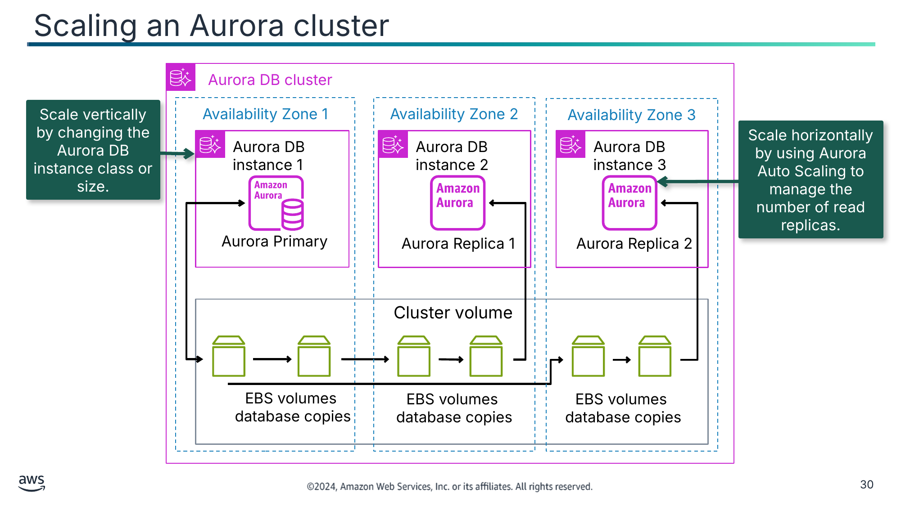

Scale vertically by changing the Aurora DB instance class or size.

Scale horizontally by using Aurora Auto Scaling to manage the number of read replicas.

Текст зі схеми

Aurora DB cluster

Availability Zone 1

Availability Zone 2

Availability Zone 3

Aurora DB instance 1

Aurora DB instance 2

Aurora DB instance 3

Aurora Primary

Aurora Replica 1

Aurora Replica 2

Cluster volume

EBS volumes

database copies

EBS volumes

database copies

EBS volumes

database copies

> **Нотатки:**
>
> |Slide number 30  
> |Instructor notes  
> |For more information on topics such as managing connections and query execution plans, please see “Managing Performance and Scaling for Aurora DB Clusters” on the course page.  
> |  
> |Student notes  
> Image description: An Aurora database cluster showing a primary instance in Availability Zone 1 and one replica instance in both Availability Zones 2 and 3. Each instance connects to a set of Amazon Elastic Block Store (Amazon EBS) volumes in the same Availability Zone. The primary instance copies its database to its EBS volumes, and those are copied to EBS volumes for each of the database replicas. The EBS volumes are in the Aurora Cluster volume, which spans across all three Availability Zones. End description.  
>
> One way to scale an Aurora cluster to meet increased workload requirements is to use Aurora Auto Scaling. Aurora Auto Scaling dynamically adjusts the number of Aurora Replicas (reader DB instances) provisioned for an Aurora DB cluster. Aurora Auto Scaling helps your Aurora DB cluster handle sudden increases in connectivity or workload. When the connectivity or workload decreases, Aurora Auto Scaling removes unnecessary Aurora Replicas so that you don't pay for unused provisioned DB instances.  
>
> You define and apply a scaling policy to an Aurora DB cluster. The scaling policy defines the minimum and maximum number of Aurora Replicas that Aurora Auto Scaling can manage. Based on the policy, Aurora Auto Scaling adjusts the number of Aurora Replicas up or down in response to actual workloads as determined by using CloudWatch metrics and target values.  
>
> Another way to scale an Aurora cluster is by changing the Aurora DB instance class to resize the cluster compute capacity. The DB instance class determines the computation and memory capacity of an Aurora DB instance. The DB instance class that you need depends on your processing power and memory requirements.  
>
> Scaling isn't instantaneous. It can take 15 minutes or more to complete the change to a different DB instance class. You can apply the change during the next scheduled maintenance window rather than immediately to avoid affecting users. As an alternative to modifying the DB instance class directly, you can minimize downtime by using the high availability features of Aurora. First, add an Aurora Replica to your cluster. When creating the replica, choose the DB instance class size that you want to use for your cluster. When the Aurora Replica is synchronized with the cluster, you then failover to the newly added Replica.  
>
> The Aurora service automatically manages Aurora storage scaling in the cluster volume.

---

## Слайд 31: Scaling an Aurora Serverless cluster

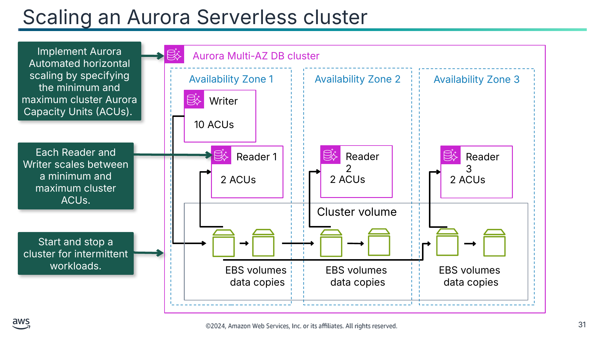

Implement Aurora Automated horizontal scaling by specifying the minimum and maximum cluster Aurora Capacity Units (ACUs).

Each Reader and Writer scales between a minimum and maximum cluster ACUs.

Start and stop a cluster for intermittent workloads.

Текст зі схеми

Aurora Multi-AZ DB cluster

Availability Zone 1

Availability Zone 2

Availability Zone 3

Writer

10 ACUs

Reader 1

Reader 2

Reader 3

2 ACUs

2 ACUs

2 ACUs

Cluster volume

EBS volumes

data copies

EBS volumes

data copies

EBS volumes

data copies

> **Нотатки:**
>
> |Slide number 31  
> |Instructor notes  
> |  
> |Student notes  
> Workloads can be intermittent and unpredictable. There can be periods of heavy workloads that might last only a few minutes or hours, and also long periods of light activity, or even no activity. Some examples are retail websites with intermittent sales events, reporting databases that produce reports when needed, development and testing environments, and new applications with uncertain requirements. In these cases, and many others, it can be difficult to configure the correct capacity at the right time. It can also result in higher costs when you pay for capacity that isn't used.  
>   
> Aurora Serverless is an on-demand, automatically scaling configuration for Amazon Aurora clusters. Aurora Serverless enables your database to automatically start up, shut down, and scale capacity up or down based on your application's needs. It enables you to run your database in the cloud without managing any database instances. Aurora Serverless can be used for infrequent, intermittent, or unpredictable workloads.  
>   
> With Aurora Serverless you create a database endpoint without specifying the DB instance class size. You specify database capacity with minimum and maximum Aurora capacity units (ACUs). Each ACU is a combination of approximately 2 gibibytes (GiB) of memory, corresponding CPU, and networking. You specify the database capacity range using this unit of measure. Aurora Serverless scales the resources vertically automatically based on the minimum and maximum capacity specifications.  
>   
> In the above example, the Amazon Aurora Aurora Multi-AZ database cluster has an 10 ACU capacity writer configured in Availability Zone 1. One 2 ACU capacity reader is configured in each availability zone. Data storage is provided by the cluster volume on EBS volumes.  
>   
> Database storage automatically scales in the same way as storage in a standard Aurora DB cluster.  
> You pay on a per-second basis for the database capacity that you use when the database is active, and you can migrate between standard and serverless configurations. You pay for the number of ACUs used. You can stop and start a cluster for intermittent workloads.

---

## Слайд 32: Scaling an Amazon RDS database

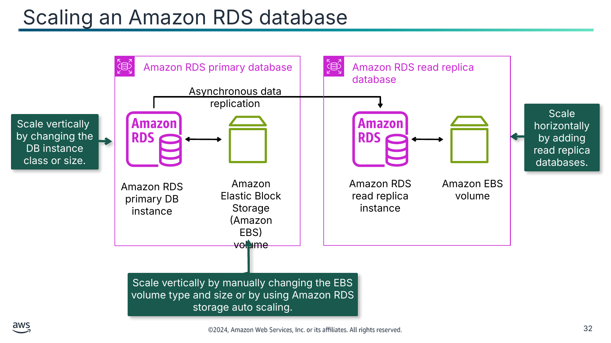

Scale horizontally by adding read replica databases.

Scale vertically  by changing the DB instance class or size.

Scale vertically by manually changing the EBS volume type and size or by using Amazon RDS storage auto scaling.

Текст зі схеми

Amazon RDS primary database

Amazon RDS read replica database

Asynchronous data replication

Amazon RDS primary DB instance

Amazon Elastic Block Storage (Amazon EBS)

volume

Amazon RDS read replica instance

Amazon EBS

volume

> **Нотатки:**
>
> |Slide number 32  
> |Instructor notes  
> |  
> |Student notes  
> Image description: Diagram of an Amazon RDS primary instance connected to an EBS volume. An arrow denotes asynchronous data replication to an Amazon RDS read replica that has its own EBS volume. End description.  
>
> As a managed service, Amazon RDS scales your relational database so that it can keep up with the increasing demands of your application. Vertical scaling is the most straightforward approach to adding more capacity in your database.  
>
> You can vertically scale your Amazon RDS database (DB) instance by changing the Amazon RDS instance class. If you decide to scale up or down the compute resources that are available to your DB instance, be aware that your database is temporarily unavailable while the DB instance class is modified. It occurs during the maintenance window for your DB instance unless you specify that the modification should be applied immediately. There is minimal downtime when you’re scaling up your Amazon RDS instance on a Multi-AZ environment because the standby database gets upgraded first, and then a failover occurs to the newly sized database. A Single-AZ Amazon RDS instance is unavailable during the scaling operation. Vertical scaling is suitable if you can’t change your application and database connectivity configuration.  
>
> When you scale your database instance up or down, your storage size remains the same and is not affected by the change. You can separately modify your DB instance to increase the allocated storage space or improve the performance by changing the storage type—for example, from General Purpose SSD to Provisioned IOPS SSD. Instead of manually provisioning storage, you can also use Amazon RDS storage autoscaling to automatically scale storage capacity in response to growing database workloads.  
>
> In addition to vertical scaling, you can scale your database horizontally. Amazon RDS uses the built-in replication functionality of the MariaDB, MySQL, Oracle, and PostgreSQL DB engines to create a special type of DB instance called a read replica from a source DB instance. Updates that are made to the source DB instance are asynchronously copied to the read replica. You can reduce the load on your source DB instance by routing read queries from your applications to the read replica.  
>
> Redirecting read traffic for business reporting and reading queries from applications are examples where read replicas are used. Another use case is for disaster recovery. You can promote the read replica to the primary database if it becomes unavailable. However, it’s important to note that read replicas are not a replacement for the high availability and automatic failover capabilities that Multi-AZ provides.

---

## Слайд 33: Scaling a DynamoDB table

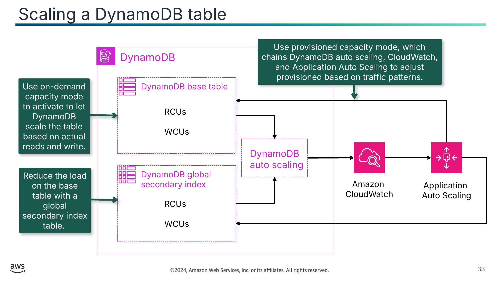

Use on-demand capacity mode to activate to let DynamoDB scale the table based on actual reads and write.

Reduce the load on the base table with a global secondary index table.

Текст зі схеми

Use provisioned capacity mode, which chains DynamoDB auto scaling, CloudWatch, and Application Auto Scaling to adjust provisioned based on traffic patterns.

DynamoDB

DynamoDB base table

RCUs

WCUs

DynamoDB auto scaling

DynamoDB global secondary index

Amazon

CloudWatch

Application  
Auto Scaling

RCUs

WCUs

> **Нотатки:**
>
> |Slide number 33  
> |Instructor notes  
> |  
> |Student notes  
> When you create a new table in DynamoDB, you must specify the table capacity mode by choosing provisioned mode or on-demand mode.  
>
> When you choose on-demand mode, DynamoDB accommodates your workloads based on actual reads and writes to the table. If a workload’s traffic level hits a new peak, DynamoDB adapts rapidly to accommodate the workload. This works well for spiky or intermittent workloads.  
>
> When you choose provisioned mode, you set the amount of read and write activity that the table can support measured in RCUs and WCUs. DynamoDB uses this information to reserve sufficient system resources to meet your throughput requirements. This works well for applications with consistent and predictable throughput. By default, the DynamoDB table in provisioned mode activates read capacity and write capacity auto scaling. DynamoDB auto scaling uses the Application Auto Scaling service to dynamically adjust provisioned throughput capacity on your behalf in response to actual traffic patterns. This enables a table or a global secondary index to increase its provisioned read and write capacity to handle sudden increases in traffic without throttling. When the workload decreases, Application Auto Scaling decreases the throughput so that you don't pay for unused provisioned capacity. If auto scaling is not required on a table, you can deactivate it.  
>
> In addition to tables, DynamoDB auto scaling also supports global secondary indexes. Every global secondary index has its own provisioned throughput capacity that is separate from that of its base table. When you create a scaling policy for a global secondary index, Application Auto Scaling adjusts the provisioned throughput settings for the index to ensure that its actual utilization stays at or near your desired utilization ratio.  
>
> The DynamoDB service automatically manages DynamoDB storage scaling.

---

## Слайд 34: Comparing AWS database scaling mechanisms

| Scaling | Aurora | Aurora Serverless | Amazon RDS | DynamoDB |
|---|---|---|---|---|
| Scope | Cluster | Cluster | Database | Table |
| Vertical scaling | Instance class or size | Cluster ACU throughput limits with each Reader and Writer automatically scaled within limits | • Instance class or size • Amazon RDS storage auto scaling | N/A |
| Horizontal scaling | Aurora Auto Scaling for read replicas | • Multi-AZ replicas • Reader replicas | Read replica databases | • On-demand mode • Provisioned mode with Application Auto Scaling • Global secondary indexes |
| Managed by AWS service | Storage scaling | Storage scaling | N/A | Storage scaling |

> **Нотатки:**
>
> |Slide number 34  
> |Instructor notes  
> |  
> |Student notes  
> The table provides a summary of this section.

---

## Слайд 35: Key takeaways: Scaling your databases

- With Aurora, you can choose the database instance class size and number of Aurora Replicas.
- Aurora Serverless scales resources automatically based on the minimum and maximum capacity specifications.
- You can manually vertically scale compute capacity for your RDS DB instance.
- You can use read replicas to horizontally scale your RDS DB instance.
- DynamoDB On-Demand offers a pricing model based on actual table reads and writes.
- DynamoDB auto scaling uses Application Auto Scaling to dynamically adjust provisioned throughput capacity.

> **Нотатки:**
>
> |Slide number 35  
> |Instructor notes  
> |  
> |Student notes

---

## Слайд 36: Using load balancers to create highly available environments

Implementing Monitoring, Elasticity, and High Availability

> **Нотатки:**
>
> |Slide number 36  
> |Instructor notes  
> |Load balancers provides health checks to provide a fleet of healthy resources. It is important for students to understand the scope and use cases of load balancers in an AWS architecture.  
> |  
> |Student notes  
> This section looks at how to use AWS load balancers to create highly available environments.

---

## Слайд 37: Highly available systems

| Percentage of uptime | Maximum downtime per year | Equivalent downtime per day |
|---|---|---|
| 90% | 36.5 days | 2.4 hours |
| 99% | 3.65 days | 14 minutes |
| 99.9% | 8.76 hours | 86 seconds |
| 99.99% | 52.6 minutes | 8.6 seconds |
| 99.999% | 5.25 minutes | 0.86 seconds |

> **Нотатки:**
>
> |Slide number 37  
> |Instructor notes  
> |  
> |Student notes  
> When you design and build production-scale solutions, you should avoid single points of failure. For example, having one database and one application instance will cause application failure if either the database or instance fails. It is prudent to have backup plans for one instance failure, Availability Zone failure, and Regional failure scenarios. One way to mitigate single points of failure is to design your architecture to be highly available.  
>
> A highly available system is one that can withstand some measure of degradation while remaining available. Downtime is minimized as much as possible, and minimal human intervention is required to bring the system back to normal operating levels. A highly available system enables resiliency in a reactive architecture. A resilient workload can automatically recover when it’s stressed by load (more requests for service), attacks, or component failure. A resilient workload recovers from a failure, or it rolls over to a secondary source within an acceptable amount of degraded performance time.

---

## Слайд 38: ELB

- Distributes traffic across multiple targets in one or more Availability Zone
- Can receive public or private traffic
- Monitors the health of registered targets with health checks
- Routes traffic to only healthy targets
- Scales based on incoming traffic

ELB

> **Нотатки:**
>
> |Instructor notes  
> |  
> |Student notes  
> ELB solves the single point of failure problem for AWS services such as EC2 instances and containers. It is a key component of creating a highly available architecture.  
>
> A load balancer automatically distributes your incoming traffic across multiple targets in one or more Availability Zones. Load balancers can be external facing and distribute inbound public traffic. They can also be internal facing and distribute private traffic.  
>
> ELB monitors the health of its registered targets and routes traffic to only healthy targets. To discover the availability of your EC2 instances, the load balancer periodically sends pings, attempts connections, or sends requests to test the EC2 instances. These tests are called health checks. Each registered EC2 instance must respond to the target of the health check with an HTTP status code of 200 to be considered healthy by your load balancer. If an instance fails a health check, a notification is sent to the Amazon EC2 Auto Scaling group to replace the instance with a healthy instance.  
>
> ELB supports four types of load balancers: Application Load Balancers, Network Load Balancers, Gateway Load Balancers, and Classic Load Balancers. Each load balancer receives a default DNS name. The ELB service scales your load balancer as your incoming traffic changes over time.

---

## Слайд 39: Types of AWS load balancers

Application Load Balancer

Network Load Balancer

Gateway Load Balancer

Classic Load  
Balancer

- Is used for HTTP and HTTPS traffic
- Operates at OSI layer 7, the application layer
- Is used for application architectures

- Is used for TLS offloading, UDP, and static IP addresses
- Operates at OSI layer 4, the transport layer
- Is used for millions of requests per second at ultra-low latency

- Is used for third-party virtual appliance fleet using GENEVE protocol
- Operates at OSI layer 3, the network layer
- Is used to improve security, compliance, and policy controls

- Is used for previous generation EC2-Classic networks
- Operates at OSI layers 3 and 7, the network and application layers
- Is used if upgrading to other load balancers is not feasible

> **Нотатки:**
>
> |Slide number 39  
> |Instructor notes  
> |For more information about the ISO model, see What is OSI Model? at https://aws.amazon.com/what-is/osi-model/.  
> |  
> |Student notes  
> You can select the type of load balancer that best suits your needs. All the types offer the high availability, automatic scaling, and robust security required to make your applications fault-tolerant.  
>
> An Application Load Balancer (ALB) functions at the application layer, the seventh layer of the Open Systems Interconnection (OSI) model. It routes HTTP and HTTPS traffic to targets such as EC2 instances, containers, IP addresses, and Lambda functions based on the content of the request. ALBs support Automatic Target Weights (ATW), which use a routing algorithm to optimize the amount of traffic sent to each target based on information available to the load balancer. ALB will adjust the amount of traffic sent to each target based on implicit health information, such as 5XX errors and connection errors.  
>
> A Network Load Balancer functions at the fourth layer of the OSI model, the transport layer. It can handle millions of requests per second and routes connections to targets such as EC2 instances, containers, Application Load Balancers, and IP addresses. It supports TCP, UDP, TCP_UDP, and TLS protocols and performs with ultra-low latencies. A Network Load Balancer is optimized to handle sudden and volatile network traffic patterns.  
>
> A Gateway Load Balancer operates at the third layer of the OSI model, the network layer. By using a Gateway Load Balancer, you can deploy, scale, and manage virtual appliances, such as firewalls, intrusion detection and prevention systems, and deep packet inspection systems. A Gateway Load Balancer combines a single entry and exit point for all traffic and distributes traffic while scaling your virtual appliances with the demand.  
>
> A Classic Load Balancer provides basic load balancing across multiple EC2 instances, and it operates at both the application level and network transport level. A Classic Load Balancer supports the load balancing of applications that use HTTP, HTTPS, TCP, and SSL. The Classic Load Balancer is an older implementation. When possible, AWS recommends that you use a dedicated Application Load Balancer or Network Load Balancer.

---

## Слайд 40: Load balancer components

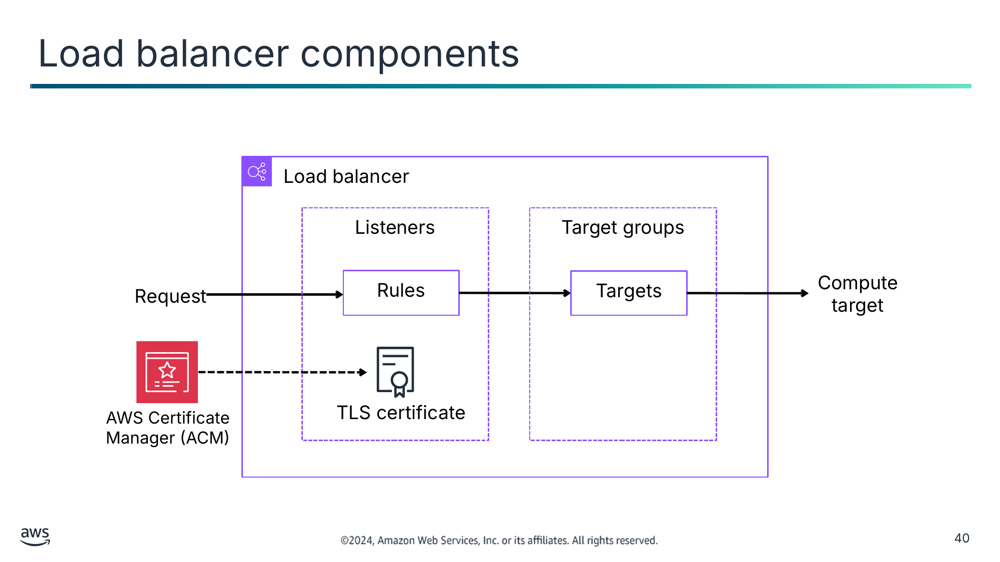

Текст зі схеми

Load balancer

Listeners

Target groups

Request

Rules

Targets

Compute target

AWS Certificate  
Manager (ACM)

TLS certificate

> **Нотатки:**
>
> |Slide number 40  
> |Instructor notes  
> |  
> |Student notes  
> A load balancer serves as the single point of contact for clients. The load balancer distributes incoming application traffic across multiple targets, such as EC2 instances, in multiple Availability Zones. This increases the availability of your application. You add one or more listeners to your load balancer.  
>
> A listener checks for connection requests from clients by using the protocol and port that you configure. The rules that you define for a listener determine how the load balancer routes requests to its registered targets. Each rule consists of a priority, one or more actions, and one or more conditions. When the conditions for a rule are met, then its actions are performed. You must define a default rule for each listener, and you can optionally define additional rules.  
>
> Some listeners such as HTTPS and TLS listeners require TLS server certificates on your load balancer to ensure that traffic is protected in transit. The HTTPS and TLS protocols use encryption to secure messages that are sent over shared networks.  
>
> AWS Certificate Manager (ACM) is a service that you can use to provision, manage, and deploy public and private SSL/TLS certificates for use on AWS services such as load balancers. SSL/TLS certificates are used to secure network communications and establish the identity of websites over the internet and resources on private networks. The load balancer uses a server certificate to end the frontend connection and then decrypt requests from clients before sending them to the targets. If you need to pass encrypted traffic to targets without the load balancer decrypting it, you can create a Network Load Balancer or Classic Load Balancer with a TCP listener. With a TCP listener, the load balancer passes encrypted traffic through to the targets without decrypting it.  
>
> Each target group routes requests to one or more registered targets, such as EC2 instances, by using the protocol and port number that you specify. You can register a target with multiple target groups, and you can configure health checks for each target group. Health checks are performed on all targets registered to a target group that is specified in a listener rule for your load balancer.  
>
> You define health check settings for your load balancer for each target group. Each target group uses the default health check settings unless you override them when you create the target group or modify them later on. After you specify a target group in a rule for a listener, the load balancer continually monitors the health of all targets registered with the target group that are in an Availability Zone enabled for the load balancer. The load balancer routes requests to the registered targets that are healthy.

---

## Слайд 41: High availability by using an Application Load Balancer and Amazon RDS Multi-AZ

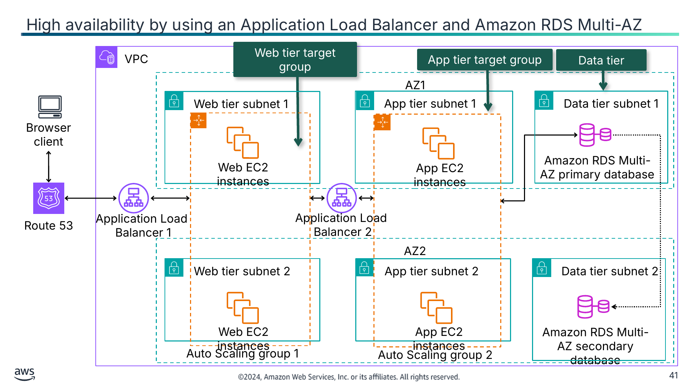

Текст зі схеми

VPC

Web tier target group

App tier target group

Data tier

AZ1

Web tier subnet 1

App tier subnet 1

Data tier subnet 1

Browser client

Amazon RDS Multi-AZ primary database

Web EC2 instances

App EC2 instances

Application Load  
Balancer 1

Application Load  
Balancer 2

Route 53

AZ2

Web tier subnet 2

App tier subnet 2

Data tier subnet 2

Web EC2 instances

App EC2 instances

Amazon RDS Multi-AZ secondary database

Auto Scaling group 1

Auto Scaling group 2

> **Нотатки:**
>
> |Slide number 41  
> |Instructor notes  
> |  
> |Student notes  
> An Application Load Balancer functions at the application layer, the seventh layer of the OSI model. After the load balancer receives a request, it evaluates the listener rules in order of priority to determine which rule to apply and then selects a target from the target group for the rule action. You can configure listener rules to route requests to different target groups based on the content of the application traffic. Routing is performed independently for each target group even when a target is registered with multiple target groups. You can configure the routing algorithm used at the target group level. The default routing algorithm is round robin which routes each request to the next target in the group. Alternatively, you can specify the routing algorithm for the least outstanding requests.  
>
> In the example on this slide, single points of failure have been eliminated. Application Load Balancer 1 is external facing and receives public HTTP and HTTPS traffic from a browser client routed through Route 53. It distributes traffic to the Web tier target group, which includes a fleet of EC2 instances in Auto scaling group 1 in Availability Zones AZ1 and AZ2.  
>
> If the health check for one EC2 instance fails, Application Load Balancer 1 will not send any traffic to the EC2 instance. It will send a unhealthy instance notification to Auto Scaling group 1 to end the instance and replace it with a healthy instance.  
>
> If there is a failure at the Availability Zone level, then Application Load Balancer 1 will send traffic to only the healthy EC2 instances in the other Availability Zone.  
>
> Similarly to Application Load Balancer 1, Application Load Balancer 2 follows the same high availability pattern. It is internal facing and receives private traffic from the Web tier target group. It distributes traffic to the App tier target group, which includes a fleet of EC2 instances in Auto Scaling group 2 in Availability Zones AZ1 and AZ2. This will protect the application against EC2 instance failure or Availability Zone failure.  
>
> The data tier has also implemented high availability by implementing an Amazon RDS Multi-AZ configuration. The primary database in AZ1 synchronously replicates data to the secondary database in AZ2. If the database fails or the Availability Zone has issues, then the secondary database is promoted to be the primary database, which makes it highly available.  
>
> This architecture can be duplicated to another Region in case of Regional issues. For more information, see the Planning for Disaster module.

---

## Слайд 42: High availability by using a Network Load Balancer

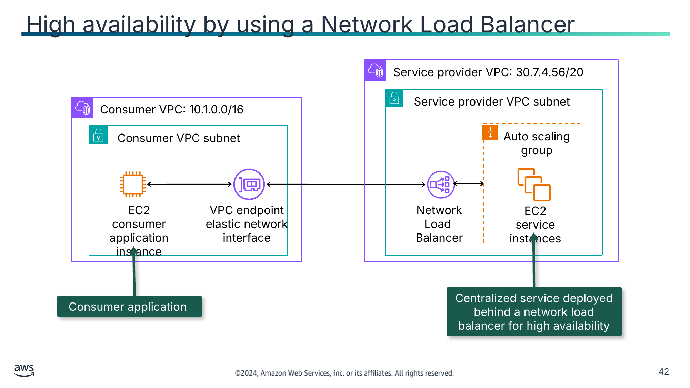

Текст зі схеми

Service provider VPC: 30.7.4.56/20

Consumer VPC: 10.1.0.0/16

Service provider VPC subnet

Consumer VPC subnet

Auto scaling group

EC2 consumer application instance

VPC endpoint

elastic network interface

Network Load  
Balancer

EC2 service instances

Consumer application

Centralized service deployed behind a network load balancer for high availability

> **Нотатки:**
>
> |Slide number 42  
> |Instructor notes  
> |  
> |Student notes  
> Network Load Balancers can be used to expose a centralized service. As you learned in the Connecting Networks module, the Consumer VPC uses the Service provider VPC for a specific service.  
>
> A Network Load Balancer functions at the fourth layer of the OSI model. It can handle millions of requests per second. Network Load Balancers support connections from clients over VPC peering, VPC endpoints, AWS managed VPN, AWS Direct Connect, and third-party VPN solutions. After the load balancer receives a connection request, it selects a target from the target group for the default rule. It attempts to open a TCP connection to the selected target on the port specified in the listener configuration.  
>
> Each Network Load Balancer receives a default DNS name with the following syntax: name-id.elb.region.amazonaws.com. An example is my-load-balancer-1234567890abcdef.elb.us-east-2.amazonaws.com. If you'd prefer to use a DNS name that is easier to remember, you can create a custom domain name and associate it with the DNS name for your load balancer. When a client makes a request by using this custom domain name, the DNS server resolves it to the DNS name for your load balancer.  
>
> You can create a target group with a single Application Load Balancer as the target and configure your Network Load Balancer to forward traffic to it. In this scenario, the Application Load Balancer takes over the load balancing decision as soon as traffic reaches it. This configuration combines the features of both load balancers. This means that you can use the layer 7 request-based routing feature of the Application Load Balancer in combination with features that the Network Load Balancer supports, such as endpoint services and static IP addresses. You can use this configuration for applications that need a single endpoint for multi-protocols, such as media services that use HTTP for signaling and RTP to stream content.

---

## Слайд 43: Security service by using a Gateway Load Balancer

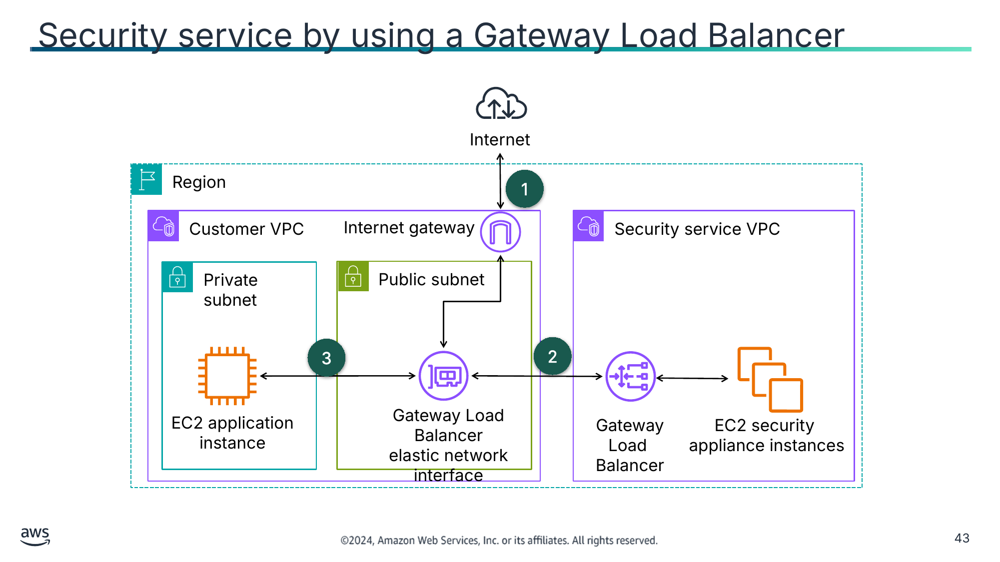

Текст зі схеми

Internet

Region

1

Customer VPC

Internet gateway

Security service VPC

Private subnet

Public subnet

3

2

EC2 application

instance

Gateway Load Balancer

elastic network interface

Gateway Load  
Balancer

EC2 security

appliance instances

> **Нотатки:**
>
> |Slide number 43  
> |Instructor notes  
> |  
> |Student notes  
> Image description: VPC 1 has a private subnet containing an EC2 instance and a public subnet with an attached Gateway Load Balancer endpoint and an internet gateway. VPC 2 has a Gateway Load Balancer and EC2 security appliance instance. End of image description.  
>
> The Gateway Load Balancer is a specific security solution to scan incoming and outgoing traffic by using virtual appliances.  
>
> A Gateway Load Balancer operates at the third layer of the OSI model, the network layer. It listens for all IP packets across all ports and forwards traffic to the target group that's specified in the listener rule. It maintains stickiness of flows to a specific target appliance by using 5-tuple (for TCP/UDP flows) or 3-tuple (for non-TCP/UDP flows). The Gateway Load Balancer and its registered virtual appliance instances exchange application traffic by using the GENEVE protocol:  
> All traffic entering VPC 1 through the internet gateway is first routed to the Gateway Load Balancer endpoint in VPC 1.  
> The traffic is then routed to the Gateway Load Balancer in VPC 2. The Gateway Load Balancer distributes the traffic to the Amazon EC2 security appliance for inspection. The security appliance responds to the Gateway Load Balancer, which returns the inspected traffic to the Gateway Load Balancer endpoint.  
> The Gateway Load Balancer endpoint sends the traffic to the EC2 application instance.  
>
> Similarly, all traffic leaving the EC2 application instance follows the same path as incoming traffic.  
>
> Gateway Load Balancers and Network Load Balancers perform different functions. A Gateway Load Balancer is a security solution that uses the GENEVE protocol, and a Network Load Balancer exposes services and  distributes network traffic across multiple servers.

---

## Слайд 44: Demo: Creating a Highly Available Application

- This demonstration uses Amazon EC2.
- In this demonstration, you will see how to do the following:
  - Create a highly available application with Elastic Load Balancing and Auto Scaling groups.
  - Create an Application Load Balancer.

> **Нотатки:**
>
> |Slide number 44  
> |Instructor notes  
> |This demo is an .mp4 file with captions. Students access it through the online course. The instructor guide includes the duration for each demo.  
> |  
> |Student notes  
> Find this recorded demo in your online course as part of this module.

---

## Слайд 45: Key takeaways: Using load balancers to create highly available environments

- ELB distributes traffic across multiple targets in one or more Availability Zones and monitors the health of registered targets with health checks.
- An Application Load Balancer is used for application architectures and operates at the OSI model application layer (layer 7).
- A Network Load Balancer is used for millions of concurrent, ultra-low latency requests and operates at the OSI model transport layer (layer 4).
- A Gateway Load Balancer is used to improve security, compliance, and policy controls and operates at the OSI model network layer (layer 3).

> **Нотатки:**
>
> |Slide number 45  
> |Instructor notes  
> |  
> |Student notes

---

## Слайд 46: Using Route 53 to create highly available environments

Implementing Monitoring, Elasticity, and High Availability

> **Нотатки:**
>
> |Slide number 46  
> |Instructor notes  
> |Route 53 is used for failover for architectures spanning multiple AWS Regions.  
> |  
> |Student notes  
> This section looks at how to use Route 53 to create highly available environments.

---

## Слайд 47: DNS lookups

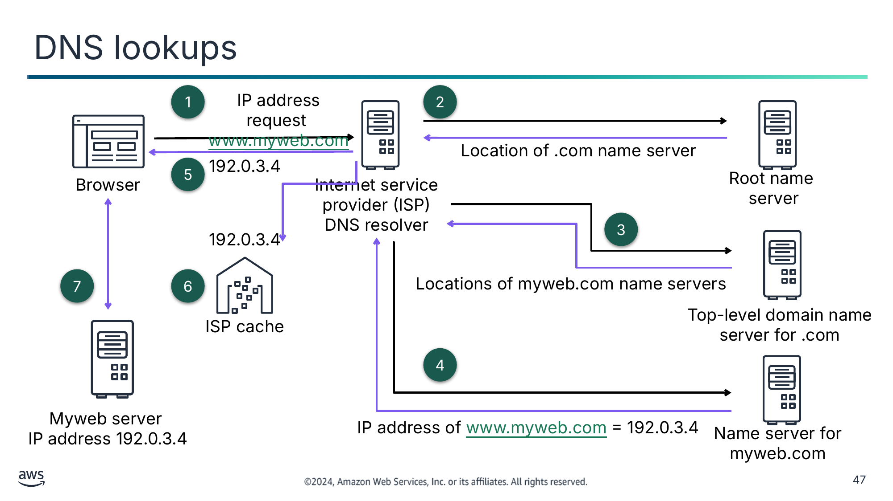

Текст зі схеми

1

IP address request [www.myweb.com](http://www.myweb.com/)

2

Location of .com name server

192.0.3.4

Browser

5

Internet service provider (ISP) DNS resolver

Root name

server

3

192.0.3.4

7

6

Locations of myweb.com name servers

Top-level domain name server for .com

ISP cache

4

Myweb server

IP address 192.0.3.4

IP address of [www.myweb.com](http://www.myweb.com/) = 192.0.3.4

Name server for myweb.com

> **Нотатки:**
>
> |Slide number 47  
> |Instructor notes  
> |  
> |Student notes  
> All computers on the Internet—from your smartphone or laptop to the servers that serve content for massive retail websites—find and communicate with one another by using IP addresses. When you open a web browser and go to a website, you don't have to remember and enter a long number. Instead, you can enter a domain name such as myweb.com and still end up in the right place.  
>
> The DNS is a globally distributed service that translates human readable names such as www.myweb.com into the numeric IP addresses such as 192.0.2.1 that computers use to connect to each other. The internet’s DNS works much like a phone book by managing the mapping between names and numbers. DNS servers translate requests for names into IP addresses, controlling which server an end user will reach when they enter a domain name into their web browser. These requests are called queries.  
>
> Clients typically do not make queries directly to authoritative DNS services. Instead, clients generally connect to another type of DNS service known a resolver, or a recursive DNS service. A recursive DNS service doesn't own any DNS records but acts as an intermediary that can get the DNS information on your behalf. If a recursive DNS service has the DNS reference cached or stored for a period of time, then it answers the DNS query by providing the source or IP information. If not, it passes the query to one or more authoritative DNS servers to find the information.  
>
> The example on this slide has the following steps:  
> A user opens a web browser, enters www.myweb.com into the address bar, and presses Enter. The request for www.myweb.com is routed to a DNS resolver, which is typically managed by the user's internet service provider (ISP).  
> The DNS resolver for the ISP forwards the request for www.myweb.com to a DNS root name server, which returns the location of the top-level domain (TLD) name server for .com.  
> The DNS resolver for the ISP forwards the request for www.myweb.com again, this time to one of the TLD name servers for .com domains. The name server for .com domains responds to the request with the names of multiple name servers that are associated with the example.com domain.  
> The DNS resolver for the ISP chooses a name server and forwards the request for www.myweb.com to that name server. The name server looks in the myweb.com hosted zone for the www.myweb.com record, gets the associated value (such as the IP address for a web server, 192.0.3.4), and returns the IP address to the DNS resolver.  
> The DNS resolver for the ISP finally has the IP address that the user needs. The resolver returns that value to the web browser.  
> The DNS resolver also caches the IP address for myweb.com for an amount of time that you specify so that it can respond more quickly the next time someone browses to myweb.com.  
> The web browser sends a request for www.myweb.com to the IP address that it got from the DNS resolver. The myweb server at 192.0.3.4 returns the web page for www.myweb.com to the web browser, and the web browser displays the page.  
>
> For more information, see What is DNS? on the content resources page of your online course.

---

## Слайд 48: Route 53

- Is a DNS web service that manages domain name registrations and provides hosted zones.
- Provides authoritative name servers for DNS resolution
- Performs DNS routing to route traffic to healthy endpoints
- Performs health checks against IP addresses or domains to manage Availability Zone or Regional failovers
- Can monitor CloudWatch alarms
- Supports multiple routing options

Route 53

> **Нотатки:**
>
> |Instructor notes  
> |  
> |Student notes  
> You can implement multi-Region high availability and fault tolerance in your network architecture by using Route 53. Route 53 is a highly available and scalable DNS web service. You can use Route 53 to perform three main functions in any combination: domain registration, DNS routing, and health checking. When users request your website or web application, for example, by entering the name of your domain in a web browser, Route 53 helps to route users to your resources. Those resources might be an S3 bucket or a web server in your data center.  
>
> Route 53 offers domain name registration. You can purchase and manage domain names such as myweb.com, and Route 53 automatically configures DNS settings for your domains. You can create a hosted zone in Route 53. A hosted zone is a container for records, which include information about how you want to route traffic for a domain (such as myweb.com) and all of its subdomains (such as www.myweb.com, retail.myweb.com, and accounting.myweb.com). A hosted zone has the same name as the corresponding domain.  
>
> Route 53 provides name servers to form part of the DNS that help to translate domain names into IP addresses. Route 53 effectively connects user requests to infrastructure that runs in AWS such as EC2 instances, ELB load balancers, or S3 buckets. You can also use Route 53 to route users to infrastructure outside AWS.  
>
> Route 53 also perform health checks to monitor the health of your resources, such as web servers and email servers. You can configure endpoint health checks or calculated health checks that monitor other health checks. You can also configure CloudWatch alarm health checks to monitor the status of CloudWatch metrics. Amazon Route 53 Application Recovery Controller now offers zonal autoshift, a feature that you can enable to safely and automatically shift your application’s traffic away from an AWS Availability Zone when AWS identifies a potential failure affecting that Availability Zone. For failures such as power and networking outages, zonal autoshift improves the availability of your application by shifting your application traffic away from an affected Availability Zone to healthy Availability Zones.  
>
> Route 53 offers various routing options, which can be combined with DNS failover to enable low-latency, fault-tolerant architectures. Amazon Route 53 Application Recovery Controller gives you insights into whether your applications and resources are ready for recovery and helps you manage and coordinate failover. Health checks in Amazon Route 53 Application Recovery Controller are associated with routing controls, which are on/off switches. You configure each routing control health check with a failover DNS record. Then you can update your routing controls in Amazon Route 53 Application Recovery Controller to reroute traffic and fail over your applications, for example, across Availability Zones or AWS Regions.

---

## Слайд 49: DNS lookups with Route 53

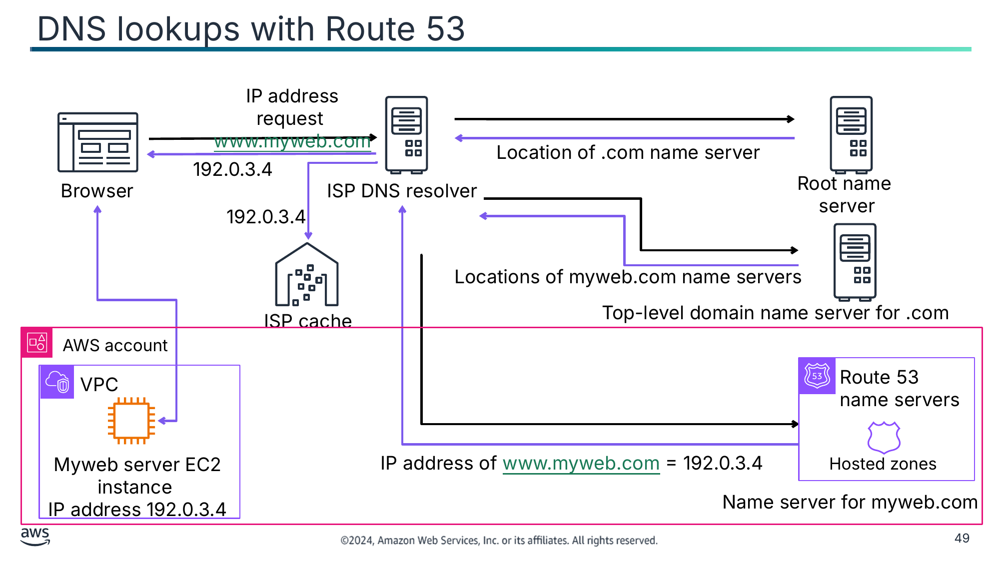

Текст зі схеми

IP address request [www.myweb.com](http://www.myweb.com/)

Location of .com name server

192.0.3.4

Root name

server

Browser

ISP DNS resolver

192.0.3.4

Locations of myweb.com name servers

Top-level domain name server for .com

ISP cache

AWS account

VPC

Route 53 name servers

Myweb server EC2 instance

IP address 192.0.3.4

IP address of [www.myweb.com](http://www.myweb.com/) = 192.0.3.4

Hosted zones

Name server for myweb.com

> **Нотатки:**
>
> |Slide number 49  
> |Instructor notes  
> |  
> |Student notes  
> The diagram on this slide is the same DNS lookup diagram as described earlier in this section. However, in this diagram, the myweb server is hosted on an EC2 instance within an Amazon VPC, and Route 53 is the name server.  
>
> Route 53 name servers are the authoritative name servers for every domain that uses Route 53 as the DNS service. The name servers know how you want to route traffic for your domain and subdomains based on the records that you created in the hosted zone for the domain. Route 53 name servers store the hosted zones for the domains that use Route 53 as the DNS service. For example, if a Route 53 name server receives a request for www.myweb.com, it finds that record and returns the IP address, such as 192.0.3.4, that is specified in the record.

---

## Слайд 50: Route 53 routing policies

Simple

Weighted

Latency

Failover

Geoproximity

Geolocation

Multivalue answer

IP-based

> **Нотатки:**
>
> |Slide number 50  
> |Instructor notes  
> |  
> |Student notes  
> Route 53 supports multiple types of routing policies, which determine how Route 53 responds to queries.  
>
> You can use simple routing to configure standard DNS records with no special Route 53 routing, such as weighted or latency. With simple routing, you typically route traffic to a single resource (for example, to a web server for your website).  
>
> You can use weighted routing to associate multiple resources with a single domain name or subdomain name and choose how much traffic is routed to each resource. This can be useful for a variety of purposes, including load balancing and testing new versions of software. To configure weighted routing, you create records that have the same name and type for each of your resources. You assign each record a relative weight that corresponds with how much traffic you want to send to each resource. Route 53 sends traffic to a resource based on the weight that you assign to the record as a proportion of the total weight for all records in the group.  
>
> If your application is hosted in multiple AWS Regions, you can improve performance for your users by serving their requests from the AWS Region that provides the lowest latency. To use latency-based routing, you create latency records for your resources in multiple AWS Regions. When Route 53 receives a DNS query for your domain or subdomain, it determines which AWS Regions you've created latency records for, determines which Region gives the user the lowest latency, and then selects a latency record for that Region.  
>
> You can use failover routing to route traffic to a resource when the resource is healthy or to a different resource when the first resource is unhealthy. The primary and secondary records can route traffic to anything from an S3 bucket that is configured as a website to a complex tree of records.  
>
> Geoproximity routing gives Route 53 the ability to route traffic to your resources based on the geographic location of your users and your resources. You can also optionally choose to route more traffic or less traffic to a given resource by specifying a value, known as a bias. A bias expands or shrinks the size of the geographic Region from which traffic is routed to a resource. To use geoproximity routing, you must use Route 53 traffic flow. You create geoproximity rules for your resources, and these rules allocate an area from your resources to be used for routing to the resource.  
>
> You can use geolocation routing to choose the resources that serve your traffic based on the geographic location of your users, meaning the location that DNS queries originate from. For example, you might want all queries from Europe to be routed to an ELB load balancer in the Frankfurt Region. When you use geolocation routing, you can localize your content and present some or all of your website in the language of your users. You can also use geolocation routing to restrict the distribution of content to only the locations in which you have distribution rights. You can specify geographic locations by continent, by country, or by state in the United States.  
>
> You can use multivalue answer routing to configure Route 53 to return multiple values, such as IP addresses for your web servers, in response to DNS queries. You can specify multiple values for almost any record. You can also use multivalue answer routing to check the health of each resource so that Route 53 returns values for only healthy resources. It's not a substitute for a load balancer, but the ability to return multiple IP addresses that have passed health checks is a way to use DNS to improve availability and load balancing.  
>
> With IP-based routing in Route 53, you can fine-tune your DNS routing by using your understanding of your network, applications, and clients to make the best DNS routing decisions for your end users. IP-based routing gives you granular control to optimize performance or reduce network costs by uploading your data to Route 53 in the form of user-IP-to-endpoint mappings. IP-based routing offers you the ability to optimize routing based on specific knowledge of your customer base. For example, a global video content provider might want to route end users from a particular ISP.

---

## Слайд 51: Demo: Amazon Route 53: Simple Routing

- This demonstration uses Amazon Route 53.
- In this demonstration, you will see how to do the following:
  - Configure Route 53 to evenly distribute HTTP request between two EC2 instances.
  - Define a Route 53 record set.

> **Нотатки:**
>
> |Slide number 51  
> |Instructor notes  
> |This demo is an .mp4 file with captions. Students access it through the online course. The instructor guide includes the duration for each demo.  
> |  
> |Student notes  
> Find this recorded demo in your online course as part of this module.

---

## Слайд 52: Demo: Amazon Route 53: Failover Routing

- This demonstration uses Amazon Route 53.
- In this demonstration, you will see how to do the following:
  - Use Route 53 to direct traffic to two availability zones for use in failures.
  - Define a Route 53 Health Check.
  - Send Route 53 Health Check alerts to an administrator.

> **Нотатки:**
>
> |Slide number 52  
> |Instructor notes  
> |This demo is an .mp4 file with captions. Students access it through the online course. The instructor guide includes the duration for each demo.  
> |  
> |Student notes  
> Find this recorded demo in your online course as part of this module.

---

## Слайд 53: Demo: Amazon Route 53: Geolocation Routing

- This demonstration uses Amazon Route 53.
- In this demonstration, you will see how to do the following:
  - Use geolocation routing to serve traffic based on geographic location.
  - Localize content for a geographic groups of users.

> **Нотатки:**
>
> |Slide number 53  
> |Instructor notes  
> |Instructor notes  
> |This demo is an .mp4 file with captions. Students access it through the online course. The instructor guide includes the duration for each demo.  
> |  
> |Student notes  
> Find this recorded demo in your online course as part of this module.

---

## Слайд 54: Route 53 public and private hosted zones

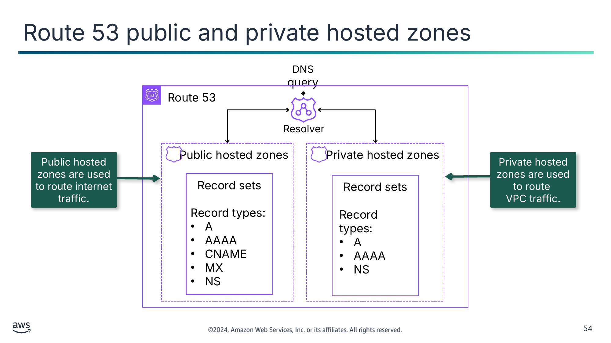

Public hosted zones are used to route internet traffic.

Private hosted zones are used to route

VPC traffic.

Текст зі схеми

DNS query

Route 53

Resolver

Public hosted zones

Private hosted zones

Record sets

Record types:

- A
- AAAA
- CNAME
- MX
- NS

Record sets

Record types:

- A
- AAAA
- NS

> **Нотатки:**
>
> |Slide number 54  
> |Instructor notes  
> |This is a simplified overview of Route 53 capability. For more information, see “Configuring Amazon Route 53 as Your DNS service” in the resource list.  
> |  
> |Student notes  
> To configure Route 53 to route traffic to your resources, you have to create a public or a private hosted zone. A hosted zone is a container for multiple records, and records contain information about how you want to route traffic for a specific domain (such as example.com) and its subdomains (such as acme.example.com and zenith.example.com). Create a public hosted zone if you want to route internet traffic to your resources: for example, so that your customers can view the company website that you're hosting on EC2 instances. Create a private hosted zone if you want to route traffic within a customer VPC.  
>
> Next you create records in the hosted zone. Records define where you want to route traffic for each domain name or subdomain name. For example, to route traffic for www.example.com to a web server in your data center, you typically create a www.example.com record in the example.com hosted zone.  
>
> When you create a record, you choose a routing policy and an optional failover destination. Next, you choose a record type. Some of the most commonly used record types are A, AAAA, CNAME, MX, and NS records.  
>
> You use an A record to route traffic to a resource, such as a web server, by using an IPv4 address. You use an AAAA record to route traffic to a resource, such as a web server, by using an IPv6 address in colon-separated hexadecimal format. A CNAME record maps DNS queries for the name of the current record, such as acme.example.com, to another domain (example.com or example.net) or subdomain (acme.example.com or zenith.example.org). An MX record specifies the names of your mail servers and, if you have two or more mail servers, the priority order. An NS record identifies the name servers for the hosted zone. For more information, see "Supported DNS Record Types" in the Amazon Route 53 Developer Guide. The link is in your course resources.  
>
> Route 53 Resolver responds recursively to DNS queries from AWS resources for public records, Amazon VPC specific DNS names, and Route 53 private hosted zones and is available by default in all VPCs. A Route 53 Resolver automatically answers DNS queries for the following:  
> Local VPC domain names for EC2 instances (for example, ec2-192-0-2-44.compute-1.amazonaws.com)  
> Records in private hosted zones (for example, acme.example.com)  
> Public domain name lookups against public name servers on the internet

---

## Слайд 55: Multi-Region failover

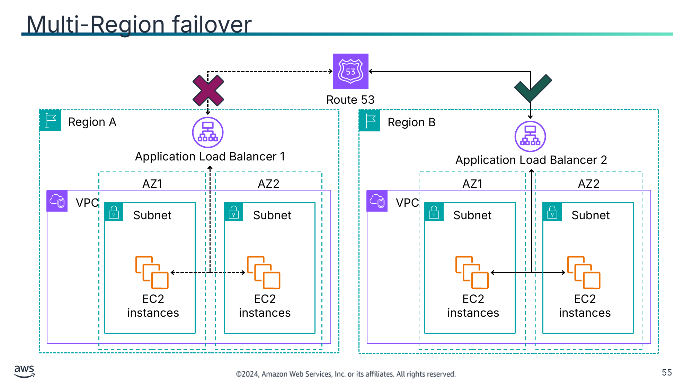

Текст зі схеми

Route 53

Region A

Region B

Application Load Balancer 1

Application Load Balancer 2

AZ1

AZ2

AZ1

AZ2

VPC

VPC

Subnet

Subnet

Subnet

Subnet

EC2 instances

EC2 instances

EC2 instances

EC2 instances

> **Нотатки:**
>
> |Slide number 55  
> |Instructor notes  
> |  
> |Student notes  
> If you have multiple resources that perform the same function, you can configure DNS failover so that Route 53 will route your traffic from an unhealthy resource to a healthy resource. For example, if you have two resources and one becomes unhealthy, Route 53 can route traffic to the other resource. In the example on this slide, Application Load Balancer 1 is not healthy in Region A, so Route 53 directs traffic to the healthy Application Load Balancer 2 in Region B.  
>
> Use an active-passive failover configuration when you want a primary resource or group of resources to be available the majority of the time and you want a secondary resource or group of resources to be on standby in case all the primary resources become unavailable. When responding to queries, Route 53 includes only the healthy primary resources. If all the primary resources are unhealthy, Route 53 begins to include only the healthy secondary resources in response to DNS queries.  
>
> To create an active-passive failover configuration with one primary record and one secondary record, you create the records and specify failover for the routing policy. When the primary resource is healthy, Route 53 responds to DNS queries by using the primary record. When the primary resource is unhealthy, Route 53 responds to DNS queries by using the secondary record.  
>
> Route 53 can check the health of your resources in both simple and complex configurations. In simple configurations, you create a group of records that all have the same name and type, such as a group of weighted records with a type of A for example.com. You then configure Route 53 to check the health of the corresponding resources. Route 53 responds to DNS queries based on the health of your resources.  
>
> In more complex configurations, you create a tree of records that route traffic based on multiple criteria. For example, if latency for your users is your most important criterion, then you might use latency alias records to route traffic to the Region that provides the best latency. The latency alias records might have weighted records in each Region as the alias target. The weighted records might route traffic to EC2 instances based on the instance type. As with a simple configuration, you can configure Route 53 to route traffic based on the health of your resources.

---

## Слайд 56: Key takeaways: Using Route 53 to create highly available environments

- Route 53 is a DNS service that does the following:
  - Manages domain name registrations
  - Provides hosted zones and authoritative name servers
  - Performs DNS routing and health checks
- Route 53 supports multiple routing options, including the following:
  - Simple routing
  - Weighted routing
  - Latency routing
  - Failover routing
  - Geoproximity routing
  - Geolocation routing
  - Multivalue answer routing
  - IP-based routing

> **Нотатки:**
>
> |Slide number 56  
> |Instructor notes  
> |  
> |Student notes

---

## Слайд 57: Guided Lab: Creating a Highly Available Environment (High availability lab)

> **Нотатки:**
>
> |Slide number 57  
> |Instructor notes  
> |  
> |Student notes  
> You will now complete a guided lab. The next slide summarizes what you will do in the lab, and you will find the detailed instructions in the lab environment.

---

## Слайд 58: High availability lab tasks:

- In this lab, you perform the following main tasks:
  - Inspect a provided VPC.
  - Create an Application Load Balancer.
  - Create an Amazon EC2 Auto Scaling group by using a launch template.
  - Update security groups.
  - Test the application.
  - Test the application for high availability.
  - This lab includes the following optional tasks:
  - Make the database highly available.
  - Configure a highly available NAT gateway.

> **Нотатки:**
>
> |Slide number 58  
> |Instructor notes  
> |  
> |Student notes  
> Access the lab environment through your online course to get additional details and complete the lab.

---

## Слайд 59: Debrief: High availability lab

- How did you determine which instances your Application Load Balancer should send traffic to?
- How did you determine the characteristics of the instances that would be launched in your Auto Scaling group?

> **Нотатки:**
>
> |Slide number 59  
> |Instructor notes  
> |Relevant before and after architectural diagrams are included in the lab instructions for each lab. You might find it helpful to pull the lab diagrams up as part of debriefing this lab.  
> |  
> |Suggested responses for question 1: How did you determine which instances your Application Load Balancer should send traffic to?  
> |  
> |When you created the Application Load Balancer, you defined the target group to be Inventory-app.  
> |  
> |Target groups define where to send traffic that enters the load balancer. The Application Load Balancer can send traffic to multiple target groups based on the URL of the incoming request. In this lab, your web application used only one target group.  
> |  
> |Suggested responses for question 2: How did you determine the characteristics of the instances that would be launched in your Auto Scaling group?  
> |  
> |You created a launch configuration. The launch configuration defines the type of instances that Amazon EC2 Auto Scaling should launch. This configuration includes details such as the AMI and instance type. The interface of the launch configuration looks similar to when you launch an EC2 instance. However, instead of launching an instance, it stores the configuration for later use.  
> |  
> |Student notes  
> Your instructor might review these questions with you, or you might review them on your own. Use this opportunity to extend your thinking about the tasks that you performed during the lab.

---

## Слайд 60: Café lab: Creating a Scalable and Highly Available Environment for the Café (High availability café lab)

> **Нотатки:**
>
> |Slide number 60  
> |Instructor notes  
> |  
> |Student notes  
> You will now complete a lab. The next slides summarize what you will do in the lab, and you will find the detailed instructions in the lab environment.

---

## Слайд 61: The evolving café architecture: version 6

| Architecture Version | Business reason for update | Technical Requirements and Architecture Update |
|---|---|---|
| V1 | Create a static website for a small business. | Host the website on Amazon S3. |
| V2 | Add online ordering. | Deploy the web application and database on Amazon EC2. |
| V3 | Reduce the effort to maintain the database and secure its data. | Separate the web and database layers. Migrate the database to Amazon RDS on a private subnet. |
| V4 | Enhance the security of the web application. | Use Amazon VPC features to configure and secure public and private subnets. |
| V5 | Create separate access mechanisms based on role. | Add IAM groups and attach resource polices to application resources. Add IAM users to groups based on role. |
| V6 | Ensure that the website can handle an expected increase in traffic. | Add a load balancer, implement auto scaling on the EC2 instances, and distribute compute and database instances across two Availability Zones. |
| V7 | Module 11 info |  |
| V8 | Module 14 info |  |

> **Нотатки:**
>
> |Instructor notes  
> |In this café lab, students will start from… and update to….  
> |Share or show the architectures.svg file, and highlight the sections of the architecture that will be modified or added with this lab.  
> |  
> |Student notes  
> The café’s business story for version 6 should be added here.

---

## Слайд 62: High availability Café lab tasks

- In this lab, you will perform the following main tasks:
  - Add a load balancer
  - Implement auto scaling on the EC2 instances
  - Distribute compute and database instances across two Availability Zones
- Open your lab environment to start the lab and find additional details about the tasks that you will perform

> **Нотатки:**
>
> |Slide number 62  
> |Instructor notes  
> |  
> |Student notes  
> Access the lab environment through your online course to get additional details and complete the lab.

---

## Слайд 63: Debrief: High availability café lab

- Where did you determine the AMI, instance type, key pair, and security groups that would be used to launch EC2 instances in your Auto Scaling group?
- When you conducted a stress test on your instances, why did the Auto Scaling group launch more instances?

> **Нотатки:**
>
> |Slide number 63  
> |Instructor notes  
> |An architectural diagram for this lab is included as part of the CafeLabDiagrams.svg file included in the educator files directory. Share this file with students so that they can zoom in and out of each phase of the architecture for a fuller picture as you debrief the lab.  
> |  
> |Suggested responses for question 1: Where did you determine the AMI, instance type, key pair, and security groups that would be used to launch EC2 instances in your Auto Scaling group?  
> |  
> |You made these configurations in the launch template. A launch template is similar to a launch configuration in that it specifies instance configuration information. It includes the ID of the AMI, the instance type, a key pair, security groups, and other parameters used to launch EC2 instances. However, defining a launch template instead of a launch configuration gives you the ability to have multiple versions of a launch template.  
> |  
> |Suggested responses for question 2: When you conducted a stress test on your instances, why did the Auto Scaling group launch more instances?  
> |  
> |The Auto Scaling group launched more instances because your target tracking scaling policy used the average CPU utilization as the tracking metric. The target value was 25 percent. This means that when you conducted the stress test, the target value exceeded 25 percent of the average CPU utilization (tracking metric). Therefore, your Auto Scaling group launched more instances to help decrease the target value.  
> |  
> |Student notes  
> Your instructor might review these questions with you, or you might review them on your own. Use this opportunity to extend your thinking about the tasks that you performed during the lab.

---

## Слайд 64: Applying AWS Well-Architected Framework principles to highly available systems

Implementing Monitoring, Elasticity, and High Availability

> **Нотатки:**
>
> |Slide number 64  
> |Instructor notes  
> |  
> |Student notes  
> This section looks at how to apply the AWS Well-Architected Framework principles to highly available systems.

---

## Слайд 65: Well-Architected Framework best practices for highly available systems

> **Нотатки:**
>
> |Slide number 65  
> |Instructor notes  
> |The remaining slides in this section present examples that highlight how the material in this module aligns to the Well-Architected Framework best practices. Optionally, you might ask students to visit the Well-Architected Framework website and find the best practices that they think connect to the material that is presented in this module, using this section as a starting point.  
> |  
> |Student notes  
> The AWS Well-Architected Framework has six pillars, and each pillar includes best practices and a set of questions that you should consider when you architect cloud solutions. This section highlights a few best practices from the reliability and performance efficiency pillars that are most relevant to this module. For a complete set of best practices by pillar on the Well-Architected Framework website, see the content resources section of your online course.  
>
> This section focuses on high availability. A system that is available is capable of delivering the designed functionality at a given point in time. Highly available systems are those that can withstand some measure of degradation while still remaining available.

---

## Слайд 66: Best practice approach: Failure management – use fault isolation to protect your workload

**Best practices**

Deploy the workload to multiple locations.

Automate recovery for components constrained to a single location.

> **Нотатки:**
>
> |Slide number 66  
> |Instructor notes  
> |  
> |Student notes  
> To ensure that failures do not affect a whole system, use fault isolation boundaries. Fault isolation boundaries limit the effect of a failure within a workload to a limited number of components. The failure doesn’t affect components outside the boundary. By using multiple fault isolation boundaries, you can limit the impact on your workload.  
>
> Deploy the workload to multiple locations: Distribute workload data and resources across multiple Availability Zones or, where necessary, across AWS Regions. These locations can be as diverse as required. One of the bedrock principles for service design in AWS is avoiding single points of failure in underlying physical infrastructure. This motivates users to build software and systems that use multiple Availability Zones and are resilient to the failure of a single zone. Similarly, systems are built to be resilient to the failure of a single compute node, single storage volume, or single instance of a database. When building a system that relies on redundant components, it’s important to ensure that the components operate independently and, in the case of AWS Regions, autonomously.  
>
> Automate recovery for components constrained to a single location: If the best practice to deploy the workload to multiple locations is not possible due to technological constraints, you must implement an alternate path to resiliency. You must automate the ability to recreate necessary infrastructure, redeploy applications, and recreate necessary data for these cases. Deploy your instances or containers by using automatic scaling when possible. If you cannot use automatic scaling, use automatic recovery for EC2 instances or implement self-healing automation based on Amazon EC2 or ECS container lifecycle events. Use Amazon EC2 Auto Scaling groups for instances and container workloads that have no requirements for a single instance IP address, private IP address, Elastic IP address, and instance metadata.  
>
> In this module, you've learned about a number of AWS services that support these best practices, including Amazon EC2 Auto Scaling and Amazon RDS Multi-AZ deployments.

---

## Слайд 67: Best practice approach: Failure management – design your workload to withstand component failures

**Best practices**

Fail over to healthy resources.

Send notifications when events impact availability.

> **Нотатки:**
>
> |Slide number 67  
> |Instructor notes  
> |  
> |Student notes  
> It is a best practice to have a backup plan if resources are impaired. When designing a service, always distribute the load across resources, Availability Zones, or Regions. Therefore, shifting traffic to the remaining healthy resources can mitigate the failure of an individual resource or impairment. Consider how services are discovered and routed to in the event of a failure.  
>
> Fail over to healthy resources: If a resource failure occurs, healthy resources should continue to serve requests. For location impairments (such as Availability Zone or AWS Region), ensure that you have systems in place to fail over to healthy resources in unimpaired locations. When designing a service, always distribute the load across resources, Availability Zones, or Regions. Therefore, shifting traffic to the remaining healthy resources can mitigate the failure of an individual resource or impairment. Consider how services are discovered and routed to in the event of a failure. The patterns and designs that allow for the failover vary for each AWS platform service. Many AWS managed services are deployed in multiple Availability Zones such as Lambda, Aurora, and DynamoDB. Other AWS services, such as Amazon EC2 and Amazon Elastic Kubernetes Service (Amazon EKS), require specific best practice designs to support the failover of resources or data storage across Availability Zones. Monitoring should be set up to check that the failover resource is healthy, track the progress of the resources failing over, and monitor business process recovery. The desired outcome is that systems are capable of automatically or manually using new resources to recover from degradation.  
>
> Send notifications when events impact availability: Notifications are sent upon the detection of thresholds breached even if the event causing the issue was automatically resolved. Automated healing helps make your workload reliable. However, it can also obscure underlying problems that need to be addressed. Implement appropriate monitoring and events so that you can detect patterns of problems, including those addressed by auto healing, so that you can resolve the root cause of issues. Resilient systems are designed so that degradation events are immediately communicated to the appropriate teams. These notifications should be sent through one or many communication channels. The desired outcome is to send alerts immediately to operations teams when thresholds are breached, such as error rates, latency, or other critical key performance indicator (KPI) metrics, so that these issues are resolved as soon as possible and user impact is avoided or minimized.  
>
> In this module, you've learned about a number of AWS services that support these best practices, including Route 53, CloudWatch, and Amazon EC2 Auto Scaling.

---

## Слайд 68: Best practice approach: Compute and hardware

**Best practices**

Scale your compute resources dynamically.

> **Нотатки:**
>
> |Slide number 68  
> |Instructor notes  
> |  
> |Student notes  
> Automation is key in assigning enough resources for your workload. The optimal compute choice for a particular workload can vary based on application design, usage patterns, and configuration settings. Architectures might use different compute choices for various components and allow different features to improve performance. Selecting the wrong compute choice for an architecture can lead to lower performance efficiency.  
>   
> Scale your compute resources dynamically: AWS provides the flexibility to scale your resources up or down dynamically through a variety of scaling mechanisms in order to meet changes in demand. Combined with compute-related metrics, dynamic scaling allows workloads to automatically respond to changes and use the optimal set of compute resources to achieve its goal. You must ensure that workload deployments can handle both scale-up and scale-down events. You can use a number of different approaches to match the supply of resources with demand.  
> Target-tracking approach: Monitor your scaling metric, and automatically increase or decrease capacity as you need it.  
> Predictive scaling: Scale in anticipation of daily and weekly trends.  
> Schedule-based approach: Set your own scaling schedule according to predictable load changes.  
> Service scaling: Choose services such as serverless services that automatically scale by design.  
>
> In this module, you've learned about a number of AWS services that support these best practices, including ELB, CloudWatch, and Amazon EC2 Auto Scaling.

---

## Слайд 69: Key takeaways: Applying AWS Well-Architected Framework principles to high availability

- Deploy the workload to multiple locations.
- Automate recovery for components constrained to a single location.
- Fail over to healthy resources.
- Send notifications when events impact availability.
- Scale your compute resources dynamically.

> **Нотатки:**
>
> |Slide number 69  
> |Instructor notes  
> |This is not an exhaustive list of best practices as covered in the AWS Well-Architected Framework best practices. These are key takeaways to explain best practices covered in the module.  
> |  
> |Student notes

---

## Слайд 70: Module wrap-up

Implementing Monitoring, Elasticity, and High Availability

> **Нотатки:**
>
> |Slide number 70  
> |Instructor notes  
> |  
> |Student notes  
> This section summarizes what you have learned and brings the module to a close.

---

## Слайд 71: Module summary

This module prepared you to do the following:

- Examine how reactive architectures use Amazon CloudWatch and Amazon EventBridge to monitor metrics and facilitate notification events.
- Use Amazon EC2 Auto Scaling within an architecture to promote elasticity and create a highly available environment.
- Determine how to scale your database resources.
- Identify a load balancing strategy to create a highly available environment.
- Use Amazon Route 53 for DNS failover.
- Use the AWS Well-Architected Framework principles when designing highly available systems.

> **Нотатки:**
>
> |Slide number 71  
> |Instructor notes  
> |  
> |Student notes

---

## Слайд 72: Considerations for the café

- Discuss how the café lab in this module answered the key questions and decisions presented at the start of this module for the café business.

---

## Слайд 73: Module knowledge check

- The knowledge check is delivered online within your course.
- The knowledge check includes 10 questions based on the material presented on the slides and in the slide notes.
- You can retake the knowledge check as many times as you like.

> **Нотатки:**
>
> |Slide number 73  
> |Instructor notes  
> |  
> |Student notes  
> Use your online course to access the knowledge check for this module.

---

## Слайд 74: Sample exam question

A web application gives customers the ability to upload orders to an Amazon S3 bucket. The resulting Amazon S3 events initiate an AWS Lambda function that inserts a message into an Amazon Simple Queue Service (Amazon SQS) queue. A single Amazon EC2 instance reads the messages from the queue, processes them, and stores them in an Amazon DynamoDB table partitioned by unique order ID. Next month, traffic is expected to increase by a factor of 10, and a solutions architect is reviewing the architecture for possible scaling problems. Which component is MOST likely to need re-architecting to be able to scale to accommodate the new traffic?

Identify the key words and phrases before continuing.

The following are the keywords and phrases:

- A single EC2 instance
- Able to scale

> **Нотатки:**
>
> |Slide number 74  
> |Instructor notes  
> |The keywords section is animated to be revealed on click.  
> |  
> |Student notes  
> The question notes the need to scale to meet increasing traffic and that there is a single EC2 instance reading from the queue.

---

## Слайд 75: Sample exam question: Response choices

A web application gives customers the ability to upload orders to an Amazon S3 bucket. The resulting Amazon S3 events initiate an AWS Lambda function that inserts a message into an Amazon Simple Queue Service (Amazon SQS) queue. A single Amazon EC2 instance reads the messages from the queue, processes them, and stores them in an Amazon DynamoDB table partitioned by unique order ID. Next month, traffic is expected to increase by a factor of 10, and a solutions architect is reviewing the architecture for possible scaling problems. Which component is MOST likely to need re-architecting to be able to scale to accommodate the new traffic?

**Choice**

**Response**

**A**

Lambda function

**B**

SQS queue

**C**

EC2 instance

**D**

DynamoDB table

> **Нотатки:**
>
> |Slide number 75  
> |Instructor notes  
> |  
> |Student notes  
> Use the keywords that you identified on the previous slide, and review each of the possible responses to determine which one best addresses the question.

---

## Слайд 76: Sample exam question: Answer

The answer is C.

**Choice**

**Response**

**C**

EC2 instance

> **Нотатки:**
>
> |Slide number 76  
> |Instructor notes  
> |  
> |Student notes  
> Choice A (Lambda function), B (SQS queue), and D (DynamoDB table) are all managed services that can be configured to scale or that scale automatically.  
>
> Response C (EC2 instance) is the most likely part of this architecture to need an update. A single EC2 instance does not scale and is a single point of failure in the architecture. A better solution would be to have EC2 instances in an Auto Scaling group across two Availability Zones and have them read messages from the queue.

---

## Слайд 77: Thank you

Corrections, feedback, or other questions?

Contact us at [https://support.aws.amazon.com/#/contacts/aws-academy](https://support.aws.amazon.com/#/contacts/aws-academy).

> **Нотатки:**
>
> |Slide number 77  
> |Instructor notes  
> |  
> |Student notes  
> That concludes this module. The Content Resources page of your course includes links to additional resources that are related to this module.
