## Слайд 1: Впровадження моніторингу, еластичності та високої доступності (Implementing Monitoring, Elasticity, and High Availability)

AWS Academy Cloud Architecting

> **Нотатки:**
>
> |Нотатки для інструктора  
> |  
> |Нотатки для студента

---

## Слайд 2: Вступ

Впровадження моніторингу, еластичності та високої доступності

> **Нотатки:**
>
> |Нотатки для інструктора  
> |  
> |Нотатки для студента  
> Цей вступний розділ описує вміст модуля.

---

## Слайд 3: Цілі модуля

Цей модуль готує вас до такого:

- Вивчати, як реактивні архітектури використовують Amazon CloudWatch і Amazon EventBridge для відстеження метрик та полегшення подій сповіщення.
- Використовувати Amazon EC2 Auto Scaling в архітектурі для сприяння еластичності та створення високодоступного середовища.
- Визначати, як масштабувати ресурси ваших баз даних.
- Визначати стратегію балансування навантаження для створення високодоступного середовища.
- Використовувати Amazon Route 53 для відмовостійкого перемикання (failover) DNS.
- Використовувати принципи AWS Well-Architected Framework під час проєктування високодоступних систем.

> **Нотатки:**
>
> |Номер слайда 3  
> |Нотатки для інструктора  
> |  
> |Нотатки для студента

---

## Слайд 4: Огляд модуля

Розділи презентації

- Моніторинг ваших ресурсів
- Масштабування ваших обчислювальних ресурсів
- Масштабування ваших баз даних
- Використання балансувальників навантаження для створення високодоступних середовищ
- Використання Route 53 для створення високодоступних середовищ
- Застосування принципів AWS Well-Architected Framework до високодоступних систем

Демонстрації

- Створення політик масштабування для Amazon EC2 Auto Scaling (Creating Scaling Policies for Amazon EC2 Auto Scaling)
- Створення високодоступного застосунку (Creating a Highly Available Application)
- Amazon Route 53: проста маршрутизація (Simple Routing)
- Amazon Route 53: маршрутизація з відмовостійким перемиканням (Failover Routing)
- Amazon Route 53: маршрутизація за геолокацією (Geolocation Routing)

Перевірки знань

- 10-запитальна перевірка знань
- Зразок запитання іспиту

> **Нотатки:**
>
> |Номер слайда 4  
> |Нотатки для інструктора  
> |Кожен модуль має вступ, розділи з вмістом і підсумок. Підсумок цього модуля містить зразок запитання іспиту для розбору зі студентами.  
> |  
> |Нотатки для студента  
> Цілі цього модуля розкриваються в кількох розділах.  
>
> Ви також переглянете перелічені демонстрації, щоб виділити сервіси та функції, розглянуті в цьому модулі.  
>
> Модуль завершується 10-запитальною перевіркою знань, що проводиться в онлайн-курсі, та зразком запитання іспиту для обговорення в класі.  
>
> Наступний слайд описує лабораторні роботи цього модуля.

---

## Слайд 5: Практичні лабораторні роботи в цьому модулі

Покрокова лабораторна робота (Guided lab)

Лабораторна робота-виклик (кафе) (Challenge (Café) lab)

- Створення високодоступного середовища (Creating a Highly Available Environment)

- Створення масштабованого та високодоступного середовища для кафе (Creating a Scalable and Highly Available Environment for the Café)

> **Нотатки:**
>
> |Номер слайда 5  
> |Нотатки для інструктора  
> |Цей модуль містить як самодостатню покрокову лабораторну роботу, так і лабораторні роботи кафе, що доповнюють архітектуру кафе, що еволюціонує. Лабораторна робота кафе — це лабораторна робота-виклик, де від студентів очікується виконання завдань без надання кожного кроку. Вступи до кожної лабораторної роботи включено до розділів лабораторних робіт у межах модуля.  
> |  
> |Нотатки для студента  
> Цей модуль містить зазначені практичні лабораторні роботи. Є покрокова лабораторна робота, де вам надаються інструкції крок за кроком, і лабораторна робота кафе (виклик), де ви працюєте над оновленням архітектури кафе. Додаткова інформація про кожну лабораторну роботу міститься в посібнику студента там, де вона виконується, а лабораторне середовище надає докладні інструкції.

---

## Слайд 6: Як хмарний архітектор, що будує архітектури з потрібною продуктивністю:

- Мені потрібно проєктувати моніторинг робочих навантажень у розподілених компонентах, щоб отримати повну картину продуктивності робочого навантаження.
- Мені потрібно розуміти, як автоматизувати масштабування хмарних обчислювальних і баз даних ресурсів, щоб забезпечити високу доступність для моїх робочих навантажень.
- Мені потрібно проєктувати механізми відмовостійкого перемикання робочих навантажень за допомогою балансувальників навантаження та мережевої маршрутизації, щоб забезпечити високу доступність у разі збоїв.

> **Нотатки:**
>
> |Номер слайда 6  
> |Нотатки для інструктора: цей слайд подає ключові наскрізні міркування проєктування, що мають спрямовувати ухвалення рішень для цього рівня хмарної архітектури. Підкресліть, що хмарний архітектор завжди має починати з бізнес-кейсу й рухатися у зворотному напрямку, щоб обрати найкращі компоненти для цього сценарію використання. Також нагадайте студентам, що рішення, імовірно, еволюціонуватимуть з часом, у міру зміни чи кращого розуміння потреб, для оптимізації вартості та продуктивності. Наприкінці модуля в підсумковому розділі включено необов’язкове обговорення, що спонукає студентів розглянути ці чинники в контексті сценарію з кафе.  
> |  
> |Нотатки для студента  
> Цей слайд просить вас прийняти перспективу хмарного архітектора, коли ви думаєте про те, як підходити до проєктування хмарної мережі. Тримайте ці міркування в голові, просуваючись цим модулем, пам’ятаючи, що хмарний архітектор має працювати у зворотному напрямку від бізнес-потреби, щоб спроєктувати найкращу архітектуру для конкретного сценарію використання. Просуваючись модулем, розглядайте сценарій з кафе, поданий у курсі, як приклад бізнес-потреби й думайте про те, як би ви відповіли на ці потреби для вигаданого бізнесу кафе.

---

## Слайд 7: Моніторинг ваших ресурсів

Впровадження моніторингу, еластичності та високої доступності

> **Нотатки:**
>
> |Номер слайда 7  
> |Нотатки для інструктора  
> |AWS використовує метрики моніторингу для впровадження еластичності та високодоступних систем. Використайте цей розділ як вступ до моніторингу та сповіщень про події.  
> |  
> |Нотатки для студента  
> Цей розділ розглядає, як відстежувати ресурси в AWS.

---

## Слайд 8: Моніторинг розподілених компонентів застосунку

Операційний стан (Operational health)

Використання ресурсів (Resource utilization)

Продуктивність застосунку (Application performance)

> **Нотатки:**
>
> |Номер слайда 8  
> |Нотатки для інструктора  
> |  
> |Нотатки для студента  
> Чуткість (responsiveness) системи чи застосунку означає, що розподілені компоненти реагують своєчасно навіть за великого навантаження. Щоб виконати цю вимогу, потрібно приділяти особливу увагу затримці.  
>
> Хороший приклад — синхронні розподілені сервіси застосунку, що мають відповідати протягом певного періоду часу. Це означає, що коли щось іде не так, вам потрібен механізм обробки помилок із низькою затримкою, щоб повідомити про проблему й вжити виправних заходів. Розподілений застосунок, що передає повідомлення між сервісами для обміну даними, також важко налагоджувати. Це тому, що не завжди можливо відтворити точний стан повного застосунку й повторити події для відтворення проблем.  
>
> Рішення — щоб кожен окремий файл журналу кожного сервісу консолідувався в центральному сервісі, що надасть повний журнал усього застосунку. Сервіс консолідації може потім агрегувати метрики з журналів. Також можна встановити сигнали (alarms) на перевищення порогових значень метрик.  
>
> Метрики, які можна відстежувати для застосунку, включають метрики операційного стану, метрики використання ресурсів і метрики продуктивності застосунку. Метрики операційного стану відстежують інфраструктуру застосунку, щоб гарантувати належну роботу середовища виконання. Метрики використання ресурсів вимірюють використання компонентів застосунку й забезпечують, щоб компоненти не були надмірно чи недостатньо використані. Метрики продуктивності застосунку вимірюють, чи задовольняється попит на застосунок.

---

## Слайд 9: CloudWatch

- Збирає та відстежує метрики сервісів AWS у різних регіонах у сховищі метрик
- Збирає журнали за допомогою Amazon CloudWatch Logs
- Підтримує вбудовані метрики сервісів AWS або користувацькі метрики
- Обчислює статистику з метрик і відображає графіки статистики метрик
- Надає сигнали для реактивних архітектур, керованих подіями
- Надає сповіщення для внесення змін до відстежуваних ресурсів

CloudWatch

> **Нотатки:**
>
> |Номер слайда 9  
> |Нотатки для інструктора  
> |  
> |Нотатки для студента  
> Amazon CloudWatch — це сховище метрик і журналів сервісів AWS. Ви можете використовувати Amazon CloudWatch Logs для відстеження, зберігання файлів журналів і доступу до них з екземплярів Amazon Elastic Compute Cloud (Amazon EC2), AWS CloudTrail, Amazon Route 53 та інших сервісів AWS.  
>
> Сервіс AWS, як-от Amazon EC2, поміщає метрики у сховище, а ви отримуєте статистику на основі цих метрик. Якщо ви поміщаєте у сховище власні користувацькі метрики, ви також можете отримувати статистику за цими метриками. Статистика — це агрегації даних метрик за вказані періоди часу. Метрики зберігаються окремо в регіонах, але можна використовувати міжрегіональну функціональність CloudWatch для агрегування статистики з різних регіонів. Ви можете використовувати панель консолі CloudWatch для відображення графіків статистики метрик.  
>
> Ви можете використовувати сигнал (alarm) для автоматичного ініціювання дій від вашого імені. Сигнал стежить за однією метрикою протягом указаного періоду часу та виконує одну чи кілька вказаних дій на основі значення метрики відносно порогу з часом. Також можна додавати сигнали на панелі.  
>
> CloudWatch також підтримує запити даних із кількох джерел, що дає змогу отримати видимість у ваших гібридних і мультихмарних метриках в єдиному вигляді панелі та відповідно налаштувати сигнали.

---

## Слайд 10: Збирання метрик і журналів CloudWatch

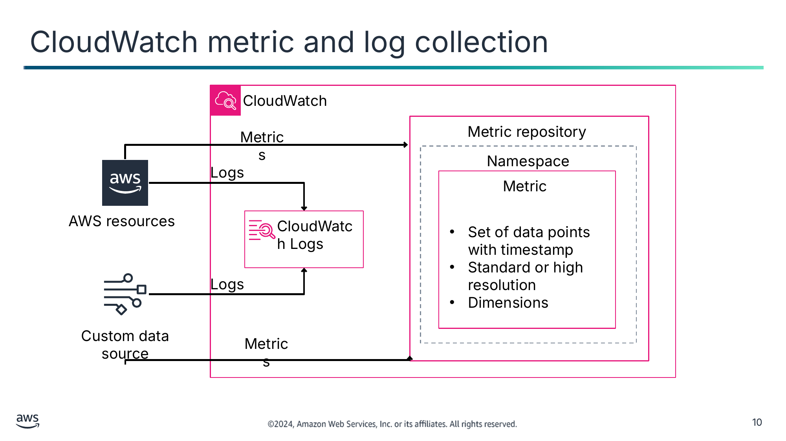

Текст зі схеми

CloudWatch

Metric repository (Сховище метрик)

Metrics (Метрики)

Namespace (Простір імен)

Logs (Журнали)

Metric (Метрика)

AWS resources (Ресурси AWS)

CloudWatch Logs

- Set of data points with timestamp (Набір точок даних з часовою позначкою)
- Standard or high resolution (Стандартна чи висока роздільна здатність)
- Dimensions (Виміри)

Logs

Custom data source (Користувацьке джерело даних)

Metrics

> **Нотатки:**
>
> |Номер слайда 10  
> |Нотатки для інструктора  
> |  
> |Нотатки для студента  
> Ресурси AWS мають можливість надсилати операційні журнали до CloudWatch Logs. Ви можете використовувати CloudWatch Logs для відстеження, зберігання файлів журналів і доступу до них із таких джерел, як екземпляри EC2, AWS CloudTrail, Route 53, Amazon Virtual Private Cloud (Amazon VPC) та інші сервіси AWS. CloudWatch Logs дає змогу централізувати журнали з усіх систем, застосунків і сервісів AWS, які ви використовуєте, в єдиному, високомасштабованому сервісі. Потім можна переглядати журнали, шукати в них певні коди помилок чи шаблони, фільтрувати їх за певними полями або безпечно архівувати для майбутнього аналізу. З CloudWatch Logs ви можете бачити всі свої журнали, незалежно від джерела, як єдиний і узгоджений потік подій, впорядкований за часом. CloudWatch Logs також підтримує виконання запитів до ваших журналів за допомогою потужної мови запитів, аудит і маскування чутливих даних у журналах та генерування метрик із журналів за допомогою фільтрів чи вбудованого формату журналу. Ви можете надсилати користувацькі дані з інших джерел до CloudWatch Logs і сховища метрик.  
>
> Метрики зберігаються у сховищі метрик у контейнері простору імен (namespace). Метрики в різних просторах імен ізольовані одна від одної, щоб метрики різних застосунків не були помилково агреговані в ту саму статистику. Простори імен AWS зазвичай використовують таку угоду іменування: AWS/service. Наприклад, Amazon EC2 використовує простір імен AWS/EC2.  
>
> Метрика — це впорядкований за часом набір точок даних з одиницею вимірювання, як-от байти, секунди, кількість і відсоток. Метрику можна розглядати як змінну для відстеження, а точки даних — як значення цієї змінної з часом. Наприклад, відсоток використання ЦП певного екземпляра EC2 — це одна з метрик, що надає Amazon EC2. Ви зможете бачити значення використання ЦП з часом для кожної часової позначки точки даних. Метрика може мати або стандартну роздільну здатність, або високу. Стандартна роздільна здатність означає, що точки даних мають деталізацію 1 хвилина. Висока роздільна здатність означає, що точки даних мають деталізацію 1 секунда.  
>
> За бажанням можна налаштувати вимір метрики (dimension). Вимір — це пара «ім’я-значення», що визначає характеристику метрики. Наприклад, багато метрик Amazon EC2 публікують InstanceId як ім’я виміру, а фактичний ідентифікатор екземпляра — як значення цього виміру. Цей вимір ідентифікатора можна використовувати для фільтрації метрик під час пошуку метрик певного екземпляра.

---

## Слайд 11: Сигнали CloudWatch (CloudWatch alarms)

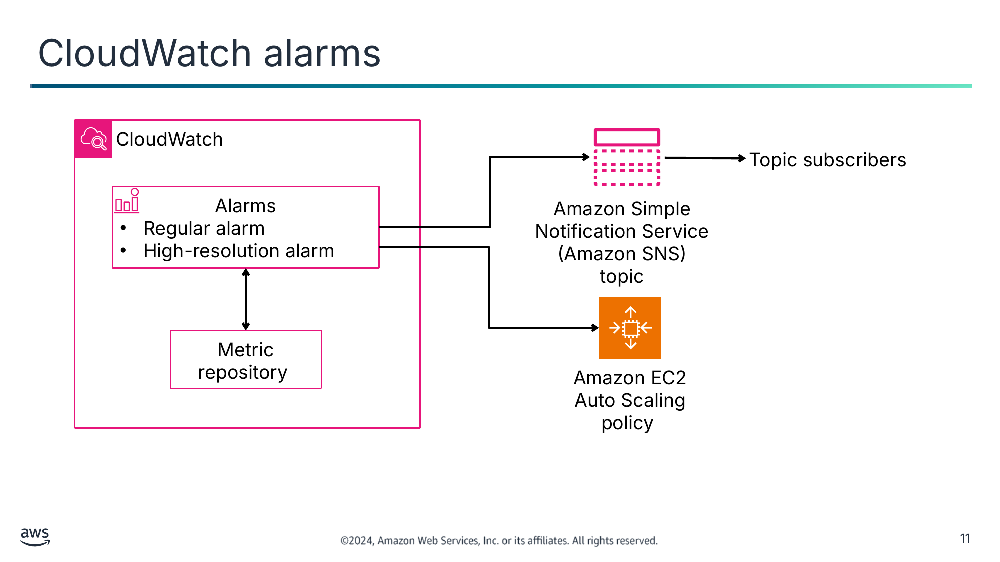

Текст зі схеми

CloudWatch

Topic subscribers (Підписники теми)

Alarms (Сигнали)

- Regular alarm (Звичайний сигнал)
- High-resolution alarm (Сигнал високої роздільної здатності)

Amazon Simple Notification Service (Amazon SNS)

topic (тема)

Metric repository (Сховище метрик)

Amazon EC2  
Auto Scaling policy (Політика Amazon EC2 Auto Scaling)

> **Нотатки:**
>
> |Номер слайда 11  
> |Нотатки для інструктора  
> |  
> |Нотатки для студента  
> Ви можете використовувати сигнал CloudWatch для автоматичного ініціювання дій від вашого імені. Сигнал стежить за однією метрикою протягом указаного періоду часу та виконує одну чи кілька вказаних дій на основі значення метрики відносно порогу з часом. Дія — це сповіщення, надіслане до теми Amazon Simple Notification Service (Amazon SNS), або політика Auto Scaling. Також можна додавати сигнали на панелі.  
>
> Сигнали викликають дії лише для сталих змін стану. Сигнали CloudWatch не викликають дій через те, що перебувають у певному стані. Стан має змінитися й зберігатися протягом указаної кількості періодів. Наприклад, сигнал активується, коли метрика CPUUtilization перевищує 70 відсотків протягом 5 хвилин. Сигнал викликає дію, як-от додавання екземпляра до політики Auto Scaling чи надсилання сповіщення команді розробки.  
>
> Коли ви створюєте сигнал для відстеження певної метрики, ви просите CloudWatch порівняти цю метрику із пороговим значенням, яке ви вказали. Ви маєте широкий контроль над тим, як CloudWatch виконує це порівняння. Можна вказати не лише період, за який виконується порівняння, а й скільки періодів оцінювання використовується для ухвалення висновку. Наприклад, якщо ви вказали три періоди оцінювання, CloudWatch порівнює вікно з трьох точок даних. CloudWatch сповіщає вас, лише якщо найстаріша точка даних порушує поріг, а інші порушують його або відсутні.  
>
> Якщо ви встановлюєте сигнал для метрики високої роздільної здатності, можна вказати сигнал високої роздільної здатності з періодом 10 секунд чи 30 секунд або встановити звичайний сигнал з періодом, кратним 60 секундам. За сигнали високої роздільної здатності стягується вища плата. Звичайні сигнали можна встановлювати для метрик стандартної роздільної здатності.

---

## Слайд 12: Панелі CloudWatch (CloudWatch dashboards)

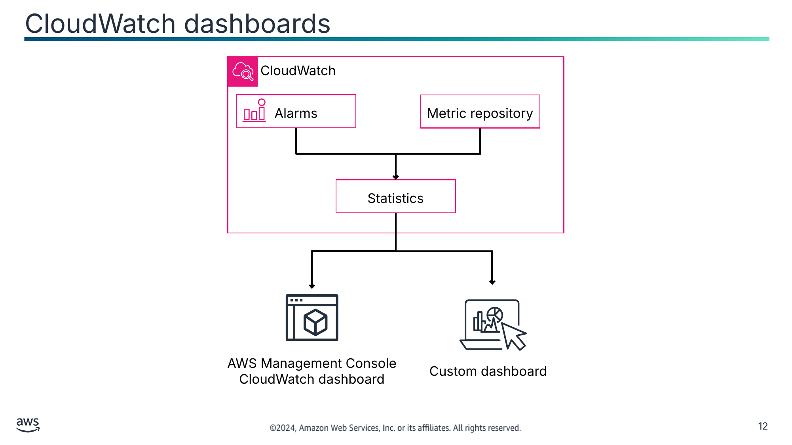

Текст зі схеми

CloudWatch

Alarms (Сигнали)

Metric repository (Сховище метрик)

Statistics (Статистика)

AWS Management Console CloudWatch dashboard (Панель CloudWatch в AWS Management Console)

Custom dashboard (Користувацька панель)

> **Нотатки:**
>
> |Номер слайда 12  
> |Нотатки для інструктора  
> |  
> |Нотатки для студента  
> Хоча метрики та сигнали корисні, іноді ви хочете порівняти метрики чи переглянути сигнали, що можуть розташовуватися в різних регіонах. Ви можете використовувати панелі CloudWatch для створення користувацьких панелей або перегляду автоматичних панелей. Ці панелі — це настроювані головні сторінки в консолі CloudWatch, які можна використовувати для відстеження ваших ресурсів в одному вигляді, навіть тих, що розподілені між різними регіонами. Ви можете використовувати панелі CloudWatch для створення настроюваних видів метрик і сигналів для ваших ресурсів AWS.  
>
> На метрику, що порушує поріг щосекунди, не слід реагувати щосекунди. З цієї причини метрики слід агрегувати з часом, щоб одна дія могла розв’язати проблему. CloudWatch надає статистику на основі точок даних метрик. Статистика — це агрегації даних метрик за вказані періоди часу. CloudWatch надає статистику на основі точок даних метрик, наданих вашими користувацькими даними або наданих іншими сервісами AWS до CloudWatch. Ви можете вказати певний період часу, і CloudWatch обчислить агрегації за допомогою простору імен, назви метрики, вимірів і одиниці вимірювання точки даних.  
>
> За допомогою панелей можна створити єдиний вигляд для вибраних метрик і сигналів, щоб допомогти оцінити стан ваших ресурсів і застосунків в одному чи кількох регіонах. Можна вибрати колір, що використовується для кожної метрики на кожному графіку, щоб відстежувати ту саму метрику на кількох графіках. Можна створити операційний посібник (playbook), що надає настанови членам команди під час операційних подій щодо того, як реагувати на конкретні інциденти. Можна створити спільний вигляд критичних вимірювань ресурсів і застосунків, яким члени команди можуть ділитися для швидшого потоку обміну даними під час операційних подій.  
>
> Якщо ви не хочете використовувати AWS Management Console, можна виконати запит до статистики CloudWatch, щоб імпортувати дані в користувацьку панель.

---

## Слайд 13: EventBridge

- Обробляє події за допомогою шини подій (event bus) або каналу (pipe)
  - Канали (pipes) — це інтеграції «точка-точка» між одним джерелом і однією ціллю.
  - Шини подій — це маршрутизатори, що отримують події й за бажанням доставляють їх до однієї чи кількох цілей.
- Ухвалює рішення щодо маршрутизації за допомогою настроюваних правил
  - Правила виконуються на основі збігу зі шаблоном події або за розкладом за допомогою Amazon EventBridge Scheduler.
  - Цілі можуть бути в іншому акаунті AWS, в іншому регіоні або в обох.

EventBridge

> **Нотатки:**
>
> |Нотатки для інструктора  
> |  
> |Нотатки для студента  
> Коли сигнали CloudWatch порушуються, подію потрібно опублікувати, щоб можна було впровадити автоматизовані чи ручні виправні дії. В AWS Amazon EventBridge — це шина подій, що використовується для маршрутизації подій.  
>
> EventBridge — це безсерверний сервіс, що використовує події для з’єднання компонентів застосунку, допомагаючи будувати масштабовані застосунки, керовані подіями. Архітектура, керована подіями (event-driven architecture), — це стиль побудови слабко зв’язаних програмних систем, що працюють разом, випускаючи події та реагуючи на них.  
>
> EventBridge використовує шини подій і канали для обробки подій. Шини подій — це маршрутизатори, що отримують події й доставляють їх до нуля чи більше цілей. Amazon EventBridge Pipes призначений для інтеграцій «точка-точка». Кожен канал отримує події з одного джерела для обробки та доставки до однієї цілі. Канали також включають підтримку розширених перетворень і збагачення подій перед доставкою до цілі.  
>
> Шини подій використовують правила для зіставлення вхідних подій і надсилання їх до цілей для обробки. Одне правило може надсилати подію до кількох цілей, які потім працюють паралельно. Правила ґрунтуються або на шаблоні події, або на розкладі. Шаблон події визначає структуру події та поля, яким відповідає правило. Правила на основі розкладу виконують дію через регулярні інтервали.  
>
> Докладніше див. «What Is Amazon EC2 Auto Scaling?» на сторінці ресурсів вмісту вашого онлайн-курсу.

---

## Слайд 14: Шина подій EventBridge (EventBridge event bus)

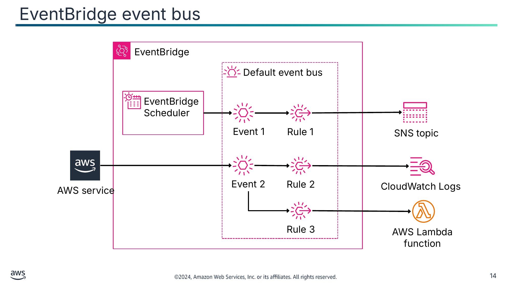

Текст зі схеми

EventBridge

Default event bus (Шина подій за замовчуванням)

EventBridge Scheduler

Event 1 (Подія 1)

Rule 1 (Правило 1)

SNS topic (Тема SNS)

Event 2

Rule 2

CloudWatch Logs

AWS service (Сервіс AWS)

Rule 3

AWS Lambda function (Функція AWS Lambda)

> **Нотатки:**
>
> |Номер слайда 14  
> |Нотатки для інструктора  
> |  
> |Нотатки для студента  
> Шина подій — це маршрутизатор, що отримує події й доставляє їх до нуля чи більше призначень, або цілей. Використовуйте шину подій, коли потрібно маршрутизувати події з багатьох джерел до багатьох цілей із необов’язковим перетворенням подій перед доставкою до цілі.  
>
> Поширений сценарій використання шин подій — як брокер між різними робочими навантаженнями, сервісами чи системами. Ви можете використовувати кілька шин подій у ваших застосунках для розділення трафіку подій: наприклад, створивши шину для обробки подій, що містять персональні ідентифікаційні дані (PII), і ще одну шину для подій, що їх не містять. Шини подій можна використовувати для агрегування подій, надсилаючи події з кількох шин подій до централізованої шини подій. Ця централізована шина може бути в тому самому акаунті, що й інші шини, але також може бути в іншому акаунті чи регіоні.  
>
> Правило отримує вхідні події й надсилає їх відповідно до цілей для обробки. Ви можете вказати, як кожне правило викликає свою ціль чи цілі, на основі шаблону події або розкладу. Шаблон події містить один чи кілька фільтрів для зіставлення подій. Розклад викликатиме ціль чи цілі через регулярні інтервали. EventBridge пропонує Amazon EventBridge Scheduler — безсерверний планувальник, який можна використовувати для створення, запуску та керування завданнями з одного центрального керованого сервісу.  
>
> Ціль — це ресурс чи кінцева точка, до якої EventBridge надсилає подію, коли подія відповідає шаблону події, визначеному для правила. Правило обробляє дані події й надсилає відповідну інформацію до цілі. Для кожного правила можна визначити до п’яти цілей. EventBridge підтримує кілька сервісів AWS і призначень API.  
>
> У прикладі на цьому слайді EventBridge Scheduler надсилає подію 1 до шини подій за замовчуванням, що викликає правило 1. Правило 1 успішно зіставляє подію й маршрутизує її до теми SNS. Сервіс AWS надсилає подію 2 до шини подій за замовчуванням, що паралельно викликає правило 2 і правило 3. Правило 2 проходить і надсилає подію до CloudWatch Logs, а правило 3 також проходить і надсилає подію до функції AWS Lambda.  
>
> Нижче наведено приклад шаблону події, що обробляє всі події завершення роботи екземплярів EC2:  
>
> {  
> "source": ["aws.ec2"],  
> "detail-type": ["EC2 Instance State-change Notification"],  
> "detail": {  
> "state": ["terminated"]  
> }  
> }

---

## Слайд 15: Моніторинг витрат на ваші ресурси

AWS Cost Explorer

AWS Budgets

AWS Cost and Usage Report

> **Нотатки:**
>
> |Номер слайда 15  
> |Нотатки для інструктора  
> |  
> |Нотатки для студента  
> Моніторинг також може допомогти вам розуміти витрати вашої інфраструктури AWS і керувати ними. AWS надає інструменти моніторингу та звітування, зокрема такі:  
> AWS Cost Explorer допомагає візуалізувати, розуміти та керувати вашими витратами й використанням AWS із щоденною чи щомісячною деталізацією. Його можна використовувати для перегляду даних за останні 13 місяців, що допомагає побачити шаблони того, як ви витрачаєте ресурси AWS з часом.  
> AWS Budgets допомагає встановлювати користувацькі бюджети, що сповіщають вас, коли ваші витрати чи використання перевищують (або прогнозовано перевищать) ваш бюджетний обсяг.  
> AWS Cost and Usage Report містить найповніший доступний набір даних про витрати та використання AWS, зокрема додаткові метадані про сервіси AWS, ціноутворення та резервування.

---

## Слайд 16: Ключові висновки: моніторинг ваших ресурсів

- Сигнали CloudWatch можуть надсилати сповіщення до Amazon EC2 Auto Scaling і тем SNS.
- CloudWatch збирає журнали й метрики сервісів AWS у різних регіонах.
- Можна використовувати панелі CloudWatch для візуалізації метрик і сигналів.
- EventBridge обробляє та маршрутизує події за допомогою шини подій або каналу.
- AWS Cost Explorer, AWS Budgets і AWS Cost and Usage Report можуть допомогти вам розуміти витрати вашої інфраструктури AWS і керувати ними.

> **Нотатки:**
>
> |Номер слайда 16  
> |Нотатки для інструктора  
> |  
> |Нотатки для студента

---

## Слайд 17: Масштабування ваших обчислювальних ресурсів

Впровадження моніторингу, еластичності та високої доступності

> **Нотатки:**
>
> |Номер слайда 17  
> |Нотатки для інструктора  
> |Цей розділ зосереджений на правильному масштабуванні продуктивної системи й підкреслює потребу в реактивних архітектурах.  
> |  
> |Нотатки для студента  
> Цей розділ розглядає, як масштабувати ваші обчислювальні ресурси у віртуальній приватній хмарі (VPC).

---

## Слайд 18: Потреба в реактивних архітектурах (reactive architectures)

Застосунки мають обробляти великі обсяги даних із часом відповіді менше секунди, маючи при цьому майже 100-відсотковий час безвідмовної роботи.

Еластична (Elastic)

Чутлива (Responsive)

Стійка (Resilient)

Кероване повідомленнями (Message-driven)

> **Нотатки:**
>
> |Номер слайда 18  
> |Нотатки для інструктора  
> |  
> |Нотатки для студента  
> Досі ви дізналися про компоненти застосунків, середовища та способи захисту доступу до застосунків. Проєктуючи застосунок, ви також повинні забезпечити, щоб він працював оптимально за різних умов і не потребував ручного втручання для відновлення після збоїв.  
>
> Від багатьох сучасних застосунків очікується обробка петабайтів даних, майже 100-відсотковий час безвідмовної роботи та надання користувачам часу відповіді менше секунди. Дедалі більше підприємств застосовують реактивні архітектури та реактивні системи, оскільки необхідно проєктувати застосунки високомасштабованим і чутливим способом. Щоб відповісти цим вимогам, можна впровадити реактивний застосунок, що є еластичним, стійким, чутливим і керованим повідомленнями.  
>
> Еластичне масштабування — це механізм динамічного масштабування ресурсів застосунку. Цей тип масштабування додаватиме чи вилучатиме ресурси, щоб реагувати на зміни й уникати простою чи вузьких місць трафіку.  
>
> Чутливий означає, що застосунки мають реагувати вчасно з найнижчою можливою затримкою. Реактивний застосунок залишається чутливим за різних робочих навантажень.  
>
> Стійкий застосунок залишається чутливим перед обличчям збою. Стійкий застосунок має здатність відновлюватися, коли його навантажують навантаження, атаки та збої будь-якого компонента компонентів робочого навантаження.  
>
> Бути керованим повідомленнями — це, мабуть, найважливіша характеристика реактивних систем. Щоб встановити межі між сервісами, реактивні застосунки спираються на асинхронну передачу повідомлень для забезпечення слабкого зв’язування, ізоляції та прозорості розташування. Прозорість розташування — це доступ до даних без явного знання розташування даних.

---

## Слайд 19: Досягнення еластичності за допомогою масштабування

Еластичність — це здатність інфраструктури розширюватися та стискатися в міру зміни вимог до потужностей.

Масштабування — це здатність збільшувати чи зменшувати обчислювальні потужності вашого застосунку.

- Вертикальне масштабування замінює ресурс ресурсом іншого розміру.
- Горизонтальне масштабування додає або вилучає ресурси, доступні застосунку.

> **Нотатки:**
>
> |Номер слайда 19  
> |Нотатки для інструктора  
> |  
> |Нотатки для студента  
> Однією з характеристик реактивної архітектури є еластичність. Еластичність означає, що інфраструктура може розширюватися й стискатися, коли змінюються вимоги до потужностей. Ви можете отримувати ресурси, коли вони вам потрібні, і вивільняти ресурси, коли не потрібні. Наприклад, ви можете збільшити кількість вебсерверів, коли трафік до вашого застосунку різко зростає, або зменшити потужність запису у вашій базі даних, коли трафік падає.  
>
> Масштабування — це здатність збільшувати чи зменшувати обчислювальні потужності вашого застосунку. Масштабування — це методика, що використовується для досягнення еластичності.  
>
> Вертикальне масштабування (vertical scaling) — це коли ви збільшуєте чи зменшуєте специфікації окремого ресурсу. Наприклад, можна перейти на новий сервер із більшим жорстким диском чи швидшим ЦП. Зазвичай застосунок і дані потрібно перенести на новий ресурс, що може призвести до простою застосунку. Наприклад, з Amazon EC2 можна зупинити екземпляр і змінити його розмір на тип екземпляра з більшою оперативною пам’яттю, ЦП, введенням-виведенням чи мережевими можливостями. AWS перенесе дані екземпляра на новий екземпляр за вас. Вертикальне масштабування зрештою може досягти межі, оскільки воно прив’язане до апаратного забезпечення, і це не завжди економічно ефективний чи високодоступний підхід.  
>
> Горизонтальне масштабування (horizontal scaling) — це коли ви додаєте або вилучаєте ресурси, доступні застосунку. Наприклад, вам може знадобитися додати більше жорстких дисків до масиву зберігання чи додати більше серверів для підтримки застосунку. Додавання ресурсів називається масштабуванням назовні (scaling out), а завершення ресурсів — масштабуванням досередини (scaling in). Горизонтальне масштабування — хороший спосіб будувати застосунки інтернет-масштабу, що використовують еластичність хмарних обчислень. Застосунки, дані або й те, й інше автоматично переносяться на додані ресурси.

---

## Слайд 20: Amazon EC2 Auto Scaling

- Керує логічною колекцією екземплярів Amazon Elastic Compute Cloud (Amazon EC2), що називається групою Amazon EC2 Auto Scaling, у кількох зонах доступності
- Запускає чи виводить з експлуатації екземпляри EC2, налаштовані шаблонами запуску (launch templates)
- Змінює розмір на основі подій від політик масштабування, сповіщень перевірок стану балансувальника навантаження чи запланованих дій
- Інтегрується з Elastic Load Balancing (ELB) для надсилання реєстрацій нових екземплярів і отримання сповіщень про стан
- Балансує кількість екземплярів між зонами доступності
- Доступний безкоштовно

Amazon EC2 Auto Scaling

> **Нотатки:**
>
> |  
> |Нотатки для інструктора  
> |Конфігурації запуску (launch configurations) більше не підтримуються Amazon EC2 Auto Scaling для типів екземплярів Amazon EC2 із датою після грудня 2022 року. Шаблони запуску (launch templates) — бажаний механізм для використання з групами Amazon EC2 Auto Scaling.  
> |  
> |Нотатки для студента  
> У хмарі масштабування можна обробляти автоматично. Amazon EC2 Auto Scaling робить це, групуючи екземпляри EC2 у групу керування, що називається групою Amazon EC2 Auto Scaling. Група може охоплювати зони доступності. Група Amazon EC2 Auto Scaling може автоматично додавати чи вилучати екземпляри EC2 відповідно до визначених користувачем політик масштабування, запланованих дій і перевірок стану Elastic Load Balancing (ELB). Коли новий екземпляр EC2 додається до групи, використовується шаблон запуску чи конфігурація запуску, що вказує конфігурацію екземпляра.  
>
> Amazon EC2 Auto Scaling інтегрується з ELB. Він автоматично реєструє нові екземпляри у балансувальників навантаження для розподілу вхідного трафіку між екземплярами в групі. Amazon EC2 Auto Scaling може отримувати сповіщення про несправний екземпляр, щоб вилучити його з групи. Група також може балансувати кількість екземплярів між зонами доступності, щоб кількість екземплярів була подібною для кожної зони доступності.  
>
> З Amazon EC2 Auto Scaling ваші застосунки отримують такі переваги:  
> Краща відмовостійкість: Amazon EC2 Auto Scaling може виявити, коли екземпляр несправний, завершити його роботу й запустити екземпляр для його заміни. Також можна налаштувати Amazon EC2 Auto Scaling на використання кількох зон доступності. Якщо одна зона доступності стає недоступною, Amazon EC2 Auto Scaling може запустити екземпляри в іншій, щоб компенсувати.  
> Краща доступність: Amazon EC2 Auto Scaling допомагає гарантувати, що ваш застосунок завжди має потрібний обсяг потужностей для обробки поточного попиту на трафік.  
> Краще керування витратами: Amazon EC2 Auto Scaling може динамічно збільшувати й зменшувати потужності за потреби. Оскільки ви платите за екземпляри EC2, які використовуєте, ви заощаджуєте кошти, запускаючи екземпляри, коли вони потрібні, і завершуючи їх, коли не потрібні.  
>
> Докладніше див. AWS Well-Architected Framework на сторінці ресурсів вмісту вашого онлайн-курсу.

---

## Слайд 21: Компоненти групи Amazon EC2 Auto Scaling

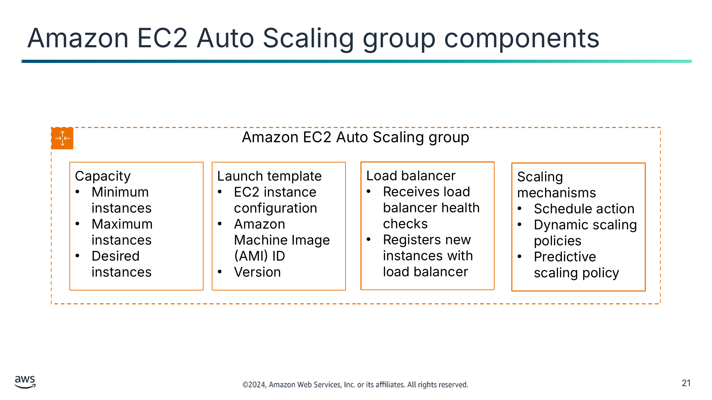

Текст зі схеми

Amazon EC2 Auto Scaling group (Група Amazon EC2 Auto Scaling)

Capacity (Потужність)

- Minimum instances (Мінімум екземплярів)
- Maximum instances (Максимум екземплярів)
- Desired instances (Бажана кількість екземплярів)

Launch template (Шаблон запуску)

- EC2 instance configuration (Конфігурація екземпляра EC2)
- Amazon Machine Image (AMI) ID (Ідентифікатор AMI)
- Version (Версія)

Load balancer (Балансувальник навантаження)

- Receives load balancer health checks (Отримує перевірки стану балансувальника навантаження)
- Registers new instances with load balancer (Реєструє нові екземпляри в балансувальнику навантаження)

Scaling mechanisms (Механізми масштабування)

- Schedule action (Запланована дія)
- Dynamic scaling policies (Політики динамічного масштабування)
- Predictive scaling policy (Політика прогнозного масштабування)

> **Нотатки:**
>
> |Номер слайда 21  
> |Нотатки для інструктора  
> |  
> |Нотатки для студента  
> Amazon EC2 Auto Scaling використовує групи Amazon EC2 Auto Scaling для керування колекцією екземплярів EC2. Кількість екземплярів у групі визначається налаштуваннями потужності. Мінімальна потужність — це найменша кількість екземплярів, потрібна для запуску застосунку, а максимальна потужність — найбільша кількість екземплярів, дозволена для групи. Бажана потужність (desired capacity) — це оптимальна кількість екземплярів, потрібна для запуску застосунку за нормальних обставин. Коли змінюється попит чи середовище, бажану потужність коригують.  
>
> Ви можете коригувати розмір групи відповідно до попиту — вручну або за допомогою автоматичного масштабування. В обох випадках не можна перевищувати налаштування мінімальної чи максимальної потужності групи. З ручним масштабуванням ви вказуєте нове значення максимальної, мінімальної чи бажаної потужності групи.  
>
> Масштабування починається з події, або дії масштабування, що наказує групі Amazon EC2 Auto Scaling або запустити, або завершити екземпляри EC2. Щоб запустити екземпляр EC2, групі потрібно знати, який тип екземплярів EC2 ініціювати. Шаблон запуску групи використовується для вказання подробиць конфігурації екземпляра EC2, як-от тип екземпляра та ідентифікатор образу Amazon Machine Image (AMI). Також можна вказати, який відсоток бажаної потужності слід виконати екземплярами за запитом, зарезервованими екземплярами та спотовими екземплярами. Потім Amazon EC2 Auto Scaling розгортає комбінацію екземплярів із найнижчою ціною для досягнення бажаної потужності на основі цих уподобань. Екземпляри за запитом і зарезервовані екземпляри доступні негайно, але спотові екземпляри можуть бути доступними чи ні в певний момент. Шаблон запуску може мати версії.  
>
> Зазвичай група Amazon EC2 Auto Scaling працює з балансувальником навантаження для допомоги в масштабуванні. Група може обрати отримання сповіщень перевірок стану екземплярів балансувальника навантаження на додачу до власних перевірок стану екземплярів групи. Група може реєструвати нові екземпляри в балансувальника навантаження.  
>
> Нова група Amazon EC2 Auto Scaling не має механізмів масштабування. Можна додати механізми масштабування, як-от заплановані дії, політики динамічного масштабування та політику прогнозного масштабування.

---

## Слайд 22: Горизонтальне масштабування за допомогою груп Amazon EC2 Auto Scaling

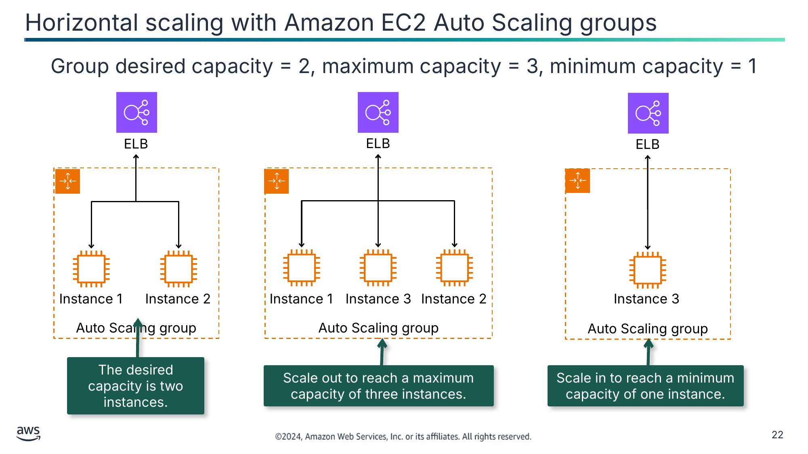

Бажана потужність групи = 2, максимальна потужність = 3, мінімальна потужність = 1

Бажана потужність — два екземпляри.

Масштабуйте назовні, щоб досягти максимальної потужності в три екземпляри.

Масштабуйте досередини, щоб досягти мінімальної потужності в один екземпляр.

Текст зі схеми

ELB

ELB

ELB

Auto Scaling group (Група Auto Scaling)

Auto Scaling group

Auto Scaling group

Instance 1 (Екземпляр 1)

Instance 2 (Екземпляр 2)

Instance 1

Instance 3 (Екземпляр 3)

Instance 2

Instance 3

> **Нотатки:**
>
> |Номер слайда 22  
> |Нотатки для інструктора  
> |  
> |Нотатки для студента  
> У прикладі на цьому слайді використовується автоматичне масштабування. Група починає із запуску достатньої кількості екземплярів для досягнення бажаної потужності, тобто двох екземплярів: екземплярів 1 і 2. Якщо балансувальник навантаження повідомляє про несправний екземпляр, група Amazon EC2 Auto Scaling завершить роботу несправного екземпляра й замінить його новим екземпляром.  
>
> Ви можете використовувати політики масштабування, щоб динамічно збільшувати кількість екземплярів у вашій групі відповідно до змінних умов. У прикладі на цьому слайді група Amazon EC2 Auto Scaling відстежує метрику сервісу AWS, як-от CloudWatch чи Amazon Simple Queue Service (Amazon SQS), щоб масштабуватися назовні. Використовуючи шаблон запуску, група Amazon EC2 Auto Scaling масштабується назовні, додаючи екземпляр 3 до групи для досягнення максимальної потужності в три екземпляри. Група Amazon EC2 Auto Scaling забезпечить, щоб максимальну потужність не було перевищено, навіть якщо надійде ще одне сповіщення про масштабування назовні.  
>
> Так само можна використовувати політики масштабування для зменшення кількості екземплярів у вашій групі Amazon EC2 Auto Scaling. У прикладі на цьому слайді активується запланована політика масштабування, щоб зменшити потужність групи Amazon EC2 Auto Scaling до мінімальної кількості екземплярів у непіковий час. Група Amazon EC2 Auto Scaling масштабується досередини, завершуючи екземпляри 1 і 2 для досягнення мінімальної потужності в один екземпляр із працюючим екземпляром 3.

---

## Слайд 23: Механізми Amazon EC2 Auto Scaling

Заплановані дії (Scheduled actions)

Динамічні політики (Dynamic policies)

Прогнозна політика (Predictive policy)

- Масштабування на основі дати й часу
- Призначені для передбачуваних робочих навантажень

- Масштабування на основі відстежуваних метрик
- Призначені для помірно нестабільних (зі сплесками) робочих навантажень

- Масштабується на основі попередніх шаблонів трафіку за допомогою машинного навчання
- Призначена для трафіку робочого навантаження, який можна передбачити за шаблоном

> **Нотатки:**
>
> |Нотатки для інструктора  
> |  
> |Нотатки для студента  
> Політики Amazon EC2 Auto Scaling надають кілька способів коригування масштабування, щоб найкраще відповідати обчислювальним вимогам ваших застосунків.  
>
> З запланованим масштабуванням (scheduled scaling) дії масштабування виконуються автоматично залежно від дати й часу. Ця функція корисна для передбачуваних робочих навантажень, коли ви точно знаєте, коли збільшити чи зменшити кількість екземплярів у вашій групі. Наприклад, припустімо, що щотижня трафік до вашого вебзастосунку починає зростати в середу, залишається високим у четвер і починає зменшуватися в п’ятницю. Можна спланувати дії масштабування на основі передбачуваних шаблонів трафіку вашого вебзастосунку. Щоб упровадити заплановане масштабування, ви створюєте запланову дію (schedule action).  
>
> Динамічне масштабування за запитом (dynamic, on-demand scaling) — це складніший спосіб масштабування ресурсів. Його можна використовувати, щоб визначити параметри, що керують процесом масштабування. Наприклад, у вас є вебзастосунок, що наразі працює на двох екземплярах EC2. Ви хочете, щоб використання ЦП групою Auto Scaling залишалося близьким до 50 відсотків, коли змінюється навантаження на застосунок. Цей варіант корисний для масштабування у відповідь на змінні умови, коли ви не знаєте, коли ці умови зміняться. Динамічне масштабування дає вам додаткову потужність для обробки сплесків трафіку без підтримки надмірної кількості простоюючих ресурсів.  
>
> Ви можете налаштувати свою групу Amazon EC2 Auto Scaling на динамічне масштабування з різними типами політик масштабування.  
>
> Політики масштабування з відстеженням цілі (target tracking scaling policies) збільшують чи зменшують поточну потужність групи на основі цільового значення для певної метрики. Цей тип масштабування подібний до того, як термостат підтримує температуру у вашому домі: ви обираєте температуру, а термостат робить решту. З політиками масштабування з відстеженням цілі ви обираєте метрику масштабування й встановлюєте цільове значення. Amazon EC2 Auto Scaling створює та керує сигналами CloudWatch, що викликають політику масштабування, і обчислює коригування масштабування на основі метрики та цільового значення. Наприклад, можна створити політику масштабування з відстеженням цілі, що націлена на середнє використання ЦП 50 відсотків. Тоді ваша група Auto Scaling масштабує кількість екземплярів, щоб утримувати фактичне значення метрики на рівні 50 відсотків чи близько до нього.  
>
> З політиками покрокового масштабування (step scaling) і простого масштабування (simple scaling) ви обираєте метрики масштабування та порогові значення для сигналів CloudWatch, що викликають процес масштабування. Просте масштабування чекатиме завершення масштабування, коли повідомляється сигнал, ігноруючи наступні сигнали. Покрокове масштабування коригуватиме масштабування відповідно до розміру порушення сигналу.  
>
> Ви можете використовувати Amazon EC2 Auto Scaling для впровадження політики прогнозного масштабування, де ваша потужність масштабується на основі прогнозованого попиту. Прогнозне масштабування працює, аналізуючи історичні дані навантаження для виявлення щоденних чи щотижневих шаблонів у потоках трафіку. Воно використовує цю інформацію для прогнозування майбутніх потреб у потужностях, щоб Amazon EC2 Auto Scaling міг проактивно збільшувати потужність вашої групи Auto Scaling відповідно до очікуваного навантаження. Прогнозне масштабування добре підходить для ситуацій, де є таке:  
> Циклічний трафік, як-от високе використання ресурсів у звичайні робочі години й низьке використання ресурсів увечері та у вихідні  
> Повторювані шаблони робочих навантажень «увімкнено-вимкнено», як-от пакетна обробка, тестування чи періодичний аналіз даних  
> Застосунки, що довго ініціалізуються, спричиняючи помітний вплив затримки на продуктивність застосунку під час подій масштабування назовні  
>
> Можна використовувати динамічне та прогнозне масштабування разом для оптимального масштабування вашої інфраструктури.

---

## Слайд 24: Масштабування за політикою покрокового масштабування (step scaling policy)

| Значення метрики (Metric value) | Менше ніж 30% | 30–39% | 40–60% | 61–70% | 71–100% |
|---|---|---|---|---|---|
| Зміна потужності у відсотках (Percentage capacity change) | -30% | -10% | Без змін | +10% | +30% |

Вилучити 30% поточної потужності

Вилучити 10% поточної потужності

Додати 10% поточної потужності

Додати 30% поточної потужності

> **Нотатки:**
>
> |Номер слайда 24  
> |Нотатки для інструктора  
> |  
> |Нотатки для студента  
> Політики покрокового масштабування збільшують чи зменшують поточну потужність масштабованої цілі на основі набору коригувань масштабування, відомих як покрокові коригування (step adjustments). Коригування залежать від розміру порушення сигналу. Політика продовжує реагувати на додаткові сигнали, поки триває діяльність масштабування. Тому всі сигнали, що порушені, оцінюються AWS Application Auto Scaling, коли він отримує повідомлення сигналів.  
>
> Коли ви створюєте політику покрокового масштабування, ви вказуєте одне чи кілька покрокових коригувань, що автоматично масштабують потужність цілі динамічно на основі розміру порушення сигналу. Кожне покрокове коригування вказує нижню межу значення метрики, верхню межу значення метрики та обсяг, на який слід масштабувати, на основі типу коригування масштабування.  
>
> CloudWatch агрегує точки даних метрик на основі статистики метрики, пов’язаної з вашим сигналом CloudWatch. Коли сигнал порушено, активується відповідна політика масштабування.  
>
> Повний приклад покрокового масштабування див. «Overview of Step Scaling Policies» на сторінці ресурсів вмісту вашого онлайн-курсу.

---

## Слайд 25: Інші варіанти масштабування AWS

	AWS Auto Scaling

- Використовуйте план масштабування (scaling plan), щоб налаштувати автоматичне масштабування для кількох ресурсів.
- Масштабуйте кілька сервісів AWS:
  - Amazon Aurora
  - Amazon EC2 Auto Scaling
  - Amazon Elastic Container Service (Amazon ECS)
  - Amazon DynamoDB

 AWS Application Auto Scaling

- Масштабуйте кілька ресурсів за допомогою масштабування з відстеженням цілі, покрокового чи запланованого масштабування.
- Масштабуйте кілька сервісів AWS:
  - Сервіси AWS Auto Scaling
  - Функції AWS Lambda
  - Amazon SageMaker
  - Amazon ElastiCache for Redis

> **Нотатки:**
>
> |Нотатки для інструктора  
> |  
> |Нотатки для студента  
> Коли ви хочете масштабувати, AWS Auto Scaling використовує план масштабування для налаштування автоматичного масштабування для пов’язаних чи асоційованих масштабованих ресурсів за лічені хвилини. Наприклад, можна використовувати теги для групування ресурсів у категорії, як-от продуктивне середовище, тестування чи розробка. Потім можна шукати та налаштовувати плани масштабування для масштабованих ресурсів, що належать до кожної категорії.  
>
> AWS Auto Scaling підтримує використання планів масштабування для таких сервісів і ресурсів:  
> Amazon Aurora: збільшення чи зменшення кількості реплік Aurora для читання, розгорнутих для кластера БД Aurora.  
> Amazon EC2 Auto Scaling: запуск чи завершення екземплярів EC2 шляхом збільшення чи зменшення бажаної потужності групи Auto Scaling.  
> Amazon Elastic Container Service (Amazon ECS): збільшення чи зменшення бажаної кількості завдань в Amazon ECS.  
> Amazon DynamoDB: збільшення чи зменшення розгорнутої потужності читання й запису таблиці DynamoDB або глобального вторинного індексу.  
>
> Application Auto Scaling — це вебсервіс для розробників і системних адміністраторів, яким потрібне рішення для автоматичного масштабування їхніх масштабованих ресурсів для окремих сервісів AWS поза межами Amazon EC2. Application Auto Scaling подібний до груп Amazon EC2 Auto Scaling тим, що можна використовувати Application Auto Scaling для автоматичного масштабування за допомогою політик масштабування з відстеженням цілі, покрокових і запланованих. Він підтримує сервіси AWS Auto Scaling.

---

## Слайд 26: Демонстрація: створення політик масштабування для Amazon EC2 Auto Scaling (Creating Scaling Policies for Amazon EC2 Auto Scaling)

- Ця демонстрація використовує Amazon EC2 Auto Scaling.
- У цій демонстрації ви побачите, як виконати таке:
  - Створити та запустити екземпляр EC2.
  - Створити групу Auto Scaling.
  - Створити політику масштабування.

> **Нотатки:**
>
> |Номер слайда 26  
> |Нотатки для інструктора  
> |Ця демонстрація — файл .mp4 із субтитрами. Студенти отримують до неї доступ через онлайн-курс. Посібник інструктора містить тривалість кожної демонстрації.  
> |  
> |Нотатки для студента  
> Знайдіть цю записану демонстрацію у вашому онлайн-курсі як частину цього модуля.

---

## Слайд 27: Ключові висновки: масштабування ваших обчислювальних ресурсів

- З Amazon EC2 Auto Scaling можна створити групу для керування логічною колекцією екземплярів EC2, що називається групою Amazon EC2 Auto Scaling.
- Група має налаштування потужності, що вказують мінімальну, максимальну та бажану кількість екземплярів, потрібну для запуску застосунку.
- Розмір групи можна масштабувати назовні й досередини за допомогою запланованих дій, динамічних політик і прогнозних політик.
- Щоб масштабувати більше сервісів, ніж екземпляри EC2, використовуйте AWS Auto Scaling або Application Auto Scaling.

> **Нотатки:**
>
> |Номер слайда 27  
> |Нотатки для інструктора  
> |  
> |Нотатки для студента

---

## Слайд 28: Масштабування ваших баз даних

Впровадження моніторингу, еластичності та високої доступності

> **Нотатки:**
>
> |Номер слайда 28  
> |Нотатки для інструктора  
> |Кожен сервіс баз даних AWS масштабується по-різному. Цей розділ охоплює найчастіше використовувані бази даних.  
> |  
> |Нотатки для студента  
> Цей розділ розглядає, як масштабувати бази даних в AWS.

---

## Слайд 29: Масштабування баз даних AWS

Aurora

Amazon Aurora Serverless

Amazon RDS

DynamoDB

Масштабування кластера

- Вертикальне масштабування за допомогою типів екземплярів
- Горизонтальне масштабування за допомогою реплік для читання
- Масштабування сховища, кероване сервісом

Масштабування кластера

- Горизонтальне масштабування обчислень за допомогою одиниць обчислень Aurora (Aurora Compute Units, ACU)
- Масштабування сховища, кероване сервісом

Масштабування бази даних

- Вертикальне масштабування за допомогою типів екземплярів, а також розміру й типу тому сховища
- Горизонтальне масштабування за допомогою реплік для читання

Масштабування таблиці

- Горизонтальне масштабування для окремого масштабування одиниць потужності читання (RCU) і одиниць потужності запису (WCU)
- Масштабування сховища, кероване сервісом

> **Нотатки:**
>
> |Нотатки для інструктора  
> |  
> |Нотатки для студента  
> Подібно до обчислювальних ресурсів Amazon EC2, сервіси баз даних AWS також можуть масштабуватися вертикально, горизонтально або обома способами. Те, як обробляється масштабування, різниться для кожного сервісу. Деякі сервіси пропонують ручне масштабування та автомасштабування, тоді як інші пропонують лише автомасштабування для певних компонентів. Масштабування бази даних ніколи не є миттєвою дією, хоча може так здаватися, оскільки більша частина масштабування відбувається як фонові процеси.  
>
> Aurora може вертикально масштабувати кластер, щоб збільшувати сховище в міру зростання даних у кластері. Ви також можете вертикально масштабувати кластер Aurora, змінюючи розмір екземпляра EC2 у кластері. Можна вказати до 15 реплік Aurora (Aurora Replicas) для горизонтального масштабування як кластерів лише для читання.  
>
> Кластери Amazon Aurora Serverless працюють на пропускній здатності за допомогою горизонтального масштабування. Ви вказуєте потужність, налаштовуючи мінімальну та максимальну кількість одиниць обчислень Aurora (Aurora Compute Units, ACU) для керування пам’яттю та обчисленнями. Aurora Serverless автоматично масштабує ресурси бази даних на основі специфікацій потужності й не опускатиметься нижче мінімуму та не перевищуватиме максимальної потужності. AWS обробляє потужність сховища Aurora Serverless.  
>
> Amazon Relational Database Service (Amazon RDS) може вертикально масштабувати сховище бази даних, якщо змінити розмір типу екземпляра EC2. Ви можете горизонтально масштабувати базу даних Amazon RDS, додаючи репліки для читання. Репліка для читання призначена лише для читання й не може бути підвищена до основної бази даних, як-от вторинна чи резервна база даних.  
>
> Таблиці DynamoDB працюють на пропускній здатності. Кожна таблиця може мати максимальну розгорнуту пропускну здатність читання й запису, виражену в одиницях потужності читання (RCU) та одиницях потужності запису (WCU). Щоб активувати масштабування, можна перейти на масштабування за запитом, установивши мінімальні та максимальні RCU і WCU з метрикою масштабування.

---

## Слайд 30: Масштабування кластера Aurora

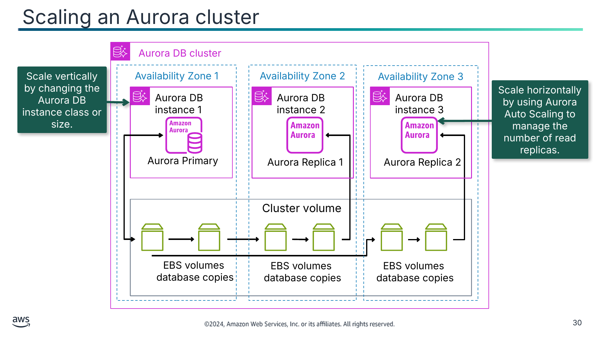

Масштабуйте вертикально, змінюючи клас чи розмір екземпляра БД Aurora.

Масштабуйте горизонтально, використовуючи Aurora Auto Scaling для керування кількістю реплік для читання.

Текст зі схеми

Aurora DB cluster (Кластер БД Aurora)

Availability Zone 1 (Зона доступності 1)

Availability Zone 2 (Зона доступності 2)

Availability Zone 3 (Зона доступності 3)

Aurora DB instance 1 (Екземпляр БД Aurora 1)

Aurora DB instance 2

Aurora DB instance 3

Aurora Primary (Основний екземпляр Aurora)

Aurora Replica 1 (Репліка Aurora 1)

Aurora Replica 2

Cluster volume (Том кластера)

EBS volumes

database copies (Томи EBS, копії бази даних)

EBS volumes

database copies

EBS volumes

database copies

> **Нотатки:**
>
> |Номер слайда 30  
> |Нотатки для інструктора  
> |Докладніше про такі теми, як керування з’єднаннями та плани виконання запитів, див. «Managing Performance and Scaling for Aurora DB Clusters» на сторінці курсу.  
> |  
> |Нотатки для студента  
> Опис зображення: кластер бази даних Aurora, що показує основний екземпляр у зоні доступності 1 і по одному екземпляру-репліці в зонах доступності 2 і 3. Кожен екземпляр підключається до набору томів Amazon Elastic Block Store (Amazon EBS) в тій самій зоні доступності. Основний екземпляр копіює свою базу даних на свої томи EBS, і вони копіюються на томи EBS для кожної з реплік бази даних. Томи EBS перебувають у томі кластера Aurora, що охоплює всі три зони доступності. Кінець опису.  
>
> Один зі способів масштабувати кластер Aurora для відповіді збільшеним вимогам робочого навантаження — використовувати Aurora Auto Scaling. Aurora Auto Scaling динамічно коригує кількість реплік Aurora (екземплярів БД для читання), розгорнутих для кластера БД Aurora. Aurora Auto Scaling допомагає вашому кластеру БД Aurora впоратися з раптовими збільшеннями підключень чи робочого навантаження. Коли підключення чи робоче навантаження зменшуються, Aurora Auto Scaling вилучає непотрібні репліки Aurora, щоб ви не платили за невикористані розгорнуті екземпляри БД.  
>
> Ви визначаєте й застосовуєте політику масштабування до кластера БД Aurora. Політика масштабування визначає мінімальну та максимальну кількість реплік Aurora, якими Aurora Auto Scaling може керувати. На основі політики Aurora Auto Scaling коригує кількість реплік Aurora вгору чи вниз у відповідь на фактичні робочі навантаження, визначені за допомогою метрик CloudWatch і цільових значень.  
>
> Ще один спосіб масштабувати кластер Aurora — змінити клас екземпляра БД Aurora, щоб змінити обчислювальну потужність кластера. Клас екземпляра БД визначає обчислювальну та пам’яттєву потужність екземпляра БД Aurora. Потрібний вам клас екземпляра БД залежить від ваших вимог до обчислювальної потужності та пам’яті.  
>
> Масштабування не миттєве. Завершення зміни на інший клас екземпляра БД може тривати 15 хвилин і більше. Ви можете застосувати зміну під час наступного запланованого вікна обслуговування, а не негайно, щоб не впливати на користувачів. Як альтернативу безпосередній зміні класу екземпляра БД можна мінімізувати простій, використовуючи функції високої доступності Aurora. Спершу додайте репліку Aurora до вашого кластера. Створюючи репліку, оберіть розмір класу екземпляра БД, який ви хочете використовувати для вашого кластера. Коли репліку Aurora синхронізовано з кластером, ви виконуєте відмовостійке перемикання на нещодавно додану репліку.  
>
> Сервіс Aurora автоматично керує масштабуванням сховища Aurora в томі кластера.

---

## Слайд 31: Масштабування кластера Aurora Serverless

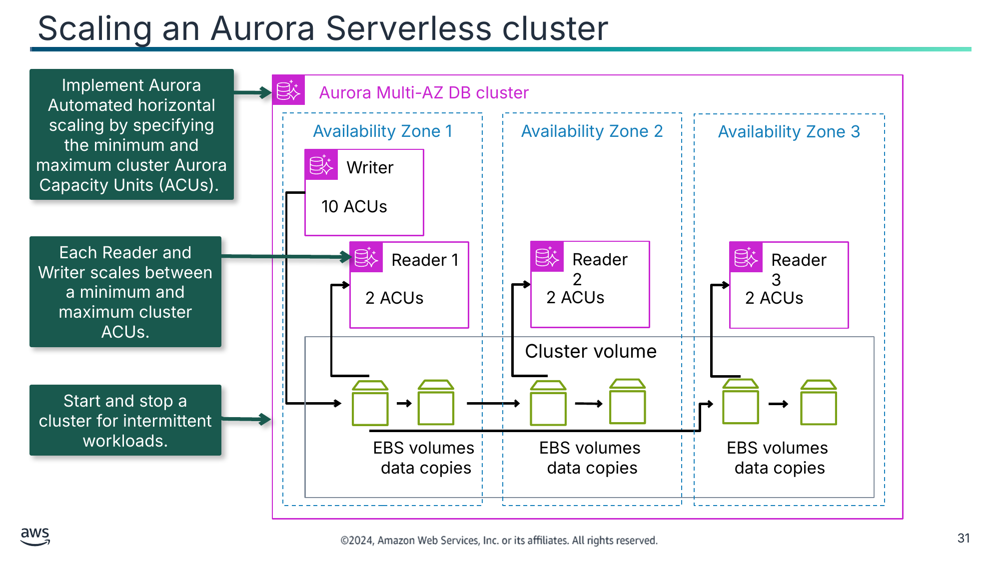

Упровадьте автоматизоване горизонтальне масштабування Aurora, указавши мінімальну та максимальну кількість одиниць потужності Aurora (ACU) кластера.

Кожен екземпляр для читання (Reader) і запису (Writer) масштабується між мінімальною та максимальною кількістю ACU кластера.

Запускайте й зупиняйте кластер для переривчастих робочих навантажень.

Текст зі схеми

Aurora Multi-AZ DB cluster (Кластер БД Aurora Multi-AZ)

Availability Zone 1 (Зона доступності 1)

Availability Zone 2

Availability Zone 3

Writer (Екземпляр для запису)

10 ACUs

Reader 1 (Екземпляр для читання 1)

Reader 2

Reader 3

2 ACUs

2 ACUs

2 ACUs

Cluster volume (Том кластера)

EBS volumes

data copies (Томи EBS, копії даних)

EBS volumes

data copies

EBS volumes

data copies

> **Нотатки:**
>
> |Номер слайда 31  
> |Нотатки для інструктора  
> |  
> |Нотатки для студента  
> Робочі навантаження можуть бути переривчастими й непередбачуваними. Можуть бути періоди великих робочих навантажень, що тривають лише кілька хвилин чи годин, а також тривалі періоди низької активності чи навіть відсутності активності. Деякі приклади — роздрібні вебсайти з переривчастими подіями розпродажів, бази даних звітності, що створюють звіти за потреби, середовища розробки й тестування та нові застосунки з невизначеними вимогами. У цих і багатьох інших випадках може бути складно налаштувати правильну потужність у потрібний час. Це також може призвести до вищих витрат, коли ви платите за потужність, що не використовується.  
>   
> Aurora Serverless — це конфігурація автоматичного масштабування за запитом для кластерів Amazon Aurora. Aurora Serverless дає вашій базі даних змогу автоматично запускатися, вимикатися та масштабувати потужність вгору чи вниз залежно від потреб вашого застосунку. Він дає змогу запускати вашу базу даних у хмарі без керування будь-якими екземплярами бази даних. Aurora Serverless можна використовувати для рідкісних, переривчастих чи непередбачуваних робочих навантажень.  
>   
> З Aurora Serverless ви створюєте кінцеву точку бази даних, не вказуючи розміру класу екземпляра БД. Ви вказуєте потужність бази даних за допомогою мінімальної та максимальної кількості одиниць потужності Aurora (ACU). Кожна ACU — це комбінація приблизно 2 гібібайтів (ГіБ) пам’яті, відповідного ЦП і мережі. Ви вказуєте діапазон потужності бази даних, використовуючи цю одиницю вимірювання. Aurora Serverless автоматично масштабує ресурси вертикально на основі специфікацій мінімальної та максимальної потужності.  
>   
> У наведеному вище прикладі кластер баз даних Amazon Aurora Multi-AZ має екземпляр для запису потужністю 10 ACU, налаштований у зоні доступності 1. По одному екземпляру для читання потужністю 2 ACU налаштовано в кожній зоні доступності. Зберігання даних забезпечує том кластера на томах EBS.  
>   
> Сховище бази даних автоматично масштабується так само, як сховище у стандартному кластері БД Aurora.  
> Ви платите посекундно за потужність бази даних, яку використовуєте, коли база даних активна, і можете переходити між стандартною та безсерверною конфігураціями. Ви платите за кількість використаних ACU. Можна зупиняти й запускати кластер для переривчастих робочих навантажень.

---

## Слайд 32: Масштабування бази даних Amazon RDS

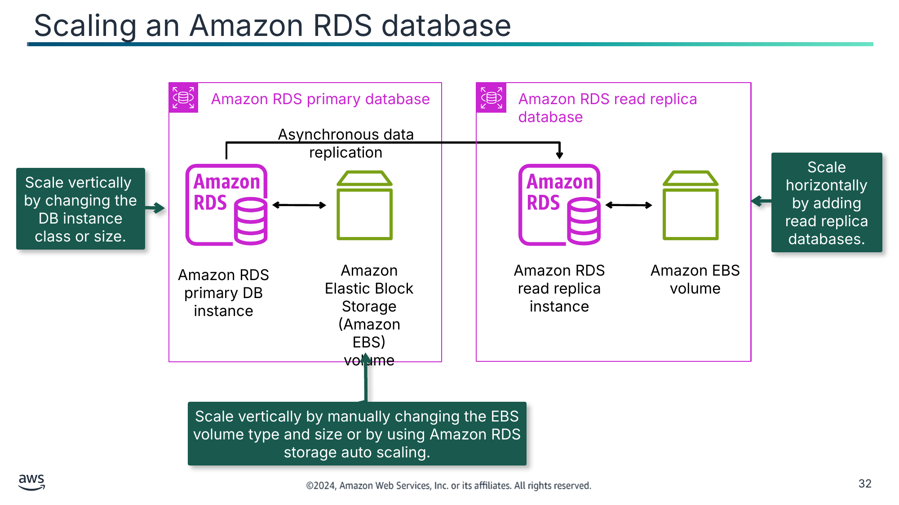

Масштабуйте горизонтально, додаючи бази даних-репліки для читання.

Масштабуйте вертикально, змінюючи клас чи розмір екземпляра БД.

Масштабуйте вертикально, вручну змінюючи тип і розмір тому EBS або використовуючи автомасштабування сховища Amazon RDS.

Текст зі схеми

Amazon RDS primary database (Основна база даних Amazon RDS)

Amazon RDS read replica database (База даних-репліка для читання Amazon RDS)

Asynchronous data replication (Асинхронна реплікація даних)

Amazon RDS primary DB instance (Основний екземпляр БД Amazon RDS)

Amazon Elastic Block Storage (Amazon EBS)

volume (том)

Amazon RDS read replica instance (Екземпляр-репліка для читання Amazon RDS)

Amazon EBS

volume

> **Нотатки:**
>
> |Номер слайда 32  
> |Нотатки для інструктора  
> |  
> |Нотатки для студента  
> Опис зображення: схема основного екземпляра Amazon RDS, підключеного до тому EBS. Стрілка позначає асинхронну реплікацію даних до репліки для читання Amazon RDS, що має власний том EBS. Кінець опису.  
>
> Як кероване обслуговування, Amazon RDS масштабує вашу реляційну базу даних, щоб вона встигала за зростаючими вимогами вашого застосунку. Вертикальне масштабування — найпростіший підхід до додавання потужності у вашій базі даних.  
>
> Ви можете вертикально масштабувати екземпляр бази даних (БД) Amazon RDS, змінюючи клас екземпляра Amazon RDS. Якщо ви вирішите збільшити чи зменшити обчислювальні ресурси, доступні вашому екземпляру БД, пам’ятайте, що ваша база даних тимчасово недоступна під час зміни класу екземпляра БД. Це відбувається під час вікна обслуговування вашого екземпляра БД, якщо ви не вкажете, що зміну слід застосувати негайно. Є мінімальний простій під час збільшення вашого екземпляра Amazon RDS у середовищі Multi-AZ, оскільки резервну базу даних оновлюють першою, а потім відбувається відмовостійке перемикання на базу даних нового розміру. Екземпляр Amazon RDS Single-AZ недоступний під час операції масштабування. Вертикальне масштабування підходить, якщо ви не можете змінити конфігурацію підключення вашого застосунку й бази даних.  
>
> Коли ви масштабуєте екземпляр бази даних вгору чи вниз, розмір вашого сховища залишається незмінним і не зазнає впливу зміни. Ви можете окремо змінити свій екземпляр БД, щоб збільшити виділений простір сховища чи покращити продуктивність, змінивши тип сховища — наприклад, із General Purpose SSD на Provisioned IOPS SSD. Замість ручного виділення сховища можна також використовувати автомасштабування сховища Amazon RDS (storage autoscaling) для автоматичного масштабування потужності сховища у відповідь на зростання робочих навантажень бази даних.  
>
> На додачу до вертикального масштабування можна масштабувати вашу базу даних горизонтально. Amazon RDS використовує вбудовану функціональність реплікації рушіїв БД MariaDB, MySQL, Oracle та PostgreSQL для створення особливого типу екземпляра БД, що називається реплікою для читання (read replica), із вихідного екземпляра БД. Оновлення, внесені до вихідного екземпляра БД, асинхронно копіюються до репліки для читання. Ви можете зменшити навантаження на ваш вихідний екземпляр БД, маршрутизуючи запити читання з ваших застосунків до репліки для читання.  
>
> Перенаправлення трафіку читання для бізнес-звітування та запитів читання із застосунків — приклади, де використовуються репліки для читання. Ще один сценарій використання — аварійне відновлення. Ви можете підвищити репліку для читання до основної бази даних, якщо вона стає недоступною. Однак важливо зазначити, що репліки для читання не замінюють можливостей високої доступності та автоматичного відмовостійкого перемикання, які забезпечує Multi-AZ.

---

## Слайд 33: Масштабування таблиці DynamoDB

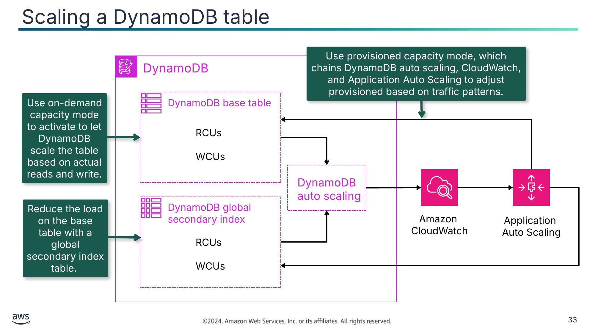

Використовуйте режим потужності за запитом (on-demand capacity mode), щоб DynamoDB масштабував таблицю на основі фактичних читань і записів.

Зменште навантаження на базову таблицю за допомогою таблиці глобального вторинного індексу.

Текст зі схеми

Use provisioned capacity mode, which chains DynamoDB auto scaling, CloudWatch, and Application Auto Scaling to adjust provisioned based on traffic patterns. (Використовуйте режим розгорнутої потужності, що пов’язує автомасштабування DynamoDB, CloudWatch і Application Auto Scaling для коригування розгорнутої потужності на основі шаблонів трафіку.)

DynamoDB

DynamoDB base table (Базова таблиця DynamoDB)

RCUs

WCUs

DynamoDB auto scaling (Автомасштабування DynamoDB)

DynamoDB global secondary index (Глобальний вторинний індекс DynamoDB)

Amazon

CloudWatch

Application  
Auto Scaling

RCUs

WCUs

> **Нотатки:**
>
> |Номер слайда 33  
> |Нотатки для інструктора  
> |  
> |Нотатки для студента  
> Коли ви створюєте нову таблицю в DynamoDB, потрібно вказати режим потужності таблиці, обравши режим розгорнутої потужності (provisioned mode) або режим за запитом (on-demand mode).  
>
> Коли ви обираєте режим за запитом, DynamoDB обслуговує ваші робочі навантаження на основі фактичних читань і записів у таблицю. Якщо рівень трафіку робочого навантаження досягає нового піку, DynamoDB швидко адаптується для обслуговування робочого навантаження. Це добре працює для робочих навантажень зі сплесками чи переривчастих.  
>
> Коли ви обираєте режим розгорнутої потужності, ви встановлюєте обсяг активності читання й запису, який може підтримувати таблиця, виміряний у RCU та WCU. DynamoDB використовує цю інформацію, щоб зарезервувати достатні системні ресурси для задоволення ваших вимог до пропускної здатності. Це добре працює для застосунків зі сталою та передбачуваною пропускною здатністю. За замовчуванням таблиця DynamoDB у режимі розгорнутої потужності активує автомасштабування потужності читання й запису. Автомасштабування DynamoDB використовує сервіс Application Auto Scaling для динамічного коригування розгорнутої пропускної здатності від вашого імені у відповідь на фактичні шаблони трафіку. Це дає таблиці чи глобальному вторинному індексу змогу збільшити розгорнуту потужність читання й запису для обробки раптових збільшень трафіку без обмеження (throttling). Коли робоче навантаження зменшується, Application Auto Scaling зменшує пропускну здатність, щоб ви не платили за невикористану розгорнуту потужність. Якщо автомасштабування для таблиці не потрібне, його можна вимкнути.  
>
> На додачу до таблиць автомасштабування DynamoDB також підтримує глобальні вторинні індекси. Кожен глобальний вторинний індекс має власну розгорнуту пропускну здатність, окрему від базової таблиці. Коли ви створюєте політику масштабування для глобального вторинного індексу, Application Auto Scaling коригує налаштування розгорнутої пропускної здатності для індексу, щоб гарантувати, що його фактичне використання залишається на рівні вашого бажаного коефіцієнта використання чи близько до нього.  
>
> Сервіс DynamoDB автоматично керує масштабуванням сховища DynamoDB.

---

## Слайд 34: Порівняння механізмів масштабування баз даних AWS

| Масштабування (Scaling) | Aurora | Aurora Serverless | Amazon RDS | DynamoDB |
|---|---|---|---|---|
| Область (Scope) | Кластер | Кластер | База даних | Таблиця |
| Вертикальне масштабування | Клас чи розмір екземпляра | Обмеження пропускної здатності ACU кластера, де кожен екземпляр для читання й запису автоматично масштабується в межах обмежень | • Клас чи розмір екземпляра • Автомасштабування сховища Amazon RDS | Н/З |
| Горизонтальне масштабування | Aurora Auto Scaling для реплік для читання | • Репліки Multi-AZ • Репліки для читання | Бази даних-репліки для читання | • Режим за запитом • Режим розгорнутої потужності з Application Auto Scaling • Глобальні вторинні індекси |
| Кероване сервісом AWS | Масштабування сховища | Масштабування сховища | Н/З | Масштабування сховища |

> **Нотатки:**
>
> |Номер слайда 34  
> |Нотатки для інструктора  
> |  
> |Нотатки для студента  
> Таблиця підсумовує цей розділ.

---

## Слайд 35: Ключові висновки: масштабування ваших баз даних

- З Aurora можна обирати розмір класу екземпляра бази даних і кількість реплік Aurora.
- Aurora Serverless автоматично масштабує ресурси на основі специфікацій мінімальної та максимальної потужності.
- Можна вручну вертикально масштабувати обчислювальну потужність вашого екземпляра БД RDS.
- Можна використовувати репліки для читання для горизонтального масштабування вашого екземпляра БД RDS.
- DynamoDB On-Demand пропонує модель ціноутворення на основі фактичних читань і записів таблиці.
- Автомасштабування DynamoDB використовує Application Auto Scaling для динамічного коригування розгорнутої пропускної здатності.

> **Нотатки:**
>
> |Номер слайда 35  
> |Нотатки для інструктора  
> |  
> |Нотатки для студента

---

## Слайд 36: Використання балансувальників навантаження для створення високодоступних середовищ

Впровадження моніторингу, еластичності та високої доступності

> **Нотатки:**
>
> |Номер слайда 36  
> |Нотатки для інструктора  
> |Балансувальники навантаження забезпечують перевірки стану, щоб надати парк справних ресурсів. Важливо, щоб студенти розуміли сферу застосування та сценарії використання балансувальників навантаження в архітектурі AWS.  
> |  
> |Нотатки для студента  
> Цей розділ розглядає, як використовувати балансувальники навантаження AWS для створення високодоступних середовищ.

---

## Слайд 37: Високодоступні системи (highly available systems)

| Відсоток безвідмовної роботи (Percentage of uptime) | Максимальний простій за рік (Maximum downtime per year) | Еквівалентний простій за день (Equivalent downtime per day) |
|---|---|---|
| 90% | 36,5 доби | 2,4 години |
| 99% | 3,65 доби | 14 хвилин |
| 99,9% | 8,76 години | 86 секунд |
| 99,99% | 52,6 хвилини | 8,6 секунди |
| 99,999% | 5,25 хвилини | 0,86 секунди |

> **Нотатки:**
>
> |Номер слайда 37  
> |Нотатки для інструктора  
> |  
> |Нотатки для студента  
> Проєктуючи та будуючи рішення продуктивного масштабу, слід уникати єдиних точок відмови. Наприклад, наявність однієї бази даних і одного екземпляра застосунку призведе до відмови застосунку, якщо вийде з ладу база даних чи екземпляр. Розумно мати резервні плани для сценаріїв відмови одного екземпляра, відмови зони доступності та відмови регіону. Один зі способів пом’якшити єдині точки відмови — спроєктувати вашу архітектуру високодоступною.  
>
> Високодоступна система — це система, що може витримати певну міру погіршення, залишаючись доступною. Простій мінімізується наскільки можливо, а для повернення системи до нормальних робочих рівнів потрібне мінімальне втручання людини. Високодоступна система забезпечує стійкість у реактивній архітектурі. Стійке робоче навантаження може автоматично відновлюватися, коли його навантажують (більше запитів на сервіс), атаки чи відмова компонента. Стійке робоче навантаження відновлюється після збою або переходить на вторинне джерело протягом прийнятного часу погіршеної продуктивності.

---

## Слайд 38: ELB

- Розподіляє трафік між кількома цілями в одній чи кількох зонах доступності
- Може отримувати публічний чи приватний трафік
- Відстежує стан зареєстрованих цілей за допомогою перевірок стану (health checks)
- Маршрутизує трафік лише до справних цілей
- Масштабується на основі вхідного трафіку

ELB

> **Нотатки:**
>
> |Нотатки для інструктора  
> |  
> |Нотатки для студента  
> ELB розв’язує проблему єдиної точки відмови для сервісів AWS, як-от екземпляри EC2 і контейнери. Це ключовий компонент створення високодоступної архітектури.  
>
> Балансувальник навантаження автоматично розподіляє ваш вхідний трафік між кількома цілями в одній чи кількох зонах доступності. Балансувальники навантаження можуть бути зовнішніми й розподіляти вхідний публічний трафік. Вони також можуть бути внутрішніми й розподіляти приватний трафік.  
>
> ELB відстежує стан своїх зареєстрованих цілей і маршрутизує трафік лише до справних цілей. Щоб виявити доступність ваших екземплярів EC2, балансувальник навантаження періодично надсилає пінги, намагається встановити з’єднання чи надсилає запити для тестування екземплярів EC2. Ці тести називаються перевірками стану. Кожен зареєстрований екземпляр EC2 має відповісти цілі перевірки стану кодом стану HTTP 200, щоб ваш балансувальник навантаження вважав його справним. Якщо екземпляр не проходить перевірку стану, до групи Amazon EC2 Auto Scaling надсилається сповіщення про заміну екземпляра справним екземпляром.  
>
> ELB підтримує чотири типи балансувальників навантаження: Application Load Balancer, Network Load Balancer, Gateway Load Balancer і Classic Load Balancer. Кожен балансувальник навантаження отримує DNS-ім’я за замовчуванням. Сервіс ELB масштабує ваш балансувальник навантаження в міру зміни вхідного трафіку з часом.

---

## Слайд 39: Типи балансувальників навантаження AWS

Application Load Balancer

Network Load Balancer

Gateway Load Balancer

Classic Load  
Balancer

- Використовується для трафіку HTTP і HTTPS
- Працює на рівні 7 моделі OSI — рівні застосунку
- Використовується для архітектур застосунків

- Використовується для розвантаження TLS (TLS offloading), UDP та статичних IP-адрес
- Працює на рівні 4 моделі OSI — транспортному рівні
- Використовується для мільйонів запитів на секунду з наднизькою затримкою

- Використовується для парку сторонніх віртуальних пристроїв за протоколом GENEVE
- Працює на рівні 3 моделі OSI — мережевому рівні
- Використовується для покращення безпеки, відповідності та засобів контролю політик

- Використовується для мереж EC2-Classic попереднього покоління
- Працює на рівнях 3 і 7 моделі OSI — мережевому та прикладному рівнях
- Використовується, якщо перехід на інші балансувальники навантаження неможливий

> **Нотатки:**
>
> |Номер слайда 39  
> |Нотатки для інструктора  
> |Докладніше про модель OSI див. «What is OSI Model?» за адресою https://aws.amazon.com/what-is/osi-model/.  
> |  
> |Нотатки для студента  
> Ви можете обрати тип балансувальника навантаження, що найкраще відповідає вашим потребам. Усі типи пропонують високу доступність, автоматичне масштабування та надійну безпеку, потрібні для того, щоб зробити ваші застосунки відмовостійкими.  
>
> Application Load Balancer (ALB) функціонує на рівні застосунку, сьомому рівні моделі взаємодії відкритих систем (Open Systems Interconnection, OSI). Він маршрутизує трафік HTTP і HTTPS до цілей, як-от екземпляри EC2, контейнери, IP-адреси та функції Lambda, на основі вмісту запиту. ALB підтримують автоматичні ваги цілей (Automatic Target Weights, ATW), що використовують алгоритм маршрутизації для оптимізації обсягу трафіку, надісланого кожній цілі, на основі інформації, доступної балансувальнику навантаження. ALB коригуватиме обсяг трафіку, надісланого кожній цілі, на основі неявної інформації про стан, як-от помилки 5XX і помилки з’єднання.  
>
> Network Load Balancer функціонує на четвертому рівні моделі OSI — транспортному рівні. Він може обробляти мільйони запитів на секунду й маршрутизує з’єднання до цілей, як-от екземпляри EC2, контейнери, Application Load Balancer та IP-адреси. Він підтримує протоколи TCP, UDP, TCP_UDP і TLS і працює з наднизькими затримками. Network Load Balancer оптимізований для обробки раптових і нестабільних шаблонів мережевого трафіку.  
>
> Gateway Load Balancer працює на третьому рівні моделі OSI — мережевому рівні. Використовуючи Gateway Load Balancer, можна розгортати, масштабувати віртуальні пристрої й керувати ними, як-от брандмауери, системи виявлення та запобігання вторгненням і системи глибокої перевірки пакетів. Gateway Load Balancer поєднує єдину точку входу та виходу для всього трафіку й розподіляє трафік, масштабуючи ваші віртуальні пристрої відповідно до попиту.  
>
> Classic Load Balancer забезпечує базове балансування навантаження між кількома екземплярами EC2 і працює і на рівні застосунку, і на рівні мережевого транспорту. Classic Load Balancer підтримує балансування навантаження застосунків, що використовують HTTP, HTTPS, TCP і SSL. Classic Load Balancer — це старіша реалізація. Коли це можливо, AWS рекомендує використовувати виділений Application Load Balancer або Network Load Balancer.

---

## Слайд 40: Компоненти балансувальника навантаження

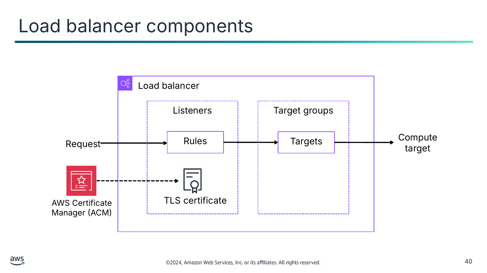

Текст зі схеми

Load balancer (Балансувальник навантаження)

Listeners (Слухачі)

Target groups (Цільові групи)

Request (Запит)

Rules (Правила)

Targets (Цілі)

Compute target (Обчислювальна ціль)

AWS Certificate  
Manager (ACM)

TLS certificate (Сертифікат TLS)

> **Нотатки:**
>
> |Номер слайда 40  
> |Нотатки для інструктора  
> |  
> |Нотатки для студента  
> Балансувальник навантаження слугує єдиною точкою контакту для клієнтів. Балансувальник навантаження розподіляє вхідний трафік застосунку між кількома цілями, як-от екземпляри EC2, у кількох зонах доступності. Це збільшує доступність вашого застосунку. Ви додаєте один чи кілька слухачів (listeners) до вашого балансувальника навантаження.  
>
> Слухач перевіряє запити на з’єднання від клієнтів за допомогою протоколу та порту, які ви налаштовуєте. Правила, які ви визначаєте для слухача, визначають, як балансувальник навантаження маршрутизує запити до своїх зареєстрованих цілей. Кожне правило складається з пріоритету, однієї чи кількох дій і однієї чи кількох умов. Коли умови правила виконуються, його дії виконуються. Для кожного слухача потрібно визначити правило за замовчуванням, а також можна за бажанням визначити додаткові правила.  
>
> Деякі слухачі, як-от слухачі HTTPS і TLS, вимагають серверних сертифікатів TLS на вашому балансувальнику навантаження, щоб гарантувати захист трафіку під час передавання. Протоколи HTTPS і TLS використовують шифрування для захисту повідомлень, що надсилаються спільними мережами.  
>
> AWS Certificate Manager (ACM) — це сервіс, який можна використовувати для виділення, керування та розгортання публічних і приватних сертифікатів SSL/TLS для використання в сервісах AWS, як-от балансувальники навантаження. Сертифікати SSL/TLS використовуються для захисту мережевого обміну даними та встановлення ідентичності вебсайтів в інтернеті та ресурсів у приватних мережах. Балансувальник навантаження використовує серверний сертифікат для завершення фронтенд-з’єднання, а потім розшифровує запити від клієнтів перед надсиланням їх до цілей. Якщо потрібно передавати зашифрований трафік до цілей без розшифрування балансувальником навантаження, можна створити Network Load Balancer або Classic Load Balancer зі слухачем TCP. Зі слухачем TCP балансувальник навантаження передає зашифрований трафік до цілей без розшифрування.  
>
> Кожна цільова група (target group) маршрутизує запити до однієї чи кількох зареєстрованих цілей, як-от екземпляри EC2, за допомогою протоколу та номера порту, які ви вкажете. Ви можете зареєструвати ціль у кількох цільових групах і налаштувати перевірки стану для кожної цільової групи. Перевірки стану виконуються для всіх цілей, зареєстрованих у цільовій групі, указаній у правилі слухача вашого балансувальника навантаження.  
>
> Ви визначаєте налаштування перевірки стану для вашого балансувальника навантаження для кожної цільової групи. Кожна цільова група використовує налаштування перевірки стану за замовчуванням, якщо ви не перевизначите їх під час створення цільової групи або не змінете пізніше. Після того як ви вкажете цільову групу в правилі для слухача, балансувальник навантаження безперервно відстежує стан усіх цілей, зареєстрованих у цільовій групі, що перебувають у зоні доступності, увімкненій для балансувальника навантаження. Балансувальник навантаження маршрутизує запити до зареєстрованих цілей, що є справними.

---

## Слайд 41: Висока доступність за допомогою Application Load Balancer та Amazon RDS Multi-AZ

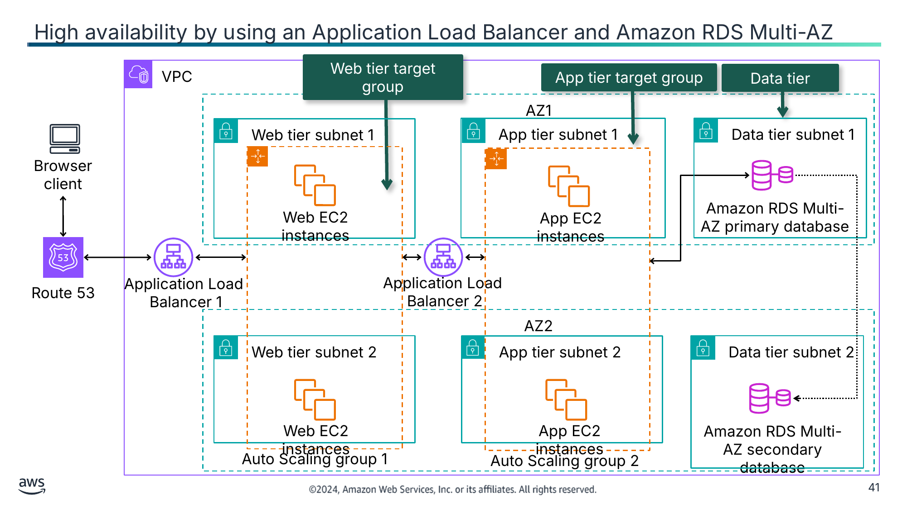

Текст зі схеми

VPC

Web tier target group (Цільова група вебрівня)

App tier target group (Цільова група рівня застосунку)

Data tier (Рівень даних)

AZ1

Web tier subnet 1 (Підмережа вебрівня 1)

App tier subnet 1 (Підмережа рівня застосунку 1)

Data tier subnet 1 (Підмережа рівня даних 1)

Browser client (Клієнт-браузер)

Amazon RDS Multi-AZ primary database (Основна база даних Amazon RDS Multi-AZ)

Web EC2 instances (Екземпляри EC2 вебрівня)

App EC2 instances (Екземпляри EC2 рівня застосунку)

Application Load  
Balancer 1

Application Load  
Balancer 2

Route 53

AZ2

Web tier subnet 2

App tier subnet 2

Data tier subnet 2

Web EC2 instances

App EC2 instances

Amazon RDS Multi-AZ secondary database (Вторинна база даних Amazon RDS Multi-AZ)

Auto Scaling group 1 (Група Auto Scaling 1)

Auto Scaling group 2

> **Нотатки:**
>
> |Номер слайда 41  
> |Нотатки для інструктора  
> |  
> |Нотатки для студента  
> Application Load Balancer функціонує на рівні застосунку, сьомому рівні моделі OSI. Після того як балансувальник навантаження отримує запит, він оцінює правила слухача за порядком пріоритету, щоб визначити, яке правило застосувати, а потім обирає ціль із цільової групи для дії правила. Можна налаштувати правила слухача для маршрутизації запитів до різних цільових груп на основі вмісту трафіку застосунку. Маршрутизація виконується незалежно для кожної цільової групи, навіть якщо ціль зареєстровано в кількох цільових групах. Можна налаштувати алгоритм маршрутизації, що використовується на рівні цільової групи. Алгоритм маршрутизації за замовчуванням — циклічний (round robin), що маршрутизує кожен запит до наступної цілі в групі. Як варіант, можна вказати алгоритм маршрутизації за найменшою кількістю невиконаних запитів (least outstanding requests).  
>
> У прикладі на цьому слайді єдині точки відмови усунено. Application Load Balancer 1 є зовнішнім і отримує публічний трафік HTTP і HTTPS від клієнта-браузера, маршрутизований через Route 53. Він розподіляє трафік до цільової групи вебрівня, що включає парк екземплярів EC2 у групі Auto Scaling 1 у зонах доступності AZ1 та AZ2.  
>
> Якщо перевірка стану одного екземпляра EC2 не проходить, Application Load Balancer 1 не надсилатиме жодного трафіку до цього екземпляра EC2. Він надішле сповіщення про несправний екземпляр до групи Auto Scaling 1, щоб завершити роботу екземпляра й замінити його справним екземпляром.  
>
> Якщо відбувається збій на рівні зони доступності, Application Load Balancer 1 надсилатиме трафік лише до справних екземплярів EC2 в іншій зоні доступності.  
>
> Подібно до Application Load Balancer 1, Application Load Balancer 2 дотримується того самого шаблону високої доступності. Він є внутрішнім і отримує приватний трафік від цільової групи вебрівня. Він розподіляє трафік до цільової групи рівня застосунку, що включає парк екземплярів EC2 у групі Auto Scaling 2 у зонах доступності AZ1 та AZ2. Це захистить застосунок від відмови екземпляра EC2 чи відмови зони доступності.  
>
> Рівень даних також упроваджує високу доступність завдяки конфігурації Amazon RDS Multi-AZ. Основна база даних в AZ1 синхронно реплікує дані на вторинну базу даних в AZ2. Якщо база даних виходить з ладу або зона доступності має проблеми, вторинну базу даних підвищують до основної бази даних, що робить її високодоступною.  
>
> Цю архітектуру можна дублювати в інший регіон на випадок регіональних проблем. Докладніше див. модуль «Планування аварійного відновлення» (Planning for Disaster).

---

## Слайд 42: Висока доступність за допомогою Network Load Balancer

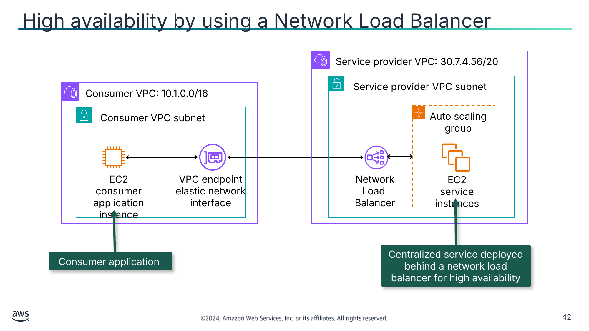

Текст зі схеми

Service provider VPC: 30.7.4.56/20 (VPC постачальника сервісу)

Consumer VPC: 10.1.0.0/16 (VPC споживача)

Service provider VPC subnet (Підмережа VPC постачальника сервісу)

Consumer VPC subnet (Підмережа VPC споживача)

Auto scaling group (Група Auto Scaling)

EC2 consumer application instance (Екземпляр EC2 застосунку-споживача)

VPC endpoint

elastic network interface (Еластичний мережевий інтерфейс кінцевої точки VPC)

Network Load  
Balancer

EC2 service instances (Екземпляри EC2 сервісу)

Consumer application (Застосунок-споживач)

Centralized service deployed behind a network load balancer for high availability (Централізований сервіс, розгорнутий за балансувальником навантаження мережі для високої доступності)

> **Нотатки:**
>
> |Номер слайда 42  
> |Нотатки для інструктора  
> |  
> |Нотатки для студента  
> Network Load Balancer можна використовувати для відкриття централізованого сервісу. Як ви дізналися в модулі «З’єднання мереж», VPC споживача використовує VPC постачальника сервісу для певного сервісу.  
>
> Network Load Balancer функціонує на четвертому рівні моделі OSI. Він може обробляти мільйони запитів на секунду. Network Load Balancer підтримують з’єднання від клієнтів через піринг VPC, кінцеві точки VPC, VPN, керований AWS, AWS Direct Connect та сторонні рішення VPN. Після того як балансувальник навантаження отримує запит на з’єднання, він обирає ціль із цільової групи для правила за замовчуванням. Він намагається відкрити з’єднання TCP до вибраної цілі на порту, указаному в конфігурації слухача.  
>
> Кожен Network Load Balancer отримує DNS-ім’я за замовчуванням із таким синтаксисом: name-id.elb.region.amazonaws.com. Приклад: my-load-balancer-1234567890abcdef.elb.us-east-2.amazonaws.com. Якщо ви віддаєте перевагу DNS-імені, яке легше запам’ятати, можна створити користувацьке доменне ім’я й пов’язати його з DNS-іменем вашого балансувальника навантаження. Коли клієнт робить запит за допомогою цього користувацького доменного імені, DNS-сервер розв’язує його в DNS-ім’я вашого балансувальника навантаження.  
>
> Можна створити цільову групу з єдиним Application Load Balancer як ціллю й налаштувати ваш Network Load Balancer на пересилання трафіку до неї. У цьому сценарії Application Load Balancer бере на себе рішення про балансування навантаження, щойно трафік досягає його. Ця конфігурація поєднує функції обох балансувальників навантаження. Це означає, що можна використовувати функцію маршрутизації Application Load Balancer на основі запитів рівня 7 у поєднанні з функціями, що підтримує Network Load Balancer, як-от сервіси кінцевих точок і статичні IP-адреси. Цю конфігурацію можна використовувати для застосунків, яким потрібна єдина кінцева точка для кількох протоколів, як-от медіасервіси, що використовують HTTP для сигналізації та RTP для потокової передачі контенту.

---

## Слайд 43: Сервіс безпеки за допомогою Gateway Load Balancer

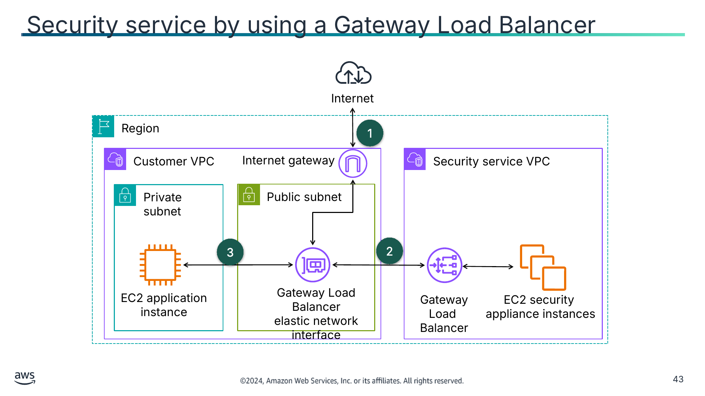

Текст зі схеми

Internet (Інтернет)

Region (Регіон)

1

Customer VPC (VPC клієнта)

Internet gateway (Інтернет-шлюз)

Security service VPC (VPC сервісу безпеки)

Private subnet (Приватна підмережа)

Public subnet (Публічна підмережа)

3

2

EC2 application

instance (Екземпляр EC2 застосунку)

Gateway Load Balancer

elastic network interface (Еластичний мережевий інтерфейс Gateway Load Balancer)

Gateway Load  
Balancer

EC2 security

appliance instances (Екземпляри EC2 пристроїв безпеки)

> **Нотатки:**
>
> |Номер слайда 43  
> |Нотатки для інструктора  
> |  
> |Нотатки для студента  
> Опис зображення: VPC 1 має приватну підмережу з екземпляром EC2 та публічну підмережу з приєднаною кінцевою точкою Gateway Load Balancer і інтернет-шлюзом. VPC 2 має Gateway Load Balancer та екземпляр EC2 пристрою безпеки. Кінець опису зображення.  
>
> Gateway Load Balancer — це специфічне рішення безпеки для сканування вхідного та вихідного трафіку за допомогою віртуальних пристроїв.  
>
> Gateway Load Balancer працює на третьому рівні моделі OSI — мережевому рівні. Він прослуховує всі IP-пакети на всіх портах і пересилає трафік до цільової групи, указаної в правилі слухача. Він зберігає прив’язку потоків до певного цільового пристрою за допомогою 5-кортежу (для потоків TCP/UDP) або 3-кортежу (для потоків не TCP/UDP). Gateway Load Balancer і його зареєстровані екземпляри віртуальних пристроїв обмінюються трафіком застосунку за допомогою протоколу GENEVE:  
> Увесь трафік, що входить у VPC 1 через інтернет-шлюз, спершу маршрутизується до кінцевої точки Gateway Load Balancer у VPC 1.  
> Потім трафік маршрутизується до Gateway Load Balancer у VPC 2. Gateway Load Balancer розподіляє трафік на пристрій безпеки Amazon EC2 для перевірки. Пристрій безпеки відповідає Gateway Load Balancer, що повертає перевірений трафік на кінцеву точку Gateway Load Balancer.  
> Кінцева точка Gateway Load Balancer надсилає трафік на екземпляр EC2 застосунку.  
>
> Так само весь трафік, що виходить з екземпляра EC2 застосунку, проходить тим самим шляхом, що й вхідний трафік.  
>
> Gateway Load Balancer і Network Load Balancer виконують різні функції. Gateway Load Balancer — це рішення безпеки, що використовує протокол GENEVE, а Network Load Balancer відкриває сервіси й розподіляє мережевий трафік між кількома серверами.

---

## Слайд 44: Демонстрація: створення високодоступного застосунку (Creating a Highly Available Application)

- Ця демонстрація використовує Amazon EC2.
- У цій демонстрації ви побачите, як виконати таке:
  - Створити високодоступний застосунок за допомогою Elastic Load Balancing і груп Auto Scaling.
  - Створити Application Load Balancer.

> **Нотатки:**
>
> |Номер слайда 44  
> |Нотатки для інструктора  
> |Ця демонстрація — файл .mp4 із субтитрами. Студенти отримують до неї доступ через онлайн-курс. Посібник інструктора містить тривалість кожної демонстрації.  
> |  
> |Нотатки для студента  
> Знайдіть цю записану демонстрацію у вашому онлайн-курсі як частину цього модуля.

---

## Слайд 45: Ключові висновки: використання балансувальників навантаження для створення високодоступних середовищ

- ELB розподіляє трафік між кількома цілями в одній чи кількох зонах доступності та відстежує стан зареєстрованих цілей за допомогою перевірок стану.
- Application Load Balancer використовується для архітектур застосунків і працює на рівні застосунку моделі OSI (рівень 7).
- Network Load Balancer використовується для мільйонів одночасних запитів із наднизькою затримкою й працює на транспортному рівні моделі OSI (рівень 4).
- Gateway Load Balancer використовується для покращення безпеки, відповідності та засобів контролю політик і працює на мережевому рівні моделі OSI (рівень 3).

> **Нотатки:**
>
> |Номер слайда 45  
> |Нотатки для інструктора  
> |  
> |Нотатки для студента

---

## Слайд 46: Використання Route 53 для створення високодоступних середовищ

Впровадження моніторингу, еластичності та високої доступності

> **Нотатки:**
>
> |Номер слайда 46  
> |Нотатки для інструктора  
> |Route 53 використовується для відмовостійкого перемикання для архітектур, що охоплюють кілька регіонів AWS.  
> |  
> |Нотатки для студента  
> Цей розділ розглядає, як використовувати Route 53 для створення високодоступних середовищ.

---

## Слайд 47: DNS-запити (DNS lookups)

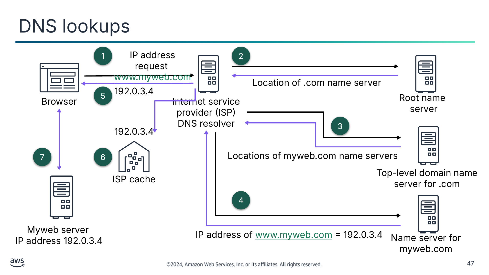

Текст зі схеми

1

IP address request [www.myweb.com](http://www.myweb.com/) (Запит IP-адреси www.myweb.com)

2

Location of .com name server (Розташування сервера імен .com)

192.0.3.4

Browser (Браузер)

5

Internet service provider (ISP) DNS resolver (DNS-резолвер інтернет-провайдера (ISP))

Root name

server (Кореневий сервер імен)

3

192.0.3.4

7

6

Locations of myweb.com name servers (Розташування серверів імен myweb.com)

Top-level domain name server for .com (Сервер імен домену верхнього рівня для .com)

ISP cache (Кеш ISP)

4

Myweb server (Сервер Myweb)

IP address 192.0.3.4 (IP-адреса 192.0.3.4)

IP address of [www.myweb.com](http://www.myweb.com/) = 192.0.3.4 (IP-адреса www.myweb.com = 192.0.3.4)

Name server for myweb.com (Сервер імен для myweb.com)

> **Нотатки:**
>
> |Номер слайда 47  
> |Нотатки для інструктора  
> |  
> |Нотатки для студента  
> Усі комп’ютери в інтернеті — від вашого смартфона чи ноутбука до серверів, що обслуговують контент великих роздрібних вебсайтів, — знаходять один одного й обмінюються даними за допомогою IP-адрес. Коли ви відкриваєте вебпереглядач і переходите на вебсайт, вам не потрібно запам’ятовувати й вводити довге число. Натомість можна ввести доменне ім’я, як-от myweb.com, і все одно потрапити в потрібне місце.  
>
> DNS — це глобально розподілений сервіс, що перетворює зрозумілі людині імена, як-от www.myweb.com, на числові IP-адреси, як-от 192.0.2.1, які комп’ютери використовують для зв’язку одне з одним. DNS інтернету працює подібно до телефонної книги, керуючи зіставленням між іменами й числами. Сервери DNS перетворюють запити імен на IP-адреси, контролюючи, до якого сервера дійде кінцевий користувач, коли введе доменне ім’я у своєму вебпереглядачі. Ці запити називаються запитами (queries).  
>
> Клієнти зазвичай не роблять запитів безпосередньо до авторитетних сервісів DNS. Натомість клієнти зазвичай підключаються до іншого типу сервісу DNS, відомого як резолвер (resolver), або рекурсивний сервіс DNS. Рекурсивний сервіс DNS не володіє жодними записами DNS, а діє як посередник, що може отримати інформацію DNS від вашого імені. Якщо рекурсивний сервіс DNS має посилання DNS у кеші чи збережене протягом певного часу, він відповідає на запит DNS, надаючи інформацію про джерело чи IP. Якщо ні, він передає запит одному чи кільком авторитетним серверам DNS, щоб знайти інформацію.  
>
> Приклад на цьому слайді має такі кроки:  
> Користувач відкриває вебпереглядач, вводить www.myweb.com в адресний рядок і натискає Enter. Запит на www.myweb.com маршрутизується до DNS-резолвера, яким зазвичай керує інтернет-провайдер (ISP) користувача.  
> DNS-резолвер ISP пересилає запит на www.myweb.com до кореневого сервера імен DNS, що повертає розташування сервера імен домену верхнього рівня (TLD) для .com.  
> DNS-резолвер ISP знову пересилає запит на www.myweb.com, цього разу до одного із серверів імен TLD для доменів .com. Сервер імен для доменів .com відповідає на запит іменами кількох серверів імен, пов’язаних із доменом example.com.  
> DNS-резолвер ISP обирає сервер імен і пересилає запит на www.myweb.com до цього сервера імен. Сервер імен шукає в розміщеній зоні myweb.com запис www.myweb.com, отримує пов’язане значення (як-от IP-адресу вебсервера, 192.0.3.4) і повертає IP-адресу DNS-резолверу.  
> DNS-резолвер ISP нарешті має IP-адресу, яка потрібна користувачу. Резолвер повертає це значення вебпереглядачу.  
> DNS-резолвер також кешує IP-адресу для myweb.com на вказаний вами час, щоб відповісти швидше наступного разу, коли хтось перейде на myweb.com.  
> Вебпереглядач надсилає запит на www.myweb.com на IP-адресу, яку він отримав від DNS-резолвера. Сервер myweb за адресою 192.0.3.4 повертає вебсторінку www.myweb.com вебпереглядачу, і вебпереглядач відображає сторінку.  
>
> Докладніше див. «What is DNS?» на сторінці ресурсів вмісту вашого онлайн-курсу.

---

## Слайд 48: Route 53

- Є вебсервісом DNS, що керує реєстрацією доменних імен і надає розміщені зони (hosted zones).
- Надає авторитетні сервери імен для розв’язання DNS
- Виконує маршрутизацію DNS для спрямування трафіку до справних кінцевих точок
- Виконує перевірки стану для IP-адрес чи доменів для керування відмовостійким перемиканням між зонами доступності чи регіонами
- Може відстежувати сигнали CloudWatch
- Підтримує кілька варіантів маршрутизації

Route 53

> **Нотатки:**
>
> |Нотатки для інструктора  
> |  
> |Нотатки для студента  
> Ви можете впровадити міжрегіональну високу доступність і відмовостійкість у вашій мережевій архітектурі за допомогою Route 53. Route 53 — це високодоступний і масштабований вебсервіс DNS. Route 53 можна використовувати для виконання трьох основних функцій у будь-якій комбінації: реєстрація доменів, маршрутизація DNS і перевірка стану. Коли користувачі запитують ваш вебсайт чи вебзастосунок, наприклад, вводячи назву вашого домену у вебпереглядачі, Route 53 допомагає маршрутизувати користувачів до ваших ресурсів. Цими ресурсами можуть бути бакет S3 або вебсервер у вашому центрі обробки даних.  
>
> Route 53 пропонує реєстрацію доменних імен. Ви можете купувати доменні імена, як-от myweb.com, і керувати ними, а Route 53 автоматично налаштовує параметри DNS для ваших доменів. Можна створити розміщену зону в Route 53. Розміщена зона — це контейнер для записів, що містять інформацію про те, як ви хочете маршрутизувати трафік для домену (як-от myweb.com) і всіх його піддоменів (як-от www.myweb.com, retail.myweb.com і accounting.myweb.com). Розміщена зона має ту саму назву, що й відповідний домен.  
>
> Route 53 надає сервери імен, що утворюють частину DNS і допомагають перетворювати доменні імена на IP-адреси. Route 53 ефективно з’єднує запити користувачів з інфраструктурою, що працює в AWS, як-от екземпляри EC2, балансувальники навантаження ELB чи бакети S3. Також можна використовувати Route 53 для маршрутизації користувачів до інфраструктури поза AWS.  
>
> Route 53 також виконує перевірки стану для відстеження стану ваших ресурсів, як-от вебсервери та поштові сервери. Можна налаштувати перевірки стану кінцевих точок чи обчислювані перевірки стану, що відстежують інші перевірки стану. Також можна налаштувати перевірки стану на основі сигналів CloudWatch для відстеження статусу метрик CloudWatch. Amazon Route 53 Application Recovery Controller тепер пропонує зональне автоматичне перемикання (zonal autoshift) — функцію, яку можна ввімкнути для безпечного й автоматичного перенаправлення трафіку вашого застосунку з зони доступності AWS, коли AWS виявляє потенційний збій, що впливає на цю зону доступності. Для збоїв, як-от відключення живлення й мережі, зональне автоматичне перемикання покращує доступність вашого застосунку, перенаправляючи трафік застосунку із зони доступності, що зазнала впливу, до справних зон доступності.  
>
> Route 53 пропонує різні варіанти маршрутизації, які можна поєднувати з відмовостійким перемиканням DNS для забезпечення архітектур із низькою затримкою та відмовостійкістю. Amazon Route 53 Application Recovery Controller дає вам розуміння того, чи готові ваші застосунки й ресурси до відновлення, і допомагає керувати відмовостійким перемиканням та координувати його. Перевірки стану в Amazon Route 53 Application Recovery Controller пов’язані з елементами керування маршрутизацією (routing controls), що є перемикачами «увімкнено/вимкнено». Ви налаштовуєте кожну перевірку стану елемента керування маршрутизацією із записом DNS відмовостійкого перемикання. Потім можна оновлювати свої елементи керування маршрутизацією в Amazon Route 53 Application Recovery Controller, щоб перенаправляти трафік і виконувати відмовостійке перемикання ваших застосунків, наприклад між зонами доступності чи регіонами AWS.

---

## Слайд 49: DNS-запити з Route 53

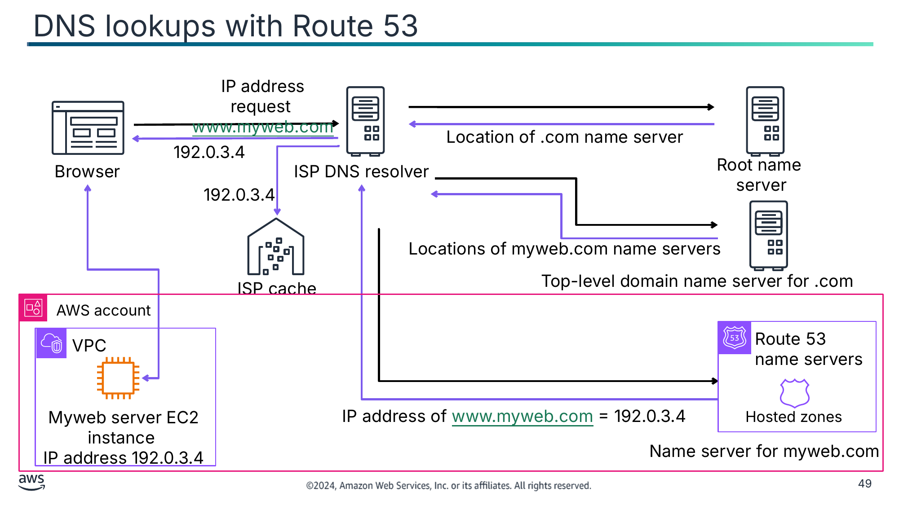

Текст зі схеми

IP address request [www.myweb.com](http://www.myweb.com/) (Запит IP-адреси www.myweb.com)

Location of .com name server (Розташування сервера імен .com)

192.0.3.4

Root name

server (Кореневий сервер імен)

Browser (Браузер)

ISP DNS resolver (DNS-резолвер ISP)

192.0.3.4

Locations of myweb.com name servers (Розташування серверів імен myweb.com)

Top-level domain name server for .com (Сервер імен домену верхнього рівня для .com)

ISP cache (Кеш ISP)

AWS account (Акаунт AWS)

VPC

Route 53 name servers (Сервери імен Route 53)

Myweb server EC2 instance (Екземпляр EC2 сервера Myweb)

IP address 192.0.3.4 (IP-адреса 192.0.3.4)

IP address of [www.myweb.com](http://www.myweb.com/) = 192.0.3.4 (IP-адреса www.myweb.com = 192.0.3.4)

Hosted zones (Розміщені зони)

Name server for myweb.com (Сервер імен для myweb.com)

> **Нотатки:**
>
> |Номер слайда 49  
> |Нотатки для інструктора  
> |  
> |Нотатки для студента  
> Схема на цьому слайді — це та сама схема DNS-запиту, що описувалася раніше в цьому розділі. Однак на цій схемі сервер myweb розміщено на екземплярі EC2 у межах Amazon VPC, а Route 53 є сервером імен.  
>
> Сервери імен Route 53 — це авторитетні сервери імен для кожного домену, що використовує Route 53 як сервіс DNS. Сервери імен знають, як ви хочете маршрутизувати трафік для вашого домену та піддоменів на основі записів, створених вами в розміщеній зоні для домену. Сервери імен Route 53 зберігають розміщені зони для доменів, що використовують Route 53 як сервіс DNS. Наприклад, якщо сервер імен Route 53 отримує запит на www.myweb.com, він знаходить цей запис і повертає IP-адресу, як-от 192.0.3.4, указану в записі.

---

## Слайд 50: Політики маршрутизації Route 53 (routing policies)

Simple (Проста)

Weighted (Зважена)

Latency (За затримкою)

Failover (З відмовостійким перемиканням)

Geoproximity (За геопроксимністю)

Geolocation (За геолокацією)

Multivalue answer (З багатозначною відповіддю)

IP-based (На основі IP)

> **Нотатки:**
>
> |Номер слайда 50  
> |Нотатки для інструктора  
> |  
> |Нотатки для студента  
> Route 53 підтримує кілька типів політик маршрутизації, що визначають, як Route 53 відповідає на запити.  
>
> Просту маршрутизацію (simple routing) можна використовувати для налаштування стандартних записів DNS без спеціальної маршрутизації Route 53, як-от зважена чи за затримкою. З простою маршрутизацією ви зазвичай маршрутизуєте трафік до одного ресурсу (наприклад, до вебсервера вашого вебсайту).  
>
> Зважену маршрутизацію (weighted routing) можна використовувати, щоб пов’язати кілька ресурсів з одним доменним іменем чи ім’ям піддомену та обрати, скільки трафіку маршрутизується до кожного ресурсу. Це може бути корисним для різних цілей, зокрема балансування навантаження та тестування нових версій програмного забезпечення. Щоб налаштувати зважену маршрутизацію, ви створюєте записи з однаковою назвою й типом для кожного з ваших ресурсів. Ви призначаєте кожному запису відносну вагу, що відповідає тому, скільки трафіку ви хочете надсилати до кожного ресурсу. Route 53 надсилає трафік до ресурсу на основі ваги, яку ви призначаєте запису, як частки від загальної ваги всіх записів у групі.  
>
> Якщо ваш застосунок розміщено в кількох регіонах AWS, можна покращити продуктивність для користувачів, обслуговуючи їхні запити з регіону AWS, що забезпечує найнижчу затримку. Щоб використовувати маршрутизацію за затримкою (latency-based routing), ви створюєте записи затримки для ваших ресурсів у кількох регіонах AWS. Коли Route 53 отримує запит DNS для вашого домену чи піддомену, він визначає, для яких регіонів AWS ви створили записи затримки, визначає, який регіон забезпечує користувачу найнижчу затримку, а потім обирає запис затримки для цього регіону.  
>
> Можна використовувати маршрутизацію з відмовостійким перемиканням (failover routing), щоб маршрутизувати трафік до ресурсу, коли ресурс справний, або до іншого ресурсу, коли перший ресурс несправний. Основні та вторинні записи можуть маршрутизувати трафік куди завгодно — від бакета S3, налаштованого як вебсайт, до складного дерева записів.  
>
> Маршрутизація за геопроксимністю (geoproximity routing) дає Route 53 змогу маршрутизувати трафік до ваших ресурсів на основі географічного розташування ваших користувачів і ваших ресурсів. Також можна за бажанням обрати маршрутизацію більшої чи меншої кількості трафіку до заданого ресурсу, указавши значення, відоме як зміщення (bias). Зміщення розширює або зменшує розмір географічного регіону, з якого трафік маршрутизується до ресурсу. Щоб використовувати маршрутизацію за геопроксимністю, потрібно використовувати потік трафіку Route 53 (traffic flow). Ви створюєте правила геопроксимності для ваших ресурсів, і ці правила виділяють область навколо ваших ресурсів для використання в маршрутизації до ресурсу.  
>
> Можна використовувати маршрутизацію за геолокацією (geolocation routing), щоб обирати ресурси, що обслуговують ваш трафік, на основі географічного розташування ваших користувачів, тобто розташування, звідки походять запити DNS. Наприклад, ви можете захотіти, щоб усі запити з Європи маршрутизувалися до балансувальника навантаження ELB у регіоні Франкфурт. Коли ви використовуєте маршрутизацію за геолокацією, ви можете локалізувати свій контент і подавати частину чи весь свій вебсайт мовою ваших користувачів. Також можна використовувати маршрутизацію за геолокацією, щоб обмежити розповсюдження контенту лише розташуваннями, де ви маєте права на розповсюдження. Можна вказувати географічні розташування за континентом, країною чи штатом у Сполучених Штатах.  
>
> Можна використовувати маршрутизацію з багатозначною відповіддю (multivalue answer routing), щоб налаштувати Route 53 на повернення кількох значень, як-от IP-адрес ваших вебсерверів, у відповідь на запити DNS. Можна вказати кілька значень майже для будь-якого запису. Також можна використовувати маршрутизацію з багатозначною відповіддю для перевірки стану кожного ресурсу, щоб Route 53 повертав значення лише для справних ресурсів. Вона не замінює балансувальник навантаження, але здатність повертати кілька IP-адрес, що пройшли перевірки стану, — це спосіб використати DNS для покращення доступності та балансування навантаження.  
>
> З маршрутизацією на основі IP (IP-based routing) в Route 53 можна точно налаштувати маршрутизацію DNS, використовуючи ваше розуміння вашої мережі, застосунків і клієнтів, щоб ухвалювати найкращі рішення щодо маршрутизації DNS для ваших кінцевих користувачів. Маршрутизація на основі IP дає детальний контроль для оптимізації продуктивності чи зменшення мережевих витрат шляхом завантаження ваших даних до Route 53 у вигляді зіставлень IP-адрес користувачів із кінцевими точками. Маршрутизація на основі IP дає змогу оптимізувати маршрутизацію на основі конкретних знань про вашу клієнтську базу. Наприклад, глобальний постачальник відеоконтенту може захотіти маршрутизувати кінцевих користувачів певного ISP.

---

## Слайд 51: Демонстрація: Amazon Route 53 — проста маршрутизація (Simple Routing)

- Ця демонстрація використовує Amazon Route 53.
- У цій демонстрації ви побачите, як виконати таке:
  - Налаштувати Route 53 для рівномірного розподілу запитів HTTP між двома екземплярами EC2.
  - Визначити набір записів Route 53 (record set).

> **Нотатки:**
>
> |Номер слайда 51  
> |Нотатки для інструктора  
> |Ця демонстрація — файл .mp4 із субтитрами. Студенти отримують до неї доступ через онлайн-курс. Посібник інструктора містить тривалість кожної демонстрації.  
> |  
> |Нотатки для студента  
> Знайдіть цю записану демонстрацію у вашому онлайн-курсі як частину цього модуля.

---

## Слайд 52: Демонстрація: Amazon Route 53 — маршрутизація з відмовостійким перемиканням (Failover Routing)

- Ця демонстрація використовує Amazon Route 53.
- У цій демонстрації ви побачите, як виконати таке:
  - Використати Route 53 для спрямування трафіку до двох зон доступності для використання під час збоїв.
  - Визначити перевірку стану Route 53 (Health Check).
  - Надсилати сповіщення перевірки стану Route 53 адміністратору.

> **Нотатки:**
>
> |Номер слайда 52  
> |Нотатки для інструктора  
> |Ця демонстрація — файл .mp4 із субтитрами. Студенти отримують до неї доступ через онлайн-курс. Посібник інструктора містить тривалість кожної демонстрації.  
> |  
> |Нотатки для студента  
> Знайдіть цю записану демонстрацію у вашому онлайн-курсі як частину цього модуля.

---

## Слайд 53: Демонстрація: Amazon Route 53 — маршрутизація за геолокацією (Geolocation Routing)

- Ця демонстрація використовує Amazon Route 53.
- У цій демонстрації ви побачите, як виконати таке:
  - Використати маршрутизацію за геолокацією для обслуговування трафіку на основі географічного розташування.
  - Локалізувати контент для географічних груп користувачів.

> **Нотатки:**
>
> |Номер слайда 53  
> |Нотатки для інструктора  
> |Нотатки для інструктора  
> |Ця демонстрація — файл .mp4 із субтитрами. Студенти отримують до неї доступ через онлайн-курс. Посібник інструктора містить тривалість кожної демонстрації.  
> |  
> |Нотатки для студента  
> Знайдіть цю записану демонстрацію у вашому онлайн-курсі як частину цього модуля.

---

## Слайд 54: Публічні та приватні розміщені зони Route 53

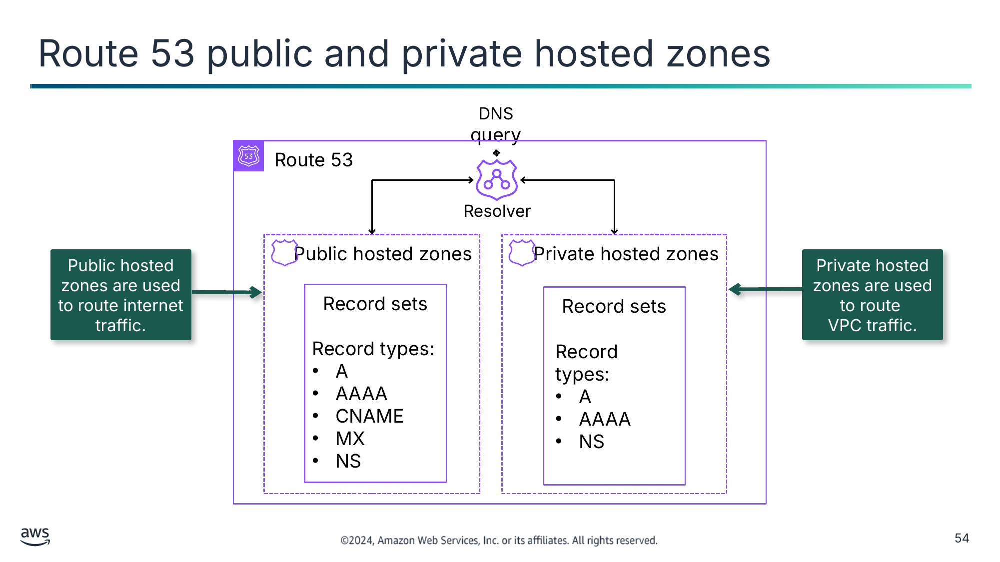

Публічні розміщені зони використовуються для маршрутизації інтернет-трафіку.

Приватні розміщені зони використовуються для маршрутизації

трафіку VPC.

Текст зі схеми

DNS query (Запит DNS)

Route 53

Resolver (Резолвер)

Public hosted zones (Публічні розміщені зони)

Private hosted zones (Приватні розміщені зони)

Record sets (Набори записів)

Record types: (Типи записів:)

- A
- AAAA
- CNAME
- MX
- NS

Record sets

Record types:

- A
- AAAA
- NS

> **Нотатки:**
>
> |Номер слайда 54  
> |Нотатки для інструктора  
> |Це спрощений огляд можливостей Route 53. Докладніше див. «Configuring Amazon Route 53 as Your DNS service» у переліку ресурсів.  
> |  
> |Нотатки для студента  
> Щоб налаштувати Route 53 для маршрутизації трафіку до ваших ресурсів, потрібно створити публічну чи приватну розміщену зону. Розміщена зона — це контейнер для кількох записів, а записи містять інформацію про те, як ви хочете маршрутизувати трафік для певного домену (як-от example.com) і його піддоменів (як-от acme.example.com і zenith.example.com). Створіть публічну розміщену зону, якщо хочете маршрутизувати інтернет-трафік до ваших ресурсів: наприклад, щоб ваші клієнти могли переглядати вебсайт компанії, який ви розміщуєте на екземплярах EC2. Створіть приватну розміщену зону, якщо хочете маршрутизувати трафік усередині VPC клієнта.  
>
> Далі ви створюєте записи в розміщеній зоні. Записи визначають, куди ви хочете маршрутизувати трафік для кожного доменного імені чи імені піддомену. Наприклад, щоб маршрутизувати трафік для www.example.com до вебсервера у вашому центрі обробки даних, ви зазвичай створюєте запис www.example.com у розміщеній зоні example.com.  
>
> Коли ви створюєте запис, ви обираєте політику маршрутизації та необов’язкове призначення відмовостійкого перемикання. Далі ви обираєте тип запису. Деякі з найпоширеніших типів записів — записи A, AAAA, CNAME, MX і NS.  
>
> Ви використовуєте запис A для маршрутизації трафіку до ресурсу, як-от вебсервер, за допомогою адреси IPv4. Ви використовуєте запис AAAA для маршрутизації трафіку до ресурсу, як-от вебсервер, за допомогою адреси IPv6 у шістнадцятковому форматі, розділеному двокрапками. Запис CNAME зіставляє запити DNS для імені поточного запису, як-от acme.example.com, з іншим доменом (example.com чи example.net) або піддоменом (acme.example.com чи zenith.example.org). Запис MX вказує імена ваших поштових серверів і, якщо у вас два чи більше поштових серверів, порядок пріоритету. Запис NS визначає сервери імен для розміщеної зони. Докладніше див. «Supported DNS Record Types» у посібнику розробника Amazon Route 53. Посилання є в ресурсах вашого курсу.  
>
> Route 53 Resolver рекурсивно відповідає на запити DNS від ресурсів AWS для публічних записів, DNS-імен, специфічних для Amazon VPC, і приватних розміщених зон Route 53 і доступний за замовчуванням у всіх VPC. Route 53 Resolver автоматично відповідає на запити DNS для такого:  
> Локальні доменні імена VPC для екземплярів EC2 (наприклад, ec2-192-0-2-44.compute-1.amazonaws.com)  
> Записи в приватних розміщених зонах (наприклад, acme.example.com)  
> Пошуки публічних доменних імен на публічних серверах імен в інтернеті

---

## Слайд 55: Міжрегіональне відмовостійке перемикання (multi-Region failover)

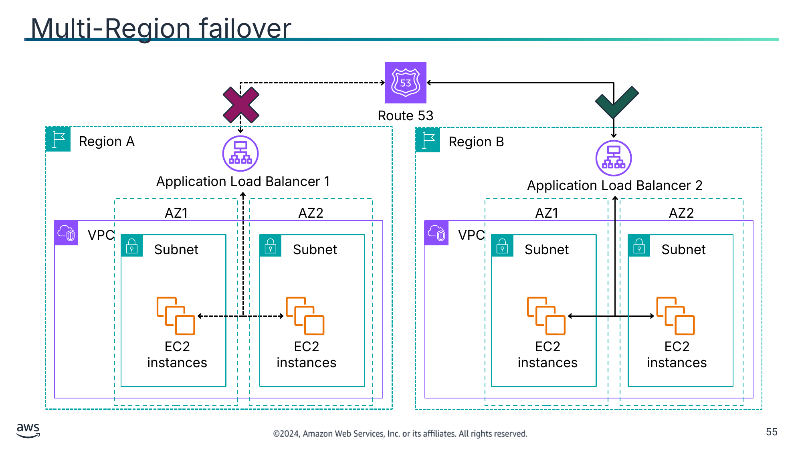

Текст зі схеми

Route 53

Region A (Регіон A)

Region B (Регіон B)

Application Load Balancer 1

Application Load Balancer 2

AZ1

AZ2

AZ1

AZ2

VPC

VPC

Subnet (Підмережа)

Subnet

Subnet

Subnet

EC2 instances (Екземпляри EC2)

EC2 instances

EC2 instances

EC2 instances

> **Нотатки:**
>
> |Номер слайда 55  
> |Нотатки для інструктора  
> |  
> |Нотатки для студента  
> Якщо у вас є кілька ресурсів, що виконують ту саму функцію, можна налаштувати відмовостійке перемикання DNS, щоб Route 53 маршрутизував ваш трафік від несправного ресурсу до справного ресурсу. Наприклад, якщо у вас два ресурси й один стає несправним, Route 53 може маршрутизувати трафік до іншого ресурсу. У прикладі на цьому слайді Application Load Balancer 1 несправний у регіоні A, тож Route 53 спрямовує трафік до справного Application Load Balancer 2 у регіоні B.  
>
> Використовуйте конфігурацію відмовостійкого перемикання «активний-пасивний» (active-passive), коли ви хочете, щоб основний ресурс чи група ресурсів були доступні більшу частину часу, а вторинний ресурс чи група ресурсів перебували в режимі очікування на випадок, якщо всі основні ресурси стануть недоступними. Відповідаючи на запити, Route 53 включає лише справні основні ресурси. Якщо всі основні ресурси несправні, Route 53 починає включати у відповіді на запити DNS лише справні вторинні ресурси.  
>
> Щоб створити конфігурацію відмовостійкого перемикання «активний-пасивний» з одним основним записом і одним вторинним записом, ви створюєте записи та вказуєте відмовостійке перемикання для політики маршрутизації. Коли основний ресурс справний, Route 53 відповідає на запити DNS за допомогою основного запису. Коли основний ресурс несправний, Route 53 відповідає на запити DNS за допомогою вторинного запису.  
>
> Route 53 може перевіряти стан ваших ресурсів і в простих, і в складних конфігураціях. У простих конфігураціях ви створюєте групу записів, що мають однакові назву й тип, як-от група зважених записів з типом A для example.com. Потім ви налаштовуєте Route 53 на перевірку стану відповідних ресурсів. Route 53 відповідає на запити DNS на основі стану ваших ресурсів.  
>
> У складніших конфігураціях ви створюєте дерево записів, що маршрутизують трафік на основі кількох критеріїв. Наприклад, якщо затримка для ваших користувачів — ваш найважливіший критерій, ви можете використати записи-псевдоніми затримки (latency alias records) для маршрутизації трафіку до регіону, що забезпечує найкращу затримку. Записи-псевдоніми затримки можуть мати зважені записи в кожному регіоні як ціль псевдоніма. Зважені записи можуть маршрутизувати трафік до екземплярів EC2 на основі типу екземпляра. Як і в простій конфігурації, можна налаштувати Route 53 на маршрутизацію трафіку на основі стану ваших ресурсів.

---

## Слайд 56: Ключові висновки: використання Route 53 для створення високодоступних середовищ

- Route 53 — це сервіс DNS, що виконує таке:
  - Керує реєстрацією доменних імен
  - Надає розміщені зони й авторитетні сервери імен
  - Виконує маршрутизацію DNS і перевірки стану
- Route 53 підтримує кілька варіантів маршрутизації, зокрема такі:
  - Проста маршрутизація
  - Зважена маршрутизація
  - Маршрутизація за затримкою
  - Маршрутизація з відмовостійким перемиканням
  - Маршрутизація за геопроксимністю
  - Маршрутизація за геолокацією
  - Маршрутизація з багатозначною відповіддю
  - Маршрутизація на основі IP

> **Нотатки:**
>
> |Номер слайда 56  
> |Нотатки для інструктора  
> |  
> |Нотатки для студента

---

## Слайд 57: Покрокова лабораторна робота: створення високодоступного середовища (Creating a Highly Available Environment, High availability lab)

> **Нотатки:**
>
> |Номер слайда 57  
> |Нотатки для інструктора  
> |  
> |Нотатки для студента  
> Зараз ви виконаєте покрокову лабораторну роботу. Наступний слайд підсумовує, що ви робитимете в лабораторній роботі, а докладні інструкції ви знайдете в лабораторному середовищі.

---

## Слайд 58: Завдання лабораторної роботи «Висока доступність»:

- У цій лабораторній роботі ви виконаєте такі основні завдання:
  - Перевірите наданий VPC.
  - Створите Application Load Balancer.
  - Створите групу Amazon EC2 Auto Scaling за допомогою шаблону запуску.
  - Оновите групи безпеки.
  - Протестуєте застосунок.
  - Протестуєте застосунок на високу доступність.
  - Ця лабораторна робота включає такі необов’язкові завдання:
  - Зробіть базу даних високодоступною.
  - Налаштуйте високодоступний NAT-шлюз.

> **Нотатки:**
>
> |Номер слайда 58  
> |Нотатки для інструктора  
> |  
> |Нотатки для студента  
> Отримайте доступ до лабораторного середовища через ваш онлайн-курс, щоб дізнатися додаткові подробиці та виконати лабораторну роботу.

---

## Слайд 59: Підсумки лабораторної роботи «Висока доступність»

- Як ви визначили, до яких екземплярів ваш Application Load Balancer має надсилати трафік?
- Як ви визначили характеристики екземплярів, що запускатимуться у вашій групі Auto Scaling?

> **Нотатки:**
>
> |Номер слайда 59  
> |Нотатки для інструктора  
> |Відповідні архітектурні схеми «до» та «після» включено до інструкцій кожної лабораторної роботи. Вам може бути корисно відкрити схеми лабораторної роботи під час підбиття підсумків цієї лабораторної роботи.  
> |  
> |Запропоновані відповіді на запитання 1: як ви визначили, до яких екземплярів ваш Application Load Balancer має надсилати трафік?  
> |  
> |Коли ви створювали Application Load Balancer, ви визначили цільову групу як Inventory-app.  
> |  
> |Цільові групи визначають, куди надсилати трафік, що надходить до балансувальника навантаження. Application Load Balancer може надсилати трафік до кількох цільових груп на основі URL-адреси вхідного запиту. У цій лабораторній роботі ваш вебзастосунок використовував лише одну цільову групу.  
> |  
> |Запропоновані відповіді на запитання 2: як ви визначили характеристики екземплярів, що запускатимуться у вашій групі Auto Scaling?  
> |  
> |Ви створили конфігурацію запуску (launch configuration). Конфігурація запуску визначає тип екземплярів, які має запускати Amazon EC2 Auto Scaling. Ця конфігурація включає такі подробиці, як AMI та тип екземпляра. Інтерфейс конфігурації запуску виглядає подібно до запуску екземпляра EC2. Однак замість запуску екземпляра він зберігає конфігурацію для подальшого використання.  
> |  
> |Нотатки для студента  
> Ваш інструктор може розглянути ці запитання з вами, або ви можете розглянути їх самостійно. Скористайтеся цією нагодою, щоб поглибити своє мислення щодо завдань, які ви виконували під час лабораторної роботи.

---

## Слайд 60: Лабораторна робота кафе: створення масштабованого та високодоступного середовища для кафе (Creating a Scalable and Highly Available Environment for the Café, High availability café lab)

> **Нотатки:**
>
> |Номер слайда 60  
> |Нотатки для інструктора  
> |  
> |Нотатки для студента  
> Зараз ви виконаєте лабораторну роботу. Наступні слайди підсумовують, що ви робитимете в лабораторній роботі, а докладні інструкції ви знайдете в лабораторному середовищі.

---

## Слайд 61: Еволюція архітектури кафе: версія 6

| Версія архітектури (Architecture Version) | Бізнес-причина оновлення (Business reason for update) | Технічні вимоги та оновлення архітектури (Technical Requirements and Architecture Update) |
|---|---|---|
| V1 | Створити статичний вебсайт для малого бізнесу. | Розмістити вебсайт на Amazon S3. |
| V2 | Додати онлайн-замовлення. | Розгорнути вебзастосунок і базу даних на Amazon EC2. |
| V3 | Зменшити зусилля на обслуговування бази даних і захист її даних. | Розділити рівні вебу та бази даних. Перенести базу даних в Amazon RDS у приватній підмережі. |
| V4 | Підвищити безпеку вебзастосунку. | Використати функції Amazon VPC для налаштування та захисту публічних і приватних підмереж. |
| V5 | Створити окремі механізми доступу на основі ролі. | Додати групи IAM і прикріпити політики ресурсів до ресурсів застосунку. Додати користувачів IAM до груп на основі ролі. |
| V6 | Забезпечити, щоб вебсайт міг витримати очікуване зростання трафіку. | Додати балансувальник навантаження, впровадити автоматичне масштабування екземплярів EC2 і розподілити екземпляри обчислень і баз даних між двома зонами доступності. |
| V7 | Інформація з модуля 11 |  |
| V8 | Інформація з модуля 14 |  |

> **Нотатки:**
>
> |Нотатки для інструктора  
> |У цій лабораторній роботі кафе студенти почнуть із… і оновлять до….  
> |Поділіться файлом architectures.svg або покажіть його й виділіть розділи архітектури, які буде змінено чи додано в цій лабораторній роботі.  
> |  
> |Нотатки для студента  
> Бізнес-історію кафе для версії 6 слід додати тут.

---

## Слайд 62: Завдання лабораторної роботи «Висока доступність кафе»

- У цій лабораторній роботі ви виконаєте такі основні завдання:
  - Додати балансувальник навантаження
  - Впровадити автоматичне масштабування екземплярів EC2
  - Розподілити екземпляри обчислень і баз даних між двома зонами доступності
- Відкрийте ваше лабораторне середовище, щоб розпочати лабораторну роботу та дізнатися додаткові подробиці про завдання, які ви виконуватимете

> **Нотатки:**
>
> |Номер слайда 62  
> |Нотатки для інструктора  
> |  
> |Нотатки для студента  
> Отримайте доступ до лабораторного середовища через ваш онлайн-курс, щоб дізнатися додаткові подробиці та виконати лабораторну роботу.

---

## Слайд 63: Підсумки лабораторної роботи «Висока доступність кафе»

- Де ви визначили AMI, тип екземпляра, пару ключів і групи безпеки, що використовуватимуться для запуску екземплярів EC2 у вашій групі Auto Scaling?
- Коли ви проводили стрес-тест ваших екземплярів, чому група Auto Scaling запустила більше екземплярів?

> **Нотатки:**
>
> |Номер слайда 63  
> |Нотатки для інструктора  
> |Архітектурну схему для цієї лабораторної роботи включено до файлу CafeLabDiagrams.svg, що входить до каталогу файлів викладача. Поділіться цим файлом зі студентами, щоб вони могли наближати й віддаляти кожну фазу архітектури для повнішої картини під час підбиття підсумків лабораторної роботи.  
> |  
> |Запропоновані відповіді на запитання 1: де ви визначили AMI, тип екземпляра, пару ключів і групи безпеки, що використовуватимуться для запуску екземплярів EC2 у вашій групі Auto Scaling?  
> |  
> |Ви зробили ці конфігурації в шаблоні запуску. Шаблон запуску подібний до конфігурації запуску тим, що вказує інформацію про конфігурацію екземпляра. Він включає ідентифікатор AMI, тип екземпляра, пару ключів, групи безпеки та інші параметри, що використовуються для запуску екземплярів EC2. Однак визначення шаблону запуску замість конфігурації запуску дає вам змогу мати кілька версій шаблону запуску.  
> |  
> |Запропоновані відповіді на запитання 2: коли ви проводили стрес-тест ваших екземплярів, чому група Auto Scaling запустила більше екземплярів?  
> |  
> |Група Auto Scaling запустила більше екземплярів, оскільки ваша політика масштабування з відстеженням цілі використовувала середнє використання ЦП як метрику відстеження. Цільове значення становило 25 відсотків. Це означає, що коли ви проводили стрес-тест, цільове значення перевищило 25 відсотків середнього використання ЦП (метрика відстеження). Тому ваша група Auto Scaling запустила більше екземплярів, щоб допомогти зменшити цільове значення.  
> |  
> |Нотатки для студента  
> Ваш інструктор може розглянути ці запитання з вами, або ви можете розглянути їх самостійно. Скористайтеся цією нагодою, щоб поглибити своє мислення щодо завдань, які ви виконували під час лабораторної роботи.

---

## Слайд 64: Застосування принципів AWS Well-Architected Framework до високодоступних систем

Впровадження моніторингу, еластичності та високої доступності

> **Нотатки:**
>
> |Номер слайда 64  
> |Нотатки для інструктора  
> |  
> |Нотатки для студента  
> Цей розділ розглядає, як застосовувати принципи AWS Well-Architected Framework до високодоступних систем.

---

## Слайд 65: Найкращі практики Well-Architected Framework для високодоступних систем

> **Нотатки:**
>
> |Номер слайда 65  
> |Нотатки для інструктора  
> |Решта слайдів у цьому розділі подають приклади, що підкреслюють, як матеріал цього модуля узгоджується з найкращими практиками Well-Architected Framework. За бажанням ви можете попросити студентів відвідати вебсайт Well-Architected Framework і знайти найкращі практики, які, на їхню думку, пов’язані з матеріалом, поданим у цьому модулі, використовуючи цей розділ як відправну точку.  
> |  
> |Нотатки для студента  
> AWS Well-Architected Framework має шість опор, і кожна опора включає найкращі практики та набір запитань, які слід враховувати під час проєктування хмарних рішень. Цей розділ виділяє кілька найкращих практик з опор надійності та ефективності продуктивності, найактуальніших для цього модуля. Повний набір найкращих практик за опорами на вебсайті Well-Architected Framework див. у розділі ресурсів вмісту вашого онлайн-курсу.  
>
> Цей розділ зосереджений на високій доступності. Доступна система здатна надавати спроєктовану функціональність у заданий момент часу. Високодоступні системи — це ті, що можуть витримати певну міру погіршення, залишаючись доступними.

---

## Слайд 66: Підхід найкращих практик: керування збоями — використовуйте ізоляцію збоїв для захисту вашого робочого навантаження

**Найкращі практики**

Розгортайте робоче навантаження в кількох розташуваннях.

Автоматизуйте відновлення для компонентів, обмежених одним розташуванням.

> **Нотатки:**
>
> |Номер слайда 66  
> |Нотатки для інструктора  
> |  
> |Нотатки для студента  
> Щоб збої не впливали на всю систему, використовуйте межі ізоляції збоїв (fault isolation boundaries). Межі ізоляції збоїв обмежують вплив збою в робочому навантаженні обмеженою кількістю компонентів. Збій не впливає на компоненти поза межею. Використовуючи кілька меж ізоляції збоїв, можна обмежити вплив на ваше робоче навантаження.  
>
> Розгортайте робоче навантаження в кількох розташуваннях: розподіляйте дані та ресурси робочого навантаження між кількома зонами доступності або, за потреби, між регіонами AWS. Ці розташування можуть бути настільки різноманітними, наскільки потрібно. Один із наріжних принципів проєктування сервісів в AWS — уникнення єдиних точок відмови в базовій фізичній інфраструктурі. Це мотивує користувачів будувати програмне забезпечення та системи, що використовують кілька зон доступності й стійкі до відмови окремої зони. Так само системи будуються стійкими до відмови одного обчислювального вузла, одного тому сховища чи одного екземпляра бази даних. Будуючи систему, що спирається на надлишкові компоненти, важливо забезпечити, щоб компоненти працювали незалежно, а у випадку регіонів AWS — автономно.  
>
> Автоматизуйте відновлення для компонентів, обмежених одним розташуванням: якщо найкраща практика розгортання робочого навантаження в кількох розташуваннях неможлива через технологічні обмеження, потрібно впровадити альтернативний шлях до стійкості. Потрібно автоматизувати здатність відтворювати необхідну інфраструктуру, повторно розгортати застосунки й відтворювати необхідні дані для цих випадків. Розгортайте ваші екземпляри чи контейнери за допомогою автоматичного масштабування, коли це можливо. Якщо не можна використовувати автоматичне масштабування, використовуйте автоматичне відновлення для екземплярів EC2 чи впровадьте автоматизацію самовідновлення на основі подій життєвого циклу Amazon EC2 чи контейнерів ECS. Використовуйте групи Amazon EC2 Auto Scaling для екземплярів і контейнерних робочих навантажень, що не мають вимог до однієї IP-адреси екземпляра, приватної IP-адреси, еластичної IP-адреси та метаданих екземпляра.  
>
> У цьому модулі ви дізналися про низку сервісів AWS, що підтримують ці найкращі практики, зокрема Amazon EC2 Auto Scaling і розгортання Amazon RDS Multi-AZ.

---

## Слайд 67: Підхід найкращих практик: керування збоями — проєктуйте робоче навантаження так, щоб воно витримувало відмови компонентів

**Найкращі практики**

Виконуйте відмовостійке перемикання на справні ресурси.

Надсилайте сповіщення, коли події впливають на доступність.

> **Нотатки:**
>
> |Номер слайда 67  
> |Нотатки для інструктора  
> |  
> |Нотатки для студента  
> Найкраща практика — мати резервний план на випадок погіршення роботи ресурсів. Проєктуючи сервіс, завжди розподіляйте навантаження між ресурсами, зонами доступності чи регіонами. Тоді перенаправлення трафіку на решту справних ресурсів може пом’якшити відмову окремого ресурсу чи погіршення. Розгляньте, як сервіси виявляються й маршрутизуються у разі збою.  
>
> Виконуйте відмовостійке перемикання на справні ресурси: якщо відбувається відмова ресурсу, справні ресурси мають продовжувати обслуговувати запити. Для погіршення розташування (як-от зона доступності чи регіон AWS) переконайтеся, що у вас є системи для відмовостійкого перемикання на справні ресурси в розташуваннях, що не постраждали. Проєктуючи сервіс, завжди розподіляйте навантаження між ресурсами, зонами доступності чи регіонами. Тоді перенаправлення трафіку на решту справних ресурсів може пом’якшити відмову окремого ресурсу чи погіршення. Розгляньте, як сервіси виявляються й маршрутизуються у разі збою. Шаблони та проєкти, що дозволяють відмовостійке перемикання, різняться для кожного платформного сервісу AWS. Багато керованих сервісів AWS розгортаються в кількох зонах доступності, як-от Lambda, Aurora та DynamoDB. Інші сервіси AWS, як-от Amazon EC2 та Amazon Elastic Kubernetes Service (Amazon EKS), потребують специфічних проєктів найкращих практик для підтримки відмовостійкого перемикання ресурсів чи сховища даних між зонами доступності. Моніторинг слід налаштувати, щоб перевіряти, що ресурс відмовостійкого перемикання справний, відстежувати прогрес ресурсів, що виконують перемикання, і відстежувати відновлення бізнес-процесів. Бажаний результат — щоб системи могли автоматично чи вручну використовувати нові ресурси для відновлення після погіршення.  
>
> Надсилайте сповіщення, коли події впливають на доступність: сповіщення надсилаються після виявлення порушених порогів, навіть якщо подію, що спричинила проблему, було розв’язано автоматично. Автоматичне самовідновлення допомагає зробити ваше робоче навантаження надійним. Однак воно також може приховувати основні проблеми, що потребують усунення. Впровадьте відповідний моніторинг і події, щоб можна було виявляти шаблони проблем, зокрема ті, що усуваються автоматичним самовідновленням, щоб розв’язати першопричину проблем. Стійкі системи проєктуються так, щоб події погіршення негайно повідомлялися відповідним командам. Ці сповіщення слід надсилати через один чи кілька каналів зв’язку. Бажаний результат — негайно надсилати сповіщення командам експлуатації, коли порушуються пороги, як-от частота помилок, затримка чи інші критичні метрики ключових показників ефективності (KPI), щоб ці проблеми розв’язувалися якнайшвидше, а вплив на користувачів уникався чи мінімізувався.  
>
> У цьому модулі ви дізналися про низку сервісів AWS, що підтримують ці найкращі практики, зокрема Route 53, CloudWatch та Amazon EC2 Auto Scaling.

---

## Слайд 68: Підхід найкращих практик: обчислення та апаратне забезпечення

**Найкращі практики**

Динамічно масштабуйте свої обчислювальні ресурси.

> **Нотатки:**
>
> |Номер слайда 68  
> |Нотатки для інструктора  
> |  
> |Нотатки для студента  
> Автоматизація — ключ до призначення достатньої кількості ресурсів для вашого робочого навантаження. Оптимальний обчислювальний вибір для певного робочого навантаження може різнитися залежно від проєкту застосунку, шаблонів використання та налаштувань конфігурації. Архітектури можуть використовувати різні обчислювальні варіанти для різних компонентів і дозволяти різні функції для покращення продуктивності. Вибір неправильного обчислювального варіанта для архітектури може призвести до нижчої ефективності продуктивності.  
>   
> Динамічно масштабуйте свої обчислювальні ресурси: AWS надає гнучкість динамічно масштабувати ваші ресурси вгору чи вниз за допомогою різноманітних механізмів масштабування, щоб відповідати змінам попиту. У поєднанні з обчислювальними метриками динамічне масштабування дає змогу робочим навантаженням автоматично реагувати на зміни й використовувати оптимальний набір обчислювальних ресурсів для досягнення своєї мети. Потрібно забезпечити, щоб розгортання робочих навантажень могли обробляти і події масштабування вгору, і масштабування вниз. Можна використовувати кілька різних підходів для відповідності пропозиції ресурсів попиту.  
> Підхід із відстеженням цілі (target-tracking): відстежуйте свою метрику масштабування й автоматично збільшуйте чи зменшуйте потужність за потреби.  
> Прогнозне масштабування (predictive scaling): масштабуйте в очікуванні щоденних і щотижневих тенденцій.  
> Підхід на основі розкладу (schedule-based): встановіть власний розклад масштабування відповідно до передбачуваних змін навантаження.  
> Масштабування сервісів (service scaling): обирайте сервіси, як-от безсерверні сервіси, що автоматично масштабуються за своїм проєктом.  
>
> У цьому модулі ви дізналися про низку сервісів AWS, що підтримують ці найкращі практики, зокрема ELB, CloudWatch та Amazon EC2 Auto Scaling.

---

## Слайд 69: Ключові висновки: застосування принципів AWS Well-Architected Framework до високої доступності

- Розгортайте робоче навантаження в кількох розташуваннях.
- Автоматизуйте відновлення для компонентів, обмежених одним розташуванням.
- Виконуйте відмовостійке перемикання на справні ресурси.
- Надсилайте сповіщення, коли події впливають на доступність.
- Динамічно масштабуйте свої обчислювальні ресурси.

> **Нотатки:**
>
> |Номер слайда 69  
> |Нотатки для інструктора  
> |Це не вичерпний перелік найкращих практик, охоплених найкращими практиками AWS Well-Architected Framework. Це ключові висновки для пояснення найкращих практик, розглянутих у модулі.  
> |  
> |Нотатки для студента

---

## Слайд 70: Підсумки модуля

Впровадження моніторингу, еластичності та високої доступності

> **Нотатки:**
>
> |Номер слайда 70  
> |Нотатки для інструктора  
> |  
> |Нотатки для студента  
> Цей розділ підсумовує те, що ви дізналися, і завершує модуль.

---

## Слайд 71: Резюме модуля

Цей модуль підготував вас до такого:

- Вивчати, як реактивні архітектури використовують Amazon CloudWatch і Amazon EventBridge для відстеження метрик та полегшення подій сповіщення.
- Використовувати Amazon EC2 Auto Scaling в архітектурі для сприяння еластичності та створення високодоступного середовища.
- Визначати, як масштабувати ресурси ваших баз даних.
- Визначати стратегію балансування навантаження для створення високодоступного середовища.
- Використовувати Amazon Route 53 для відмовостійкого перемикання DNS.
- Використовувати принципи AWS Well-Architected Framework під час проєктування високодоступних систем.

> **Нотатки:**
>
> |Номер слайда 71  
> |Нотатки для інструктора  
> |  
> |Нотатки для студента

---

## Слайд 72: Міркування щодо кафе

- Обговоріть, як лабораторна робота кафе в цьому модулі відповіла на ключові запитання та рішення, подані на початку цього модуля для бізнесу кафе.

---

## Слайд 73: Перевірка знань модуля

- Перевірка знань проводиться онлайн у вашому курсі.
- Перевірка знань включає 10 запитань на основі матеріалу, поданого на слайдах і в нотатках до слайдів.
- Ви можете повторно проходити перевірку знань стільки разів, скільки захочете.

> **Нотатки:**
>
> |Номер слайда 73  
> |Нотатки для інструктора  
> |  
> |Нотатки для студента  
> Скористайтеся своїм онлайн-курсом, щоб отримати доступ до перевірки знань для цього модуля.

---

## Слайд 74: Зразок запитання іспиту

Вебзастосунок дає клієнтам змогу завантажувати замовлення до бакета Amazon S3. Відповідні події Amazon S3 запускають функцію AWS Lambda, що вставляє повідомлення в чергу Amazon Simple Queue Service (Amazon SQS). Єдиний екземпляр Amazon EC2 читає повідомлення з черги, обробляє їх і зберігає в таблиці Amazon DynamoDB, розділеній за унікальним ідентифікатором замовлення. Наступного місяця очікується збільшення трафіку вдесятеро, і архітектор рішень переглядає архітектуру на можливі проблеми масштабування. Який компонент НАЙІМОВІРНІШЕ потребуватиме переробки архітектури, щоб мати змогу масштабуватися для обробки нового трафіку?

Визначте ключові слова та фрази, перш ніж продовжувати.

Ось ключові слова та фрази:

- Єдиний екземпляр EC2
- Здатність масштабуватися

> **Нотатки:**
>
> |Номер слайда 74  
> |Нотатки для інструктора  
> |Розділ із ключовими словами налаштовано з анімацією для розкриття за клацанням.  
> |  
> |Нотатки для студента  
> Запитання вказує на потребу масштабуватися для відповіді зростаючому трафіку та на те, що з черги читає єдиний екземпляр EC2.

---

## Слайд 75: Зразок запитання іспиту: варіанти відповідей

Вебзастосунок дає клієнтам змогу завантажувати замовлення до бакета Amazon S3. Відповідні події Amazon S3 запускають функцію AWS Lambda, що вставляє повідомлення в чергу Amazon Simple Queue Service (Amazon SQS). Єдиний екземпляр Amazon EC2 читає повідомлення з черги, обробляє їх і зберігає в таблиці Amazon DynamoDB, розділеній за унікальним ідентифікатором замовлення. Наступного місяця очікується збільшення трафіку вдесятеро, і архітектор рішень переглядає архітектуру на можливі проблеми масштабування. Який компонент НАЙІМОВІРНІШЕ потребуватиме переробки архітектури, щоб мати змогу масштабуватися для обробки нового трафіку?

**Варіант**

**Відповідь**

**A**

Функція Lambda

**B**

Черга SQS

**C**

Екземпляр EC2

**D**

Таблиця DynamoDB

> **Нотатки:**
>
> |Номер слайда 75  
> |Нотатки для інструктора  
> |  
> |Нотатки для студента  
> Використайте ключові слова, які ви визначили на попередньому слайді, і розгляньте кожен із можливих варіантів відповіді, щоб визначити, який із них найкраще відповідає запитанню.

---

## Слайд 76: Зразок запитання іспиту: відповідь

Правильна відповідь — C.

**Варіант**

**Відповідь**

**C**

Екземпляр EC2

> **Нотатки:**
>
> |Номер слайда 76  
> |Нотатки для інструктора  
> |  
> |Нотатки для студента  
> Варіанти A (функція Lambda), B (черга SQS) і D (таблиця DynamoDB) — це керовані сервіси, які можна налаштувати на масштабування або які масштабуються автоматично.  
>
> Відповідь C (екземпляр EC2) — найімовірніша частина цієї архітектури, що потребуватиме оновлення. Єдиний екземпляр EC2 не масштабується й є єдиною точкою відмови в архітектурі. Кращим рішенням було б мати екземпляри EC2 у групі Auto Scaling у двох зонах доступності та щоб вони читали повідомлення з черги.

---

## Слайд 77: Дякуємо

Виправлення, відгуки чи інші запитання?

Зв’яжіться з нами за адресою [https://support.aws.amazon.com/#/contacts/aws-academy](https://support.aws.amazon.com/#/contacts/aws-academy).

> **Нотатки:**
>
> |Номер слайда 77  
> |Нотатки для інструктора  
> |  
> |Нотатки для студента  
> На цьому цей модуль завершено. Сторінка ресурсів вмісту вашого курсу містить посилання на додаткові ресурси, пов’язані з цим модулем.
