## Слайд 1: Automating Your Architecture

AWS Academy Cloud Architecting

> **Нотатки:**
>
> |Instructor notes  
> |  
> |Student notes  
> Welcome to the Automating Your Architecture module. This module introduces you to the foundations of automation and infrastructure as code (IaC). The module also introduces AWS CloudFormation, a service that helps you model and set up your AWS resources by using a template that describes the resources you want. The template then takes care of provisioning and configuring those resources for you. You will also learn about some additional tools to help you implement CloudFormation more quickly.

---

## Слайд 2: Introduction

Automating Your Architecture

> **Нотатки:**
>
> |Slide number 2  
> |Instructor notes  
> |  
> |Student notes  
> This introduction section describes the content of this module.

---

## Слайд 3: Module objectives

This module prepares you to do the following:

- Recognize when to use architecture automation and why.
- Identify how to use infrastructure as code (IaC) as a strategy for provisioning and managing cloud resources.
- Identify how to model, create, and manage a collection of AWS resources by using AWS CloudFormation.
- Identify how to use AWS Quick Start CloudFormation templates to set up an architecture.
- Identify uses of Amazon Q Developer.
- Use the AWS Well-Architected Framework principles when designing automation strategies.

> **Нотатки:**
>
> |Slide number 3  
> |Instructor notes  
> |This module focuses on automation, infrastructure as code (IaC), and CloudFormation.  
> |  
> |Student notes

---

## Слайд 4: Module overview

**Presentation sections**

- Reasons to automate
- Using infrastructure as code
- Customizing with CloudFormation
- Using AWS Quick Starts
- Customizing with AmazonQ Developer
- Applying AWS Well-Architected Framework principles

**Demos**

- Analyzing an AWS CloudFormation Template
- AWS CloudFormation Resources
- Reviewing an AWS CloudFormation Template
- Using the AWS CloudFormation Console

**Knowledge checks**

- 10-question knowledge check
- Sample exam question

> **Нотатки:**
>
> |Slide number 4  
> |Instructor notes  
> |Each module has an introduction, content sections, and a wrap-up. The wrap-up for this module contains a sample exam question for you to review with the students. This module includes four demos and two labs.  
> |  
> |Student notes  
> The objectives of this module are presented across multiple sections.  
>
> You will also view a series of demonstrations that show how to work with CloudFormation. These demos include an overview of CloudFormation resources, an analysis of a CloudFormation template, a review of a template with customization, and an overview of using the CloudFormation console.  
>
> The module wraps up with a 10-question knowledge check delivered in the online course and a sample exam question.

---

## Слайд 5: Hands-on labs in this module

Guided lab

Challenge (Café) lab

- Automating Infrastructure Deployment with AWS CloudFormation

- Automating Infrastructure Deployment

> **Нотатки:**
>
> |Slide number 5  
> |Instructor notes  
> |This module includes both a stand-alone guided lab and a café lab, which adds to the evolving architecture of the café. The café lab is a challenge lab where students are expected to complete tasks without every step being provided. Introductions to each lab are include in the lab sections within the module.  
> |  
> |Student notes  
> This module includes the hands-on labs listed. The guided lab provides you with step-by-step instructions. In the café (challenge) lab, you work on updating the architecture for the café. Additional information about each lab is included in the student guide where the lab takes place, and the lab environment provides detailed instructions.

---

## Слайд 6: As a cloud architect designing:

- I need to use automation to reduce the risks of manual processes when building architectures and maximize the benefit from reproducible environments.
- I need to deploy my architectures by using infrastructure as code so that I can rapidly and consistently deploy environments and changes.
- I need to consider how my automation design decisions impact performance and cost so that I can optimize the value of the architecture to the business.


> **Нотатки:**
>
> |Slide number 6  
> |Instructor notes: This slide presents key overarching design considerations that should guide decision-making for designing for automation. Emphasize how a cloud architect must consider the business case and deploy infrastructure as code to reduce the risks of manual processes. Also remind students that the decisions are likely to evolve over time as needs change or are better understood to optimize cost and performance. At the end of the module, there is an optional discussion included in the wrap-up section to prompt the students to consider these factors in the context of the café scenario.  
> |  
> |Student notes  
> This slide asks you to take the perspective of a cloud architect as you think about how to approach designing for automation. Keep these considerations in mind as you progress through this module, remembering that the cloud architect should work backward from the business need to design the best architecture for a specific use case. As you progress through the module, consider the café scenario presented in the course as an example business need, and think about how you would address these needs for the fictional café business.

---

## Слайд 7: Reasons to automate

Automating Your Architecture

> **Нотатки:**
>
> |Slide number 7  
> |Instructor notes  
> |  
> |Student notes  
> This section describes reasons to automate when architecting for the cloud.

---

## Слайд 8: Process without automation

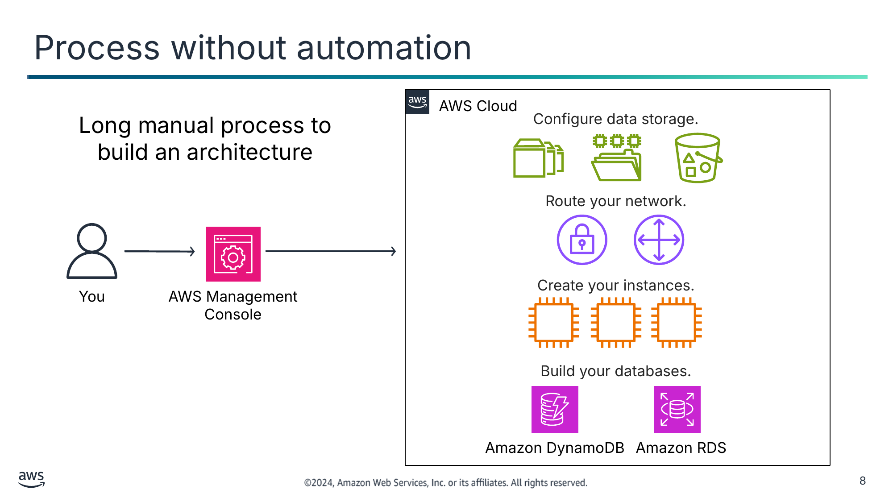

Long manual process to build an architecture

<details>
<summary>Текст зі схеми</summary>

AWS Cloud

Configure data storage.

Route your network.

You

AWS Management Console

Create your instances.

Build your databases.

Amazon DynamoDB

Amazon RDS

</details>

> **Нотатки:**
>
> |Slide number 8  
> |Instructor notes  
> |Students who are new to cloud architecture might not consider the drawbacks of manually deploying resources. This slide shows one possible way to build out resources by using the console, but every step of the process is manual. This means that building an architecture can take a very long time and can create risks for the environment. Point out the possible issues, including making updates, debugging, and managing dependencies. Also discuss how realistic it is to do all these processes manually. On the next slide, the students will learn about the risks from manual processes.  
> |  
> |Student notes  
> Many organizations will start using AWS by manually creating an Amazon Simple Storage Service (Amazon S3) bucket or by launching an Amazon Elastic Compute Cloud (Amazon EC2) instance and running a web server on it. Then, over time, they manually add more resources as they find that expanding their use of AWS can meet additional business needs. Soon, however, it can become challenging to manually manage and maintain these resources.  
>
> Manual processes are error prone, unreliable, and inadequate to support an agile business. Frequently, an organization may tie up highly skilled resources to provide manual configuration when time could be better spent supporting other more critical and higher value activities within the business.  
>
> When considering building an architecture manually or with automation, the following are some questions to ask:  
> Where do you want to put your efforts—into the design or the implementation? What are the risks of manual implementations?  
> How would you ideally update production servers? How will you roll out deployments across multiple geographic regions? When things break—and they will—how will you manage the rollback to the last known good version?  
> How will you debug deployments? Can you fix the bugs in your application before you roll the deployment out to the customer? How will you discover what is wrong and then fix it so that it remains fixed?  
> How will you manage dependencies on the various systems and subsystems in your organization?  
> Is it realistic that you will be able to do all these tasks through manual configurations?

---

## Слайд 9: Risks from manual processes

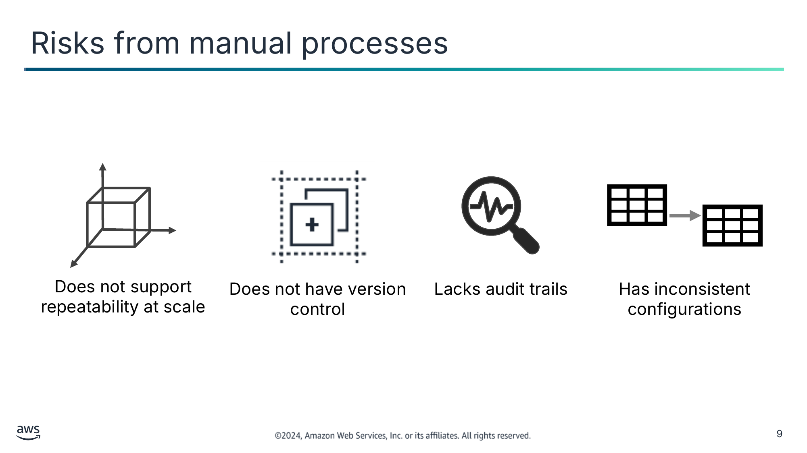

Does not support repeatability at scale

Does not have version control

Lacks audit trails

Has inconsistent configurations

> **Нотатки:**
>
> |Slide number 9  
> |Instructor notes  
> |Consider opening with a question such as, “What are the risk from manual processes?” The students need to understand that manual processes are often the choice for a programmer when they start out. Manual processes create risks for both the environment and the applications that are developed. Use this as the discussion of the anti-pattern before getting to the solution of automation.  
> |  
> |Student notes  
> Manual processes create risks to your applications and environment.  
>
> Manually creating resources and adding new features and functionality to your environment does not scale. If you are responsible for a large corporate application, there might not be enough people to manually add features as necessary. Determine how you will replicate deployments to multiple Regions.  
>
> Creating an architecture and applications from scratch does not have inherent version control. If there is an emergency, it’s helpful to be able to roll back the production stack to a previous version, but that is not possible when you create your environment manually. A stack is a collection of AWS resources that you can manage as a single unit. Determine how you will roll back the production environment to a prior version.  
>
> Having an audit trail is important for many compliance and security situations. It’s dangerous to give anyone in your organization the ability to manually control and edit your environments. Determine how you will ensure compliance. How will you track changes to configuration details at the resource level?  
>
> Finally, consistency is critical when you want to minimize risks. Automation helps you to maintain consistency. Determine how you will ensure matching configurations across multiple EC2 instances.

---

## Слайд 10: Benefits of automation

Reduces manual intervention or access

Allows for reproducible environments

Improves productivity

Automates testing  
and scaling

> **Нотатки:**
>
> |Slide number 10  
> |Instructor notes  
> |This should be contrasted with the anti-pattern of manual processes from the last slide. This slide discusses the benefits of automation and should be used as the foundation for discussions in the coming sections. The next section is Using infrastructure as code, which includes discussion of how to implement these benefits of automation.  
> |  
> |Student notes  
> To minimize the risks from manual processes, modern operating environments commonly rely on full automation. Automation eliminates manual intervention or access to production environments and focuses on the setup, configuration, deployment, and support of infrastructure and the applications that run on it. By using automation, you can set up reproducible environments more rapidly in a standardized and repeatable configuration.  
>
> You can improve productivity by using automation for software testing, software releasing, machine configuration, operating system patching, troubleshooting, or bug fixing. You can use many levels of automation practices together. You can use automatic scaling to respond to customer demand and create more elastic environments.  
>
> For more information about the benefits of automation, see “The Case for Investing in Cloud Automation” and “Automation and Tooling” on the content resources page of your online course.

---

## Слайд 11: Key takeaways: Reasons to automate

- Manual processes are error prone, unreliable, and inadequate to support an agile business.
- Manual processes create risks to applications and environments.
- Automation helps you eliminate manual process and build rapidly.

> **Нотатки:**
>
> |Slide number 11  
> |Instructor notes  
> |There are no student notes for this slide.  
> |  
> |Student notes

---

## Слайд 12: Using infrastructure as code

Automating Your Architecture

> **Нотатки:**
>
> |Slide number 12  
> |Instructor notes  
> |This section introduces infrastructure as code (IaC). This section is intended to bridge the ideas of automation with the AWS automation tool CloudFormation. This section discusses the benefits and approaches to IaC and introduces several AWS IaC solutions.  
> |  
> |Student notes  
> This section introduces infrastructure as code (IaC). Infrastructure was traditionally provisioned by using a combination of scripts and manual processes. This results in the creation of new environments not always being repeatable, reliable, or consistent. IaC solutions enable the creation, deployment, and maintenance of infrastructure in a programmatic and descriptive way. This section discusses the benefits and approaches to IaC and introduces several AWS IaC solutions.

---

## Слайд 13: IaC overview

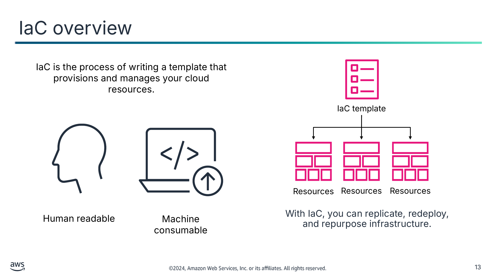

IaC is the process of writing a template that provisions and manages your cloud resources.

Human readable

Machine consumable

With IaC, you can replicate, redeploy, and repurpose infrastructure.

<details>
<summary>Текст зі схеми</summary>

IaC template

Resources

Resources

Resources

</details>

> **Нотатки:**
>
> |Slide number 13  
> |Instructor notes  
> |Remind the students that infrastructure and code is the way to implement the benefits of automation. If the students need more information on IaC, you can review the content on “What is Infrastructure as Code?” The link is in the course resources.  
> |  
> |Student notes  
> Infrastructure as code (IaC) is an industry term that refers to the process of provisioning and managing cloud resources by defining them in a template file that is both human-readable and machine-consumable. Any application environment requires many infrastructure components, such as operating systems, database connections, and storage. Developers have to regularly set up, update, and maintain the infrastructure to develop, test, and deploy applications.  
>
> Manual infrastructure management is time-consuming and prone to error—especially when you manage applications at scale. With infrastructure as code, you define your infrastructure's desired state without including all the steps to get to that state. Organizations use infrastructure as code to control costs, reduce risks, and respond with speed to new business opportunities.  
>
> IaC continues to grow in popularity because it provides a workable solution to challenges, such as how to replicate, redeploy, and repurpose infrastructure, reliably, and consistently.

---

## Слайд 14: IaC benefits

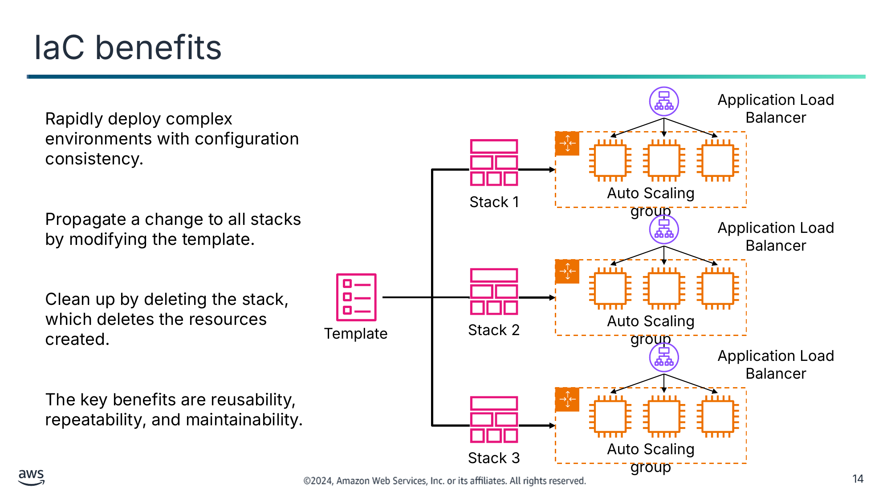

Rapidly deploy complex environments with configuration consistency.

Propagate a change to all stacks by modifying the template.

Clean up by deleting the stack, which deletes the resources created.

The key benefits are reusability, repeatability, and maintainability.

<details>
<summary>Текст зі схеми</summary>

Application Load Balancer

Auto Scaling group

Stack 1

Application Load Balancer

Auto Scaling group

Template

Stack 2

Application Load Balancer

Auto Scaling group

Stack 3

</details>

> **Нотатки:**
>
> |Slide number 14  
> |Instructor notes  
> |This slide shows an example of the key benefits of IaC. Highlight the benefits of reusability, repeatability, and maintainability as you walk through the diagram.  
> |Review the concepts of the development environment, test environment, and production environment.  
> |  
> |Student notes  
> Now, consider some of the benefits of IaC in more detail. If you build infrastructure with code, you gain benefits such as the ability to rapidly deploy complex environments. With one template (or a combination of templates), you can build the same complex environments repeatedly. For example, a stack can include all the resources required to run a web application, such as a web server, a database, and networking rules. If you no longer require that web application, you can delete the stack, and all of its related resources are deleted.  
>
> In this example, you can use a single template to create three different stacks. Stack 1 is your development environment, stack 2 is your test environment, and stack 3 is your production environment. The development environment is typically more flexible and dynamic so that you can prototype, write, test, and debug code for your application. The test environment simulates the production environment so that new applications can be tested for functionality, performance, and reliability. The production environment is where your application is made available to end users.  
>
> When you use one template to create these three stacks, you can have greater confidence that if your test jobs performed well in the test environment, they will also perform well in the production environment. The template minimizes the risk that the test environment is configured differently from the production environment.  
>
> If you must make a configuration update in the test environment, your can push the update to the template to update all the stacks. This process helps ensure that the modifications to a single environment will be reliably propagated to all environments that should receive the update.  
>
> Another benefit is that you can clean up all the resources that were created in your account to support a test environment after you no longer need them. This helps reduce the cost associated with resources that you no longer need and helps keep your account clean.

---

## Слайд 15: CloudFormation

- Provides a simplified way to model, create, and manage a collection of AWS resources
  - A collection of resources is called a CloudFormation stack.
  - There is no extra charge (pay for only the resources that you create).
- Can create, update, and delete stacks
- Enables orderly and predictable provisioning and updating of resources
- Enables version control of AWS resource deployments

CloudFormation

> **Нотатки:**
>
> |Slide number 15  
> |Instructor notes  
> |The remainder of this module focuses on how to use CloudFormation to build infrastructure as code. This should be a thorough introduction to the basics of the service. For more information, see the CloudFormation service page. A link is provided in the course resources.  
> |  
> |Student notes  
> CloudFormation provisions resources by using infrastructure as code. You can use CloudFormation to build and rebuild your infrastructure and applications in a repeatable manner without needing to perform manual actions or write custom scripts. With CloudFormation, you author a document that describes what your infrastructure should be, including all the AWS resources that should be a part of the deployment. You can think of this document as a model. You then use the model to create the reality because CloudFormation can actually create the resources in your account.  
>
> When you use CloudFormation to create resources, it is called a CloudFormation stack. You create a stack, update a stack, or delete a stack. Thus, you can provision resources in an orderly and predicable way.  
>
> By using CloudFormation, you can treat your infrastructure as code. Author it with any code editor, check it into a version control system such as GitHub, and review files with team members before you deploy into the appropriate environments. If the CloudFormation document that you create to model your deployment is checked into a version control system, you could always delete a stack, check out an older version of the document, and create a stack from it. With version control, you can use essential rollback capabilities.  
>
> For more information, see the CloudFormation service page. A link is provided in the course resources.

---

## Слайд 16: AWS IaC services that use CloudFormation

AWS Elastic Beanstalk

AWS Quick Starts

AWS Serverless Application Model (AWS SAM)

AWS Amplify

AWS Cloud Development Kit (AWS CDK)

A fully managed service that automatically launches an AWS environment with your uploaded application code

Automated reference architectures based on CloudFormation templates

An extension of CloudFormation with shorthand syntax for building common serverless infrastructure

A development framework for full stack web and mobile apps that requires less coding and less knowledge of backend integrations

An open source development framework to model and provision resources through CloudFormation by using familiar programming languages

AWS CloudFormation

> **Нотатки:**
>
> |Slide number 16  
> |Instructor notes  
> |CloudFormation is the foundation of many different AWS infrastructure as code services. This slide introduces those services. Review the basics of each service, and discuss how CloudFormation is used behind the scenes to deploy the resources.  
> |  
> |Student notes  
> AWS offers other services that help with the creation, deployment, and maintenance of infrastructure in a programmatic way. Each service offers options for abstracting parts of the coding required to build your infrastructure. Your decision should depend on the relative level of convenience and control that you need, and the skills of your architecting and development teams.  Whichever service you choose, behind the scenes, AWS will use CloudFormation to deploy your resources.  
>
> AWS Elastic Beanstalk  
> You can use Elastic Beanstalk to deploy and manage applications in the AWS Cloud without having to learn about the infrastructure that runs those applications. You upload your application, and Elastic Beanstalk automatically handles the details of capacity provisioning, load balancing, scaling, and application health monitoring. Elastic Beanstalk supports applications developed in many common programming languages, including Go, Java, .NET, Node.js, PHP, Python, and Ruby. When you deploy your application, Elastic Beanstalk builds the selected supported platform version and provisions one or more AWS resources, such as EC2 instances, to run your application.  
>
> AWS Quick Starts  
> AWS Quick Starts are automated reference architectures that streamline the deployment of key workloads on the AWS Cloud. By using best practices and automating hundreds of manual procedures, Quick Starts can help you deploy popular technologies to AWS in minutes. They use infrastructure as code to provision production environments on AWS that might require hundreds of discreet procedures to deploy manually. In addition to the efficiency they offer, Quick Starts have an often overlooked but critical aspect: they’re open source and modular. That’s what makes them customizable.  
>
> AWS Serverless Application Model (AWS SAM)  
> The AWS SAM is a toolkit for building and running serverless applications on AWS. AWS SAM consists of two parts: AWS SAM templates and the AWS SAM Command Line Interface (AWS SAM CLI). AWS SAM templates provide a shorthand syntax that is optimized for defining infrastructure as code for serverless applications. An extension of CloudFormation, you deploy AWS SAM templates directly to CloudFormation, benefiting from its extensive IaC support on AWS. The AWS SAM CLI is a developer tool that you can use to quickly create, develop, and deploy serverless applications.  
>
> AWS Amplify  
> Amplify is a service that helps you build full-stack web and mobile applications in hours. Amplify consists of a set of tools and services to accelerate the development of mobile and web applications on AWS. The Amplify open source framework includes a set of libraries with strong conventions and best practices, UI components, and a CLI to build an application backend and integrate it with your iOS, Android, Web, and React Native application. The framework leverages a core set of AWS Cloud services to offer capabilities including offline data, authentication, analytics, push notifications, and bots at high scale. Amplify also offers a fully managed web application and static website hosting service to host your frontend web application, create and delete backend environments, and set up continuous integration and continuous delivery (CI/CD) on the front end and backend. Behind the scenes, Amplify deployments build CloudFormation stacks.  
>
> AWS Cloud Development Kit (AWS CDK)  
> The AWS CDK is an open source software development framework for defining cloud infrastructure as code. The AWS CDK uses modern programming languages and deploys through CloudFormation. You can use the AWS CDK to build reliable, scalable, cost-effective applications in the cloud and to author AWS CDK projects, which are applied to generate CloudFormation templates.  
>
> You can run AWS CDK projects by using the AWS CDK command line interface (CLI) or in a continuous delivery system. You can use the AWS CDK CLI to list the stacks defined in your AWS CDK application and synthesize the stacks into CloudFormation templates. You then deploy the stacks to any public AWS Region.

---

## Слайд 17: Key takeaways: Using infrastructure as code

- IaC is the process of provisioning and managing your cloud resources by writing a template file.
- IaC rapidly deploys complex environments, and you can build or update the same complex environments repeatedly.
- Choose an IaC solution based on your use case, relative balance of convenience and control, and the skills of your team.
- CloudFormation is an IaC service to help you create, update, and delete services and architectures.

> **Нотатки:**
>
> |Slide number 17  
> |Instructor notes  
> |There are no student note for this slide.  
> |  
> |Student notes

---

## Слайд 18: Customizing with CloudFormation

Automating Your Architecture

> **Нотатки:**
>
> |Slide number 18  
> |Instructor notes  
> |This section is an overview of the CloudFormation template. The students will need to understand how the templates are laid out and created before learning about ways to build them in the following sections.  
> |Ensure that the students have a firm grasp of how CloudFormation functions before moving on.  
> |  
> |Student notes  
> This section provides an overview of CloudFormation and customization a CloudFormation template.

---

## Слайд 19: How CloudFormation works

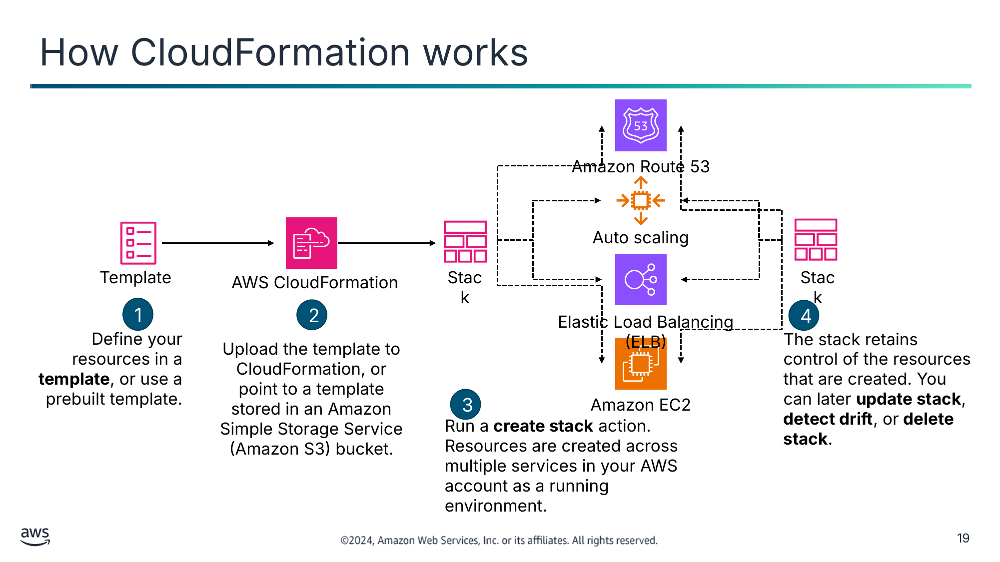

1

2

4

Define your resources in a **template**, or use a prebuilt template.

Upload the template to CloudFormation, or point to a template stored in an Amazon Simple Storage Service (Amazon S3) bucket.

The stack retains control of the resources that are created. You can later **update stack**, **detect drift**, or **delete stack**.

3

Run a **create stack** action. Resources are created across multiple services in your AWS account as a running environment.

<details>
<summary>Текст зі схеми</summary>

Amazon Route 53

Auto scaling

Template

AWS CloudFormation

Stack

Stack

Elastic Load Balancing (ELB)

Amazon EC2

</details>

> **Нотатки:**
>
> |Slide number 19  
> |Instructor notes  
> |Refer to the service introduction slide for CloudFormation. This diagram shows how CloudFormation uses a template to build out a set of resources as a stack. Walk through the steps to illustrate the process of CloudFormation.  
> |  
> |Student notes  
> This diagram demonstrates how CloudFormation works. First, you define the AWS resources that you want to create. In this example, it creates a few EC2 instances, a load balancer, an Auto Scaling group, and an Amazon Route 53 hosted zone. You define the resources in a CloudFormation template. You can create the template from scratch, or you can use a prebuilt template. Many sample templates are also available.  
>
> CloudFormation offers broad support for AWS services. However, in some cases where the exact feature that you want is not available, you can invoke an AWS Lambda function during the stack build that calls the AWS SDK to reach full service API coverage.  
>
> Next, you upload the template to CloudFormation. Alternatively, you can store the template on Amazon S3 and point CloudFormation to the location where it is stored.  
>
> Third, you run the create stack action. When you do this, the CloudFormation service reads through what is specified in the template and creates the desired resources in your AWS account. A single stack can create and configure resources in a single Region across multiple AWS services.  
>
> Finally, you can observe the progress of the stack-creation process. After the stack has successfully completed, the AWS resources that it created exist in your account. The stack object remains, and it acts like a handle to all the resources that it created. This is helpful when you want to take actions later. For example, you might want to update the stack (to create additional AWS resources or modify existing resources) or delete the stack (which will clean up and delete the resources that were created by the stack). When deleting a stack, you can determine which items to keep when the stack is deleted.  
>
> For a full list of resources supported by CloudFormation, see “AWS Resource and Property Types” in the CloudFormation User Guide. A link is provided in your course resources.

---

## Слайд 20: CloudFormation template syntax

Template

YAML example

JSON example

```
AWSTemplateFormatVersion: 2010-09-09
Resources:
 awsexamplebucket1:
 Type: AWS::S3::Bucket
```

```
{
 "AWSTemplateFormatVersion": "2010-09-09",
 "Resources" : {
 “awsexamplebucket1" : {
 "Type" : "AWS::S3::Bucket"
 }
 }
}
```

YAML advantages

JSON advantages

- Is optimized for readability
- Is less verbose
- Supports embedded comments

- More widely used by other computer systems  
(for example, APIs)
- Usually less complex to generate and parse

> **Нотатки:**
>
> |Slide number 20  
> |Instructor notes  
> |Review the key difference between YAML and JSON found on the page titled “What’s the Difference Between YAML and JSON” within the Cloud Comparison tool. The direct link is in the course resources for this module.  
> |  
> |Student notes  
> A CloudFormation template can be authored in either JSON or YAML.  
>
> YAML is optimized for readability. The same data that is stored in JSON will take fewer lines to store in YAML because YAML does not use braces ({}), and it uses fewer quotation marks (“”). Another advantage of YAML is that it natively supports embedded comments. Debugging YAML documents can be less complicated compared with JSON because of the human-readable format. With JSON, it can be difficult to track down missing or misplaced commas or braces. YAML does not have this issue.  
>
> Despite the many advantages of YAML, JSON offers some unique advantages. First, it is widely used by computer systems. Its ubiquity is an advantage because data that is stored in JSON can reliably be used with many systems without needing transformation. It is usually less complex to generate and parse JSON than it is to generate and parse YAML. Additionally, you can add comments to a CloudFormation template in JSON, which requires the used of the metadata attribute in the CloudFormation template.  
>
> You should choose the language that best suits your use case, business needs, and your experience. Choose YAML for a more human-readable format and JSON for cross compatibility. Ultimately, the decision will be between you and your organization.  
>
> It is recommended that you treat templates as source code and store them in a code repository.  
>
> Recall that templates can also be authored in AWS CloudFormation Designer (Designer), a graphical design interface in the AWS Management Console that can be used to author or view the contents of CloudFormation templates. It can also be used to convert a valid JSON template to YAML or to convert YAML to JSON. It provides a drag-and-drop interface for authoring templates that can be output as either JSON or YAML.  
>
> For more information, see “What’s the Difference Between YAML and JSON” on the content resources page of your online course.

---

## Слайд 21: Anatomy of a CloudFormation template

---

AWSTemplateFormatVersion: "*version date*"

Description:

	*String*

Metadata:

	*template metadata*

Parameters:  
	*set of parameters*

Rules:

	*set of rules*

Mappings:

	*set of mappings*

Conditions:

	*set of conditions*

Transform:

	*set of transforms*

Resources:

	*set of resources*

Outputs:

	*set of outputs*

- When you write a CloudFormation template you have a choice of sections to include based on your workload.
- The only required section is **Resources**. Additional sections are optional.
- This example shows a YAML-formatted template fragment in the suggested order of sections.

> **Нотатки:**
>
> |Slide number 21  
> |Instructor notes  
> |This slide shows the sections of a CloudFormation template. The only section that is required is the Resources section, but it will be helpful to students to understand all the sections. The next slide includes an example. For more information, see “Template anatomy” on the content resources page of your online course.  
> |  
> |Student notes  
> When you write a CloudFormation template, you have a choice of sections to include based on your workload. A CloudFormation template includes several major sections. The Resources section is the only required section. Although a fixed order of sections is not required, as you build your template, it can be helpful to use the logical order because values in one section might refer to values from a previous section. The following is a suggested order:  
> Format Version: This section provides the CloudFormation template version that the template conforms to. The template format version isn't the same as the API or Web Services Description Language (WSDL) version. The template format version can change independently of the API and WSDL versions.  
> Description: This section includes a text string that describes the template. This section must always follow the template Format Version section.  
> Metadata: This section includes objects that provide additional information about the template.  
> Parameters: This section includes values to pass to your template at runtime (when you create or update a stack.  
> Rules: This section validates a parameter or a combination of parameters passed to a template during a stack creation or stack update.  
> Mappings: This section includes a mapping of keys and associated values that you can use to specify conditional parameter values, similar to a lookup table.  
> Conditions: This section includes conditions that control whether certain resources are created or whether certain resource properties are assigned a value during stack creation or update.  
> Transform: For serverless applications, the Transform section specifies the version of the AWS SAM to use. When you specify a transform, you can use AWS SAM syntax to declare resources in your template.  
> Resources (required): This section specifies the stack resources and their properties, such as an EC2 instance or an S3 bucket.  
> Outputs: This section describes the values that are returned whenever you view your stack's properties.  
>
> For a full review of the anatomy of a CloudFormation template, see “Template Anatomy.” A link is provided in your course resources.

---

## Слайд 22: Resources template: Create an EC2 instance

```
{
     "Resources": {
         "Ec2Instance": {
         "Type": "AWS::EC2::Instance",
         "Properties": {
         "ImageId": "ami-9d23aeea",
         "InstanceType": "m3.medium",
         "KeyName": {"Ref": "KeyPair}
    }},

     "Outputs": {
         "InstanceId": {
         "Description": "InstanceId",
         "Value": {"Ref": "Ec2Instance"}
   }
   }
}
```

**Resources** define what needs to be created in the AWS account (all you need).

**Outputs** specify the values returned after the stack is created.

> **Нотатки:**
>
> |Slide number 22  
> |Instructor notes  
> |This example shows two sections of a CloudFormation template. This example includes the details of what the previous slide covered. Although the previous slide was in a YAML format, the flow of the template is the same in both YAML and JSON. You can compare and contrast the two slides to show the students where these two resources fit in a larger template if they choose to use additional sections of the template. You can also illustrate the differences between YAML and JSON.  
> |  
> |Student notes  
> This example CloudFormation template creates an EC2 instance. Although this example does not illustrate all possible sections of a template, it does highlight some of the most commonly used sections, including Resources and Outputs.  
>
> The Resources section is required for any template. Use it to specify the AWS resources to create, as well as their properties. In this example, a resource of type AWS::EC2::Instance is specified, which creates an EC2 instance. The example resource includes both statically defined properties (ImageId and InstanceType) and a reference to the KeyPair parameter. Examples include creating all components of a virtual private cloud (VPC) in a Region and then creating EC2 instances in the VPC.  
>
> The example shows the Outputs section, which describe the values that are returned when you view your stack's properties. In the example, an InstanceId output is declared. After the stack is created, you can see this value in the stack details in the CloudFormation console by running the aws cloudformation describe-stacks AWS Command Line Interface (AWS CLI) command or by using the AWS SDKs to retrieve this value. An example use is returning the instance ID or the public IP address of an EC2 instance.

---

## Слайд 23: AWS CloudFormation Designer (Designer)

1

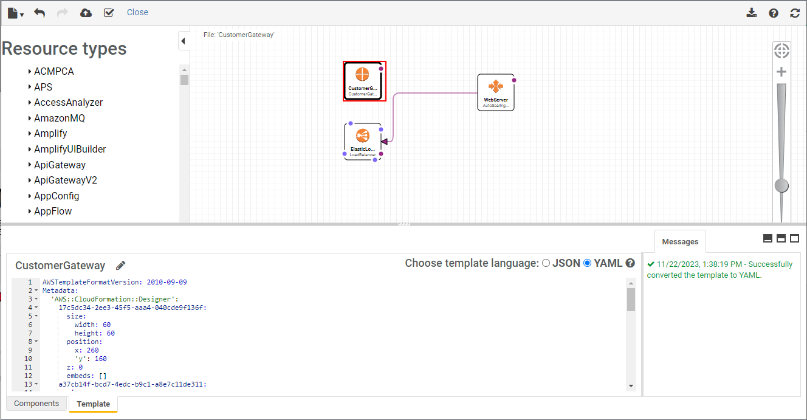

Toolbar

Fit-to-window button

4

3

2

Canvas pane

Resources types pane

Full screen and Split screen buttons

5

Integrated JSON and YAML editor pane

7

6

Messages pane

> **Нотатки:**
>
> |Slide number 23  
> |Instructor notes  
> |Designer is a graphic tool for building a CloudFormation template. This is a good way to visualize a template before it is built. Consider opening the console and giving a short walk-through of the designer.  
> |For more information, see “AWS CloudFormation Designer interface overview.” A link is provided in the course resources.  
> |  
> |Student notes  
> Designer is a graphic tool for creating, viewing, and modifying CloudFormation templates. With Designer, you can diagram your template resources by using a drag-and-drop interface and then edit their details by using the integrated JSON and YAML editor. Designer can help you quickly see the interrelationship between a template's resources and modify templates. With Designer, you can see graphic representations of the resources in your template. It also simplifies template authoring and simplifies template editing.  
>
> Designer has several components. The following are the panes and main components:  
> The toolbar provides quick access to commands for common actions, such as opening and saving templates, undoing or redoing changes, creating a stack, and validating your template. You can also download the diagram as an image, get help, or refresh the diagram in the canvas pane.  
> The Resource types pane lists all the template resources that you can add to your template, categorized by their AWS service name. You add resources by dragging them from the Resource types pane to the canvas. Designer can display only CloudFormation supported resource types. It cannot display other entities, such as Availability Zones or the resources of a nested stack.  
> The canvas pane displays your template resources as a diagram. You use it to add or remove resources, create relationships between resources, and arrange their layout. The changes that you make in the canvas automatically modify the template's JSON or YAML.  
> The fit-to-window button resizes the canvas pane to fit your template's diagram.  
> The full screen and split screen buttons select different views of Designer. You can select a full-screen view of the canvas, a full-screen view of the Integrated JSON and YAML editor, or a split-screen view of the canvas and editor.  
> In the integrated JSON and YAML editor panel, you specify the details of your template, such as resource properties or template parameters. When you select an item in the canvas, Designer highlights the related JSON or YAML in the editor. After editing the JSON or YAML, you must refresh the canvas to update the diagram.  
> When you convert a template from JSON to YAML or do the reverse, the Messages pane displays a success or failure message. When you open, validate, or attempt to create a stack with an invalid template, the Messages pane displays validation errors.

---

## Слайд 24: Using conditions

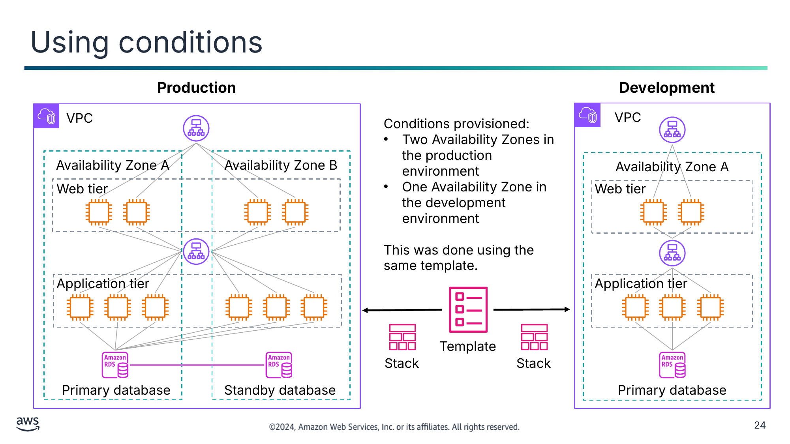

Conditions provisioned:

- Two Availability Zones in the production environment
- One Availability Zone in the development environment

This was done using the same template.

<details>
<summary>Текст зі схеми</summary>

**Production**

VPC

Availability Zone A

Availability Zone B

Web tier

Application tier

Primary database

Standby database

**Development**

  VPC

Availability Zone A

Web tier

Application tier

Primary database

Template

Stack

Stack

</details>

> **Нотатки:**
>
> |Slide number 24  
> |Instructor notes  
> |To review the syntax of a condition, see “Conditions” on the content resources page of your online course. This resource gives code examples of conditions in both YAML and JSON notation. There are examples of a simple function and a nested function. Review these codes with the students.  
> |  
> |Student notes  
> You can use the same CloudFormation template to create both your production environment and development environment. This approach can help ensure that (for example) the same application binaries, same Java version, and same database version are used in both development and production. Thus, the template can help ensure that your application behaves in production the same way that it behaved in the development environment.  
>
> In the example, you see that both the production and development environments are created from the same template. However, the production environment is configured to run across two Availability Zones, and the development environment runs in a single Availability Zone. These kinds of deployment-specific differences can be accomplished by using conditions. You can use a conditions statement in CloudFormation templates to help ensure that development, test, and production environments—though they are different in size and scope—are otherwise configured identically.  
>
> You might need several testing environments for functional testing, user acceptance testing, and load testing. Having different test environments gives multiple developers the ability to work on tests without compromising each other’s data. Having multiple test environments also gives you the ability to test different issues independently. Creating those environments manually is risky. However, creating them with CloudFormation helps ensure consistency and repeatability.

---

## Слайд 25: CloudFormation change sets

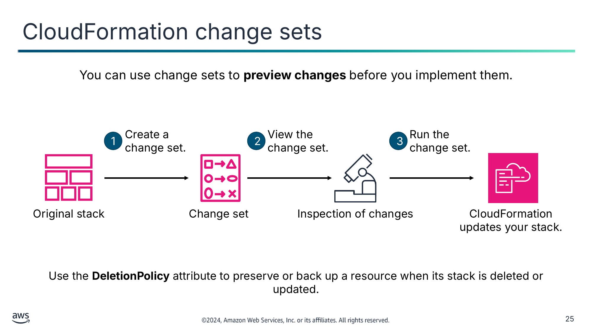

You can use change sets to **preview changes** before you implement them.

Use the **DeletionPolicy** attribute to preserve or back up a resource when its stack is deleted or updated.

<details>
<summary>Текст зі схеми</summary>

1

Create a

change set.

2

View the

change set.

3

Run the

change set.

Original stack

Change set

Inspection of changes

CloudFormation updates your stack.

</details>

> **Нотатки:**
>
> |Slide number 25  
> |Instructor notes  
> |Change sets can be very helpful for understanding how changes will affect running resources. Change sets can be used once resources have been provisioned. For more information about how to create, view, and use change sets, see “Updating Stacks Using Change Sets.” A link is provided in the course resources.  
> |You may want to show an example of a change set. The CloudFormation documentation provides example change sets for this purpose. A link to the example change sets is in the course resources.  
> |  
> |Student notes  
> One way to update a stack (and thus update your AWS resources) is to update the CloudFormation template that you used to create the stack and then run the Update Stack option.  
>
> However, before you actually run an update, you might want to gain additional insight about the specific changes that CloudFormation will implement if you run that command. If you want this type of insight, you can use a change set.  
>
> By using change sets, you can preview the changes, verify that they align with your expectations, and then approve the updates before you proceed.  
>
> Follow this basic workflow to use CloudFormation change sets:  
> Create a change set by submitting changes for the stack that you want to update.  
> View the change set to see which stack settings and resources will change. If you want to consider other changes before you decide which changes to make, create additional change sets.  
> Run the change set. CloudFormation updates your stack with those changes.  
>
> If you use change sets, you might want to set a deletion policy on some resources. You can use the DeletionPolicy attribute to preserve (or, in some cases, back up) a resource when its stack is deleted or updated. If a resource has no DeletionPolicy attribute, CloudFormation deletes the resource.  
>
> For a full review of CloudFormation change sets, see “Updating Stacks Using Change Sets.” A link is provided in your course resources.

---

## Слайд 26: Drift detection

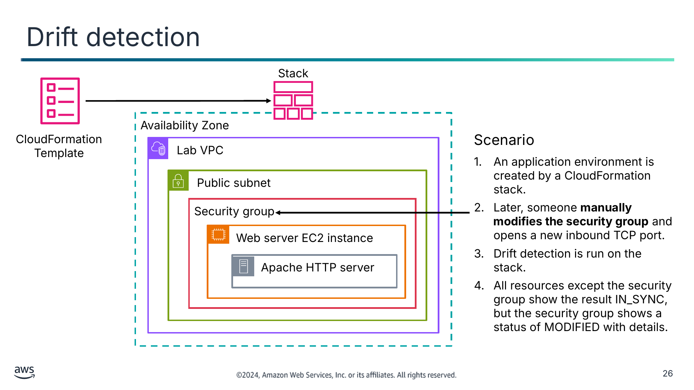

Scenario

1. An application environment is created by a CloudFormation stack.
2. Later, someone **manually modifies the security group** and opens a new inbound TCP port.
3. Drift detection is run on the stack.
4. All resources except the security group show the result IN_SYNC, but the security group shows a status of MODIFIED with details.

<details>
<summary>Текст зі схеми</summary>

Stack

Availability Zone

CloudFormation Template

Lab VPC

Public subnet

Security group

Web server EC2 instance

Apache HTTP server

</details>

> **Нотатки:**
>
> |Slide number 26  
> |Instructor notes  
> |Consider asking this question during this slide:  
> |Question: In this scenario, what would be a better approach if the team wants to modify the security group settings?  
> |Answer: Modify the CloudFormation template security group settings. Then, run Update Stack. CloudFormation will update the security group. This keeps the model deployment synchronized with the actual deployment.  
> |For a list of resources that support drift detection, see “Resources That Support Import and Drift Detection Operations.” A link is provided in your course resources.  
> |  
> |Student notes  
> Consider this scenario: an application environment is created by running a CloudFormation stack. Then, someone decides to manually modify the deployed environment settings. They create a new inbound rule in the security group that was created by the stack. However, they make this change outside the context of CloudFormation—for example, by using the Amazon EC2 console. As the architect of this application, you would want to know that your deployed environment no longer matches the model environment that is defined in the CloudFormation template.  
>
> How would you know which resources were modified so that they no longer exactly conform with the specifications in the stack?  
>
> Drift detection can be run on a stack by choosing Detect Drift from the Stack actions menu in the console. Performing drift detection on a stack shows you whether the stack has drifted from its expected template configuration. Drift detection returns detailed information about the drift status of each resource that supports drift detection in the stack.  
>
> When you delete a stack that has drift, the drift is not handled by the CloudFormation resource cleanup process. If the stack has unresolved resource dependencies, they might cause the delete stack action to fail. In such cases, you might need to manually resolve the issue.  
>
> For a list of resources that support drift detection, see “Resources That Support Import and Drift Detection Operations.” A link is provided in your course resources.

---

## Слайд 27: Scoping and organizing templates

| Category | Type of Template |
|---|---|
| Frontend services | Web interfaces, mobile access, and analytics dashboard |
| Backend services | Search, payments, reviews, and recommendations |
| Shared services | • Customer relationship management (CRM) databases,<br>• common monitoring, alarms, subnets, and security groups |
| Network | VPCs, internet gateways, virtual private networks (VPNs), and NAT devices |
| Security | AWS Identity and Access Management (IAM) policies, users, groups, and roles |

> **Нотатки:**
>
> |Slide number 27  
> |Instructor notes  
> |For more information on nested stacks, see “Working with Nested Stacks.” A link is provided in your course resources.  
> |  
> |Student notes  
> As your organization starts to use more CloudFormation templates, it will be important for you to have a strategy for templates. This strategy will define the scope of what a single template should create and the general characteristics that would make you want to define your AWS infrastructure in more than one template.  
>
> The table offers some ideas about how you might organize your templates so that they can be maintained and so that they can be used in combination with each other in a way that makes sense. A good strategy is to group your resource definitions in templates similar to the way that you would organize the functionality of a large enterprise application into different parts.  
>
> Think about the more tightly connected components of your infrastructure, and consider putting them in the same templates. In this example, CloudFormation templates are scoped to create and maintain AWS resources in one of five areas: frontend services, backend services, shared services, network, and security. In each area, you might maintain a template that is scoped to a single application or a single department's needs.  
>
> You can also consider using nested stacks. Nested stacks are created as part of other stacks. As your infrastructure grows, common patterns can emerge in which you declare the same components in multiple templates. You can separate out these common components and create dedicated templates for them. Then use the resource in your template to reference other templates, creating nested stacks.  
>
> Regardless of how you organize and scope each CloudFormation template, treat your templates as code that needs version control. Store your templates in a source control system.  
>
> For more information on nested stacks, see “Working with Nested Stacks.” A link is provided in your course resources.

---

## Слайд 28: Demo: Analyzing an AWS CloudFormation Template

- This demo uses CloudFormation.
- In this demonstration, you examine a CloudFormation template and analyze the template in depth.


> **Нотатки:**
>
> |Slide number 28  
> |Instructor notes  
> |This is a video demo. Students can access the demo from their online course  
> |  
> |Student notes  
> In this demonstration, you examine a CloudFormation template and analyze the template in depth.

---

## Слайд 29: Demo: AWS CloudFormation Resources

- This demo uses CloudFormation and AWS Quick Starts.
- In this demonstration, you are introduced to CloudFormation and the resources available for creating CloudFormation templates.


> **Нотатки:**
>
> |Slide number 29  
> |Instructor notes  
> |This is a video demo. Students can access the demo from their online course.  
> |  
> |Student notes  
> In this demonstration, you are introduced to the details of CloudFormation, and you will see how to simplify your infrastructure management by using the ideas of infrastructure as code. This demo also introduces resources for creating CloudFormation templates.

---

## Слайд 30: Demo: Reviewing an AWS CloudFormation Template

- This demo uses CloudFormation.
- In this demonstration, you review the changes that you make to a CloudFormation template.


> **Нотатки:**
>
> |Slide number 30  
> |Instructor notes  
> |This is a video demo. Students can access the demo from their online course.  
> |  
> |Student notes  
> In this demonstration, you review the changes that you make to a CloudFormation template.

---

## Слайд 31: Demo: Using the AWS CloudFormation Console

- This demo uses CloudFormation.
- In this demonstration, you learn how to use the CloudFormation console.


> **Нотатки:**
>
> |Slide number 31  
> |Instructor notes  
> |This is a video demo. Students can access the demo from their online course.  
> |  
> |Student notes  
> In this demonstration, you learn how to use the CloudFormation console. You review concepts of Designer and drift detection. You also learn how to clean things up when you’re finished so that you don’t incur any unnecessary charges.

---

## Слайд 32: Key takeaways: Customizing with CloudFormation

- CloudFormation is an IaC service that you can use to model, create, and manage a collection of AWS resources.
- CloudFormation IaC is defined in templates that are authored in JSON or YAML.
- A stack is what you create when you use a template to create AWS resources.
- Actions that are available on an existing stack include update stack, detect drift, and delete stack.

> **Нотатки:**
>
> |Slide number 32  
> |Instructor notes  
> |There are no student notes for this slide.  
> |  
> |Student notes

---

## Слайд 33: Using AWS Quick Starts

Automating Your Architecture

> **Нотатки:**
>
> |Slide number 33  
> |Instructor notes  
> |This section introduces AWS Quick Starts, which is a good way for students to see CloudFormation in action without having to build the template themselves. Consider reviewing several AWS Quick Starts during this section. A link to the AWS Quick Starts page is in the course resources.  
> |  
> |Student notes  
> This section introduces AWS Quick Starts for automating deployments to the AWS Cloud.

---

## Слайд 34: AWS Quick Starts

- Are gold-standard deployments
- Are based on AWS best practices for security and high availability
- Can be used to create entire architectures in less than an hour
- Can be used for experimentation and as the basis for your own architectures

AWS Quick Starts

> **Нотатки:**
>
> |Instructor notes  
> |AWS Quick Starts is a good way to begin with CloudFormation. Quick Starts are a gold-standard deployment for a variety of solutions. You can use Quick Starts to help the students to understand CloudFormation templates.  
> |  
> |Student notes  
> AWS Quick Starts provide CloudFormation templates for full solutions. The Quick Starts are built by AWS solutions architects and partners to help you deploy popular solutions on AWS based on AWS best practices for security and high availability. These reference deployments can be provisioned in your AWS account in less than an hour and often in only minutes. They help you build well-architected test or production environments in a few steps. You can use them to create entire architectures, or you can use them to experiment with new deployment approaches.  
>
> Quick Starts use infrastructure as code with CloudFormation as the foundation. This helps you to use CloudFormation to provision architectures without having to build your own template.  
>
> For more information, see AWS Quick Starts on the content resources page. A link is provided in your course resources.

---

## Слайд 35: How to use AWS Quick Starts

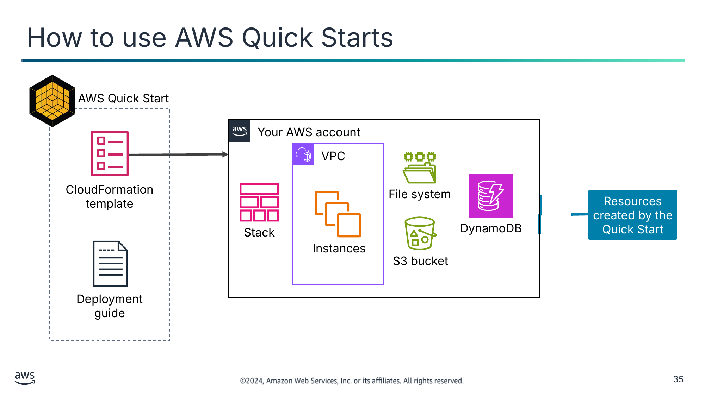

<details>
<summary>Текст зі схеми</summary>

AWS Quick Start

Your AWS account

VPC

CloudFormation template

File system

Resources created by the Quick Start

Stack

DynamoDB

Instances

S3 bucket

Deployment guide

</details>

> **Нотатки:**
>
> |Slide number 35  
> |Instructor notes  
> |Review how to access and deploy AWS Quick Starts. Go to the AWS Quick Starts page to discuss the different types of solutions. A link is in the course resources.  
> |  
> |Go to the AWS Quick Starts page.  
> |Review the landing page and the ways to search for and filter Quick Starts. To filter only Quick Starts, select the check box next to AWS Quick Starts on the Content Type menu.  
> |To choose a Quick Start to review, select the name.  
> |Review the parts of the Quick Start, including how to deploy and the costs for the deployment.  
> |To show what it looks like in the console, choose deploy for the Quick Start.  
> |Walk through the steps for deploying in the console. If desired, actually deploy the Quick Start.  
> |If you deployed the Quick Start, clean up and delete the resources that were created.  
> |You might also want to discuss the different Quick Start use cases when using the search and filter features.  
> |  
> |Student notes  
> Each Quick Start consists of a CloudFormation template and a deployment guide. The guide provides details about deployment options and how to configure the deployment to match your needs. The guide also provides information about the security considerations and estimated costs for the deployment. You can customize the deployment to match your needs and create the stack. Depending on the AWS resources that must be created, the Quick Start will finish deploying in a matter of minutes or a few hours.  
>
> Even if you do not use the Quick Starts, you may find it helpful to look at a few of them to see the types of patterns and practices that the Quick Starts follow. You might find that they help accelerate your own template development when you borrow a section of a Quick Start and embed it in your own template.  
>
> AWS Marketplace Amazon Machine Images (AMIs) are another solution that people sometimes use. These resources can be launched from the Amazon EC2 console. AWS Marketplace AMIs provide single-vendor solutions that run on EC2 instances. In contrast, AWS Quick Starts are modular and more customizable solutions that might (or might not) use Amazon EC2.

---

## Слайд 36: AWS Quick Starts example

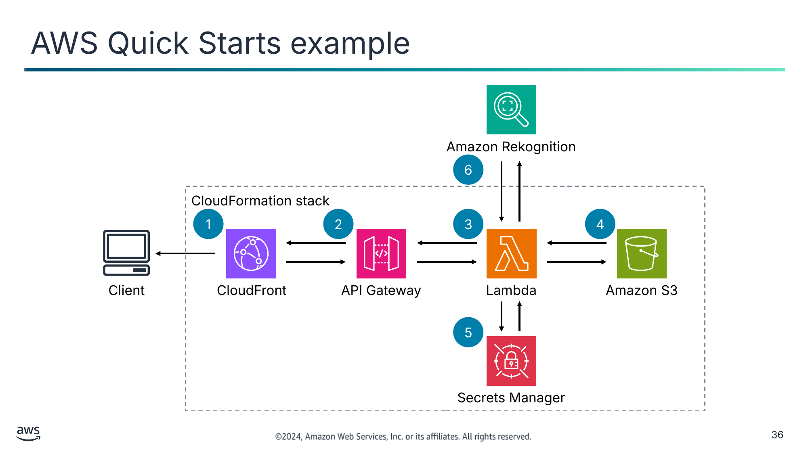

<details>
<summary>Текст зі схеми</summary>

Amazon Rekognition

6

CloudFormation stack

1

2

3

4

Client

CloudFront

API Gateway

Lambda

Amazon S3

5

Secrets Manager

</details>

> **Нотатки:**
>
> |Slide number 36  
> |Instructor notes  
> |Review this example of AWS Quick Starts step by step. To view the entire solution, see Serverless Image Handler in the AWS Solutions Library. A link is provided in your course resources.  
> |  
> |Student notes  
> This architecture is an example of an AWS Quick Start that you can deploy in less than an hour. This solution creates a serverless architecture to initiate cost-effective image processing in the AWS Cloud. This solution gives you dynamic content delivery on an interactive web interface with content moderation and smart image cropping with Amazon Rekognition.  
>
> You might implement an architecture like this if you are trying to maintain high-quality images on your websites and mobile applications:  
> The CloudFormation template deploys an Amazon CloudFront distribution that provides a caching layer to reduce the cost of image processing and the latency of subsequent image delivery. The CloudFront domain name provides cached access to the image handler API.  
> Amazon API Gateway provides endpoint resources and initiates the Lambda function.  
> A Lambda function retrieves the image from a customer’s existing S3 bucket and uses open source image processing software to return a modified version of the image to API Gateway.  
> An S3 bucket is used for log storage. This is a separate bucket from the S3 bucket for storing images.  
> If you activate the Image URL signature feature, the Lambda function retrieves the secret value from your existing AWS Secrets Manager secret to validate the signature  
> You can use Amazon Rekognition to analyze your image and return the results if you use the smart crop or content moderation features.  
>
> For more information about this example, see Serverless Image Handler in the AWS Solutions Library. A link is provided in your course resources.

---

## Слайд 37: Key takeaways: Using AWS Quick Starts

- AWS Quick Starts provide CloudFormation templates built by solutions architects and partners that reflect AWS best practices.
- AWS Quick Starts consists of a CloudFormation template and a deployment guide, which provide details about deployment options and ways to configure the deployment to match your needs.
- AWS Quick Starts can also help you see patterns and practices to accelerate your own template development.

> **Нотатки:**
>
> |Slide number 37  
> |Instructor notes  
> |There are no student notes for this slide.  
> |  
> |Student notes

---

## Слайд 38: Customizing with Amazon Q Developer

Automating Your Architecture

> **Нотатки:**
>
> |Slide number 38  
> |Instructor notes  
> |This section is an introduction to Amazon Q Developer. Amazon Q Developer is a generative AI coding companion that will help students to make updates to a CloudFormation template more quickly. Keep in mind that Amazon Q Developer is trained on billions of lines of code and is continually updating, so the outputs that you see each time might not be the same.  
> |  
> |Student notes  
> This section is an introduction to Amazon Q Developer. Amazon Q Developer helps you improve developer productivity by providing code recommendations based on developers’ natural comments and prior code.

---

## Слайд 39: Challenges of writing infrastructure as code


Human error

Differing skill levels

Size and complexity of templates

Security vulnerabilities

> **Нотатки:**
>
> |Slide number 39  
> |Instructor notes  
> Consider opening with a discussion starting with the question, “What are the challenges that you have faced in learning to write code?” Lead the discussion around the challenges that the students have faced and the challenges listed on the slide.  
> |  
> |Student notes  
> Writing code can be challenging, especially when you begin work as a developer.  
>
> Human error: Code is written by humans, and humans can introduce errors in the code. These errors might be made when performing familiar tasks, when you apply an incorrect action, or when you forget to complete a step. Errors can be hard to find, especially when the actions are correct but not for the programming goals.  
>
> Differing skill levels: Developers have different skill levels and coding styles. The most effective developers are problem solvers, a skill that grows as you practice. As a newer developer, you might choose more intricate code than is necessary. As your skills grow, you may start to write code that considers how to create, maintain, and administer. The goal of a programmer is to tackle the problem to find a workable solution. Technologies are tools to address the challenges.  
>
> Size and complexity of templates: Writing a template to describe all resources in detail for even a basic three-tier architecture quickly becomes complex. Even when you have an existing template or Quick Start, you can get lost in the details.  
>
> Security vulnerabilities: Security is a top priority when developing software. One of the problems that new developers face is overlooking security when writing code. A focus on delivering error-free code rather than checking to see if it is secure can lead to unintended security vulnerabilities.

---

## Слайд 40: Amazon Q Developer

- Generative AI-powered coding assistant
- Designed for developers and IT professionals
- Generates code and helps you understand, build, extend, and operate AWS applications
- Scan code for security vulnerabilities
- Secure and private by design

Amazon Q Developer

> **Нотатки:**
>
> |Instructor notes  
> |Amazon Q Developer is a tool that can help the students make updates to CloudFormation templates. Module 1 introduced this service. The service introduction slide is repeated here as a refresher. Make the connection to updating CloudFormation and Quick Starts by using Amazon Q Developer recommendations.  
> |  
> |Student notes  
> To alleviate some of the challenges with writing code, AWS introduced Amazon Q Developer. Amazon Q Developer is a coding assistant that those without extensive experience can use. It is trained on years of high-quality AWS examples and documentation. It can also be trained on your company’s code and systems. Amazon Q Developer can chat about code, provide in-line code completions, generate new code, and scan your code for security vulnerabilities. It can also make code upgrades and improvements, such as language updates, debugging, and optimizations. With Amazon Q Developer, you can describe the application you want to create in natural language, and Amazon Q Developer will generate and suggest code for the application. You can build applications without needing to write all code yourself. The no-code approach of Amazon Q Developer can be particularly useful for creating simple web applications, automating business processes, or building prototypes and proofs of concept.  
>
>
> For more information, see “Getting Started” in the AWS Amazon Q Developer User Guide on the content resources page of your online course.

---

## Слайд 41: Amazon Q Developer supports you across the software development lifecycle (SDLC)

Plan

Create

Test and secure

Operate

Maintain and modernize

- Ask questions and get referenceable and contextual guidance.
- Explain code with conversational coding.

- Receive in-line code recommendations for multiple languages.
- Implement features through comments or code prompts.
- Chat in your integrated development environment (IDE).

- Generate unit tests.
- Scan project code for security vulnerabilities and get remediation suggestions.

- Troubleshoot errors.
- Troubleshoot network connectivity with VPC Reachability Analyzer.

- Modernize code with Amazon Q Developer Agent for  code transformation.

> **Нотатки:**
>
> |Instructor notes  
> |Amazon Q Developer supports you across the software development lifecycle.  
> |Plan: Use the AWS Management Console to ask questions, get best practices and recommendations.  
> |Create: In-line code recommendations using natural language.  
> |Test and secure: Unit test assistance.  
> |Operate: Troubleshoot errors, analyze your VPC and more.  
> |Maintain and modernize: Upgrade projects to more up-to-date languages.  
> |Resource: AWS DevOps blog, Accelerate your Software Development Lifecycle with Amazon Q, at https://aws.amazon.com/blogs/devops/accelerate-your-software-development-lifecycle-with-amazon-q/.  
> |  
> |Student notes  
> Amazon Q supports developers across the software development lifecycle (SDLC) phases in several ways.  
> Plan: You can use Amazon Q in the AWS Management Console to ask questions, receive best practices and recommendations, optimize Amazon Elastic Cloud Compute (EC2) instances, and learn more about the Well-Architected Framework. In the integrated development environment (IDE), Amazon Q can help you understand your code base and get up to speed on projects.  
> Create: Amazon Q helps improve development productivity through in-line code recommendations directly in your IDE or command line interface (CLI), using natural language to generate new features. You can ask Amazon Q questions without leaving the IDE. The in-line code recommendations are available for multiple coding languages. For more information, see “Supported languages for Amazon Q Developer in the IDE” at https://docs.aws.amazon.com/amazonq/latest/qdeveloper-ug/q-language-ide-support.html.  
> Test and secure: Amazon Q helps you confirm that your code is working and secure through unit test assistance. It helps you to find and fix security vulnerabilities earlier in the development cycle.  
> Operate: Amazon Q can help troubleshoot errors, for example, in AWS Lambda, Amazon EC2, and Amazon Elastic Container Service (Amazon ECS). You can analyze your VPC reachability and get better debug and optimization tips.  
> Maintain and modernize: Amazon Q Developer Agent for code transformation helps you maintain and modernize code by upgrading projects to more up-to-date language versions.  
>
> For more information, see “Accelerate your Software Development Lifecycle with Amazon Q” in the AWS DevOps Blog at https://aws.amazon.com/blogs/devops/accelerate-your-software-development-lifecycle-with-amazon-q/.

---

## Слайд 42: Example: Using Amazon Q Developer with CloudFormation

Amazon Q Developer makes suggestions that the developer can accept

The accepted code snippet  is added into the template

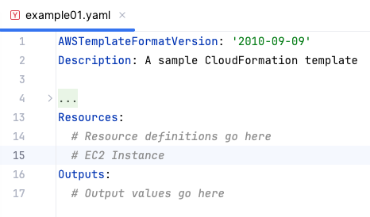

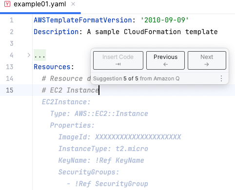

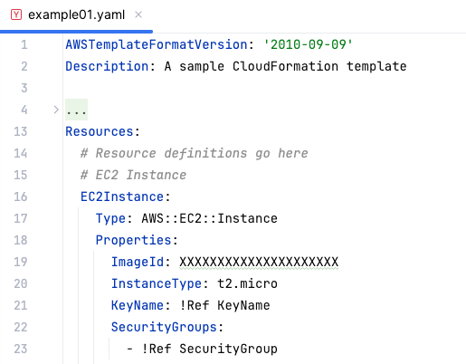

Developer types the start of a  desired resource within a YAML file

> **Нотатки:**
>
> |Slide number 42  
> |Instructor notes  
> | This is a simple example of how Amazon Q Developer can suggest relevant code related to CloudFormation.  
> |  
> |Student notes  
> Amazon Q Developer can help you modify a CloudFormation template. When modifying a stack template, you can use Amazon Q Developer to write, modify, or delete code. Amazon Q Developer generates suggestions in either YAML or JSON to fit seamlessly into your CloudFormation template.  
>
> Amazon Q Developer also helps you write Lambda functions for a CloudFormation stack. Once activated in the Lambda console, Amazon Q Developer can make code recommendations on demand in the Lambda code editor as you develop your function

---

## Слайд 43: Key takeaways: Customizing with Amazon Q Developer

- Amazon Q Developer is a generative AI coding tool that you can use to generate real-time code suggestions.
- Amazon Q Developer can offer suggestions for writing CloudFormation templates.

> **Нотатки:**
>
> |Slide number 43  
> |Instructor notes  
> |There are no student notes on this slide.  
> |  
> |Student notes

---

## Слайд 44: Guided lab: Automating Infrastructure Deployment with AWS CloudFormation (CloudFormation lab)

> **Нотатки:**
>
> |Slide number 44  
> |Instructor notes  
> |  
> |Student notes  
> You will now complete a lab. The next slides summarize what you will do in the lab, and the lab environment provides detailed instructions.

---

## Слайд 45: CloudFormation lab tasks:

- In this lab, you perform the following main tasks:
  - Use AWS CloudFormation to deploy a virtual private cloud (VPC) networking layer
  - Use AWS CloudFormation to deploy an application layer that references the networking layer
  - Explore templates with AWS CloudFormation Designer
  - Delete a stack that has a deletion policy
- Open your lab environment to start the lab and find additional details about the tasks that you will perform

> **Нотатки:**
>
> |Slide number 45  
> |Instructor notes  
> |  
> |Student notes  
> Access the lab environment through your online course to get additional details and complete the lab.

---

## Слайд 46: Debrief: CloudFormation deployment lab

- What was a best practice that you learned when using CloudFormation to deploy a layered architecture?
- When the CloudFormation stack was created for your VPC, which two outputs did the stack create?

> **Нотатки:**
>
> |Slide number 46  
> |Instructor notes  
> |Relevant before and after architectural diagrams are included in the lab instructions for each lab. You might find it helpful to pull the lab diagrams up as part of debriefing this lab.  
> |  
> |Lead the class in a conversation about the key takeaways from the lab. Use the details from the previous section to help you debrief the lab with the students after they have completed it. Debriefing the lab is strongly encouraged. It helps the students make connections between their hands-on experience and the concepts that you discussed in the lecture before this lab.  
> |  
> |Suggested responses for question 1: What was a best practice that you learned when using CloudFormation to deploy a layered architecture?  
> It is a best practice to deploy infrastructure in layers. The following are common layers:  
> |Network  
> |Database  
> |Application  
> |This way, you can reuse templates between systems. For example, you can deploy a common network topology between the development, test, and production environments, or you can deploy a standard database for multiple applications.  
> |  
> |Suggested responses for question 2: When your CloudFormation stack was created in the VPC, which two outputs did the stack create?  
> The ID of the public subnet that was created  
> The ID of the VPC that was created  
> |A CloudFormation stack can provide output information, such as the ID of specific resources and links to resources. Outputs can also be used to provide values to other stacks. In this lab, the VPC and subnet IDs were given export names so that other stacks can retrieve the values. These other stacks can then build resources (such as EC2 instances and security groups) inside the VPC and subnet that were just created.  
> |  
> |Student notes  
> Your instructor might review these questions with you, or you might review them on your own. Use this opportunity to extend your thinking about the tasks that you performed during the lab.

---

## Слайд 47: Applying AWS Well-Architected Framework principles to automation

Automating Your Architecture

> **Нотатки:**
>
> |Slide number 47  
> |Instructor notes  
> |  
> |Student notes  
> This section is an overview of applying the AWS Well-Architected Framework to automation.

---

## Слайд 48: AWS Well-Architected Framework automation best practices

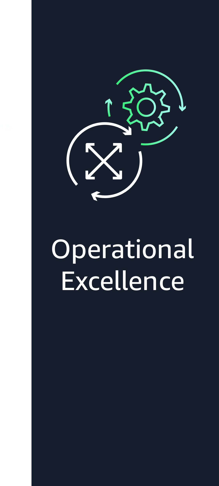


> **Нотатки:**
>
> |Slide number 48  
> |Instructor notes  
> |The remaining slides in this section present examples that highlight how the material in this module aligns to the Well-Architected Framework best practices. Optionally, you might ask students to visit the Well-Architected Framework website and find the best practices that they think connect to the material that is presented in this module, using this section as a starting point.  
> |For more information, see the AWS Well-Architected Framework on the content resources page of your online course.  
> |  
> |Student notes  
> The AWS Well-Architected Framework has six pillars, and each pillar includes best practices and a set of questions that you should consider when you architect cloud solutions. This section highlights a few best practices from the pillars that are most relevant to this module.  
>
> Find the complete set of best practices by pillar on the Well-Architected Framework website. A link is provided in the content resources section of your online course.

---

## Слайд 49: Best practice approach: Prepare – design for operations


**Best practices**

Perform operations as code.

Make frequent, small,  
reversible changes.

Fully automate integration  
and deployment.

> **Нотатки:**
>
> |Slide number 49  
> |Instructor notes  
> |  
> |Student notes  
> Automating operations is an important best practice under operational excellence pillar. As you learned in this module, automating with infrastructure as code improves the flow of development and maintains consistency with changes going into production. In AWS, you can view your entire workload (applications, infrastructure, policy, governance, and operations) as code. Your workload can be defined and updated by using code. This means you can apply the same engineering discipline that you use for application code to every element of your stack.  
>
> Perform operations as code: One of the operational excellence best practices is to perform operations as code. In the cloud, you can apply the same engineering discipline that you use for application code to your entire environment. You can define your entire workload as code and update it with code. You can script your operations procedures and automate when they run by invoking them in response to events. By performing operations as code, you limit human error and enable consistent responses to events.  
>
> Make frequent, small, reversible changes: Another operational excellence design principle is to make frequent, small, reversible changes. You should design workloads to enable regular updates to components so that you can increase the flow of beneficial changes into your workload. Making changes in small increments that can be reversed will help you if the change isn’t beneficial or introduces other errors. This results in more effective troubleshooting and faster remediation with the option to roll back changes.  
>
> Fully automate integration and deployment: Developers can use automation tools to deliver code and move code to production. With automation for integration and deployment, there is a full audit trail of changes and configurations that should meet the needs of governance and compliance. Processes that are repeatable can be standardized across teams leaving developers free to focus on development, increasing productivity.  
>
> For more information, see the Operational Excellence Pillar whitepaper in the course resources page for more information.

---

## Слайд 50: Best practice approach: Security


**Best practices**

Automate security best practices.

> **Нотатки:**
>
> |Slide number 50  
> |Instructor notes  
> |  
> |Student notes  
> The security pillar describes how to take advantage of cloud technologies to protect data, systems, and assets in a way that can improve your security posture.  
>
> Automate security best practices: You can automate security at many different levels. Automated software-based security mechanisms improve your ability to securely scale more rapidly and cost-effectively. This helps you create secure architectures, including the implementation of controls that are defined and managed as code in version-controlled templates. Automate identification and classification to implement correct controls. Using automation for this instead of direct access from a person reduces the risk of human error and exposure.  
>
> In this module, you learned about CloudFormation, which is a key service in automating. When deploying CloudFormation templates, ensure that security has been considered at every step so that automation best practices can help keep your workload secure.  
>
> For more information, see the Security Pillar whitepaper in the course resources page for more information.

---

## Слайд 51: Best practices approach: Change management – implement change


**Best practices**

Deploy changes  
with automation.

Use automation when obtaining or scaling resources.

> **Нотатки:**
>
> |Slide number 51  
> |Instructor notes  
> |  
> |Student notes  
> The reliability pillar encompasses the ability of a workload to perform its intended function correctly and consistently when it’s expected to. This includes the ability to operate and test the workload through its total lifecycle. Making changes to production systems is one of the largest risk areas for many organizations. You need to be able to make controlled changes to a system to deploy new functionality and to ensure that workloads and operating environment are running properly patched software. If these changes are uncontrolled, then it is difficult to predict the effect of these changes or to address issues that arise because of them. You learned in this module that using infrastructure as code gives you the ability to deploy changes with automation and reduce the chance of human error.  
>
> Deploy changes with automation: In this module, you have learned that manual approaches create risks for an organization. To avoid manual approaches, changes to your infrastructure should be done via automation where possible. It is a best practice to use automation wherever it’s practical, such as for testing and deploying changes, adding or removing capacity, and migrating data.  
>
> Use automation when obtaining or scaling resources: When replacing impaired resources or scaling your workload, automate the process by using managed AWS services, such as Amazon S3 and AWS Auto Scaling. You can also use third-party tools and AWS SDKs to automate scaling. Managed AWS services include Amazon S3, CloudFront, AWS Auto Scaling, Lambda, Amazon DynamoDB, AWS Fargate, and Route 53.  
>
> In this module, you learned about CloudFormation and the ability to implement changes to the CloudFormation template that can be rolled out consistently to the stacks. This is a way to manage change by using automation.  
>
> For more information, see the Reliability Pillar whitepaper in the course resources page for more information.

---

## Слайд 52: Best practices approach: Optimize over time – automating operations


**Best practices**

Perform automation for operations.

> **Нотатки:**
>
> |Slide number 52  
> |Instructor notes  
> |  
> |Student notes  
> Cost optimization is a continual process of refinement and improvement over the span of a workload’s lifecycle. You should build and operate cost-aware workloads that achieve business outcomes while minimizing costs. As you learned in this module, automating operations reduces the time and effort for admin tasks, deployment, and other operations. When considering automation, evaluate the required time and cost for the effort of operations and reduce the human effort where possible. Having fewer manual tasks improves efficiency and benefits enterprises by delivering a consistent and reliable experience when deploying, administering, or operating workloads.  
>
> Perform automation for operations: Automating operations is an important best practice under the cost optimization pillar for minimizing costs and helping your organization maximize its return on investment. Start by prioritizing your operations based on required effort by looking at overall operations cost in the cloud. By using AWS services, tools, or third-party products, you can choose which AWS automations to implement and customize for your specific requirements. You can free up infrastructure resources from manual operational tasks and use them for higher value tasks and innovations, thereby improving business outcomes.  
>
> Look at the total cost of human actions by factoring in the cost of operations and management. Prioritize automations for administrative tasks to reduce the human effort. Prioritize automating repetitive, high-value activities. Activities that pose a higher risk of human error are typically the better place to start automating because the risk often poses an unwanted additional operational cost.  
>
> For more information, see the Cost Optimization Pillar whitepaper in the course resources page for more information.

---

## Слайд 53: Key takeaways: Applying Well-Architected Framework principles

- Best practices related to automating your architecture include the following:
  - Perform operations as code.
  - Make frequent, small, reversible changes.
  - Fully automate integration and deployment.
  - Automate security best practices.
  - Deploy changes with automation.
  - Use automation when obtaining or scaling resources.
  - Perform automation for operations.

> **Нотатки:**
>
> |Slide number 53  
> |Instructor notes  
> |There are no student notes on this slide.  
> |  
> |Student notes

---

## Слайд 54: Café lab: Automating Infrastructure Deployment (Café deployment lab)

> **Нотатки:**
>
> |Slide number 54  
> |Instructor notes  
> |  
> |Student notes  
> You will now complete a lab. The next slides summarize what you will do in the lab, and the lab environment provides detailed instructions.

---

## Слайд 55: The evolving café architecture: version 7

| Architecture Version | Business reason for update | Technical requirements/ architecture update |
|---|---|---|
| V1 | Create a static website for a small business. | Host the website on Amazon S3. |
| V2 | Add online ordering. | Deploy the web application and database on Amazon EC2. |
| V3 | Reduce the effort to maintain the database and secure its data. | Separate the web and database layers. Migrate the database to Amazon RDS on a private subnet. |
| V4 | Enhance the security of the web application. | Use Amazon VPC features to configure and secure public and private subnets. |
| V5 | Create separate access mechanisms based on role. | Add IAM groups and attach resource polices to application resources. Add IAM users to groups based on role. |
| V6 | Ensure that the website can handle an expected increase in traffic. | Add a load balancer, implement auto scaling on the EC2 instances, and distribute compute and database instances across two Availability Zones. |
| V7 | Deploy the website in a repeatable way. |  |
| V8 | Module 14 info |  |

> **Нотатки:**
>
> |Instructor notes  
> |In this café lab, students will start from… and update to….  
> |Share or show the architectures.svg file, and highlight the sections of the architecture that will be modified or added with this lab.  
> |  
> |Student notes  
> The café’s business has been steadily increasing. Sofía and Nikhil have become friends with a few of the café regulars, who are AWS consultants, and they have started to discuss the café’s current architecture. Olivia, one of the regulars and an AWS solutions architect, identified a need for the café’s online business to scale. Scaling will require additional servers to run the online ordering application, but the current subnet size is too small and can’t support this growth. Therefore, they will need to rearchitect some aspects of the network that the application runs in.  
>
> On further review of the café’s architecture, Olivia also noticed a vulnerability: the TCP port that’s used to administer the application server is accessible to the internet. Sofía explained that she and Nikhil must be able to manage and maintain the server. Olivia advises them to set up a bastion host to reduce public access to the server and to make it more secure.  
>
> In this lab, you will update the café architecture to enhance the security of the web application by using Amazon Virtual Private Cloud (Amazon VPC) features to configure private and public subnets. This café lab creates version 4 of the café architecture.

---

## Слайд 56: Café deployment lab tasks

- In this lab, you will do the following:
  - Deploy a virtual private cloud (VPC) networking layer by using an AWS CloudFormation template
  - Deploy an application layer by using an AWS CloudFormation template
  - Use Git to invoke AWS CodePipeline, and to create or update stacks from templates that are stored in a code repository
  - Use AWS CloudFormation to conditionally build different infrastructures based on environmental variables

> **Нотатки:**
>
> |Slide number 56  
> |Instructor notes  
> |  
> |Student notes  
> Access the lab environment through your online course to get additional details and complete the lab.

---

## Слайд 57: Debrief: Café deployment lab

- Where did you store versions of the AWS CloudFormation templates in this lab?
- What did you have to do before you duplicated your application layer template to the Oregon Region?

> **Нотатки:**
>
> |Slide number 57  
> |Instructor notes  
> |An architectural diagram for this lab is included as part of the CafeLabDiagrams.svg file included in the educator files directory. Share this file with students so that they can zoom in and out of each phase of the architecture for a fuller picture as you debrief the lab.  
> |  
> |Suggested responses for question 1: Where did you store versions of the AWS CloudFormation templates in this lab?  
> |In this lab, you used AWS CodeCommit to clone a CodeCommit repository. Then you were able to store CloudFormation templates in the repository. CodeCommit is a good choice for storing templates and managing version control for them.  
> |  
> |Suggested responses for question 2: What did you have to do before you duplicated your application layer template to the Oregon Region?  
> |Before you duplicate your application layer template to the Oregon Region, you create an Amazon EC2 key pair. You name the key pair cafe-oregon.  
> |Then you revisit the application template details to verify that the template does not need to be updated for the new key pair.  
> |The KeyName property in the resource definition for the EC2 instance references the RegionMap mapping that is defined in the template.  
> |The mapping indicates that if the instance is launched in the us-east-1 (N. Virginia) Region, it should use the vockey key pair. However, if the instance is launched in the us-west-2 (Oregon) Region, it should use the cafe-oregon key pair that you just created.  
> |When you duplicate an architecture from one Region to another, it is important to know which resources might be Region-specific. Then you need to make sure that provisions have been made in the new Region and in the CloudFormation template.  
> |  
> |Student notes  
> Your instructor might review these questions with you, or you might review them on your own. Use this opportunity to extend your thinking about the tasks that you performed during the lab.

---

## Слайд 58: Module wrap-up

Automating Your Architecture

> **Нотатки:**
>
> |Slide number 58  
> |Instructor notes  
> |  
> |Student notes  
> This section summarizes what you have learned and brings the module to a close.

---

## Слайд 59: Module summary

This module prepared you to do the following:

- Recognize when to use architecture automation and why.
- Identify how infrastructure as code (IaC) as a strategy for provisioning and managing cloud resources.
- Identify how to model, create, and manage a collection of AWS resources by using AWS CloudFormation.
- Identify how to use AWS Quick Start CloudFormation templates to set up an architecture.
- Identify uses of Amazon Q Developer.
- Use the AWS Well-Architected Framework principles when designing automation.

> **Нотатки:**
>
> |Slide number 59  
> |Instructor notes  
> |There are no student notes for this slide.  
> |  
> |Student notes

---

## Слайд 60: Considerations for the cafe

- Discuss how the café lab in this module answered the key questions and decisions presented at the start of this module for the café business.


> **Нотатки:**
>
> |Instructor notes:  
> |Optional: Ask the students to address how Sofia might apply the knowledge learned in this module to her business. Emphasize how architectural decisions are specific to the use case and business need, that there is no single answer, and that the architecture should evolve over time.  
> |  
> |Student notes  
> Use the café business as an example to apply what you’ve learned in this module to building a cloud architecture.  
>

---

## Слайд 61: Module knowledge check

- The knowledge check is delivered online within your course.
- The knowledge check includes 10 questions based on material presented on the slides and in the slide notes.
- You can retake the knowledge check as many times as you like.

> **Нотатки:**
>
> |Slide number 61  
> |Instructor notes  
> |  
> |Student notes  
> Use your online course to access the knowledge check for this module.

---

## Слайд 62: Sample exam question

Consider a situation where you want to create a single AWS CloudFormation template that is capable of creating both a production environment that spans two Availability Zones and a development environment that exists in a single Availability Zone. Which optional section of the CloudFormation template will you want to make use of to configure the logic that will support this?

Identify the key words and phrases before continuing.

The following are the key words and phrases:

- A single AWS CloudFormation template
- An environment with two Availability Zones and an environment with a single Availability Zone
- Optional section

> **Нотатки:**
>
> |Slide number 62  
> |Instructor notes  
> |The key words section is animated to be revealed on click.  
> |  
> |Student notes  
> The main driver for the solution is that you want a single template that can be used to deploy both a single and a two Availability Zone environment.

---

## Слайд 63: Sample exam question: Response choices

Consider a situation where you want to create a single AWS CloudFormation template that is capable of creating both a production environment that spans two Availability Zones, and a development environment that exists in a single Availability Zone. Which optional section of the CloudFormation template will you want to make use of to configure the logic that will support this?

**Choice**

**Response**

**A**

Conditions

**B**

Outputs

**C**

Resources

**D**

Description

> **Нотатки:**
>
> |Slide number 63  
> |Instructor notes  
> |  
> |Student notes  
> Use the key words that you identified on the previous slide, and review each of the possible responses to determine which one best addresses the question.

---

## Слайд 64: Sample exam question: Answer

The answer is A.

**Choice**

**Response**

**A**

Conditions

> **Нотатки:**
>
> |Slide number 64  
> |Instructor notes  
> |  
> |Student notes  
> Choice B (Outputs) is not a section that can affect how many AWS resources will be deployed by the template when the stack is run.  
>
> Choice C (Resources) is not an optional section of a CloudFormation template.  
>   
> Choice D (Description) is not a section that will affect the configuration.  
>   
> Choice A (Conditions) meets the requirement. The Conditions section is the optional section of a CloudFormation template that defines the circumstances under which entities are created or configured.

---

## Слайд 65: Thank you

Corrections, feedback, or other questions?

Contact us at [https://support.aws.amazon.com/#/contacts/aws-academy](https://support.aws.amazon.com/#/contacts/aws-academy).

> **Нотатки:**
>
> |Slide number 65  
> |Instructor notes  
> |  
> |Student notes  
> That concludes this module. The Content Resources page of your course includes links to additional resources that are related to this module.
