## Слайд 1: Автоматизація вашої архітектури (Automating Your Architecture)

AWS Academy Cloud Architecting

> **Нотатки:**
>
> |Нотатки для інструктора  
> |  
> |Нотатки для студента  
> Вітаємо в модулі «Автоматизація вашої архітектури». Цей модуль знайомить вас з основами автоматизації та інфраструктури як коду (infrastructure as code, IaC). Модуль також знайомить з AWS CloudFormation — сервісом, що допомагає моделювати та налаштовувати ресурси AWS за допомогою шаблона, який описує потрібні вам ресурси. Потім шаблон подбає про розгортання та налаштування цих ресурсів за вас. Ви також дізнаєтеся про деякі додаткові інструменти, що допомагають швидше впроваджувати CloudFormation.

---

## Слайд 2: Вступ

Автоматизація вашої архітектури

> **Нотатки:**
>
> |Номер слайда 2  
> |Нотатки для інструктора  
> |  
> |Нотатки для студента  
> Цей вступний розділ описує вміст модуля.

---

## Слайд 3: Цілі модуля

Цей модуль готує вас до такого:

- Розпізнавати, коли використовувати автоматизацію архітектури та навіщо.
- Визначати, як використовувати інфраструктуру як код (IaC) як стратегію розгортання хмарних ресурсів і керування ними.
- Визначати, як моделювати, створювати колекцію ресурсів AWS та керувати нею за допомогою AWS CloudFormation.
- Визначати, як використовувати шаблони AWS Quick Start CloudFormation для налаштування архітектури.
- Визначати сценарії використання Amazon Q Developer.
- Використовувати принципи AWS Well-Architected Framework під час проєктування стратегій автоматизації.

> **Нотатки:**
>
> |Номер слайда 3  
> |Нотатки для інструктора  
> |Цей модуль зосереджений на автоматизації, інфраструктурі як коді (IaC) та CloudFormation.  
> |  
> |Нотатки для студента

---

## Слайд 4: Огляд модуля

**Розділи презентації**

- Причини автоматизувати
- Використання інфраструктури як коду
- Налаштування за допомогою CloudFormation
- Використання AWS Quick Starts
- Налаштування за допомогою AmazonQ Developer
- Застосування принципів AWS Well-Architected Framework

**Демонстрації**

- Аналіз шаблона AWS CloudFormation (Analyzing an AWS CloudFormation Template)
- Ресурси AWS CloudFormation (AWS CloudFormation Resources)
- Перегляд шаблона AWS CloudFormation (Reviewing an AWS CloudFormation Template)
- Використання консолі AWS CloudFormation (Using the AWS CloudFormation Console)

**Перевірки знань**

- 10-запитальна перевірка знань
- Зразок запитання іспиту

> **Нотатки:**
>
> |Номер слайда 4  
> |Нотатки для інструктора  
> |Кожен модуль має вступ, розділи з вмістом і підсумок. Підсумок цього модуля містить зразок запитання іспиту для розбору зі студентами. Цей модуль включає чотири демонстрації та дві лабораторні роботи.  
> |  
> |Нотатки для студента  
> Цілі цього модуля розкриваються в кількох розділах.  
>
> Ви також переглянете серію демонстрацій, що показують, як працювати з CloudFormation. Ці демонстрації включають огляд ресурсів CloudFormation, аналіз шаблона CloudFormation, перегляд шаблона з налаштуванням і огляд використання консолі CloudFormation.  
>
> Модуль завершується 10-запитальною перевіркою знань, що проводиться в онлайн-курсі, та зразком запитання іспиту.

---

## Слайд 5: Практичні лабораторні роботи в цьому модулі

Покрокова лабораторна робота (Guided lab)

Лабораторна робота-виклик (кафе) (Challenge (Café) lab)

- Автоматизація розгортання інфраструктури за допомогою AWS CloudFormation (Automating Infrastructure Deployment with AWS CloudFormation)

- Автоматизація розгортання інфраструктури (Automating Infrastructure Deployment)

> **Нотатки:**
>
> |Номер слайда 5  
> |Нотатки для інструктора  
> |Цей модуль містить як самодостатню покрокову лабораторну роботу, так і лабораторну роботу кафе, що доповнює архітектуру кафе, що еволюціонує. Лабораторна робота кафе — це лабораторна робота-виклик, де від студентів очікується виконання завдань без надання кожного кроку. Вступи до кожної лабораторної роботи включено до розділів лабораторних робіт у межах модуля.  
> |  
> |Нотатки для студента  
> Цей модуль містить зазначені практичні лабораторні роботи. Покрокова лабораторна робота надає вам інструкції крок за кроком. У лабораторній роботі кафе (виклик) ви працюєте над оновленням архітектури кафе. Додаткова інформація про кожну лабораторну роботу міститься в посібнику студента там, де вона виконується, а лабораторне середовище надає докладні інструкції.

---

## Слайд 6: Як хмарний архітектор, що проєктує:

- Мені потрібно використовувати автоматизацію, щоб зменшити ризики ручних процесів під час побудови архітектур і максимізувати користь від відтворюваних середовищ.
- Мені потрібно розгортати свої архітектури за допомогою інфраструктури як коду, щоб я міг швидко й послідовно розгортати середовища та зміни.
- Мені потрібно враховувати, як мої рішення щодо проєкту автоматизації впливають на продуктивність і вартість, щоб я міг оптимізувати цінність архітектури для бізнесу.


> **Нотатки:**
>
> |Номер слайда 6  
> |Нотатки для інструктора: цей слайд подає ключові наскрізні міркування проєктування, що мають спрямовувати ухвалення рішень під час проєктування автоматизації. Підкресліть, що хмарний архітектор має враховувати бізнес-кейс і розгортати інфраструктуру як код, щоб зменшити ризики ручних процесів. Також нагадайте студентам, що рішення, імовірно, еволюціонуватимуть з часом, у міру зміни чи кращого розуміння потреб, для оптимізації вартості та продуктивності. Наприкінці модуля в підсумковому розділі включено необов’язкове обговорення, що спонукає студентів розглянути ці чинники в контексті сценарію з кафе.  
> |  
> |Нотатки для студента  
> Цей слайд просить вас прийняти перспективу хмарного архітектора, коли ви думаєте про те, як підходити до проєктування автоматизації. Тримайте ці міркування в голові, просуваючись цим модулем, пам’ятаючи, що хмарний архітектор має працювати у зворотному напрямку від бізнес-потреби, щоб спроєктувати найкращу архітектуру для конкретного сценарію використання. Просуваючись модулем, розглядайте сценарій з кафе, поданий у курсі, як приклад бізнес-потреби й думайте про те, як би ви відповіли на ці потреби для вигаданого бізнесу кафе.

---

## Слайд 7: Причини автоматизувати

Автоматизація вашої архітектури

> **Нотатки:**
>
> |Номер слайда 7  
> |Нотатки для інструктора  
> |  
> |Нотатки для студента  
> Цей розділ описує причини автоматизувати під час проєктування архітектури для хмари.

---

## Слайд 8: Процес без автоматизації

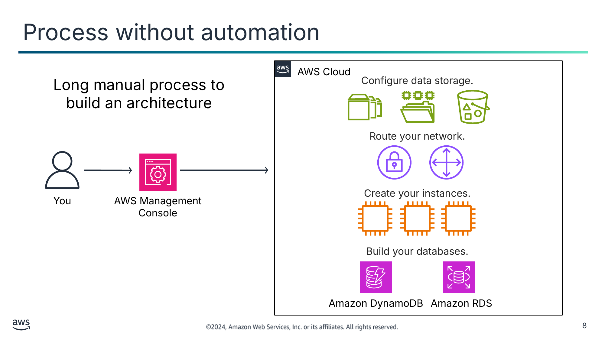

Довгий ручний процес побудови архітектури

<details>
<summary>Текст зі схеми</summary>

AWS Cloud

Configure data storage. (Налаштуйте сховище даних.)

Route your network. (Маршрутизуйте вашу мережу.)

You (Ви)

AWS Management Console

Create your instances. (Створіть ваші екземпляри.)

Build your databases. (Побудуйте ваші бази даних.)

Amazon DynamoDB

Amazon RDS

</details>

> **Нотатки:**
>
> |Номер слайда 8  
> |Нотатки для інструктора  
> |Студенти, нові в хмарній архітектурі, можуть не враховувати недоліків ручного розгортання ресурсів. Цей слайд показує один можливий спосіб побудувати ресурси за допомогою консолі, але кожен крок процесу ручний. Це означає, що побудова архітектури може тривати дуже довго й створювати ризики для середовища. Вкажіть на можливі проблеми, зокрема внесення оновлень, налагодження та керування залежностями. Також обговоріть, наскільки реалістично виконувати всі ці процеси вручну. На наступному слайді студенти дізнаються про ризики ручних процесів.  
> |  
> |Нотатки для студента  
> Багато організацій починають використовувати AWS, вручну створюючи бакет Amazon Simple Storage Service (Amazon S3) або запускаючи екземпляр Amazon Elastic Compute Cloud (Amazon EC2) і запускаючи на ньому вебсервер. Потім, з часом, вони вручну додають більше ресурсів, коли виявляють, що розширення використання AWS може задовольнити додаткові бізнес-потреби. Однак незабаром може стати складно вручну керувати цими ресурсами й підтримувати їх.  
>
> Ручні процеси схильні до помилок, ненадійні та недостатні для підтримки гнучкого бізнесу. Часто організація може зв’язувати висококваліфіковані ресурси ручним налаштуванням, коли цей час можна було б краще витратити на підтримку інших, критичніших і вартісніших видів діяльності в бізнесі.  
>
> Розглядаючи побудову архітектури вручну чи з автоматизацією, ось деякі запитання, які варто поставити:  
> Куди ви хочете спрямувати свої зусилля — у проєктування чи реалізацію? Які ризики ручних реалізацій?  
> Як ви ідеально оновлювали б продуктивні сервери? Як ви розгортатимете розгортання в кількох географічних регіонах? Коли речі ламаються (а вони ламатимуться), як ви керуватимете відкатом до останньої відомої робочої версії?  
> Як ви налагоджуватимете розгортання? Чи можете ви виправити помилки у вашому застосунку до того, як розгорнете його для клієнта? Як ви дізнаєтеся, що не так, а потім виправите це так, щоб воно залишалося виправленим?  
> Як ви керуватимете залежностями від різних систем і підсистем у вашій організації?  
> Чи реалістично, що ви зможете виконати всі ці завдання за допомогою ручних конфігурацій?

---

## Слайд 9: Ризики ручних процесів

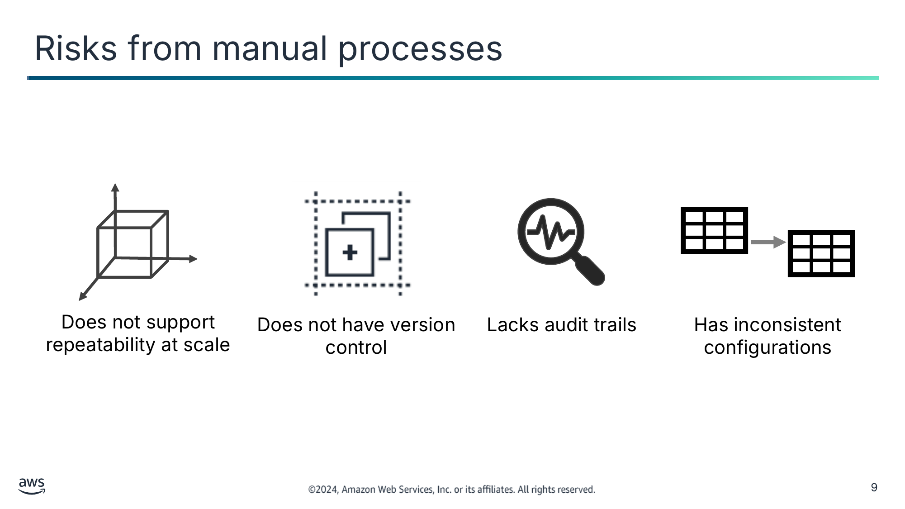

Не підтримує повторюваність у масштабі

Не має контролю версій

Не має слідів аудиту

Має неузгоджені конфігурації

> **Нотатки:**
>
> |Номер слайда 9  
> |Нотатки для інструктора  
> |Розгляньте початок із запитання, як-от «Які ризики ручних процесів?» Студенти мають зрозуміти, що ручні процеси часто є вибором програміста на початку. Ручні процеси створюють ризики як для середовища, так і для застосунків, що розробляються. Використайте це як обговорення антишаблона перед переходом до рішення — автоматизації.  
> |  
> |Нотатки для студента  
> Ручні процеси створюють ризики для ваших застосунків і середовища.  
>
> Ручне створення ресурсів і додавання нових функцій та функціональності до вашого середовища не масштабується. Якщо ви відповідаєте за великий корпоративний застосунок, може не вистачати людей, щоб вручну додавати функції за потреби. Визначте, як ви реплікуватимете розгортання в кількох регіонах.  
>
> Створення архітектури й застосунків з нуля не має вбудованого контролю версій. У надзвичайній ситуації корисно мати змогу відкотити продуктивний стек до попередньої версії, але це неможливо, коли ви створюєте своє середовище вручну. Стек (stack) — це колекція ресурсів AWS, якою можна керувати як єдиним цілим. Визначте, як ви відкочуватимете продуктивне середовище до попередньої версії.  
>
> Наявність сліду аудиту важлива для багатьох ситуацій відповідності та безпеки. Небезпечно давати будь-кому у вашій організації змогу вручну контролювати й редагувати ваші середовища. Визначте, як ви забезпечуватимете відповідність. Як ви відстежуватимете зміни деталей конфігурації на рівні ресурсу?  
>
> Нарешті, узгодженість критично важлива, коли ви хочете мінімізувати ризики. Автоматизація допомагає підтримувати узгодженість. Визначте, як ви забезпечуватимете однакові конфігурації на кількох екземплярах EC2.

---

## Слайд 10: Переваги автоматизації

Зменшує ручне втручання чи доступ

Дає змогу мати відтворювані середовища

Підвищує продуктивність

Автоматизує тестування  
і масштабування

> **Нотатки:**
>
> |Номер слайда 10  
> |Нотатки для інструктора  
> |Це слід протиставити антишаблону ручних процесів із попереднього слайда. Цей слайд обговорює переваги автоматизації й має слугувати основою для обговорень у наступних розділах. Наступний розділ — «Використання інфраструктури як коду», що включає обговорення того, як упровадити ці переваги автоматизації.  
> |  
> |Нотатки для студента  
> Щоб мінімізувати ризики ручних процесів, сучасні операційні середовища зазвичай спираються на повну автоматизацію. Автоматизація усуває ручне втручання чи доступ до продуктивних середовищ і зосереджується на налаштуванні, конфігурації, розгортанні та підтримці інфраструктури й застосунків, що на ній працюють. За допомогою автоматизації ви можете швидше налаштовувати відтворювані середовища в стандартизованій і повторюваній конфігурації.  
>
> Ви можете підвищити продуктивність, використовуючи автоматизацію для тестування програмного забезпечення, випуску програмного забезпечення, конфігурації машин, встановлення виправлень в операційні системи, усунення несправностей чи виправлення помилок. Можна використовувати разом багато рівнів практик автоматизації. Можна використовувати автоматичне масштабування для реагування на попит клієнтів і створення еластичніших середовищ.  
>
> Докладніше про переваги автоматизації див. «The Case for Investing in Cloud Automation» і «Automation and Tooling» на сторінці ресурсів вмісту вашого онлайн-курсу.

---

## Слайд 11: Ключові висновки: причини автоматизувати

- Ручні процеси схильні до помилок, ненадійні та недостатні для підтримки гнучкого бізнесу.
- Ручні процеси створюють ризики для застосунків і середовищ.
- Автоматизація допомагає усунути ручні процеси та швидко будувати.

> **Нотатки:**
>
> |Номер слайда 11  
> |Нотатки для інструктора  
> |Для цього слайда немає нотаток для студента.  
> |  
> |Нотатки для студента

---

## Слайд 12: Використання інфраструктури як коду (infrastructure as code)

Автоматизація вашої архітектури

> **Нотатки:**
>
> |Номер слайда 12  
> |Нотатки для інструктора  
> |Цей розділ знайомить з інфраструктурою як кодом (IaC). Цей розділ призначений для зв’язку ідей автоматизації з інструментом автоматизації AWS — CloudFormation. Цей розділ обговорює переваги та підходи до IaC і знайомить із кількома рішеннями IaC від AWS.  
> |  
> |Нотатки для студента  
> Цей розділ знайомить з інфраструктурою як кодом (IaC). Інфраструктуру традиційно розгортали за допомогою комбінації скриптів і ручних процесів. Це призводить до того, що створення нових середовищ не завжди повторюване, надійне чи узгоджене. Рішення IaC дають змогу створювати, розгортати та обслуговувати інфраструктуру програмним і описовим способом. Цей розділ обговорює переваги та підходи до IaC і знайомить із кількома рішеннями IaC від AWS.

---

## Слайд 13: Огляд IaC

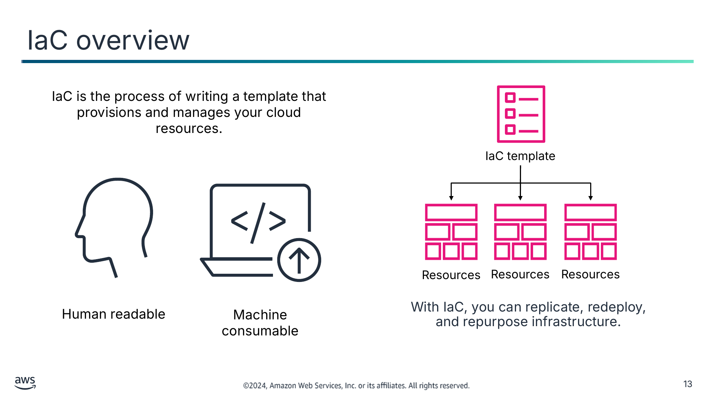

IaC — це процес написання шаблона, що розгортає ваші хмарні ресурси та керує ними.

Зрозумілий людині

Придатний для обробки машиною

З IaC ви можете реплікувати, повторно розгортати та перепрофілювати інфраструктуру.

<details>
<summary>Текст зі схеми</summary>

IaC template (Шаблон IaC)

Resources (Ресурси)

Resources

Resources

</details>

> **Нотатки:**
>
> |Номер слайда 13  
> |Нотатки для інструктора  
> |Нагадайте студентам, що інфраструктура та код — це спосіб упровадити переваги автоматизації. Якщо студентам потрібно більше інформації про IaC, можна переглянути матеріал «What is Infrastructure as Code?» Посилання є в ресурсах курсу.  
> |  
> |Нотатки для студента  
> Інфраструктура як код (infrastructure as code, IaC) — це галузевий термін, що позначає процес розгортання хмарних ресурсів і керування ними шляхом їх визначення у файлі шаблона, зрозумілому людині та придатному для обробки машиною. Будь-яке середовище застосунку потребує багатьох компонентів інфраструктури, як-от операційні системи, підключення до баз даних і сховище. Розробники мають регулярно налаштовувати, оновлювати й підтримувати інфраструктуру для розробки, тестування та розгортання застосунків.  
>
> Ручне керування інфраструктурою трудомістке й схильне до помилок — особливо коли ви керуєте застосунками в масштабі. З інфраструктурою як кодом ви визначаєте бажаний стан вашої інфраструктури, не включаючи всіх кроків для досягнення цього стану. Організації використовують інфраструктуру як код для контролю витрат, зменшення ризиків і швидкого реагування на нові бізнес-можливості.  
>
> IaC і далі набуває популярності, оскільки забезпечує працездатне рішення таких викликів, як-от як реплікувати, повторно розгортати та перепрофілювати інфраструктуру надійно й узгоджено.

---

## Слайд 14: Переваги IaC

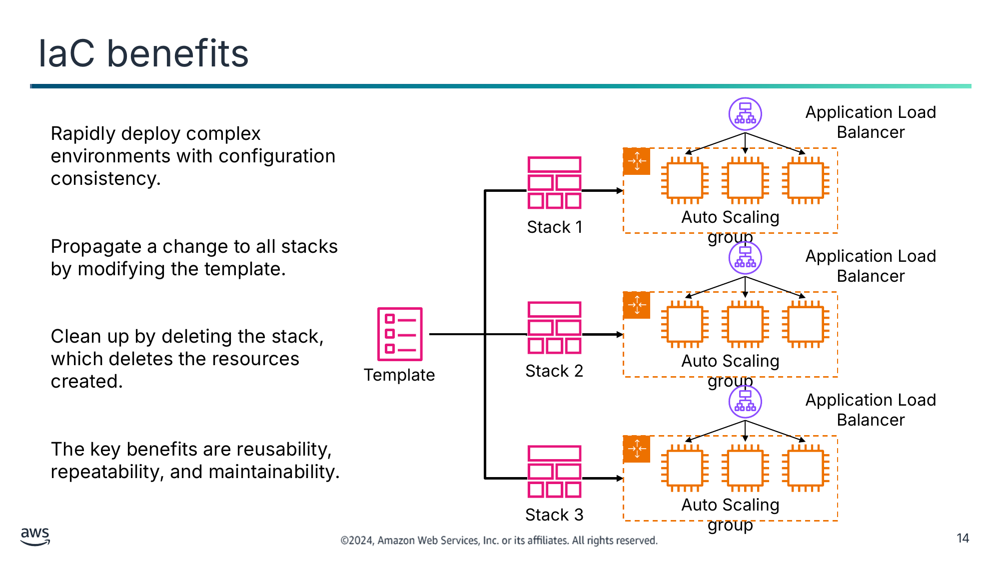

Швидко розгортайте складні середовища з узгодженістю конфігурації.

Поширюйте зміну на всі стеки, змінюючи шаблон.

Очищуйте, видаляючи стек, що видаляє створені ресурси.

Ключові переваги — повторне використання, повторюваність і зручність обслуговування.

<details>
<summary>Текст зі схеми</summary>

Application Load Balancer

Auto Scaling group (Група Auto Scaling)

Stack 1 (Стек 1)

Application Load Balancer

Auto Scaling group

Template (Шаблон)

Stack 2

Application Load Balancer

Auto Scaling group

Stack 3

</details>

> **Нотатки:**
>
> |Номер слайда 14  
> |Нотатки для інструктора  
> |Цей слайд показує приклад ключових переваг IaC. Виділіть переваги повторного використання, повторюваності та зручності обслуговування, проходячи схемою.  
> |Розгляньте концепції середовища розробки, середовища тестування та продуктивного середовища.  
> |  
> |Нотатки для студента  
> Тепер розгляньмо деякі переваги IaC докладніше. Якщо ви будуєте інфраструктуру за допомогою коду, ви отримуєте такі переваги, як здатність швидко розгортати складні середовища. З одним шаблоном (або комбінацією шаблонів) можна неодноразово будувати ті самі складні середовища. Наприклад, стек може включати всі ресурси, потрібні для запуску вебзастосунку, як-от вебсервер, база даних і правила мережі. Якщо вебзастосунок більше не потрібен, можна видалити стек, і всі пов’язані з ним ресурси видаляються.  
>
> У цьому прикладі можна використовувати єдиний шаблон для створення трьох різних стеків. Стек 1 — це ваше середовище розробки, стек 2 — середовище тестування, а стек 3 — продуктивне середовище. Середовище розробки зазвичай гнучкіше й динамічніше, щоб можна було створювати прототипи, писати, тестувати й налагоджувати код вашого застосунку. Середовище тестування імітує продуктивне середовище, щоб нові застосунки можна було перевіряти на функціональність, продуктивність і надійність. Продуктивне середовище — це місце, де ваш застосунок стає доступним кінцевим користувачам.  
>
> Коли ви використовуєте один шаблон для створення цих трьох стеків, ви можете мати більше впевненості, що якщо ваші тестові завдання добре працювали в середовищі тестування, вони так само добре працюватимуть і в продуктивному середовищі. Шаблон мінімізує ризик того, що середовище тестування налаштоване інакше, ніж продуктивне середовище.  
>
> Якщо потрібно внести оновлення конфігурації в середовищі тестування, можна передати оновлення до шаблона, щоб оновити всі стеки. Цей процес допомагає гарантувати, що зміни в одному середовищі надійно поширяться на всі середовища, що мають отримати оновлення.  
>
> Ще одна перевага — можна очистити всі ресурси, створені у вашому акаунті для підтримки середовища тестування, коли вони більше не потрібні. Це допомагає зменшити витрати, пов’язані з ресурсами, що більше не потрібні, і допомагає підтримувати порядок у вашому акаунті.

---

## Слайд 15: CloudFormation

- Забезпечує спрощений спосіб моделювати, створювати колекцію ресурсів AWS і керувати нею
  - Колекція ресурсів називається стеком CloudFormation (CloudFormation stack).
  - Додаткової плати немає (ви платите лише за ресурси, які створюєте).
- Може створювати, оновлювати й видаляти стеки
- Забезпечує впорядковане та передбачуване розгортання й оновлення ресурсів
- Забезпечує контроль версій розгортань ресурсів AWS

CloudFormation

> **Нотатки:**
>
> |Номер слайда 15  
> |Нотатки для інструктора  
> |Решта цього модуля зосереджена на тому, як використовувати CloudFormation для побудови інфраструктури як коду. Це має бути ґрунтовний вступ до основ сервісу. Докладніше див. сторінку сервісу CloudFormation. Посилання надано в ресурсах курсу.  
> |  
> |Нотатки для студента  
> CloudFormation розгортає ресурси за допомогою інфраструктури як коду. Ви можете використовувати CloudFormation для побудови й перебудови вашої інфраструктури та застосунків повторюваним способом без потреби виконувати ручні дії чи писати користувацькі скрипти. З CloudFormation ви створюєте документ, що описує, якою має бути ваша інфраструктура, зокрема всі ресурси AWS, що мають бути частиною розгортання. Цей документ можна розглядати як модель. Потім ви використовуєте модель для створення реальності, оскільки CloudFormation може фактично створювати ресурси у вашому акаунті.  
>
> Коли ви використовуєте CloudFormation для створення ресурсів, це називається стеком CloudFormation. Ви створюєте стек, оновлюєте стек чи видаляєте стек. Таким чином, можна розгортати ресурси впорядкованим і передбачуваним способом.  
>
> Використовуючи CloudFormation, ви можете ставитися до своєї інфраструктури як до коду. Створюйте її в будь-якому редакторі коду, додавайте до системи контролю версій, як-от GitHub, і переглядайте файли з членами команди перед розгортанням у відповідні середовища. Якщо документ CloudFormation, який ви створюєте для моделювання свого розгортання, додано до системи контролю версій, ви завжди можете видалити стек, отримати старішу версію документа й створити з неї стек. З контролем версій можна використовувати важливі можливості відкату.  
>
> Докладніше див. сторінку сервісу CloudFormation. Посилання надано в ресурсах курсу.

---

## Слайд 16: Сервіси IaC від AWS, що використовують CloudFormation

AWS Elastic Beanstalk

AWS Quick Starts

AWS Serverless Application Model (AWS SAM)

AWS Amplify

AWS Cloud Development Kit (AWS CDK)

Повністю кероване обслуговування, що автоматично запускає середовище AWS із завантаженим вами кодом застосунку

Автоматизовані еталонні архітектури на основі шаблонів CloudFormation

Розширення CloudFormation зі скороченим синтаксисом для побудови поширеної безсерверної інфраструктури

Фреймворк розробки для повнофункціональних веб- і мобільних застосунків, що потребує менше кодування та менше знань про інтеграції бекенду

Фреймворк розробки з відкритим кодом для моделювання та розгортання ресурсів через CloudFormation за допомогою знайомих мов програмування

AWS CloudFormation

> **Нотатки:**
>
> |Номер слайда 16  
> |Нотатки для інструктора  
> |CloudFormation — це основа багатьох різних сервісів інфраструктури як коду від AWS. Цей слайд знайомить із цими сервісами. Розгляньте основи кожного сервісу й обговоріть, як CloudFormation використовується за лаштунками для розгортання ресурсів.  
> |  
> |Нотатки для студента  
> AWS пропонує інші сервіси, що допомагають створювати, розгортати та обслуговувати інфраструктуру програмним способом. Кожен сервіс пропонує варіанти абстрагування частин кодування, потрібного для побудови вашої інфраструктури. Ваше рішення має залежати від відносного рівня зручності та контролю, які вам потрібні, і навичок ваших команд архітекторів і розробників.  Який би сервіс ви не обрали, за лаштунками AWS використовуватиме CloudFormation для розгортання ваших ресурсів.  
>
> AWS Elastic Beanstalk  
> Elastic Beanstalk можна використовувати для розгортання застосунків у хмарі AWS і керування ними без потреби вивчати інфраструктуру, що запускає ці застосунки. Ви завантажуєте свій застосунок, а Elastic Beanstalk автоматично обробляє подробиці виділення потужностей, балансування навантаження, масштабування та моніторингу стану застосунку. Elastic Beanstalk підтримує застосунки, розроблені багатьма поширеними мовами програмування, зокрема Go, Java, .NET, Node.js, PHP, Python і Ruby. Коли ви розгортаєте свій застосунок, Elastic Beanstalk будує вибрану підтримувану версію платформи та розгортає один чи кілька ресурсів AWS, як-от екземпляри EC2, для запуску вашого застосунку.  
>
> AWS Quick Starts  
> AWS Quick Starts — це автоматизовані еталонні архітектури, що спрощують розгортання ключових робочих навантажень у хмарі AWS. Використовуючи найкращі практики й автоматизуючи сотні ручних процедур, Quick Starts можуть допомогти розгорнути популярні технології в AWS за лічені хвилини. Вони використовують інфраструктуру як код для розгортання продуктивних середовищ в AWS, що можуть потребувати сотень окремих процедур для ручного розгортання. На додачу до ефективності, яку вони пропонують, Quick Starts мають часто непомічений, але критично важливий аспект: вони з відкритим кодом і модульні. Саме це робить їх настроюваними.  
>
> AWS Serverless Application Model (AWS SAM)  
> AWS SAM — це набір інструментів для побудови та запуску безсерверних застосунків в AWS. AWS SAM складається з двох частин: шаблонів AWS SAM та інтерфейсу командного рядка AWS SAM (AWS SAM CLI). Шаблони AWS SAM надають скорочений синтаксис, оптимізований для визначення інфраструктури як коду для безсерверних застосунків. Як розширення CloudFormation, ви розгортаєте шаблони AWS SAM безпосередньо в CloudFormation, користуючись його широкою підтримкою IaC в AWS. AWS SAM CLI — це інструмент розробника, який можна використовувати для швидкого створення, розробки та розгортання безсерверних застосунків.  
>
> AWS Amplify  
> Amplify — це сервіс, що допомагає будувати повнофункціональні веб- і мобільні застосунки за години. Amplify складається з набору інструментів і сервісів для прискорення розробки мобільних і вебзастосунків в AWS. Фреймворк Amplify з відкритим кодом включає набір бібліотек із сильними конвенціями та найкращими практиками, компоненти UI та CLI для побудови бекенду застосунку й інтеграції його з вашими застосунками iOS, Android, Web і React Native. Фреймворк використовує основний набір сервісів хмари AWS для надання можливостей, зокрема офлайн-даних, автентифікації, аналітики, push-сповіщень і ботів у великому масштабі. Amplify також пропонує повністю кероване обслуговування розміщення вебзастосунків і статичних вебсайтів для розміщення вашого фронтенд-вебзастосунку, створення й видалення бекенд-середовищ та налаштування безперервної інтеграції та безперервної доставки (CI/CD) на фронтенді й бекенді. За лаштунками розгортання Amplify будують стеки CloudFormation.  
>
> AWS Cloud Development Kit (AWS CDK)  
> AWS CDK — це фреймворк розробки програмного забезпечення з відкритим кодом для визначення хмарної інфраструктури як коду. AWS CDK використовує сучасні мови програмування й розгортає через CloudFormation. AWS CDK можна використовувати для побудови надійних, масштабованих, економічно ефективних застосунків у хмарі та для створення проєктів AWS CDK, які застосовуються для генерування шаблонів CloudFormation.  
>
> Проєкти AWS CDK можна запускати за допомогою інтерфейсу командного рядка AWS CDK (CLI) або в системі безперервної доставки. AWS CDK CLI можна використовувати, щоб перелічити стеки, визначені у вашому застосунку AWS CDK, і синтезувати стеки в шаблони CloudFormation. Потім ви розгортаєте стеки в будь-якому публічному регіоні AWS.

---

## Слайд 17: Ключові висновки: використання інфраструктури як коду

- IaC — це процес розгортання хмарних ресурсів і керування ними шляхом написання файлу шаблона.
- IaC швидко розгортає складні середовища, і ви можете неодноразово будувати чи оновлювати ті самі складні середовища.
- Обирайте рішення IaC на основі вашого сценарію використання, відносного балансу зручності та контролю й навичок вашої команди.
- CloudFormation — це сервіс IaC, що допомагає створювати, оновлювати й видаляти сервіси та архітектури.

> **Нотатки:**
>
> |Номер слайда 17  
> |Нотатки для інструктора  
> |Для цього слайда немає нотаток для студента.  
> |  
> |Нотатки для студента

---

## Слайд 18: Налаштування за допомогою CloudFormation

Автоматизація вашої архітектури

> **Нотатки:**
>
> |Номер слайда 18  
> |Нотатки для інструктора  
> |Цей розділ — огляд шаблона CloudFormation. Студентам потрібно зрозуміти, як шаблони розташовані й створюються, перш ніж вивчати способи їх побудови в наступних розділах.  
> |Переконайтеся, що студенти твердо розуміють, як функціонує CloudFormation, перш ніж рухатися далі.  
> |  
> |Нотатки для студента  
> Цей розділ надає огляд CloudFormation і налаштування шаблона CloudFormation.

---

## Слайд 19: Як працює CloudFormation

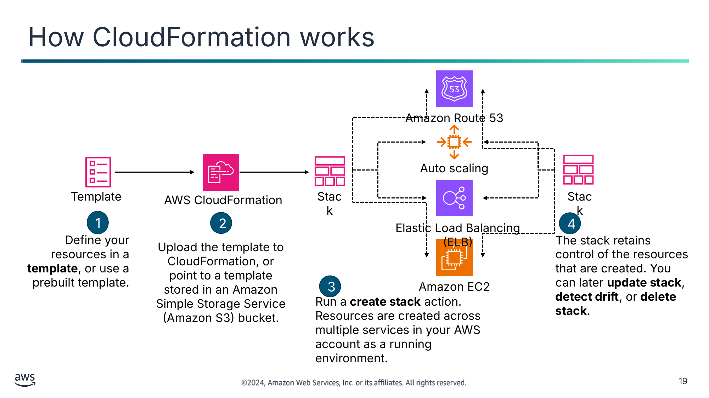

1

2

4

Визначте свої ресурси в **шаблоні** (template) або використайте попередньо створений шаблон.

Завантажте шаблон до CloudFormation або вкажіть на шаблон, що зберігається в бакеті Amazon Simple Storage Service (Amazon S3).

Стек зберігає контроль над створеними ресурсами. Пізніше можна **оновити стек** (update stack), **виявити дрейф** (detect drift) або **видалити стек** (delete stack).

3

Виконайте дію **створення стеку** (create stack). Ресурси створюються в кількох сервісах у вашому акаунті AWS як працююче середовище.

<details>
<summary>Текст зі схеми</summary>

Amazon Route 53

Auto scaling (Автоматичне масштабування)

Template (Шаблон)

AWS CloudFormation

Stack (Стек)

Stack

Elastic Load Balancing (ELB)

Amazon EC2

</details>

> **Нотатки:**
>
> |Номер слайда 19  
> |Нотатки для інструктора  
> |Зверніться до слайда зі вступом до сервісу CloudFormation. Ця схема показує, як CloudFormation використовує шаблон для побудови набору ресурсів як стека. Пройдіться по кроках, щоб проілюструвати процес CloudFormation.  
> |  
> |Нотатки для студента  
> Ця схема демонструє, як працює CloudFormation. Спочатку ви визначаєте ресурси AWS, які хочете створити. У цьому прикладі створюється кілька екземплярів EC2, балансувальник навантаження, група Auto Scaling і розміщена зона Amazon Route 53. Ви визначаєте ресурси в шаблоні CloudFormation. Шаблон можна створити з нуля або використати попередньо створений шаблон. Також доступно багато зразків шаблонів.  
>
> CloudFormation пропонує широку підтримку сервісів AWS. Однак у деяких випадках, коли потрібної вам функції немає, під час побудови стека можна викликати функцію AWS Lambda, що викликає AWS SDK для досягнення повного покриття API сервісу.  
>
> Далі ви завантажуєте шаблон до CloudFormation. Як варіант, можна зберегти шаблон в Amazon S3 і вказати CloudFormation місце, де він зберігається.  
>
> По-третє, ви виконуєте дію створення стека. Коли ви це робите, сервіс CloudFormation зчитує вказане в шаблоні й створює бажані ресурси у вашому акаунті AWS. Один стек може створювати й налаштовувати ресурси в одному регіоні в кількох сервісах AWS.  
>
> Нарешті, ви можете спостерігати за прогресом процесу створення стека. Після успішного завершення стека ресурси AWS, які він створив, існують у вашому акаунті. Об’єкт стека залишається й діє як дескриптор усіх створених ним ресурсів. Це корисно, коли ви хочете виконувати дії пізніше. Наприклад, ви можете захотіти оновити стек (створити додаткові ресурси AWS чи змінити наявні ресурси) або видалити стек (що очистить і видалить ресурси, створені стеком). Під час видалення стека можна визначити, які елементи зберегти.  
>
> Повний перелік ресурсів, що підтримуються CloudFormation, див. «AWS Resource and Property Types» у посібнику користувача CloudFormation. Посилання надано у ваших ресурсах курсу.

---

## Слайд 20: Синтаксис шаблона CloudFormation

Шаблон

Приклад YAML

Приклад JSON

```
AWSTemplateFormatVersion: 2010-09-09
Resources:
 awsexamplebucket1:
 Type: AWS::S3::Bucket
```

```
{
 "AWSTemplateFormatVersion": "2010-09-09",
 "Resources" : {
 “awsexamplebucket1" : {
 "Type" : "AWS::S3::Bucket"
 }
 }
}
```

Переваги YAML

Переваги JSON

- Оптимізований для читабельності
- Менш багатослівний
- Підтримує вбудовані коментарі

- Ширше використовується іншими комп’ютерними системами  
(наприклад, API)
- Зазвичай менш складний для генерації та розбору

> **Нотатки:**
>
> |Номер слайда 20  
> |Нотатки для інструктора  
> |Розгляньте ключову відмінність між YAML і JSON, наведену на сторінці «What’s the Difference Between YAML and JSON» в інструменті Cloud Comparison. Пряме посилання є в ресурсах курсу для цього модуля.  
> |  
> |Нотатки для студента  
> Шаблон CloudFormation можна створювати в JSON або YAML.  
>
> YAML оптимізований для читабельності. Ті самі дані, що зберігаються в JSON, займатимуть менше рядків у YAML, оскільки YAML не використовує фігурних дужок ({}) і використовує менше лапок (“”). Ще одна перевага YAML — він нативно підтримує вбудовані коментарі. Налагодження документів YAML може бути менш складним порівняно з JSON через формат, зрозумілий людині. У JSON може бути важко відшукати відсутні чи неправильно розміщені коми або дужки. У YAML цієї проблеми немає.  
>
> Попри багато переваг YAML, JSON пропонує деякі унікальні переваги. По-перше, він широко використовується комп’ютерними системами. Його поширеність — це перевага, оскільки дані, збережені в JSON, можна надійно використовувати з багатьма системами без потреби перетворення. Зазвичай генерувати й розбирати JSON менш складно, ніж генерувати й розбирати YAML. Крім того, можна додавати коментарі до шаблона CloudFormation у JSON, що потребує використання атрибута metadata в шаблоні CloudFormation.  
>
> Слід обирати мову, що найкраще відповідає вашому сценарію використання, бізнес-потребам і вашому досвіду. Обирайте YAML для формату, зрозумілішого людині, і JSON для міжсистемної сумісності. Зрештою, рішення буде між вами та вашою організацією.  
>
> Рекомендується ставитися до шаблонів як до вихідного коду й зберігати їх у репозиторії коду.  
>
> Пригадайте, що шаблони також можна створювати в AWS CloudFormation Designer (Designer) — графічному інтерфейсі проєктування в AWS Management Console, що можна використовувати для створення чи перегляду вмісту шаблонів CloudFormation. Його також можна використовувати для перетворення дійсного шаблона JSON на YAML чи перетворення YAML на JSON. Він надає інтерфейс «перетягни й відпусти» для створення шаблонів, які можна вивести як JSON або YAML.  
>
> Докладніше див. «What’s the Difference Between YAML and JSON» на сторінці ресурсів вмісту вашого онлайн-курсу.

---

## Слайд 21: Анатомія шаблона CloudFormation

---

AWSTemplateFormatVersion: "*version date*"

Description:

	*String*

Metadata:

	*template metadata*

Parameters:  
	*set of parameters*

Rules:

	*set of rules*

Mappings:

	*set of mappings*

Conditions:

	*set of conditions*

Transform:

	*set of transforms*

Resources:

	*set of resources*

Outputs:

	*set of outputs*

- Коли ви пишете шаблон CloudFormation, ви можете обирати розділи для включення залежно від вашого робочого навантаження.
- Єдиний обов’язковий розділ — **Resources**. Додаткові розділи необов’язкові.
- Цей приклад показує фрагмент шаблона у форматі YAML у запропонованому порядку розділів.

> **Нотатки:**
>
> |Номер слайда 21  
> |Нотатки для інструктора  
> |Цей слайд показує розділи шаблона CloudFormation. Єдиний обов’язковий розділ — Resources, але студентам буде корисно зрозуміти всі розділи. Наступний слайд містить приклад. Докладніше див. «Template anatomy» на сторінці ресурсів вмісту вашого онлайн-курсу.  
> |  
> |Нотатки для студента  
> Коли ви пишете шаблон CloudFormation, ви можете обирати розділи для включення залежно від вашого робочого навантаження. Шаблон CloudFormation включає кілька основних розділів. Розділ Resources — єдиний обов’язковий. Хоча фіксований порядок розділів не потрібен, під час побудови шаблона може бути корисно використовувати логічний порядок, оскільки значення в одному розділі можуть посилатися на значення з попереднього розділу. Нижче наведено запропонований порядок:  
> Format Version: цей розділ вказує версію шаблона CloudFormation, якій відповідає шаблон. Версія формату шаблона не те саме, що версія API чи Web Services Description Language (WSDL). Версія формату шаблона може змінюватися незалежно від версій API та WSDL.  
> Description: цей розділ містить текстовий рядок, що описує шаблон. Цей розділ завжди має йти після розділу Format Version шаблона.  
> Metadata: цей розділ містить об’єкти, що надають додаткову інформацію про шаблон.  
> Parameters: цей розділ містить значення, що передаються до вашого шаблона під час виконання (коли ви створюєте чи оновлюєте стек).  
> Rules: цей розділ перевіряє параметр або комбінацію параметрів, передану до шаблона під час створення чи оновлення стека.  
> Mappings: цей розділ містить зіставлення ключів і пов’язаних значень, які можна використовувати для вказання умовних значень параметрів, подібно до таблиці пошуку.  
> Conditions: цей розділ містить умови, що контролюють, чи створюються певні ресурси або чи призначаються значення певним властивостям ресурсів під час створення чи оновлення стека.  
> Transform: для безсерверних застосунків розділ Transform вказує версію AWS SAM, що використовується. Коли ви вказуєте перетворення, можна використовувати синтаксис AWS SAM для оголошення ресурсів у вашому шаблоні.  
> Resources (обов’язковий): цей розділ вказує ресурси стека та їхні властивості, як-от екземпляр EC2 чи бакет S3.  
> Outputs: цей розділ описує значення, що повертаються щоразу, коли ви переглядаєте властивості вашого стека.  
>
> Повний огляд анатомії шаблона CloudFormation див. «Template Anatomy». Посилання надано у ваших ресурсах курсу.

---

## Слайд 22: Шаблон Resources: створення екземпляра EC2

```
{
     "Resources": {
         "Ec2Instance": {
         "Type": "AWS::EC2::Instance",
         "Properties": {
         "ImageId": "ami-9d23aeea",
         "InstanceType": "m3.medium",
         "KeyName": {"Ref": "KeyPair}
    }},

     "Outputs": {
         "InstanceId": {
         "Description": "InstanceId",
         "Value": {"Ref": "Ec2Instance"}
   }
   }
}
```

**Resources** визначають, що потрібно створити в акаунті AWS (усе, що вам потрібно).

**Outputs** вказують значення, що повертаються після створення стека.

> **Нотатки:**
>
> |Номер слайда 22  
> |Нотатки для інструктора  
> |Цей приклад показує два розділи шаблона CloudFormation. Цей приклад містить подробиці того, що охоплював попередній слайд. Хоча попередній слайд був у форматі YAML, потік шаблона однаковий і в YAML, і в JSON. Можна порівняти й протиставити два слайди, щоб показати студентам, де ці два ресурси вписуються у більший шаблон, якщо вони оберуть використання додаткових розділів шаблона. Також можна проілюструвати відмінності між YAML і JSON.  
> |  
> |Нотатки для студента  
> Цей приклад шаблона CloudFormation створює екземпляр EC2. Хоча цей приклад не ілюструє всіх можливих розділів шаблона, він виділяє деякі з найчастіше використовуваних розділів, зокрема Resources та Outputs.  
>
> Розділ Resources обов’язковий для будь-якого шаблона. Використовуйте його, щоб указати ресурси AWS для створення, а також їхні властивості. У цьому прикладі вказано ресурс типу AWS::EC2::Instance, що створює екземпляр EC2. Приклад ресурсу включає і статично визначені властивості (ImageId та InstanceType), і посилання на параметр KeyPair. Приклади включають створення всіх компонентів віртуальної приватної хмари (VPC) у регіоні, а потім створення екземплярів EC2 у VPC.  
>
> Приклад показує розділ Outputs, що описує значення, які повертаються, коли ви переглядаєте властивості вашого стека. У прикладі оголошено вихідне значення InstanceId. Після створення стека ви можете побачити це значення в подробицях стека в консолі CloudFormation, виконавши команду aws cloudformation describe-stacks AWS Command Line Interface (AWS CLI) або використавши AWS SDK для отримання цього значення. Приклад використання — повернення ідентифікатора екземпляра чи публічної IP-адреси екземпляра EC2.

---

## Слайд 23: AWS CloudFormation Designer (Designer)

1

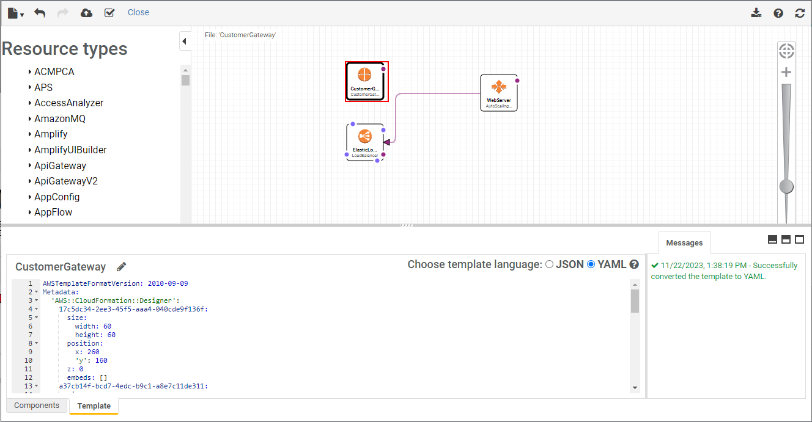

Toolbar (Панель інструментів)

Fit-to-window button (Кнопка «вмістити у вікно»)

4

3

2

Canvas pane (Панель полотна)

Resources types pane (Панель типів ресурсів)

Full screen and Split screen buttons (Кнопки повноекранного та розділеного режимів)

5

Integrated JSON and YAML editor pane (Панель інтегрованого редактора JSON і YAML)

7

6

Messages pane (Панель повідомлень)

> **Нотатки:**
>
> |Номер слайда 23  
> |Нотатки для інструктора  
> |Designer — це графічний інструмент для побудови шаблона CloudFormation. Це хороший спосіб візуалізувати шаблон до його побудови. Розгляньте можливість відкрити консоль і коротко провести екскурсію Designer.  
> |Докладніше див. «AWS CloudFormation Designer interface overview». Посилання надано в ресурсах курсу.  
> |  
> |Нотатки для студента  
> Designer — це графічний інструмент для створення, перегляду та зміни шаблонів CloudFormation. За допомогою Designer ви можете зобразити ресурси вашого шаблона на діаграмі за допомогою інтерфейсу «перетягни й відпусти», а потім редагувати їхні подробиці за допомогою інтегрованого редактора JSON і YAML. Designer може допомогти швидко побачити взаємозв’язок між ресурсами шаблона та змінювати шаблони. З Designer можна бачити графічні подання ресурсів у вашому шаблоні. Він також спрощує створення й редагування шаблонів.  
>
> Designer має кілька компонентів. Нижче наведено панелі та основні компоненти:  
> Панель інструментів надає швидкий доступ до команд для поширених дій, як-от відкриття й збереження шаблонів, скасування чи повторення змін, створення стека та перевірка вашого шаблона. Також можна завантажити діаграму як зображення, отримати довідку або оновити діаграму на панелі полотна.  
> Панель типів ресурсів (Resource types) перелічує всі ресурси шаблона, які можна додати до вашого шаблона, класифіковані за назвою сервісу AWS. Ви додаєте ресурси, перетягуючи їх з панелі типів ресурсів на полотно. Designer може відображати лише типи ресурсів, що підтримуються CloudFormation. Він не може відображати інші сутності, як-от зони доступності чи ресурси вкладеного стека.  
> Панель полотна (canvas) відображає ресурси вашого шаблона як діаграму. Ви використовуєте її для додавання чи вилучення ресурсів, створення зв’язків між ресурсами та розташування їхнього макета. Зміни, які ви вносите на полотні, автоматично змінюють JSON чи YAML шаблона.  
> Кнопка «вмістити у вікно» (fit-to-window) змінює розмір панелі полотна, щоб вмістити діаграму вашого шаблона.  
> Кнопки повноекранного та розділеного режимів вибирають різні подання Designer. Можна обрати повноекранний вигляд полотна, повноекранний вигляд інтегрованого редактора JSON і YAML або розділений екран полотна та редактора.  
> На панелі інтегрованого редактора JSON і YAML ви вказуєте подробиці вашого шаблона, як-от властивості ресурсів чи параметри шаблона. Коли ви вибираєте елемент на полотні, Designer виділяє відповідний JSON чи YAML у редакторі. Після редагування JSON чи YAML потрібно оновити полотно, щоб оновити діаграму.  
> Коли ви перетворюєте шаблон з JSON на YAML або навпаки, панель повідомлень (Messages) відображає повідомлення про успіх чи невдачу. Коли ви відкриваєте, перевіряєте чи намагаєтеся створити стек за недійсним шаблоном, панель повідомлень відображає помилки перевірки.

---

## Слайд 24: Використання умов (conditions)

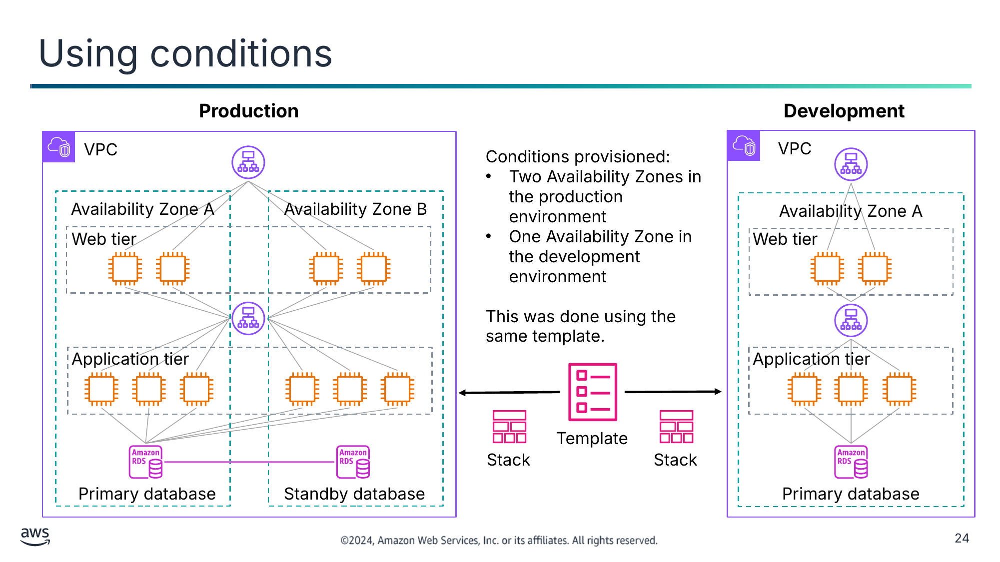

Розгорнуті умови:

- Дві зони доступності в продуктивному середовищі
- Одна зона доступності в середовищі розробки

Це зроблено за допомогою того самого шаблона.

<details>
<summary>Текст зі схеми</summary>

**Production (Продуктивне середовище)**

VPC

Availability Zone A (Зона доступності A)

Availability Zone B (Зона доступності B)

Web tier (Веброівень)

Application tier (Рівень застосунку)

Primary database (Основна база даних)

Standby database (Резервна база даних)

**Development (Середовище розробки)**

  VPC

Availability Zone A

Web tier

Application tier

Primary database

Template (Шаблон)

Stack (Стек)

Stack

</details>

> **Нотатки:**
>
> |Номер слайда 24  
> |Нотатки для інструктора  
> |Щоб переглянути синтаксис умови, див. «Conditions» на сторінці ресурсів вмісту вашого онлайн-курсу. Цей ресурс надає приклади коду умов і в записі YAML, і в JSON. Є приклади простої функції та вкладеної функції. Розгляньте ці коди зі студентами.  
> |  
> |Нотатки для студента  
> Ви можете використовувати той самий шаблон CloudFormation для створення і продуктивного середовища, і середовища розробки. Цей підхід може допомогти гарантувати, що (наприклад) ті самі бінарні файли застосунку, та сама версія Java і та сама версія бази даних використовуються і в розробці, і в продуктивному середовищі. Таким чином, шаблон може допомогти забезпечити, що ваш застосунок поводиться в продуктивному середовищі так само, як у середовищі розробки.  
>
> У прикладі ви бачите, що і продуктивне середовище, і середовище розробки створюються з того самого шаблона. Однак продуктивне середовище налаштовано працювати у двох зонах доступності, а середовище розробки працює в одній зоні доступності. Такі відмінності, специфічні для розгортання, можна досягти за допомогою умов. Можна використовувати оператор умов у шаблонах CloudFormation, щоб гарантувати, що середовища розробки, тестування та продуктивне середовище — хоч і різні за розміром і обсягом — налаштовані в решті ідентично.  
>
> Вам може знадобитися кілька середовищ тестування для функціонального тестування, приймального тестування користувачами та навантажувального тестування. Наявність різних середовищ тестування дає кільком розробникам змогу працювати над тестами, не порушуючи даних одне одного. Наявність кількох середовищ тестування також дає змогу тестувати різні проблеми незалежно. Створення цих середовищ вручну ризиковане. Однак створення їх за допомогою CloudFormation допомагає забезпечити узгодженість і повторюваність.

---

## Слайд 25: Набори змін CloudFormation (change sets)

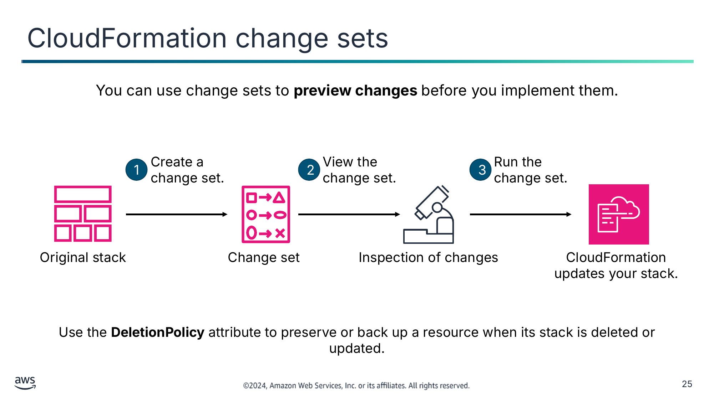

Ви можете використовувати набори змін, щоб **переглядати зміни** перед їх упровадженням.

Використовуйте атрибут **DeletionPolicy**, щоб зберегти чи створити резервну копію ресурсу, коли його стек видаляється чи оновлюється.

<details>
<summary>Текст зі схеми</summary>

1

Create a

change set. (Створіть набір змін.)

2

View the

change set. (Перегляньте набір змін.)

3

Run the

change set. (Виконайте набір змін.)

Original stack (Початковий стек)

Change set (Набір змін)

Inspection of changes (Перевірка змін)

CloudFormation updates your stack. (CloudFormation оновлює ваш стек.)

</details>

> **Нотатки:**
>
> |Номер слайда 25  
> |Нотатки для інструктора  
> |Набори змін можуть бути дуже корисними для розуміння того, як зміни вплинуть на працюючі ресурси. Набори змін можна використовувати після розгортання ресурсів. Докладніше про те, як створювати, переглядати й використовувати набори змін, див. «Updating Stacks Using Change Sets». Посилання надано в ресурсах курсу.  
> |Можливо, ви захочете показати приклад набору змін. Документація CloudFormation надає приклади наборів змін для цієї мети. Посилання на приклади наборів змін є в ресурсах курсу.  
> |  
> |Нотатки для студента  
> Один зі способів оновити стек (а отже, оновити ваші ресурси AWS) — оновити шаблон CloudFormation, який ви використали для створення стека, а потім виконати опцію Update Stack.  
>
> Однак перш ніж фактично виконувати оновлення, ви можете захотіти отримати додаткове розуміння конкретних змін, які CloudFormation впровадить, якщо ви виконаєте цю команду. Якщо вам потрібне таке розуміння, можна використовувати набір змін.  
>
> Використовуючи набори змін, можна переглянути зміни, переконатися, що вони відповідають вашим очікуванням, а потім схвалити оновлення, перш ніж продовжити.  
>
> Дотримуйтеся цього базового робочого процесу для використання наборів змін CloudFormation:  
> Створіть набір змін, надіславши зміни для стека, який ви хочете оновити.  
> Перегляньте набір змін, щоб побачити, які налаштування стека й ресурси зміняться. Якщо ви хочете розглянути інші зміни, перш ніж вирішити, які зміни внести, створіть додаткові набори змін.  
> Виконайте набір змін. CloudFormation оновить ваш стек цими змінами.  
>
> Якщо ви використовуєте набори змін, можливо, захочете встановити політику видалення для деяких ресурсів. Атрибут DeletionPolicy можна використовувати для збереження (або, в деяких випадках, резервного копіювання) ресурсу, коли його стек видаляється чи оновлюється. Якщо ресурс не має атрибута DeletionPolicy, CloudFormation видаляє ресурс.  
>
> Повний огляд наборів змін CloudFormation див. «Updating Stacks Using Change Sets». Посилання надано у ваших ресурсах курсу.

---

## Слайд 26: Виявлення дрейфу (drift detection)

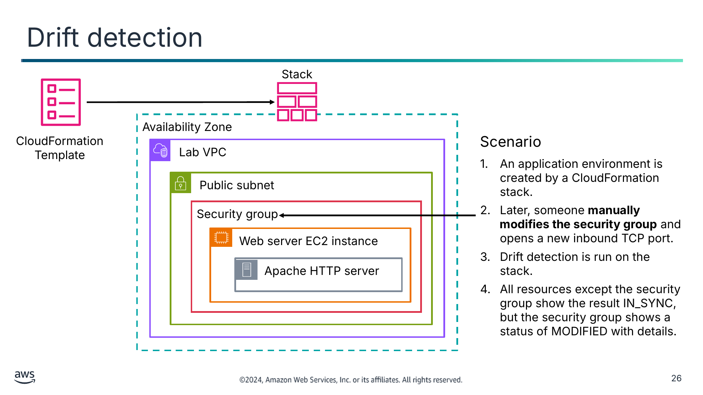

Сценарій

1. Середовище застосунку створюється стеком CloudFormation.
2. Пізніше хтось **вручну змінює групу безпеки** й відкриває новий вхідний порт TCP.
3. На стеку виконується виявлення дрейфу.
4. Усі ресурси, окрім групи безпеки, показують результат IN_SYNC, але група безпеки показує статус MODIFIED із подробицями.

<details>
<summary>Текст зі схеми</summary>

Stack (Стек)

Availability Zone (Зона доступності)

CloudFormation Template (Шаблон CloudFormation)

Lab VPC

Public subnet (Публічна підмережа)

Security group (Група безпеки)

Web server EC2 instance (Екземпляр EC2 вебсервера)

Apache HTTP server (Вебсервер Apache HTTP)

</details>

> **Нотатки:**
>
> |Номер слайда 26  
> |Нотатки для інструктора  
> |Розгляньте можливість поставити це запитання під час цього слайда:  
> |Запитання: у цьому сценарії який підхід був би кращим, якщо команда хоче змінити налаштування групи безпеки?  
> |Відповідь: змінити налаштування групи безпеки в шаблоні CloudFormation. Потім виконати Update Stack. CloudFormation оновить групу безпеки. Це підтримує синхронізацію модельного розгортання з фактичним розгортанням.  
> |Перелік ресурсів, що підтримують виявлення дрейфу, див. «Resources That Support Import and Drift Detection Operations». Посилання надано у ваших ресурсах курсу.  
> |  
> |Нотатки для студента  
> Розгляньте цей сценарій: середовище застосунку створюється запуском стека CloudFormation. Потім хтось вирішує вручну змінити налаштування розгорнутого середовища. Вони створюють нове вхідне правило в групі безпеки, створеній стеком. Однак вони вносять цю зміну поза контекстом CloudFormation — наприклад, за допомогою консолі Amazon EC2. Як архітектор цього застосунку, ви хотіли б знати, що ваше розгорнуте середовище більше не відповідає модельному середовищу, визначеному в шаблоні CloudFormation.  
>
> Як ви дізнаєтеся, які ресурси було змінено, так що вони більше точно не відповідають специфікаціям у стеку?  
>
> Виявлення дрейфу можна виконати на стеку, обравши Detect Drift в меню Stack actions у консолі. Виконання виявлення дрейфу на стеку показує, чи відхилився стек від очікуваної конфігурації шаблона. Виявлення дрейфу повертає докладну інформацію про статус дрейфу кожного ресурсу в стеку, що підтримує виявлення дрейфу.  
>
> Коли ви видаляєте стек із дрейфом, дрейф не обробляється процесом очищення ресурсів CloudFormation. Якщо стек має невирішені залежності ресурсів, вони можуть призвести до невдачі дії видалення стека. У таких випадках може знадобитися вручну розв’язати проблему.  
>
> Перелік ресурсів, що підтримують виявлення дрейфу, див. «Resources That Support Import and Drift Detection Operations». Посилання надано у ваших ресурсах курсу.

---

## Слайд 27: Визначення області та організація шаблонів

| Категорія (Category) | Тип шаблона (Type of Template) |
|---|---|
| Фронтенд-сервіси | Вебінтерфейси, мобільний доступ і панель аналітики |
| Бекенд-сервіси | Пошук, платежі, відгуки та рекомендації |
| Спільні сервіси | • Бази даних керування взаємовідносинами з клієнтами (CRM),<br>• спільний моніторинг, сигнали, підмережі та групи безпеки |
| Мережа | VPC, інтернет-шлюзи, віртуальні приватні мережі (VPN) і NAT-пристрої |
| Безпека | Політики, користувачі, групи й ролі AWS Identity and Access Management (IAM) |

> **Нотатки:**
>
> |Номер слайда 27  
> |Нотатки для інструктора  
> |Докладніше про вкладені стеки див. «Working with Nested Stacks». Посилання надано у ваших ресурсах курсу.  
> |  
> |Нотатки для студента  
> У міру того як ваша організація починає використовувати більше шаблонів CloudFormation, вам важливо мати стратегію щодо шаблонів. Ця стратегія визначатиме область того, що має створювати один шаблон, і загальні характеристики, через які ви захочете визначити свою інфраструктуру AWS у кількох шаблонах.  
>
> Таблиця пропонує деякі ідеї щодо того, як можна організувати ваші шаблони, щоб їх можна було підтримувати та використовувати разом осмисленим способом. Хороша стратегія — групувати визначення ресурсів у шаблонах так само, як ви організували б функціональність великого корпоративного застосунку на різні частини.  
>
> Подумайте про щільніше пов’язані компоненти вашої інфраструктури й розгляньте можливість розмістити їх в одних шаблонах. У цьому прикладі шаблони CloudFormation мають область створення та підтримки ресурсів AWS в одній із п’яти галузей: фронтенд-сервіси, бекенд-сервіси, спільні сервіси, мережа та безпека. У кожній галузі можна підтримувати шаблон, що має область однієї програми чи потреб одного відділу.  
>
> Також можна розглянути використання вкладених стеків (nested stacks). Вкладені стеки створюються як частина інших стеків. У міру зростання вашої інфраструктури можуть з’являтися поширені шаблони, у яких ви оголошуєте ті самі компоненти в кількох шаблонах. Ці спільні компоненти можна виокремити й створити для них спеціальні шаблони. Потім використовуйте ресурс у вашому шаблоні для посилання на інші шаблони, створюючи вкладені стеки.  
>
> Незалежно від того, як ви організовуєте й визначаєте область кожного шаблона CloudFormation, ставтеся до своїх шаблонів як до коду, що потребує контролю версій. Зберігайте свої шаблони в системі контролю джерел.  
>
> Докладніше про вкладені стеки див. «Working with Nested Stacks». Посилання надано у ваших ресурсах курсу.

---

## Слайд 28: Демонстрація: аналіз шаблона AWS CloudFormation (Analyzing an AWS CloudFormation Template)

- Ця демонстрація використовує CloudFormation.
- У цій демонстрації ви вивчаєте шаблон CloudFormation і докладно аналізуєте його.


> **Нотатки:**
>
> |Номер слайда 28  
> |Нотатки для інструктора  
> |Це відеодемонстрація. Студенти мають доступ до демонстрації через свій онлайн-курс  
> |  
> |Нотатки для студента  
> У цій демонстрації ви вивчаєте шаблон CloudFormation і докладно аналізуєте його.

---

## Слайд 29: Демонстрація: ресурси AWS CloudFormation (AWS CloudFormation Resources)

- Ця демонстрація використовує CloudFormation і AWS Quick Starts.
- У цій демонстрації вас знайомлять із CloudFormation і ресурсами, доступними для створення шаблонів CloudFormation.


> **Нотатки:**
>
> |Номер слайда 29  
> |Нотатки для інструктора  
> |Це відеодемонстрація. Студенти мають доступ до демонстрації через свій онлайн-курс.  
> |  
> |Нотатки для студента  
> У цій демонстрації вас знайомлять із подробицями CloudFormation, і ви побачите, як спростити керування інфраструктурою, використовуючи ідеї інфраструктури як коду. Ця демонстрація також знайомить із ресурсами для створення шаблонів CloudFormation.

---

## Слайд 30: Демонстрація: перегляд шаблона AWS CloudFormation (Reviewing an AWS CloudFormation Template)

- Ця демонстрація використовує CloudFormation.
- У цій демонстрації ви переглядаєте зміни, які вносите до шаблона CloudFormation.


> **Нотатки:**
>
> |Номер слайда 30  
> |Нотатки для інструктора  
> |Це відеодемонстрація. Студенти мають доступ до демонстрації через свій онлайн-курс.  
> |  
> |Нотатки для студента  
> У цій демонстрації ви переглядаєте зміни, які вносите до шаблона CloudFormation.

---

## Слайд 31: Демонстрація: використання консолі AWS CloudFormation (Using the AWS CloudFormation Console)

- Ця демонстрація використовує CloudFormation.
- У цій демонстрації ви дізнаєтеся, як використовувати консоль CloudFormation.


> **Нотатки:**
>
> |Номер слайда 31  
> |Нотатки для інструктора  
> |Це відеодемонстрація. Студенти мають доступ до демонстрації через свій онлайн-курс.  
> |  
> |Нотатки для студента  
> У цій демонстрації ви дізнаєтеся, як використовувати консоль CloudFormation. Ви розглядаєте концепції Designer та виявлення дрейфу. Ви також дізнаєтеся, як усе очистити після завершення, щоб не нести непотрібних витрат.

---

## Слайд 32: Ключові висновки: налаштування за допомогою CloudFormation

- CloudFormation — це сервіс IaC, який можна використовувати для моделювання, створення колекції ресурсів AWS і керування нею.
- IaC CloudFormation визначається в шаблонах, створених у JSON або YAML.
- Стек — це те, що ви створюєте, коли використовуєте шаблон для створення ресурсів AWS.
- Дії, доступні для наявного стека, включають оновлення стека, виявлення дрейфу та видалення стека.

> **Нотатки:**
>
> |Номер слайда 32  
> |Нотатки для інструктора  
> |Для цього слайда немає нотаток для студента.  
> |  
> |Нотатки для студента

---

## Слайд 33: Використання AWS Quick Starts

Автоматизація вашої архітектури

> **Нотатки:**
>
> |Номер слайда 33  
> |Нотатки для інструктора  
> |Цей розділ знайомить з AWS Quick Starts — хорошим способом для студентів побачити CloudFormation в дії, не будуючи шаблон самостійно. Розгляньте можливість переглянути кілька AWS Quick Starts під час цього розділу. Посилання на сторінку AWS Quick Starts є в ресурсах курсу.  
> |  
> |Нотатки для студента  
> Цей розділ знайомить з AWS Quick Starts для автоматизації розгортань у хмарі AWS.

---

## Слайд 34: AWS Quick Starts

- Є розгортаннями «золотого стандарту»
- Ґрунтуються на найкращих практиках AWS щодо безпеки та високої доступності
- Можуть використовуватися для створення цілих архітектур менш ніж за годину
- Можуть використовуватися для експериментів і як основа для ваших власних архітектур

AWS Quick Starts

> **Нотатки:**
>
> |Нотатки для інструктора  
> |AWS Quick Starts — хороший спосіб розпочати роботу з CloudFormation. Quick Starts — це розгортання «золотого стандарту» для різноманітних рішень. Quick Starts можна використовувати, щоб допомогти студентам зрозуміти шаблони CloudFormation.  
> |  
> |Нотатки для студента  
> AWS Quick Starts надають шаблони CloudFormation для повних рішень. Quick Starts створені архітекторами рішень і партнерами AWS, щоб допомогти вам розгортати популярні рішення в AWS на основі найкращих практик AWS щодо безпеки та високої доступності. Ці еталонні розгортання можна розгорнути у вашому акаунті AWS менш ніж за годину, а часто лише за лічені хвилини. Вони допомагають будувати добре спроєктовані (well-architected) тестові чи продуктивні середовища за кілька кроків. Їх можна використовувати для створення цілих архітектур або для експериментів із новими підходами до розгортання.  
>
> Quick Starts використовують інфраструктуру як код із CloudFormation як основою. Це допомагає використовувати CloudFormation для розгортання архітектур, не будуючи власного шаблона.  
>
> Докладніше див. AWS Quick Starts на сторінці ресурсів. Посилання надано у ваших ресурсах курсу.

---

## Слайд 35: Як використовувати AWS Quick Starts

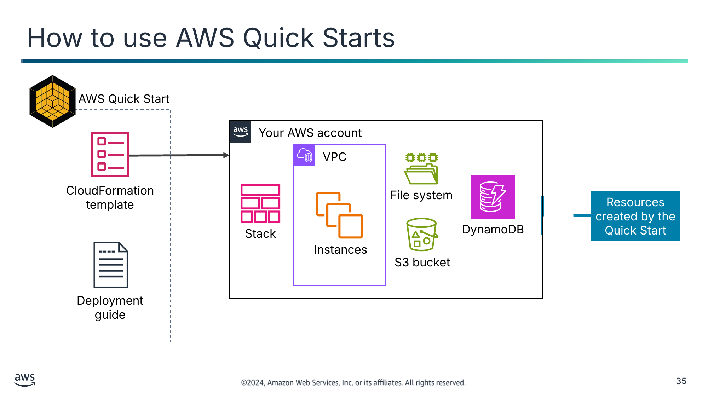

<details>
<summary>Текст зі схеми</summary>

AWS Quick Start

Your AWS account (Ваш акаунт AWS)

VPC

CloudFormation template (Шаблон CloudFormation)

File system (Файлова система)

Resources created by the Quick Start (Ресурси, створені Quick Start)

Stack (Стек)

DynamoDB

Instances (Екземпляри)

S3 bucket (Бакет S3)

Deployment guide (Посібник із розгортання)

</details>

> **Нотатки:**
>
> |Номер слайда 35  
> |Нотатки для інструктора  
> |Розгляньте, як отримати доступ до AWS Quick Starts і розгортати їх. Перейдіть на сторінку AWS Quick Starts, щоб обговорити різні типи рішень. Посилання є в ресурсах курсу.  
> |  
> |Перейдіть на сторінку AWS Quick Starts.  
> |Огляньте початкову сторінку та способи пошуку й фільтрації Quick Starts. Щоб відфільтрувати лише Quick Starts, поставте прапорець поруч з AWS Quick Starts у меню Content Type.  
> |Щоб обрати Quick Start для перегляду, виберіть його назву.  
> |Огляньте частини Quick Start, зокрема як розгортати та вартість розгортання.  
> |Щоб показати, як це виглядає в консолі, виберіть deploy для Quick Start.  
> |Пройдіть кроки розгортання в консолі. За бажанням фактично розгорніть Quick Start.  
> |Якщо ви розгорнули Quick Start, очистіть і видаліть створені ресурси.  
> |Також можна обговорити різні сценарії використання Quick Start, використовуючи функції пошуку й фільтрації.  
> |  
> |Нотатки для студента  
> Кожен Quick Start складається із шаблона CloudFormation і посібника з розгортання. Посібник надає подробиці про варіанти розгортання та як налаштувати розгортання відповідно до ваших потреб. Посібник також надає інформацію про міркування безпеки та орієнтовну вартість розгортання. Ви можете налаштувати розгортання відповідно до ваших потреб і створити стек. Залежно від ресурсів AWS, які потрібно створити, Quick Start завершить розгортання за лічені хвилини чи кілька годин.  
>
> Навіть якщо ви не використовуєте Quick Starts, вам може бути корисно переглянути кілька з них, щоб побачити типи шаблонів і практик, яких вони дотримуються. Ви можете виявити, що вони допомагають прискорити розробку власних шаблонів, коли ви запозичуєте розділ Quick Start і вбудовуєте його у власний шаблон.  
>
> AWS Marketplace Amazon Machine Images (AMI) — ще одне рішення, яке іноді використовують. Ці ресурси можна запускати з консолі Amazon EC2. AWS Marketplace AMI надають рішення одного постачальника, що працюють на екземплярах EC2. Натомість AWS Quick Starts — це модульні й більш настроювані рішення, що можуть (або не можуть) використовувати Amazon EC2.

---

## Слайд 36: Приклад AWS Quick Starts

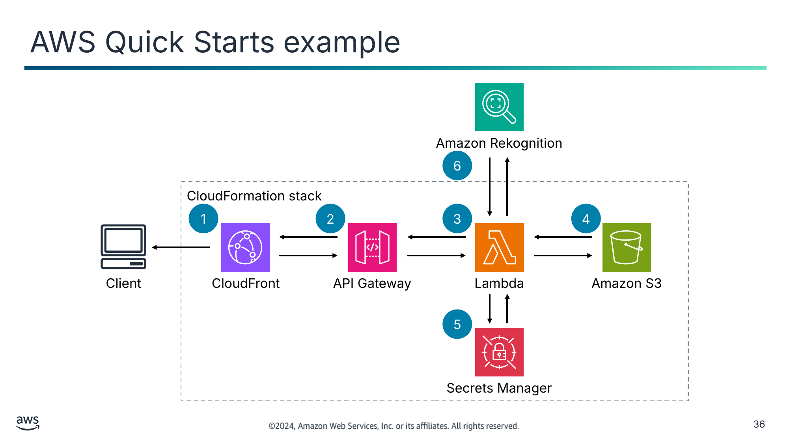

<details>
<summary>Текст зі схеми</summary>

Amazon Rekognition

6

CloudFormation stack (Стек CloudFormation)

1

2

3

4

Client (Клієнт)

CloudFront

API Gateway

Lambda

Amazon S3

5

Secrets Manager

</details>

> **Нотатки:**
>
> |Номер слайда 36  
> |Нотатки для інструктора  
> |Розгляньте цей приклад AWS Quick Starts крок за кроком. Щоб переглянути все рішення, див. Serverless Image Handler у бібліотеці рішень AWS (AWS Solutions Library). Посилання надано у ваших ресурсах курсу.  
> |  
> |Нотатки для студента  
> Ця архітектура — приклад AWS Quick Start, який можна розгорнути менш ніж за годину. Це рішення створює безсерверну архітектуру для ініціювання економічно ефективної обробки зображень у хмарі AWS. Це рішення забезпечує динамічну доставку контенту в інтерактивному вебінтерфейсі з модерацією контенту та розумним кадруванням зображень за допомогою Amazon Rekognition.  
>
> Ви можете впровадити таку архітектуру, якщо намагаєтеся підтримувати зображення високої якості на ваших вебсайтах і в мобільних застосунках:  
> Шаблон CloudFormation розгортає дистрибуцію Amazon CloudFront, що забезпечує рівень кешування для зменшення вартості обробки зображень і затримки подальшої доставки зображень. Доменне ім’я CloudFront забезпечує кешований доступ до API обробника зображень.  
> Amazon API Gateway надає ресурси кінцевих точок і запускає функцію Lambda.  
> Функція Lambda отримує зображення з наявного бакета S3 клієнта й використовує програмне забезпечення для обробки зображень із відкритим кодом, щоб повернути змінену версію зображення до API Gateway.  
> Бакет S3 використовується для зберігання журналів. Це окремий бакет від бакета S3 для зберігання зображень.  
> Якщо ви активуєте функцію підпису URL-адреси зображення, функція Lambda отримує секретне значення з вашого наявного секрету AWS Secrets Manager для перевірки підпису  
> Можна використовувати Amazon Rekognition для аналізу вашого зображення та повернення результатів, якщо ви використовуєте функції розумного кадрування чи модерації контенту.  
>
> Докладніше про цей приклад див. Serverless Image Handler у бібліотеці рішень AWS. Посилання надано у ваших ресурсах курсу.

---

## Слайд 37: Ключові висновки: використання AWS Quick Starts

- AWS Quick Starts надають шаблони CloudFormation, створені архітекторами рішень і партнерами, що відображають найкращі практики AWS.
- AWS Quick Starts складаються із шаблона CloudFormation і посібника з розгортання, що надають подробиці про варіанти розгортання та способи налаштування розгортання відповідно до ваших потреб.
- AWS Quick Starts також можуть допомогти побачити шаблони та практики для прискорення розробки ваших власних шаблонів.

> **Нотатки:**
>
> |Номер слайда 37  
> |Нотатки для інструктора  
> |Для цього слайда немає нотаток для студента.  
> |  
> |Нотатки для студента

---

## Слайд 38: Налаштування за допомогою Amazon Q Developer

Автоматизація вашої архітектури

> **Нотатки:**
>
> |Номер слайда 38  
> |Нотатки для інструктора  
> |Цей розділ — вступ до Amazon Q Developer. Amazon Q Developer — це генеративний ШІ-помічник із програмування, що допоможе студентам швидше вносити оновлення до шаблона CloudFormation. Пам’ятайте, що Amazon Q Developer навчено на мільярдах рядків коду, і він постійно оновлюється, тож результати, які ви бачите щоразу, можуть не збігатися.  
> |  
> |Нотатки для студента  
> Цей розділ — вступ до Amazon Q Developer. Amazon Q Developer допомагає підвищити продуктивність розробників, надаючи рекомендації щодо коду на основі природних коментарів розробників і попереднього коду.

---

## Слайд 39: Виклики написання інфраструктури як коду


Людська помилка

Різні рівні навичок

Розмір і складність шаблонів

Вразливості безпеки

> **Нотатки:**
>
> |Номер слайда 39  
> |Нотатки для інструктора  
> Розгляньте початок обговорення із запитання: «З якими викликами ви стикалися, вивчаючи написання коду?» Спрямуйте обговорення навколо викликів, з якими стикалися студенти, і викликів, перелічених на слайді.  
> |  
> |Нотатки для студента  
> Написання коду може бути складним, особливо коли ви починаєте працювати розробником.  
>
> Людська помилка: код пишуть люди, і люди можуть вносити помилки в код. Ці помилки можуть виникати під час виконання знайомих завдань, коли ви застосовуєте неправильну дію або коли забуваєте завершити крок. Помилки може бути важко знайти, особливо коли дії правильні, але не для цілей програмування.  
>
> Різні рівні навичок: розробники мають різні рівні навичок і стилі кодування. Найефективніші розробники — це розв’язувачі проблем, і ця навичка зростає з практикою. Як новіший розробник, ви можете обирати складніший код, ніж потрібно. У міру зростання ваших навичок ви можете почати писати код, що враховує, як створювати, підтримувати та адмініструвати. Мета програміста — розв’язати проблему, знайшовши працездатне рішення. Технології — це інструменти для розв’язання викликів.  
>
> Розмір і складність шаблонів: написання шаблона для докладного опису всіх ресурсів навіть для базової триярусної архітектури швидко стає складним. Навіть коли у вас є наявний шаблон чи Quick Start, можна загубитися в деталях.  
>
> Вразливості безпеки: безпека — головний пріоритет під час розробки програмного забезпечення. Одна з проблем, з якою стикаються нові розробники, — упускання безпеки під час написання коду. Зосередження на доставці коду без помилок, а не на перевірці його безпеки може призвести до ненавмисних вразливостей безпеки.

---

## Слайд 40: Amazon Q Developer

- Помічник із кодування на основі генеративного ШІ (generative AI)
- Розроблений для розробників та ІТ-фахівців
- Генерує код і допомагає зрозуміти, побудувати, розширити та експлуатувати застосунки AWS
- Сканує код на вразливості безпеки
- Безпечний і приватний за проєктом

Amazon Q Developer

> **Нотатки:**
>
> |Нотатки для інструктора  
> |Amazon Q Developer — це інструмент, що може допомогти студентам вносити оновлення до шаблонів CloudFormation. Модуль 1 знайомив із цим сервісом. Слайд зі вступом до сервісу повторюється тут для нагадування. Зв’яжіть це з оновленням CloudFormation і Quick Starts за допомогою рекомендацій Amazon Q Developer.  
> |  
> |Нотатки для студента  
> Щоб пом’якшити деякі виклики написання коду, AWS запровадив Amazon Q Developer. Amazon Q Developer — це помічник із кодування, яким можуть користуватися ті, хто не має великого досвіду. Він навчений на прикладах і документації AWS високої якості за багато років. Його також можна навчити на коді та системах вашої компанії. Amazon Q Developer може спілкуватися про код, надавати вбудовані доповнення коду, генерувати новий код і сканувати ваш код на вразливості безпеки. Він також може виконувати оновлення та покращення коду, як-от оновлення мов, налагодження й оптимізації. З Amazon Q Developer можна описати застосунок, який ви хочете створити, природною мовою, і Amazon Q Developer згенерує та запропонує код для застосунку. Можна будувати застосунки, не пишучи весь код самостійно. Підхід Amazon Q Developer без коду (no-code) може бути особливо корисним для створення простих вебзастосунків, автоматизації бізнес-процесів чи побудови прототипів і доказів концепції.  
>
>
> Докладніше див. «Getting Started» у посібнику користувача AWS Amazon Q Developer на сторінці ресурсів вмісту вашого онлайн-курсу.

---

## Слайд 41: Amazon Q Developer підтримує вас на всьому життєвому циклі розробки програмного забезпечення (SDLC)

Планування (Plan)

Створення (Create)

Тестування та захист (Test and secure)

Експлуатація (Operate)

Підтримка та модернізація (Maintain and modernize)

- Ставте запитання й отримуйте настанови з посиланнями та контекстом.
- Пояснюйте код за допомогою розмовного кодування.

- Отримуйте вбудовані рекомендації щодо коду для кількох мов.
- Упроваджуйте функції через коментарі чи запити коду.
- Спілкуйтеся у вашому інтегрованому середовищі розробки (IDE).

- Генеруйте модульні тести.
- Скануйте код проєкту на вразливості безпеки та отримуйте пропозиції щодо усунення.

- Усувайте помилки.
- Усувайте проблеми мережевого підключення за допомогою VPC Reachability Analyzer.

- Модернізуйте код за допомогою Amazon Q Developer Agent for code transformation.

> **Нотатки:**
>
> |Нотатки для інструктора  
> |Amazon Q Developer підтримує вас на всьому життєвому циклі розробки програмного забезпечення.  
> |Планування: використовуйте AWS Management Console, щоб ставити запитання, отримувати найкращі практики та рекомендації.  
> |Створення: вбудовані рекомендації щодо коду природною мовою.  
> |Тестування та захист: допомога з модульними тестами.  
> |Експлуатація: усувайте помилки, аналізуйте вашу VPC тощо.  
> |Підтримка та модернізація: оновлюйте проєкти до новіших мов.  
> |Ресурс: блог AWS DevOps, «Accelerate your Software Development Lifecycle with Amazon Q», за адресою https://aws.amazon.com/blogs/devops/accelerate-your-software-development-lifecycle-with-amazon-q/.  
> |  
> |Нотатки для студента  
> Amazon Q підтримує розробників на фазах життєвого циклу розробки програмного забезпечення (SDLC) кількома способами.  
> Планування: можна використовувати Amazon Q в AWS Management Console, щоб ставити запитання, отримувати найкращі практики та рекомендації, оптимізувати екземпляри Amazon Elastic Cloud Compute (EC2) і дізнаватися більше про Well-Architected Framework. В інтегрованому середовищі розробки (IDE) Amazon Q може допомогти зрозуміти вашу кодову базу й швидко увійти в курс проєктів.  
> Створення: Amazon Q допомагає підвищити продуктивність розробки через вбудовані рекомендації щодо коду безпосередньо у вашому IDE чи інтерфейсі командного рядка (CLI), використовуючи природну мову для генерування нових функцій. Можна ставити Amazon Q запитання, не залишаючи IDE. Вбудовані рекомендації щодо коду доступні для кількох мов програмування. Докладніше див. «Supported languages for Amazon Q Developer in the IDE» за адресою https://docs.aws.amazon.com/amazonq/latest/qdeveloper-ug/q-language-ide-support.html.  
> Тестування та захист: Amazon Q допомагає підтвердити, що ваш код працює й безпечний, за допомогою допомоги з модульними тестами. Він допомагає знаходити й виправляти вразливості безпеки раніше в циклі розробки.  
> Експлуатація: Amazon Q може допомогти усувати помилки, наприклад в AWS Lambda, Amazon EC2 та Amazon Elastic Container Service (Amazon ECS). Можна аналізувати досяжність вашої VPC і отримувати кращі поради з налагодження та оптимізації.  
> Підтримка та модернізація: Amazon Q Developer Agent for code transformation допомагає підтримувати й модернізувати код, оновлюючи проєкти до новіших версій мов.  
>
> Докладніше див. «Accelerate your Software Development Lifecycle with Amazon Q» у блозі AWS DevOps за адресою https://aws.amazon.com/blogs/devops/accelerate-your-software-development-lifecycle-with-amazon-q/.

---

## Слайд 42: Приклад: використання Amazon Q Developer з CloudFormation

Amazon Q Developer робить пропозиції, які розробник може прийняти

Прийнятий фрагмент коду додається до шаблона

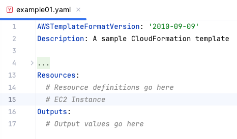

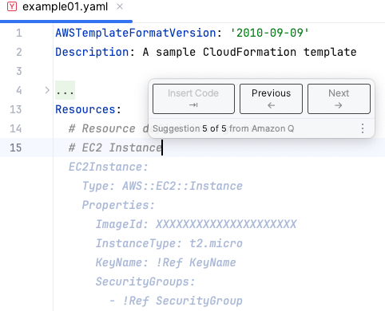

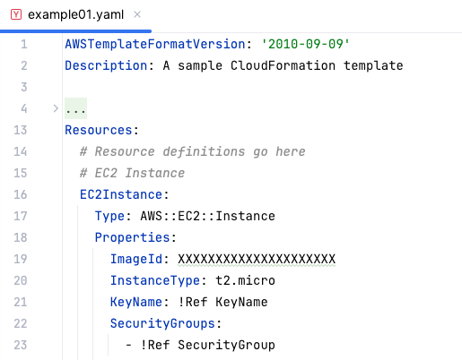

Розробник вводить початок потрібного ресурсу у файлі YAML

> **Нотатки:**
>
> |Номер слайда 42  
> |Нотатки для інструктора  
> | Це простий приклад того, як Amazon Q Developer може пропонувати релевантний код, пов’язаний з CloudFormation.  
> |  
> |Нотатки для студента  
> Amazon Q Developer може допомогти змінити шаблон CloudFormation. Змінюючи шаблон стека, можна використовувати Amazon Q Developer для написання, зміни чи видалення коду. Amazon Q Developer генерує пропозиції в YAML чи JSON, щоб безшовно вписатися у ваш шаблон CloudFormation.  
>
> Amazon Q Developer також допомагає писати функції Lambda для стека CloudFormation. Після активації в консолі Lambda Amazon Q Developer може надавати рекомендації щодо коду за запитом у редакторі коду Lambda під час розробки вашої функції

---

## Слайд 43: Ключові висновки: налаштування за допомогою Amazon Q Developer

- Amazon Q Developer — це інструмент кодування на основі генеративного ШІ, який можна використовувати для генерування пропозицій коду в реальному часі.
- Amazon Q Developer може пропонувати рекомендації щодо написання шаблонів CloudFormation.

> **Нотатки:**
>
> |Номер слайда 43  
> |Нотатки для інструктора  
> |Для цього слайда немає нотаток для студента.  
> |  
> |Нотатки для студента

---

## Слайд 44: Покрокова лабораторна робота: автоматизація розгортання інфраструктури за допомогою AWS CloudFormation (Automating Infrastructure Deployment with AWS CloudFormation, CloudFormation lab)

> **Нотатки:**
>
> |Номер слайда 44  
> |Нотатки для інструктора  
> |  
> |Нотатки для студента  
> Зараз ви виконаєте лабораторну роботу. Наступні слайди підсумовують, що ви робитимете в лабораторній роботі, а лабораторне середовище надає докладні інструкції.

---

## Слайд 45: Завдання лабораторної роботи «CloudFormation»:

- У цій лабораторній роботі ви виконаєте такі основні завдання:
  - Використаєте AWS CloudFormation для розгортання мережевого рівня віртуальної приватної хмари (VPC)
  - Використаєте AWS CloudFormation для розгортання рівня застосунку, що посилається на мережевий рівень
  - Дослідите шаблони за допомогою AWS CloudFormation Designer
  - Видалите стек, що має політику видалення
- Відкрийте ваше лабораторне середовище, щоб розпочати лабораторну роботу та дізнатися додаткові подробиці про завдання, які ви виконуватимете

> **Нотатки:**
>
> |Номер слайда 45  
> |Нотатки для інструктора  
> |  
> |Нотатки для студента  
> Отримайте доступ до лабораторного середовища через ваш онлайн-курс, щоб дізнатися додаткові подробиці та виконати лабораторну роботу.

---

## Слайд 46: Підсумки лабораторної роботи «Розгортання CloudFormation»

- Яку найкращу практику ви засвоїли, використовуючи CloudFormation для розгортання шаруватої архітектури?
- Коли стек CloudFormation було створено для вашої VPC, які два вихідні значення (outputs) створив стек?

> **Нотатки:**
>
> |Номер слайда 46  
> |Нотатки для інструктора  
> |Відповідні архітектурні схеми «до» та «після» включено до інструкцій кожної лабораторної роботи. Вам може бути корисно відкрити схеми лабораторної роботи під час підбиття підсумків цієї лабораторної роботи.  
> |  
> |Проведіть із класом розмову про ключові висновки з лабораторної роботи. Використайте подробиці з попереднього розділу, щоб допомогти підбити підсумки лабораторної роботи зі студентами після її завершення. Підбиття підсумків лабораторної роботи наполегливо рекомендується. Воно допомагає студентам встановити зв’язки між їхнім практичним досвідом і концепціями, які ви обговорювали в лекції перед цією лабораторною роботою.  
> |  
> |Запропоновані відповіді на запитання 1: яку найкращу практику ви засвоїли, використовуючи CloudFormation для розгортання шаруватої архітектури?  
> Найкраща практика — розгортати інфраструктуру шарами. Поширені шари такі:  
> |Мережа  
> |База даних  
> |Застосунок  
> |Таким чином можна повторно використовувати шаблони між системами. Наприклад, можна розгортати спільну мережеву топологію між середовищами розробки, тестування та продуктивним середовищем або розгортати стандартну базу даних для кількох застосунків.  
> |  
> |Запропоновані відповіді на запитання 2: коли ваш стек CloudFormation було створено у VPC, які два вихідні значення створив стек?  
> Ідентифікатор створеної публічної підмережі  
> Ідентифікатор створеної VPC  
> |Стек CloudFormation може надавати вихідну інформацію, як-от ідентифікатор конкретних ресурсів і посилання на ресурси. Вихідні значення також можна використовувати для передавання значень іншим стекам. У цій лабораторній роботі ідентифікаторам VPC і підмережі було надано імена експорту, щоб інші стеки могли отримувати ці значення. Ці інші стеки можуть потім будувати ресурси (як-от екземпляри EC2 і групи безпеки) всередині щойно створених VPC і підмережі.  
> |  
> |Нотатки для студента  
> Ваш інструктор може розглянути ці запитання з вами, або ви можете розглянути їх самостійно. Скористайтеся цією нагодою, щоб поглибити своє мислення щодо завдань, які ви виконували під час лабораторної роботи.

---

## Слайд 47: Застосування принципів AWS Well-Architected Framework до автоматизації

Автоматизація вашої архітектури

> **Нотатки:**
>
> |Номер слайда 47  
> |Нотатки для інструктора  
> |  
> |Нотатки для студента  
> Цей розділ — огляд застосування AWS Well-Architected Framework до автоматизації.

---

## Слайд 48: Найкращі практики AWS Well-Architected Framework для автоматизації


> **Нотатки:**
>
> |Номер слайда 48  
> |Нотатки для інструктора  
> |Решта слайдів у цьому розділі подають приклади, що підкреслюють, як матеріал цього модуля узгоджується з найкращими практиками Well-Architected Framework. За бажанням ви можете попросити студентів відвідати вебсайт Well-Architected Framework і знайти найкращі практики, які, на їхню думку, пов’язані з матеріалом, поданим у цьому модулі, використовуючи цей розділ як відправну точку.  
> |Докладніше див. AWS Well-Architected Framework на сторінці ресурсів вмісту вашого онлайн-курсу.  
> |  
> |Нотатки для студента  
> AWS Well-Architected Framework має шість опор, і кожна опора включає найкращі практики та набір запитань, які слід враховувати під час проєктування хмарних рішень. Цей розділ виділяє кілька найкращих практик з опор, найактуальніших для цього модуля.  
>
> Повний набір найкращих практик за опорами знайдіть на вебсайті Well-Architected Framework. Посилання надано в розділі ресурсів вмісту вашого онлайн-курсу.

---

## Слайд 49: Підхід найкращих практик: підготовка — проєктування для операцій


**Найкращі практики**

Виконуйте операції як код.

Вносьте часті, невеликі,  
оборотні зміни.

Повністю автоматизуйте інтеграцію  
та розгортання.

> **Нотатки:**
>
> |Номер слайда 49  
> |Нотатки для інструктора  
> |  
> |Нотатки для студента  
> Автоматизація операцій — важлива найкраща практика в опорі операційної досконалості. Як ви дізналися в цьому модулі, автоматизація за допомогою інфраструктури як коду покращує потік розробки та підтримує узгодженість змін, що потрапляють у продуктивне середовище. В AWS можна розглядати все ваше робоче навантаження (застосунки, інфраструктуру, політику, управління й операції) як код. Ваше робоче навантаження можна визначати й оновлювати за допомогою коду. Це означає, що ви можете застосовувати ту саму інженерну дисципліну, яку використовуєте для коду застосунку, до кожного елемента вашого стека.  
>
> Виконуйте операції як код: одна з найкращих практик операційної досконалості — виконувати операції як код. У хмарі ви можете застосовувати ту саму інженерну дисципліну, яку використовуєте для коду застосунку, до всього вашого середовища. Можна визначити все ваше робоче навантаження як код і оновлювати його кодом. Можна написати скрипти для ваших операційних процедур і автоматизувати їх запуск, викликаючи їх у відповідь на події. Виконуючи операції як код, ви обмежуєте людську помилку й забезпечуєте узгоджені реакції на події.  
>
> Вносьте часті, невеликі, оборотні зміни: ще один принцип проєктування операційної досконалості — вносити часті, невеликі, оборотні зміни. Слід проєктувати робочі навантаження так, щоб уможливити регулярні оновлення компонентів, щоб збільшити потік корисних змін у ваше робоче навантаження. Внесення змін невеликими кроками, які можна відмінити, допоможе вам, якщо зміна не корисна або вносить інші помилки. Це призводить до ефективнішого усунення несправностей і швидшого усунення (remediation) з можливістю відкату змін.  
>
> Повністю автоматизуйте інтеграцію та розгортання: розробники можуть використовувати інструменти автоматизації для доставки коду й переміщення коду в продуктивне середовище. З автоматизацією інтеграції та розгортання є повний слід аудиту змін і конфігурацій, що має відповідати потребам управління та відповідності. Процеси, що повторюються, можна стандартизувати в усіх командах, залишаючи розробникам свободу зосередитися на розробці, підвищуючи продуктивність.  
>
> Докладніше див. технічний документ опори операційної досконалості на сторінці ресурсів курсу.

---

## Слайд 50: Підхід найкращих практик: безпека


**Найкращі практики**

Автоматизуйте найкращі практики безпеки.

> **Нотатки:**
>
> |Номер слайда 50  
> |Нотатки для інструктора  
> |  
> |Нотатки для студента  
> Опора безпеки описує, як скористатися хмарними технологіями для захисту даних, систем і активів способом, що може покращити ваш стан безпеки (security posture).  
>
> Автоматизуйте найкращі практики безпеки: безпеку можна автоматизувати на багатьох різних рівнях. Автоматизовані програмні механізми безпеки покращують вашу здатність безпечно масштабуватися швидше й економічніше. Це допомагає створювати безпечні архітектури, зокрема впроваджуючи засоби контролю, визначені та керовані як код у шаблонах під контролем версій. Автоматизуйте ідентифікацію та класифікацію для впровадження правильних засобів контролю. Використання автоматизації для цього замість прямого доступу людини зменшує ризик людської помилки та розкриття.  
>
> У цьому модулі ви дізналися про CloudFormation — ключовий сервіс в автоматизації. Під час розгортання шаблонів CloudFormation переконайтеся, що безпеку враховано на кожному кроці, щоб найкращі практики автоматизації допомагали зберегти ваше робоче навантаження безпечним.  
>
> Докладніше див. технічний документ опори безпеки на сторінці ресурсів курсу.

---

## Слайд 51: Підхід найкращих практик: керування змінами — впровадження змін


**Найкращі практики**

Розгортайте зміни  
за допомогою автоматизації.

Використовуйте автоматизацію під час отримання чи масштабування ресурсів.

> **Нотатки:**
>
> |Номер слайда 51  
> |Нотатки для інструктора  
> |  
> |Нотатки для студента  
> Опора надійності охоплює здатність робочого навантаження виконувати свою призначену функцію правильно та стабільно, коли від нього цього очікують. Це включає здатність експлуатувати та тестувати робоче навантаження протягом усього його життєвого циклу. Внесення змін до продуктивних систем — одна з найбільших галузей ризику для багатьох організацій. Потрібно мати змогу вносити контрольовані зміни до системи для розгортання нової функціональності та забезпечення того, що робочі навантаження й операційне середовище працюють на належно виправленому програмному забезпеченні. Якщо ці зміни неконтрольовані, складно передбачити вплив цих змін або розв’язати проблеми, що виникають через них. Ви дізналися в цьому модулі, що використання інфраструктури як коду дає вам змогу розгортати зміни за допомогою автоматизації та зменшувати ймовірність людської помилки.  
>
> Розгортайте зміни за допомогою автоматизації: у цьому модулі ви дізналися, що ручні підходи створюють ризики для організації. Щоб уникнути ручних підходів, зміни вашої інфраструктури слід виконувати за допомогою автоматизації, де це можливо. Найкраща практика — використовувати автоматизацію скрізь, де це практично, наприклад для тестування й розгортання змін, додавання чи вилучення потужностей і міграції даних.  
>
> Використовуйте автоматизацію під час отримання чи масштабування ресурсів: під час заміни пошкоджених ресурсів чи масштабування вашого робочого навантаження автоматизуйте процес за допомогою керованих сервісів AWS, як-от Amazon S3 та AWS Auto Scaling. Також можна використовувати сторонні інструменти й AWS SDK для автоматизації масштабування. Керовані сервіси AWS включають Amazon S3, CloudFront, AWS Auto Scaling, Lambda, Amazon DynamoDB, AWS Fargate і Route 53.  
>
> У цьому модулі ви дізналися про CloudFormation і здатність упроваджувати зміни в шаблон CloudFormation, які можна послідовно розгортати до стеків. Це спосіб керування змінами за допомогою автоматизації.  
>
> Докладніше див. технічний документ опори надійності на сторінці ресурсів курсу.

---

## Слайд 52: Підхід найкращих практик: оптимізація з часом — автоматизація операцій


**Найкраща практика**

Виконуйте автоматизацію для операцій.

> **Нотатки:**
>
> |Номер слайда 52  
> |Нотатки для інструктора  
> |  
> |Нотатки для студента  
> Оптимізація витрат — це безперервний процес уточнення й покращення протягом життєвого циклу робочого навантаження. Слід будувати й експлуатувати робочі навантаження з урахуванням вартості, що досягають бізнес-результатів і мінімізують витрати. Як ви дізналися в цьому модулі, автоматизація операцій зменшує час і зусилля на адміністративні завдання, розгортання та інші операції. Розглядаючи автоматизацію, оцініть потрібний час і вартість зусиль операцій і зменшуйте людські зусилля, де це можливо. Менша кількість ручних завдань покращує ефективність і приносить користь підприємствам, надаючи узгоджений і надійний досвід під час розгортання, адміністрування чи експлуатації робочих навантажень.  
>
> Виконуйте автоматизацію для операцій: автоматизація операцій — важлива найкраща практика в опорі оптимізації витрат для мінімізації витрат і допомоги вашій організації в максимізації віддачі від інвестицій. Почніть із пріоритезації ваших операцій на основі потрібних зусиль, дивлячись на загальну вартість операцій у хмарі. Використовуючи сервіси AWS, інструменти чи сторонні продукти, ви можете обирати, які автоматизації AWS упровадити й налаштувати під ваші конкретні вимоги. Можна звільнити ресурси інфраструктури від ручних операційних завдань і використати їх для цінніших завдань та інновацій, покращуючи таким чином бізнес-результати.  
>
> Подивіться на загальну вартість людських дій, враховуючи вартість операцій та керування. Пріоритезуйте автоматизації для адміністративних завдань, щоб зменшити людські зусилля. Пріоритезуйте автоматизацію повторюваних, цінних видів діяльності. Види діяльності з вищим ризиком людської помилки зазвичай — краще місце для початку автоматизації, оскільки ризик часто становить небажану додаткову операційну вартість.  
>
> Докладніше див. технічний документ опори оптимізації витрат на сторінці ресурсів курсу.

---

## Слайд 53: Ключові висновки: застосування принципів Well-Architected Framework

- Найкращі практики, пов’язані з автоматизацією вашої архітектури, включають такі:
  - Виконуйте операції як код.
  - Вносьте часті, невеликі, оборотні зміни.
  - Повністю автоматизуйте інтеграцію та розгортання.
  - Автоматизуйте найкращі практики безпеки.
  - Розгортайте зміни за допомогою автоматизації.
  - Використовуйте автоматизацію під час отримання чи масштабування ресурсів.
  - Виконуйте автоматизацію для операцій.

> **Нотатки:**
>
> |Номер слайда 53  
> |Нотатки для інструктора  
> |Для цього слайда немає нотаток для студента.  
> |  
> |Нотатки для студента

---

## Слайд 54: Лабораторна робота кафе: автоматизація розгортання інфраструктури (Automating Infrastructure Deployment, Café deployment lab)

> **Нотатки:**
>
> |Номер слайда 54  
> |Нотатки для інструктора  
> |  
> |Нотатки для студента  
> Зараз ви виконаєте лабораторну роботу. Наступні слайди підсумовують, що ви робитимете в лабораторній роботі, а лабораторне середовище надає докладні інструкції.

---

## Слайд 55: Еволюція архітектури кафе: версія 7

| Версія архітектури (Architecture Version) | Бізнес-причина оновлення (Business reason for update) | Технічні вимоги / оновлення архітектури (Technical requirements/ architecture update) |
|---|---|---|
| V1 | Створити статичний вебсайт для малого бізнесу. | Розмістити вебсайт на Amazon S3. |
| V2 | Додати онлайн-замовлення. | Розгорнути вебзастосунок і базу даних на Amazon EC2. |
| V3 | Зменшити зусилля на обслуговування бази даних і захист її даних. | Розділити рівні вебу та бази даних. Перенести базу даних в Amazon RDS у приватній підмережі. |
| V4 | Підвищити безпеку вебзастосунку. | Використати функції Amazon VPC для налаштування та захисту публічних і приватних підмереж. |
| V5 | Створити окремі механізми доступу на основі ролі. | Додати групи IAM і прикріпити політики ресурсів до ресурсів застосунку. Додати користувачів IAM до груп на основі ролі. |
| V6 | Забезпечити, щоб вебсайт міг витримати очікуване зростання трафіку. | Додати балансувальник навантаження, впровадити автоматичне масштабування екземплярів EC2 і розподілити екземпляри обчислень і баз даних між двома зонами доступності. |
| V7 | Розгортати вебсайт повторюваним способом. |  |
| V8 | Інформація з модуля 14 |  |

> **Нотатки:**
>
> |Нотатки для інструктора  
> |У цій лабораторній роботі кафе студенти почнуть із… і оновлять до….  
> |Поділіться файлом architectures.svg або покажіть його й виділіть розділи архітектури, які буде змінено чи додано в цій лабораторній роботі.  
> |  
> |Нотатки для студента  
> Бізнес кафе стабільно зростає. Софія (Sofía) та Нікіл (Nikhil) потоваришували з кількома постійними відвідувачами кафе, які є консультантами AWS, і почали обговорювати поточну архітектуру кафе. Олівія (Olivia), одна з постійних відвідувачок і архітекторка рішень AWS, визначила потребу в масштабуванні онлайн-бізнесу кафе. Масштабування потребуватиме додаткових серверів для запуску застосунку онлайн-замовлень, але поточний розмір підмережі надто малий і не може підтримати це зростання. Тому їм потрібно буде переробити деякі аспекти мережі, в якій працює застосунок.  
>
> Під час подальшого перегляду архітектури кафе Олівія також помітила вразливість: порт TCP, що використовується для адміністрування сервера застосунку, доступний з інтернету. Софія пояснила, що вона й Нікіл мають мати змогу керувати сервером і підтримувати його. Олівія радить налаштувати бастіонний хост, щоб зменшити публічний доступ до сервера й зробити його безпечнішим.  
>
> У цій лабораторній роботі ви оновите архітектуру кафе, щоб підвищити безпеку вебзастосунку за допомогою функцій Amazon Virtual Private Cloud (Amazon VPC) для налаштування приватних і публічних підмереж. Ця лабораторна робота кафе створює версію 4 архітектури кафе.

---

## Слайд 56: Завдання лабораторної роботи «Розгортання кафе»

- У цій лабораторній роботі ви виконаєте таке:
  - Розгорнете мережевий рівень віртуальної приватної хмари (VPC) за допомогою шаблона AWS CloudFormation
  - Розгорнете рівень застосунку за допомогою шаблона AWS CloudFormation
  - Використаєте Git для виклику AWS CodePipeline та для створення чи оновлення стеків із шаблонів, що зберігаються в репозиторії коду
  - Використаєте AWS CloudFormation для умовної побудови різних інфраструктур на основі змінних середовища

> **Нотатки:**
>
> |Номер слайда 56  
> |Нотатки для інструктора  
> |  
> |Нотатки для студента  
> Отримайте доступ до лабораторного середовища через ваш онлайн-курс, щоб дізнатися додаткові подробиці та виконати лабораторну роботу.

---

## Слайд 57: Підсумки лабораторної роботи «Розгортання кафе»

- Де ви зберігали версії шаблонів AWS CloudFormation у цій лабораторній роботі?
- Що вам потрібно було зробити, перш ніж дублювати шаблон рівня застосунку в регіон Oregon?

> **Нотатки:**
>
> |Номер слайда 57  
> |Нотатки для інструктора  
> |Архітектурну схему для цієї лабораторної роботи включено до файлу CafeLabDiagrams.svg, що входить до каталогу файлів викладача. Поділіться цим файлом зі студентами, щоб вони могли наближати й віддаляти кожну фазу архітектури для повнішої картини під час підбиття підсумків лабораторної роботи.  
> |  
> |Запропоновані відповіді на запитання 1: де ви зберігали версії шаблонів AWS CloudFormation у цій лабораторній роботі?  
> |У цій лабораторній роботі ви використали AWS CodeCommit для клонування репозиторію CodeCommit. Потім ви змогли зберігати шаблони CloudFormation у репозиторії. CodeCommit — хороший вибір для зберігання шаблонів і керування контролем версій для них.  
> |  
> |Запропоновані відповіді на запитання 2: що вам потрібно було зробити, перш ніж дублювати шаблон рівня застосунку в регіон Oregon?  
> |Перш ніж дублювати шаблон рівня застосунку в регіон Oregon, ви створюєте пару ключів Amazon EC2. Ви називаєте пару ключів cafe-oregon.  
> |Потім ви знову переглядаєте подробиці шаблона застосунку, щоб переконатися, що шаблон не потребує оновлення для нової пари ключів.  
> |Властивість KeyName у визначенні ресурсу для екземпляра EC2 посилається на зіставлення RegionMap, визначене в шаблоні.  
> |Зіставлення вказує, що якщо екземпляр запущено в регіоні us-east-1 (N. Virginia), він має використовувати пару ключів vockey. Однак якщо екземпляр запущено в регіоні us-west-2 (Oregon), він має використовувати пару ключів cafe-oregon, яку ви щойно створили.  
> |Коли ви дублюєте архітектуру з одного регіону в інший, важливо знати, які ресурси можуть бути специфічними для регіону. Потім потрібно переконатися, що в новому регіоні та в шаблоні CloudFormation зроблено відповідні налаштування.  
> |  
> |Нотатки для студента  
> Ваш інструктор може розглянути ці запитання з вами, або ви можете розглянути їх самостійно. Скористайтеся цією нагодою, щоб поглибити своє мислення щодо завдань, які ви виконували під час лабораторної роботи.

---

## Слайд 58: Підсумки модуля

Автоматизація вашої архітектури

> **Нотатки:**
>
> |Номер слайда 58  
> |Нотатки для інструктора  
> |  
> |Нотатки для студента  
> Цей розділ підсумовує те, що ви дізналися, і завершує модуль.

---

## Слайд 59: Резюме модуля

Цей модуль підготував вас до такого:

- Розпізнавати, коли використовувати автоматизацію архітектури та навіщо.
- Визначати, як інфраструктура як код (IaC) використовується як стратегія розгортання хмарних ресурсів і керування ними.
- Визначати, як моделювати, створювати колекцію ресурсів AWS та керувати нею за допомогою AWS CloudFormation.
- Визначати, як використовувати шаблони AWS Quick Start CloudFormation для налаштування архітектури.
- Визначати сценарії використання Amazon Q Developer.
- Використовувати принципи AWS Well-Architected Framework під час проєктування автоматизації.

> **Нотатки:**
>
> |Номер слайда 59  
> |Нотатки для інструктора  
> |Для цього слайда немає нотаток для студента.  
> |  
> |Нотатки для студента

---

## Слайд 60: Міркування щодо кафе

- Обговоріть, як лабораторна робота кафе в цьому модулі відповіла на ключові запитання та рішення, подані на початку цього модуля для бізнесу кафе.


> **Нотатки:**
>
> |Нотатки для інструктора:  
> |Необов’язково: попросіть студентів розповісти, як Софія могла б застосувати знання, здобуті в цьому модулі, до свого бізнесу. Підкресліть, що архітектурні рішення специфічні для сценарію використання та бізнес-потреби, що немає єдиної відповіді й що архітектура має еволюціонувати з часом.  
> |  
> |Нотатки для студента  
> Використайте бізнес кафе як приклад, щоб застосувати те, що ви дізналися в цьому модулі, до побудови хмарної архітектури.  
>

---

## Слайд 61: Перевірка знань модуля

- Перевірка знань проводиться онлайн у вашому курсі.
- Перевірка знань включає 10 запитань на основі матеріалу, поданого на слайдах і в нотатках до слайдів.
- Ви можете повторно проходити перевірку знань стільки разів, скільки захочете.

> **Нотатки:**
>
> |Номер слайда 61  
> |Нотатки для інструктора  
> |  
> |Нотатки для студента  
> Скористайтеся своїм онлайн-курсом, щоб отримати доступ до перевірки знань для цього модуля.

---

## Слайд 62: Зразок запитання іспиту

Розгляньте ситуацію, коли ви хочете створити єдиний шаблон AWS CloudFormation, здатний створювати і продуктивне середовище, що охоплює дві зони доступності, і середовище розробки, що існує в одній зоні доступності. Який необов’язковий розділ шаблона CloudFormation ви захочете використати для налаштування логіки, що підтримуватиме це?

Визначте ключові слова та фрази, перш ніж продовжувати.

Ось ключові слова та фрази:

- Єдиний шаблон AWS CloudFormation
- Середовище з двома зонами доступності та середовище з однією зоною доступності
- Необов’язковий розділ

> **Нотатки:**
>
> |Номер слайда 62  
> |Нотатки для інструктора  
> |Розділ із ключовими словами налаштовано з анімацією для розкриття за клацанням.  
> |  
> |Нотатки для студента  
> Головний чинник рішення в тому, що вам потрібен єдиний шаблон, який можна використати для розгортання і середовища з однією зоною доступності, і з двома.

---

## Слайд 63: Зразок запитання іспиту: варіанти відповідей

Розгляньте ситуацію, коли ви хочете створити єдиний шаблон AWS CloudFormation, здатний створювати і продуктивне середовище, що охоплює дві зони доступності, і середовище розробки, що існує в одній зоні доступності. Який необов’язковий розділ шаблона CloudFormation ви захочете використати для налаштування логіки, що підтримуватиме це?

**Варіант**

**Відповідь**

**A**

Conditions

**B**

Outputs

**C**

Resources

**D**

Description

> **Нотатки:**
>
> |Номер слайда 63  
> |Нотатки для інструктора  
> |  
> |Нотатки для студента  
> Використайте ключові слова, які ви визначили на попередньому слайді, і розгляньте кожен із можливих варіантів відповіді, щоб визначити, який із них найкраще відповідає запитанню.

---

## Слайд 64: Зразок запитання іспиту: відповідь

Правильна відповідь — A.

**Варіант**

**Відповідь**

**A**

Conditions

> **Нотатки:**
>
> |Номер слайда 64  
> |Нотатки для інструктора  
> |  
> |Нотатки для студента  
> Варіант B (Outputs) — це розділ, що не може впливати на те, скільки ресурсів AWS буде розгорнуто шаблоном під час запуску стека.  
>
> Варіант C (Resources) — не необов’язковий розділ шаблона CloudFormation.  
>   
> Варіант D (Description) — не розділ, що впливатиме на конфігурацію.  
>   
> Варіант A (Conditions) відповідає вимозі. Розділ Conditions — це необов’язковий розділ шаблона CloudFormation, що визначає обставини, за яких створюються чи налаштовуються сутності.

---

## Слайд 65: Дякуємо

Виправлення, відгуки чи інші запитання?

Зв’яжіться з нами за адресою [https://support.aws.amazon.com/#/contacts/aws-academy](https://support.aws.amazon.com/#/contacts/aws-academy).

> **Нотатки:**
>
> |Номер слайда 65  
> |Нотатки для інструктора  
> |  
> |Нотатки для студента  
> На цьому цей модуль завершено. Сторінка ресурсів вмісту вашого курсу містить посилання на додаткові ресурси, пов’язані з цим модулем.
