## Слайд 1: Caching Content

AWS Academy Cloud Architecting

> **Нотатки:**
>
> |Instructor notes  
> |  
> |Student notes  
> Welcome to the Caching Content module. This module introduces two AWS services for caching data: Amazon CloudFront and Amazon ElastiCache.

---

## Слайд 2: Introduction

Caching Content

> **Нотатки:**
>
> |Instructor notes  
> |  
> |Student notes  
> This introduction section describes the content of this module.

---

## Слайд 3: Module objectives

This module prepares you to do the following:

- Identify how caching content can improve application performance and reduce latency.
- Identify how to use Amazon CloudFront to deliver content by using edge locations protection.
- Create architectures that use CloudFront to cache content.
- Describe how to use Amazon ElastiCache for database caching.
- Use the AWS Well-Architected Framework principles when designing caching strategies.

> **Нотатки:**
>
> |Slide number 3  
> |Instructor notes  
> |  
> |Student notes

---

## Слайд 4: Module overview

**Presentation sections**

- Overview of caching
- Caching using CloudFront
- Caching using ElastiCache
- Applying AWS Well-Architected Framework principles to caching

**Knowledge checks**

- 10-question knowledge check
- Sample exam question

> **Нотатки:**
>
> |Slide number 4  
> |Instructor notes  
> |Each module has an introduction, content sections, and a wrap-up. The wrap-up for this module contains a sample exam question for you to review with the students.  
> |  
> |Student notes  
> The objectives of this module are presented across multiple sections.  
>
> The module wraps up with a 10-question knowledge check delivered in the online course and a sample exam question to discuss in class.  
>
> The next slide describes the lab in this module.

---

## Слайд 5: Hands-on labs in this module

Guided lab

- Streaming Dynamic Content Using Amazon CloudFront

> **Нотатки:**
>
> |Slide number 5  
> |Instructor notes  
> |This module includes a guided lab. This lab provides step-by-step instructions and is a stand-alone lab. It does not depend on the café scenario or related architecture. The introduction to the lab is included in the lab section within the module.  
> |  
> |Student notes  
> This module includes the lab listed. The lab section of the student guide includes additional information about the lab, and the lab environment provides detailed instructions.

---

## Слайд 6: As a cloud architect designing content caching:

- I need to determine when and how to provide a faster way for my customers to access content so that I can balance performance, cost, and data freshness to meet evolving business requirements.
- I need to incorporate a content delivery network (CDN) service in my architecture designs so that I can distribute static content securely and efficiently.
- I need to select an in-memory caching strategy so that I can reduce network latency and offload database pressure.

> **Нотатки:**
>
> |Slide number 6  
> |Instructor notes  
> |This slide presents key overarching design considerations that should guide decision-making for this layer of a cloud architecture. Emphasize how a cloud architect must always start with the business case and work backward to choose the best components for that use case. Also remind students that the decisions are likely to evolve over time as needs change or are better understood to optimize cost and performance. At the end of the module, there is an optional discussion included in the wrap-up section to prompt the students to consider these factors in the context of the café scenario.  
> |  
> |Student notes  
> This slide asks you to take the perspective of a cloud architect as you think about how to approach caching content. Keep these considerations in mind as you progress through this module, remembering that the cloud architect should work backward from the business need to design the best architecture for a specific use case. As you progress through the module, consider the café scenario presented in the course as an example business need and think about how you would address these needs for the fictional café business.

---

## Слайд 7: Overview of caching

Caching Content

> **Нотатки:**
>
> |Instructor notes  
> |  
> |Student notes  
> This section provides an overview of caching and explains how caching helps businesses.

---

## Слайд 8: Why cache content?

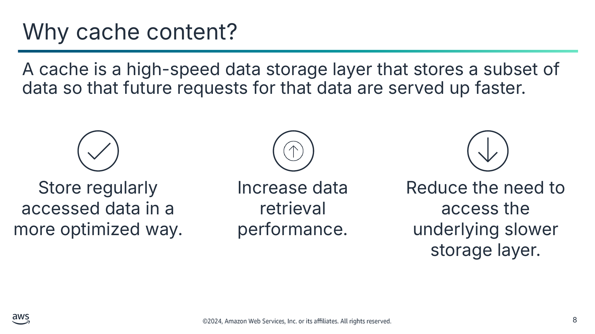

A cache is a high-speed data storage layer that stores a subset of data so that future requests for that data are served up faster.

Store regularly accessed data in a more optimized way.

Increase data retrieval performance.

Reduce the need to access the underlying slower storage layer.

> **Нотатки:**
>
> |Slide number 8  
> |Instructor notes  
> |One way to improve system performance is to make data available more quickly. Many systems have pieces of data that are more frequently accessed than others. In such situations, temporarily storing that data on a storage technology that is faster than its natural location will permit faster access. Caching gives you the ability to efficiently reuse previously retrieved or computed data. A cache is a high-speed data storage layer that stores a subset of data so that future requests for that data are served up faster than is possible by accessing the data’s primary storage location.  
> |  
> |The “Let’s Architect! Leveraging in-memory databases” blog provides caching use cases in which performance has increased. This resource could be shared at the beginning of the module to help students understand how caching is used or at the end of the module to see the services they have learned applied in the industry.  
> |  
> |Student notes  
> The speed at which you deliver content affects the success of your application. Caching provides a way to increase the speed of data retrieval and reduces the frequency in which the main database or storage layer is accessed. In computing, a cache is a high-speed data storage layer. Unlike a database, which usually stores data in a complete and durable form, a cache transiently stores a subset of data.  
>
> Caching facilitates faster access to data because the primary purpose of a cache is to increase the performance of data retrieval by reducing the need to access the underlying, slower storage layer. Future requests for cached data are served faster than requests that access the data’s primary storage location. Caching gives you the ability to efficiently reuse previously retrieved or computed data. Caching is an optimization strategy that will help with cost reduction and performance enhancement. For the end user, caching provides faster performance.

---

## Слайд 9: Caching analogy

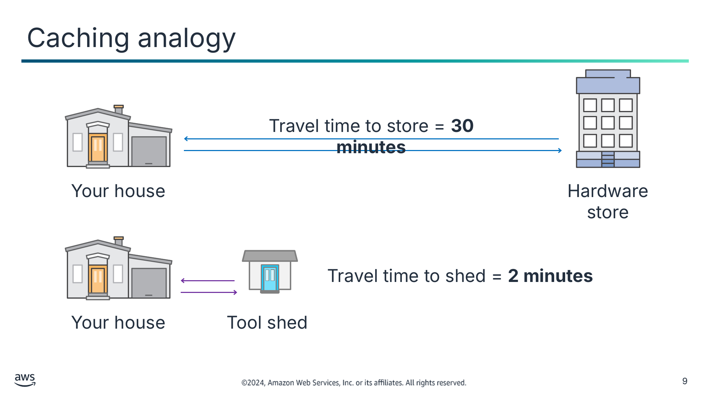

Текст зі схеми

Travel time to store = **30 minutes**

Your house

Hardware store

Your house

Tool shed

Travel time to shed = **2 minutes**

> **Нотатки:**
>
> |Slide number 9  
> |Instructor notes  
> |  
> |Student notes  
> To illustrate how a cache improves performance, consider the example of making a trip to a hardware store.  
>
> If the store is miles away, it takes you considerable effort to go there every time you need something. Instead, you can store the supplies that you use regularly in a tool shed close to your house. Therefore, it takes you less time to access these supplies than it would to go all the way to the hardware store. However, you could still go to the store to refresh your supplies.  
>
> In this example, the tool shed is analogous to a cache. You keep the tools you need often in a nearby location. In caching, this nearby location can have different forms, such as edge locations and in-memory databases. You will learn more about using edge locations and an in-memory database in this module.

---

## Слайд 10: What should you cache?

Static and frequently accessed data

Results of computationally intensive calculations

Results of time-consuming, frequently used, or complex database queries

> **Нотатки:**
>
> |Slide number 10  
> |Instructor notes  
> |  
> |Student notes  
> The following are examples of typically cached content:  
> Static and frequently accessed data: For caching to provide meaningful benefits, the data should be static and frequently accessed, such as a personal profile on a social media site. Static content is content that rarely changes, such as HTML, CSS, JavaScript, images, and video files. Conversely, you don't want to cache data if caching it provides no speed or cost advantage.  
> Results of computationally intensive calculations: Compute-intensive workloads that manipulate data sets, such as recommendation engines and high-performance computing simulations, also benefit from caching in the form of an in-memory data layer acting as a cache.  
> Results of time-consuming, frequently used, or complex database queries: Time-consuming, frequently used, or complex database queries often create bottlenecks in applications. Generally, if the data requires a slow and expensive query to acquire, it's a candidate for caching. For example, queries that perform joins on multiple tables are slower and more expensive than queries on single tables. However, even data that requires a relatively quick query might still be a candidate for caching.

---

## Слайд 11: Trade-offs to consider when caching

Benefits of caching

Challenges of caching

- Reduces response latency
- Reduces cost
- Alleviates the load on the origin (data source)
- Provides predictable performance
- Improves availability

- Requires additional engineering
- Requires someone to determine how to cache data and deal with stale data based on the business use case

> **Нотатки:**
>
> |Slide number 11  
> |Instructor notes  
> |The article “Caching challenges and strategies” can be used to provide specific benefits and challenges of caching for students who have experience with caching. Best practices and considerations are provided at the end of the article. A link is provided on the content resources page of your online course.  
> |Make sure there is a legitimate need for a cache that is justified in terms of cost, latency, or availability improvements.  
> |Plan to operate the cache with the same rigor and processes used for the rest of the service fleet and infrastructure. Don’t underestimate this effort.  
> |Be deliberate and empirical in the choice of cache size, expiration policy, and eviction policy.  
> |  
> |Student notes  
> The benefits of caching are its ability to reduce the response latency that users experience with your application, reduce cost, alleviate the load on source data, and provide predictable application performance. When implementing caching, an extra component is added to the infrastructure. Although caching enhances performance, it also increases complexity. You should consider the additional engineering required to maintain the cache. Additional coding may be required in some database scenarios. Another challenge of caching content is determining how to cache data and deal with stale data. This is done based on the business use case. This module discusses ways to deal with stale content so that you can decide when having up-to-date data is worth the cost and effort.  
>
> When implementing caching data, consider the trade-offs. It can help dramatically improve performance but requires a clear strategy for how and when to update or invalidate cached data to prevent incorrect system behavior.

---

## Слайд 12: Types of caching and AWS caching services

Amazon CloudFront

Amazon ElastiCache

Static caching (edge caching)

Database caching (data caching)

Retrieve content from the nearest edge location.

Retrieve content from an in-memory database layer.

> **Нотатки:**
>
> |Slide number 12  
> |Instructor notes  
> |The AWS Caching Solutions page explains other AWS caching solutions. The link is provided in the resource page.  
> |  
> |Student notes  
> The two types of caching that you will learn about in this module are static caching and database caching:  
> Static caching, or edge caching, is using caching servers to store content closer to users. A content delivery network (CDN) provides the ability to use its global network of edge locations to deliver a cached copy of web content such as videos, webpages, and images to your customers. To reduce response time, a CDN uses the edge location nearest to the customer or to the originating request location to deliver a cached copy of static content. CloudFront is a global CDN service that accelerates the delivery of your content.  
> In database caching, the cache acts as an adjacent data access layer to your database that your applications can use to improve performance. A database cache layer can be applied in front of any type of database, including relational and NoSQL databases. Common techniques used to load data into your cache include lazy loading and write-through methods. ElastiCache is a web service that you can use to deploy, operate, and scale an in-memory data store or cache in the cloud. The service improves the performance of web applications by giving you the ability to retrieve information from fast, managed, in-memory data stores instead of relying entirely on slower disk-based databases.

---

## Слайд 13: Key takeaways: Overview of caching

- A cache is a high-speed data storage layer that stores a subset of data so that future requests for that data are served up faster.
- Static and frequently accessed data are good candidates for caching.
- Caching improves application speed and decreases database cost.
- Content is retrieved from the nearest edge location with static caching and retrieved from an in-memory database layer with database caching.

> **Нотатки:**
>
> |Slide number 13  
> |Instructor notes  
> |  
> |Student notes

---

## Слайд 14: Caching using CloudFront

Caching Content

> **Нотатки:**
>
> |Slide number 14  
> |Instructor notes  
> |  
> |Student notes  
> This section explains how CloudFront facilitates static caching securely as a CDN service.

---

## Слайд 15: Content delivery network (CDN)

Delivery challenge

CDN solution

Deliver geographically dispersed content with low latency and low cost for end users to access.

- Is a globally distributed system of caching servers
- Has intermediary servers between the client and the application
- Caches copies of commonly requested files (static content)
- Delivers a local copy of the requested content from a nearby cache edge or point of presence

> **Нотатки:**
>
> |Slide number 15  
> |Instructor notes  
> |CDNs are introduced as the solution to the challenge of delivering content across the globe in a secure and cost-optimized way.  
> |This slide is meant to explain the concept of CDNs in preparation for introducing what CloudFront can do. Once students understand CloudFront as a service, the slide explaining CloudFront edge locations and edge caches will complete what they need to know about CDNs.  
> |  
> |Student notes  
> Challenge: Because of the global and complex nature of the internet, communication traffic between applications and their users (clients) has to move over large physical distances. The communication is also two-way, with requests going from the client to the server and responses coming back. For example, when a user visits a website, data from that website's server has to travel across the internet to reach the user's computer. If the user is located far from that server, it will take a long time to load a large file, such as a video or website image.  
>
> Solution: A CDN is a network of interconnected servers that speeds up application loading for data-heavy applications. Static content is stored on CDN servers geographically closer to the users and reaches their computers much faster. A CDN improves efficiency by introducing intermediary servers between the client and the website server. These CDN servers manage some of the client-server communications. They decrease web traffic to the web server, reduce bandwidth consumption, and improve the user experience of your applications. A CDN caches copies of commonly requested files that are hosted on the application origin server. These files can include static content, such as HTML, CSS, JavaScript, image, and video files. The CDN delivers a local copy of the requested content from a cache edge or point of presence (PoP) that provides the fastest delivery to the requester.

---

## Слайд 16: Which type of content can you cache by using an edge cache?

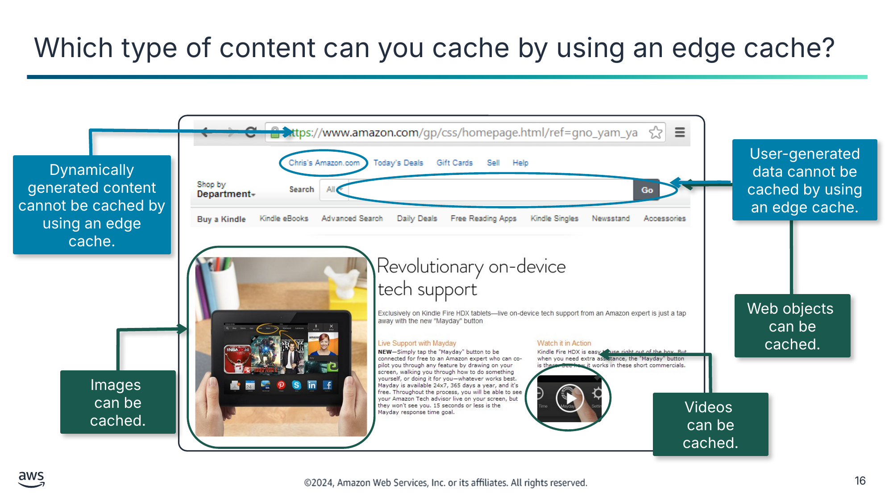

User-generated data cannot be cached by using an edge cache.

Dynamically generated content cannot be cached by using an edge cache.

Web objects  
can be cached.

Images  
can be cached.

Videos  
can be cached.

> **Нотатки:**
>
> |Slide number 16  
> |Instructor notes  
> |  
> |Student notes  
> This example of an Amazon.com webpage shows how static and dynamic content can compose a dynamic web application. This web application is delivered through the HTTPS protocol for the encryption of user page requests and the pages that are returned from a web server.  
> You can use a CDN or edge cache to cache static content. Such content might include web objects (for example, HTML documents, CSS style sheets, or JavaScript files), image files, and video files.  
> You cannot cache dynamically generated content or user-generated data. However, you can configure CloudFront to deliver this information from an application that runs on a custom origin. For example, it might be an Amazon Elastic Compute Cloud (Amazon EC2) instance or a web server.  
>
> Additionally, you can configure CloudFront to require that viewers use HTTPS to request your objects so that connections are encrypted when CloudFront communicates with viewers. You also can configure CloudFront to use HTTPS to get objects from your origin so that connections are encrypted when CloudFront communicates with your origin.

---

## Слайд 17: CloudFront

- Is a CDN service that delivers content across the globe securely with low latency and high transfer speeds
- Provides high-speed content distribution by delivering through edge locations
- Improves application resiliency from distributed denial of service (DDoS) attacks by leveraging services such as AWS Shield and AWS WAF

CloudFront

> **Нотатки:**
>
> |Slide number 17  
> |Instructor notes  
> |For more information, see the CloudFront documentation link on the content resources page of your online course.  
> |  
> |Student notes  
> CloudFront is a CDN service built for high performance, security, and developer convenience. With CloudFront, you can deliver data through globally dispersed PoPs with automated network mapping and intelligent routing.  
> CloudFront speeds up the distribution of your content by routing each user request through the AWS backbone network to the edge location that can best serve your content. Typically, this is a CloudFront edge server that provides the fastest delivery to the viewer. Using the AWS network dramatically reduces the number of networks that your users' requests must pass through, which improves performance. You also get increased reliability and availability because copies of your content are now cached in multiple edge locations around the world.  
> With the web application firewall, AWS WAF, and the managed distributed denial of service (DDoS) protection service, AWS Shield, you can use CloudFront to improve the resiliency of your applications that run on AWS from DDoS attacks. CloudFront protects against network and application layer attacks, supports multiple methods of access control, and helps ensure secure delivery for sensitive data. CloudFront delivers content over HTTPS by using the latest TLS version to encrypt and secure communication between viewer clients and CloudFront.

---

## Слайд 18: CloudFront global edge network components

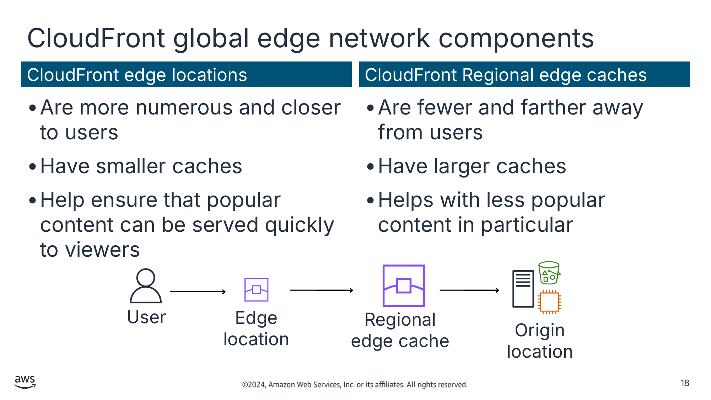

CloudFront edge locations

CloudFront Regional edge caches

- Are more numerous and closer to users
- Have smaller caches
- Help ensure that popular content can be served quickly to viewers

- Are fewer and farther away from users
- Have larger caches
- Helps with less popular content in particular

Текст зі схеми

User

Edge location

Origin location

Regional edge cache

> **Нотатки:**
>
> |Slide number 18  
> |Instructor notes  
> |The image shows the CloudFront global edge network components that exist between the user and the origin location. CloudFront edge locations are closer to users while CloudFront Regional edge caches are farther away. The larger Regional edge caches are located between your origin location and the global edge locations that serve content directly to viewers. Access a map of the global edge network to show students how these PoPs are distributed by using the Amazon CloudFront Key Features link on the resource page.  
> |  
> |Student notes  
> To deliver content with lower latency to end users, CloudFront uses a global network of more than 550 edge locations and 13 Regional edge caches in more than 100 cities across 50 countries. The information is current as of October 2023.  
> CloudFront edge locations are more numerous and closer to users than Regional edge caches. There are fewer CloudFront Regional edge caches, which are farther away from users than edge locations. A Regional edge cache has a larger cache than an individual edge location, so objects remain in the Regional edge cache longer. This arrangement helps to keep more of your content closer to your viewers.  
> CloudFront edge locations make sure that popular content can be served quickly to viewers. As objects become less popular, individual edge locations might remove those objects to make room for more popular content. For less popular content, CloudFront has Regional edge caches. Regional edge caches help with all types of content, particularly content that tends to become less popular over time. Examples include user-generated content; ecommerce assets, such as product photos and videos; and news and event-related content that might suddenly become popular.  
> As the slide shows, Regional edge caches are CloudFront locations that are deployed globally and close to your viewers. They are located between your origin location and the global edge locations that serve content directly to viewers. Regional edge caches reduce the need for CloudFront to go back to your origin server, and they improve overall performance for viewers.  
> CloudFront edge locations are connected to AWS Regions through the AWS network backbone—fully redundant, multiple 100 gigabit Ethernet (GbE) parallel fibers that circle the globe and link with tens of thousands of networks for improved origin fetches and dynamic content acceleration.  
>
> For more information about where the edge locations and Regional edge caches are, see the Amazon CloudFront Key Features page in the course resource document.

---

## Слайд 19: How caching works in CloudFront

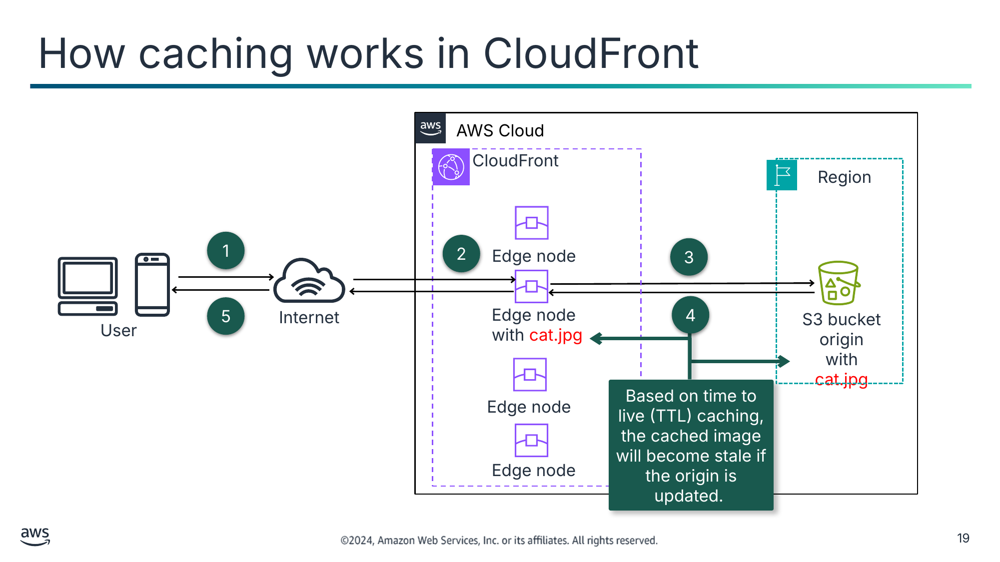

Текст зі схеми

AWS Cloud

CloudFront

Region

S3 bucket origin

with cat.jpg

Internet

User

1

2

Edge node

3

5

4

Edge node  
with cat.jpg

Edge node

Based on time to live (TTL) caching, the cached image will become stale if the origin is updated.

Edge node

> **Нотатки:**
>
> |Slide number 19  
> |Instructor notes  
> |The next section covers approaches to handling stale content. This diagram is meant to provide a high-level understanding of caching with CloudFront.  
> |  
> |Student notes  
> A user makes a request to access the cat.jpg image file.  
> The DNS routes the request to the edge location that can best serve the request. Typically, it is the nearest edge location that has the shortest latency. CloudFront checks the cache for the requested content. If the content is in the cache, CloudFront delivers it immediately to the user (step 5), and the data journey ends here.  
> The content might not be currently in the cache. If that is the case, CloudFront forwards the request to the origin location that you identified as the source for the definitive version of your content: in this case, the Amazon Simple Storage Service (Amazon S3) bucket that contains the image file.  
> The origin location sends the object back to the edge location.  
> CloudFront then forwards the file to the user, and it also adds it to the cache for the next time someone requests it.  
>
> The time to live (TTL) is the setting in CloudFront that determines how long the edge locations should cache the content before requesting it again from the origin server. Based on the TTL specified, the cached image will become stale if the origin is updated.

---

## Слайд 20: How to configure a CloudFront distribution

Specify an  
origin location.

Configure  
the distribution.

CloudFront becomes available.

CloudFront sends your distribution’s  
configuration to  
edge locations.

> **Нотатки:**
>
> |Instructor notes  
> |The resource page includes a CloudFront tutorial. It is a step-by-step guide that has screenshots to create a CloudFront web distribution and deliver a piece of static content hosted in the cloud through Amazon S3.  
> |  
> |If students have questions about how to configure a CloudFront distribution, this page is a helpful resource for you to respond with screenshots.  
> |  
> |Student notes  
> When you want to use CloudFront to distribute your content, follow these steps:  
> You specify the origin location from which CloudFront gets your files. These files will be distributed from CloudFront edge locations all over the world. An origin server stores the original, definitive version of your objects. If you're serving content over HTTP, your origin server is either an S3 bucket or an HTTP server, such as a web server. Your HTTP server can run on an EC2 instance or on an on-premises server that you manage. These servers are also known as custom origins.  
> You create a CloudFront distribution, which tells CloudFront which custom origins to get your files from when users request the files through your website or application. At the same time, you specify details such as whether you want CloudFront to log all requests and whether you want the distribution to be enabled as soon as it's created.  
> CloudFront becomes available and assigns a domain name to your new distribution.  
> CloudFront sends your distribution's configuration—but not the content—to all edge locations. Edge locations are collections of servers in geographically dispersed data centers where CloudFront caches copies of your objects.

---

## Слайд 21: Controlling how long content is cached

Set a maximum TTL value

Implement content versioning

Specify  
cache-control headers

Use CloudFront invalidation requests

Expires cached content faster with a low maximum TTL value

Fetches and caches new files immediately

Provides precise control over content expiration for individual files

Forces CloudFront to expire content from edge caches

> **Нотатки:**
>
> |Instructor notes  
> |In the resource document, the link to the section titled “Managing How Long Content Stays in the Cache (Expiration)” of the Amazon CloudFront Developer Guide is included. You will find examples of different origin headers and TTL settings and how they affect caching as concrete examples to share with your students.  
> |  
> |Student notes  
> If you’re ever confused by a situation in which you’ve updated content, but you are still seeing stale content, one likely reason is that CloudFront is still serving up cached content. You can control CloudFront caching behavior with a combination of CloudFront minimum TTL specifications, maximum TTL specifications, content versioning, cache-control HTTP headers, and CloudFront invalidation requests.  
>
> CloudFront will typically serve cached content from an edge location until the content expires. After it expires, the next time that content is requested by an end user, CloudFront goes back to the origin location to fetch the content and then cache it. CloudFront edge locations automatically expire content after maximum TTL seconds elapse (by default, this is 24 hours). For managing how long content is cached, the best practice is to understand and use the four approaches together:  
> Set a maximum TTL value: CloudFront may expire content anytime between the minimum TTL and maximum TTL. By default, each file automatically expires after 24 hours. You can change the default behavior and set the maximum TTL to be a relatively low value. The trade-off is that cached content expires faster because of the low maximum TTL value. This results in more frequent requests to your origin because the CloudFront caches need to be repopulated more often.  
> Implement content versioning: Every time you update content, embed a version identifier in the file names. It can be a timestamp, a sequential number, or any other information that you can use to distinguish between two versions of the same file. Content versioning has a clear benefit: it sidesteps CloudFront expiration behaviors altogether. Because new file names are involved, CloudFront immediately fetches the new files from the origin (and afterwards, cache them).  
> Specify cache-control headers: You can manage CloudFront expiration behavior by specifying Cache-Control headers for your website content. If you keep the minimum TTL at the default 0 seconds, then CloudFront honors any Cache-Control: max-age HTTP header that is individually set for your content. This gives you more precise control over content expiration for individual files.  
> Use CloudFront invalidation requests: CloudFront invalidation requests are a way to force CloudFront to expire content. Invalidation requests aren’t immediate. It takes several minutes from the time that you submit one to the time that CloudFront actually expires the content. CloudFront gives you the ability to specify which content should be invalidated. You should use this method sparingly and only for individual objects. The next time a viewer requests the file, CloudFront returns to the origin to fetch the latest version of the file.

---

## Слайд 22: Using CloudFront for video streaming

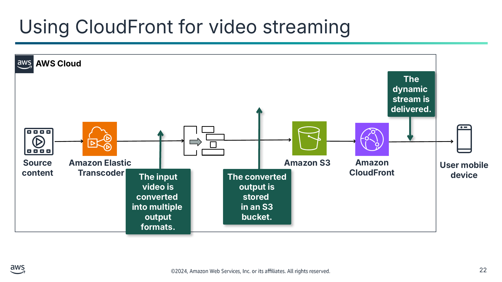

Текст зі схеми

 **AWS Cloud**

**The dynamic**  
**stream is**  
**delivered.**

**Source**  
**content**

**Amazon Elastic**  
**Transcoder**

**Amazon S3**

**Amazon**  
**CloudFront**

**The input video is converted**  
**into multiple**  
**output formats.**

**The converted**  
**output is stored**  
**in an S3 bucket.**

**User mobile**  
**device**

> **Нотатки:**
>
> |Instructor notes  
> |For more information, see the Amazon Elastic Transcoder documentation link on the content resources page of your online course.  
> |This architecture prepares students for the CloudFront lab.  
> |  
> |Student notes  
> You can use CloudFront to deliver streaming videos. You must use an encoder to format and package video content before CloudFront can distribute it. After converting the video into the output formats, you host the converted content in an S3 bucket, which is your origin server. You then use CloudFront to deliver the segment files to users around the world.  
>
> Examples of encoders include AWS Elemental MediaConvert and Amazon Elastic Transcoder. Elastic Transcoder provides a way for developers to convert (or transcode) media files from their source format into versions that will play back on devices such as smartphones, tablets, and PCs. The packaging process creates segments, which are static files that contain your audio, video, and captions content. It also generates manifest files, which describe which segments to play and the specific order to play them in. Package formats include Dynamic Adaptive Streaming over HTTP (DASH, or MPEG-DASH), Apple HTTP Live Streaming (HLS), Microsoft Smooth Streaming, and Common Media Application Format (CMAF).

---

## Слайд 23: DDoS mitigation

Security challenge

CloudFront solution

Publicly accessible content is exposed to common web threats that affect availability and compromise security.

- Monitoring and mitigation are built into Amazon Route 53 as it routes traffic to CloudFront.
- CloudFront can create an AWS WAF web access control list (ACL) that configures rules to analyze incoming requests and block threats before they reach your servers.
- Shield DDoS mitigations allow only traffic that is valid for web applications to pass through to CloudFront.

> **Нотатки:**
>
> |Slide number 23  
> |Instructor notes  
> |DDoS events occur when a threat actor sends traffic floods from multiple sources to disrupt the availability of a targeted application. The blog “How to Help Protect Dynamic Web Applications Against DDoS Attacks by Using Amazon CloudFront and Amazon Route 53” visually explains how Shield, CloudFront, and Route 53 work together to help protect against DDoS attacks. A link is provided on the content resources page of your online course.  
> |  
> |Student notes  
> Challenge: Publicly accessible web applications and APIs are exposed to threats such as commonly occurring vulnerabilities described in the OWASP Top 10; SQL injection; automated requests; and HTTP floods (denial of service [DoS]) that affect availability, compromise security, or consume excessive resources. A DDoS attack is a deliberate attempt to make your website or application unavailable to users, for example, by flooding it with network traffic. To achieve this end, attackers use multiple sources to orchestrate an attack against a target. These sources might include distributed groups of malware-infected computers, routers, Internet of Things (IoT) devices, and other endpoints.  
>
> Solution: You can use CloudFront to improve the resiliency of your applications that run on AWS from DDoS attacks. To protect your system from DDoS attacks, use CloudFront for distributing both static and dynamic content. The following combined features help ensure that your application origin receives only well-formed web requests and that it's protected against common web threats:  
> A DNS service, such as Amazon Route 53, can effectively connect users’ requests to a CloudFront distribution. The CloudFront distribution then proxies requests for dynamic content to the infrastructure that hosts your application’s endpoints. Both Route 53 DNS requests and subsequent application traffic that are routed through CloudFront are inspected inline. Always-on monitoring, anomaly detection, and mitigation against common infrastructure DDoS attacks are built into both Route 53 and CloudFront.  
> AWS WAF analyzes incoming requests and helps you block these types of threats before they reach your servers. You can secure your CloudFront distributions with AWS WAF by configuring your web access control list (web ACL) containing the security rules that you’d like to enable. CloudFront creates an AWS WAF web ACL, configures rules to protect your servers from common web threats, and attaches the web ACL to the CloudFront distribution for you.  
> Shield DDoS mitigation continually inspects traffic for CloudFront. Shield DDoS mitigations allow only traffic that's valid for web applications to pass through to the service. This provides automatic protection against many common DDoS vectors, such as UDP reflection attacks.

---

## Слайд 24: Key takeaways: Caching using CloudFront

- Static file caching is done by using a CDN.
- CloudFront is a CDN service that uses edge locations and Regional edge caches to deliver content securely across the globe.
- You can control CloudFront caching behavior by using a combination of actions.
- By using CloudFront for distributing content, you are also protecting your systems from DDoS attacks.

> **Нотатки:**
>
> |Slide number 24  
> |Instructor notes  
> |  
> |Student notes

---

## Слайд 25: Guided lab: Streaming Dynamic Content Using Amazon CloudFront (CloudFront lab)

> **Нотатки:**
>
> |Slide number 25  
> |Instructor notes  
> |  
> |Student notes  
> You will now complete a lab. The next slides summarize what you will do in the lab, and you will find the detailed instructions in the lab environment.

---

## Слайд 26: CloudFront lab tasks:

In this lab, you perform the following main tasks:

- Create an Amazon CloudFront distribution.
- Create an Amazon Elastic Transcoder pipeline.
- Test playback of the dynamic (multiple bitrate) stream.

> **Нотатки:**
>
> |Slide number 26  
> |Instructor notes  
> |  
> |Student notes  
> Access the lab environment through your online course to get additional details and complete the lab.

---

## Слайд 27: Debrief: CloudFront lab

- What did you specify as the origin that will be used to deliver the multiple bit-rate files generated by Amazon Elastic Transcoder to end-user devices?
- Which two components does the playback URL that plays through Amazon CloudFront consist of?

> **Нотатки:**
>
> |Slide number 27  
> |Instructor notes  
> |Relevant before and after architectural diagrams are included in the lab instructions for each lab. You might find it helpful to pull the lab diagrams up as part of debriefing this lab.  
> |  
> |Suggested responses for question 1: What did you specify as the origin that will be used to deliver the multiple bit-rate files generated by Amazon Elastic Transcoder to end-user devices?  
> |  
> |You chose the S3 bucket that was created for you: awstrainingreinvent.  
> |  
> |When you create a CloudFront distribution, you specify the origin where CloudFront sends requests for the files. You can use several different kinds of origins with CloudFront. For example, you can use an S3 bucket, a MediaStore container, a MediaPackage channel, an Application Load Balancer, or a Lambda function URL.  
> |  
> |Suggested responses for question 2: Which two components does the playback URL that plays through Amazon CloudFront consist of?  
> |CloudFront domain name  
> |Path of the playlist file in the S3 bucket (output generated by Elastic Transcoder): The following is an example: http:// domain name>/<playlist file path in Amazon S3 bucket>  
> |  
> |Student notes  
> Your instructor might review these questions with you, or you might review them on your own. Use this opportunity to extend your thinking about the tasks that you performed during the lab.

---

## Слайд 28: Caching using ElastiCache

Caching Content

> **Нотатки:**
>
> |Slide number 28  
> |Instructor notes  
> |  
> |Student notes  
> This section explains how to use ElastiCache for database caching.

---

## Слайд 29: When should you cache your database?

You are concerned about response times for your customer.

You have a high volume of requests that are overburdening your database.

You want to reduce your database costs.

> **Нотатки:**
>
> |Slide number 29  
> |Instructor notes  
> |The overview section at the beginning of the course and the final section of the course discuss the trade-offs of implementing a caching component. This slide draws students’ attention to general scenarios in which database caching might be a suitable choice to consider. You can read more about the specific use case of an online medical library that uses ElastiCache as mentioned in the student notes by using the link in the resource guide in the “Latency reduction of hybrid architectures with Amazon ElastiCache” blog.  
> |  
> |Student notes  
> As you learned earlier in this module, time-consuming database queries and complex queries can create bottlenecks in applications.  
>
> A database cache supplements your primary database by removing unnecessary pressure on it, typically in the form of frequently accessed read data. The cache itself can be in a number of areas, including your database or application, or as a standalone layer. You should consider caching your database in the following situations:  
> You are concerned about response times for your customer. You might have latency-sensitive workloads that you want to speed up. Caching can help you increase throughput and reduce data retrieval latency, thus improving the performance of your application.  
> You have a high volume of requests that overburden your database. You might have a large amount of traffic and therefore are not getting the throughput that you need for that workload. Putting a caching layer next to your database can increase your throughput and help you achieve higher performance.  
> You would like to reduce your database costs. Whether data is distributed in a disk-based NoSQL database or vertically scaled up in a relational database, scaling for high reads can be costly. A number of database read replicas might be necessary to match what a single in-memory cache node can deliver in terms of requests per second.  
>
> A use case is an online medical library with search capabilities that are driven by a database. The database was overloaded due to a high number of queries from a search engine. The results from the queries were so large that they saturated the customer’s low-speed network link, affecting the response time. In this case, the solution was an in-memory cache based on ElastiCache. Because the issue involves latency to the backend database, using ElastiCache will reduce network latency and offload the database pressure.  
>
> When implementing caching data, also consider the trade-offs. Caching can help dramatically improve performance but requires a clear strategy for how and when to update or invalidate cached data to prevent incorrect system behavior.

---

## Слайд 30: ElastiCache

- Is a fully managed, key-value, in-memory data store with sub-millisecond latency
- Sits between an application and an origin data store
- Decreases access latency and eases the load of databases and applications
- Provides a high performance and cost-effective in-memory cache
- Is fully compatible with open source Redis and Memcached engines

ElastiCache

> **Нотатки:**
>
> |Slide number 30  
> |Instructor notes  
> |For more information, see the ElastiCache documentation link on the content resources page of your online course.  
> |  
> |Student notes  
> ElastiCache is an in-memory, key-value store that sits between your application and the data store (database) that it accesses. You can use ElastiCache to deploy, operate, and scale an in-memory cache in the cloud.  
>
> The benefits of ElastiCache include the following:  
> Fully managed: ElastiCache manages the work involved in setting up a distributed in-memory environment, from provisioning the server resources that you request to installing the software. After your environment is up and running, the service automates common administrative tasks, such as failure detection, recovery, and software patching. ElastiCache provides detailed monitoring metrics that are associated with your nodes to help you diagnose and react to issues quickly.  
> Scalable: ElastiCache can scale out, scale in, and scale up to meet fluctuating application demands.  
> Extreme performance: ElastiCache works as an in-memory data store and cache to support the most demanding applications that require sub-millisecond response times.  
> Cost-effective: Most data stores have areas of data that are frequently accessed but seldom updated. Additionally, querying a database is always slower and more expensive than locating a key in a key-value pair cache. Some database queries are especially expensive to perform, such as queries that involve joins across multiple tables or queries with intensive calculations. By caching these kinds of query results, you pay the price of the query one time. Then, you can quickly retrieve the data multiple times without having to rerun the query.  
> Memcached or Redis compatible: Developers can continue to use the same Redis and Memcached application code, drivers, and tools to run, manage, and scale their workloads on ElastiCache. You can use Elasticache to seamlessly deploy, run, and scale popular open-source-compatible in-memory data stores. Manage and analyze fast-moving data with ElastiCache for Redis, or build a scalable caching tier for data-intensive applications with ElastiCache for Memcached.

---

## Слайд 31: Choose an ElastiCache engine based on what you need

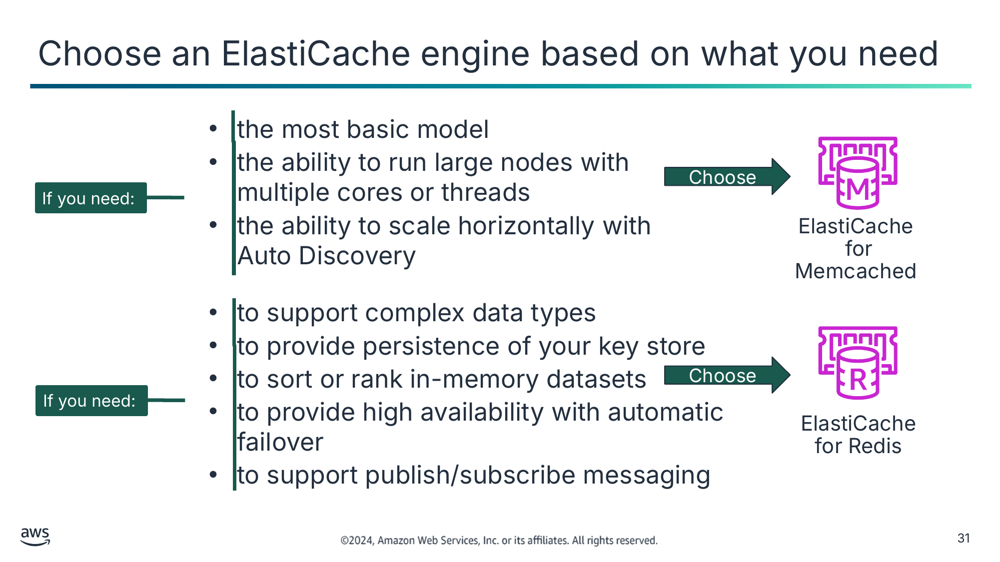

- the most basic model
- the ability to run large nodes with multiple cores or threads
- the ability to scale horizontally with Auto Discovery

Choose

ElastiCache  
for Memcached

- to support complex data types
- to provide persistence of your key store
- to sort or rank in-memory datasets
- to provide high availability with automatic failover
- to support publish/subscribe messaging

Choose

ElastiCache  
for Redis

Текст зі схеми

If you need:

If you need:

> **Нотатки:**
>
> |Slide number 31  
> |Instructor notes  
> |  
> |Student notes  
> One goal of ElastiCache is to reduce the additional complexity of administering your in-memory caching systems for Redis and Memcached engines. The Memcached and Redis engines are caches that can be used to offload a database burden. Both engines offer sub-millisecond response times. By storing data in memory, they can read data more quickly than disk-based databases. Each engine provides certain advantages.  
>
> ElastiCache for Memcached offers the following:  
> Low maintenance: Memcached requires less maintenance than Redis. Choose Memcached if you need the most basic model.  
> Multithreading: Because Memcached is multithreaded, it can use multiple processing cores, which means that you can handle more operations by scaling up compute capacity. Choose this engine if you need to run large nodes with multiple cores or threads.  
> Horizontal scalability with Auto Discovery: When Memcached clusters are used in ElastiCache, the clusters can add and remove nodes by using the Auto Discovery feature. This feature automatically discovers changes to the node membership in a cluster, such as new nodes that are added or nodes that were subtracted. The ElastiCache client reconfigures automatically in response.  
>
> ElastiCache for Redis offers the following:  
> Advanced data structures: Redis supports complex data types, such as strings, hashes, lists, sets, sorted sets, and bitmaps. If you need complex data types, choose Redis.  
> Persistence: Redis provides persistence of your key store. By contrast, the Memcached engine does not support persistence. For example, perhaps a node fails and is replaced with a new, empty node, or you might delete a node or scale one down. In this case, you lose the data that’s stored in cache memory.  
> Sorting or ranking of datasets: You can use Redis to sort or rank in-memory datasets. For example, you can use Redis-sorted sets to implement a game leaderboard that keeps a list of players that is sorted by their rank.  
> Multi-AZ deployments with automatic failover: ElastiCache for Redis provides high availability through Multi-AZ deployments with automatic failover in case your primary node fails.  
> Publish/subscribe messaging: Redis supports publish/subscribe messaging with pattern matching, which you can use for high-performance chat rooms, real-time comment streams, social media feeds, and server intercommunication.

---

## Слайд 32: ElastiCache components

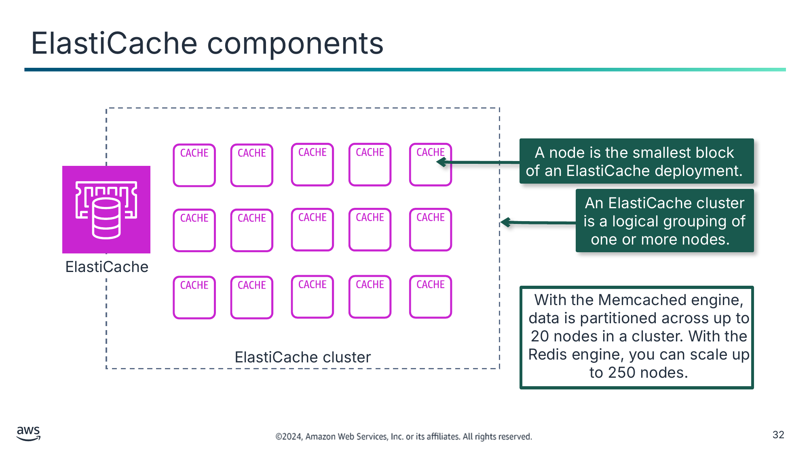

A node is the smallest block  
of an ElastiCache deployment.

An ElastiCache cluster is a logical grouping of one or more nodes.

Текст зі схеми

ElastiCache

ElastiCache cluster

With the Memcached engine, data is partitioned across up to 20 nodes in a cluster. With the Redis engine, you can scale up to 250 nodes.

> **Нотатки:**
>
> |Slide number 32  
> |Instructor notes  
> |  
> |Student notes  
> A cache node is the smallest building block of an ElastiCache deployment. It is a fixed-size chunk of secure, network-attached RAM. Each node runs the engine that was chosen when the cluster or replication group was created or last modified. Each node has its own DNS name and port. It can exist in isolation from other nodes or in a grouping with other nodes, which is also known as a cluster. If necessary, you can scale the nodes in a cluster up or down to a different instance type. Your application connects to an ElastiCache node or cluster by using a unique address that is called an endpoint.  
>   
> While the ElastiCache components are the same, depending on which engine you use, there will be some differences.  
> With the Memcached engine, data is partitioned across nodes in a cluster. Memcached data is partitioned across up to 20 nodes. For Memcached workloads, data is partitioned across all nodes in the cluster. Thus, you can scale out to better handle more data when demand grows.  
> With the Redis engine, you can scale your Redis cluster up to 250 nodes. A Redis cluster is a logical grouping of one or more shards. A Redis shard is a grouping of 1-6 related nodes. ElastiCache for Redis provides high availability through Multi-AZ deployments with automatic failover.

---

## Слайд 33: Time to live (TTL)

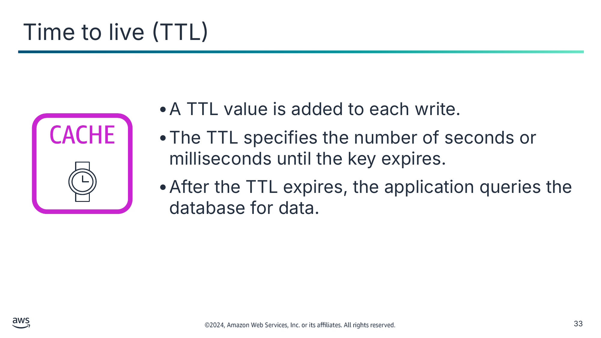

- A TTL value is added to each write.
- The TTL specifies the number of seconds or milliseconds until the key expires.
- After the TTL expires, the application queries the database for data.

> **Нотатки:**
>
> |Slide number 33  
> |Instructor notes  
> |For the minimum TTL, both engines allow a TTL of 0, which means that the key-value pair is evicted or expired as soon as it is set or retrieved. For the maximum TTL, there isn’t an explicit maximum TTL for Memcached. If you don’t set a specific TTL, keys will persist until the cache is full, at which point Memcached will start evicting keys in the order of those least recently used. Redis does have a configurable maximum TTL. You can define the eviction policy yourself in the Redis config file, which is out of scope for this course. Without explicitly setting a TTL, the default behavior for both service engines is to let keys persist indefinitely until space is needed or the data is manually removed.  
> |  
> |Student notes  
> The time to live (TTL) is an integer value or key that specifies the number of seconds or milliseconds, depending on the in-memory engine, until the key expires. When an application attempts to read an expired key, the application is treated as though the data isn’t found in the cache. As a result, the database is queried and the cache is updated. This way, the data doesn’t get too stale, and values in the cache are occasionally refreshed from the database.  
>
> Data gets stale by nature. The next slide explains two strategies to handle stale data.

---

## Слайд 34: Strategies for handling stale data

| Features | Lazy Loading | Write-Through |
|---|---|---|
| Caching Pattern | This strategy updates the cache after the data is requested. | This strategy updates the cache immediately after updating the primary database. |
| Advantage | The cache contains only data that the application actually requests. | The cache is up-to-date with the primary database (most likely data will be found in the cache). |
| Disadvantage | This strategy requires a programmatic strategy to handle keeping the cache as up to date. | This strategy results in an increase in cost from storing data in-memory that you might not use. |

> **Нотатки:**
>
> |Slide number 34  
> |Instructor notes  
> |This slide serves as an introduction of two caching strategies: lazy loading and write-through. The caching patterns of the two strategies are explained, and the advantages and disadvantages are compared. The following two slides illustrate the process of these strategies.  
> |  
> |For a more detailed explanation, see the Caching Strategies section of the ElastiCache documentation. A link is provided in the resource page.  
> |  
> |Student notes  
> There are multiple strategies for keeping information in the cache in sync with the database. This slide examines two of the common caching strategies. At a high level, the following is a comparison of these strategies:  
> In lazy loading, data is loaded into the cache only when it is necessary. Lazy loading helps ensure that the data loaded into the cache is data that the application needs. The disadvantage of this strategy is that it permits stale data, so the data is not always up to date.  
> An alternative strategy is to write-through to the cache every time the database is accessed. This approach results in fewer cache misses, which can improve performance but requires additional storage for data, which the application might or might not need. In this strategy, the infrequently requested data that is also written to the cache results in a larger and more expensive cache.  
>
> The issue with caching data is it becomes stale by its nature. Therefore, it’s important to employ a programmatic strategy to handle keeping the cache as up to date as is appropriate. These caching strategies need to focus on the business considerations such as cost, speed, start up, and a tolerance for sometimes having stale data for a short period of time. The best strategy depends on your use case. It is critical to understand the impact of stale data on your use case. If the impact is high, then consider maintaining freshness with write-throughs. If the impact is low, then lazy loading might be sufficient. It also helps to understand the frequency of change of the underlying data because this frequency affects the performance and cost trade-offs of the caching strategies. Once you decide on a strategy for maintaining your cache, you will need to implement this approach within your application.

---

## Слайд 35: Caching strategies: Lazy loading

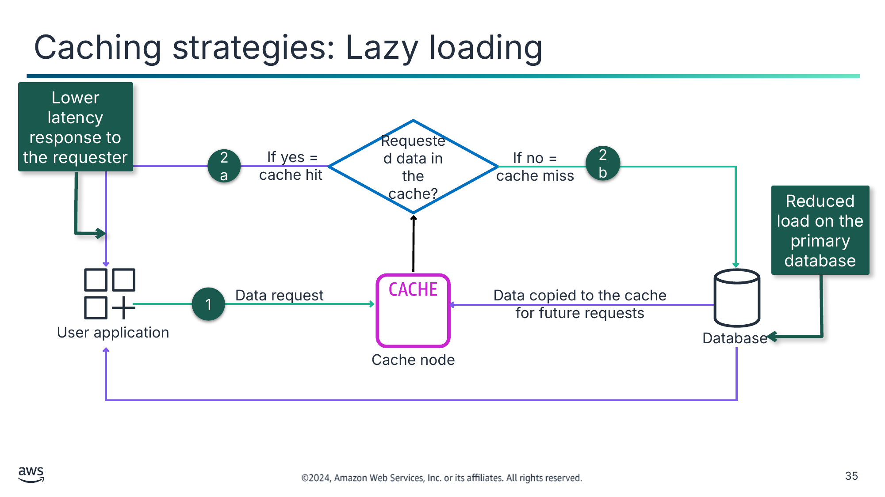

Lower latency response to the requester

Reduced load on the primary database

Текст зі схеми

Requested data in the cache?

If yes = cache hit

2b

2a

1

Data copied to the cache for future requests

Database

Cache node

User application

Data request

If no = cache miss

> **Нотатки:**
>
> |Slide number 35  
> |Instructor notes  
> |This decision diagram shows the flow between the application and the database. The caching node is in between and will be accessed first. The terms cache hit and cache miss are explained.  
> |  
> |The route labeled 2a is meant to be shown as a shorter path, providing a lower latency response to the requester. The route labeled 2b is followed by two paths: data getting copied to the cache and data going from the database to the application.  
> |  
> |Student notes  
> This diagram shows how a user can access content by using lazy loading caching. (The green lines show a data request, and the purple lines show a data response.)  
> 1. A user makes a request to access content. Whether or not the requested data is in the cache determines the next step.  
> 2a. The application code first tries and reads the data from the cache. If the cache contains the data, ElastiCache returns the file to the user, and the data journey ends here. This is known as a cache hit.  
> 2b. If the data was not found in the cache, it is known as a cache miss. The cache forwards the request to the primary database that hosts the content. The origin server sends the requested data to the user and adds it to the cache for the next time someone requests it.  
>
> This diagram does not show how to handle a stale cache and shows only the high-level process for caching responses from an underlying data source.  
>
> Use lazy loading when you have data that will be read often but written infrequently. For example, in a typical web or mobile application, a user’s profile rarely changes, but it is accessed throughout the application. A person might update his or her profile only a few times per year. However, the profile might be accessed dozens or hundreds of times a day, depending on the user.  
>
> The advantage of lazy loading is that only requested data is cached. Because most data is never requested, lazy loading avoids filling up the cache with unnecessary data. However, a cache miss incurs a penalty. Each cache miss results in three trips, which can cause a noticeable delay in data getting to the application. Also, if data is written to the cache only when a cache miss occurs, data in the cache can become stale. Lazy loading does not provide updates to the cache when data is changed in the database.

---

## Слайд 36: Caching strategies: Write-through

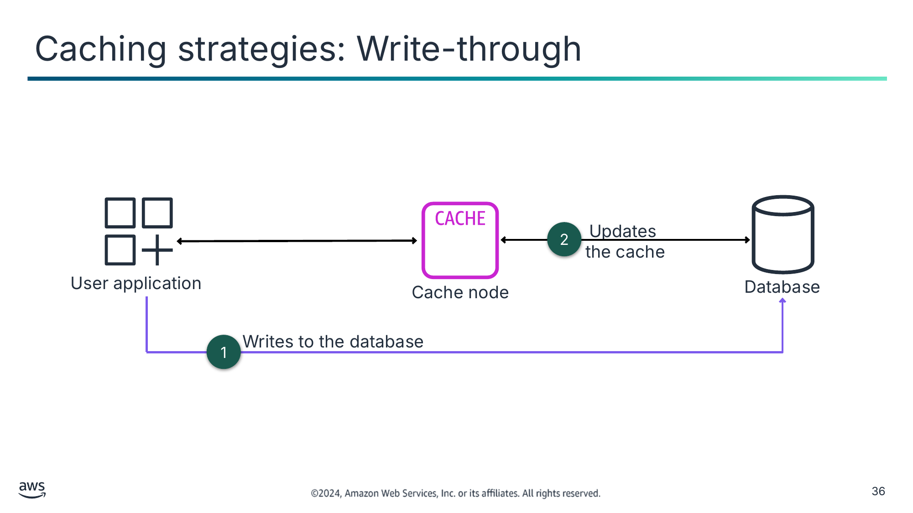

Текст зі схеми

Updates

the cache

Cache node

Writes to the database

User application

Database

2

1

> **Нотатки:**
>
> |Slide number 36  
> |Instructor notes  
> |Unlike lazy loading, this strategy does not depend on what is in the cache node. The data is written to the database, and the cache gets updated.  
> |  
> |Student notes  
> This diagram show how content gets cached by using the write-through strategy.  
> With any change or update to the application, the data is written to the database.  
> Immediately after, the local cache gets updated.  
>
> This approach is proactive: you can avoid unnecessary cache misses when you have data that you know is going to be accessed. The advantage of this approach is that it increases the likelihood that your application will find that value in the cache when it looks for it. Data in the cache is always up to date and never stale. The disadvantage is that you are potentially caching data that you don’t need, so this approach can cause added costs.  
>
> Use a write-through caching strategy when you have data that must be updated in real time.

---

## Слайд 37: Key takeaways: Caching using ElastiCache

- ElastiCache is a key-value, in-memory data store with the purpose of providing millisecond latency and inexpensive access to copies of data.
- ElastiCache reduces the complexity of administering your caching systems for Redis and Memcached engines.
- Lazy loading and write-through are two strategies to handle keeping the cache as up to date as is appropriate.

> **Нотатки:**
>
> |Slide number 37  
> |Instructor notes  
> |  
> |Student notes

---

## Слайд 38: Applying the AWS Well-Architected Framework principles to caching

Caching Content

> **Нотатки:**
>
> |Slide number 38  
> |Instructor notes  
> |  
> |Student notes  
> This section looks at how to apply the AWS Well-Architected Framework principles to caching your content.

---

## Слайд 39: AWS Well-Architected Framework caching best practices

> **Нотатки:**
>
> |Slide number 39  
> |Instructor notes  
> |The remaining slides in this section present examples that highlight how the material in this module aligns to the AWS Well-Architected Framework best practices. Optionally, you might ask students to visit the Well-Architected Framework website and find the best practices that they think connect to the material that is presented in this module, using this section as a starting point.  
> |  
> |Student notes  
> The AWS Well-Architected Framework has six pillars, and each pillar includes best practices and a set of questions that you should consider when you architect cloud solutions. This section highlights a few best practices from the pillars that are most relevant to this module. Find the complete set of best practices by pillar on the Well-Architected Framework website. The content resources section of your online course provides a link.  
>
> As you make connections between the AWS Well-Architected Framework pillars and caching, consider your role as a cloud architect caching content and the need to know the following information:  
> When to cache content to improve performance and optimize cost  
> How to deal with stale content so that you can balance managing cost with having up-to-date data.  
> Why to incorporate a CDN service as an in-memory caching strategy into your architecture designs

---

## Слайд 40: Best practice approach: Data management

**Best practices**

Implement data access patterns that utilize caching.

Implement strategies to improve query performance in data store.

> **Нотатки:**
>
> |Slide number 40  
> |Instructor notes  
> |The link to these best practices are provided in the resource document. These best practices are from the performance efficiency pillar, focus area “Data Management.”  
> |  
> |Student notes  
> Storing data in a cache can improve read latency, read throughput, user experience, and overall efficiency, as well as reduce costs. Data caching can be one of the most effective strategies to improve your overall application performance and reduce burden on your underlying primary data sources.  
>
> Implement data access patterns that utilize caching: First identify databases, APIs and network services that could benefit from caching. Services that have heavy read workloads, have a high read-to-write ratio, or are expensive to scale are candidates for caching. Next, identify the appropriate type of caching strategy that best fits your access pattern. Then configure a cache invalidation strategy, such as a time-to-live (TTL), for all data that balances freshness of data and reducing pressure on backend datastore. Finally, monitor cache hit rate with a goal of 80% or higher. Lower values may indicate insufficient cache size or an access pattern that does not benefit from caching.  
>
> In this module, you've learned how Amazon CloudFront will typically serve cached content from an edge location until the content expires. To solve the issue of have two copies of the data, you can control CloudFront caching behavior with a combination of CloudFront minimum TTL specifications, maximum TTL specifications, content versioning, cache-control HTTP headers, and CloudFront invalidation requests.  
>   
> In this module, you’ve also learned how in-memory databases are used for applications that require real-time access to data, the lowest latency, and the highest throughput. By storing data directly in memory, these databases deliver microsecond latency to applications where millisecond latency is not enough. You may use in-memory databases for application caching, session management, gaming leaderboards, and geospatial applications. ElastiCache is a fully managed in-memory data store that is compatible with Redis and Memcached.  
>
> Implement strategies to improve query performance in data store: Optimizing data and query performance results in more efficiency, lower cost, and improved user experience. Data optimization and query tuning are critical aspects of performance efficiency in a data store, as they impact the performance and responsiveness of the entire cloud workload. Unoptimized queries can result in greater resource usage and bottlenecks, which reduce the overall efficiency of a data store. One strategy to improve query performance is a distributed caching solution which will improve latency and reduce the number of database I/O operation.

---

## Слайд 41: Best practice approach: Foundations – plan your network topology

**Best practice**

Use highly available network connectivity for your workload public endpoints.

> **Нотатки:**
>
> |Slide number 41  
> |Instructor notes  
> |The link to this best practice is provided in the resource document. These best practice is from the reliability pillar, best practice area “Foundations,” and topic “Plan your network topology.”  
> |  
> |Student notes  
> It is critical to plan, build, and operationalize highly available network connectivity for your public endpoints. If your workload becomes unreachable due to a loss in connectivity, even if your workload is running and available, your customers will see your system as down. By combining the highly available and resilient network connectivity for your workload’s public endpoints, along with a resilient architecture for your workload itself, you can provide the best possible availability and service level for your customers. To achieve this, one of the best practices is to use CDNs.  
>
> Use highly available network connectivity for your workload public endpoints: CloudFront provides an API for distributing content with low latency and high data transfer rates by serving requests through the use a network of edge locations around the world. CDNs serve customers by serving content located or cached at a location near the user. This also improves the availability of your application because the load for content is shifted away from your servers to CloudFront edge locations. The edge locations and Regional edge caches hold cached copies of your content close to your viewers, which results in quick retrieval and increases the reachability and availability of your workload.  
>
> In this module, you've learned how CloudFront securely delivers content across the globe and improves application resiliency from DDoS attacks. Caching content by using CloudFront increase the reliability of your customers’ access to your application.

---

## Слайд 42: Best practice approach: Cost-effective resources - plan for data transfer

**Best practices**

Perform data transfer modeling.

Select components to optimize data transfer cost.

Implement services to reduce data transfer costs.

> **Нотатки:**
>
> |Slide number 42  
> |Instructor notes  
> |The links to these best practices are provided in the resource document. These best practices are from the cost optimization pillar, the focus area “Cost-effective resources,” and the topic “Plan for data transfer.”  
> |  
> |Student notes  
> Using the appropriate services, resources, and configurations for your workloads is key to cost savings. These best practices will help you optimize cost when caching content.  
>   
> Perform data transfer modeling: Gather requirements and perform data transfer modeling of the workload and each of its components. This identifies the lowest cost point for its current data transfer requirements. Understand where the data transfer occurs in your workload, the cost of the transfer, and its associated benefit. You can use this information to make an informed decision to modify or accept the architectural decision.  
>
> Select components to optimize data transfer cost: Architecting for data transfer helps you minimize data transfer costs. By using the data transfer modeling, focus on where the largest data transfer costs are or where they would be if the workload usage changes. Look for alternative architectures or additional components that remove or reduce the need for data transfer or lower its cost. This may involve using CDNs to locate data closer to users.  
>
> Implement services to reduce data transfer costs: You can use edge locations or CDNs to deliver content to end users or build caching layers in front of your application servers or databases. Depending on your workload components, type, and cloud architecture, a variety of services can assist you in compressing, caching, and sharing and distributing your traffic on the cloud. CloudFront caches data at edge locations across the world, which reduces the load on your resources. By using CloudFront, you can reduce the administrative effort to deliver content to large numbers of users globally with minimum latency. The security savings bundle can help you save up to 30 percent on your CloudFront usage if you plan to grow your usage over time.  
>
> In this module, one way you’ve learned how to optimize costs with caching is by controlling how long content is cached. You can control CloudFront caching behavior with a combination of CloudFront minimum TTL specifications, maximum TTL specifications, content versioning, cache-control HTTP headers, and CloudFront invalidation requests. When implementing caching, consider an appropriate strategy for ensuring that you provide accurate results.

---

## Слайд 43: Key takeaways: Applying AWS Well -Architected Framework principles to caching

- Consider best practices in the performance efficiency pillar such as making selection choices based on data characteristics and available options.
- Consider best practices in the reliability pillar such as using highly available network connectivity for your public endpoints.
- Consider best practices in the cost optimization pillar such as implementing services to reduce data transfer costs.

> **Нотатки:**
>
> |Slide number 43  
> |Instructor notes  
> |This is not an exhaustive list of best practices as covered in the AWS Well-Architected best practices. These are key takeaways to explain best practices covered in the module. A link is on the content resources page of your online course.  
> |  
> |Student notes

---

## Слайд 44: Module wrap-up

Caching Content

> **Нотатки:**
>
> |Slide number 44  
> |Instructor notes  
> |  
> |Student notes  
> This section summarizes what you have learned and brings the module to a close.

---

## Слайд 45: Module summary

This module prepared you to do the following:

- Identify how caching content can improve application performance and reduce latency.
- Identify how to use Amazon CloudFront to deliver content by using edge locations protection.
- Create architectures that use CloudFront to cache content.
- Describe how to use ElastiCache for database caching.
- Use the AWS Well-Architected Framework principles when designing caching strategies.

> **Нотатки:**
>
> |Slide number 45  
> |Instructor notes  
> |  
> |Student notes

---

## Слайд 46: Considerations for the café

- Discuss how you as a cloud architect might advise the café based on the key cloud architect concerns presented at the start of this module.

---

## Слайд 47: Module knowledge check

- The knowledge check is delivered online within your course.
- The knowledge check includes 10 questions based on material presented on the slides and in the slide notes.
- You can retake the knowledge check as many times as you like.

> **Нотатки:**
>
> |Slide number 47  
> |Instructor notes  
> |  
> |Student notes  
> Use your online course to access the knowledge check for this module.

---

## Слайд 48: Sample exam question

Your company is hosting an ecommerce site and storing the records in an Amazon RDS database. After a few days, the Amazon RDS database is experiencing serious performance issues due to website requests. Which option is the most cost-effective way to deal with the performance issues due to many read requests?

Identify the key words and phrases before continuing.

The following are the key words and phrases:

- Amazon RDS database
- cost-effective
- performance issues due to many read requests

> **Нотатки:**
>
> |Slide number 48  
> |Instructor notes  
> |The key words section is animated to be revealed on click. Point out the requirements as stated in the question. Example: The question implies the need for some type of caching solution based on the desired outcome of dealing with performance issues in a cost-effective way.  
> |  
> |Student notes

---

## Слайд 49: Sample exam question: Response choices

Your company is hosting an ecommerce site and storing the records in an **Amazon RDS database**. After a few days, the Amazon RDS database is experiencing serious performance issues due to website requests. Which option is the most **cost-effective** way to deal with the **performance issues due to many read requests**?

**Choice**

**Response**

**A**

Enable the Multi-AZ feature for the Amazon RDS database.

**B**

Configure Amazon ElastiCache to cache frequently used content from the database.

**C**

Place a load balancer in front of the database.

**D**

Configure Amazon CloudFront to cache content from the database.

> **Нотатки:**
>
> |Slide number 49  
> |Instructor notes  
> |  
> |Student notes  
> Use the key words that you identified on the previous slide, and review each of the possible responses to determine which one best addresses the question.

---

## Слайд 50: Sample exam question: Answer

The answer is B.

**Choice**

**Response**

**B**

Configure Amazon ElastiCache to cache frequently used content from the database.

> **Нотатки:**
>
> |Slide number 50  
> |Instructor notes  
> |  
> |Student notes  
> Choice A (Enable the Multi-AZ feature for the Amazon RDS database) would provide high availability but would not improve database performance.  
>
> Choice C (Place a load balancer in front of the database) would not impact database performance.  
>
> Choice D (Configure Amazon CloudFront to cache content from the database) would not improve performance because CloudFront is not used for database caching.  
>
> Choice B (Configure Amazon ElastiCache to cache frequently used content from the database) is the best choice. This option will reduce the amount of traffic being sent to the database.

---

## Слайд 51: Thank you

Corrections, feedback, or other questions?

Contact us at [https://support.aws.amazon.com/#/contacts/aws-academy](https://support.aws.amazon.com/#/contacts/aws-academy).

> **Нотатки:**
>
> |Slide number 51  
> |Instructor notes  
> |  
> |Student notes  
> That concludes this module. The Content Resources page of your course includes links to additional resources that are related to this module.
