## Слайд 1: Кешування контенту (Caching Content)

AWS Academy Cloud Architecting

> **Нотатки:**
>
> |Нотатки для інструктора  
> |  
> |Нотатки для студента  
> Вітаємо в модулі «Кешування контенту». Цей модуль знайомить із двома сервісами AWS для кешування даних: Amazon CloudFront та Amazon ElastiCache.

---

## Слайд 2: Вступ

Кешування контенту

> **Нотатки:**
>
> |Нотатки для інструктора  
> |  
> |Нотатки для студента  
> Цей вступний розділ описує вміст модуля.

---

## Слайд 3: Цілі модуля

Цей модуль готує вас до такого:

- Визначати, як кешування контенту може покращити продуктивність застосунків і зменшити затримку.
- Визначати, як використовувати Amazon CloudFront для доставки контенту через периферійні локації (edge locations) із захистом.
- Створювати архітектури, що використовують CloudFront для кешування контенту.
- Описувати, як використовувати Amazon ElastiCache для кешування баз даних.
- Використовувати принципи AWS Well-Architected Framework під час проєктування стратегій кешування.

> **Нотатки:**
>
> |Номер слайда 3  
> |Нотатки для інструктора  
> |  
> |Нотатки для студента

---

## Слайд 4: Огляд модуля

**Розділи презентації**

- Огляд кешування
- Кешування за допомогою CloudFront
- Кешування за допомогою ElastiCache
- Застосування принципів AWS Well-Architected Framework до кешування

**Перевірки знань**

- 10-запитальна перевірка знань
- Зразок запитання іспиту

> **Нотатки:**
>
> |Номер слайда 4  
> |Нотатки для інструктора  
> |Кожен модуль має вступ, розділи з вмістом і підсумок. Підсумок цього модуля містить зразок запитання іспиту для розбору зі студентами.  
> |  
> |Нотатки для студента  
> Цілі цього модуля розкриваються в кількох розділах.  
>
> Модуль завершується 10-запитальною перевіркою знань, що проводиться в онлайн-курсі, та зразком запитання іспиту для обговорення в класі.  
>
> Наступний слайд описує лабораторну роботу цього модуля.

---

## Слайд 5: Практичні лабораторні роботи в цьому модулі

Покрокова лабораторна робота (Guided lab)

- Потокова передача динамічного контенту за допомогою Amazon CloudFront (Streaming Dynamic Content Using Amazon CloudFront)

> **Нотатки:**
>
> |Номер слайда 5  
> |Нотатки для інструктора  
> |Цей модуль містить покрокову лабораторну роботу. Ця лабораторна робота надає інструкції крок за кроком і є самодостатньою. Вона не залежить від сценарію з кафе чи пов’язаної архітектури. Вступ до лабораторної роботи включено до розділу лабораторної роботи в межах модуля.  
> |  
> |Нотатки для студента  
> Цей модуль містить зазначену лабораторну роботу. Розділ лабораторної роботи в посібнику студента містить додаткову інформацію про лабораторну роботу, а лабораторне середовище надає докладні інструкції.

---

## Слайд 6: Як хмарний архітектор, що проєктує кешування контенту:

- Мені потрібно визначити, коли й як забезпечити швидший спосіб доступу моїх клієнтів до контенту, щоб я міг збалансувати продуктивність, вартість і актуальність даних відповідно до змінних бізнес-вимог.
- Мені потрібно включити сервіс мережі доставки контенту (CDN) у мої проєкти архітектури, щоб я міг безпечно й ефективно розповсюджувати статичний контент.
- Мені потрібно обрати стратегію кешування в пам’яті, щоб я міг зменшити мережеву затримку й розвантажити базу даних.

> **Нотатки:**
>
> |Номер слайда 6  
> |Нотатки для інструктора  
> |Цей слайд подає ключові наскрізні міркування проєктування, що мають спрямовувати ухвалення рішень для цього рівня хмарної архітектури. Підкресліть, що хмарний архітектор завжди має починати з бізнес-кейсу й рухатися у зворотному напрямку, щоб обрати найкращі компоненти для цього сценарію використання. Також нагадайте студентам, що рішення, імовірно, еволюціонуватимуть з часом, у міру зміни чи кращого розуміння потреб, для оптимізації вартості та продуктивності. Наприкінці модуля в підсумковому розділі включено необов’язкове обговорення, що спонукає студентів розглянути ці чинники в контексті сценарію з кафе.  
> |  
> |Нотатки для студента  
> Цей слайд просить вас прийняти перспективу хмарного архітектора, коли ви думаєте про те, як підходити до кешування контенту. Тримайте ці міркування в голові, просуваючись цим модулем, пам’ятаючи, що хмарний архітектор має працювати у зворотному напрямку від бізнес-потреби, щоб спроєктувати найкращу архітектуру для конкретного сценарію використання. Просуваючись модулем, розглядайте сценарій з кафе, поданий у курсі, як приклад бізнес-потреби й думайте про те, як би ви відповіли на ці потреби для вигаданого бізнесу кафе.

---

## Слайд 7: Огляд кешування

Кешування контенту

> **Нотатки:**
>
> |Нотатки для інструктора  
> |  
> |Нотатки для студента  
> Цей розділ надає огляд кешування та пояснює, як кешування допомагає бізнесу.

---

## Слайд 8: Навіщо кешувати контент?

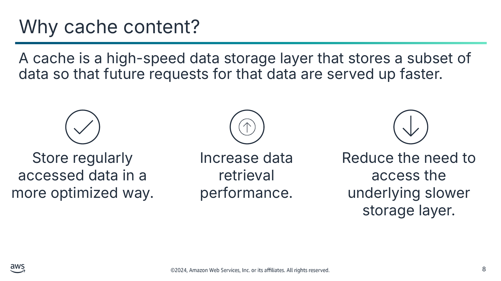

Кеш — це високошвидкісний рівень зберігання даних, що зберігає підмножину даних, щоб майбутні запити на ці дані обслуговувалися швидше.

Зберігайте дані, до яких звертаються регулярно, у більш оптимізований спосіб.

Підвищуйте продуктивність отримання даних.

Зменшуйте потребу звертатися до базового повільнішого рівня зберігання.

> **Нотатки:**
>
> |Номер слайда 8  
> |Нотатки для інструктора  
> |Один зі способів покращити продуктивність системи — зробити дані доступними швидше. Багато систем мають частини даних, до яких звертаються частіше, ніж до інших. У таких ситуаціях тимчасове зберігання цих даних на технології зберігання, швидшій за їх природне розташування, дозволить швидший доступ. Кешування дає змогу ефективно повторно використовувати раніше отримані чи обчислені дані. Кеш — це високошвидкісний рівень зберігання даних, що зберігає підмножину даних, щоб майбутні запити на ці дані обслуговувалися швидше, ніж це можливо під час доступу до основного місця зберігання даних.  
> |  
> |Блог «Let’s Architect! Leveraging in-memory databases» надає сценарії використання кешування, у яких продуктивність зросла. Цим ресурсом можна поділитися на початку модуля, щоб допомогти студентам зрозуміти, як використовується кешування, або наприкінці модуля, щоб побачити, як розглянуті сервіси застосовуються в галузі.  
> |  
> |Нотатки для студента  
> Швидкість, з якою ви доставляєте контент, впливає на успіх вашого застосунку. Кешування дає спосіб збільшити швидкість отримання даних і зменшує частоту, з якою звертаються до основної бази даних чи рівня зберігання. В обчисленнях кеш — це високошвидкісний рівень зберігання даних. На відміну від бази даних, яка зазвичай зберігає дані в повній і довговічній формі, кеш тимчасово зберігає підмножину даних.  
>
> Кешування полегшує швидший доступ до даних, оскільки основна мета кешу — підвищити продуктивність отримання даних, зменшивши потребу звертатися до базового, повільнішого рівня зберігання. Майбутні запити на кешовані дані обслуговуються швидше, ніж запити, що звертаються до основного місця зберігання даних. Кешування дає змогу ефективно повторно використовувати раніше отримані чи обчислені дані. Кешування — це стратегія оптимізації, що допоможе зменшити витрати й покращити продуктивність. Для кінцевого користувача кешування забезпечує швидшу продуктивність.

---

## Слайд 9: Аналогія кешування

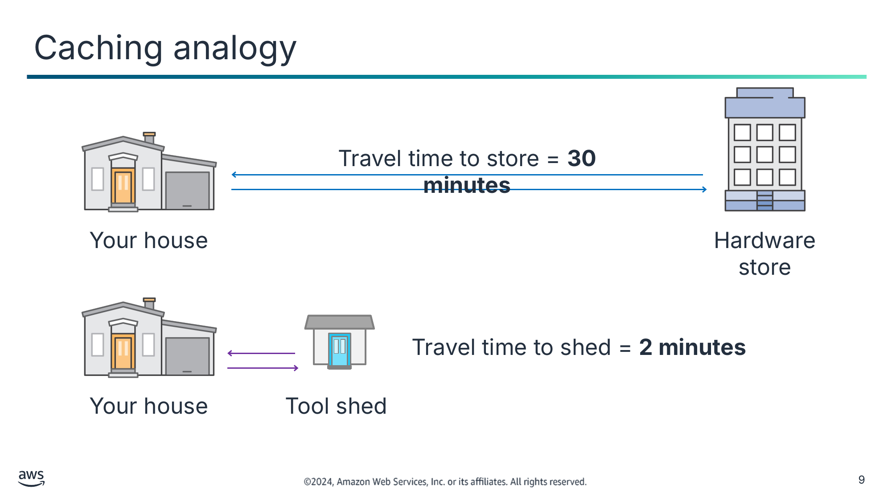

Текст зі схеми

Travel time to store = **30 minutes** (Час у дорозі до магазину = **30 хвилин**)

Your house (Ваш дім)

Hardware store (Господарський магазин)

Your house

Tool shed (Сарай для інструментів)

Travel time to shed = **2 minutes** (Час у дорозі до сараю = **2 хвилини**)

> **Нотатки:**
>
> |Номер слайда 9  
> |Нотатки для інструктора  
> |  
> |Нотатки для студента  
> Щоб проілюструвати, як кеш покращує продуктивність, розгляньте приклад поїздки до господарського магазину.  
>
> Якщо магазин за багато миль, вам доводиться докладати чималих зусиль, щоб їхати туди щоразу, коли вам щось потрібно. Натомість можна зберігати матеріали, які ви використовуєте регулярно, у сараї для інструментів поблизу вашого дому. Тому вам потрібно менше часу, щоб отримати доступ до цих матеріалів, ніж щоб їхати аж до господарського магазину. Однак ви все одно можете їздити до магазину, щоб поповнити запаси.  
>
> У цьому прикладі сарай для інструментів аналогічний кешу. Ви тримаєте інструменти, які вам часто потрібні, у розташуванні поблизу. У кешуванні це розташування поблизу може мати різні форми, як-от периферійні локації та бази даних у пам’яті. Ви дізнаєтеся більше про використання периферійних локацій і бази даних у пам’яті в цьому модулі.

---

## Слайд 10: Що слід кешувати?

Статичні дані та дані, до яких часто звертаються

Результати обчислювально інтенсивних розрахунків

Результати тривалих, часто використовуваних чи складних запитів до бази даних

> **Нотатки:**
>
> |Номер слайда 10  
> |Нотатки для інструктора  
> |  
> |Нотатки для студента  
> Нижче наведено приклади контенту, що зазвичай кешується:  
> Статичні дані та дані, до яких часто звертаються: щоб кешування давало значущі переваги, дані мають бути статичними та такими, до яких часто звертаються, як-от особистий профіль на сайті соціальної мережі. Статичний контент — це контент, що рідко змінюється, як-от HTML, CSS, JavaScript, зображення та відеофайли. І навпаки, не слід кешувати дані, якщо кешування не дає переваги в швидкості чи вартості.  
> Результати обчислювально інтенсивних розрахунків: обчислювально інтенсивні робочі навантаження, що маніпулюють наборами даних, як-от рушії рекомендацій і симуляції високопродуктивних обчислень, також виграють від кешування у формі рівня даних у пам’яті, що діє як кеш.  
> Результати тривалих, часто використовуваних чи складних запитів до бази даних: тривалі, часто використовувані чи складні запити до бази даних часто створюють вузькі місця в застосунках. Загалом, якщо дані потребують повільного й дорогого запиту для отримання, вони є кандидатом на кешування. Наприклад, запити, що виконують об’єднання (joins) кількох таблиць, повільніші й дорожчі, ніж запити до окремих таблиць. Однак навіть дані, що потребують відносно швидкого запиту, усе одно можуть бути кандидатом на кешування.

---

## Слайд 11: Компроміси (trade-offs), які слід враховувати під час кешування

Переваги кешування

Виклики кешування

- Зменшує затримку відповіді
- Зменшує витрати
- Полегшує навантаження на джерело (джерело даних)
- Забезпечує передбачувану продуктивність
- Покращує доступність

- Потребує додаткової інженерії
- Потребує, щоб хтось визначив, як кешувати дані та поводитися із застарілими даними залежно від бізнес-сценарію

> **Нотатки:**
>
> |Номер слайда 11  
> |Нотатки для інструктора  
> |Статтю «Caching challenges and strategies» можна використати, щоб надати конкретні переваги та виклики кешування студентам, що мають досвід кешування. Найкращі практики та міркування наведено наприкінці статті. Посилання надано на сторінці ресурсів вмісту вашого онлайн-курсу.  
> |Переконайтеся, що є законна потреба в кеші, обґрунтована з погляду вартості, затримки чи покращення доступності.  
> |Плануйте експлуатувати кеш із тією самою ретельністю та процесами, що використовуються для решти парку сервісів та інфраструктури. Не недооцінюйте ці зусилля.  
> |Будьте свідомими й емпіричними у виборі розміру кешу, політики завершення терміну дії та політики витіснення (eviction).  
> |  
> |Нотатки для студента  
> Переваги кешування — його здатність зменшити затримку відповіді, яку користувачі відчувають із вашим застосунком, зменшити витрати, полегшити навантаження на вихідні дані та забезпечити передбачувану продуктивність застосунку. Під час впровадження кешування до інфраструктури додається додатковий компонент. Хоча кешування покращує продуктивність, воно також збільшує складність. Слід враховувати додаткову інженерію, потрібну для підтримки кешу. У деяких сценаріях баз даних може знадобитися додаткове кодування. Ще один виклик кешування контенту — визначення того, як кешувати дані та поводитися із застарілими даними. Це робиться залежно від бізнес-сценарію. Цей модуль обговорює способи поводження із застарілим контентом, щоб ви могли вирішити, коли актуальні дані варті витрат і зусиль.  
>
> Під час впровадження кешування даних враховуйте компроміси. Воно може допомогти різко покращити продуктивність, але потребує чіткої стратегії щодо того, як і коли оновлювати чи робити недійсними кешовані дані, щоб запобігти неправильній поведінці системи.

---

## Слайд 12: Типи кешування та сервіси кешування AWS

Amazon CloudFront

Amazon ElastiCache

Статичне кешування (кешування на периферії)

Кешування баз даних (кешування даних)

Отримуйте контент із найближчої периферійної локації.

Отримуйте контент із рівня бази даних у пам’яті.

> **Нотатки:**
>
> |Номер слайда 12  
> |Нотатки для інструктора  
> |Сторінка AWS Caching Solutions пояснює інші рішення кешування AWS. Посилання надано на сторінці ресурсів.  
> |  
> |Нотатки для студента  
> Два типи кешування, про які ви дізнаєтеся в цьому модулі, — статичне кешування та кешування баз даних:  
> Статичне кешування, або кешування на периферії (edge caching), — це використання серверів кешування для зберігання контенту ближче до користувачів. Мережа доставки контенту (CDN) дає змогу використовувати свою глобальну мережу периферійних локацій для доставки кешованої копії вебконтенту, як-от відео, вебсторінки й зображення, вашим клієнтам. Щоб скоротити час відповіді, CDN використовує периферійну локацію, найближчу до клієнта чи місця походження запиту, для доставки кешованої копії статичного контенту. CloudFront — це глобальний сервіс CDN, що прискорює доставку вашого контенту.  
> У кешуванні баз даних кеш діє як суміжний рівень доступу до даних для вашої бази даних, який ваші застосунки можуть використовувати для покращення продуктивності. Рівень кешу бази даних можна застосувати перед будь-яким типом бази даних, зокрема реляційними й NoSQL. Поширені методики завантаження даних у ваш кеш включають ліниве завантаження (lazy loading) та методи наскрізного запису (write-through). ElastiCache — це вебсервіс, що можна використовувати для розгортання, експлуатації та масштабування сховища даних чи кешу в пам’яті в хмарі. Сервіс покращує продуктивність вебзастосунків, даючи змогу отримувати інформацію зі швидких керованих сховищ даних у пам’яті замість того, щоб повністю спиратися на повільніші бази даних на дисках.

---

## Слайд 13: Ключові висновки: огляд кешування

- Кеш — це високошвидкісний рівень зберігання даних, що зберігає підмножину даних, щоб майбутні запити на ці дані обслуговувалися швидше.
- Статичні дані та дані, до яких часто звертаються, — хороші кандидати на кешування.
- Кешування покращує швидкість застосунку й зменшує вартість бази даних.
- Контент отримується з найближчої периферійної локації за статичного кешування та з рівня бази даних у пам’яті за кешування баз даних.

> **Нотатки:**
>
> |Номер слайда 13  
> |Нотатки для інструктора  
> |  
> |Нотатки для студента

---

## Слайд 14: Кешування за допомогою CloudFront

Кешування контенту

> **Нотатки:**
>
> |Номер слайда 14  
> |Нотатки для інструктора  
> |  
> |Нотатки для студента  
> Цей розділ пояснює, як CloudFront безпечно забезпечує статичне кешування як сервіс CDN.

---

## Слайд 15: Мережа доставки контенту (CDN)

Виклик доставки

Рішення CDN

Доставляти географічно розподілений контент із низькою затримкою та низькою вартістю доступу для кінцевих користувачів.

- Є глобально розподіленою системою серверів кешування
- Має проміжні сервери між клієнтом і застосунком
- Кешує копії поширених запитуваних файлів (статичний контент)
- Доставляє локальну копію запитуваного контенту з найближчої периферії кешу або точки присутності (point of presence)

> **Нотатки:**
>
> |Номер слайда 15  
> |Нотатки для інструктора  
> |CDN представлено як рішення виклику доставки контенту в усьому світі безпечним і оптимізованим за вартістю способом.  
> |Цей слайд призначений пояснити концепцію CDN для підготовки до представлення того, що може робити CloudFront. Коли студенти зрозуміють CloudFront як сервіс, слайд, що пояснює периферійні локації та периферійні кеші CloudFront, завершить те, що їм потрібно знати про CDN.  
> |  
> |Нотатки для студента  
> Виклик: через глобальну й складну природу інтернету трафік обміну даними між застосунками та їхніми користувачами (клієнтами) має долати великі фізичні відстані. Обмін даними також двосторонній: запити йдуть від клієнта до сервера, а відповіді повертаються. Наприклад, коли користувач відвідує вебсайт, дані із сервера цього вебсайту мають пройти інтернетом, щоб досягти комп’ютера користувача. Якщо користувач розташований далеко від цього сервера, завантаження великого файлу, як-от відео чи зображення вебсайту, займе багато часу.  
>
> Рішення: CDN — це мережа взаємопов’язаних серверів, що прискорює завантаження застосунків для застосунків із великою кількістю даних. Статичний контент зберігається на серверах CDN, географічно ближчих до користувачів, і досягає їхніх комп’ютерів набагато швидше. CDN покращує ефективність, запроваджуючи проміжні сервери між клієнтом і сервером вебсайту. Ці сервери CDN керують частиною обміну даними між клієнтом і сервером. Вони зменшують вебтрафік до вебсервера, зменшують споживання пропускної здатності та покращують користувацький досвід ваших застосунків. CDN кешує копії поширених запитуваних файлів, що розміщені на вихідному сервері застосунку. Ці файли можуть включати статичний контент, як-от файли HTML, CSS, JavaScript, зображень і відео. CDN доставляє локальну копію запитуваного контенту з периферії кешу чи точки присутності (PoP), що забезпечує найшвидшу доставку запитувачу.

---

## Слайд 16: Який тип контенту можна кешувати за допомогою периферійного кешу?

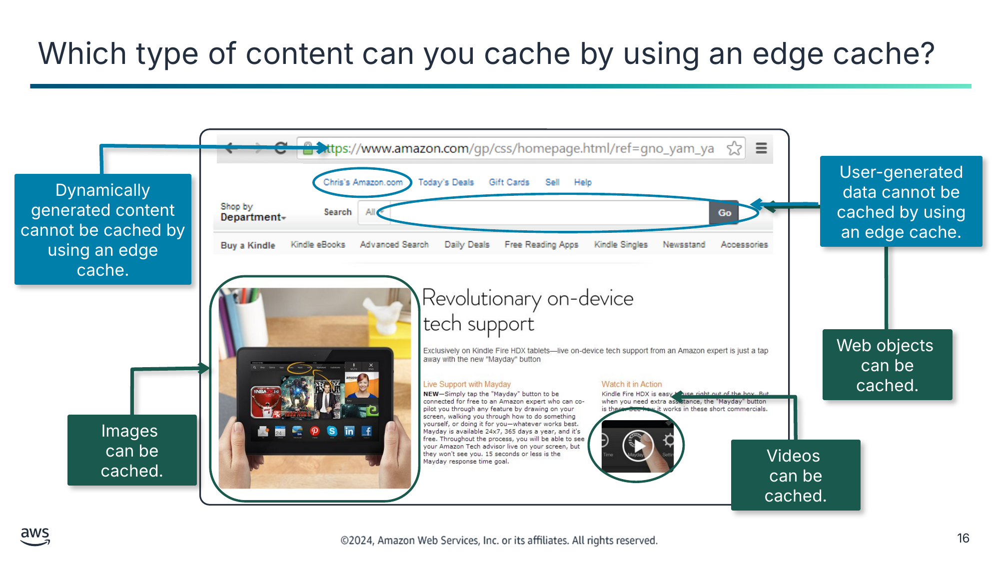

Дані, згенеровані користувачем, не можна кешувати за допомогою периферійного кешу.

Динамічно згенерований контент не можна кешувати за допомогою периферійного кешу.

Вебоб’єкти  
можна кешувати.

Зображення  
можна кешувати.

Відео  
можна кешувати.

> **Нотатки:**
>
> |Номер слайда 16  
> |Нотатки для інструктора  
> |  
> |Нотатки для студента  
> Цей приклад вебсторінки Amazon.com показує, як статичний і динамічний контент можуть складати динамічний вебзастосунок. Цей вебзастосунок доставляється за протоколом HTTPS для шифрування запитів сторінок користувачів і сторінок, що повертаються з вебсервера.  
> Можна використовувати CDN чи периферійний кеш для кешування статичного контенту. Такий контент може включати вебоб’єкти (наприклад, документи HTML, таблиці стилів CSS чи файли JavaScript), файли зображень і відеофайли.  
> Не можна кешувати динамічно згенерований контент чи дані, згенеровані користувачем. Однак можна налаштувати CloudFront на доставку цієї інформації із застосунку, що працює на користувацькому джерелі (custom origin). Наприклад, це може бути екземпляр Amazon Elastic Compute Cloud (Amazon EC2) або вебсервер.  
>
> Крім того, можна налаштувати CloudFront так, щоб вимагати від глядачів використання HTTPS для запиту ваших об’єктів, щоб з’єднання шифрувалися під час обміну даними CloudFront із глядачами. Також можна налаштувати CloudFront на використання HTTPS для отримання об’єктів із вашого джерела, щоб з’єднання шифрувалися під час обміну даними CloudFront із вашим джерелом.

---

## Слайд 17: CloudFront

- Є сервісом CDN, що безпечно доставляє контент по всьому світу з низькою затримкою та високими швидкостями передавання
- Забезпечує високошвидкісне розповсюдження контенту, доставляючи через периферійні локації
- Покращує стійкість застосунків до розподілених атак «відмова в обслуговуванні» (DDoS), використовуючи сервіси, як-от AWS Shield і AWS WAF

CloudFront

> **Нотатки:**
>
> |Номер слайда 17  
> |Нотатки для інструктора  
> |Докладніше див. посилання на документацію CloudFront на сторінці ресурсів вмісту вашого онлайн-курсу.  
> |  
> |Нотатки для студента  
> CloudFront — це сервіс CDN, створений для високої продуктивності, безпеки та зручності розробників. З CloudFront можна доставляти дані через глобально розосереджені PoP з автоматизованим мережевим картографуванням та інтелектуальною маршрутизацією.  
> CloudFront прискорює розповсюдження вашого контенту, маршрутизуючи кожен запит користувача через магістральну мережу AWS до периферійної локації, що може найкраще обслужити ваш контент. Зазвичай це периферійний сервер CloudFront, що забезпечує найшвидшу доставку глядачу. Використання мережі AWS різко зменшує кількість мереж, через які мають проходити запити ваших користувачів, що покращує продуктивність. Ви також отримуєте підвищену надійність і доступність, оскільки копії вашого контенту тепер кешуються в кількох периферійних локаціях по всьому світу.  
> З брандмауером вебзастосунків AWS WAF і керованим сервісом захисту від розподілених атак «відмова в обслуговуванні» (DDoS) AWS Shield можна використовувати CloudFront для покращення стійкості ваших застосунків, що працюють в AWS, до атак DDoS. CloudFront захищає від атак на мережевому рівні та рівні застосунку, підтримує кілька методів контролю доступу й допомагає забезпечити безпечну доставку чутливих даних. CloudFront доставляє контент через HTTPS, використовуючи найновішу версію TLS для шифрування та захисту обміну даними між клієнтами-глядачами та CloudFront.

---

## Слайд 18: Компоненти глобальної периферійної мережі CloudFront

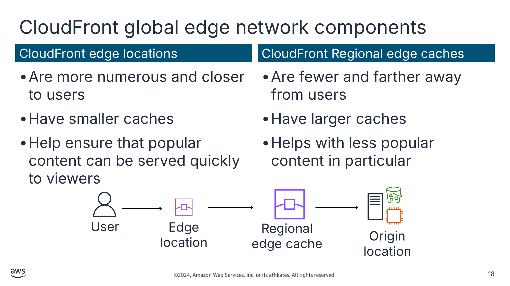

Периферійні локації CloudFront (CloudFront edge locations)

Регіональні периферійні кеші CloudFront (CloudFront Regional edge caches)

- Їх більше, і вони ближче до користувачів
- Мають менші кеші
- Допомагають забезпечити швидке обслуговування популярного контенту для глядачів

- Їх менше, і вони далі від користувачів
- Мають більші кеші
- Допомагають зокрема з менш популярним контентом

Текст зі схеми

User (Користувач)

Edge location (Периферійна локація)

Origin location (Локація джерела)

Regional edge cache (Регіональний периферійний кеш)

> **Нотатки:**
>
> |Номер слайда 18  
> |Нотатки для інструктора  
> |Зображення показує компоненти глобальної периферійної мережі CloudFront, що існують між користувачем і локацією джерела. Периферійні локації CloudFront ближчі до користувачів, тоді як регіональні периферійні кеші CloudFront далі. Більші регіональні периферійні кеші розташовані між вашою локацією джерела та глобальними периферійними локаціями, що безпосередньо обслуговують контент для глядачів. Отримайте доступ до карти глобальної периферійної мережі, щоб показати студентам, як розподілені ці PoP, за допомогою посилання Amazon CloudFront Key Features на сторінці ресурсів.  
> |  
> |Нотатки для студента  
> Щоб доставляти контент кінцевим користувачам із меншою затримкою, CloudFront використовує глобальну мережу з понад 550 периферійних локацій і 13 регіональних периферійних кешів у понад 100 містах у 50 країнах. Інформація актуальна станом на жовтень 2023 року.  
> Периферійних локацій CloudFront більше, і вони ближче до користувачів, ніж регіональні периферійні кеші. Регіональних периферійних кешів CloudFront менше, і вони далі від користувачів, ніж периферійні локації. Регіональний периферійний кеш має більший кеш, ніж окрема периферійна локація, тож об’єкти залишаються в регіональному периферійному кеші довше. Це розташування допомагає тримати більше вашого контенту ближче до ваших глядачів.  
> Периферійні локації CloudFront забезпечують швидке обслуговування популярного контенту для глядачів. У міру того як об’єкти стають менш популярними, окремі периферійні локації можуть вилучати ці об’єкти, щоб звільнити місце для популярнішого контенту. Для менш популярного контенту CloudFront має регіональні периферійні кеші. Регіональні периферійні кеші допомагають з усіма типами контенту, зокрема з контентом, що з часом, як правило, стає менш популярним. Приклади включають контент, згенерований користувачами; активи електронної комерції, як-от фото й відео продуктів; та новини й контент, пов’язаний із подіями, що можуть раптово стати популярними.  
> Як показує слайд, регіональні периферійні кеші — це локації CloudFront, розгорнуті глобально й близько до ваших глядачів. Вони розташовані між вашою локацією джерела та глобальними периферійними локаціями, що безпосередньо обслуговують контент для глядачів. Регіональні периферійні кеші зменшують потребу CloudFront повертатися до вашого вихідного сервера й покращують загальну продуктивність для глядачів.  
> Периферійні локації CloudFront з’єднані з регіонами AWS через магістраль мережі AWS — повністю надлишкові, багатократні паралельні оптичні волокна 100 гігабітного Ethernet (GbE), що охоплюють земну кулю та з’єднуються з десятками тисяч мереж для покращеного отримання даних із джерела та прискорення динамічного контенту.  
>
> Докладніше про те, де розташовані периферійні локації та регіональні периферійні кеші, див. сторінку Amazon CloudFront Key Features у документі ресурсів курсу.

---

## Слайд 19: Як працює кешування в CloudFront

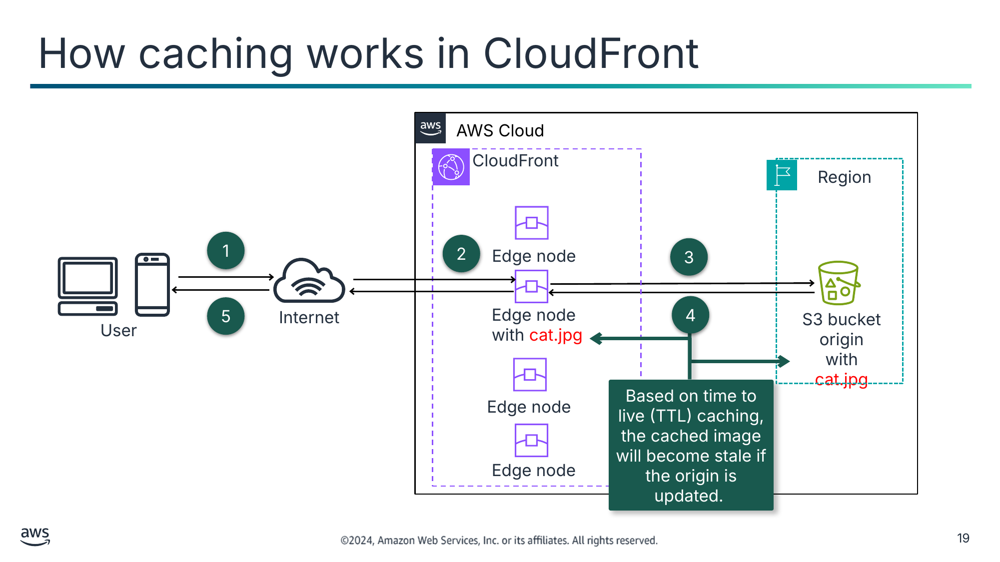

Текст зі схеми

AWS Cloud

CloudFront

Region (Регіон)

S3 bucket origin

with cat.jpg (Джерело — бакет S3 з cat.jpg)

Internet (Інтернет)

User (Користувач)

1

2

Edge node (Периферійний вузол)

3

5

4

Edge node  
with cat.jpg (Периферійний вузол з cat.jpg)

Edge node

Based on time to live (TTL) caching, the cached image will become stale if the origin is updated. (За кешування на основі часу життя (TTL) кешоване зображення стане застарілим, якщо джерело оновиться.)

Edge node

> **Нотатки:**
>
> |Номер слайда 19  
> |Нотатки для інструктора  
> |Наступний розділ охоплює підходи до поводження із застарілим контентом. Ця схема призначена надати загальне розуміння кешування з CloudFront.  
> |  
> |Нотатки для студента  
> Користувач робить запит на доступ до файлу зображення cat.jpg.  
> DNS маршрутизує запит до периферійної локації, що може найкраще обслужити запит. Зазвичай це найближча периферійна локація з найкоротшою затримкою. CloudFront перевіряє кеш на запитуваний контент. Якщо контент є в кеші, CloudFront доставляє його користувачу негайно (крок 5), і шлях даних на цьому закінчується.  
> Контент може бути відсутній у кеші на цей момент. Якщо так, CloudFront пересилає запит до локації джерела, яку ви визначили як джерело остаточної версії вашого контенту: у цьому випадку до бакета Amazon Simple Storage Service (Amazon S3), що містить файл зображення.  
> Локація джерела надсилає об’єкт назад до периферійної локації.  
> CloudFront потім пересилає файл користувачу, а також додає його до кешу для наступного разу, коли хтось його запитає.  
>
> Час життя (time to live, TTL) — це налаштування в CloudFront, що визначає, як довго периферійні локації мають кешувати контент, перш ніж знову запитувати його з вихідного сервера. На основі вказаного TTL кешоване зображення стане застарілим, якщо джерело оновиться.

---

## Слайд 20: Як налаштувати дистрибуцію CloudFront

Вкажіть  
локацію джерела.

Налаштуйте  
дистрибуцію.

CloudFront стає доступним.

CloudFront надсилає конфігурацію вашої дистрибуції до  
периферійних локацій.

> **Нотатки:**
>
> |Нотатки для інструктора  
> |Сторінка ресурсів містить навчальний посібник із CloudFront. Це покроковий посібник зі скриншотами для створення вебдистрибуції CloudFront і доставки фрагмента статичного контенту, розміщеного в хмарі через Amazon S3.  
> |  
> |Якщо в студентів є запитання про те, як налаштувати дистрибуцію CloudFront, ця сторінка — корисний ресурс, щоб відповісти зі скриншотами.  
> |  
> |Нотатки для студента  
> Коли ви хочете використовувати CloudFront для розповсюдження вашого контенту, виконайте такі кроки:  
> Ви вказуєте локацію джерела, з якої CloudFront отримує ваші файли. Ці файли розповсюджуватимуться з периферійних локацій CloudFront по всьому світу. Вихідний сервер (origin server) зберігає початкову, остаточну версію ваших об’єктів. Якщо ви обслуговуєте контент через HTTP, ваш вихідний сервер — це або бакет S3, або сервер HTTP, як-от вебсервер. Ваш сервер HTTP може працювати на екземплярі EC2 чи на локальному сервері, яким ви керуєте. Ці сервери також відомі як користувацькі джерела (custom origins).  
> Ви створюєте дистрибуцію CloudFront, що повідомляє CloudFront, з яких користувацьких джерел отримувати ваші файли, коли користувачі запитують файли через ваш вебсайт чи застосунок. Водночас ви вказуєте подробиці, як-от чи хочете ви, щоб CloudFront журналював усі запити, і чи хочете ви, щоб дистрибуцію було ввімкнено одразу після створення.  
> CloudFront стає доступним і призначає доменне ім’я вашій новій дистрибуції.  
> CloudFront надсилає конфігурацію вашої дистрибуції — але не контент — до всіх периферійних локацій. Периферійні локації — це колекції серверів у географічно розосереджених центрах обробки даних, де CloudFront кешує копії ваших об’єктів.

---

## Слайд 21: Керування тривалістю кешування контенту

Установіть максимальне значення TTL

Впровадьте версіонування контенту

Вкажіть  
заголовки cache-control

Використовуйте запити на анулювання CloudFront (invalidation requests)

Швидше завершує термін дії кешованого контенту за низького максимального значення TTL

Отримує й кешує нові файли негайно

Забезпечує точний контроль над завершенням терміну дії окремих файлів

Змушує CloudFront завершити термін дії контенту в периферійних кешах

> **Нотатки:**
>
> |Нотатки для інструктора  
> |У документі ресурсів наведено посилання на розділ «Managing How Long Content Stays in the Cache (Expiration)» посібника розробника Amazon CloudFront. Ви знайдете приклади різних заголовків джерела та налаштувань TTL і того, як вони впливають на кешування, як конкретні приклади, якими можна поділитися зі студентами.  
> |  
> |Нотатки для студента  
> Якщо ви коли-небудь заплуталися в ситуації, коли ви оновили контент, але все ще бачите застарілий контент, одна ймовірна причина — CloudFront усе ще обслуговує кешований контент. Можна контролювати поведінку кешування CloudFront за допомогою комбінації специфікацій мінімального TTL CloudFront, специфікацій максимального TTL, версіонування контенту, заголовків HTTP cache-control та запитів на анулювання CloudFront.  
>
> CloudFront зазвичай обслуговуватиме кешований контент з периферійної локації, доки термін дії контенту не завершиться. Після завершення терміну дії, коли наступного разу цей контент запитає кінцевий користувач, CloudFront повертається до локації джерела, щоб отримати контент і закешувати його. Периферійні локації CloudFront автоматично завершують термін дії контенту після спливу максимального TTL у секундах (за замовчуванням це 24 години). Для керування тим, як довго кешується контент, найкраща практика — розуміти й використовувати разом чотири підходи:  
> Установіть максимальне значення TTL: CloudFront може завершити термін дії контенту будь-коли між мінімальним TTL і максимальним TTL. За замовчуванням термін дії кожного файлу автоматично завершується через 24 години. Можна змінити поведінку за замовчуванням і встановити максимальний TTL відносно низьким значенням. Компроміс у тому, що термін дії кешованого контенту завершується швидше через низьке максимальне значення TTL. Це призводить до частіших запитів до вашого джерела, оскільки кеші CloudFront потрібно частіше наповнювати знову.  
> Впровадьте версіонування контенту: щоразу, коли ви оновлюєте контент, вбудовуйте ідентифікатор версії в імена файлів. Це може бути часова позначка, послідовний номер чи будь-яка інша інформація, яку можна використати для розрізнення двох версій того самого файлу. Версіонування контенту має очевидну перевагу: воно взагалі обходить поведінку завершення терміну дії CloudFront. Оскільки задіяні нові імена файлів, CloudFront негайно отримує нові файли з джерела (а потім кешує їх).  
> Вкажіть заголовки cache-control: можна керувати поведінкою завершення терміну дії CloudFront, указавши заголовки Cache-Control для вмісту вашого вебсайту. Якщо залишити мінімальний TTL за замовчуванням 0 секунд, CloudFront дотримується будь-якого заголовка HTTP Cache-Control: max-age, окремо встановленого для вашого контенту. Це дає вам точніший контроль над завершенням терміну дії окремих файлів.  
> Використовуйте запити на анулювання CloudFront: запити на анулювання CloudFront — це спосіб змусити CloudFront завершити термін дії контенту. Запити на анулювання не негайні. Від моменту надсилання запиту до фактичного завершення терміну дії контенту CloudFront минає кілька хвилин. CloudFront дає змогу вказати, який контент слід анулювати. Цей метод слід використовувати економно й лише для окремих об’єктів. Наступного разу, коли глядач запитає файл, CloudFront повертається до джерела, щоб отримати найновішу версію файлу.

---

## Слайд 22: Використання CloudFront для потокового відео

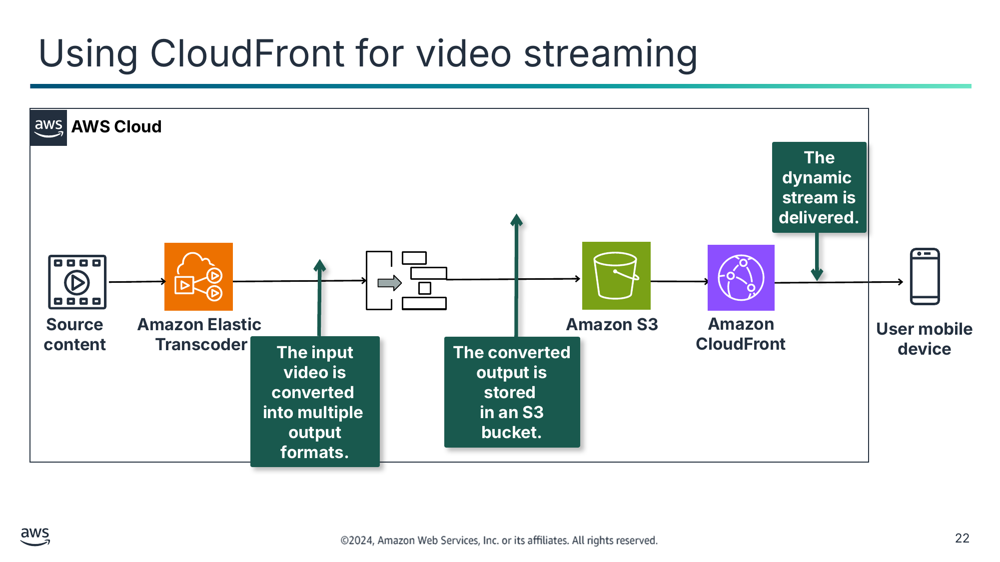

Текст зі схеми

 **AWS Cloud**

**The dynamic**  
**stream is**  
**delivered.** (**Динамічний потік доставляється.**)

**Source**  
**content** (**Вихідний контент**)

**Amazon Elastic**  
**Transcoder**

**Amazon S3**

**Amazon**  
**CloudFront**

**The input video is converted**  
**into multiple**  
**output formats.** (**Вхідне відео перетворюється на кілька вихідних форматів.**)

**The converted**  
**output is stored**  
**in an S3 bucket.** (**Перетворений вихід зберігається в бакеті S3.**)

**User mobile**  
**device** (**Мобільний пристрій користувача**)

> **Нотатки:**
>
> |Нотатки для інструктора  
> |Докладніше див. посилання на документацію Amazon Elastic Transcoder на сторінці ресурсів вмісту вашого онлайн-курсу.  
> |Ця архітектура готує студентів до лабораторної роботи з CloudFront.  
> |  
> |Нотатки для студента  
> Можна використовувати CloudFront для доставки потокового відео. Потрібно використовувати кодувальник (encoder) для форматування та пакування відеоконтенту, перш ніж CloudFront зможе його розповсюджувати. Після перетворення відео у вихідні формати ви розміщуєте перетворений контент у бакеті S3, що є вашим вихідним сервером. Потім ви використовуєте CloudFront для доставки файлів сегментів користувачам по всьому світу.  
>
> Приклади кодувальників включають AWS Elemental MediaConvert та Amazon Elastic Transcoder. Elastic Transcoder надає розробникам спосіб перетворювати (транскодувати) медіафайли з їхнього вихідного формату на версії, що відтворюватимуться на пристроях, як-от смартфони, планшети та ПК. Процес пакування створює сегменти, що є статичними файлами, які містять ваш аудіо-, відео- та субтитровий контент. Він також генерує файли маніфесту, що описують, які сегменти відтворювати й у якому порядку. Формати пакування включають Dynamic Adaptive Streaming over HTTP (DASH, або MPEG-DASH), Apple HTTP Live Streaming (HLS), Microsoft Smooth Streaming і Common Media Application Format (CMAF).

---

## Слайд 23: Пом’якшення DDoS

Виклик безпеки

Рішення CloudFront

Публічно доступний контент відкритий загальним вебзагрозам, що впливають на доступність і компрометують безпеку.

- Моніторинг і пом’якшення вбудовано в Amazon Route 53, коли він маршрутизує трафік до CloudFront.
- CloudFront може створити список контролю вебдоступу (web access control list, ACL) AWS WAF, що налаштовує правила для аналізу вхідних запитів і блокування загроз до того, як вони досягнуть ваших серверів.
- Пом’якшення DDoS від Shield пропускає до CloudFront лише трафік, дійсний для вебзастосунків.

> **Нотатки:**
>
> |Номер слайда 23  
> |Нотатки для інструктора  
> |Події DDoS виникають, коли зловмисник надсилає потоки трафіку з кількох джерел, щоб порушити доступність цільового застосунку. Блог «How to Help Protect Dynamic Web Applications Against DDoS Attacks by Using Amazon CloudFront and Amazon Route 53» наочно пояснює, як Shield, CloudFront і Route 53 працюють разом для захисту від атак DDoS. Посилання надано на сторінці ресурсів вмісту вашого онлайн-курсу.  
> |  
> |Нотатки для студента  
> Виклик: публічно доступні вебзастосунки та API піддаються загрозам, як-от поширені вразливості, описані в OWASP Top 10; SQL-ін’єкції; автоматизовані запити; і HTTP-потопи (відмова в обслуговуванні [DoS]), що впливають на доступність, компрометують безпеку чи споживають надмірні ресурси. Атака DDoS — це навмисна спроба зробити ваш вебсайт чи застосунок недоступним для користувачів, наприклад заливаючи його мережевим трафіком. Для досягнення цієї мети зловмисники використовують кілька джерел для організації атаки на ціль. Ці джерела можуть включати розподілені групи заражених шкідливим програмним забезпеченням комп’ютерів, маршрутизаторів, пристроїв Інтернету речей (IoT) та інших кінцевих точок.  
>
> Рішення: можна використовувати CloudFront для покращення стійкості ваших застосунків, що працюють в AWS, до атак DDoS. Щоб захистити вашу систему від атак DDoS, використовуйте CloudFront для розповсюдження як статичного, так і динамічного контенту. Наведені нижче поєднані функції допомагають забезпечити, щоб джерело вашого застосунку отримувало лише правильно сформовані вебзапити й було захищене від поширених вебзагроз:  
> Сервіс DNS, як-от Amazon Route 53, може ефективно з’єднувати запити користувачів із дистрибуцією CloudFront. Потім дистрибуція CloudFront проксіює запити динамічного контенту до інфраструктури, що розміщує кінцеві точки вашого застосунку. І запити DNS Route 53, і подальший трафік застосунку, що маршрутизується через CloudFront, перевіряються на льоту. Постійний моніторинг, виявлення аномалій і пом’якшення поширених атак DDoS на інфраструктуру вбудовано і в Route 53, і в CloudFront.  
> AWS WAF аналізує вхідні запити й допомагає блокувати ці типи загроз до того, як вони досягнуть ваших серверів. Можна захистити ваші дистрибуції CloudFront за допомогою AWS WAF, налаштувавши ваш список контролю вебдоступу (web ACL), що містить правила безпеки, які ви хочете ввімкнути. CloudFront створює web ACL AWS WAF, налаштовує правила для захисту ваших серверів від поширених вебзагроз і приєднує web ACL до дистрибуції CloudFront за вас.  
> Пом’якшення DDoS від Shield безперервно перевіряє трафік для CloudFront. Пом’якшення DDoS від Shield пропускає до сервісу лише трафік, дійсний для вебзастосунків. Це забезпечує автоматичний захист від багатьох поширених векторів DDoS, як-от атаки з відображенням UDP (UDP reflection attacks).

---

## Слайд 24: Ключові висновки: кешування за допомогою CloudFront

- Кешування статичних файлів виконується за допомогою CDN.
- CloudFront — це сервіс CDN, що використовує периферійні локації та регіональні периферійні кеші для безпечної доставки контенту по всьому світу.
- Можна контролювати поведінку кешування CloudFront за допомогою комбінації дій.
- Використовуючи CloudFront для розповсюдження контенту, ви також захищаєте свої системи від атак DDoS.

> **Нотатки:**
>
> |Номер слайда 24  
> |Нотатки для інструктора  
> |  
> |Нотатки для студента

---

## Слайд 25: Покрокова лабораторна робота: потокова передача динамічного контенту за допомогою Amazon CloudFront (Streaming Dynamic Content Using Amazon CloudFront, CloudFront lab)

> **Нотатки:**
>
> |Номер слайда 25  
> |Нотатки для інструктора  
> |  
> |Нотатки для студента  
> Зараз ви виконаєте лабораторну роботу. Наступні слайди підсумовують, що ви робитимете в лабораторній роботі, а докладні інструкції ви знайдете в лабораторному середовищі.

---

## Слайд 26: Завдання лабораторної роботи «CloudFront»:

У цій лабораторній роботі ви виконаєте такі основні завдання:

- Створите дистрибуцію Amazon CloudFront.
- Створите конвеєр Amazon Elastic Transcoder.
- Протестуєте відтворення динамічного потоку (з кількома бітрейтами).

> **Нотатки:**
>
> |Номер слайда 26  
> |Нотатки для інструктора  
> |  
> |Нотатки для студента  
> Отримайте доступ до лабораторного середовища через ваш онлайн-курс, щоб дізнатися додаткові подробиці та виконати лабораторну роботу.

---

## Слайд 27: Підсумки лабораторної роботи «CloudFront»

- Що ви вказали як джерело, яке використовуватиметься для доставки файлів із кількома бітрейтами, згенерованих Amazon Elastic Transcoder, на пристрої кінцевих користувачів?
- З яких двох компонентів складається URL-адреса відтворення, що відтворюється через Amazon CloudFront?

> **Нотатки:**
>
> |Номер слайда 27  
> |Нотатки для інструктора  
> |Відповідні архітектурні схеми «до» та «після» включено до інструкцій кожної лабораторної роботи. Вам може бути корисно відкрити схеми лабораторної роботи під час підбиття підсумків цієї лабораторної роботи.  
> |  
> |Запропоновані відповіді на запитання 1: що ви вказали як джерело, яке використовуватиметься для доставки файлів із кількома бітрейтами, згенерованих Amazon Elastic Transcoder, на пристрої кінцевих користувачів?  
> |  
> |Ви обрали бакет S3, створений для вас: awstrainingreinvent.  
> |  
> |Коли ви створюєте дистрибуцію CloudFront, ви вказуєте джерело, куди CloudFront надсилає запити на файли. З CloudFront можна використовувати кілька різних видів джерел. Наприклад, можна використовувати бакет S3, контейнер MediaStore, канал MediaPackage, Application Load Balancer або URL-адресу функції Lambda.  
> |  
> |Запропоновані відповіді на запитання 2: з яких двох компонентів складається URL-адреса відтворення, що відтворюється через Amazon CloudFront?  
> |Доменне ім’я CloudFront  
> |Шлях до файлу списку відтворення в бакеті S3 (вихід, згенерований Elastic Transcoder): нижче наведено приклад: http:// domain name>/<playlist file path in Amazon S3 bucket>  
> |  
> |Нотатки для студента  
> Ваш інструктор може розглянути ці запитання з вами, або ви можете розглянути їх самостійно. Скористайтеся цією нагодою, щоб поглибити своє мислення щодо завдань, які ви виконували під час лабораторної роботи.

---

## Слайд 28: Кешування за допомогою ElastiCache

Кешування контенту

> **Нотатки:**
>
> |Номер слайда 28  
> |Нотатки для інструктора  
> |  
> |Нотатки для студента  
> Цей розділ пояснює, як використовувати ElastiCache для кешування баз даних.

---

## Слайд 29: Коли слід кешувати базу даних?

Вас турбують часи відповіді для вашого клієнта.

У вас великий обсяг запитів, що перевантажують вашу базу даних.

Ви хочете зменшити витрати на базу даних.

> **Нотатки:**
>
> |Номер слайда 29  
> |Нотатки для інструктора  
> |Оглядовий розділ на початку курсу й заключний розділ курсу обговорюють компроміси впровадження компонента кешування. Цей слайд привертає увагу студентів до загальних сценаріїв, у яких кешування бази даних може бути доречним варіантом для розгляду. Докладніше про конкретний сценарій використання — онлайн-медичну бібліотеку, що використовує ElastiCache, як згадано в нотатках для студента — можна прочитати за посиланням у посібнику ресурсів у блозі «Latency reduction of hybrid architectures with Amazon ElastiCache».  
> |  
> |Нотатки для студента  
> Як ви дізналися раніше в цьому модулі, тривалі запити до бази даних і складні запити можуть створювати вузькі місця в застосунках.  
>
> Кеш бази даних доповнює вашу основну базу даних, усуваючи непотрібний тиск на неї, зазвичай у формі даних для читання, до яких часто звертаються. Сам кеш може бути в кількох місцях, зокрема у вашій базі даних чи застосунку або як окремий рівень. Слід розглянути кешування вашої бази даних у таких ситуаціях:  
> Вас турбують часи відповіді для вашого клієнта. У вас можуть бути чутливі до затримки робочі навантаження, які ви хочете пришвидшити. Кешування може допомогти збільшити пропускну здатність і зменшити затримку отримання даних, покращуючи таким чином продуктивність вашого застосунку.  
> У вас великий обсяг запитів, що перевантажують вашу базу даних. У вас може бути великий обсяг трафіку, і тому ви не отримуєте пропускної здатності, потрібної для цього робочого навантаження. Розміщення рівня кешування поруч із вашою базою даних може збільшити вашу пропускну здатність і допомогти досягти вищої продуктивності.  
> Ви хотіли б зменшити витрати на базу даних. Незалежно від того, чи розподілені дані в дисковій базі даних NoSQL, чи масштабовані вертикально в реляційній базі даних, масштабування для великої кількості читань може бути дорогим. Може знадобитися певна кількість реплік бази даних для читання, щоб відповідати тому, що може забезпечити один вузол кешу в пам’яті за кількістю запитів на секунду.  
>
> Сценарій використання — онлайн-медична бібліотека з можливостями пошуку, що керуються базою даних. База даних була перевантажена через велику кількість запитів від пошукового рушія. Результати запитів були настільки великими, що насичували низькошвидкісний мережевий канал клієнта, впливаючи на час відповіді. У цьому випадку рішенням був кеш у пам’яті на основі ElastiCache. Оскільки проблема стосується затримки до бекенд-бази даних, використання ElastiCache зменшить мережеву затримку й розвантажить базу даних.  
>
> Під час впровадження кешування даних також враховуйте компроміси. Кешування може допомогти різко покращити продуктивність, але потребує чіткої стратегії щодо того, як і коли оновлювати чи робити недійсними кешовані дані, щоб запобігти неправильній поведінці системи.

---

## Слайд 30: ElastiCache

- Є повністю керованим сховищем даних у пам’яті типу «ключ-значення» із затримкою менше мілісекунди
- Розташовується між застосунком і вихідним сховищем даних
- Зменшує затримку доступу й полегшує навантаження баз даних і застосунків
- Забезпечує високопродуктивний і економічно ефективний кеш у пам’яті
- Повністю сумісний із рушіями з відкритим кодом Redis і Memcached

ElastiCache

> **Нотатки:**
>
> |Номер слайда 30  
> |Нотатки для інструктора  
> |Докладніше див. посилання на документацію ElastiCache на сторінці ресурсів вмісту вашого онлайн-курсу.  
> |  
> |Нотатки для студента  
> ElastiCache — це сховище «ключ-значення» в пам’яті, що розташовується між вашим застосунком і сховищем даних (базою даних), до якого він звертається. Можна використовувати ElastiCache для розгортання, експлуатації та масштабування кешу в пам’яті в хмарі.  
>
> Переваги ElastiCache включають такі:  
> Повністю кероване: ElastiCache керує роботою з налаштування розподіленого середовища в пам’яті — від виділення запитаних вами серверних ресурсів до встановлення програмного забезпечення. Після того як ваше середовище запущено й працює, сервіс автоматизує поширені адміністративні завдання, як-от виявлення збоїв, відновлення та встановлення виправлень програмного забезпечення. ElastiCache надає докладні метрики моніторингу, пов’язані з вашими вузлами, щоб допомогти швидко діагностувати проблеми та реагувати на них.  
> Масштабоване: ElastiCache може масштабуватися назовні, досередини та вгору для задоволення змінних потреб застосунків.  
> Надзвичайна продуктивність: ElastiCache працює як сховище даних і кеш у пам’яті для підтримки найвимогливіших застосунків, що потребують часу відповіді менше мілісекунди.  
> Економічна ефективність: більшість сховищ даних мають ділянки даних, до яких часто звертаються, але які рідко оновлюються. Крім того, запит до бази даних завжди повільніший і дорожчий, ніж пошук ключа в кеші «ключ-значення». Деякі запити до бази даних особливо дорогі у виконанні, як-от запити, що включають об’єднання кількох таблиць чи запити з інтенсивними обчисленнями. Кешуючи результати таких запитів, ви платите ціну запиту один раз. Потім можна швидко отримувати дані багато разів, не виконуючи запит повторно.  
> Сумісність із Memcached чи Redis: розробники можуть і далі використовувати той самий код застосунків, драйвери та інструменти Redis і Memcached для запуску, керування та масштабування своїх робочих навантажень на ElastiCache. Можна використовувати Elasticache для безшовного розгортання, запуску та масштабування популярних сховищ даних у пам’яті, сумісних із відкритим кодом. Керуйте й аналізуйте швидкозмінні дані за допомогою ElastiCache for Redis або будуйте масштабований рівень кешування для застосунків із великою кількістю даних за допомогою ElastiCache for Memcached.

---

## Слайд 31: Оберіть рушій ElastiCache залежно від того, що вам потрібно

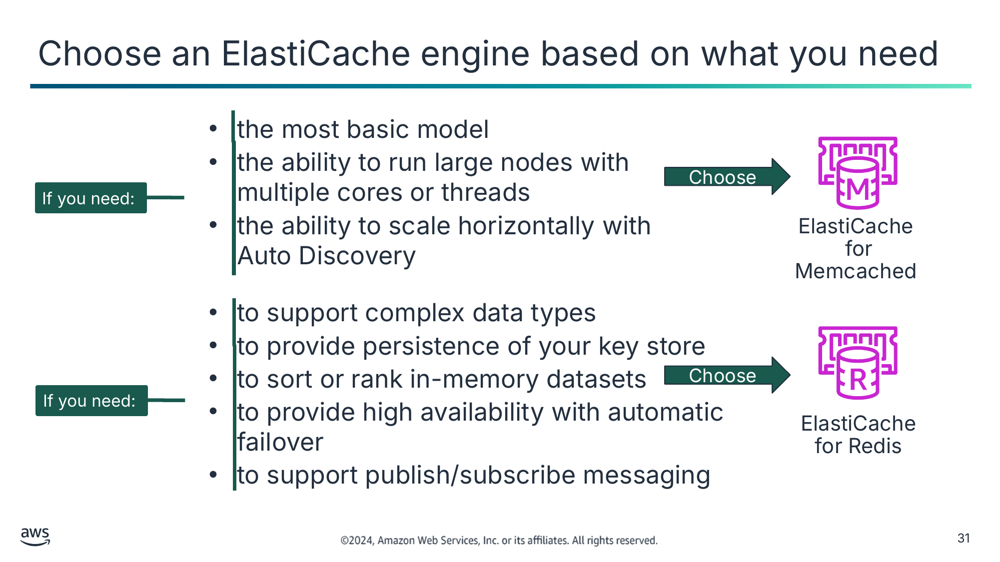

- найпростішої моделі
- можливості запускати великі вузли з кількома ядрами чи потоками
- можливості горизонтального масштабування за допомогою Auto Discovery

Оберіть

ElastiCache  
for Memcached

- підтримки складних типів даних
- забезпечення збереження вашого сховища ключів
- сортування чи ранжування наборів даних у пам’яті
- забезпечення високої доступності з автоматичним відмовостійким перемиканням
- підтримки обміну повідомленнями за схемою «публікація/підписка» (publish/subscribe)

Оберіть

ElastiCache  
for Redis

Текст зі схеми

If you need: (Якщо вам потрібно:)

If you need:

> **Нотатки:**
>
> |Номер слайда 31  
> |Нотатки для інструктора  
> |  
> |Нотатки для студента  
> Одна з цілей ElastiCache — зменшити додаткову складність адміністрування ваших систем кешування в пам’яті для рушіїв Redis і Memcached. Рушії Memcached і Redis — це кеші, що можуть використовуватися для розвантаження бази даних. Обидва рушії пропонують час відповіді менше мілісекунди. Зберігаючи дані в пам’яті, вони можуть читати дані швидше, ніж дискові бази даних. Кожен рушій надає певні переваги.  
>
> ElastiCache for Memcached пропонує таке:  
> Низьке обслуговування: Memcached потребує менше обслуговування, ніж Redis. Обирайте Memcached, якщо вам потрібна найпростіша модель.  
> Багатопотоковість: оскільки Memcached багатопотоковий, він може використовувати кілька ядер обробки, що означає, що ви можете обробляти більше операцій, збільшуючи обчислювальну потужність. Обирайте цей рушій, якщо потрібно запускати великі вузли з кількома ядрами чи потоками.  
> Горизонтальна масштабованість з Auto Discovery: коли кластери Memcached використовуються в ElastiCache, кластери можуть додавати й вилучати вузли за допомогою функції Auto Discovery. Ця функція автоматично виявляє зміни членства вузлів у кластері, як-от нові додані вузли чи вилучені вузли. Клієнт ElastiCache автоматично переналаштовується у відповідь.  
>
> ElastiCache for Redis пропонує таке:  
> Розширені структури даних: Redis підтримує складні типи даних, як-от рядки, хеші, списки, множини, впорядковані множини та бітові карти. Якщо вам потрібні складні типи даних, обирайте Redis.  
> Збереження (persistence): Redis забезпечує збереження вашого сховища ключів. Натомість рушій Memcached не підтримує збереження. Наприклад, можливо, вузол виходить з ладу й замінюється новим порожнім вузлом, або ви можете видалити вузол чи зменшити його. У такому разі ви втрачаєте дані, що зберігаються в пам’яті кешу.  
> Сортування чи ранжування наборів даних: можна використовувати Redis для сортування чи ранжування наборів даних у пам’яті. Наприклад, можна використати впорядковані множини Redis для впровадження таблиці лідерів гри, що веде список гравців, відсортований за їхнім рангом.  
> Розгортання Multi-AZ з автоматичним відмовостійким перемиканням: ElastiCache for Redis забезпечує високу доступність через розгортання Multi-AZ з автоматичним відмовостійким перемиканням на випадок відмови вашого основного вузла.  
> Обмін повідомленнями «публікація/підписка»: Redis підтримує обмін повідомленнями за схемою «публікація/підписка» зі зіставленням шаблонів, що можна використовувати для високопродуктивних чатів, потоків коментарів у реальному часі, стрічок соціальних мереж і міжсерверного обміну даними.

---

## Слайд 32: Компоненти ElastiCache

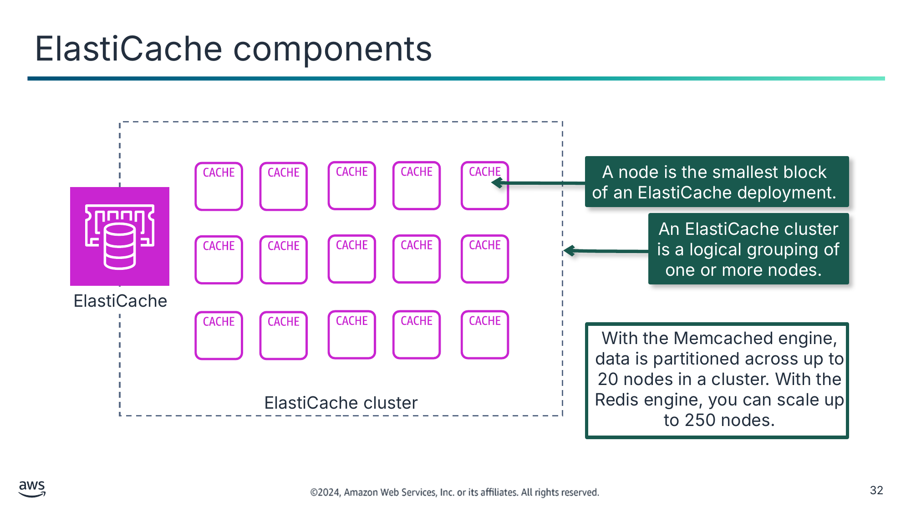

Вузол (node) — найменший блок  
розгортання ElastiCache.

Кластер ElastiCache — це логічне групування одного чи кількох вузлів.

Текст зі схеми

ElastiCache

ElastiCache cluster (Кластер ElastiCache)

With the Memcached engine, data is partitioned across up to 20 nodes in a cluster. With the Redis engine, you can scale up to 250 nodes. (З рушієм Memcached дані розділяються між до 20 вузлів у кластері. З рушієм Redis можна масштабуватися до 250 вузлів.)

> **Нотатки:**
>
> |Номер слайда 32  
> |Нотатки для інструктора  
> |  
> |Нотатки для студента  
> Вузол кешу — це найменший будівельний блок розгортання ElastiCache. Це шматок захищеної, підключеної до мережі оперативної пам’яті фіксованого розміру. Кожен вузол запускає рушій, обраний під час створення чи останньої зміни кластера або групи реплікації. Кожен вузол має власне DNS-ім’я та порт. Він може існувати окремо від інших вузлів або в групі з іншими вузлами, що також відомо як кластер. За потреби можна масштабувати вузли в кластері вгору чи вниз до іншого типу екземпляра. Ваш застосунок підключається до вузла чи кластера ElastiCache за унікальною адресою, що називається кінцевою точкою (endpoint).  
>   
> Хоча компоненти ElastiCache однакові, залежно від того, який рушій ви використовуєте, будуть деякі відмінності.  
> З рушієм Memcached дані розділяються між вузлами в кластері. Дані Memcached розділяються між до 20 вузлів. Для робочих навантажень Memcached дані розділяються між усіма вузлами кластера. Тому можна масштабуватися назовні, щоб краще обробляти більше даних, коли попит зростає.  
> З рушієм Redis можна масштабувати ваш кластер Redis до 250 вузлів. Кластер Redis — це логічне групування одного чи кількох шардів. Шард Redis (shard) — це групування з 1–6 пов’язаних вузлів. ElastiCache for Redis забезпечує високу доступність через розгортання Multi-AZ з автоматичним відмовостійким перемиканням.

---

## Слайд 33: Час життя (time to live, TTL)

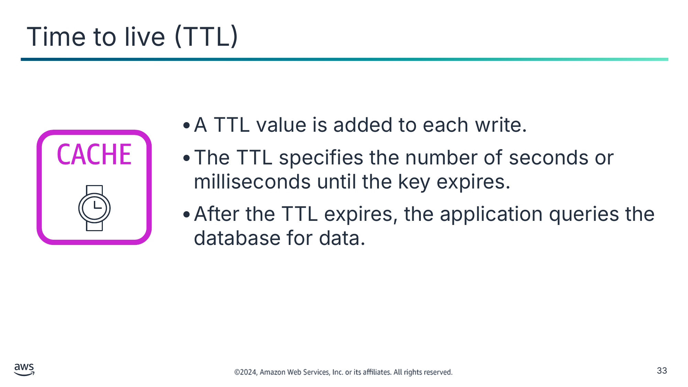

- Значення TTL додається до кожного запису.
- TTL вказує кількість секунд чи мілісекунд до завершення терміну дії ключа.
- Після завершення TTL застосунок запитує дані з бази даних.

> **Нотатки:**
>
> |Номер слайда 33  
> |Нотатки для інструктора  
> |Для мінімального TTL обидва рушії дозволяють TTL 0, що означає, що пара «ключ-значення» витісняється чи її термін дії завершується одразу після встановлення чи отримання. Для максимального TTL явного максимального TTL для Memcached немає. Якщо ви не встановите певний TTL, ключі зберігатимуться, доки кеш не заповниться, після чого Memcached почне витісняти ключі в порядку тих, що використовувалися найменш нещодавно. Redis має настроюваний максимальний TTL. Політику витіснення можна визначити самостійно у файлі конфігурації Redis, що виходить за межі цього курсу. Без явного встановлення TTL поведінка за замовчуванням для обох рушіїв сервісу — дозволити ключам зберігатися необмежено, доки не знадобиться місце або дані не буде видалено вручну.  
> |  
> |Нотатки для студента  
> Час життя (TTL) — це ціле значення чи ключ, що вказує кількість секунд чи мілісекунд, залежно від рушія в пам’яті, до завершення терміну дії ключа. Коли застосунок намагається прочитати ключ із завершеним терміном дії, до застосунку ставляться так, ніби дані не знайдено в кеші. У результаті виконується запит до бази даних і кеш оновлюється. Таким чином дані не стають занадто застарілими, а значення в кеші час від часу оновлюються з бази даних.  
>
> Дані за своєю природою застарівають. Наступний слайд пояснює дві стратегії поводження із застарілими даними.

---

## Слайд 34: Стратегії поводження із застарілими даними (stale data)

| Функції (Features) | Ліниве завантаження (Lazy Loading) | Наскрізний запис (Write-Through) |
|---|---|---|
| Шаблон кешування (Caching Pattern) | Ця стратегія оновлює кеш після того, як дані запитано. | Ця стратегія оновлює кеш одразу після оновлення основної бази даних. |
| Перевага (Advantage) | Кеш містить лише дані, які застосунок фактично запитує. | Кеш актуальний відносно основної бази даних (найімовірніше, дані буде знайдено в кеші). |
| Недолік (Disadvantage) | Ця стратегія потребує програмної стратегії для підтримки актуальності кешу. | Ця стратегія призводить до збільшення вартості через зберігання в пам’яті даних, які ви, можливо, не використовуватимете. |

> **Нотатки:**
>
> |Номер слайда 34  
> |Нотатки для інструктора  
> |Цей слайд слугує вступом до двох стратегій кешування: лінивого завантаження та наскрізного запису. Пояснюються шаблони кешування двох стратегій, і порівнюються переваги й недоліки. Наступні два слайди ілюструють процес цих стратегій.  
> |  
> |Докладніше пояснення див. розділ «Caching Strategies» документації ElastiCache. Посилання надано на сторінці ресурсів.  
> |  
> |Нотатки для студента  
> Існує кілька стратегій для синхронізації інформації в кеші з базою даних. Цей слайд розглядає дві поширені стратегії кешування. Загалом нижче наведено порівняння цих стратегій:  
> У лінивому завантаженні дані завантажуються в кеш лише коли це необхідно. Ліниве завантаження допомагає забезпечити, щоб дані, завантажені в кеш, були даними, потрібними застосунку. Недолік цієї стратегії в тому, що вона допускає застарілі дані, тож дані не завжди актуальні.  
> Альтернативна стратегія — записувати наскрізь до кешу щоразу, коли відбувається звернення до бази даних. Цей підхід призводить до меншої кількості промахів кешу (cache misses), що може покращити продуктивність, але потребує додаткового сховища для даних, які застосунку можуть бути потрібні чи не потрібні. У цій стратегії дані, що запитуються нечасто й також записуються до кешу, призводять до більшого й дорожчого кешу.  
>
> Проблема кешування даних у тому, що вони за своєю природою застарівають. Тому важливо застосовувати програмну стратегію для підтримки актуальності кешу настільки, наскільки це доречно. Ці стратегії кешування мають зосереджуватися на бізнес-міркуваннях, як-от вартість, швидкість, запуск і допустимість іноді короткочасної наявності застарілих даних. Найкраща стратегія залежить від вашого сценарію використання. Критично важливо розуміти вплив застарілих даних на ваш сценарій використання. Якщо вплив високий, розгляньте підтримку актуальності за допомогою наскрізного запису. Якщо вплив низький, ліниве завантаження може бути достатнім. Також допомагає розуміти частоту зміни базових даних, оскільки ця частота впливає на компроміси продуктивності та вартості стратегій кешування. Коли ви вирішите стратегію підтримки вашого кешу, потрібно буде впровадити цей підхід у вашому застосунку.

---

## Слайд 35: Стратегії кешування: ліниве завантаження (lazy loading)

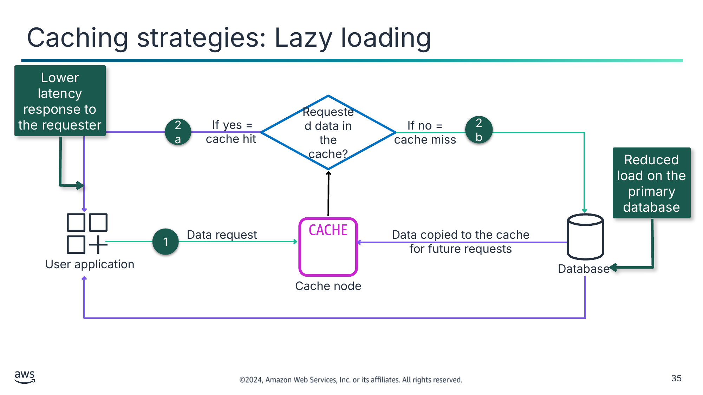

Відповідь із нижчою затримкою для запитувача

Зменшене навантаження на основну базу даних

Текст зі схеми

Requested data in the cache? (Запитувані дані є в кеші?)

If yes = cache hit (Якщо так = влучання в кеш)

2b

2a

1

Data copied to the cache for future requests (Дані скопійовано до кешу для майбутніх запитів)

Database (База даних)

Cache node (Вузол кешу)

User application (Застосунок користувача)

Data request (Запит даних)

If no = cache miss (Якщо ні = промах кешу)

> **Нотатки:**
>
> |Номер слайда 35  
> |Нотатки для інструктора  
> |Ця діаграма рішень показує потік між застосунком і базою даних. Вузол кешування розташований посередині й буде викликаний першим. Пояснюються терміни «влучання в кеш» (cache hit) і «промах кешу» (cache miss).  
> |  
> |Маршрут із позначкою 2a призначений для показу як коротшого шляху, що забезпечує відповідь запитувачу з нижчою затримкою. За маршрутом із позначкою 2b слідують два шляхи: копіювання даних до кешу та передавання даних із бази даних до застосунку.  
> |  
> |Нотатки для студента  
> Ця схема показує, як користувач може отримати доступ до контенту за допомогою кешування з лінивим завантаженням. (Зелені лінії показують запит даних, а фіолетові лінії — відповідь із даними.)  
> 1. Користувач робить запит на доступ до контенту. Чи є запитувані дані в кеші, визначає наступний крок.  
> 2a. Код застосунку спершу намагається прочитати дані з кешу. Якщо кеш містить дані, ElastiCache повертає файл користувачу, і шлях даних на цьому закінчується. Це відомо як влучання в кеш (cache hit).  
> 2b. Якщо дані не знайдено в кеші, це відомо як промах кешу (cache miss). Кеш пересилає запит до основної бази даних, що розміщує контент. Вихідний сервер надсилає запитувані дані користувачу й додає їх до кешу для наступного разу, коли хтось їх запитає.  
>
> Ця схема не показує, як поводитися із застарілим кешем, і показує лише високорівневий процес кешування відповідей із базового джерела даних.  
>
> Використовуйте ліниве завантаження, коли у вас є дані, що читатимуться часто, але записуватимуться рідко. Наприклад, у типовому вебзастосунку чи мобільному застосунку профіль користувача рідко змінюється, але до нього звертаються протягом усього застосунку. Людина може оновлювати свій профіль лише кілька разів на рік. Однак до профілю можуть звертатися десятки чи сотні разів на день залежно від користувача.  
>
> Перевага лінивого завантаження в тому, що кешуються лише запитувані дані. Оскільки більшість даних ніколи не запитується, ліниве завантаження уникає заповнення кешу непотрібними даними. Однак промах кешу має штраф. Кожен промах кешу призводить до трьох звернень, що може спричинити помітну затримку отримання даних застосунком. Крім того, якщо дані записуються до кешу лише під час промаху кешу, дані в кеші можуть стати застарілими. Ліниве завантаження не забезпечує оновлень кешу, коли дані змінюються в базі даних.

---

## Слайд 36: Стратегії кешування: наскрізний запис (write-through)

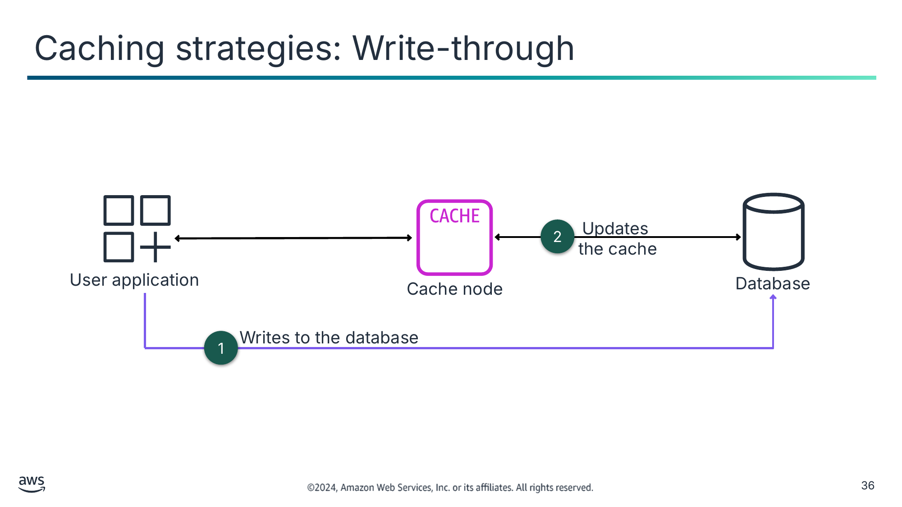

Текст зі схеми

Updates

the cache (Оновлює кеш)

Cache node (Вузол кешу)

Writes to the database (Записує до бази даних)

User application (Застосунок користувача)

Database (База даних)

2

1

> **Нотатки:**
>
> |Номер слайда 36  
> |Нотатки для інструктора  
> |На відміну від лінивого завантаження, ця стратегія не залежить від того, що є у вузлі кешу. Дані записуються до бази даних, а кеш оновлюється.  
> |  
> |Нотатки для студента  
> Ця схема показує, як контент кешується за допомогою стратегії наскрізного запису.  
> З будь-якою зміною чи оновленням застосунку дані записуються до бази даних.  
> Одразу після цього локальний кеш оновлюється.  
>
> Цей підхід проактивний: ви можете уникнути непотрібних промахів кешу, коли у вас є дані, до яких, як ви знаєте, звертатимуться. Перевага цього підходу в тому, що він збільшує ймовірність того, що ваш застосунок знайде це значення в кеші, коли шукатиме його. Дані в кеші завжди актуальні й ніколи не застарілі. Недолік у тому, що ви потенційно кешуєте дані, які вам не потрібні, тож цей підхід може спричинити додаткові витрати.  
>
> Використовуйте стратегію кешування з наскрізним записом, коли у вас є дані, що мають оновлюватися в реальному часі.

---

## Слайд 37: Ключові висновки: кешування за допомогою ElastiCache

- ElastiCache — це сховище даних у пам’яті типу «ключ-значення», призначене забезпечувати затримку на рівні мілісекунд і недорогий доступ до копій даних.
- ElastiCache зменшує складність адміністрування ваших систем кешування для рушіїв Redis і Memcached.
- Ліниве завантаження та наскрізний запис — дві стратегії для підтримки актуальності кешу настільки, наскільки це доречно.

> **Нотатки:**
>
> |Номер слайда 37  
> |Нотатки для інструктора  
> |  
> |Нотатки для студента

---

## Слайд 38: Застосування принципів AWS Well-Architected Framework до кешування

Кешування контенту

> **Нотатки:**
>
> |Номер слайда 38  
> |Нотатки для інструктора  
> |  
> |Нотатки для студента  
> Цей розділ розглядає, як застосовувати принципи AWS Well-Architected Framework до кешування вашого контенту.

---

## Слайд 39: Найкращі практики AWS Well-Architected Framework для кешування

> **Нотатки:**
>
> |Номер слайда 39  
> |Нотатки для інструктора  
> |Решта слайдів у цьому розділі подають приклади, що підкреслюють, як матеріал цього модуля узгоджується з найкращими практиками AWS Well-Architected Framework. За бажанням ви можете попросити студентів відвідати вебсайт Well-Architected Framework і знайти найкращі практики, які, на їхню думку, пов’язані з матеріалом, поданим у цьому модулі, використовуючи цей розділ як відправну точку.  
> |  
> |Нотатки для студента  
> AWS Well-Architected Framework має шість опор, і кожна опора включає найкращі практики та набір запитань, які слід враховувати під час проєктування хмарних рішень. Цей розділ виділяє кілька найкращих практик з опор, найактуальніших для цього модуля. Повний набір найкращих практик за опорами знайдіть на вебсайті Well-Architected Framework. Розділ ресурсів вмісту вашого онлайн-курсу містить посилання.  
>
> Встановлюючи зв’язки між опорами AWS Well-Architected Framework і кешуванням, розгляньте свою роль як хмарного архітектора, що кешує контент, і потребу знати таку інформацію:  
> Коли кешувати контент для покращення продуктивності та оптимізації витрат  
> Як поводитися із застарілим контентом, щоб збалансувати керування витратами й наявність актуальних даних.  
> Чому слід включати сервіс CDN як стратегію кешування в пам’яті у ваші проєкти архітектури

---

## Слайд 40: Підхід найкращих практик: керування даними

**Найкращі практики**

Упроваджуйте шаблони доступу до даних, що використовують кешування.

Упроваджуйте стратегії покращення продуктивності запитів у сховищі даних.

> **Нотатки:**
>
> |Номер слайда 40  
> |Нотатки для інструктора  
> |Посилання на ці найкращі практики надано в документі ресурсів. Ці найкращі практики належать до опори ефективності продуктивності, галузі «Керування даними» (Data Management).  
> |  
> |Нотатки для студента  
> Зберігання даних у кеші може покращити затримку читання, пропускну здатність читання, користувацький досвід і загальну ефективність, а також зменшити витрати. Кешування даних може бути однією з найефективніших стратегій покращення загальної продуктивності вашого застосунку та зменшення навантаження на базові первинні джерела даних.  
>
> Упроваджуйте шаблони доступу до даних, що використовують кешування: спершу визначте бази даних, API та мережеві сервіси, що можуть виграти від кешування. Сервіси, що мають важкі робочі навантаження читання, високе співвідношення читання до запису або дорогі в масштабуванні, є кандидатами на кешування. Далі визначте відповідний тип стратегії кешування, що найкраще відповідає вашому шаблону доступу. Потім налаштуйте стратегію анулювання кешу, як-от час життя (TTL), для всіх даних, що балансує актуальність даних і зменшення навантаження на бекенд-сховище даних. Нарешті, відстежуйте частку влучань у кеш (cache hit rate) з метою 80% або вище. Нижчі значення можуть вказувати на недостатній розмір кешу чи шаблон доступу, що не виграє від кешування.  
>
> У цьому модулі ви дізналися, як Amazon CloudFront зазвичай обслуговуватиме кешований контент із периферійної локації, доки термін дії контенту не завершиться. Щоб розв’язати проблему наявності двох копій даних, можна контролювати поведінку кешування CloudFront за допомогою комбінації специфікацій мінімального TTL CloudFront, специфікацій максимального TTL, версіонування контенту, заголовків HTTP cache-control та запитів на анулювання CloudFront.  
>   
> У цьому модулі ви також дізналися, як бази даних у пам’яті використовуються для застосунків, що потребують доступу до даних у реальному часі, найнижчої затримки та найвищої пропускної здатності. Зберігаючи дані безпосередньо в пам’яті, ці бази даних забезпечують затримку на рівні мікросекунд для застосунків, де затримки в мілісекунди недостатньо. Можна використовувати бази даних у пам’яті для кешування застосунків, керування сеансами, ігрових таблиць лідерів і геопросторових застосунків. ElastiCache — це повністю кероване сховище даних у пам’яті, сумісне з Redis і Memcached.  
>
> Упроваджуйте стратегії покращення продуктивності запитів у сховищі даних: оптимізація даних і продуктивності запитів призводить до більшої ефективності, нижчої вартості та покращеного користувацького досвіду. Оптимізація даних і налаштування запитів — критично важливі аспекти ефективності продуктивності в сховищі даних, оскільки вони впливають на продуктивність і чутливість усього хмарного робочого навантаження. Неоптимізовані запити можуть призвести до більшого використання ресурсів і вузьких місць, що зменшують загальну ефективність сховища даних. Одна зі стратегій покращення продуктивності запитів — рішення розподіленого кешування, що покращить затримку й зменшить кількість операцій введення-виведення бази даних.

---

## Слайд 41: Підхід найкращих практик: основи — плануйте топологію вашої мережі

**Найкраща практика**

Використовуйте високодоступне мережеве підключення для публічних кінцевих точок вашого робочого навантаження.

> **Нотатки:**
>
> |Номер слайда 41  
> |Нотатки для інструктора  
> |Посилання на цю найкращу практику надано в документі ресурсів. Ця найкраща практика належить до опори надійності, галузі найкращих практик «Основи» (Foundations) і теми «Плануйте топологію вашої мережі».  
> |  
> |Нотатки для студента  
> Критично важливо планувати, будувати й вводити в експлуатацію високодоступне мережеве підключення для ваших публічних кінцевих точок. Якщо ваше робоче навантаження стає недосяжним через втрату підключення, навіть якщо ваше робоче навантаження працює й доступне, ваші клієнти бачитимуть вашу систему як недоступну. Поєднуючи високодоступне й стійке мережеве підключення для публічних кінцевих точок вашого робочого навантаження зі стійкою архітектурою самого робочого навантаження, ви можете забезпечити найкращу можливу доступність і рівень сервісу для ваших клієнтів. Для цього одна з найкращих практик — використовувати CDN.  
>
> Використовуйте високодоступне мережеве підключення для публічних кінцевих точок вашого робочого навантаження: CloudFront надає API для розповсюдження контенту з низькою затримкою та високими швидкостями передавання даних, обслуговуючи запити через мережу периферійних локацій по всьому світу. CDN обслуговують клієнтів, надаючи контент, розташований чи кешований у місці поблизу користувача. Це також покращує доступність вашого застосунку, оскільки навантаження на контент переноситься з ваших серверів на периферійні локації CloudFront. Периферійні локації та регіональні периферійні кеші тримають кешовані копії вашого контенту близько до ваших глядачів, що призводить до швидкого отримання та збільшує досяжність і доступність вашого робочого навантаження.  
>
> У цьому модулі ви дізналися, як CloudFront безпечно доставляє контент по всьому світу й покращує стійкість застосунків до атак DDoS. Кешування контенту за допомогою CloudFront збільшує надійність доступу ваших клієнтів до вашого застосунку.

---

## Слайд 42: Підхід найкращих практик: економічно ефективні ресурси — плануйте передавання даних

**Найкращі практики**

Виконуйте моделювання передавання даних.

Обирайте компоненти для оптимізації вартості передавання даних.

Упроваджуйте сервіси для зменшення витрат на передавання даних.

> **Нотатки:**
>
> |Номер слайда 42  
> |Нотатки для інструктора  
> |Посилання на ці найкращі практики надано в документі ресурсів. Ці найкращі практики належать до опори оптимізації витрат, галузі «Економічно ефективні ресурси» (Cost-effective resources) і теми «Плануйте передавання даних».  
> |  
> |Нотатки для студента  
> Використання відповідних сервісів, ресурсів і конфігурацій для ваших робочих навантажень — ключ до економії коштів. Ці найкращі практики допоможуть оптимізувати витрати під час кешування контенту.  
>   
> Виконуйте моделювання передавання даних: зберіть вимоги й виконайте моделювання передавання даних робочого навантаження та кожного з його компонентів. Це визначає точку найнижчої вартості для його поточних вимог до передавання даних. Зрозумійте, де в вашому робочому навантаженні відбувається передавання даних, вартість передавання та пов’язану з ним користь. Цю інформацію можна використати, щоб ухвалити обґрунтоване рішення про зміну чи прийняття архітектурного рішення.  
>
> Обирайте компоненти для оптимізації вартості передавання даних: проєктування з урахуванням передавання даних допомагає мінімізувати витрати на передавання даних. Використовуючи моделювання передавання даних, зосередьтеся на тому, де найбільші витрати на передавання даних або де вони були б, якщо використання робочого навантаження зміниться. Шукайте альтернативні архітектури чи додаткові компоненти, що усувають або зменшують потребу в передаванні даних чи знижують його вартість. Це може включати використання CDN для розміщення даних ближче до користувачів.  
>
> Упроваджуйте сервіси для зменшення витрат на передавання даних: можна використовувати периферійні локації чи CDN для доставки контенту кінцевим користувачам або будувати рівні кешування перед вашими серверами застосунків чи базами даних. Залежно від компонентів вашого робочого навантаження, типу та хмарної архітектури, різноманітні сервіси можуть допомогти стискати, кешувати та спільно використовувати й розподіляти ваш трафік у хмарі. CloudFront кешує дані на периферійних локаціях по всьому світу, що зменшує навантаження на ваші ресурси. Використовуючи CloudFront, можна зменшити адміністративні зусилля з доставки контенту великій кількості користувачів у всьому світі з мінімальною затримкою. Пакет економії на безпеці (security savings bundle) може допомогти заощадити до 30 відсотків на використанні CloudFront, якщо ви плануєте збільшувати своє використання з часом.  
>
> У цьому модулі один зі способів оптимізувати витрати за допомогою кешування, про які ви дізналися, — контролювати, як довго кешується контент. Можна контролювати поведінку кешування CloudFront за допомогою комбінації специфікацій мінімального TTL CloudFront, специфікацій максимального TTL, версіонування контенту, заголовків HTTP cache-control та запитів на анулювання CloudFront. Під час впровадження кешування розгляньте відповідну стратегію забезпечення точних результатів.

---

## Слайд 43: Ключові висновки: застосування принципів AWS Well-Architected Framework до кешування

- Враховуйте найкращі практики в опорі ефективності продуктивності, як-от вибір на основі характеристик даних і наявних варіантів.
- Враховуйте найкращі практики в опорі надійності, як-от використання високодоступного мережевого підключення для ваших публічних кінцевих точок.
- Враховуйте найкращі практики в опорі оптимізації витрат, як-от упровадження сервісів для зменшення витрат на передавання даних.

> **Нотатки:**
>
> |Номер слайда 43  
> |Нотатки для інструктора  
> |Це не вичерпний перелік найкращих практик, охоплених найкращими практиками AWS Well-Architected. Це ключові висновки для пояснення найкращих практик, розглянутих у модулі. Посилання є на сторінці ресурсів вмісту вашого онлайн-курсу.  
> |  
> |Нотатки для студента

---

## Слайд 44: Підсумки модуля

Кешування контенту

> **Нотатки:**
>
> |Номер слайда 44  
> |Нотатки для інструктора  
> |  
> |Нотатки для студента  
> Цей розділ підсумовує те, що ви дізналися, і завершує модуль.

---

## Слайд 45: Резюме модуля

Цей модуль підготував вас до такого:

- Визначати, як кешування контенту може покращити продуктивність застосунків і зменшити затримку.
- Визначати, як використовувати Amazon CloudFront для доставки контенту через периферійні локації (edge locations) із захистом.
- Створювати архітектури, що використовують CloudFront для кешування контенту.
- Описувати, як використовувати ElastiCache для кешування баз даних.
- Використовувати принципи AWS Well-Architected Framework під час проєктування стратегій кешування.

> **Нотатки:**
>
> |Номер слайда 45  
> |Нотатки для інструктора  
> |  
> |Нотатки для студента

---

## Слайд 46: Міркування щодо кафе

- Обговоріть, як ви, як хмарний архітектор, могли б порадити кафе на основі ключових занепокоєнь хмарного архітектора, поданих на початку цього модуля.

---

## Слайд 47: Перевірка знань модуля

- Перевірка знань проводиться онлайн у вашому курсі.
- Перевірка знань включає 10 запитань на основі матеріалу, поданого на слайдах і в нотатках до слайдів.
- Ви можете повторно проходити перевірку знань стільки разів, скільки захочете.

> **Нотатки:**
>
> |Номер слайда 47  
> |Нотатки для інструктора  
> |  
> |Нотатки для студента  
> Скористайтеся своїм онлайн-курсом, щоб отримати доступ до перевірки знань для цього модуля.

---

## Слайд 48: Зразок запитання іспиту

Ваша компанія розміщує сайт електронної комерції та зберігає записи в базі даних Amazon RDS. Через кілька днів база даних Amazon RDS зазнає серйозних проблем із продуктивністю через запити вебсайту. Який варіант є найекономічнішим способом розв’язання проблем із продуктивністю через велику кількість запитів на читання?

Визначте ключові слова та фрази, перш ніж продовжувати.

Ось ключові слова та фрази:

- База даних Amazon RDS
- Економічно ефективний
- Проблеми з продуктивністю через велику кількість запитів на читання

> **Нотатки:**
>
> |Номер слайда 48  
> |Нотатки для інструктора  
> |Розділ із ключовими словами налаштовано з анімацією для розкриття за клацанням. Вкажіть на вимоги, викладені в запитанні. Приклад: запитання натякає на потребу в певному типі рішення з кешування на основі бажаного результату — розв’язання проблем із продуктивністю економічно ефективним способом.  
> |  
> |Нотатки для студента

---

## Слайд 49: Зразок запитання іспиту: варіанти відповідей

Ваша компанія розміщує сайт електронної комерції та зберігає записи в **базі даних Amazon RDS**. Через кілька днів база даних Amazon RDS зазнає серйозних проблем із продуктивністю через запити вебсайту. Який варіант є найбільш **економічно ефективним** способом розв’язання **проблем із продуктивністю через велику кількість запитів на читання**?

**Варіант**

**Відповідь**

**A**

Увімкнути функцію Multi-AZ для бази даних Amazon RDS.

**B**

Налаштувати Amazon ElastiCache для кешування часто використовуваного контенту з бази даних.

**C**

Розмістити балансувальник навантаження перед базою даних.

**D**

Налаштувати Amazon CloudFront для кешування контенту з бази даних.

> **Нотатки:**
>
> |Номер слайда 49  
> |Нотатки для інструктора  
> |  
> |Нотатки для студента  
> Використайте ключові слова, які ви визначили на попередньому слайді, і розгляньте кожен із можливих варіантів відповіді, щоб визначити, який із них найкраще відповідає запитанню.

---

## Слайд 50: Зразок запитання іспиту: відповідь

Правильна відповідь — B.

**Варіант**

**Відповідь**

**B**

Налаштувати Amazon ElastiCache для кешування часто використовуваного контенту з бази даних.

> **Нотатки:**
>
> |Номер слайда 50  
> |Нотатки для інструктора  
> |  
> |Нотатки для студента  
> Варіант A (увімкнути функцію Multi-AZ для бази даних Amazon RDS) забезпечив би високу доступність, але не покращив би продуктивність бази даних.  
>
> Варіант C (розмістити балансувальник навантаження перед базою даних) не вплинув би на продуктивність бази даних.  
>
> Варіант D (налаштувати Amazon CloudFront для кешування контенту з бази даних) не покращив би продуктивність, оскільки CloudFront не використовується для кешування баз даних.  
>
> Варіант B (налаштувати Amazon ElastiCache для кешування часто використовуваного контенту з бази даних) — найкращий вибір. Цей варіант зменшить обсяг трафіку, що надсилається до бази даних.

---

## Слайд 51: Дякуємо

Виправлення, відгуки чи інші запитання?

Зв’яжіться з нами за адресою [https://support.aws.amazon.com/#/contacts/aws-academy](https://support.aws.amazon.com/#/contacts/aws-academy).

> **Нотатки:**
>
> |Номер слайда 51  
> |Нотатки для інструктора  
> |  
> |Нотатки для студента  
> На цьому цей модуль завершено. Сторінка ресурсів вмісту вашого курсу містить посилання на додаткові ресурси, пов’язані з цим модулем.
