## Слайд 1: Побудова роз’єднаних архітектур (Building Decoupled Architectures)

AWS Academy Cloud Architecting

> **Нотатки:**
>
> |Нотатки для інструктора  
> |  
> |Нотатки для студента  
> Вітаємо в модулі «Побудова роз’єднаних архітектур». Цей модуль пояснює переваги роз’єднання архітектури та описує методики й сервіси AWS, які можна використовувати для роз’єднання архітектури.

---

## Слайд 2: Вступ

Побудова роз’єднаних архітектур

> **Нотатки:**
>
> |Нотатки для інструктора  
> |  
> |Нотатки для студента  
> Цей вступний розділ описує вміст модуля.

---

## Слайд 3: Цілі модуля

Цей модуль готує вас до такого:

- Розрізняти щільно та слабко зв’язані архітектури.
- Визначати, як працює Amazon Simple Queue Service (Amazon SQS) і коли його використовувати.
- Визначати, як працює Amazon Simple Notification Service (Amazon SNS) і коли його використовувати.
- Описувати Amazon MQ.
- Роз’єднувати робочі навантаження за допомогою Amazon SQS.

> **Нотатки:**
>
> |Номер слайда 3  
> |Нотатки для інструктора  
> |  
> |Нотатки для студента

---

## Слайд 4: Огляд модуля

**Розділи презентації**

- Роз’єднання вашої архітектури
- Роз’єднання застосунків за допомогою Amazon SQS
- Роз’єднання застосунків за допомогою Amazon SNS
- Роз’єднання гібридного застосунку за допомогою Amazon MQ

**Перевірки знань**

- 10-запитальна перевірка знань
- Зразок запитання іспиту

> **Нотатки:**
>
> |Номер слайда 4  
> |Нотатки для інструктора  
> |Кожен модуль має вступ, розділи з вмістом і підсумок. Підсумок цього модуля містить зразок запитання іспиту для розбору зі студентами.  
> |  
> |Нотатки для студента  
> Цілі цього модуля розкриваються в кількох розділах.  
> Модуль завершується 10-запитальною перевіркою знань, що проводиться в онлайн-курсі, та зразком запитання іспиту для обговорення в класі.  
> Наступний слайд описує лабораторну роботу цього модуля.

---

## Слайд 5: Практична лабораторна робота в цьому модулі

Покрокова лабораторна робота (Guided lab)

- Побудова роз’єднаних застосунків за допомогою Amazon SQS (Building Decoupled Applications by Using Amazon SQS)

> **Нотатки:**
>
> |Номер слайда 5  
> |Нотатки для інструктора  
> |Цей модуль містить покрокову лабораторну роботу. Покрокові лабораторні роботи надають інструкції крок за кроком і є самодостатніми. Вони не залежать від сценарію з кафе чи пов’язаної архітектури. Вступи до кожної лабораторної роботи включено до розділів лабораторних робіт у межах модуля.  
> |  
> |Нотатки для студента  
> Цей модуль містить зазначену покрокову лабораторну роботу. У цій лабораторній роботі ви створите й використаєте чергу Amazon Simple Queue Service (Amazon SQS) для роз’єднання функцій у застосунку. Додаткова інформація про цю лабораторну роботу та кожну лабораторну роботу міститься в посібнику студента там, де вона виконується, а лабораторне середовище надає докладні інструкції.

---

## Слайд 6: Як хмарний архітектор, що проєктує архітектури застосунків:

- Мені потрібно усувати потенційні вузькі місця продуктивності, щоб архітектура масштабувалася в міру зростання трафіку.
- Мені потрібно обмежувати вплив збоїв у застосунку, щоб відмова одного компонента не призводила до падіння застосунку.
- Мені потрібно впроваджувати архітектури, у яких зміни одного компонента застосунку можуть відбуватися без впливу на інші частини, щоб я міг мінімізувати простій під час обслуговування.

> **Нотатки:**
>
> |Номер слайда 6  
> |Нотатки для інструктора  
> |Цей слайд подає ключові наскрізні міркування проєктування, що мають спрямовувати ухвалення рішень для цього рівня хмарної архітектури. Підкресліть, що хмарний архітектор завжди має починати з бізнес-кейсу й рухатися у зворотному напрямку, щоб обрати найкращі компоненти для цього сценарію використання. Також нагадайте студентам, що рішення, імовірно, еволюціонуватимуть з часом, у міру зміни чи кращого розуміння потреб, для оптимізації вартості та продуктивності. Наприкінці цього модуля в підсумковому розділі включено необов’язкове обговорення, що спонукає студентів розглянути ці чинники в контексті сценарію з кафе.  
> |  
> |Нотатки для студента  
> Цей слайд просить вас прийняти перспективу хмарного архітектора, коли ви думаєте про те, як підходити до проєктування хмарної мережі. Тримайте ці міркування в голові, просуваючись цим модулем, пам’ятаючи, що хмарний архітектор має працювати у зворотному напрямку від бізнес-потреби, щоб спроєктувати найкращу архітектуру для конкретного сценарію використання. Просуваючись модулем, розглядайте сценарій з кафе, поданий у курсі, як приклад бізнес-потреби й думайте про те, як би ви відповіли на ці потреби для вигаданого бізнесу кафе.

---

## Слайд 7: Роз’єднання вашої архітектури

Побудова роз’єднаних архітектур

> **Нотатки:**
>
> |Номер слайда 7  
> |Нотатки для інструктора  
> |  
> |Нотатки для студента  
> Роз’єднання (decoupling) — це відокремлення компонентів у системі так, щоб вони могли працювати незалежно. Цей розділ обговорює мотивацію роз’єднання архітектури й описує різні методики, які можна використовувати для роз’єднання архітектури.

---

## Слайд 8: Щільне зв’язування (tight coupling) у триярусній архітектурі

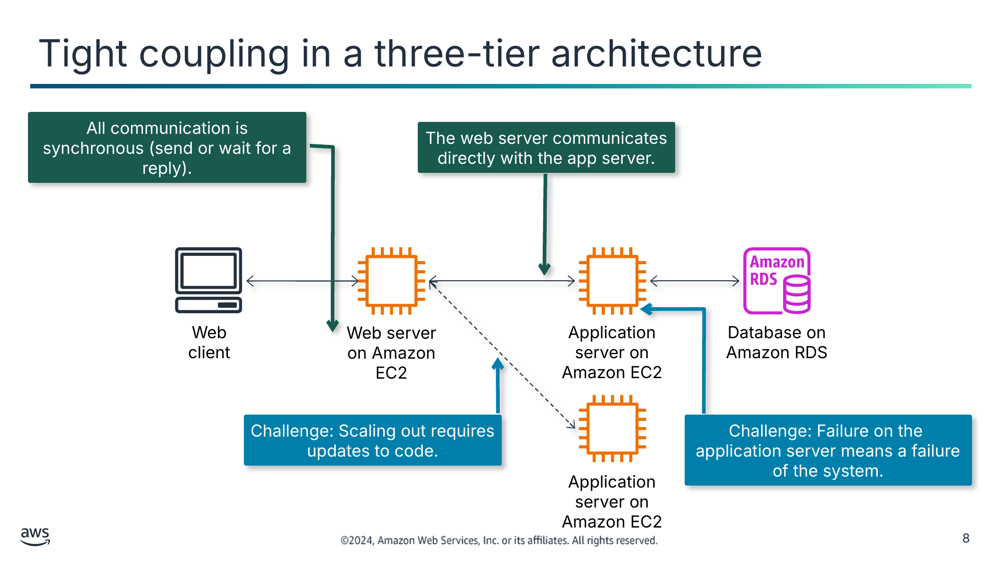

Увесь обмін даними синхронний (надіслати або чекати відповіді).

Вебсервер спілкується безпосередньо із сервером застосунку.

Виклик: масштабування назовні потребує оновлень коду.

Виклик: збій на сервері застосунку означає збій системи.

Текст зі схеми

Web client (Вебклієнт)

Application server on Amazon EC2 (Сервер застосунку на Amazon EC2)

Database on Amazon RDS (База даних на Amazon RDS)

Web server on Amazon EC2 (Вебсервер на Amazon EC2)

Application server on Amazon EC2

> **Нотатки:**
>
> |Номер слайда 8  
> |Нотатки для інструктора  
> |Цей приклад використовує триярусну архітектуру — поширену й найкращу практику архітектури для вебзастосунків — щоб виділити різні ділянки в системі, де може виникати щільне зв’язування, і його негативні наслідки. Використайте виноски на схемі, щоб визначити, що означає щільне зв’язування, і описати виклики, які воно створює. Подробиці див. в нотатках.  
> |  
> |Нотатки для студента  
> Щільне зв’язування (tight coupling) стосується системи, у якій пов’язані компоненти залежать один від одного настільки, що зміни чи збої в одному компоненті змушують до змін чи збоїв в інших компонентах. У триярусній архітектурі рівень представлення (на вебсервері), бізнес-логіка (на сервері застосунку) та бекенд-база даних розробляються й підтримуються як незалежні компоненти. Ця архітектура забезпечує більшу гнучкість, ніж попередні архітектури, коли потрібно змінити одну частину застосунку чи масштабувати архітектуру назовні.  
>
> Однак якщо ці незалежні компоненти все ще щільно зв’язані між собою, архітектура все одно не дуже стійка. Візьмімо приклад бізнесу, що переніс свій локальний вебзастосунок у хмару та впровадив триярусну архітектуру. Архітектура використовує Amazon Relational Database Service (Amazon RDS) для рівня сервера бази даних і Amazon Elastic Compute Cloud (Amazon EC2) для рівнів вебсервера та сервера застосунку. Обмін даними між рівнями синхронний, що означає, що вихідний компонент надсилає запит до цільового компонента й чекає відповіді, перш ніж продовжити.  
>
> Розгляньте такі виклики:  
> Якщо сервер застосунку виходить з ладу або вебсервер падає, уся система не працює, а клієнту повертаються помилки.  
> Якщо системному адміністратору потрібно оновити сервер застосунку для обслуговування чи виправлення помилки, він має вивести всю систему з роботи.  
> Якщо системний адміністратор хоче масштабувати назовні один із рівнів, він має оновити код, щоб той знав IP-адреси нових компонентів і знав, коли маршрутизувати трафік до кожного з них.

---

## Слайд 9: Щільне зв’язування збільшує складність масштабування

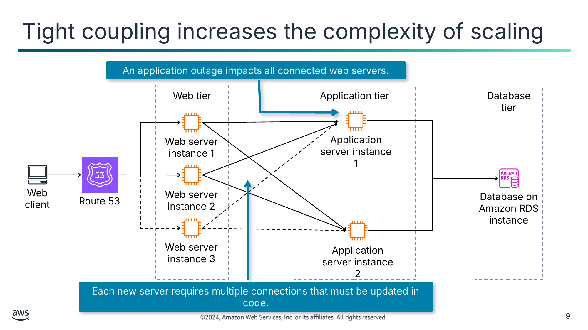

Збій застосунку впливає на всі підключені вебсервери.

Кожен новий сервер потребує кількох з’єднань, які потрібно оновлювати в коді.

Текст зі схеми

Web tier (Вебрівень)

Application tier (Рівень застосунку)

Database tier (Рівень бази даних)

Application server instance 1 (Екземпляр сервера застосунку 1)

Web server instance 1 (Екземпляр вебсервера 1)

Web client (Вебклієнт)

Web server instance 2

Route 53

Database on Amazon RDS instance (Екземпляр бази даних на Amazon RDS)

Web server instance 3

Application server instance 2

> **Нотатки:**
>
> |Номер слайда 9  
> |Нотатки для інструктора  
> |  
> |Нотатки для студента  
> Виклики масштабування в щільно зв’язаній системі створюють додаткову складність, що може перешкоджати здатності застосунку масштабуватися. У цьому прикладі бізнес масштабував свою систему застосунку вгору, додавши два додаткових вебсервери й один додатковий сервер застосунку для забезпечення більшої стійкості. Вони також запровадили Amazon Route 53 як сервіс імен, що повідомляє їм, коли один із вебсерверів недоступний.  
>
> Однак оскільки пов’язані компоненти безпосередньо з’єднані один з одним, додавання чи вилучення компонента для масштабування назовні чи досередини потребує створення чи вилучення з’єднань у кожному пов’язаному рівні. Чим більше компонентів щільно зв’язано, тим більше з’єднань потрібно додавати чи вилучати. У прикладі щільно зв’язаної архітектури додавання нового екземпляра вебсервера до вебрівня потребує встановлення загалом трьох нових з’єднань: одного від Route 53 до нового екземпляра та двох від нового екземпляра до серверів застосунку. Так само додавання нового екземпляра сервера застосунку до рівня застосунку потребувало б встановлення трьох нових з’єднань: по одному від кожного екземпляра вебсервера до нового екземпляра сервера застосунку.  
>
> Крім того, хоча кількість серверів збільшилася, системному адміністратору доведеться обробляти збої застосунку вручну. Якщо один із екземплярів сервера застосунку виходить з ладу, продуктивність усіх вебсерверів буде порушена, оскільки вони безпосередньо підключені до цього екземпляра.

---

## Слайд 10: Слабке зв’язування (loose coupling) між рівнями

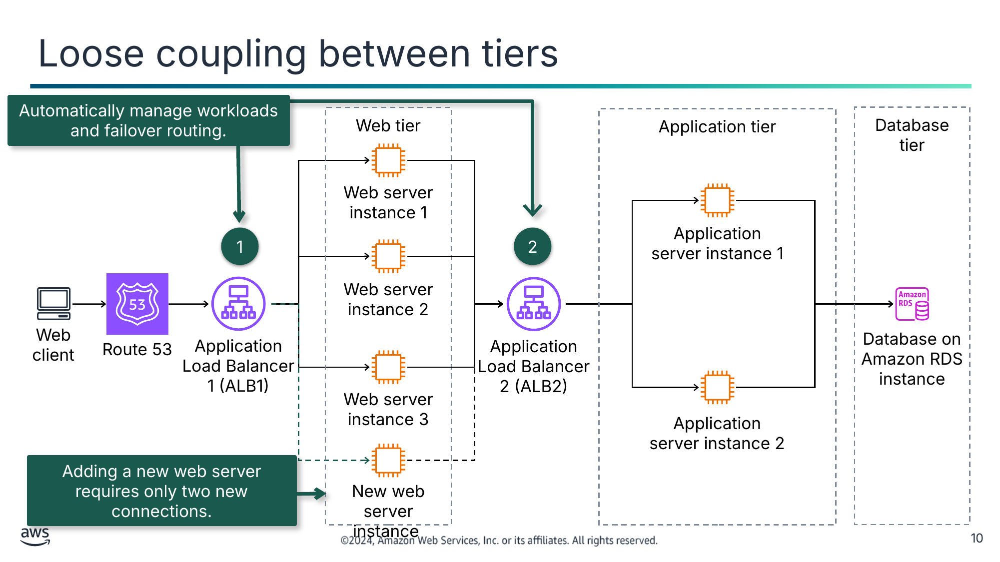

Автоматично керує робочими навантаженнями та маршрутизацією відмовостійкого перемикання.

Додавання нового вебсервера потребує лише двох нових з’єднань.

Текст зі схеми

Web tier (Вебрівень)

Application tier (Рівень застосунку)

Database tier (Рівень бази даних)

Web server instance 1 (Екземпляр вебсервера 1)

Application server instance 1 (Екземпляр сервера застосунку 1)

1

2

Web server instance 2

Web client (Вебклієнт)

Route 53

Application Load Balancer 1 (ALB1)

Application Load Balancer 2 (ALB2)

Database on Amazon RDS instance (Екземпляр бази даних на Amazon RDS)

Web server instance 3

Application server instance 2

New web server instance (Новий екземпляр вебсервера)

> **Нотатки:**
>
> |Номер слайда 10  
> |Нотатки для інструктора  
> |  
> |Нотатки для студента  
> На рівні інфраструктури ефективний спосіб полегшити проблеми, спричинені щільно зв’язаною архітектурою, і впровадити слабке зв’язування — запровадити проміжний компонент між залежними рівнями. Зі слабким зв’язуванням ви зменшуєте залежності у вашій системі, використовуючи керовані рішення, як-от Elastic Load Balancing (ELB), як посередників між рівнями вашої системи. Таким чином посередник автоматично обробляє збої та масштабування компонентів чи рівнів.  
>
> У прикладі триярусної архітектури вебзастосунку слабке зв’язування впроваджено на рівні інфраструктури так:  
> Додайте балансувальник навантаження ALB (тип ELB) перед вебсерверами. Цей балансувальник навантаження розподіляє трафік від Route 53 до екземплярів вебсерверів. Він відстежує стан усіх екземплярів і надсилає трафік лише до справних екземплярів.  
> Додайте балансувальник навантаження ALB між екземплярами вебсерверів та екземплярами серверів застосунку. Подібно до попереднього пункту, цей балансувальник навантаження виконує автоматичне керування робочим навантаженням і функції маршрутизації відмовостійкого перемикання між екземплярами вебсервера та сервера застосунку.  
>
> Якщо тепер ви хочете масштабуватися назовні й додати новий екземпляр вебсервера, потрібно створити лише два з’єднання: одне до ALB1 і друге до ALB2.  
>
> Докладний опис сервісу ELB виходить за межі цього модуля. Докладніше про ELB див. посібник користувача Elastic Load Balancing. Посилання надано у ваших ресурсах курсу.

---

## Слайд 11: Щільне зв’язування всередині застосунку

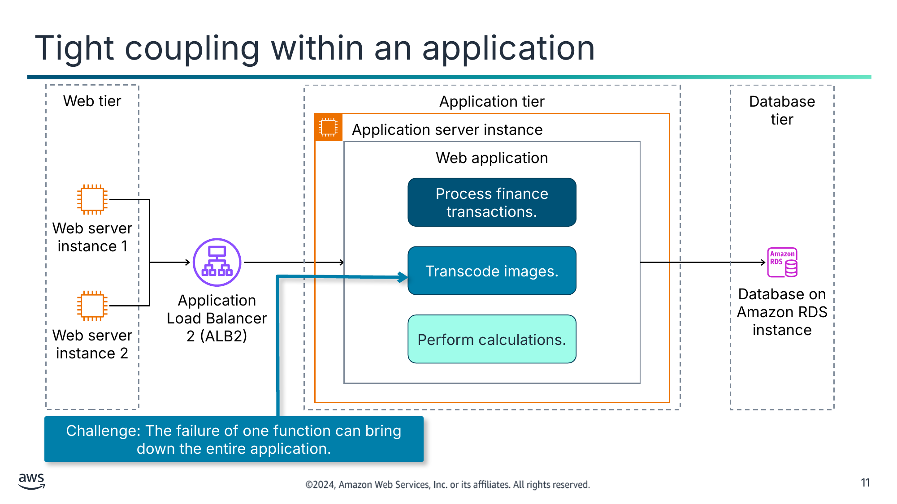

Виклик: збій однієї функції може зупинити весь застосунок.

Текст зі схеми

Web tier (Веброівень)

Application tier (Рівень застосунку)

Database tier (Рівень бази даних)

Application server instance (Екземпляр сервера застосунку)

Web application (Вебзастосунок)

Process finance transactions. (Обробка фінансових транзакцій.)

Web server instance 1 (Екземпляр вебсервера 1)

Transcode images. (Транскодування зображень.)

Database on Amazon RDS instance (Екземпляр бази даних на Amazon RDS)

Application Load Balancer 2 (ALB2)

Perform calculations. (Виконання обчислень.)

Web server instance 2

> **Нотатки:**
>
> |Номер слайда 11  
> |Нотатки для інструктора  
> |  
> |Нотатки для студента  
> Щільне зв’язування також може виникати всередині застосунку, коли бізнес-функції застосунку реалізовано й розгорнуто в єдиному блоці, як-от у монолітному застосунку. Цей проєкт створює такі виклики:  
> Проблема в одній функції може спричинити уповільнення всіх інших функцій застосунку або зупинку всього застосунку.  
> Зміни однієї функції потребують переведення всього застосунку в режим обслуговування.  
>
> У прикладі триярусної архітектури розгляньте сценарій, у якому вебзастосунок має три окремі функції: обробка фінансових транзакцій, транскодування зображень і виконання обчислень. Функції застосунку щільно зв’язані в єдиний блок розгортання та працюють в одному процесі в екземплярі сервера застосунку.  
>
> Якщо виникає уповільнення однієї функції застосунку, наприклад функції транскодування зображень, це може погіршити продуктивність усього застосунку або навіть призвести до того, що весь застосунок перестане відповідати. Відповіді на вхідні запити від рівня вебсервера поступово сповільнюватимуться й зрештою припиняться, якщо застосунок не відповідатиме.  
>
> Щоб розв’язати ці виклики, можна проєктувати застосунки, що використовують методики слабкого зв’язування на основі архітектури мікросервісів і асинхронних рішень обміну повідомленнями.

---

## Слайд 12: Слабке зв’язування: архітектура мікросервісів (microservice architecture)

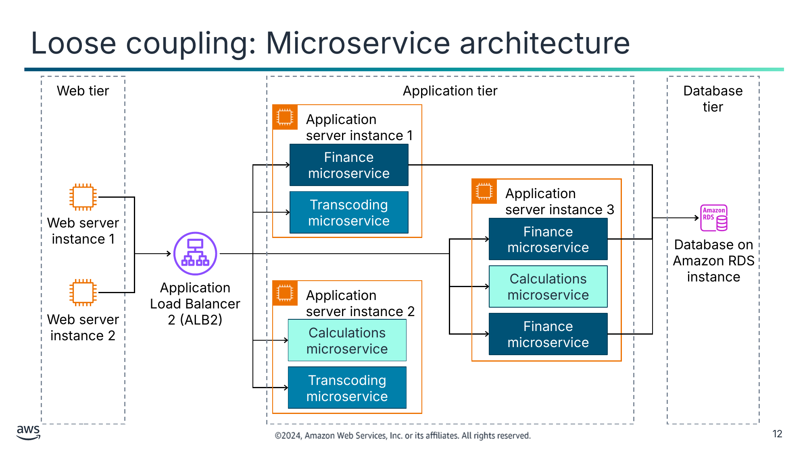

Текст зі схеми

Web tier (Веброівень)

Application tier (Рівень застосунку)

Database tier (Рівень бази даних)

Application server instance 1 (Екземпляр сервера застосунку 1)

Finance microservice (Фінансовий мікросервіс)

Application server instance 3

Transcoding microservice (Мікросервіс транскодування)

Web server instance 1 (Екземпляр вебсервера 1)

Finance microservice

Database on Amazon RDS instance (Екземпляр бази даних на Amazon RDS)

Calculations microservice (Мікросервіс обчислень)

Application Load Balancer 2 (ALB2)

Application server instance 2

Web server instance 2

Calculations microservice

Finance microservice

Transcoding microservice

> **Нотатки:**
>
> |Номер слайда 12  
> |Нотатки для інструктора  
> |  
> |Нотатки для студента  
> Архітектура мікросервісів поділяє функції застосунку на частини, що можуть масштабуватися та виходити з ладу незалежно. Кожен мікросервіс працює у власному процесі, підтримує власні дані та відкриває свою функцію через чітко визначений API. Це призводить до архітектури застосунку з повторно використовуваними компонентами, що є масштабованими й надійними. Мікросервіси, що реалізують застосунок, слабко зв’язані й можуть обмінюватися даними один з одним за допомогою синхронного чи асинхронного обміну. Це слабке зв’язування дає змогу вносити зміни до застосунку, не впливаючи на інші частини застосунку. Також можна додавати функції до компонента, мінімізуючи ризик для компонентів, що від нього залежать.  
>
> У прикладі на цьому слайді щільно зв’язані функції вебзастосунку розділено на окремі мікросервіси: фінансовий, транскодування та обчислень. Кожен мікросервіс працює у власному процесі (у цьому випадку у власному контейнері) і може масштабуватися незалежно від інших мікросервісів. Зверніть увагу, наприклад, що фінансовий мікросервіс масштабовано для роботи в трьох контейнерах, тоді як мікросервіс обчислень працює лише в одному. Це тому, що фінансовий мікросервіс отримує й має обробляти більше запитів, ніж мікросервіс обчислень. Крім того, якщо один із мікросервісів виходить з ладу (наприклад, мікросервіс транскодування в екземплярі сервера застосунку 1), збій не впливає на фінансовий мікросервіс і мікросервіс обчислень. Він також не впливає на мікросервіс транскодування, що працює в екземплярі сервера застосунку 2.  
>
> Докладний опис мікросервісів виходить за межі цього модуля. Модуль «Побудова мікросервісів і безсерверних архітектур» (Building Microservices and Serverless Architectures) обговорює мікросервіси.  
>
> Докладніше про мікросервіси див. «Implementing Microservices on AWS» у Implementing Microservices on AWS. Посилання надано у ваших ресурсах курсу.

---

## Слайд 13: Розвантаження запитів: Amazon SQS та Amazon SNS

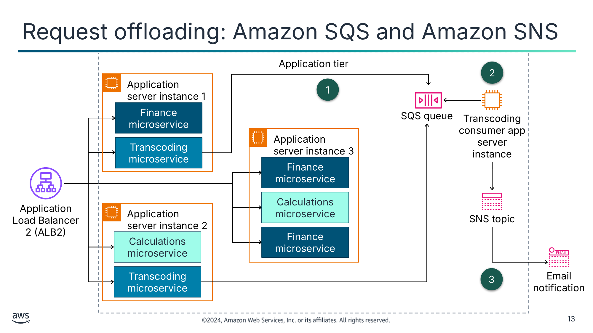

Текст зі схеми

Application tier (Рівень застосунку)

2

Application server instance 1 (Екземпляр сервера застосунку 1)

1

Finance microservice (Фінансовий мікросервіс)

SQS queue (Черга SQS)

Transcoding

consumer app server instance (Екземпляр сервера застосунку-споживача транскодування)

Application server instance 3

Transcoding microservice (Мікросервіс транскодування)

Finance microservice

Calculations microservice (Мікросервіс обчислень)

Application Load Balancer 2 (ALB2)

Application server instance 2

SNS topic (Тема SNS)

Calculations microservice

Finance microservice

Transcoding microservice

3

Email notification (Сповіщення електронною поштою)

> **Нотатки:**
>
> |Номер слайда 13  
> |Нотатки для інструктора  
> |  
> |Нотатки для студента  
> Щоб додатково покращити стійкість за допомогою слабкого зв’язування, робіть взаємодії компонентів асинхронними там, де це можливо. Ця модель підходить для будь-якої взаємодії, що не потребує негайної відповіді й де достатньо підтвердження того, що запит зареєстровано. Вона включає один компонент, що генерує події, — виробника (producer), і інший, що їх споживає, — споживача (consumer). Два компоненти не інтегруються й не взаємодіють безпосередньо, а зазвичай роблять це через проміжний довговічний рівень зберігання, як-от черга чи тема. Ця роз’єднана архітектура полегшує інтеграцію та повторне використання компонентів. Зауважте, що компоненти застосунку, роз’єднані за допомогою асинхронного обміну повідомленнями, можуть бути традиційними функціями чи мікросервісами.  
>
> У прикладі вебзастосунку бізнес помічає, що час відповіді мікросервісу транскодування поганий. Користувачі помічають, що їм доводиться довго чекати транскодування зображення й завершення одного зображення, перш ніж вони зможуть надіслати наступне. Цей час відповіді частково зумовлений синхронним проєктом функції, що може обробляти лише одне зображення за раз і не повертає відповіді користувачу, доки зображення не завершить оброблення. Щоб розв’язати цю проблему, бізнес переробляє функцію на використання асинхронних рішень слабкого зв’язування.  
>
> Схема ілюструє отриману архітектуру, що складається з таких змін:  
> Логіка, що виконує функцію транскодування, переміщується з мікросервісу транскодування до окремого застосунку-споживача. Мікросервіс стає виробником повідомлень і асинхронно підключається до застосунку-споживача за допомогою черги SQS. Для кожного запиту, який отримує мікросервіс, він зберігає завантажене зображення в системі зберігання (наприклад, Amazon Simple Storage Service [Amazon S3]) і поміщає повідомлення в чергу для обробки застосунком-споживачем. Мікросервіс негайно відповідає користувачу, підтверджуючи отримання запиту й приймаючи надсилання нового запиту.  
> Застосунок-споживач транскодування періодично опитує чергу SQS на наявність повідомлення. Для кожного отриманого повідомлення застосунок виконує функцію транскодування над зображенням, пов’язаним із повідомленням. Зауважте, що сервери для цього застосунку можуть масштабуватися назовні та досередини за потреби для досягнення бажаних цілей продуктивності.  
> Після того як застосунок-споживач завершує транскодування зображення, він поміщає повідомлення в тему Amazon Simple Notification Service (Amazon SNS), щоб указати, що він завершив це завдання. Тема надсилає користувачу електронного листа з повідомленням про успішне транскодування зображення.

---

## Слайд 14: Слабке зв’язування: Amazon MQ

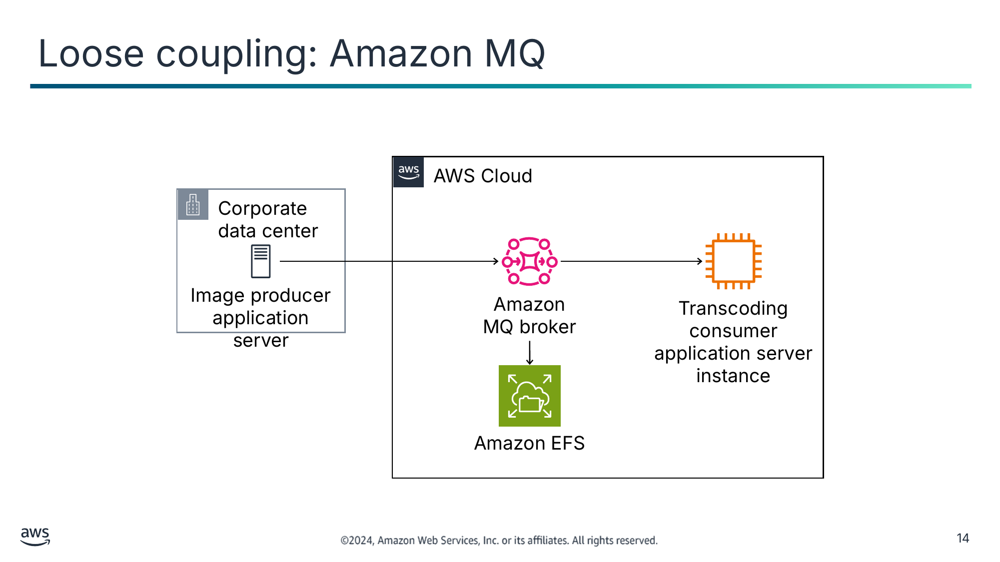

Текст зі схеми

AWS Cloud

Corporate

data center (Корпоративний центр обробки даних)

Image producer application server (Сервер застосунку-виробника зображень)

Amazon MQ broker (Брокер Amazon MQ)

Transcoding

consumer application server instance (Екземпляр сервера застосунку-споживача транскодування)

Amazon EFS

> **Нотатки:**
>
> |Номер слайда 14  
> |Нотатки для інструктора  
> |  
> |Нотатки для студента  
> Що якщо локальний застосунок хоче використовувати застосунок-споживач транскодування в хмарі AWS для транскодування зображень? Як можна досягти цієї інтеграції, щоб локальному застосунку не потрібно було підключатися безпосередньо до застосунку-споживача й бути щільно з ним зв’язаним? Відповідь — використати Amazon MQ. Цей сервіс може слабко зв’язувати застосунки, що працюють локально, із застосунками, що працюють у хмарі AWS, за допомогою асинхронного обміну повідомленнями.  
>
> Як ілюструє схема на цьому слайді, локальний застосунок, що створює зображення, може надіслати повідомлення застосунку-споживачу транскодування через брокер Amazon MQ. Брокер зберігає повідомлення за допомогою сервісу Amazon Elastic File System (Amazon EFS) або Amazon Elastic Block Store (Amazon EBS). Використовуючи Amazon MQ для забезпечення інтерфейсу на основі повідомлень для застосунку-споживача, бізнес може дати клієнтам поза хмарою AWS змогу повторно використовувати функцію гнучким і узгодженим способом.

---

## Слайд 15: Категорії рішень для слабкого зв’язування

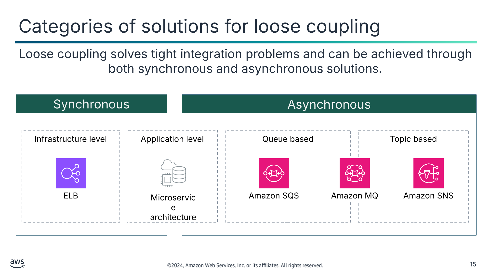

Слабке зв’язування розв’язує проблеми щільної інтеграції й може бути досягнуто як синхронними, так і асинхронними рішеннями.

Синхронні

Асинхронні

Рівень інфраструктури

Рівень застосунку

На основі черг

На основі тем

ELB

Архітектура мікросервісів

Amazon SQS

Amazon MQ

Amazon SNS

> **Нотатки:**
>
> |Номер слайда 15  
> |Нотатки для інструктора  
> |  
> |Нотатки для студента  
> Щоб забезпечити масштабування вашого застосунку в міру збільшення навантаження та відсутність вузьких місць чи єдиних точок відмови у вашій системі, впроваджуйте слабке зв’язування. Слабке зв’язування допомагає ізолювати поведінку компонента від інших компонентів, що від нього залежать, що підвищує стійкість і гнучкість. Упровадження слабкого зв’язування між залежностями ізолює збій в одному компоненті від впливу на інший компонент.  
>
> Рішення зі слабкого зв’язування можуть бути синхронними чи асинхронними. У синхронній категорії рішення на рівні інфраструктури зазвичай передбачають запровадження проміжного компонента між залежними рівнями. Наприклад, використання балансувальника навантаження ELB між щільно зв’язаними рівнями вебсервера та сервера застосунку слабко зв’язує ці рівні. На рівні застосунку використання архітектури мікросервісів — ефективний спосіб слабко зв’язати функції застосунку.  
>
> Асинхронні рішення зі слабкого зв’язування передбачають використання повідомлень, а також черг чи тем між залежними компонентами. Amazon SQS — це сервіс AWS, що підтримує асинхронний обмін повідомленнями за допомогою черг, а Amazon SNS використовує теми. Amazon MQ підтримує і черги, і теми.  
>   
> Зауважте, що цей модуль зосереджений на асинхронних рішеннях обміну повідомленнями та визначає й представляє інші рішення лише для повноти. Наступні розділи обговорюють Amazon SQS, Amazon SNS та Amazon MQ докладніше.  
>
> Докладніше про ELB див. «What is Elastic Load Balancing?» у посібнику користувача Elastic Load Balancing. Посилання надано у ваших ресурсах курсу.

---

## Слайд 16: Ключові висновки: роз’єднання вашої архітектури

- Щільно зв’язані системи важко масштабувати, і вони створюють вузькі місця та єдині точки відмови.
- Слабко зв’язана архітектура усуває прямі залежності між пов’язаними компонентами та забезпечує масштабованість і стійкість.
- Рішення зі слабкого зв’язування розділяють рівні інфраструктури чи функції застосунку й зазвичай запроваджують проміжний компонент між ними.
- Рішення зі слабкого зв’язування можуть бути синхронними чи асинхронними.
  - ELB — приклад синхронного рішення.
  - Amazon SQS, Amazon SNS та Amazon MQ — приклади асинхронного рішення.

> **Нотатки:**
>
> |Номер слайда 16  
> |Нотатки для інструктора  
> |  
> |Нотатки для студента

---

## Слайд 17: Роз’єднання застосунків за допомогою Amazon SQS

Побудова роз’єднаних архітектур

> **Нотатки:**
>
> |Номер слайда 17  
> |Нотатки для інструктора  
> |  
> |Нотатки для студента  
> Цей розділ описує, як працює Amazon SQS і коли його використовувати.

---

## Слайд 18: Обмін повідомленнями «точка-точка» (point-to-point messaging)

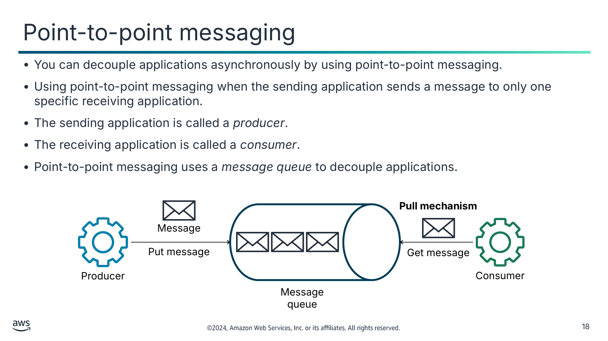

- Можна асинхронно роз’єднувати застосунки за допомогою обміну повідомленнями «точка-точка».
- Обмін повідомленнями «точка-точка» використовується, коли застосунок-відправник надсилає повідомлення лише одному конкретному застосунку-одержувачу.
- Застосунок-відправник називається *виробником* (producer).
- Застосунок-одержувач називається *споживачем* (consumer).
- Обмін повідомленнями «точка-точка» використовує *чергу повідомлень* (message queue) для роз’єднання застосунків.

Текст зі схеми

**Pull mechanism** (**Механізм витягування**)

Message (Повідомлення)

Put message (Помістити повідомлення)

Get message (Отримати повідомлення)

Producer (Виробник)

Consumer (Споживач)

Message queue (Черга повідомлень)

> **Нотатки:**
>
> |Номер слайда 18  
> |Нотатки для інструктора  
> |  
> |Нотатки для студента  
> Обмін повідомленнями «точка-точка» — це асинхронна модель обміну повідомленнями, що допомагає впровадити роз’єднану архітектуру. Вона дає змогу двом застосункам обмінюватися даними асинхронно за допомогою повідомлень і черги повідомлень. Вона називається «точка-точка», тому що застосунок-відправник знає, хто є застосунком-одержувачем, і надсилає повідомлення лише одному споживачу. Застосунок-відправник називається виробником, оскільки він генерує повідомлення й поміщає їх у чергу. Застосунок-одержувач називається споживачем, оскільки він отримує повідомлення з черги й обробляє їх.  
>
> Повідомлення представляє дані, надіслані виробником споживачу. Черга повідомлень — це тимчасове сховище для повідомлень, що чекають обробки. Повідомлення зазвичай невеликі й можуть бути такими речами, як запити, відповіді, повідомлення про помилки чи інформація. Приклади повідомлень включають записи клієнтів, замовлення продуктів, рахунки-фактури та записи пацієнтів.  
>
> Споживач отримує повідомлення з черги, періодично опитуючи чергу, щоб перевірити, чи є повідомлення для отримання. Якщо так, споживач отримує повідомлення й обробляє його. Цей підхід називається механізмом витягування (pull mechanism).  
>
> Схема на слайді ілюструє потік повідомлень в обміні «точка-точка», що виглядає так:  
> Виробник поміщає повідомлення в чергу.  
> Черга зберігає повідомлення, доки його не буде отримано.  
> Споживач отримує повідомлення з черги.

---

## Слайд 19: Amazon Simple Queue Service (Amazon SQS)

- Є повністю керованим сервісом черг повідомлень
- Допомагає інтегрувати та роз’єднувати розподілені програмні системи й компоненти застосунків
- Забезпечує високодоступні, безпечні й довговічні можливості черг повідомлень
- Надає інтерфейс AWS Management Console і API вебсервісів

Amazon SQS

> **Нотатки:**
>
> |Номер слайда 19  
> |Нотатки для інструктора  
> |  
> |Нотатки для студента  
> Amazon SQS — це повністю керований сервіс черг повідомлень, який можна використовувати для роз’єднання компонентів застосунку, щоб вони працювали й виходили з ладу незалежно. Він діє як буфер між відправниками та одержувачами. Наприклад, він дає змогу вебсервісним застосункам ставити в чергу повідомлення, згенеровані одним компонентом застосунку, для споживання іншим компонентом.  
>
> Amazon SQS працює у величезному масштабі й може обробляти мільярди повідомлень на день. Він зберігає всі черги повідомлень і повідомлення в межах єдиного високодоступного регіону AWS із кількома надлишковими зонами доступності. Ця надлишковість захищає доступ до повідомлень від відмови будь-якого окремого комп’ютера, мережі чи зони доступності.  
>
> До Amazon SQS можна отримати доступ за допомогою AWS Management Console для створення черг і тестування обміну повідомленнями. Також до Amazon SQS можна звертатися програмно за допомогою API через AWS SDK.

---

## Слайд 20: Переваги Amazon SQS

Повністю кероване (Fully managed)

Надійність (Reliability)

Безпека (Security)

Масштабованість (Scalability)

Уникайте потреби керувати програмним забезпеченням обміну повідомленнями чи підтримувати інфраструктуру.

Доставляйте великі обсяги даних без втрати повідомлень.

Безпечно надсилайте чутливі дані між застосунками.

Еластично масштабуйтеся залежно від використання.

> **Нотатки:**
>
> |Номер слайда 20  
> |Нотатки для інструктора  
> |  
> |Нотатки для студента  
> З Amazon SQS не потрібно керувати виділеною інфраструктурою обміну повідомленнями. Як повністю кероване обслуговування, Amazon SQS автоматично розгортає й керує обчислювальними, сховищними та мережевими ресурсами, потрібними для підтримки обміну повідомленнями. Amazon SQS не потребує адміністративних накладних витрат і потребує мало конфігурації.  
>
> Amazon SQS забезпечує надійний обмін даними між розподіленими програмними компонентами. Його можна використовувати для обміну повідомленнями між будь-якою кількістю систем без втрати жодних повідомлень. Amazon SQS забезпечує надзвичайно високу довговічність повідомлень, оскільки зберігає повідомлення на кількох серверах. Можна надійно доставляти великі обсяги даних за будь-якого рівня пропускної здатності.  
>
> Крім того, ви контролюєте, хто може надсилати повідомлення до черги й отримувати їх із черги. Також можна захищати чутливі дані, шифруючи повідомлення в чергах за допомогою серверного шифрування (SSE) і використовуючи ключі, керовані AWS Key Management Service (AWS KMS). Amazon SQS розшифровує повідомлення лише коли вони надсилаються авторизованому споживачу.  
>
> Amazon SQS можна використовувати для побудови відмовостійких і масштабованих застосунків. Він працює у величезному масштабі й може обробляти мільярди повідомлень щодня. Повідомлення можна надсилати й читати одночасно, а кілька виробників і споживачів можуть взаємодіяти з однією чергою. Можна масштабуватися еластично й економічно ефективно залежно від використання, щоб вам не потрібно було турбуватися про планування потужностей чи попереднє виділення. Також можна масштабувати кількість повідомлень, які ви надсилаєте до Amazon SQS, вгору чи вниз без жодної конфігурації.

---

## Слайд 21: Основні компоненти Amazon SQS

- Повідомлення може мати розмір до 256 КБ.
- Повідомлення залишається в черзі, доки його явно не видалять або воно не перевищить період зберігання повідомлень черги.

Повідомлення (Message)

- Amazon SQS пропонує два типи черг: стандартні та «першим прийшов — першим вийшов» (first-in-first-out, FIFO)
- Можна налаштувати параметри черги, зокрема такі:
  - Період зберігання повідомлень
  - Тайм-аут видимості (visibility timeout)
  - Час очікування отримання повідомлення (коротке чи довге опитування)

Черга (Queue)

- До будь-якої черги можна прив’язати чергу недоставлених повідомлень (dead-letter queue, DLQ).
- DLQ зберігає повідомлення, які не вдалося успішно спожити.

Черга недоставлених повідомлень (Dead-letter queue)

> **Нотатки:**
>
> |Номер слайда 21  
> |Нотатки для інструктора  
> |  
> |Нотатки для студента  
> Основні компоненти Amazon SQS — повідомлення та черги. Цей слайд перелічує деякі їхні ключові функції.  
>
> Повідомлення Amazon SQS мають максимальний розмір 256 КБ і можуть містити XML, JSON та неформатований текст. Щоб надсилати повідомлення розміром понад 256 КБ, можна використовувати Amazon SQS Extended Client Library for Java. Цю бібліотеку можна використовувати для надсилання й отримання повідомлень із корисним навантаженням до 2 ГБ. Крім того, повідомлення в черзі залишаються в черзі, доки споживач їх не видалить або вони не перевищать період зберігання повідомлень черги. За замовчуванням черга зберігає повідомлення 4 дні. Можна налаштувати чергу на зберігання повідомлень до 14 днів.  
>
> Amazon SQS підтримує два типи черг: стандартні черги та черги FIFO. Одна з основних відмінностей між цими двома типами в тому, що стандартна черга іноді доставляє повідомлення в порядку, відмінному від того, у якому їх надіслано. Черга FIFO натомість строго зберігає порядок, у якому повідомлення надсилаються й отримуються.  
>
> Черги мають низку параметрів, які можна налаштувати. Вони включають такі:  
> Період зберігання повідомлень: цей параметр — це час, протягом якого Amazon SQS зберігає повідомлення, що залишаються в черзі.  
> Тайм-аут видимості: цей параметр — це тривалість часу, протягом якого повідомлення, отримане з черги одним споживачем, не видиме для інших споживачів повідомлень. Цей параметр черги можна перевизначити на рівні повідомлення, коли споживач отримує повідомлення з черги.  
> Час очікування отримання повідомлення: цей параметр — це максимальний час, протягом якого Amazon SQS чекає, поки повідомлення стануть доступними після того, як черга отримає запит на отримання. Цей параметр контролює поведінку опитування черги (коротке опитування чи довге опитування).  
>
> Amazon SQS також має підтримку черги недоставлених повідомлень (DLQ). DLQ — це черга, пов’язана з іншою чергою — вихідною чергою (source queue) — і отримує повідомлення з вихідної черги, які не вдалося обробити. Після перевищення максимальної кількості спроб обробки Amazon SQS автоматично переміщує повідомлення з вихідної черги до пов’язаної DLQ. DLQ — як і будь-яка інша черга SQS: до неї можна надсилати повідомлення й отримувати їх із неї. DLQ стандартної черги також має бути стандартною чергою. Так само DLQ черги FIFO також має бути чергою FIFO.  
>
> Більше про типи черг і параметри черг ви дізнаєтеся на наступних слайдах.

---

## Слайд 22: Приклад роз’єднання: Amazon SQS

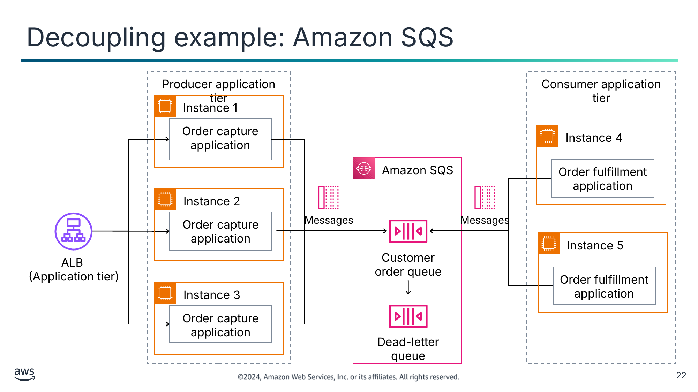

Текст зі схеми

Producer application tier (Рівень застосунку-виробника)

Consumer application tier (Рівень застосунку-споживача)

Instance 1 (Екземпляр 1)

Order capture application (Застосунок захоплення замовлень)

Instance 4

Order fulfillment application (Застосунок виконання замовлень)

Amazon SQS

Instance 2

Order capture application

Messages (Повідомлення)

Messages

Instance 5

Order fulfillment application

Customer order queue (Черга замовлень клієнтів)

ALB

(Application tier) (Рівень застосунку)

Instance 3

Order capture application

Dead-letter queue (Черга недоставлених повідомлень)

> **Нотатки:**
>
> |Номер слайда 22  
> |Нотатки для інструктора  
> |  
> |Нотатки для студента  
> Розгляньте приклад вебзастосунку, що обробляє замовлення клієнтів і має функції захоплення замовлень та виконання замовлень. У щільно зв’язаному проєкті, як у монолітному застосунку, обидві функції було б реалізовано та розгорнуто в єдиному блоці. Можна роз’єднати архітектуру цього застосунку, запровадивши чергу SQS. Чергу можна використати, щоб ізолювати логіку виконання замовлень у власний компонент, щоб вона працювала в окремому процесі від вебзастосунку захоплення замовлень.  
>
> У цьому прикладі застосунок захоплення замовлень — це виробник. Він створює замовлення клієнтів і надсилає їх як повідомлення до черги SQS — черги замовлень клієнтів. Застосунок-виробник масштабовано для роботи в трьох екземплярах, навантаження між якими балансує балансувальник навантаження типу ALB. Усі три екземпляри виробника надсилають повідомлення до черги замовлень клієнтів. Застосунок виконання замовлень — це споживач, і він обробляє замовлення від екземплярів виробника. Застосунок-споживач працює на двох екземплярах, що обидва можуть отримувати повідомлення з черги. Він опитує чергу й отримує повідомлення в черзі. Після успішної обробки повідомлення застосунок-споживач видаляє повідомлення з черги. Якщо повідомлення не вдається обробити, Amazon SQS надсилає його до DLQ.  
>
> Використання черг SQS у цьому прикладі дає такі переваги:  
> Застосунок стійкіший до сплесків трафіку. Черга діє як буфер для поглинання сплесків, а функції захоплення замовлень і виконання замовлень можуть масштабуватися незалежно одна від одної.  
> Роботу можна виконувати лише так швидко, як потрібно для керування витратами. Оскільки замовлення тимчасово зберігаються в черзі під час захоплення, їх можна обробляти асинхронно в іншому темпі.  
> Якщо виникає виняток застосунку, обробку замовлення можна повторити або перенаправити до черги недоставлених повідомлень для повторної обробки на пізнішому етапі.

---

## Слайд 23: Типи черг (queue types)

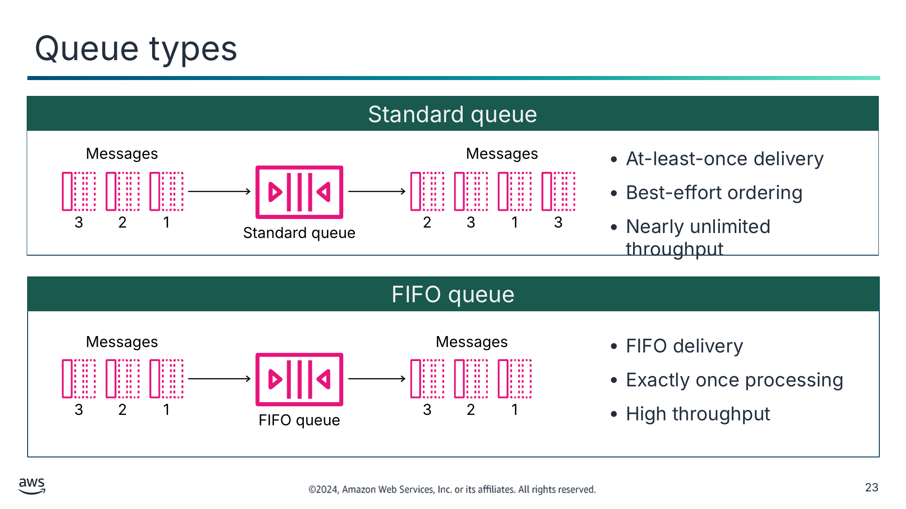

Стандартна черга (Standard queue)

- Доставка принаймні один раз (at-least-once)
- Упорядкування за можливістю (best-effort)
- Майже необмежена пропускна здатність

Черга FIFO (FIFO queue)

- Доставка «першим прийшов — першим вийшов»
- Обробка рівно один раз (exactly once)
- Висока пропускна здатність

Текст зі схеми

Messages (Повідомлення)

Messages

3

2

1

2

3

1

3

Standard queue (Стандартна черга)

Messages

Messages

3

2

1

3

2

1

FIFO queue (Черга FIFO)

> **Нотатки:**
>
> |Номер слайда 23  
> |Нотатки для інструктора  
> |  
> |Нотатки для студента  
> Існує два типи черг SQS: стандартні черги та черги FIFO.  
>
> Стандартні черги пропонують такі функції:  
> Доставка принаймні один раз: повідомлення доставляється принаймні один раз, але іноді доставляється більше однієї копії повідомлення.  
> Упорядкування за можливістю: іноді повідомлення можуть доставлятися в порядку, відмінному від того, у якому їх надіслано.  
> Майже необмежена пропускна здатність: стандартні черги підтримують майже необмежену кількість викликів API на секунду для кожної операції API (SendMessage, ReceiveMessage чи DeleteMessage).  
>
> Черги FIFO мають такі функції:  
> Доставка «першим прийшов — першим вийшов»: повідомлення доставляються в точному порядку, у якому їх надіслано.  
> Обробка рівно один раз: повідомлення обробляються рівно один раз.  
> Висока пропускна здатність: черги FIFO підтримують до 300 викликів API на секунду для кожної операції API. Коли ви пакетуєте 10 повідомлень на операцію (максимум), черги FIFO можуть підтримувати до 3000 викликів API на секунду.  
>
> Як загальна настанова, використовуйте стандартну чергу, коли ваш застосунок-споживач може обробляти повідомлення, що надходять більше одного разу й не по порядку. Якщо вашому застосунку-споживачу потрібно, щоб порядок зберігався, використовуйте чергу FIFO.  
>
> На схемі для стандартної черги три повідомлення входять у чергу пронумеровані й у послідовності 1, 2 і 3. Оскільки стандартна черга не гарантує упорядкування та доставки рівно один раз, повідомлення залишають чергу в послідовності 3, 1, 3 і 2. Зауважте, що повідомлення 3 доставляється двічі. Однак на схемі для черги FIFO повідомлення входять у чергу в порядку 1, 2 і 3 і виходять із черги в точно такому самому порядку. Крім того, кожне повідомлення доставляється лише один раз.

---

## Слайд 24: Конфігурація черги: тип опитування (polling type)

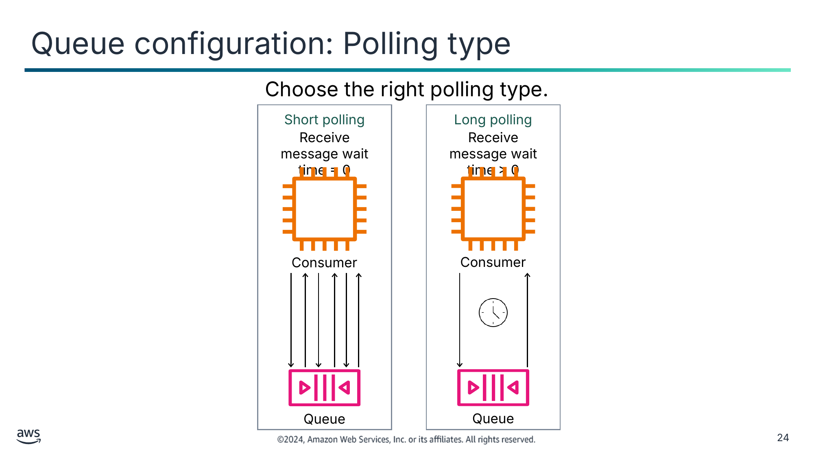

Оберіть правильний тип опитування.

Текст зі схеми

Short polling (Коротке опитування)

Long polling (Довге опитування)

Receive message wait time = 0 (Час очікування отримання повідомлення = 0)

Receive message wait time > 0

Consumer (Споживач)

Consumer

Queue (Черга)

Queue

> **Нотатки:**
>
> |Номер слайда 24  
> |Нотатки для інструктора  
> |  
> |Нотатки для студента  
> Створюючи чергу SQS, потрібно врахувати, як ваш застосунок взаємодіє з чергою, і налаштувати параметри черги відповідно. Один конкретний параметр, який слід оптимізувати, — час очікування отримання повідомлення.  
>
> Параметр часу очікування отримання повідомлення контролює тип опитування для черги. Amazon SQS підтримує і коротке, і довге опитування для отримання повідомлень із черги. За замовчуванням черги використовують коротке опитування, що позначається нульовим значенням параметра часу очікування отримання повідомлення (часу очікування опитування). Будь-яке ненульове значення встановлює довге опитування, а максимально допустиме значення — 20 секунд.  
>
> Щоб забезпечити довговічність, Amazon SQS надлишково зберігає повідомлення в черзі на кількох серверах. Коли споживач запитує повідомлення, коротке опитування запитує лише підмножину серверів (на основі зваженого випадкового розподілу) і повертає повідомлення лише з цих серверів. Amazon SQS потім одразу надсилає відповідь споживачу, навіть якщо запит не знайшов повідомлень. Це призводить до швидшої відповіді, але збільшує кількість відповідей і, отже, збільшує витрати. Натомість довге опитування запитує всі сервери на наявність повідомлень, а Amazon SQS надсилає відповідь споживачу, коли час очікування опитування спливає. Отриманий ефект такий, що Amazon SQS чекає, доки в черзі не з’явиться повідомлення, перш ніж надіслати відповідь. Довге опитування забезпечує рідші відповіді, але зменшує витрати, оскільки зменшує кількість порожніх отримань.  
>
> Залежно від частоти надходження повідомлень у вашу чергу, багато відповідей від черги, що використовує коротке опитування, можуть повідомляти про порожню чергу. Майже в усіх випадках довге опитування Amazon SQS краще за коротке. Один виняток — якщо вашому застосунку потрібна негайна відповідь на його запити опитування: наприклад, як у випадку застосунку, що споживає ціни акцій у реальному часі. Ще один виняток — якщо ваш застосунок використовує єдиний потік для опитування кількох черг. Використання довгого опитування, імовірно, не працюватиме, оскільки єдиний потік чекатиме тайм-ауту довгого опитування на будь-яких порожніх чергах, затримуючи обробку будь-яких черг, що можуть містити повідомлення.  
>
> Схема показує, що з коротким опитуванням частота відповідей від черги до споживача висока. Однак з довгим опитуванням частота нижча, оскільки черга має чекати спливу часу очікування опитування, перш ніж повернути відповідь споживачу.

---

## Слайд 25: Конфігурація черги: видимість повідомлень (message visibility)

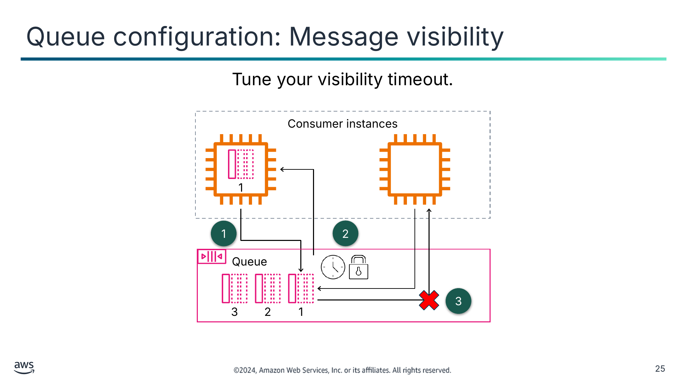

Налаштуйте свій тайм-аут видимості.

Текст зі схеми

Consumer instances (Екземпляри споживачів)

1

1

2

  Queue (Черга)

3

3

2

1

> **Нотатки:**
>
> |Номер слайда 25  
> |Нотатки для інструктора  
> |  
> |Нотатки для студента  
> Ще один параметр, який слід належно налаштувати під час створення черги SQS, — тайм-аут видимості повідомлення.  
>
> Тайм-аут видимості (visibility timeout) — це період часу, коли Amazon SQS не дає іншим споживачам отримувати й обробляти те саме повідомлення. Тайм-аут допомагає забезпечити, щоб повідомлення не обробляли кілька разів із дублюванням. Протягом тайм-ауту видимості споживач, що отримав повідомлення, має обробити його, а потім видалити з черги. Якщо споживач не обробить і не видалить повідомлення до спливу тайм-ауту видимості, повідомлення стає видимим для інших споживачів і може бути оброблене знову. Зазвичай слід встановлювати тайм-аут видимості на максимальний час, потрібний вашому застосунку для обробки та видалення повідомлення з черги. Тайм-аут видимості повідомлення за замовчуванням — 30 секунд. Максимум — 12 годин. Наприклад, якщо вашому застосунку потрібно щонайбільше 15 секунд для обробки й видалення повідомлення, слід встановити тайм-аут видимості на 15 секунд.  
>
> Схема ілюструє, як тайм-аут видимості впливає на доступ до того самого повідомлення в черзі. Піктограми з позначками 1, 2 чи 3 — це повідомлення. Потік подій такий:  
> Споживач запитує наступне повідомлення, повідомлення 1, з черги.  
> Черга повертає повідомлення 1 споживачу, запускає зворотний відлік тайм-ауту видимості й робить повідомлення невидимим для інших споживачів.  
> Другий споживач запитує наступне повідомлення з черги, яким усе ще є повідомлення 1. Оскільки тайм-аут видимості ще не досягнуто, повідомлення 1 усе ще невидиме для другого споживача й не доставляється.

---

## Слайд 26: Як працює черга повідомлень SQS

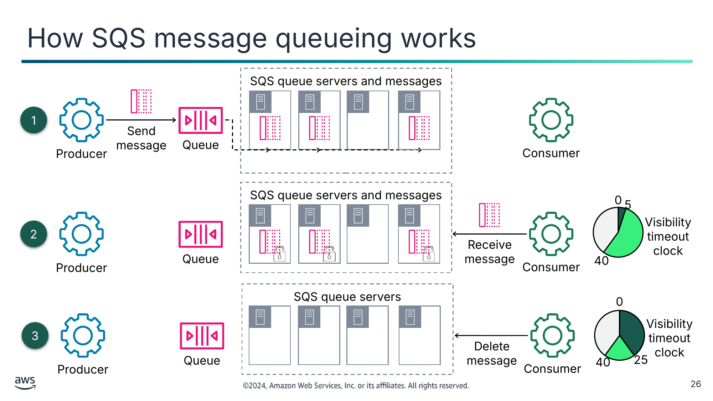

| |  |
|---|---|

| |  |
|---|---|

Текст зі схеми

SQS queue servers and messages (Сервери черги SQS і повідомлення)

1

Send message (Надіслати повідомлення)

Queue (Черга)

Producer (Виробник)

Consumer (Споживач)

SQS queue servers and messages

0

5

Visibility timeout clock (Годинник тайм-ауту видимості)

2

Receive message (Отримати повідомлення)

Producer

Queue

Consumer

40

SQS queue servers (Сервери черги SQS)

0

3

Visibility timeout clock

Delete message (Видалити повідомлення)

Queue

25

Producer

Consumer

40

> **Нотатки:**
>
> |Номер слайда 26  
> |Нотатки для інструктора  
> |  
> |Нотатки для студента  
> Наведений нижче сценарій ілюструє життєвий цикл повідомлення в черзі SQS і те, як працює обмін повідомленнями Amazon SQS:  
> Спершу виробник надсилає повідомлення до черги, і повідомлення надлишково розподіляється між серверами черги.  
> Коли споживач готовий обробити повідомлення, він отримує повідомлення з черги, і починається період тайм-ауту видимості. Поки повідомлення обробляється, воно залишається в черзі. Протягом тайм-ауту видимості інші споживачі не можуть обробляти повідомлення. У цьому прикладі тайм-аут видимості встановлено на 40 секунд.  
> Після обробки повідомлення споживач видаляє повідомлення з черги протягом періоду тайм-ауту видимості. Ця дія запобігає повторному отриманню й обробці повідомлення після спливу тайм-ауту видимості. Amazon SQS не видаляє повідомлення автоматично. Оскільки Amazon SQS — розподілена система, немає гарантії, що споживач фактично отримує повідомлення (наприклад, через проблему з підключенням чи проблему в застосунку-споживачі). Тому споживач має видалити повідомлення з черги після отримання та обробки.  
>
> Якщо тайм-аут видимості спливає, а споживач, що отримав повідомлення, не видалив його, повідомлення знову стає видимим для споживання.

---

## Слайд 27: Сценарії використання Amazon SQS

Робочі черги (Work queues)

Буферизація та пакетні операції (Buffering and batch operations)

Роз’єднуйте компоненти розподіленого застосунку, що обробляють однаковий обсяг роботи з різною швидкістю.

Забезпечуйте буфер проти сплесків трафіку або пакетуйте роботу для оброблення пізніше.

Розвантаження запитів (Request offloading)

Запуск Amazon EC2 Auto Scaling (Trigger Amazon EC2 Auto Scaling)

Ставте запити в чергу, щоб прибрати повільні операції з інтерактивних шляхів запитів.

Використовуйте черги SQS, щоб допомогти визначити навантаження на застосунок і викликати дії масштабування.

> **Нотатки:**
>
> |Номер слайда 27  
> |Нотатки для інструктора  
> |  
> |Нотатки для студента  
> Використання черги повідомлень чудово підходить для асинхронного обміну даними між сервісами. Деякі конкретні сценарії використання Amazon SQS включають такі:  
> Робочі черги: роз’єднуйте компоненти розподіленого застосунку, які можуть не обробляти однаковий обсяг роботи з однаковою швидкістю. Можна помістити роботу в чергу, яку можуть обробляти кілька споживачів (робітників) у групі Auto Scaling. Споживачі можуть масштабуватися вгору й вниз залежно від навантаження та вимог до затримки. Наприклад, розгляньте автомобільну навігаційну систему, що збирає дані з тисяч автомобілів для надання актуальної інформації про стан доріг і маршрутизацію. Ця інформація зберігається в картографічній базі даних у хмарі. Оскільки датчики на автомобілі надсилають дані в реальному часі й з високою частотою, дані спершу зберігаються як повідомлення в черзі. Компонент застосунку, що оновлює базу даних, отримує й обробляє повідомлення з черги у власному темпі. Він може масштабуватися вгору чи вниз залежно від бажаних цілей продуктивності оновлення бази даних.  
> Буферизація та пакетні операції: додайте масштабованості й надійності вашій архітектурі та згладжуйте тимчасові сплески обсягу без втрати повідомлень чи збільшення затримки. Пакетування запитів повідомлень дає споживачу змогу обробляти їх масово й пізніше, ніж вони були створені. Наприклад, застосунок біржової торгівлі може відокремити захоплення біржових транзакцій у реальному часі від оновлення відповідних балансів портфеля клієнтів. Протягом дня транзакції захоплюються й пакетуються в чергу. Вночі пакет обробляється для оновлення балансів клієнтів.  
> Розвантаження запитів: ставте запити в чергу, щоб прибрати повільні операції з інтерактивних шляхів запитів. Наприклад, у банківському застосунку відокремте фронтенд-застосунок, який клієнт може використовувати для здійснення оплати рахунку, від бекенд-застосунку, що її обробляє. Таким чином клієнт отримує негайну відповідь, а оплата рахунку обробляється у фоновому режимі.  
> Запуск Amazon EC2 Auto Scaling: використовуйте черги SQS, щоб допомогти визначити навантаження на застосунок. У поєднанні з Amazon EC2 Auto Scaling можна масштабувати кількість екземплярів EC2 назовні чи досередини залежно від обсягу трафіку, виміряного кількістю повідомлень у черзі. Наприклад, розгляньте застосунок виконання замовлень, що отримує й обробляє повідомлення замовлень із черги. Застосунок працює в групі Amazon EC2 Auto Scaling. Якщо ви хочете забезпечити рівень сервісу, за якого в черзі в будь-який момент не чекає більш ніж 10 замовлень, можна створити сигнал Amazon CloudWatch, що запускає додавання ще одного екземпляра до групи Auto Scaling, коли метрика NumberOfMessagesSent черги перевищує 10.  
>
> Існують сценарії, коли використання черги не рекомендоване. Вони включають такі:  
> Вибір конкретних повідомлень: ви можете захотіти вибірково отримувати повідомлення з черги, що відповідають певному набору атрибутів або одноразовому логічному запиту. Наприклад, сервіс запитує повідомлення з певним атрибутом, оскільки воно містить відповідь на інше повідомлення, яке сервіс надіслав. У цьому сценарії черга може містити повідомлення, які ніхто не опитує й які ніколи не споживаються.  
> Керування великими повідомленнями: більшість протоколів і реалізацій обміну повідомленнями найкраще працюють із повідомленнями розумного розміру (десятки чи сотні КБ). У міру зростання розмірів повідомлень найкраще використовувати виділену систему зберігання (як-от Amazon S3) і передавати в самому повідомленні посилання на об’єкт у сховищі.

---

## Слайд 28: Ключові висновки: роз’єднання застосунків за допомогою Amazon SQS

- Amazon SQS — це повністю керований сервіс черг повідомлень, який можна використовувати для роз’єднання компонентів застосунку, щоб вони працювали незалежно.
- Amazon SQS підтримує стандартні черги та черги FIFO.
- Повідомлення, які не вдається обробити, можна надсилати до черги недоставлених повідомлень.
- Довге опитування допомагає зменшити вартість використання Amazon SQS, зменшуючи кількість порожніх відповідей на запит споживача на отримання повідомлення.
- Виробник надсилає повідомлення до черги. Споживач обробляє й видаляє повідомлення протягом періоду тайм-ауту видимості.

> **Нотатки:**
>
> |Номер слайда 28  
> |Нотатки для інструктора  
> |  
> |Нотатки для студента

---

## Слайд 29: Покрокова лабораторна робота: побудова роз’єднаних застосунків за допомогою Amazon SQS (Building Decoupled Applications by Using Amazon SQS, Amazon SQS lab)

> **Нотатки:**
>
> |Номер слайда 29  
> |Нотатки для інструктора  
> |  
> |Нотатки для студента  
> Зараз ви виконаєте лабораторну роботу. Наступні слайди підсумовують, що ви робитимете в лабораторній роботі, а лабораторне середовище містить докладні інструкції.

---

## Слайд 30: Завдання лабораторної роботи «Amazon SQS»

У цій лабораторній роботі ви виконаєте такі основні завдання:

- Створите й налаштуєте чергу SQS.
- Використаєте чергу в застосунку, спроєктованому з роз’єднаними функціями.

> **Нотатки:**
>
> |Номер слайда 30  
> |Нотатки для інструктора  
> |  
> |Нотатки для студента  
> Отримайте доступ до лабораторного середовища через ваш онлайн-курс, щоб дізнатися додаткові подробиці та виконати лабораторну роботу.

---

## Слайд 31: Підсумки лабораторної роботи «Amazon SQS»

- Як ви налаштували тему SNS для надсилання повідомлень у потрібні місця?
- Як ви налаштували Amazon S3 для сповіщення Amazon SNS, коли завантажується нове зображення?

> **Нотатки:**
>
> |Номер слайда 31  
> |Нотатки для інструктора  
> |Відповідні архітектурні схеми «до» та «після» включено до інструкцій кожної лабораторної роботи. Вам може бути корисно відкрити схеми лабораторної роботи під час підбиття підсумків цієї лабораторної роботи.  
> |  
> |Запропоновані відповіді на запитання 1: як ви налаштували тему SNS для надсилання повідомлень у потрібні місця?  
> |  
> |Вам потрібно було, щоб тема SNS сповіщала чергу SQS, а також вас електронною поштою. Спершу ви створили підписку для теми SNS на надсилання повідомлення до черги SQS. Потім ви перейшли на сторінку консолі Amazon SQS і підписалися на відповідну тему SNS. Це підтвердило, що черга SQS отримуватиме сповіщення від теми SNS. По-друге, ви налаштували підписки електронної пошти для користувача (вас). Потім ви зайшли у свою електронну пошту й відкрили запрошення підписатися на тему SNS і підписалися. Це гарантувало, що Amazon SNS також надсилатиме вам сповіщення електронною поштою.  
> |  
> |Запропоновані відповіді на запитання 2: як ви налаштували Amazon S3 для сповіщення Amazon SNS, коли завантажується нове зображення?  
> |  
> |Ви налаштували бакет S3, що отримує зображення, на надсилання сповіщення до теми SNS за допомогою сповіщень про події Amazon S3 (Amazon S3 Event Notifications). Ви зробили це, створивши сповіщення про подію на вкладці Properties бакета S3. Функцію Amazon S3 Event Notifications можна використовувати для отримання сповіщень, коли в бакеті S3 відбуваються певні події.  
> |  
> |Нотатки для студента  
> Ваш інструктор може розглянути ці запитання з вами, або ви можете розглянути їх самостійно. Скористайтеся цією нагодою, щоб поглибити своє мислення щодо завдань, які ви виконували під час лабораторної роботи.

---

## Слайд 32: Роз’єднання застосунків за допомогою Amazon SNS

Побудова роз’єднаних архітектур

> **Нотатки:**
>
> |Номер слайда 32  
> |Нотатки для інструктора  
> |  
> |Нотатки для студента  
> Цей розділ описує, як працює Amazon SNS для роз’єднання щільно зв’язаних архітектур і коли використовувати цей сервіс.

---

## Слайд 33: Обмін повідомленнями «публікація/підписка» (publish/subscribe messaging)

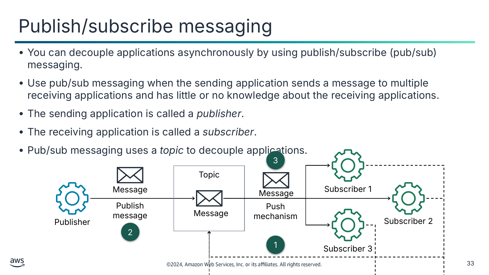

- Можна асинхронно роз’єднувати застосунки за допомогою обміну повідомленнями «публікація/підписка» (pub/sub).
- Використовуйте обмін повідомленнями pub/sub, коли застосунок-відправник надсилає повідомлення кільком застосункам-одержувачам і має мало знань про застосунки-одержувачі або не має їх зовсім.
- Застосунок-відправник називається *видавцем* (publisher).
- Застосунок-одержувач називається *підписником* (subscriber).
- Обмін повідомленнями pub/sub використовує *тему* (topic) для роз’єднання застосунків.

Текст зі схеми

3

Topic (Тема)

Message (Повідомлення)

Subscriber 1 (Підписник 1)

Message

Publish message (Опублікувати повідомлення)

Push mechanism (Механізм проштовхування)

Message

Publisher (Видавець)

Subscriber 2

2

1

Subscriber 3

> **Нотатки:**
>
> |Номер слайда 33  
> |Нотатки для інструктора  
> |  
> |Нотатки для студента  
> Обмін повідомленнями «публікація/підписка» (pub/sub) — це модель обміну повідомленнями, що може використовуватися для асинхронного роз’єднання застосунків. Вона забезпечує миттєві сповіщення про події для розподілених застосунків і дозволяє асинхронно розсилати повідомлення різним частинам системи.  
>
> Застосунок-відправник називається видавцем, оскільки він надсилає повідомлення одному чи кільком одержувачам і не обов’язково щось знає про них. Видавець публікує повідомлення в проміжному призначенні, що називається темою. Застосунки-одержувачі називаються підписниками, оскільки вони виявляють зацікавленість в отриманні повідомлень від видавця, підписавшись на тему. Повідомлення в темі автоматично розсилаються підписникам асинхронно. Цей підхід називається механізмом проштовхування (push mechanism) і усуває потребу періодично перевіряти чи опитувати нові повідомлення.  
>
> На відміну від черг повідомлень, що зберігають повідомлення, доки їх не буде отримано й видалено, теми повідомлень передають повідомлення без черги чи з невеликою чергою й одразу проштовхують їх усім підписникам. Підписники часто виконують різні функції й можуть кожен паралельно робити з повідомленням щось інше. Видавцю не потрібно знати, хто використовує інформацію, яку він розсилає, а підписникам не потрібно знати, від кого надходить повідомлення. Цей стиль обміну повідомленнями дещо відрізняється від черг повідомлень, де компонент, що надсилає повідомлення, часто знає призначення, до якого він надсилає.  
>
> Схема на слайді ілюструє, як працює обмін повідомленнями pub/sub, що виглядає так:  
> Одержувач, зацікавлений в отриманні повідомлень із теми, підписується на тему. У цьому випадку одержувачі — Підписники 1, 2 і 3.  
> Видавець публікує повідомлення в темі.  
> Тема проштовхує повідомлення підписникам теми.

---

## Слайд 34: Amazon Simple Notification Service (Amazon SNS)

- Є повністю керованим сервісом обміну повідомленнями pub/sub
- Допомагає роз’єднувати застосунки за допомогою сповіщень
- Забезпечує високомасштабовані, безпечні й економічно ефективні можливості сповіщень
- Надає інтерфейс AWS Management Console і API вебсервісів

Amazon SNS

> **Нотатки:**
>
> |Номер слайда 34  
> |Нотатки для інструктора  
> |  
> |Нотатки для студента  
> Amazon SNS — це вебсервіс, який можна використовувати для налаштування, експлуатації та надсилання сповіщень із хмари. Сервіс дотримується моделі обміну повідомленнями pub/sub, де сповіщення доставляються клієнтам за допомогою механізму проштовхування.  
>
> Amazon SNS розроблено для задоволення потреб найбільших і найвимогливіших застосунків, і він дає змогу застосункам публікувати необмежену кількість повідомлень будь-коли. Без накладних витрат на обслуговування чи керування й з оплатою за фактом використання Amazon SNS дає розробникам механізм для включення потужної системи сповіщень у свої застосунки.  
>
> Коли ви використовуєте Amazon SNS, ви створюєте тему й встановлюєте політики, що обмежують, хто може публікувати в темі чи підписуватися на неї. Видавець надсилає повідомлення до тем, які він або створив, або має дозвіл публікувати в них. Amazon SNS зіставляє тему зі списком підписників, що підписалися на цю тему, і доставляє повідомлення кожному з цих підписників. Кожна тема має унікальну назву, що ідентифікує кінцеву точку Amazon SNS для видавців, щоб публікувати повідомлення, і підписників, щоб реєструватися для сповіщень. Підписники отримують усі повідомлення, опубліковані в темах, на які вони підписані, і всі підписники теми отримують ті самі повідомлення. Крім того, і видавці, і підписники можуть використовувати TLS для захисту каналу надсилання й отримання повідомлень.  
>
> Amazon SNS забезпечує довговічне зберігання повідомлення під час його обробки. Отримавши запит на публікацію, Amazon SNS зберігає кілька копій повідомлення на диску в кількох зонах доступності, перш ніж підтвердити отримання запиту видавцю. Amazon SNS видаляє повідомлення після публікації його підписникам. На відміну від Amazon SQS, Amazon SNS не зберігає повідомлення тривалий час.  
>
> До Amazon SNS можна отримати доступ за допомогою AWS Management Console для створення тем і підписок та тестування публікації повідомлень. Також до Amazon SNS можна звертатися програмно за допомогою API через AWS SDK.

---

## Слайд 35: Типи підписників

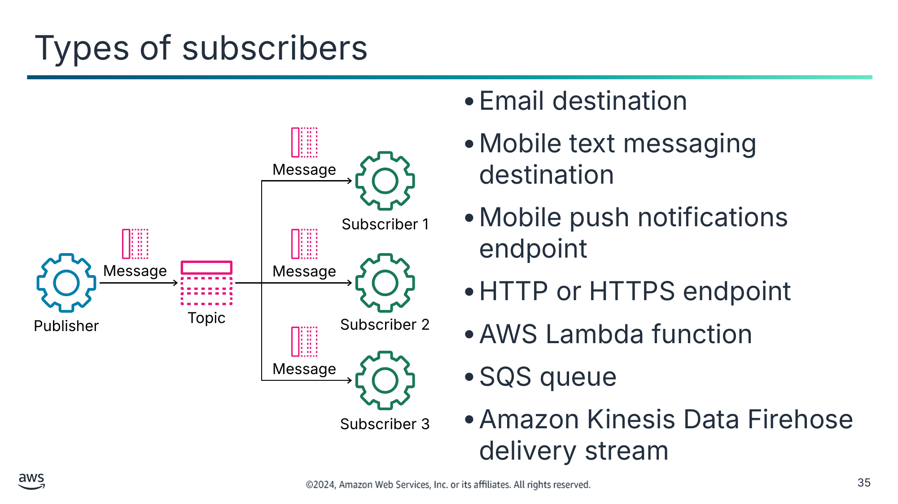

- Призначення електронної пошти
- Призначення мобільних текстових повідомлень
- Кінцева точка мобільних push-сповіщень
- Кінцева точка HTTP або HTTPS
- Функція AWS Lambda
- Черга SQS
- Потік доставки Amazon Kinesis Data Firehose

Текст зі схеми

Message (Повідомлення)

Subscriber 1 (Підписник 1)

Message

Message

Publisher (Видавець)

Topic (Тема)

Subscriber 2

Message

Subscriber 3

> **Нотатки:**
>
> |Номер слайда 35  
> |Нотатки для інструктора  
> |  
> |Нотатки для студента  
> Amazon SNS підтримує кілька призначень для доставки повідомлень, зокрема такі:  
> Призначення електронної пошти: Amazon SNS надсилає повідомлення на зареєстровану адресу електронної пошти. Повідомлення може надсилатися в текстовому форматі або як об’єкт JSON.  
> Призначення мобільних текстових повідомлень: Amazon SNS надсилає повідомлення на зареєстрований номер телефону як текстове повідомлення Short Message Service (SMS).  
> Кінцева точка мобільних push-сповіщень: Amazon SNS надсилає повідомлення на кінцеву точку мобільного пристрою як нативне push-сповіщення.  
> Кінцева точка HTTP або HTTPS: Amazon SNS надсилає повідомлення на URL-адресу за допомогою запиту HTTP POST.  
> Функція AWS Lambda: Amazon SNS надсилає повідомлення до функції Lambda для виклику виконання користувацької бізнес-логіки.  
> Черга SQS: Amazon SNS надсилає повідомлення до черги SQS для оброблення застосунком-одержувачем пізніше.  
> Потік доставки Amazon Kinesis Data Firehose: Amazon SNS надсилає повідомлення до потоку доставки Firehose для доставки в кінцеві точки сховищ та аналітики.

---

## Слайд 36: Сценарії використання Amazon SNS

Сповіщення про сигнали застосунку та системи

Сповіщення електронною поштою та текстовими повідомленнями

Мобільні push-сповіщення

> **Нотатки:**
>
> |Номер слайда 36  
> |Нотатки для інструктора  
> |  
> |Нотатки для студента  
> Amazon SNS можна використовувати для підтримки широкого спектра потреб, зокрема сповіщення про події, системи робочих процесів, мобільні застосунки та будь-які інші застосунки, що генерують чи споживають сповіщення.  
>
> Деякі конкретні сценарії використання Amazon SNS включають такі:  
> Сигнали застосунку та системи: можна використовувати Amazon SNS для отримання негайного сповіщення, коли відбувається подія, як-от зміна групи Auto Scaling.  
> Push-повідомлення електронною поштою та текстові повідомлення: можна використовувати Amazon SNS, щоб проштовхувати цільові заголовки новин підписникам електронною поштою чи SMS.  
> Мобільні push-сповіщення: можна використовувати Amazon SNS для надсилання сповіщень до застосунку (наприклад, щоб вказати, що доступне оновлення). Повідомлення-сповіщення може включати посилання для завантаження й встановлення оновлення.

---

## Слайд 37: Приклад роз’єднання: використання Amazon SQS з Amazon SNS

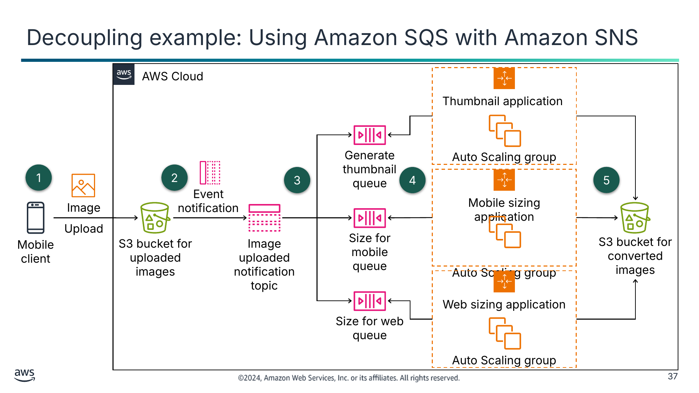

Текст зі схеми

AWS Cloud

Thumbnail application (Застосунок мініатюр)

Auto Scaling group (Група Auto Scaling)

Generate thumbnail queue (Черга генерування мініатюр)

1

2

3

4

Mobile sizing application (Застосунок зміни розміру для мобільних пристроїв)

Auto Scaling group

5

Event notification (Сповіщення про подію)

Image (Зображення)

Upload (Завантаження)

Mobile client (Мобільний клієнт)

S3 bucket for uploaded images (Бакет S3 для завантажених зображень)

Image uploaded (Зображення завантажено)

notification topic (тема сповіщень)

Size for mobile queue (Черга зміни розміру для мобільних)

S3 bucket for converted images (Бакет S3 для перетворених зображень)

Web sizing application (Застосунок зміни розміру для вебу)

Auto Scaling group

Size for web queue (Черга зміни розміру для вебу)

> **Нотатки:**
>
> |Номер слайда 37  
> |Нотатки для інструктора  
> |  
> |Нотатки для студента  
> Використання високодоступних сервісів, як-от Amazon SNS і Amazon SQS, для маршрутизації повідомлень — ефективний спосіб розподілу повідомлень між роз’єднаними функціями застосунку.  
> Цей приклад ілюструє сценарій розгалуження (fanout), що використовує Amazon SNS та Amazon SQS. У сценарії розгалуження повідомлення надсилається до теми SNS, а потім реплікується й проштовхується до кількох черг SQS, кінцевих точок HTTP чи адрес електронної пошти. Це можна використовувати для паралельної асинхронної обробки.  
>
> У цьому прикладі мобільний клієнт завантажує зображення до бакета S3, щоб перетворити його на три різні розміри, придатні для мініатюри, мобільного застосунку та вебзастосунку. Потік сценарію використання такий:  
> Мобільний застосунок завантажує зображення до бакета S3.  
> Після завантаження зображення до бакета функція сповіщень про події Amazon S3 викликає сповіщення, що публікує повідомлення в темі SNS. Повідомлення містить URL-адресу об’єкта зображення в Amazon S3.  
> Тема одночасно доставляє повідомлення (розгалужує) до трьох різних черг: черги генерування мініатюр, черги зміни розміру для мобільних і черги зміни розміру для вебу. Кожну чергу спостерігають різні застосунки, що працюють у власних групах Auto Scaling.  
> Застосунок мініатюр опитує чергу генерування мініатюр, застосунок зміни розміру для мобільних опитує чергу зміни розміру для мобільних, а застосунок зміни розміру для вебу опитує чергу зміни розміру для вебу.  
> Кожен застосунок виконує призначену функцію зміни розміру незалежно один від одного й зберігає результат у бакеті S3 перетворених зображень.

---

## Слайд 38: Міркування щодо Amazon SNS

Публікація повідомлень (Message publishing)

Повторні спроби HTTP або HTTPS (HTTP or HTTPS retry)

Доставка повідомлень (Message delivery)

- Одне опубліковане повідомлення
- Немає варіантів відкликання

- Використовуйте *стандартну* тему, якщо порядок доставки повідомлень не має значення.
- Використовуйте тему *FIFO*, якщо потрібен точний порядок доставки повідомлень.
- Налаштуйте політику доставки кінцевої точки HTTP або HTTPS, щоб контролювати поведінку повторних спроб.

> **Нотатки:**
>
> |Номер слайда 38  
> |Нотатки для інструктора  
> |  
> |Нотатки для студента  
> Нижче наведено важливі міркування під час використання Amazon SNS:  
> Кожне повідомлення-сповіщення містить одне опубліковане повідомлення.  
> Коли повідомлення доставлено успішно, його неможливо відкликати.  
> Amazon SNS пропонує два типи тем: стандартні та FIFO. Зі стандартною темою Amazon SNS намагатиметься доставляти повідомлення від видавця в порядку, у якому повідомлення було опубліковано в темі. Однак мережеві проблеми потенційно можуть призвести до порушення порядку повідомлень на стороні підписника. Якщо потрібне строге впорядкування повідомлень, використовуйте тему FIFO. Тема FIFO доставляє повідомлення в порядку, у якому повідомлення було опубліковано.  
> Amazon SNS визначає політику доставки (delivery policy) для контролю шаблону повторних спроб для кожного протоколу доставки, який він підтримує. Ця політика контролює, як Amazon SNS повторює доставку повідомлень, коли система, що розміщує підписану кінцеву точку, стає недоступною. Коли політику доставки вичерпано, Amazon SNS припиняє повторні спроби доставки й відкидає повідомлення, якщо до підписки не прикріплено чергу недоставлених повідомлень. Не можна змінювати політики доставки, визначені Amazon SNS, за винятком політики доставки для кінцевої точки HTTP або HTTPS. Для такої кінцевої точки можна, наприклад, налаштувати політику залежно від потужності вашого сервера HTTP.

---

## Слайд 39: Порівняння Amazon SNS та Amazon SQS

|  | Amazon SNS | Amazon SQS |
|---|---|---|
| Модель обміну повідомленнями (Messaging Model) | Видавець-підписник (Publisher-Subscriber) | Виробник-споживач (Producer-Consumer) |
| Модель розподілу (Distribution Model) | Один до багатьох | Один до одного |
| Механізм доставки (Delivery Mechanism) | Проштовхування (пасивне) | Витягування (активне) |
| Збереження повідомлень (Message Persistence) | Ні | Так |

> **Нотатки:**
>
> |Номер слайда 39  
> |Нотатки для інструктора  
> |  
> |Нотатки для студента  
> Ця таблиця підсумовує ключові відмінності між Amazon SNS та Amazon SQS:  
> Amazon SNS використовує парадигму обміну повідомленнями «видавець-підписник», де видавець не обов’язково щось знає про підписника.  
> Amazon SQS використовує парадигму обміну повідомленнями «виробник-споживач», де виробник знає споживача повідомлення.  
> Видавець Amazon SNS може надіслати повідомлення одному чи кільком підписникам. Підписники мають бути доступні на момент публікації, щоб отримати повідомлення.  
> Виробник Amazon SQS надсилає повідомлення лише одному споживачу. Споживачу не обов’язково бути доступним на момент надсилання повідомлення.  
> Amazon SNS надсилає повідомлення за допомогою механізму проштовхування.  
> Amazon SQS надсилає повідомлення за допомогою механізму витягування.  
> Повідомлення Amazon SNS не зберігаються й видаляються після публікації.  
> Повідомлення Amazon SQS зберігаються в черзі, доки споживач їх не видалить або не буде досягнуто ліміту зберігання повідомлень.

---

## Слайд 40: Ключові висновки: роз’єднання застосунків за допомогою Amazon SNS

- Amazon SNS — це вебсервіс, який можна використовувати для налаштування, експлуатації та надсилання сповіщень із хмари.
- Amazon SNS дотримується парадигми обміну повідомленнями pub/sub.
- Щоб використовувати Amazon SNS, ви створюєте тему, створюєте підписників для теми й публікуєте повідомлення в темі.
- Можна використовувати теми, щоб роз’єднувати видавців повідомлень і підписників та розгалужувати повідомлення кільком одержувачам одночасно.
- Сервіси AWS можуть публікувати повідомлення в темі SNS для виклику обчислень і робочих процесів, керованих подіями.

> **Нотатки:**
>
> |Номер слайда 40  
> |Нотатки для інструктора  
> |  
> |Нотатки для студента

---

## Слайд 41: Роз’єднання гібридного застосунку за допомогою Amazon MQ

Побудова роз’єднаних архітектур

> **Нотатки:**
>
> |Номер слайда 41  
> |Нотатки для інструктора  
> |  
> |Нотатки для студента  
> Цей розділ надає вступний опис сервісу Amazon MQ.

---

## Слайд 42: Amazon MQ

- Є повністю керованим сервісом брокера повідомлень (message broker)
- Полегшує налаштування, експлуатацію та керування брокером повідомлень Apache ActiveMQ чи RabbitMQ у хмарі AWS
- Надає рішення на основі черг і тем для слабкого зв’язування застосунків
- Дає змогу програмним застосункам і компонентам обмінюватися даними за допомогою різних мов програмування, операційних систем і формальних протоколів обміну повідомленнями

Amazon MQ

> **Нотатки:**
>
> |Номер слайда 42  
> |Нотатки для інструктора  
> |  
> |Нотатки для студента  
> Amazon MQ — це кероване обслуговування брокера повідомлень для Apache ActiveMQ і RabbitMQ, яке можна використовувати для налаштування й експлуатації брокерів повідомлень у хмарі. ActiveMQ і RabbitMQ — популярні брокери повідомлень із відкритим кодом. Брокер повідомлень дозволяє різним програмним системам, що часто використовують різні мови програмування на різних платформах, обмінюватися даними та інформацією. Як повністю кероване обслуговування, Amazon MQ зменшує ваші операційні обов’язки, керуючи розгортанням, налаштуванням і обслуговуванням брокера повідомлень.  
>
> Amazon MQ можна використовувати для інтеграції різнорідних систем слабко зв’язаним способом за допомогою черг і тем. Amazon MQ підключається до ваших наявних застосунків за допомогою галузевих стандартних API та протоколів обміну повідомленнями, що включають Java Message Service (JMS), .NET Message Service (NMS), Advanced Message Queuing Protocol (AMQP), Streaming Text Oriented Messaging Protocol (STOMP), Message Queuing Telemetry Transport (MQTT) і WebSocket. Можна мігрувати з будь-якого брокера повідомлень, що використовує ці стандарти, на Amazon MQ, зазвичай без потреби переписувати будь-який код обміну повідомленнями. У більшості випадків можна оновити кінцеві точки ваших застосунків для підключення до Amazon MQ і почати надсилати повідомлення.

---

## Слайд 43: Сценарій використання Amazon MQ: гібридне хмарне середовище

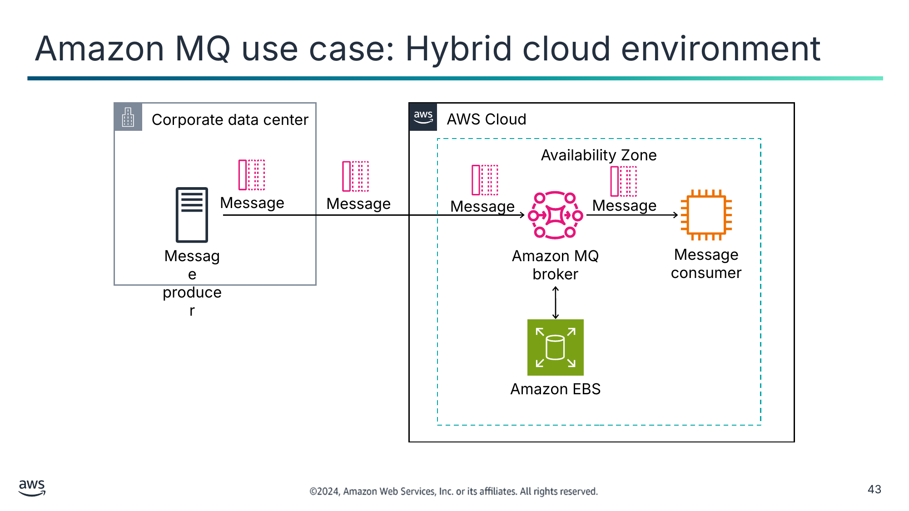

Текст зі схеми

Corporate data center (Корпоративний центр обробки даних)

AWS Cloud

Availability Zone (Зона доступності)

Message (Повідомлення)

Message

Message

Message

Message producer (Виробник повідомлень)

Amazon MQ

broker (Брокер)

Message consumer (Споживач повідомлень)

Amazon EBS

> **Нотатки:**
>
> |Номер слайда 43  
> |Нотатки для інструктора  
> |  
> |Нотатки для студента  
> Багато організацій, особливо підприємства, спираються на брокерів повідомлень для з’єднання та координації різних систем. Брокери повідомлень дають змогу розподіленим застосункам обмінюватися даними один з одним. Брокери слугують технологічною основою ІТ-середовища підприємства й, зрештою, бізнес-сервісів.  
>
> У багатьох випадках ці організації почали будувати нові хмароорієнтовані застосунки або виконувати перенесення застосунків в AWS за підходом lift-and-shift. Є деякі застосунки, як-от системи мейнфреймів, міграція яких надто дорога. У таких випадках локальні застосунки все одно мають взаємодіяти з хмарними компонентами.  
>
> Amazon MQ дає організаціям змогу надсилати повідомлення між застосунками в хмарі та застосунками, що перебувають локально, щоб уможливити гібридні середовища та модернізацію застосунків. Наприклад, можна викликати функцію Lambda з черг і тем, що керуються брокерами Amazon MQ, для інтеграції застарілих систем із безсерверними архітектурами.  
>
> У цьому прикладі локальний застосунок-виробник хоче надсилати повідомлення застосунку-споживачу, що працює в хмарі AWS. Щоб підтримати цю вимогу, системний адміністратор створює єдиний брокер Amazon MQ for ActiveMQ в одній зоні доступності. Адміністратор також налаштовує брокер на зберігання повідомлень у томі EBS, оптимізованому для низької затримки та високої пропускної здатності. Потім виробник може надсилати повідомлення брокеру ActiveMQ, що поширює їх споживачу повідомлень.  
>
> Докладніше про рушії Amazon MQ ActiveMQ і RabbitMQ та їхні різні конфігурації див. посібник розробника Amazon MQ. Посилання надано у ваших ресурсах курсу.

---

## Слайд 44: Вибір правильного рішення для роз’єднання

|  | Amazon SQS | Amazon SNS | Amazon MQ |
|---|---|---|---|
| Застосовність (Applicability) | Хмароорієнтовані застосунки | Хмарно-нативні застосунки | • Гібридні застосунки • Міграція брокера повідомлень |
| Модель обміну повідомленнями (Messaging Model) | Виробник-споживач | Видавець-підписник | • Виробник-споживач • Видавець-підписник |
| API програмування (Programming API) | API Amazon SQS | API Amazon SNS | Галузеві стандартні API брокера повідомлень |
| Модель ціноутворення (Pricing Model) | Оплата за запит | Оплата за запит | • Оплата за годину • Оплата за ГБ |

> **Нотатки:**
>
> |Номер слайда 44  
> |Нотатки для інструктора  
> |  
> |Нотатки для студента  
> Якщо потрібно інтегрувати локальні застосунки з хмарними застосунками, AWS рекомендує використовувати Amazon MQ. Він підтримує API та протоколи відкритих стандартів, як-от JMS та AMQP, і дає вашим локальним застосункам змогу обмінюватися даними з хмарними застосунками без потреби переписувати код обміну повідомленнями. Так само, якщо ви використовуєте обмін повідомленнями в наявних застосунках і хочете перенести свої брокери повідомлень у хмару, Amazon MQ — рекомендоване рішення. Можна перейти з будь-якого брокера повідомлень на основі стандартів на Amazon MQ, щоб зменшити обслуговування брокера, зменшити витрати на ліцензування та покращити стабільність брокера. З Amazon MQ ви платите за час роботи вашого екземпляра брокера повідомлень, сховище, яке ви використовуєте щомісяця, і плату за передавання даних.  
>
> Якщо ви будуєте нові застосунки в хмарі, AWS рекомендує використовувати Amazon SQS та Amazon SNS. Це сервіси черг і тем, що використовують API й не вимагають налаштування брокерів повідомлень. Ціноутворення Amazon SQS ґрунтується на кількості щомісячних запитів API та платі за передавання даних. Ціноутворення Amazon SNS ґрунтується на кількості щомісячних запитів API, кількості доставок до різних кінцевих точок і платі за передавання даних.

---

## Слайд 45: Ключові висновки: роз’єднання гібридного застосунку за допомогою Amazon MQ

- Amazon MQ — це кероване обслуговування, яке можна використовувати для налаштування й експлуатації брокерів повідомлень Apache ActiveMQ та RabbitMQ у хмарі.
- Amazon MQ сумісний з API та протоколами обміну повідомленнями відкритих стандартів.
- Amazon MQ можна використовувати для інтеграції локальних і хмарних середовищ слабко зв’язаним способом.
- Також можна використовувати Amazon MQ для міграції ваших локальних брокерів повідомлень із відкритим кодом у хмару AWS.

> **Нотатки:**
>
> |Номер слайда 45  
> |Нотатки для інструктора  
> |  
> |Нотатки для студента

---

## Слайд 46: Підсумки модуля

Побудова роз’єднаних архітектур

> **Нотатки:**
>
> |Номер слайда 46  
> |Нотатки для інструктора  
> |  
> |Нотатки для студента  
> Цей розділ підсумовує те, що ви дізналися, і завершує модуль.

---

## Слайд 47: Резюме модуля

Цей модуль підготував вас до такого:

- Розрізняти щільно та слабко зв’язані архітектури.
- Визначати, як працює Amazon SQS і коли його використовувати.
- Визначати, як працює Amazon SNS і коли його використовувати.
- Описувати Amazon MQ.
- Роз’єднувати робочі навантаження за допомогою Amazon SQS.

> **Нотатки:**
>
> |Номер слайда 47  
> |Нотатки для інструктора  
> |  
> |Нотатки для студента

---

## Слайд 48: Міркування щодо кафе

- Обговоріть, як ви, як хмарний архітектор, могли б порадити кафе на основі ключових занепокоєнь хмарного архітектора, поданих на початку цього модуля.

---

## Слайд 49: Перевірка знань модуля

- Перевірка знань проводиться онлайн у вашому курсі.
- Перевірка знань включає 10 запитань на основі матеріалу, поданого на слайдах і в нотатках до слайдів.
- Ви можете повторно проходити перевірку знань стільки разів, скільки захочете.

> **Нотатки:**
>
> |Номер слайда 49  
> |Нотатки для інструктора  
> |  
> |Нотатки для студента  
> Скористайтеся своїм онлайн-курсом, щоб отримати доступ до перевірки знань для цього модуля.

---

## Слайд 50: Зразок запитання іспиту

Компанії потрібно виконувати асинхронну обробку й впровадити Amazon Simple Queue Service (Amazon SQS) як частину роз’єднаної архітектури. Компанія хоче забезпечити, щоб кількість порожніх відповідей на запити опитування була мінімальною.

Що має зробити архітектор рішень, щоб зменшити кількість порожніх відповідей?

Визначте ключові слова та фрази, перш ніж продовжувати.

Ось ключові слова та фрази:

- Черга SQS
- Порожні відповіді зведено до мінімуму

> **Нотатки:**
>
> |Номер слайда 50  
> |Нотатки для інструктора  
> |Розділ із ключовими словами налаштовано з анімацією для розкриття за клацанням.  
> |  
> |Нотатки для студента  
> Ключові слова, визначені на слайді, виокремлюють елементи запитання, що найважливіші для вибору правильної відповіді.

---

## Слайд 51: Зразок запитання іспиту: варіанти відповідей

Компанії потрібно виконувати асинхронну обробку й впровадити Amazon Simple Queue Service (Amazon SQS) як частину роз’єднаної архітектури. Компанія хоче забезпечити, щоб кількість порожніх відповідей на запити опитування була мінімальною.

Що має зробити архітектор рішень, щоб зменшити кількість порожніх відповідей?

**Варіант**

**Відповідь**

**A**

Збільшити максимальний період зберігання повідомлень для черги.

**B**

Збільшити максимальну кількість отримань (maximum receives) для політики повторного спрямування (redrive policy) черги.

**C**

Збільшити тайм-аут видимості за замовчуванням для черги.

**D**

Збільшити час очікування отримання повідомлення для черги.

> **Нотатки:**
>
> |Номер слайда 51  
> |Нотатки для інструктора  
> |  
> |Нотатки для студента  
> Використайте ключові слова, які ви визначили на попередньому слайді, і розгляньте кожен із можливих варіантів відповіді, щоб визначити, який із них найкраще відповідає запитанню.

---

## Слайд 52: Зразок запитання іспиту: відповідь

Правильна відповідь — D.

**Варіант**

**Відповідь**

**D**

Збільшити час очікування отримання повідомлення для черги

> **Нотатки:**
>
> |Номер слайда 52  
> |Нотатки для інструктора  
> |  
> |Нотатки для студента  
> Порожнє опитування означає, що немає повідомлень для отримання, коли черга опитує нові повідомлення.  
>
> Варіант A (збільшити максимальний період зберігання повідомлень) збільшив би тривалість зберігання повідомлень у черзі, але не запобіг би порожнім відповідям, якщо в черзі немає нових повідомлень.  
>
> Варіант B (збільшити максимальну кількість отримань для політики повторного спрямування черги) збільшив би кількість спроб Amazon SQS доставити повідомлення, якщо воно не доставляється, але це не пов’язано з опитуванням і з відсутністю знайдених повідомлень.  
>
> Варіант C (збільшити тайм-аут видимості за замовчуванням для черги) можна використати, якби ваш застосунок не обробляв і не видаляв повідомлення достатньо швидко, перш ніж вони знову ставали видимими для черги. Це допомагає запобігти двічі обробленню повідомлень.  
>
> Варіант D правильний. Збільшення часу очікування отримання повідомлення збільшує час між запитами, що робить імовірнішим надходження додаткових повідомлень в інтервалі між опитуваннями.

---

## Слайд 53: Дякуємо

Виправлення, відгуки чи інші запитання?

Зв’яжіться з нами за адресою [https://support.aws.amazon.com/#/contacts/aws-academy](https://support.aws.amazon.com/#/contacts/aws-academy).

> **Нотатки:**
>
> |Номер слайда 53  
> |Нотатки для інструктора  
> |  
> |Нотатки для студента  
> На цьому цей модуль завершено. Сторінка ресурсів вмісту вашого курсу містить посилання на додаткові ресурси, пов’язані з цим модулем.
