## Слайд 1: Побудова безсерверних архітектур і мікросервісів (Building Serverless Architectures and Microservices)

AWS Academy Cloud Architecting

> **Нотатки:**
>
> |Нотатки для інструктора  
> |  
> |Нотатки для студента  
> Вітаємо в модулі «Побудова безсерверних архітектур і мікросервісів». Цей модуль знайомить вас із безсерверними архітектурами та мікросервісами. Ви також дізнаєтеся, як використовувати сервіси AWS для безсерверних архітектур і мікросервісів.

---

## Слайд 2: Вступ

Побудова безсерверних архітектур і мікросервісів

> **Нотатки:**
>
> |Нотатки для інструктора  
> |  
> |Нотатки для студента  
> Цей вступний розділ описує вміст модуля.

---

## Слайд 3: Цілі модуля

Цей модуль готує вас до такого:

- Визначати безсерверні архітектури.
- Визначати характеристики мікросервісів.
- Проєктувати безсерверне рішення за допомогою AWS Lambda.
- Визначати, як контейнери використовуються в Amazon Web Services (AWS).
- Описувати типи робочих процесів, що підтримує AWS Step Functions.
- Описувати поширену архітектуру для Amazon API Gateway.
- Використовувати принципи AWS Well-Architected Framework під час побудови безсерверних архітектур.

> **Нотатки:**
>
> |Номер слайда 3  
> |Нотатки для інструктора  
> |  
> |Нотатки для студента

---

## Слайд 4: Огляд модуля

**Розділи презентації**

- Мислення в категоріях безсерверності
- Проєктування безсерверних мікросервісів
- Побудова безсерверних архітектур за допомогою AWS Lambda
- Побудова мікросервісних застосунків за допомогою контейнерних сервісів AWS
- Оркестрація мікросервісів за допомогою AWS Step Functions
- Розширення безсерверних архітектур за допомогою Amazon API Gateway
- Застосування принципів AWS Well-Architected Framework до мікросервісів і безсерверних архітектур

**Демонстрації**

  - Використання AWS Lambda з Amazon S3 (Using AWS Lambda with Amazon S3)
  - Запуск контейнера (Running a Container)

**Вправа**

  - Декомпозиція монолітного застосунку за допомогою AWS API Gateway (Decomposing a Monolithic Application with AWS API Gateway)

**Перевірки знань**

- 10-запитальна перевірка знань
- Зразок запитання іспиту

> **Нотатки:**
>
> |Номер слайда 4  
> |Нотатки для інструктора  
> |Кожен модуль має вступ, розділи з вмістом і підсумок. Підсумок цього модуля містить зразок запитання іспиту для розбору зі студентами.  
> |  
> |Нотатки для студента  
> Цілі цього модуля розкриваються в кількох розділах.  
>
> Ви також візьмете участь у вправі з вибору сервісів для заданого сценарію використання мікросервісів.  
>
> Ви також переглянете дві демонстрації, що показують, як AWS Lambda працює з Amazon Simple Storage Service (Amazon S3) і як запустити контейнер в AWS.  
>
> Модуль завершується 10-запитальною перевіркою знань, що проводиться в онлайн-курсі, та зразком запитання іспиту для обговорення в класі.  
> Лабораторні роботи цього модуля описано на наступному слайді.

---

## Слайд 5: Практичні лабораторні роботи в цьому модулі

Покрокові лабораторні роботи (Guided labs)

Лабораторна робота-виклик (кафе) (Challenge (Café) lab)

- Упровадження безсерверної архітектури в AWS (Implementing a Serverless Architecture on AWS)
- Розбиття монолітного застосунку Node.js на мікросервіси (необов’язково) (Breaking a Monolithic Node.js Application into Microservices (Optional))

- Упровадження безсерверної архітектури для кафе (Implementing a Serverless Architecture for the Café)

> **Нотатки:**
>
> |Номер слайда 5  
> |Нотатки для інструктора  
> |Цей модуль містить дві самодостатні покрокові лабораторні роботи та лабораторну роботу кафе, що доповнює архітектуру кафе, що еволюціонує. Лабораторна робота кафе — це лабораторна робота-виклик, де від студентів очікується виконання завдань без надання кожного кроку. Вступи до кожної лабораторної роботи включено до розділів лабораторних робіт у межах модуля.  
> |  
> |Нотатки для студента  
> Цей модуль містить зазначені практичні лабораторні роботи. З покроковими лабораторними роботами ви отримуєте інструкції крок за кроком. У лабораторній роботі кафе (виклик) ви працюєте над оновленням архітектури кафе. Додаткова інформація про кожну лабораторну роботу міститься в посібнику студента там, де вона виконується, а докладні інструкції надаються в лабораторному середовищі.

---

## Слайд 6: Як хмарний архітектор, що будує мікросервіси:

- Мені потрібно розпізнавати, коли обирати безсерверні архітектури AWS і які сервіси обирати для кожного сценарію використання, щоб я міг побудувати рішення, оптимізоване за продуктивністю та вартістю.
- Мені потрібно застосовувати архітектури, керовані подіями, з мікросервісами, щоб я міг будувати масштабовані й стійкі мікросервісні архітектури.
- Мені потрібно знати, коли використовувати оркестрацію робочих процесів, щоб мої мікросервісні архітектури могли обробляти збої робочих процесів і потребували мінімального ручного втручання.


> **Нотатки:**
>
> |Номер слайда 6  
> |Нотатки для інструктора  
> |Цей слайд подає ключові наскрізні міркування проєктування, що мають спрямовувати ухвалення рішень для цього рівня хмарної архітектури. Підкресліть, що хмарний архітектор завжди має починати з бізнес-кейсу й рухатися у зворотному напрямку, щоб обрати найкращі компоненти для цього сценарію використання. Також нагадайте студентам, що рішення, імовірно, еволюціонуватимуть з часом, у міру зміни чи кращого розуміння потреб, для оптимізації вартості та продуктивності. Наприкінці модуля в підсумковому розділі включено необов’язкове обговорення, що спонукає студентів розглянути ці чинники в контексті сценарію з кафе.  
> |  
> |Нотатки для студента  
> Цей слайд просить вас прийняти перспективу хмарного архітектора, коли ви думаєте про те, як підходити до проєктування хмарної мережі. Тримайте ці міркування в голові, просуваючись цим модулем, пам’ятаючи, що хмарний архітектор має працювати у зворотному напрямку від бізнес-потреби, щоб спроєктувати найкращу архітектуру для конкретного сценарію використання. Просуваючись модулем, розглядайте сценарій з кафе, поданий у курсі, як приклад бізнес-потреби й думайте про те, як би ви відповіли на ці потреби для вигаданого бізнесу кафе.

---

## Слайд 7: Мислення в категоріях безсерверності (thinking serverless)

Побудова безсерверних архітектур і мікросервісів

> **Нотатки:**
>
> |Номер слайда 7  
> |Нотатки для інструктора  
> |  
> |Нотатки для студента  
> Цей розділ розглядає безсерверні архітектури в AWS.

---

## Слайд 8: Триярусний проєкт вебзастосунку у VPC

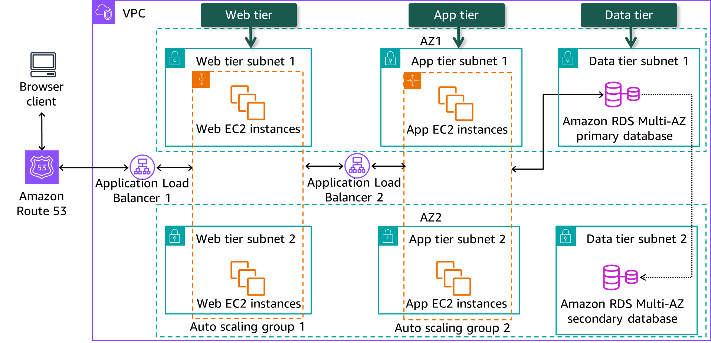

> **Нотатки:**
>
> |Номер слайда 8  
> |Нотатки для інструктора  
> |Щоб протиставити безсерверні обчислення й сховище безсерверним сервісам, студентам потрібно зрозуміти дуже поширену триярусну архітектуру, впроваджену за допомогою балансувальників навантаження, екземплярів EC2 і реляційних баз даних у VPC. Простежте мережевий трафік від клієнта-браузера через веб-, прикладний рівні та рівень даних.  
> |  
> |Нотатки для студента  
> Коли потрібно розгорнути вебзастосунок у віртуальній приватній хмарі (VPC), як на діаграмі вище, ви зазвичай використовуватимете вебдомен, що вказує на Application Load Balancer, який вказує на веброівень. Для високої доступності веброівень розгортається на кількох екземплярах Amazon Elastic Compute Cloud (Amazon EC2) у двох зонах доступності (AZ) у групі автоматичного масштабування. Це забезпечить доступність навіть коли екземпляр Amazon EC2 виходить з ладу чи AZ недоступна. Вебрівень відповідає за рівень представлення для клієнта-браузера.  
>
> Рівень застосунку відповідає за бізнес-логіку вебзастосунку й доступний із вебрівня через інший Application Load Balancer, що вказує на рівень застосунку. Подібно до вебрівня, він має проєкт високої доступності у двох AZ із групою автоматичного масштабування. Веброівнем і рівнем застосунку керує клієнт AWS, який має забезпечити регулярне застосування виправлень безпеки й оновлень програмного забезпечення до екземплярів. Екземпляри відстежуються, а сигнали налаштовуються в Amazon CloudWatch.  
>
> Рівень застосунку звертається до рівня даних за запитами даних. Рівень даних складається з керованої AWS основної бази даних Amazon Relational Database Service (Amazon RDS) Multi-AZ в одній AZ із синхронною реплікацією на вторинну базу даних Amazon RDS у другій AZ. RDS — це кероване обслуговування AWS, що означає, що AWS відповідає за керування екземплярами баз даних EC2 і застосування виправлень безпеки та оновлень програмного забезпечення. Коли основна база даних виходить з ладу, вторинну базу даних підвищують до основної.  
>
> Шаблон архітектури з багатьма рівнями надає загальну структуру, щоб забезпечити, що роз’єднані й незалежно масштабовані компоненти застосунку можна окремо розробляти, адмініструвати й підтримувати. Мережа діє як межа між рівнями й часто вимагає створення багатьох недиференційованих компонентів застосунку. Такі компоненти, як черги повідомлень і компоненти автентифікації, виглядають однаково для будь-якого застосунку.

---

## Слайд 9: Переваги безсерверності AWS (AWS serverless)

Без керування серверами

Безперервне масштабування

Сервіси з оплатою за цінність

Вбудована висока доступність

Підходить для архітектур, керованих подіями, та мікросервісних архітектур

> **Нотатки:**
>
> |Номер слайда 9  
> |Нотатки для інструктора  
> |  
> |Нотатки для студента  
> Що якщо ви єдиний веброзробник застосунку чи абсолютно новий стартап, що хоче мінімізувати витрати на інфраструктуру? Або що якщо у вас немає достатньо персоналу для обслуговування та підтримки екземплярів EC2? Або що якщо ви хочете розбити розгортання монолітних рівнів на менші, гнучкі частини? Безсерверні сервіси AWS розв’язують ці сценарії.  
>
> Ще в 2013 році AWS помітив, що клієнти використовують екземпляри EC2 протягом справді коротких періодів. Це започаткувало процес, що привів до безсерверних сервісів AWS, де середовище виконання повністю керується AWS, а модель оплати ґрунтується на використанні сервісу. Безсерверні ресурси AWS можна використовувати протягом дуже коротких проміжків часу, як-от двозначні мілісекунди, що покращує ефективність ресурсів і забезпечує детальне керування витратами.  
>
> Сервіс AWS вважається безсерверним, коли ви можете розгорнути застосунок, не думаючи про сервери чи розмір серверів. AWS керує середовищем виконання та розміром сервісу. У результаті ви можете зосередитися на своєму основному продукті й робити розгортання застосунків меншими та швидшими. Наприклад, функції AWS Lambda можна розгорнути одним клацанням у консолі AWS, і зазвичай вони готові за лічені секунди.  
>
> Модель ціноутворення сервісу зазвичай ґрунтується на моделі використання, де вартість залежить від того, наскільки використовується сервіс і наскільки використовується сховище. Це усуває оплату за сервіси, що не використовуються. Ця модель особливо корисна для стартапів, коли бізнес ще розвивається, щоб тримати накладні витрати низькими. Наприклад, бакети Amazon Simple Storage Service (Amazon S3) мають різні рівні використання залежно від шаблонів використання, кожен зі своєю ціною.  
>
> Багато безсерверних сервісів AWS мають можливість автоматично масштабуватися на основі певної метрики. AWS потім масштабуватиме ресурси сервісу на основі метрики. Наприклад, Amazon DynamoDB може збільшувати чи зменшувати розгорнуту пропускну здатність читання й запису таблиці на основі фактичних шаблонів трафіку.  
>
> Безсерверні сервіси AWS мають вбудовану відмовостійкість і високу доступність. Безсерверні сховища даних працюють у трьох AZ, а безсерверні обчислювальні ресурси, як-от контейнери AWS Fargate, працюють в ізольованому середовищі, на яке не впливають збої інших контейнерів.  
>
> Безсерверні сервіси AWS придатні для використання в архітектурах, керованих подіями, та мікросервісних архітектурах. Як ви дізналися в попередньому модулі, мікросервіси — це архітектурний стиль, що структурує застосунок як колекцію незалежних, слабко зв’язаних сервісів. Архітектура, керована подіями (event-driven architecture, EDA), — це сучасний архітектурний шаблон, побудований із малих, роз’єднаних сервісів, що публікують, споживають чи маршрутизують події. Події — це повідомлення, що надсилаються між сервісами. Ця архітектура полегшує масштабування, оновлення й незалежне розгортання окремих компонентів системи. Їх можуть викликати події, вони можуть випускати події й мають вбудовані можливості для побудови з подіями. Наприклад, функція AWS Lambda може обробляти події повідомлень черги з Amazon Simple Queue Service (Amazon SQS), події потоків з Amazon Kinesis Data Streams чи Amazon DynamoDB Streams або події об’єктів з Amazon S3.

---

## Слайд 10: Безсерверні сервіси AWS (AWS serverless services)

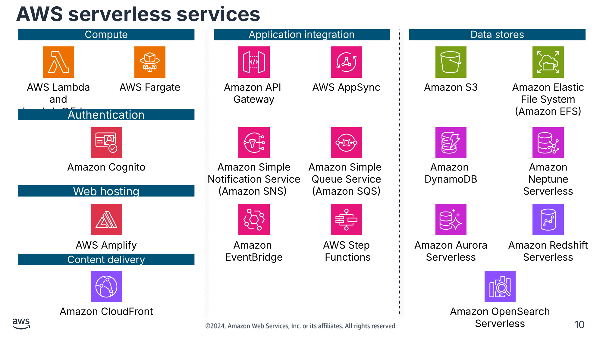

Compute (Обчислення)

Application integration (Інтеграція застосунків)

Data stores (Сховища даних)

AWS Lambda and Lambda@Edge

AWS Fargate

Amazon API

Gateway

AWS AppSync

Amazon S3

Amazon Elastic File System (Amazon EFS)

Authentication (Автентифікація)

Amazon Cognito

Amazon Simple Notification Service

(Amazon SNS)

Amazon Simple

Queue Service

(Amazon SQS)

Amazon

DynamoDB

Amazon Neptune Serverless

Web hosting (Вебхостинг)

AWS Amplify

Amazon

EventBridge

AWS Step

 Functions

Amazon Aurora Serverless

Amazon Redshift Serverless

Content delivery (Доставка контенту)

Amazon CloudFront

Amazon OpenSearch Serverless

> **Нотатки:**
>
> |Номер слайда 10  
> |Нотатки для інструктора  
> |Цей слайд включає набір доступних безсерверних сервісів. Розгляньте можливість оглянути його на високому рівні. Докладніше див. Serverless on AWS на сторінці ресурсів вмісту вашого онлайн-курсу.  
> |  
> |Нотатки для студента  
> Сучасні застосунки будуються за принципом «безсерверне насамперед» (serverless-first) — стратегією, що пріоритезує впровадження безсерверних сервісів, щоб ви могли підвищити гнучкість у всьому стеку застосунку. AWS розробив безсерверні сервіси для всіх трьох рівнів стека застосунку: обчислення, інтеграція застосунків і сховища даних. Є навіть сервіси для спеціалізованих галузей, як-от аналітика.  
>
> Безсерверні обчислювальні варіанти AWS — це функції AWS Lambda і контейнери AWS Fargate. AWS Lambda — це обчислювальний сервіс, керований подіями, що дає змогу запускати функції коду без розгортання чи керування серверами. Функції Lambda можна розгортати в регіоні AWS або на периферійній локації за допомогою Lambda@Edge. AWS Fargate — це безсерверне рішення для контейнерів, що можна використовувати з Amazon Elastic Container Service (Amazon ECS) або Amazon Elastic Kubernetes Service (Amazon EKS).  
>
> Безсерверну інтеграцію застосунків можна поділити на категорії видавців API, застосунків обміну повідомленнями та оркестрації й подій. Amazon API Gateway і AWS AppSync — два безсерверні варіанти AWS для публікації API й керування ними. Amazon API Gateway дає змогу створювати, публікувати та підтримувати restful- і HTTP API. AWS AppSync дає змогу розгортати API GraphQL і керувати ними. Один запит може збирати дані з різних сховищ даних для безперебійного користувацького досвіду. Безсерверні застосунки обміну повідомленнями AWS включають Amazon Simple Notification Service (Amazon SNS) і Amazon SQS. Amazon SNS дотримується моделі «публікація та підписка» для обміну даними між застосунками та між застосунком і людиною.  
>
> Amazon SQS — це сервіс черг повідомлень, що використовується для роз’єднання компонентів програмного забезпечення застосунків. Безсерверну оркестрацію та події забезпечують AWS Step Functions і Amazon EventBridge. AWS Step Functions — це оркестратор робочих процесів, що використовується для впорядкування кількох сервісів AWS для виконання складних транзакцій. AWS EventBridge — це сервіс шини подій, що маршрутизує події до налаштованих призначень, перевіряючи схеми повідомлень.  
>
> Безсерверні сховища даних AWS включають такі сервіси:  
> Amazon S3 зберігає об’єкти в бакетах.  
> Amazon Elastic File System (Amazon EFS) зберігає файли, доступні екземплярам EC2, AWS Lambda та контейнерам Amazon ECS, Amazon EKS і Fargate.  
> Amazon DynamoDB — це сервіс баз даних «ключ-значення» та документів для часу відповіді в одиниці мілісекунд.  
> Amazon OpenSearch Serverless забезпечує пошук даних і аналітику журналів без розгортання ресурсів.  
> Amazon Neptune Serverless — це графова база даних, що масштабується залежно від використання.  
> Amazon Redshift Serverless — це стовпцеве реляційне сховище даних із моделлю ціноутворення «платіть за те, що використовуєте».  
> Amazon Aurora Serverless — це реляційна база даних, сумісна з MySQL і PostgreSQL, що масштабується залежно від використання.  
> Це не вичерпний перелік варіантів безсерверного зберігання даних. AWS також пропонує спеціалізовані безсерверні бази даних, як-от Amazon Timestream, Amazon Quantum Ledger Database (Amazon QLDB) і Amazon Keyspaces (for Apache Cassandra).  
>
> Для автентифікації застосунків використовуйте Amazon Cognito для керування пулами користувачів застосунків та інтеграції із зовнішніми постачальниками ідентичності. AWS Amplify — це рішення для побудови й розміщення веб- і мобільних застосунків. Сервіс доставки контенту Amazon CloudFront можна використовувати для розповсюдження статичного вебконтенту з Amazon S3, що діє як вебсервер.

---

## Слайд 11: Триярусний проєкт вебзастосунку за допомогою безсерверних сервісів AWS

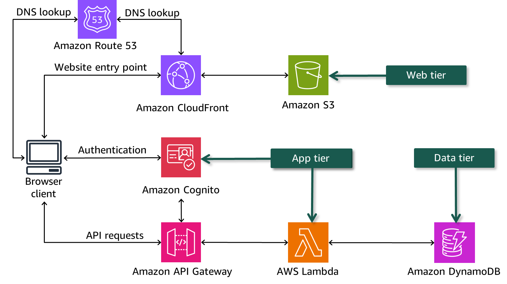

> **Нотатки:**
>
> |Номер слайда 11  
> |Нотатки для інструктора  
> Порівняйте триярусну архітектуру VPC із цією діаграмою, що впроваджує три архітектурні рівні.  
>
> |Нотатки для студента  
> Поширений безсерверний шаблон для триярусного проєкту вебзастосунку зображено в наведеному вище прикладі. Amazon CloudFront розповсюджує статичний веб-фронтенд із бакета Amazon S3 до клієнта-браузера.  
>
> Автентифікацію користувачів рівня застосунку обробляє пул користувачів Amazon Cognito, що надає веб-токен JSON (JWT) для авторизації запитів API. API Gateway отримує запити API й перевіряє токен JWT в Amazon Cognito. Якщо токен дійсний, запит передається до функції AWS Lambda для виконання бізнес-логіки застосунку.  
>
> Щоб отримати дані застосунку, функція Lambda запитує дані з Amazon DynamoDB, що використовується як рівень даних.

---

## Слайд 12: Ключові висновки: мислення в категоріях безсерверності

- Безсерверні сервіси AWS надають вам такі переваги:
  - Без керування серверами
  - Сервіси з оплатою за цінність
  - Безперервне масштабування
  - Вбудована відмовостійкість
- Безсерверні сервіси придатні для архітектур, керованих подіями, та мікросервісних архітектур.

> **Нотатки:**
>
> |Номер слайда 12  
> |Нотатки для інструктора  
> |  
> |Нотатки для студента

---

## Слайд 13: Проєктування безсерверних мікросервісів

Побудова безсерверних архітектур і мікросервісів

> **Нотатки:**
>
> |Номер слайда 13  
> |Нотатки для інструктора  
> |  
> |Нотатки для студента  
> Цей розділ знайомить із концепцією мікросервісів.

---

## Слайд 14: Характеристики мікросервісу

Автономний (Autonomous)

Спеціалізований (Specialized)

- Може розроблятися й розгортатися без впливу на інші мікросервіси
- Масштабується незалежно
- Не ділить код з іншими мікросервісами
- Обмінюється даними через чітко визначені API

- Виконує одну бізнес-функцію, розв’язуючи конкретну проблему
- Належить невеликій команді розробників, що обирає інструменти розробки
- Не зберігає стану (stateless)
- Має власне сховище даних

> **Нотатки:**
>
> |Номер слайда 14  
> |Нотатки для інструктора  
> |  
> |Нотатки для студента  
> В архітектурі мікросервісів застосунок будується як незалежні компоненти, що запускають кожен процес застосунку як сервіс. Ці сервіси обмінюються даними через чітко визначений інтерфейс за допомогою легких API. Сервіси будуються для бізнес-можливостей, і кожен сервіс виконує одну функцію. Оскільки вони працюють незалежно, кожен сервіс можна оновлювати, розгортати й масштабувати для задоволення попиту на конкретні функції застосунку.  
>
> Мікросервіс автономний, що означає, що ним можна керувати й масштабувати його без впливу на функціонування інших сервісів. Мікросервіс не ділить жодної частини свого коду чи реалізації з іншими сервісами. Будь-який обмін даними між окремими мікросервісами відбувається через чітко визначені легкі API.  
>
> Мікросервіс спеціалізований, що означає, що його спроєктовано для певного набору можливостей. Він зосереджується на розв’язанні конкретної проблеми для однієї бізнес-функції. Наприклад, вхід на вебсайт можна розробити як один мікросервіс. Зазвичай мікросервіс належить невеликій команді розробників, що вирішує, яке середовище виконання та мову кодування використовувати. Мікросервіс також має бути безстановим (stateless), щоб забезпечити швидке створення екземплярів і масштабування. Кешування стану ідеальне для мікросервісів для швидкого відновлення після апаратної відмови. Мікросервіси володіють власними сховищами даних, щоб полегшити атомарні, узгоджені, ізольовані й довговічні (ACID) транзакції за потреби. Якщо розробники з часом додають більше коду до мікросервісу й мікросервіс стає складним, його можна розділити на окремі мікросервіси.

---

## Слайд 15: Приклад: розбиття монолітного застосунку на мікросервіси

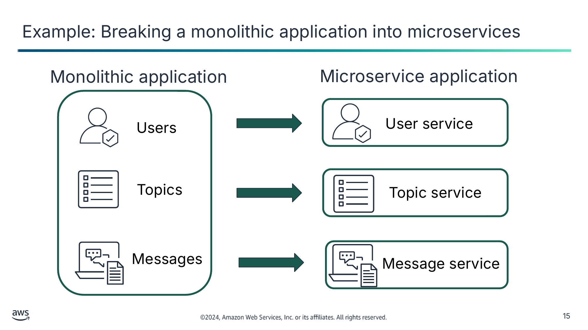

Monolithic application (Монолітний застосунок)

Microservice application (Мікросервісний застосунок)

Users (Користувачі)

User service (Сервіс користувачів)

Topics (Теми)

Topic service (Сервіс тем)

Messages (Повідомлення)

Message service (Сервіс повідомлень)

> **Нотатки:**
>
> |Номер слайда 15  
> |Нотатки для інструктора  
>
> |Нотатки для студента  
> У цьому прикладі застосунок форуму — це монолітний, щільно зв’язаний набір процесів для користувачів, тем і повідомлень. Процеси працюють як єдиний сервіс. Якщо один процес застосунку відчуває сплеск попиту, потрібно масштабувати всю архітектуру. Додавання чи покращення функцій стає складнішим у міру зростання кодової бази, що обмежує експериментування й ускладнює впровадження нових ідей. Доступність монолітних застосунків також під ризиком, оскільки багато залежних і щільно зв’язаних процесів збільшують вплив збою одного процесу.  
>
> Тепер припустімо, що той самий застосунок працює в архітектурі мікросервісів. Кожен процес застосунку побудований як незалежний компонент, що працює як мікросервіс. Мікросервіси обмінюються даними за допомогою легких операцій API. Кожен сервіс виконує одну функцію, що може підтримувати кілька застосунків. Оскільки сервіси працюють незалежно, їх можна оновлювати, розгортати й масштабувати для задоволення попиту на конкретні функції застосунку.

---

## Слайд 16: Переваги мікросервісів

 Гнучкість команди (Team agility)

Повторно використовуваний код (Reusable code)

Гнучке масштабування (Flexible scaling)

Технологічна свобода (Technological freedom)

Стійкість (Resilience)

Спрощене розгортання (Simplified deployment)

> **Нотатки:**
>
> |Номер слайда 16  
> |Нотатки для інструктора  
> |  
> |Нотатки для студента  
> Мікросервіси підвищують гнучкість команди розробників. Мікросервіси сприяють організації малих незалежних команд, що беруть на себе відповідальність за свої сервіси. Команди діють у малому й добре зрозумілому контексті та мають повноваження працювати незалежніше й швидше. Це скорочує розробку до швидких циклів.  
>
> Поділ програмного забезпечення на малі, чітко визначені модулі дає командам змогу використовувати функції для кількох цілей. Сервіс, написаний для певної функції, можна повторно використати як будівельний блок для іншої функції. Це дає розробникам змогу поєднувати наявні мікросервіси для створення нових можливостей, не пишучи код з нуля.  
>
> Мікросервіси дозволяють гнучке масштабування, де кожен мікросервіс масштабується незалежно для задоволення попиту на функцію застосунку, яку він підтримує. Це дає командам змогу точно підбирати розмір інфраструктури, точно вимірювати вартість функції й підтримувати доступність, якщо мікросервіс відчуває сплеск попиту.  
>
> Мікросервіси дають командам розробників технологічну свободу ухвалювати технічні рішення автономно. Вони розуміють, що архітектури не дотримуються підходу «один розмір для всіх». Команди мають свободу обирати найкращий інструмент для розв’язання своїх конкретних проблем. Як наслідок, команди, що будують мікросервіси, можуть обирати найкращий інструмент для кожного завдання. Команда відповідає за створення мікросервісу, а також за його розгортання й підтримку в продуктивному середовищі.  
>
> З мікросервісами застосунки обробляють повну відмову сервісу, погіршуючи функціональність, а не руйнуючи весь застосунок, як у випадку монолітних застосунків.  
>   
> Мікросервіси спрощують розгортання за допомогою конвеєрів безперервної інтеграції та безперервної доставки. Це спрощує випробування нових ідей і відкат, якщо щось не працює. Низька вартість невдачі уможливлює експериментування, допомагає оновлювати код і прискорює час виходу нових функцій на ринок.

---

## Слайд 17: Безсерверні шаблони мікросервісів в AWS

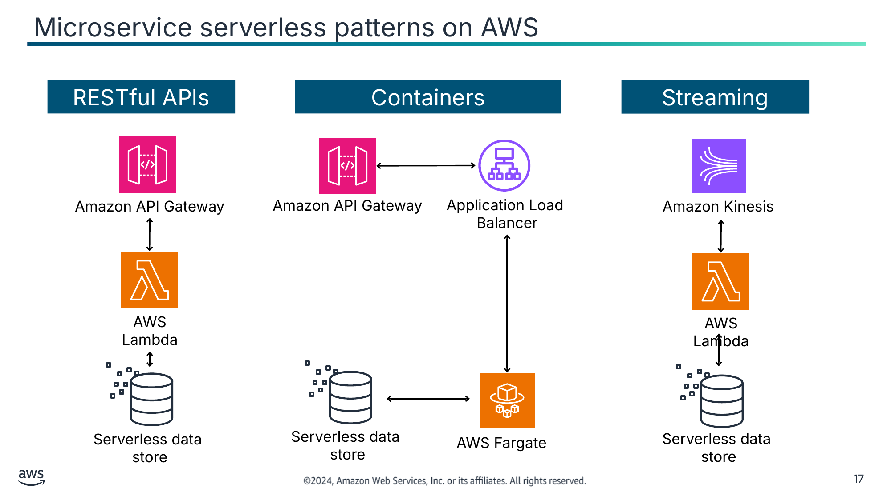

RESTful APIs

Containers (Контейнери)

Streaming (Потокова передача)

Serverless data

store (Безсерверне сховище даних)

Serverless data

store

Serverless data

store

<details>
<summary>Текст зі схеми</summary>

Amazon API Gateway

Amazon API Gateway

Application Load

Balancer

Amazon Kinesis

AWS Lambda

AWS Lambda

AWS Fargate

</details>

> **Нотатки:**
>
> |Номер слайда 17  
> |Нотатки для інструктора  
> |Упровадження поширених шаблонів — швидка перемога, якщо команда не знайома з мікросервісами. Також важливо зазначити, що AWS Lambda — не єдиний доступний безсерверний обчислювальний варіант для мікросервісів.  
> |  
> |Нотатки для студента  
> В AWS є багато шаблонів архітектури мікросервісів на вибір. Ось кілька поширених безсерверних обчислювальних шаблонів:  
>
> RESTful API: Representational State Transfer (REST) — це архітектурний стиль, що використовується для обміну даними між сервісами, яким потрібні безстанові обчислення. Дані та функції — це ресурси зі станом джерела в певний момент часу, що називається поданням ресурсу (resource representation). Архітектури RESTful можна впровадити за допомогою Amazon API Gateway та AWS Lambda як безсерверного рішення. REST узгоджується з принципом проєктування AWS Lambda — безстанові функції. Сервіс AWS Lambda виконує ваш код протягом заданого часу, перш ніж спливе тайм-аут, з максимальною тривалістю 15 хвилин.  
>
> Контейнери: якщо мікросервісу потрібно більше 15 хвилин для успішного завершення, контейнери можна використовувати як обчислювальну частину сервісу. Для безсерверних контейнерів мікросервісів AWS Fargate можна розгорнути за Application Load Balancer, що отримує запити від Amazon API Gateway. Якщо безсерверність не є жорсткою вимогою, замість AWS Fargate можна використовувати Amazon Elastic Container Service (Amazon ECS) або Amazon Elastic Kubernetes Service (Amazon EKS).  
>
> Потокова передача: мікросервіси також можуть викликатися сервісом потокової передачі. AWS Lambda інтегровано з Amazon Kinesis, і він може масштабуватися разом із Kinesis, щоб забезпечити рішення потокового мікросервісу.  
>
> Докладніше про ці шаблони архітектури, а також розгортані шаблони див. посилання «Serverless pattern collection» у переліку ресурсів.

---

## Слайд 18: Мікросервіси в безсерверній триярусній веб-архітектурі

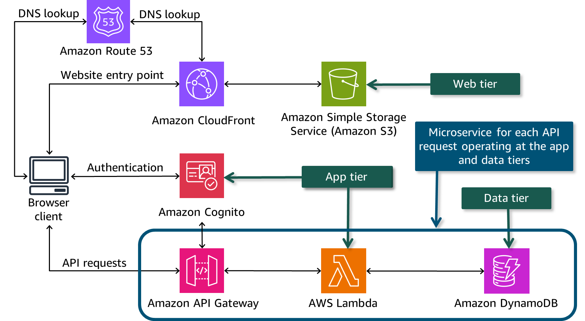

> **Нотатки:**
>
> |Номер слайда 18  
> |Нотатки для інструктора  
> |  
> |Нотатки для студента  
> Мікросервіси працюють на рівні застосунку та рівні даних триярусної веб-архітектури. Кожен запит API виконує бізнес-можливість. Поєднання Amazon API Gateway як API, AWS Lambda для обчислень і Amazon DynamoDB як сховища даних дає безсерверний шаблон мікросервісу. Функції AWS Lambda ідеально підходять для обчислювального компонента мікросервісів, оскільки кожна функція має максимум 15 хвилин на виконання.  
>
> Отже, із наведеного вище прикладу видно, що мікросервіси формують лише частину рішення триярусної архітектури й не мають розглядатися як самостійне повне рішення триярусної архітектури.

---

## Слайд 19: Ключові висновки: проєктування безсерверних мікросервісів

- Мікросервісні застосунки складаються з автономних, спеціалізованих сервісів.
- Мікросервіси мають такі переваги:
  - Гнучкість команди
  - Повторно використовуваний код
  - Гнучке масштабування
  - Технологічна свобода
  - Стійкість
  - Спрощене розгортання
- Мікросервіси можуть формувати частину триярусної архітектури, працюючи на рівнях застосунку та даних.

> **Нотатки:**
>
> |Номер слайда 19  
> |Нотатки для інструктора  
> |  
> |Нотатки для студента

---

## Слайд 20: Побудова безсерверних архітектур за допомогою AWS Lambda

Побудова безсерверних архітектур і мікросервісів

> **Нотатки:**
>
> |Номер слайда 20  
> |Нотатки для інструктора  
> |  
> |Нотатки для студента  
> Цей розділ розглядає безсерверні архітектури в AWS.

---

## Слайд 21: Порівняння операційних завдань

| Операційні завдання (Operational tasks) | Сервер у VPC (Server in a VPC) | Безсерверне (Serverless) |
|---|---|---|
| Налаштування екземпляра | Так | Ні |
| Оновлення операційної системи (ОС) | Так | Ні |
| Встановлення платформи застосунку | Так | Ні |
| Побудова й розгортання застосунків | Так | Так |
| Налаштування автоматичного масштабування й балансування навантаження | Так | Ні |
| Безперервний захист і моніторинг екземплярів | Так | Ні |
| Моніторинг і підтримка застосунків | Так | Так |

> **Нотатки:**
>
> |Номер слайда 21  
> |Нотатки для інструктора  
> |  
> |Нотатки для студента  
> Одна з основних переваг хмарних обчислень — її здатність приховувати рівень інфраструктури. Ця здатність усуває потребу вручну керувати базовим фізичним апаратним забезпеченням. У безсерверному середовищі ця абстракція дає змогу зосередитися на коді ваших застосунків, не витрачаючи часу на побудову й підтримку базової інфраструктури. З безсерверними застосунками ніколи немає екземплярів, операційних систем чи серверів для керування. AWS обробляє все, що потрібно для запуску та масштабування вашого застосунку. Будуючи безсерверні застосунки, ваші розробники можуть зосередитися на коді, що робить ваш бізнес унікальним.  
>
> Діаграма вище порівнює операційні завдання в середовищі сервера віртуальної приватної хмари (VPC) із завданнями в безсерверному середовищі. Безсерверний підхід до розробки зменшує накладні витрати й дає змогу зосереджуватися, експериментувати та впроваджувати інновації швидше. Єдині безсерверні обчислювальні операційні завдання, про які потрібно подбати в безсерверному середовищі, — побудувати й розгорнути застосунки, а потім відстежувати й підтримувати ці застосунки в продуктивному середовищі.

---

## Слайд 22: AWS Lambda

- AWS Lambda дає змогу запускати функції коду без розгортання чи керування серверами.
- Функції Lambda налаштовуються мовою середовища виконання, обсягом пам’яті та тривалістю тайм-ауту.
- Функція має максимальну тривалість 15 хвилин.
- Функції можна розгортати як файли .zip або образи контейнерів.

Lambda

> **Нотатки:**
>
> |Номер слайда 22  
> |Нотатки для інструктора  
> |  
> |Нотатки для студента  
> AWS Lambda — це обчислювальний сервіс, що дає змогу запускати код без розгортання чи керування серверами. Lambda запускає ваш код на високодоступній обчислювальній інфраструктурі та виконує все адміністрування обчислювальних ресурсів, зокрема обслуговування серверів і операційних систем, виділення потужностей, автоматичне масштабування й журналювання.  
>
> Ви налаштовуєте свою функцію Lambda мовою середовища виконання, якій надаєте перевагу, обсягом пам’яті, потрібним функції, і максимальною тривалістю тайм-ауту функції. Обсяг пам’яті визначає обсяг віртуального ЦП і пропускної здатності мережі. Наразі мінімальний і максимальний обсяг пам’яті, що можна виділити, — 128 МБ і 10 240 МБ відповідно. Функція Lambda не може перевищувати 15 хвилин тривалості, тож 15 хвилин — максимальне налаштування тайм-ауту. Це жорсткий ліміт AWS, і його не можна змінити.  
>
> Ви створюєте код для функції та завантажуєте його за допомогою пакета розгортання (deployment package). Lambda підтримує два типи пакетів розгортання: образи контейнерів і архіви файлів .zip. Сервіс Lambda викликає функцію, коли відбувається подія. Lambda запускає кілька екземплярів вашої функції паралельно, регульованих лімітами паралельності та масштабування. Ви платите лише за обчислювальний час, який споживаєте, — плати немає, коли ваш код не працює.

---

## Слайд 23: Варіанти розташування функції Lambda

У сервісі AWS Lambda

У регіональному периферійному кеші Amazon CloudFront

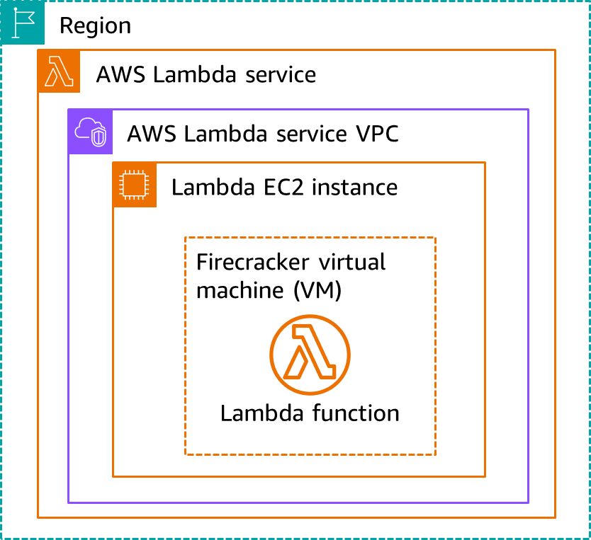

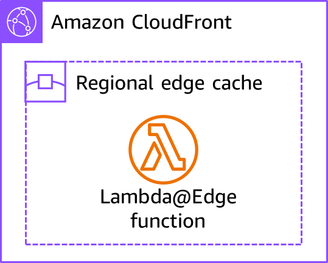

> **Нотатки:**
>
> |Номер слайда 23  
> |Нотатки для інструктора  
> |Зверніть увагу, що цей слайд зосереджений на функціях Lambda. Функції Amazon CloudFront згадано, щоб підкреслити обчислювальні можливості AWS на периферійних кешах CloudFront. Докладніше див. https://aws.amazon.com/blogs/aws/introducing-cloudfront-functions-run-your-code-at-the-edge-with-low-latency-at-any-scale/.  
> |  
> |Нотатки для студента  
> Функція Lambda може працювати всередині VPC, що належить сервісу AWS Lambda, або в регіональному кеші Amazon CloudFront.  
>
> Коли ви створюєте функцію Lambda, ви розгортаєте її в регіоні AWS, де хочете, щоб працювала ваша функція Lambda. Коли функцію Lambda викликають, сервіс Lambda створює ізольовану віртуальну машину (VM) Firecracker на екземплярі Amazon Elastic Compute Cloud (Amazon EC2) у VPC сервісу Lambda. Firecracker розроблено в Amazon Web Services (AWS), і він надає можливість створити мікроВМ менш ніж за секунду. Після виконання функції ВМ доступна для виконання наступного запиту. Сервіс Lambda створюватиме стільки середовищ виконання ВМ, скільки дозволяє конфігурація функції. Сервіс Lambda застосовує правила мережевого доступу та безпеки до VPC сервісу Lambda, а Lambda автоматично підтримує й відстежує VPC.  
>
> Lambda@Edge — це розширення AWS Lambda, обчислювального сервісу, що дає змогу запускати функції, які налаштовують контент, що доставляє CloudFront. Можна створювати функції Node.js чи Python в одному регіоні, US East (N. Virginia), а потім запускати їх у регіональних периферійних локаціях AWS по всьому світу, ближчих до глядача. Обробка запитів у локаціях AWS, ближчих до глядача, замість вихідних серверів суттєво зменшує затримку й покращує користувацький досвід. Приклад сценарію використання Lambda@Edge — роздрібний вебсайт, що продає одяг. Якщо ви використовуєте файли cookie, щоб указати, який колір куртки обрав користувач, функція Lambda може змінити запит так, щоб CloudFront повертав зображення куртки в обраному кольорі.  
>
> Щоб розширити функції на периферійні локації CloudFront, можна використовувати функції CloudFront. Зверніть увагу, що функції CloudFront не мають мережевого доступу й мають значно менші ліміти максимального часу виконання та загального розміру пакета.

---

## Слайд 24: Підключення функції Lambda до вашої VPC

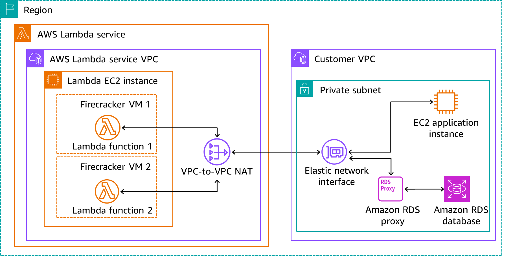

> **Нотатки:**
>
> |Номер слайда 24  
> |Нотатки для інструктора  
> |  
> |Нотатки для студента  
> Іноді може виникнути вимога впровадити архітектуру, що має безсерверні компоненти та компоненти, що працюють у вашій власній VPC. Проєктуючи архітектуру такого типу, приділяйте особливу увагу масштабуванню, оскільки деякі компоненти можуть спричиняти вузьке місце.  
>
> За замовчуванням функція Lambda не підключена до VPC у вашому акаунті. Якщо вашій функції Lambda потрібен доступ до ресурсів у VPC вашого акаунта, можна налаштувати функцію на підключення до вашої VPC. Сервіс Lambda надає керовані ресурси, що називаються еластичними мережевими інтерфейсами (ENI) Hyperplane, які створюються, коли функцію налаштовано на підключення до VPC. Коли функцію Lambda у VPC Lambda викликають, вона підключається до ENI у VPC вашого акаунта. ENI Hyperplane забезпечують можливості NAT від VPC Lambda до VPC вашого акаунта за допомогою NAT VPC-до-VPC (V2N). V2N забезпечує підключення від VPC Lambda до VPC вашого акаунта, але не в зворотному напрямку.  
>
> Коли ви підключаєте функцію до VPC у вашому акаунті, функція не може отримати доступ до інтернету, якщо ваша VPC не надає доступу. Щоб надати вашій функції доступ до інтернету, маршрутизуйте вихідний трафік до NAT-шлюзу в публічній підмережі. NAT-шлюз має публічну IP-адресу й може підключатися до інтернету через інтернет-шлюз VPC.  
>
> У наведеному вище прикладі база даних та екземпляр застосунку Amazon EC2 можуть спричинити вузькі місця, якщо функції Lambda агресивно масштабуються. Функції Lambda 1 і 2 підключаються до екземпляра застосунку EC2 і проксі Amazon Relational Database Service (Amazon RDS), розгорнутих у приватній підмережі у VPC клієнта за допомогою NAT VPC-до-VPC та ENI. Щоб масштабувати екземпляр EC2, розгорніть його за балансувальником навантаження застосунку в групі Amazon EC2 Auto Scaling.  
>
> Щоб масштабувати базу даних, можна використати проксі Amazon RDS, що керує пулом з’єднань до бази даних Amazon RDS. Оскільки функції Lambda можуть швидко масштабуватися, з’єднання з базою даних Amazon RDS можуть бути насичені. Функції Lambda, що швидко відкривають і закривають з’єднання з базою даних, можуть призвести до відставання бази даних. Коли більше немає доступних з’єднань, функція видасть помилку. За використання баз даних MySQL і Aurora Amazon RDS цю проблему можна розв’язати за допомогою проксі RDS. Функції Lambda підключаються до проксі RDS, що матиме відкрите з’єднання з базою даних, готове до використання.

---

## Слайд 25: Визначення безсерверних сценаріїв Lambda

Синхронна обробка (Synchronous processing)

Асинхронна обробка (Asynchronous processing)

Потокова обробка (Streaming processing)

- Вебзастосунки
- Вебсервіси
- Мікросервіси
- Висновки машинного навчання

- Заплановані події
- Повідомлення в черзі
- Перетворення зображень чи відео
- Тригери сервісів AWS

Потокові застосунки

> **Нотатки:**
>
> |Номер слайда 25  
> |Нотатки для інструктора  
> |  
> |Нотатки для студента  
> Функції Lambda придатні для використання в синхронній, асинхронній і потоковій обробці.  
>
> Синхронна обробка — це коли запитувач робить запит і очікує відповіді протягом певного періоду часу. Один із найпоширеніших синхронних шаблонів Lambda — мікросервіси вебсайтів і мобільних застосунків. Для вебсайту можна викликати функцію Lambda за допомогою Amazon API Gateway. Для мобільних застосунків можна обробляти клацання у вашому застосунку, викликаючи URL-адресу функції Lambda. Приклад синхронного процесу — додавання товару до кошика під час перегляду сайту електронної комерції. Функція Lambda може оновити кошик вибраним товаром.  
>
> Асинхронна обробка — це коли запитувач робить запит, щоб розвантажити процес на пізніший час. Функції Lambda можна використовувати асинхронно, оскільки вони мають вбудовану здатність обробляти вхідні дані з черг і планувальників подій. Приклад асинхронного процесу — доставка посилки онлайн-покупцю. Функції Lambda можна використовувати для оновлення статусу посилки, обробляючи повідомлення в черзі. Інші приклади — обробка файлів та ідентифікація зображень.  
>
> Потокова обробка потрібна, коли дані надходять безперервним потоком. Сервіс Lambda має вбудовану здатність пакетувати дані потоку й викликати функції Lambda для обробки пакета. Функції Lambda часто використовуються для аналітики даних, щоб форматувати дані в інший формат або агрегувати сирі дані. Приклад потокового процесу — Amazon DynamoDB Streams для запису змін у таблиці DynamoDB і пересилання їх до функції Lambda для агрегування.

---

## Слайд 26: Виклик синхронної функції Lambda

Зовнішній запит API за допомогою API Gateway

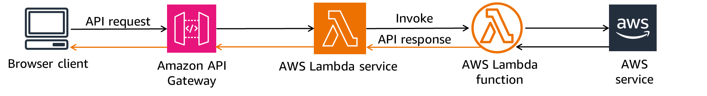

Зовнішній запит API за допомогою URL-адреси функції Lambda

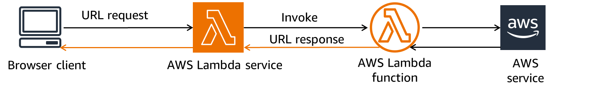

> **Нотатки:**
>
> |Номер слайда 26  
> |Нотатки для інструктора  
> |  
> |Нотатки для студента  
> Коли ви викликаєте функцію синхронно, сервіс Lambda виконує функцію й чекає відповіді. У цьому прикладі запит API отримується від клієнта-браузера до Amazon API Gateway. API Gateway викликає функцію Lambda, звертаючись до сервісу AWS Lambda. Поки функція виконується, вона може за бажанням викликати інші сервіси AWS. Коли функція завершується, сервіс Lambda повертає відповідь із коду функції з додатковими даними, як-от версія функції, яку було викликано. Якщо функція стикається з помилкою, помилка повертається як відповідь. Сервіс Lambda повертає відповідь до API Gateway, що, своєю чергою, надсилає відповідь клієнту-браузеру.  
>
> Ще один варіант синхронного виклику Lambda — використовувати URL-адресу функції (function URL). URL-адреса функції — це виділена кінцева точка HTTP(S) для вашої функції Lambda. У наведеному вище прикладі запит URL надсилається безпосередньо до сервісу Lambda від клієнта-браузера. Сервіс Lambda викликає функцію Lambda, що повертає відповідь URL. Відповідь повертається клієнту-браузеру.  
>
> Коли ви створюєте URL-адресу функції, Lambda автоматично генерує для вас унікальну кінцеву точку URL. Після створення URL-адреси функції її кінцева точка URL ніколи не змінюється. URL-адреси функцій Lambda використовують політики на основі ресурсів для безпеки та контролю доступу. URL-адреси функцій також підтримують варіанти налаштування спільного використання ресурсів між походженнями (CORS). CORS визначає спосіб, у який клієнтські вебзастосунки, завантажені в одному домені, можуть взаємодіяти з ресурсами в іншому домені.  
>
> Хоча URL-адреси функцій прості й легкі в налаштуванні, застосунок-браузер потребуватиме оновлення, якщо URL змінюється. Коли функція змінюється за Amazon API Gateway, змін у застосунку-браузері не потрібно.

---

## Слайд 27: Виклик асинхронної функції Lambda

Подія-тригер сервісу AWS


Запланована подія


> **Нотатки:**
>
> |Номер слайда 27  
> |Нотатки для інструктора  
> |  
> |Нотатки для студента  
> Коли ви викликаєте функцію асинхронно, ви не чекаєте відповіді від коду функції. Ви передаєте подію Lambda, а Lambda обробляє решту. Сервіс Lambda поміщає подію в чергу й повертає успішну відповідь без додаткової інформації. Окремий процес читає події з черги й надсилає їх до функції. Можна налаштувати, як Lambda обробляє помилки, і надсилати записи викликів до нижчого за потоком ресурсу, як-от Amazon Simple Queue Service (Amazon SQS) чи Amazon EventBridge, щоб зв’язати компоненти вашого застосунку в ланцюжок.  
>
> Кілька сервісів AWS, як-от Amazon Simple Storage Service (Amazon S3) і Amazon Simple Notification Service (Amazon SNS), викликають функції асинхронно для обробки подій. Якщо потрібні заплановані події, можна використовувати EventBridge як планувальник для виклику функцій Lambda. Якщо сервіс AWS не має прямої інтеграції із сервісом Lambda, EventBridge може слугувати шиною подій для маршрутизації запиту. Приклад запланованої події — щоденне звітування чи будь-який повторюваний процес, що має активуватися.

---

## Слайд 28: Зіставлення джерел подій Lambda (event source mappings) для черг і потоків


> **Нотатки:**
>
> |Номер слайда 28  
> |Нотатки для інструктора  
> |  
> |Нотатки для студента  
> Зіставлення джерела подій (event source mapping) — це ресурс Lambda, що читає з джерела подій і викликає функцію Lambda. Можна використовувати зіставлення джерел подій для обробки елементів із потоку чи черги в сервісах, що не викликають функції Lambda безпосередньо. Сервіс Lambda може опитувати сервіси AWS, як-от Amazon DynamoDB, Amazon Kinesis, Amazon SQS та Amazon DocumentDB (із сумісністю з MongoDB).  
>
> На діаграмі вище цільове джерело подій — потік DynamoDB. Коли сервіс Lambda опитує потік DynamoDB на події, до сервісу Lambda повертається кілька подій. Сервіс Lambda пакетує записи разом в єдине корисне навантаження й викликає функцію Lambda з цим навантаженням. Можна налаштувати функцію Lambda, щоб указати максимальний розмір вікна пакета й навантаження. Навантаження не може перевищувати ліміт вхідних даних функції Lambda в 6 МБ.  
>
> Приклад сценарію: якщо замовлення клієнта змінило статус на «доставка в процесі» в таблиці замовлень DynamoDB, функція Lambda викликається, щоб надіслати сповіщення клієнту й виконати певну фінансову обробку.

---

## Слайд 29: Обробник функції Lambda на Python (Python Lambda function handler)

1 		import json

2 		def lambda_handler(event, context):

3		 		length=event['length’]

4 		 width=event['width']

5 		 area = calculate_area(length, width)

6 		 data = {"area": area}

7 		 return json.dumps(data)

8 		def calculate_area(length, width):

9 		 return length*width

Рядок 2: об’єкт події (event) — це документ JSON, що містить вхідні дані та дані викликаючого сервісу

Рядок 2: об’єкт контексту (context) надає методи та властивості про середовище виконання функції та виклик

Рядок 7: json.dumps(data) повертає результат як документ JSON

Рядки 8 і 9: метод бізнес-логіки

> **Нотатки:**
>
> |Номер слайда 29  
> |Нотатки для інструктора  
> |  
> |Нотатки для студента  
> Обробник функції Lambda (handler) — це точка входу у вашому коді функції, що обробляє події. Коли вашу функцію викликають, Lambda запускає метод-обробник. Ваша функція виконується, доки обробник не поверне відповідь, не завершиться чи не спливе тайм-аут. Назва обробника функції Lambda, указана під час створення функції Lambda, походить від назви файлу, де розташована функція-обробник Lambda, плюс назви функції-обробника Python. Обробник функції може мати будь-яку назву, однак назва за замовчуванням у консолі Lambda — lambda_function.lambda_handler. Ця назва обробника функції відображає назву функції (lambda_handler) і файл, де зберігається код обробника (lambda_function.py).  
>
> Коли Lambda викликає ваш обробник функції, середовище виконання Lambda передає обробнику функції два аргументи: об’єкти події та контексту. Перший аргумент — об’єкт події. Подія — це документ у форматі JSON, що містить дані для обробки функцією Lambda. Середовище виконання Lambda перетворює подію на об’єкт і передає його у ваш код функції. Об’єкт події містить інформацію від викликаючого сервісу. Другий аргумент — об’єкт контексту. Об’єкт контексту передається вашій функції Lambda під час виконання. Цей об’єкт надає методи та властивості, що надають інформацію про виклик, функцію та середовище виконання.  
>
> У наведеному вище прикладі код працює таким чином:  
> Рядок 1: до функції імпортується модуль бібліотеки Python json для використання.  
> Рядок 2: це метод точки входу для функції Lambda, що отримує параметри об’єктів події та контексту від сервісу Lambda.  
> Рядки 3 і 4: локальні змінні функції length і width витягуються з об’єкта події.  
> Рядок 5: метод бізнес-логіки calculate_area викликається з параметрами length і width. Найкраща практика — тримати функцію-обробник малою та розміщувати бізнес-логіку в окремих методах. Це зменшує час завантаження функції-обробника.  
> Рядки 8 і 9: метод calculate_area виконується, повертаючи результат area.  
> Рядки 6 і 7: змінна area перетворюється на рядок JSON і повертається за допомогою методу dumps бібліотеки JSON.  
>
> Щоб отримувати рекомендації щодо коду за запитом, використовуйте Amazon Q Developer в AWS Management Console або як плагін до вашого улюбленого інтегрованого середовища розробки (IDE).

---

## Слайд 30: Шари Lambda (Lambda layers)

Без шарів

З шарами

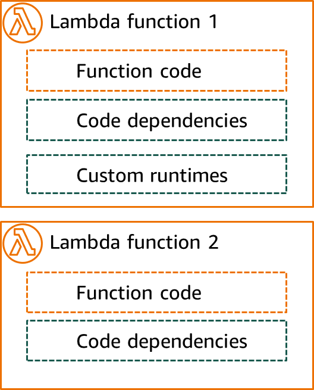

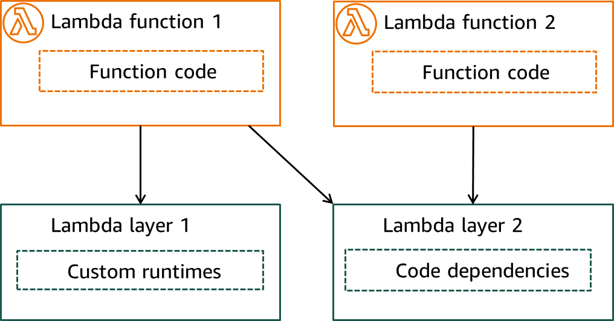

> **Нотатки:**
>
> |Номер слайда 30  
> |Нотатки для інструктора  
> |  
> |Нотатки для студента  
> Опис зображення «Без шарів»: дві функції Lambda (функція 1 і функція 2), кожна зі своїм кодом функції та залежностями. Функція 1 також включає користувацьке середовище виконання. Кінець опису.  
> Опис зображення «З шарами»: функція Lambda 1 і функція Lambda 2 містять лише код функції. Функція Lambda 1 використовує шар 1 для свого користувацького середовища виконання та шар 2 для залежностей коду. Функція Lambda 2 використовує шар 2 для своїх залежностей коду. Кінець опису.  
>
> Шар Lambda (Lambda layer) — це архів файлу .zip, що містить додатковий код чи дані. Шари зазвичай містять залежності бібліотек, користувацьке середовище виконання чи файли конфігурації. Також можна запакувати власне користувацьке середовище виконання в шар Lambda, якщо ви надаєте перевагу іншому середовищу виконання, ніж надані сервісом Lambda.  
>
> Є кілька причин, чому можна розглянути використання шарів:  
>
> Зменшення розміру пакетів розгортання: замість включення всіх залежностей функції разом із кодом функції у ваш пакет розгортання помістіть їх у шар. Це зберігає пакети розгортання малими й упорядкованими.  
> Відокремлення основної логіки функції від залежностей: за допомогою шарів можна оновлювати залежності функції незалежно від коду функції й навпаки. Це сприяє розділенню відповідальностей і допомагає зосередитися на логіці вашої функції.  
> Спільне використання залежностей кількома функціями: після створення шару його можна застосувати до будь-якої кількості функцій у вашому акаунті. Без шарів потрібно включати ті самі залежності в кожен окремий пакет розгортання.  
> Використання редактора коду консолі Lambda: редактор коду — корисний інструмент для швидкого тестування незначних оновлень коду функції. Однак не можна використовувати редактор, якщо розмір вашого пакета розгортання завеликий. Використання шарів зменшує розмір вашого пакета й може розблокувати використання редактора коду.

---

## Слайд 31: Демонстрація: використання AWS Lambda з Amazon S3 (Using AWS Lambda with Amazon S3)

- Ця демонстрація використовує AWS Lambda та Amazon S3.
- У цій демонстрації ви побачите, як виконати таке:
  - Використати AWS Lambda з Amazon S3 для завантаження об’єкта.
  - Створити мініатюру для об’єкта.


> **Нотатки:**
>
> |Номер слайда 31  
> |Нотатки для інструктора  
> |Ця демонстрація — файл .mp4 із субтитрами. Студенти отримують до неї доступ через онлайн-курс. Посібник інструктора містить тривалість кожної демонстрації.  
> |  
> |Нотатки для студента  
> Знайдіть цю записану демонстрацію у вашому онлайн-курсі як частину цього модуля.

---

## Слайд 32: Ключові висновки: побудова безсерверних архітектур за допомогою AWS Lambda

- AWS Lambda — це сервіс для запуску функцій коду без розгортання чи керування серверами.
- Функція Lambda може працювати всередині VPC, що належить сервісу AWS Lambda, або як Lambda@Edge в регіональному кеші Amazon CloudFront.
- Функцію Lambda можна налаштувати на підключення до вашої VPC для доступу до сервісів AWS усередині VPC.
- Функцію Lambda можна викликати синхронно, асинхронно та за допомогою зіставлень джерел подій для черг і потоків.
- Використовуйте шари Lambda для пакування залежностей коду чи користувацьких середовищ виконання, що повторно використовуватимуться всіма функціями Lambda в регіоні.

> **Нотатки:**
>
> |Номер слайда 32  
> |Нотатки для інструктора  
> |  
> |Нотатки для студента

---

## Слайд 33: Покрокова лабораторна робота: упровадження безсерверної архітектури в AWS (Implementing a Serverless Architecture on AWS, Lambda lab)

> **Нотатки:**
>
> |Номер слайда 33  
> |Нотатки для інструктора  
> |  
> |Нотатки для студента  
> Це необов’язкова лабораторна робота. Наступні слайди підсумовують, що ви робитимете в лабораторній роботі, а докладні інструкції ви знайдете в лабораторному середовищі.

---

## Слайд 34: Завдання лабораторної роботи «Lambda»:

- У цій лабораторній роботі ви виконаєте таке:
  - Упровадите безсерверну архітектуру в AWS.
  - Запустите функції Lambda з Amazon S3 та Amazon DynamoDB.
  - Налаштуєте Amazon Simple Notification Service (Amazon SNS) для надсилання сповіщень.
- Відкрийте ваше лабораторне середовище, щоб розпочати лабораторну роботу та дізнатися додаткові подробиці про завдання, які ви виконуватимете.


> **Нотатки:**
>
> |Номер слайда 34  
> |Нотатки для інструктора  
> |  
> |Нотатки для студента  
> Отримайте доступ до лабораторного середовища через ваш онлайн-курс, щоб дізнатися додаткові подробиці та виконати лабораторну роботу.

---

## Слайд 35: Підсумки лабораторної роботи «Lambda»

- Коли ви створювали функцію Load-Inventory, ви надали функції роль. Що роль робить для функції?
- У цій лабораторній роботі ви створили кілька функцій Lambda. Яка перевага використання кількох функцій замість об’єднання кількох завдань в одну функцію?

> **Нотатки:**
>
> |Номер слайда 35  
> |Нотатки для інструктора  
> |Відповідні архітектурні схеми «до» та «після» включено до інструкцій кожної лабораторної роботи. Вам може бути корисно відкрити схеми лабораторної роботи під час підбиття підсумків цієї лабораторної роботи.  
> |  
> |Запропоновані відповіді на запитання 1: коли ви створювали функцію Load-Inventory, ви надали функції роль. Що роль робить для функції?  
> |  
> |Роль надає функції Lambda дозволи, щоб вона могла отримувати доступ до інших сервісів AWS. У цій функції роль надала Lambda доступ до Amazon S3 та DynamoDB.  
> |  
> |Запропоновані відповіді на запитання 2: у цій лабораторній роботі ви створили кілька функцій Lambda. Яка перевага використання кількох функцій замість об’єднання кількох завдань в одну функцію?  
> |  
> |Цей архітектурний підхід має кілька переваг:  
> |Кожна функція Lambda виконує одну конкретну функцію. Ця практика робить код простішим і зручнішим в обслуговуванні.  
> |Додаткову бізнес-логіку можна додавати, створюючи додаткові функції Lambda. Оскільки кожна функція працює незалежно, створення додаткових функцій Lambda не впливає на наявну функціональність.  
> |  
> |Нотатки для студента  
> Ваш інструктор може розглянути ці запитання з вами, або ви можете розглянути їх самостійно. Скористайтеся цією нагодою, щоб поглибити своє мислення щодо завдань, які ви виконували під час лабораторної роботи.

---

## Слайд 36: Побудова мікросервісних застосунків за допомогою контейнерних сервісів AWS

Побудова безсерверних архітектур і мікросервісів

> **Нотатки:**
>
> |Номер слайда 36  
> |Нотатки для інструктора  
> |У цьому розділі ми представляємо контейнери для запуску мікросервісних застосунків. Використання контейнерів рекомендоване, коли перевищено ліміти квот AWS Lambda та коли запуск функцій Lambda занадто дорогий для безперервних робочих навантажень. Слід зазначити, що сервіс Lambda може запускати контейнери, обмежені стандартними лімітами квот AWS Lambda.  
> |  
> |Нотатки для студента  
> Цей розділ розглядає побудову мікросервісних застосунків за допомогою контейнерних сервісів AWS.

---

## Слайд 37: Вибір контейнерів замість функцій AWS Lambda

Довше за 15 хвилин (Longer than 15 minutes)

Застосунки з інтенсивним використанням пам’яті (Memory intensive applications)

Міграція застарілих контейнерів (Migrating legacy containers)

Вартість (Cost)

Якщо сервіс працює довше за 15 хвилин, він не підходить для функцій Lambda.

Робочі навантаження, що використовують понад 10 ГБ пам’яті, не підходять для функцій Lambda.

Контейнери можуть допомогти мігрувати застарілі застосунки, що працюють локально чи на екземплярах EC2, без їх рефакторингу чи перепроєктування архітектури.

- Контейнери можна запускати безперервно за фіксованою вартістю.
- Ціна запуску функції Lambda зростає разом із кількістю викликів, тривалістю та виділеною пам’яттю.

> **Нотатки:**
>
> |Номер слайда 37  
> |Нотатки для інструктора  
> |  
> |Нотатки для студента  
> Хоча AWS Lambda — чудове рішення для мікросервісів, не всі мікросервісні застосунки підходять для побудови за допомогою функцій Lambda. Якщо процес мікросервісу виконується довше за 15 хвилин або використовує понад 10 ГБ пам’яті, потрібно знайти альтернативу функціям Lambda. Контейнери можна підібрати за розміром для застосунків, що перевищують обмеження функцій Lambda. Якщо вам потрібне інше середовище виконання, ніж надає Lambda, запуск його в контейнері може бути простішим рішенням, ніж перенесення його для відповідності середовищу виконання Lambda.  
>
> Застарілі застосунки, де рефакторинг коду в мікросервіси не є варіантом через часові чи практичні обмеження, зазвичай — хороші кандидати для контейнерів.  
>
> Функції AWS Lambda можуть стати дорогими, якщо функція працює тривалий час і використовує багато пам’яті. Наприклад, функція Lambda з 3 мільйонами запитів на місяць, що працює в середньому 120 мс із 1536 МБ пам’яті на процесорі Arm, коштуватиме 7,80 долара на місяць, якщо не застосовувати економію вільного рівня. Якщо пам’ять і період виконання збільшити до 5 ГБ і 5000 мс відповідно, вартість зростає до 1000,60 долара на місяць без застосування економії вільного рівня. Натомість запуск п’яти контейнерів AWS Fargate безперервно з 5 ГБ пам’яті коштує 180,65 долара. Якщо застосунок отримує запити безперервно й має дуже мало простою, існує цінова точка за кількістю транзакцій на секунду, за якої контейнери були б економічнішими за функції Lambda. Зверніть увагу, що ці цінові суми ілюстративні й можуть не збігатися з актуальними цінами.

---

## Слайд 38: Перевага контейнерів

Віртуальні машини (Virtual machines)

Контейнери (Containers)

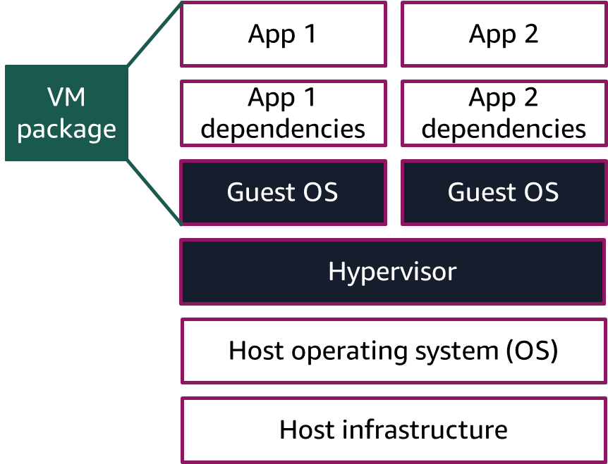

Container package (Пакет контейнера)

App 1 with dependencies (Застосунок 1 із залежностями)

App 2 with dependencies

Container engine (Рушій контейнерів)

Host operating system (OS)

Host infrastructure

> **Нотатки:**
>
> |Номер слайда 38  
> |Нотатки для інструктора  
> |  
> |Нотатки для студента  
> Архітектуру віртуальних машин (VM) було спроєктовано для розміщення кількох застосунків, що працюють на різних гостьових операційних системах (ОС). Кожен пакет VM складається з коду застосунку, залежностей застосунку та рівня гостьової ОС, що означає, що вони відносно великі. Пакети VM розгортаються на гіпервізорі, що виділяє ресурси хоста кожному застосунку.  
>
> Контейнери — це стандартизовані пакети коду застосунку, що містять код і залежності коду. Вони працюють поверх рушія контейнерів (container engine) і мають лише доступ на читання до частин ОС хоста. Пакети контейнерів помітно менші за пакети VM. У результаті контейнери легкі, можуть швидко запускатися й швидко масштабуватися для розміщення змінних робочих навантажень. Контейнери самодостатні й працюватимуть однаково незалежно від ОС і апаратної платформи.  
>
> По суті, рушій контейнерів замінює рівні гіпервізора та гостьової ОС у VM. Контейнери використовують менше ресурсів системи хоста, оскільки не включають гостьової ОС. Це означає, що на хості того самого розміру можна запускати набагато більше контейнерів, ніж застосунків VM.  
>
> Деякі з найширше використовуваних рушіїв контейнерів — Docker Engine, containerd і Red Hat OpenShift.

---

## Слайд 39: Сценарії використання контейнерів

Мікросервісні застосунки

Пакетна обробка

Масштабування моделей машинного навчання (ML)

Стандартизація застосунків гібридної архітектури

Міграція застосунків у хмару

> **Нотатки:**
>
> |Номер слайда 39  
> |Нотатки для інструктора  
> |  
> |Нотатки для студента  
> Які ж типи сценаріїв використання дуже добре підходять для контейнерів? Мікросервіс можна запакувати як застосунок-контейнер, що працюватиме в ізольованому процесі, не впливаючи на інші мікросервіси. Контейнери також підходять для пакетних завдань, що потребують тривалої обробки. Наприклад, завдання вилучення, перетворення та завантаження (ETL) може працювати стільки, скільки триває перетворення, і може динамічно масштабуватися у відповідь на зміни попиту.  
>
> AWS використовує контейнери для сервісів машинного навчання (ML), як-от Amazon SageMaker, для розгортання запакованих алгоритмів навчання й розгортання моделей ML. Клієнти AWS також можуть використовувати контейнери для масштабування та запуску моделей ML поруч із великими наборами даних, потрібними для навчання моделей.  
>
> Якщо у вас є архітектура, що охоплює хмару AWS і локальне середовище, можна використовувати контейнери для стандартизації коду застосунку та пакетів розгортання, щоб полегшити навантаження обслуговування й адміністрування для окремих середовищ.  
>
> Якщо вам потрібно, щоб застосунки швидко переміщувалися з локального середовища в хмару, контейнери можна використати для пакування застосунків і їх розгортання в хмарі без внесення змін до коду.

---

## Слайд 40: Створення й розгортання контейнерів Docker

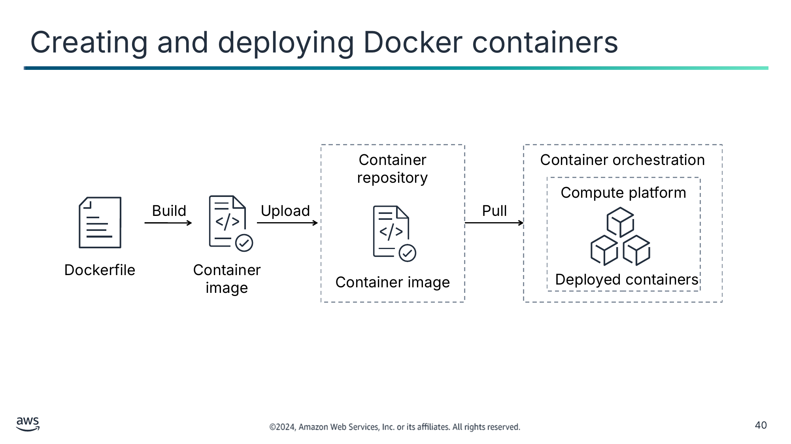

<details>
<summary>Текст зі схеми</summary>

Container repository (Репозиторій контейнерів)

Container orchestration (Оркестрація контейнерів)

Compute platform (Обчислювальна платформа)

Build (Побудова)

Upload (Завантаження)

Pull (Витягування)

Dockerfile

Container image (Образ контейнера)

Container image

Deployed containers (Розгорнуті контейнери)

</details>

> **Нотатки:**
>
> |Номер слайда 40  
> |Нотатки для інструктора  
> |  
> |Нотатки для студента  
> Docker Engine широко використовується в AWS як рушій контейнерів. Перший крок створення й розгортання контейнера Docker — створити Dockerfile. Dockerfile — це текстовий файл, що містить інструкції побудови образу контейнера. Він вказує середовище контейнера й код, що працює всередині середовища. Наступний крок — побудувати образ контейнера, виконавши команду побудови рушія контейнерів.  
>
> Після успішної побудови й тестування та перевірки на локальному хості образ контейнера завантажується до репозиторію контейнерів. Тепер образ контейнера готовий до розгортання. Зазвичай із єдиного образу розгортається кілька контейнерів.  
>
> Хоча контейнери можна розгортати вручну, компанії надають перевагу використанню сервісів оркестрації контейнерів для керування, розгортання та масштабування сотень чи тисяч контейнерів. Сервіс оркестрації витягує потрібний образ контейнера з репозиторію контейнерів і розгортає потрібну кількість контейнерів на обчислювальній платформі. Сервіси оркестрації контейнерів можуть використовувати одну обчислювальну платформу або кілька типів обчислювальних платформ для розгортання контейнерів і керування ними. Сервіс оркестрації відстежуватиме стан обчислювальної платформи та контейнерів.  
>
> Специфікації контейнерів регулює Open Container Initiative (OCI), що надає галузевий стандарт для специфікацій образу контейнера, середовища виконання та розповсюдження. Це означає, що контейнери можна переносити на різні платформи та середовища без змін.

---

## Слайд 41: Контейнерні сервіси AWS

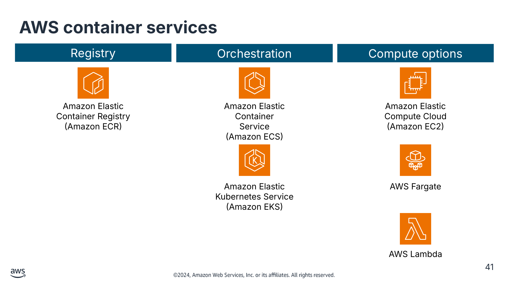

Registry (Реєстр)

Orchestration (Оркестрація)

Compute options (Обчислювальні варіанти)

Amazon Elastic Container Registry (Amazon ECR)

Amazon Elastic Container Service (Amazon ECS)

Amazon Elastic Compute Cloud (Amazon EC2)

Amazon Elastic Kubernetes Service (Amazon EKS)

AWS Fargate

AWS Lambda

> **Нотатки:**
>
> |Номер слайда 41  
> |Нотатки для інструктора  
> |  
> |Нотатки для студента  
> AWS має низку сервісів, що запускають і підтримують контейнери. В основі цих сервісів — сервіси керування реєстром контейнерів, оркестрації та обчислювальними варіантами.  
>
> Amazon Elastic Container Registry (Amazon ECR) — це кероване AWS обслуговування реєстру образів контейнерів, безпечне, масштабоване й надійне. Amazon ECR підтримує приватні й публічні репозиторії. Приватні репозиторії мають дозволи на основі ресурсів за допомогою AWS Identity and Access Management (IAM), щоб дозволити доступ до ваших образів контейнерів лише певним користувачам чи екземплярам Amazon Elastic Compute Cloud (Amazon EC2).  
>
> AWS має два варіанти оркестрації контейнерів для керування кластерами контейнерів. Оркестрації контейнерів надають спрощений інтерфейс для створення й підтримки кластерів контейнерів. Розгортання кластера зазвичай виконується одним викликом API та файлами конфігурації.  
>
> Amazon Elastic Container Service (Amazon ECS) розроблено AWS, і він постачається із вбудованими найкращими практиками конфігурації та експлуатації AWS. Він інтегрований як з інструментами AWS, так і зі сторонніми, як-от Amazon ECR і Docker. Ця інтеграція прискорює час розробки команд, щоб вони зосереджувалися на побудові застосунків, а не середовища.  
>
> Інший варіант оркестрації — використання Amazon Elastic Kubernetes Service (Amazon EKS), що використовує систему Kubernetes для керування контейнерами. Kubernetes — це система з відкритим кодом, що автоматизує керування, масштабування та розгортання контейнеризованих застосунків. Amazon EKS підходить для клієнтів AWS, що запускають кластери Kubernetes локально й хочуть ті самі інструменти оркестрації в хмарі.  
>
> Клієнти AWS також можуть обрати запуск різних сервісів оркестрації контейнерів за допомогою екземплярів Amazon EC2, встановлюючи сервіс оркестрації та керуючи ним так само, як вони б робили це локально.  
>
> Як кластери Amazon ECS, так і кластери Amazon EKS можуть створювати обчислювальні вузли за допомогою екземплярів Amazon EC2 або використовувати вузли AWS Fargate. Як варіант, кластер може мати і вузли екземплярів Amazon EC2, і вузли Fargate. Тоді як вузли екземплярів EC2 працюють усередині VPC клієнта, вузлами Fargate керує AWS у віртуальній приватній хмарі (VPC) AWS Fargate. Amazon ECS та Amazon EKS мають кожен функцію Anywhere для розгортання кластерів у локальному середовищі.  
>
> AWS Lambda також можна використовувати для запуску контейнерів з пам’яттю до 10 ГБ. Функціями AWS Lambda не керує сервіс оркестрації контейнерів. Обов’язково виконайте порівняння вартості, щоб обрати найекономічніше рішення під час вибору між AWS Lambda, Amazon ECS, AWS Fargate чи Amazon EKS.

---

## Слайд 42: Переваги AWS Fargate

Без керування кластерами чи серверами

Посекундна тарифікація

Автоматичне масштабування

Підходить для команд, нових у контейнерах

- Без розгортання чи обслуговування серверів.
- Без оптимізації упаковки кластера.

Платіть лише за те, що використовуєте.

Динамічно масштабуйте завдання на основі ЦП, пам’яті чи інших метрик.

Використання AWS Fargate не потребує всебічних знань технологій контейнерів.

> **Нотатки:**
>
> |Номер слайда 42  
> |Нотатки для інструктора  
> |  
> |Нотатки для студента  
> AWS Fargate дає змогу запускати контейнери без накладних витрат на керування серверами чи кластерами контейнерів. З AWS Fargate не потрібно розгортати, налаштовувати чи масштабувати кластери віртуальних машин для запуску контейнерів. Це усуває потребу обирати типи серверів, вирішувати, коли масштабувати ваші кластери, чи оптимізувати упаковку кластера для ефективності. AWS Fargate забезпечує посекундну тарифікацію, щоб можна було використовувати обчислення за потребою. Це гарантує, що не споживаються невикористані ресурси пам’яті чи ЦП. Автоматичне масштабування — це здатність автоматично збільшувати чи зменшувати бажану кількість завдань у вашому сервісі Amazon ECS. Масштабуванням AWS Fargate можна керувати за допомогою постачальників потужностей Amazon ECS (capacity providers). Постачальник потужностей вирішує, як завдання розподіляються між постачальниками потужностей кластера. AWS Fargate має вбудовані масштабування та безпеку, що робить його придатним для команд, які тільки починають працювати з технологією контейнерів і не знайомі з процесами кластерів.

---

## Слайд 43: Розгортання та виклик контейнерів в Amazon ECS

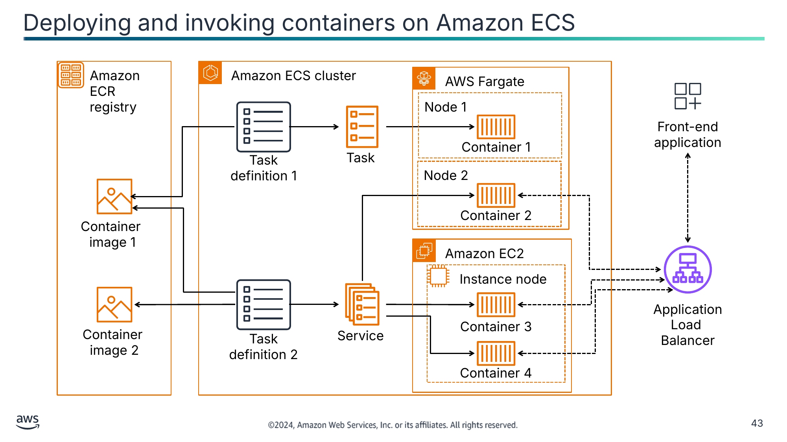

<details>
<summary>Текст зі схеми</summary>

Amazon ECR registry (Реєстр Amazon ECR)

Amazon ECS cluster (Кластер Amazon ECS)

AWS Fargate

Node 1 (Вузол 1)

Front-end application (Фронтенд-застосунок)

Task (Завдання)

Container 1 (Контейнер 1)

Task definition 1 (Визначення завдання 1)

Node 2

Container 2

Container

image 1 (Образ контейнера 1)

Amazon EC2

Instance node (Вузол-екземпляр)

Application Load  
Balancer

Container

image 2

Container 3

Task definition 2

Service (Сервіс)

Container 4

</details>

> **Нотатки:**
>
> |Номер слайда 43  
> |Нотатки для інструктора  
> |Цей слайд слугує високорівневим вступом до Amazon ECS. Докладніше про Amazon ECS див. посібник розробника Amazon Elastic Container Service на сторінці ресурсів вмісту.  
> |  
> |Нотатки для студента  
> Перш ніж розгорнути контейнер за допомогою Amazon ECS, потрібно створити кластер ECS. Кластер ECS складається з обчислювальних вузлів на обчислювальній платформі, як-от AWS Fargate і Amazon EC2.  
>   
> Щоб розгорнути контейнери, ви створюєте визначення завдання ECS (task definition) як схему для вашого застосунку. Завдання — це найменша одиниця обчислень в Amazon ECS і надають набір контейнерів, які ви хочете розмістити разом, їхні властивості та те, як вони можуть бути пов’язані. Завдання включають усю інформацію, потрібну Amazon ECS, щоб ухвалити рішення про розміщення — який хост використати для розгортання контейнерів. Щоб запустити один контейнер, ваше визначення завдання має включати лише одне визначення контейнера. Це текстовий файл у форматі JSON, що описує параметри та один чи кілька контейнерів, які формують ваш застосунок. Деякі з параметрів, які можна вказати у визначенні завдання, — образ контейнера для кожного контейнера в завданні, ЦП і пам’ять завдання чи контейнера та тип запуску завдання для визначення обчислювального сервісу.  
>
> Після створення визначення завдання його можна запустити як завдання або як сервіс. Коли завдання запускається, це призводить до певної кількості розгорнутих контейнерів у кластері. Amazon ECS може керувати кількома завданнями як сервісом. Сервіс Amazon ECS запускає й підтримує бажану кількість завдань одночасно в кластері Amazon ECS для забезпечення високої доступності. Якщо будь-яке з ваших завдань виходить з ладу чи зупиняється з будь-якої причини, сервіс Amazon ECS запускає інший екземпляр на основі вашого визначення завдання для заміни збійного завдання.  
>
> Наприклад, коли фронтенд-застосунок хоче використати контейнерний сервіс, можна налаштувати Application Load Balancer у сервісі для розподілу запитів між контейнерами. Application Load Balancer ухвалює рішення щодо маршрутизації на рівні застосунку (HTTP/HTTPS), підтримує маршрутизацію за шляхом і може маршрутизувати запити до одного чи кількох портів на кожному екземплярі контейнера у вашому кластері.  
>
> У наведеному вище прикладі визначення завдання 1 вказує образ контейнера 1, що запускатиметься як завдання, розгортаючи контейнер Fargate 1 на вузлі 1. Визначення завдання 2, з іншого боку, вказує образ контейнера 1 та образ контейнера 2. Воно розгортатиметься як сервіс, розгортаючи контейнер Fargate 2 на вузлі Fargate 2 та контейнери 3 і 4 вузла-екземпляра EC2 на вузлі-екземплярі EC2. Сервіс 2 також указав Application Load Balancer для виклику контейнерів сервісу із фронтенд-застосунків на основі шляху URL. Наприклад, якщо контейнер Login реалізував мікросервіс входу, то Application Load Balancer може мати правило слухача, що пересилає шлях /api/login до мікросервісу входу.

---

## Слайд 44: Розгортання та виклик контейнерів в Amazon EKS

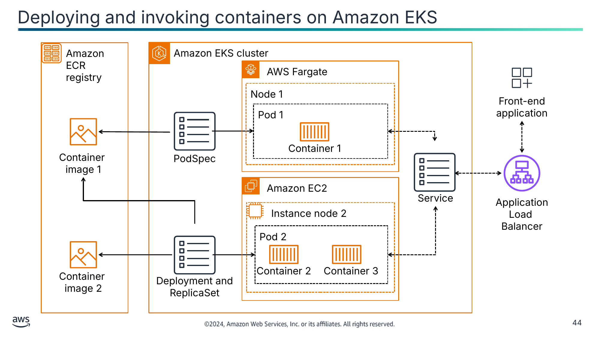

<details>
<summary>Текст зі схеми</summary>

Amazon ECR registry (Реєстр Amazon ECR)

Amazon EKS cluster (Кластер Amazon EKS)

AWS Fargate

Node 1 (Вузол 1)

Front-end application (Фронтенд-застосунок)

Pod 1

Container 1 (Контейнер 1)

Container

image 1 (Образ контейнера 1)

PodSpec

Amazon EC2

Service (Сервіс)

Application Load  
Balancer

Instance node 2 (Вузол-екземпляр 2)

Pod 2

Container

image 2

Container 2

Container 3

Deployment and ReplicaSet

</details>

> **Нотатки:**
>
> |Номер слайда 44  
> |Нотатки для інструктора  
> |Цей слайд слугує високорівневим вступом до Amazon EKS. Докладніше про Amazon EKS див. посібник розробника Amazon EKS на сторінці ресурсів вмісту.  
> |  
> |Нотатки для студента  
> Перш ніж розгорнути контейнер за допомогою Amazon EKS, потрібно створити кластер Amazon EKS. Кластер складається з набору робочих машин, що називаються вузлами. Можна створити кластер Amazon EKS із вузлами AWS Fargate та екземплярів Amazon EC2.  
>
> Оркестрації Kubernetes використовують Pod як найменшу одиницю розгортання й не взаємодіють безпосередньо з контейнером. Pod можна використати для розгортання одного контейнера чи кількох контейнерів, що залежать один від одного. Окремий Pod можна розгорнути за допомогою PodSpec, що вказує, який образ контейнера використовувати. Щоб розгорнути кілька високодоступних Pod, можна створити Deployment, що володіє ReplicaSet. Deployment відповідає за підтримку кількості запущених Pod, як указано в ReplicaSet.  
>
> Щоб дати Pod змогу обмінюватися даними чи надати іншим застосункам доступ до Pod, можна створити сервіс Kubernetes (Service). Service використовує мітки Pod для маршрутизації мережевих запитів до доступних Pod з тією самою міткою.  
>
> У наведеному вище прикладі PodSpec, що вказує образ контейнера 1, використовується для розгортання Pod 1, що містить контейнер 1. Deployment вказує образ контейнера 1 та образ контейнера 2 і використовує ReplicaSet для розгортання Pod 2. Pod 2 містить контейнер 2 та контейнер 3. І Pod 1, і Pod 2 використовують Service для прийому й надсилання запитів і відповідей від фронтенд-застосунку.

---

## Слайд 45: Вибір між Amazon ECS та Amazon EKS

| Тема (Topic) | Amazon ECS | Amazon EKS |
|---|---|---|
| Складність (Complexity) | Спрощує створення та обслуговування кластера | Надає більше контролю над кластером за допомогою складного інтерфейсу |
| Масштабування (Scaling) | Автоматичне масштабування залежно від попиту | Ручне налаштування груп автоматичного масштабування |
| Набір інструментів (Toolset) | Набір інструментів Amazon ECS | Набір інструментів Kubernetes |
| Досвід команди (Team experience) | Нові в архітектурі кластерів контейнерів | Знайомі з архітектурою кластерів Kubernetes і процесами керування |

> **Нотатки:**
>
> |Номер слайда 45  
> |Нотатки для інструктора  
> |  
> |Нотатки для студента  
> Amazon ECS надає рішення AWS із власною думкою (opinionated) для запуску контейнерів у масштабі. Він скорочує час, потрібний клієнтам для успішної побудови, розгортання чи міграції їхніх контейнеризованих застосунків. Спроєктований для простоти з самого початку, Amazon ECS зменшує кількість рішень, які клієнти мають ухвалювати щодо конфігурацій обчислень, мережі та безпеки, не жертвуючи масштабом чи функціями.  
>
> Amazon EKS надає гнучкість Kubernetes із безпекою та стійкістю керованого обслуговування AWS, оптимізованого для клієнтів, що будують високодоступні сервіси. Amazon EKS надає безпечне, надійне, масштабоване й стійке середовище Kubernetes для клієнтів.  
>
> Вибір сервісу для оркестрації контейнерів залежить від вимог команди розробки та підтримки. Якщо команді потрібен простіший інтерфейс і менший контроль над кластером, то Amazon ECS був би бажаним сервісом. Він забезпечує нативну інтеграцію сервісів AWS з AWS і автоматичне масштабування залежно від попиту. Це корисно команді, що нова в архітектурі кластерів контейнерів і не має досвіду Kubernetes.

---

## Слайд 46: Демонстрація: запуск контейнера (Running a Container)

- Ця демонстрація використовує Amazon Elastic Container Service.
- У цій демонстрації ви побачите, як виконати таке:
  - Запустити зразок застосунку в кластері Amazon ECS за балансувальником навантаження.


> **Нотатки:**
>
> |Номер слайда 46  
> |Нотатки для інструктора  
> |Ця демонстрація — файл .mp4 із субтитрами. Студенти отримують до неї доступ через онлайн-курс. Посібник інструктора містить тривалість кожної демонстрації.  
> |  
> |Нотатки для студента  
> Знайдіть цю записану демонстрацію у вашому онлайн-курсі як частину цього модуля.

---

## Слайд 47: Ключові висновки: побудова мікросервісних застосунків за допомогою контейнерних сервісів AWS

- Обирайте контейнерне рішення замість функцій Lambda, коли застосунок потребує ресурсів, що перевищують ліміти сервісу Lambda.
- Amazon ECR надає сервіс репозиторію образів контейнерів.
- Amazon ECS — це сервіс оркестрації контейнерів з інструментарієм AWS.
- Amazon EKS — це сервіс оркестрації контейнерів з інструментарієм Kubernetes.
- AWS Fargate керує безсерверними вузлами кластера й може розгортатися в кластерах Amazon ECS та Amazon EKS.

> **Нотатки:**
>
> |Номер слайда 47  
> |Нотатки для інструктора  
> |  
> |Нотатки для студента

---

## Слайд 48: Оркестрація мікросервісів за допомогою AWS Step Functions

Побудова безсерверних архітектур і мікросервісів

> **Нотатки:**
>
> |Номер слайда 48  
> |Нотатки для інструктора  
> |  
> |Нотатки для студента  
> Цей розділ розглядає оркестрацію сервісів за допомогою AWS Step Functions.

---

## Слайд 49: Виклики мікросервісних застосунків

Залежності (Dependencies)

Сценарії помилок (Error scenarios)

Координація мікросервісів (Microservice coordination)

- Обробка залежностей мікросервісів
- Послідовне чи паралельне зв’язування мікросервісів у ланцюжок

Обробка повторних спроб після тайм-ауту чи помилки

- Масштабування застосунку
- Підтримка стану для безстанових мікросервісів
- Передавання даних між мікросервісами
- Моніторинг і усунення несправностей

> **Нотатки:**
>
> |Номер слайда 49  
> |Нотатки для інструктора  
> |  
> |Нотатки для студента  
> Упровадження мікросервісів не позбавлене викликів. Обробка тисяч мікросервісів, що мають залежності від інших мікросервісів, обробка сценаріїв помилок і координація мікросервісів можуть бути складними.  
>
> У міру зростання розміру вашого застосунку кількість компонентів збільшується, і можливо багато шаблонів того, які завдання виконувати і в якому порядку. Розгляньте мікросервісний застосунок, побудований, наприклад, за допомогою функцій Lambda. Ви можете захотіти викликати функцію Lambda одразу після іншої функції й лише якщо перша функція виконується успішно. Ви можете захотіти, щоб дві функції викликалися паралельно, а потім передати об’єднані результати в третю функцію. Або ви можете захотіти обрати, яка з двох функцій викликається, на основі виходу іншої функції.  
>
> Виклик функції може призвести до помилки з кількох причин. Ваш код може згенерувати виняток, перевищити тайм-аут чи вичерпати пам’ять. Середовище виконання, що запускає ваш код, може зіткнутися з помилкою й зупинитися. Коли виникає помилка, ваш код міг виконатися повністю, частково або взагалі не виконатися. У більшості випадків клієнт чи сервіс, що викликає вашу функцію, повторює спробу, якщо стикається з помилкою, тож ваш код має вміти обробляти ту саму подію неодноразово без небажаних наслідків. Якщо ваша функція керує ресурсами чи записує в базу даних, потрібно обробляти випадки, коли той самий запит робиться кілька разів.  
>
> Вам потрібен спосіб координації компонентів вашого застосунку. Цей рівень координації має вміти автоматично масштабуватися у відповідь на змінні навантаження застосунку й вміти обробляти помилки та тайм-аути. Він також має підтримувати стан вашого застосунку під час його роботи, наприклад відстежувати, який крок виконується в цей момент, і зберігати дані, що переміщуються між кроками вашого робочого процесу. Ці функції допомагають будувати й експлуатувати ваші застосунки. Вам також потрібна видимість у вашому застосунку, щоб усувати помилки й відстежувати продуктивність.

---

## Слайд 50: AWS Step Functions

- Є безсерверним сервісом оркестрації для керування робочими процесами між кількома сервісами AWS
- Має кінцеві автомати (state machines, робочі процеси), що містять ряд станів (кроків), керованих подіями
- Керує станом, контрольними точками та перезапусками кожного робочого процесу
- Забезпечує можливість обробки помилок
- Може передавати дані між станами
- Стани можуть фільтрувати й змінювати дані

Step Functions

> **Нотатки:**
>
> |Номер слайда 50  
> |Нотатки для інструктора  
> |  
> |Нотатки для студента  
> AWS Step Functions — це безсерверний сервіс оркестрації, що дає змогу координувати компоненти розподілених застосунків і мікросервісів за допомогою візуальних робочих процесів. З Step Functions можна будувати кінцевий автомат (state machine, робочий процес) застосунку як ряд станів (кроків), керованих подіями.  
>
> Step Functions надає надійний спосіб координувати компоненти й проходити функції вашого застосунку. Step Functions пропонує графічну консоль, щоб можна було візуалізувати компоненти вашого застосунку як ряд кроків. Він автоматично запускає й відстежує кожен крок, а також повторює спроби за помилок, тож ваш застосунок працює по порядку й так, як очікується. Step Functions журналює стан кожного кроку, щоб можна було ефективно діагностувати й налагоджувати проблеми. Можна перезапустити робочий процес із точки збою.  
>
> Можна передати вхідні дані до кінцевого автомата й отримати результати назад як синхронну відповідь. Кінцеві автомати мають здатність передавати дані від одного стану до наступного. Стан може фільтрувати дані чи додавати результати до вхідних даних для передавання далі до наступного стану.  
>
> Кінцеві автомати Step Functions можуть викликатися із сервісів AWS, як-от Amazon API Gateway, Amazon EventBridge, AWS Lambda та інші кінцеві автомати, що працюють у Step Functions. Можна використовувати вкладені кінцеві автомати, щоб зменшити складність ваших основних робочих процесів і повторно використовувати поширені процеси.

---

## Слайд 51: Типи робочих процесів: Standard чи Express

| Тема (Topic) | Робочі процеси Standard (Standard Workflows) | Робочі процеси Express (Express Workflows) |
|---|---|---|
| Тривалість | Тривалі | Короткі, без активностей |
| Метрики виконання | Повна історія в консолі | Результати в CloudWatch Logs |
| Обробка | Асинхронна | Синхронна й асинхронна |
| Модель виконання | Рівно один раз (Exactly-once) | • Синхронна: принаймні один раз (At-least-once)<br>• Асинхронна: щонайбільше один раз (At-most-once) |
| Прогрес кінцевого автомата | Зберігається під час кожного переходу стану | Не зберігається під час кожного переходу стану |
| Ціноутворення | Тарифікується за кількістю переходів станів | Тарифікується за кількістю запитів на робочий процес і його тривалістю |

> **Нотатки:**
>
> |Номер слайда 51  
> |Нотатки для інструктора  
> |  
> |Нотатки для студента  
> Step Functions має два типи робочих процесів. Робочі процеси Standard мають виконання робочого процесу рівно один раз і наразі можуть працювати до 1 року. Це означає, що кожен крок у робочому процесі Standard виконається рівно один раз. Робочі процеси Express натомість мають виконання принаймні один раз для синхронних робочих процесів і щонайбільше один раз для асинхронних. Робочі процеси Express наразі можуть працювати до п’яти хвилин. Це означає, що один чи кілька кроків у робочому процесі Express потенційно можуть виконатися більше одного разу.  
>
> Робочі процеси Standard ідеальні для тривалих робочих процесів, що піддаються аудиту, оскільки показують історію виконання й візуальне налагодження. Приклад тривалого робочого процесу — виконання замовлення клієнта, що може тривати кілька днів. Робочі процеси Express ідеальні для робочих навантажень із високою частотою подій, як-от обробка потокових даних і приймання даних IoT.  
>
> Асинхронні робочі процеси Express повертають підтвердження того, що робочий процес розпочався, але не чекають його завершення. Щоб отримати результат, потрібно опитувати журнали Amazon CloudWatch сервісу. Асинхронні робочі процеси Express можна використовувати, коли не потрібен негайний вихід відповіді, як-от сервіси обміну повідомленнями чи обробка даних, від якої не залежать інші сервіси.  
>
> Синхронні робочі процеси Express запускають робочий процес, чекають його завершення, а потім повертають результат. Це дає розробникам змогу швидко отримувати відповідь робочого процесу без потреби опитувати додаткові сервіси чи писати додатковий код. Це корисно для оркестрації мікросервісів великого обсягу та швидких обчислювальних завдань, що обмінюються даними через HTTPS, як використовується в більшості застосунків, орієнтованих на клієнта. З синхронними робочими процесами Express можна розробляти застосунки без потреби писати додатковий код для обробки помилок, повторних спроб чи запуску паралельних завдань.  
>
> Навіть коли продуктивний робочий процес може найкраще підходити до робочих процесів Express, розробники виявили корисним налагоджувати робочий процес за допомогою робочих процесів Standard. Причина в тому, що робочі процеси Standard мають візуальне подання помилок та історію виконання, що надає легкодоступні подробиці про кожне виконання чи кожен крок виконання. Після того як робочий процес працює, як потрібно, якщо робоче навантаження більше підходить до робочого процесу Express, можна скопіювати робочий процес Standard у робочий процес Express.  
>
> Робочі процеси Standard тарифікуються за кількістю переходів станів, потрібних для виконання вашого застосунку. Робочі процеси Express тарифікуються за кількістю запитів на ваш робочий процес і його тривалістю.

---

## Слайд 52: Сценарії використання Step Functions

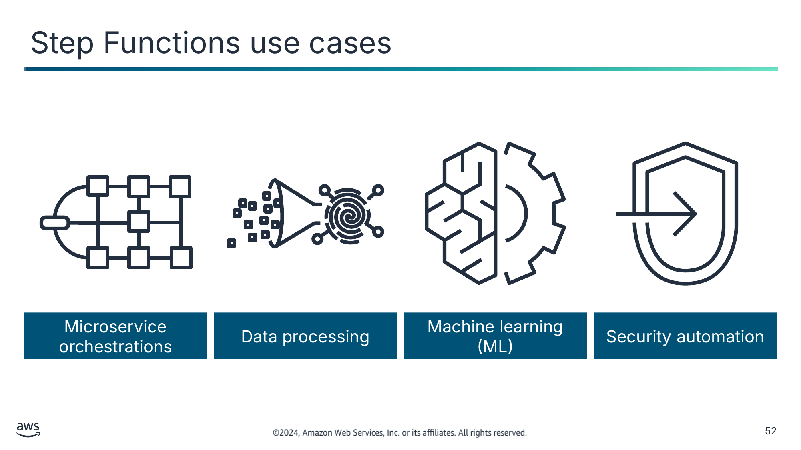

Оркестрація мікросервісів

Обробка даних

Машинне навчання (ML)

Автоматизація безпеки

> **Нотатки:**
>
> |Номер слайда 52  
> |Нотатки для інструктора  
> |  
> |Нотатки для студента fixed  
> Кінцеві автомати Step Functions можна використовувати, коли потрібен робочий процес. В AWS ми бачимо, що клієнти часто використовують Step Functions для оркестрації мікросервісів, обробки даних, машинного навчання та автоматизації безпеки.  
>
> Step Functions дає кілька способів керувати вашими мікросервісними робочими процесами. Для тривалих робочих процесів можна використовувати робочі процеси Standard з інтеграцією AWS Fargate для оркестрації застосунків, що працюють у контейнерах. Для короткотривалих робочих процесів великого обсягу, що потребують негайної відповіді, ідеальні синхронні робочі процеси Express. Їх можна використовувати для веб- або мобільних застосунків, що часто мають робочі процеси короткої тривалості й потребують завершення низки кроків, перш ніж повернути відповідь. Синхронні робочі процеси Express можна ініціювати безпосередньо з Amazon API Gateway, і з’єднання тримається відкритим, доки робочий процес не завершиться чи не спливе тайм-аут. Для короткотривалих робочих процесів, що не потребують негайної відповіді, Step Functions надає асинхронні робочі процеси Express.  
>
> Step Functions забезпечує масштабованість, надійність і доступність, потрібні для успішного керування вашими робочими процесами обробки даних. Можна керувати мільйонами одночасних виконань за допомогою Step Functions, оскільки він масштабується горизонтально й забезпечує відмовостійкі робочі процеси. Обробляйте дані Step Functions швидше за допомогою паралельних виконань, як-от тип стану Parallel, чи динамічного паралелізму за допомогою типу стану Map. Як частину вашого робочого процесу можна використовувати стан Map для ітерації за об’єктами в статичному сховищі даних, як-от бакет Amazon Simple Storage Service (Amazon S3). Step Functions також дає змогу повторювати невдалі виконання чи обирати певний спосіб обробки помилок без потреби керувати складним процесом.  
>
> Step Functions дає змогу оркеструвати наскрізні робочі процеси машинного навчання (ML) в Amazon SageMaker. Ці робочі процеси можуть включати попередню обробку даних, зокрема збагачення даних, постобробку, інженерію ознак, перевірку даних і оцінювання моделі.  
>
> Автоматизація безпеки може допомогти керувати дедалі складнішими й трудомісткими операціями, як-от оновлення та встановлення виправлень програмного забезпечення, розгортання оновлень безпеки для усунення вразливостей, вибір інфраструктури, синхронізація даних, маршрутизація заявок підтримки тощо. Автоматизація повторюваних і трудомістких завдань може дати вашій організації змогу виконувати рутинні операції швидко й послідовно у великому масштабі. Step Functions дає змогу створювати робочі процеси, що автоматично масштабуються відповідно до потреб вашого бізнесу без потреби ручного втручання. У випадках, коли у вашому робочому процесі виникає помилка, вона часто не потребує ручного втручання. Step Functions дає змогу автоматично повторювати невдалі завдання й має експоненційне відкладання (exponential backoff), що може керувати помилками у вашому робочому процесі.

---

## Слайд 53: Координація станів робочого процесу

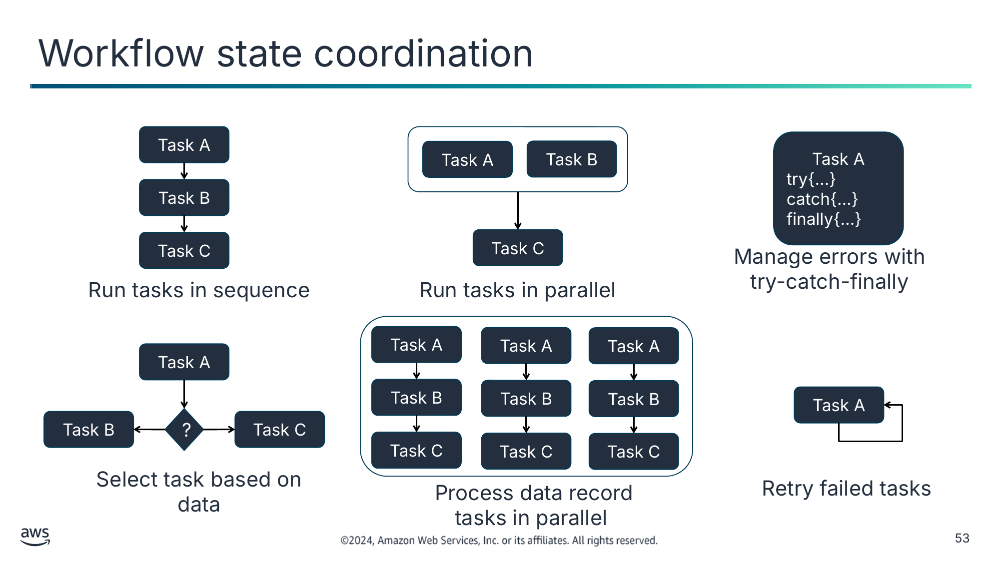

Task A

try{…}

catch{…}

finally{…}

Керування помилками за допомогою try-catch-finally

Виконання завдань послідовно

Виконання завдань паралельно

Вибір завдання на основі даних

Повторення невдалих завдань

Паралельна обробка завдань для записів даних

<details>
<summary>Текст зі схеми</summary>

Task A

Task B

Task C

Task A

Task B

Task C

Task A

Task A

Task A

Task B

Task B

Task B

Task C

Task C

Task C

Task A

Task B

?

Task C

Task A

</details>

> **Нотатки:**
>
> |Номер слайда 53  
> |Нотатки для інструктора  
> |  
> |Нотатки для студента  
> AWS Step Functions керує логікою вашого застосунку за вас. Він реалізує координації, як-от виконання завдань послідовно чи паралельно, розгалуження й тайм-аути. Ця методика усуває зайвий код, що може повторюватися у ваших мікросервісах і функціях. Step Functions автоматично обробляє помилки й винятки за допомогою вбудованих try-catch і повторних спроб, незалежно від того, чи завдання виконується секунди чи місяці. Можна автоматично повторювати невдалі чи завдання з тайм-аутом. Можна реагувати по-різному на різні типи помилок і коректно відновлюватися, переходячи до призначеного коду очищення та відновлення.

---

## Слайд 54: Типи станів (кроків) кінцевого автомата

Робочі стани (Work states)

Стани переходу (Transition states)

Стани зупинки (Stop states)

- **Task:** інтегрується із сервісами AWS
- **Activity:** виконує завдання, розміщене будь-де
- **Pass:** передає чи фільтрує вхідні дані до наступного стану
- **Wait:** затримує робочий процес на вказаний час
- **Стан має опцію очікування зворотного виклику (callback):** призупиняє робочий процес і чекає на зворотний виклик

- **Choice:** додає умови для керування потоком до наступного стану
- **Parallel:** додає гілки вкладених кінцевих автоматів усередині кінцевого автомата
- **Map:** розділяє робочий процес для кожного запису даних у наборі даних, що виконується паралельно

- **Success:** зупиняє кінцевий автомат і позначає виконання як успішне
- **Fail:** зупиняє кінцевий автомат і позначає виконання як невдале
- **Стан має параметр end:** зупиняє кінцевий автомат

> **Нотатки:**
>
> |Номер слайда 54  
> |Нотатки для інструктора  
> |  
> |Нотатки для студента  
> Типи станів (кроків) кінцевого автомата можна класифікувати як робочі стани, стани переходу чи стани зупинки.  
>
> Робочі стани включають стани task, activity, pass і wait. Стан task представляє одиницю роботи, яку виконує інший сервіс AWS, як-от AWS Lambda. Як варіант, завдання може викликати кінцеву точку HTTP. Стан task обробляє інтеграції сервісів AWS і може викликати будь-який сервіс чи API AWS, що підтримуються першокласними інтеграціями сервісів AWS Step Functions та AWS SDK. Завдання може інтегруватися синхронно з типом виклику «запит-відповідь», запускати завдання (job) і чекати його завершення. Завдання може за бажанням викликати сервіс із маркером завдання (task token) і чекати зворотного виклику, що включає маркер і корисне навантаження.  
>
> Активності (activities) — це завдання у вашому кінцевому автоматі, де роботу виконує робітник (worker), що може бути розміщений будь-де. Робітник активності може бути застосунком, що працює на екземплярі Amazon EC2, функцією AWS Lambda, мобільним пристроєм чи будь-яким застосунком, що може встановити з’єднання HTTP. Подібно до завдання, активність може за бажанням викликати сервіс чи кінцеву точку HTTP із маркером завдання й чекати зворотного виклику, що включає маркер і корисне навантаження.  
>
> Стан pass передає свій вхід на свій вихід, не виконуючи роботи. Стани pass корисні під час побудови й налагодження кінцевих автоматів. Також можна використовувати стан pass для перетворення вхідних даних стану JSON за допомогою фільтрів, а потім передавати перетворені дані до наступного стану у вашому робочому процесі. Стан wait затримує продовження кінцевого автомата на вказаний час. Можна обрати або відносний час, указаний у секундах від початку стану, або абсолютний час завершення, указаний як часова позначка.  
>
> Стани переходу керують потоком кінцевого автомата, визначаючи, який стан виконувати далі. Стан choice додає умовну логіку до кінцевого автомата. Він містить масив правил вибору, що визначають, до якого стану кінцевий автомат переходить далі. Ви використовуєте оператор порівняння в правилі вибору, щоб порівняти вхідну змінну з певним значенням. Наприклад, за допомогою правил вибору можна порівняти, чи вхідна змінна більша чи менша за 50. Стан parallel можна використовувати для додавання окремих гілок вкладених кінцевих автоматів усередині кінцевого автомата. Використовуйте стан map для виконання набору кроків робочого процесу для кожного елемента набору даних. Ітерації стану map виконуються паралельно, що дає змогу швидко обробляти набір даних. Стани map можуть використовувати різноманітні типи вхідних даних, зокрема масив JSON, список об’єктів Amazon S3 чи файл CSV.  
>
> Стани зупинки завершують виконання кінцевого автомата. Стан може містити параметр end, що завершує виконання, або можна використовувати стани success і fail, коли записується, чи виконання було успішним.

---

## Слайд 55: Визначення кінцевого автомата за допомогою Amazon States Language

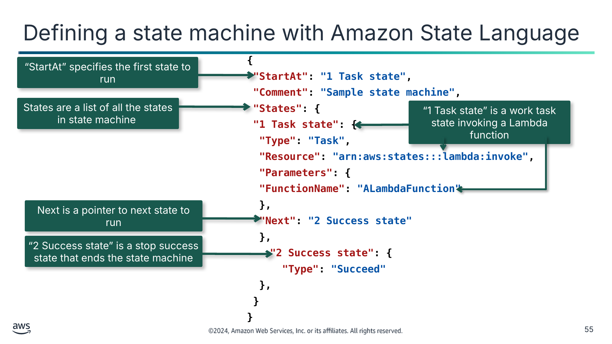

```
{
 "StartAt": "1 Task state",
 "Comment": "Sample state machine",
 "States": {
 "1 Task state": {
  "Type": "Task",
  "Resource": "arn:aws:states:::lambda:invoke",
  "Parameters": {
  "FunctionName": "ALambdaFunction"
  },
  "Next": "2 Success state"
  },
"2 Success state": {
  "Type": "Succeed"
  },
 }
}
```

“StartAt” указує перший стан для виконання

States — це список усіх станів у кінцевому автоматі

Next — це вказівник на наступний стан для виконання

“2 Success state” — це стан зупинки (успішної), що завершує кінцевий автомат

<details>
<summary>Текст зі схеми</summary>

“1 Task state” — це робочий стан завдання, що викликає функцію Lambda (“1 Task state” is a work task state invoking a Lambda function)

</details>

> **Нотатки:**
>
> |Номер слайда 55  
> |Нотатки для інструктора  
> |  
> |Нотатки для студента  
> Кінцевий автомат Step Functions — це колекція станів, визначених в Amazon States Language. Amazon States Language — це структурована мова на основі JSON, що використовується для визначення кінцевого автомата та колекції станів для виконання. Кінцевий автомат використовує пари «ключ-значення» для визначення полів і значень кінцевого автомата й завжди вказує, який стан виконувати першим.  
>
> Кінцевий автомат завжди містить поле StartAt з назвою стану, що вказує на перший стан для виконання. Поле States містить колекцію вкладених документів JSON, що визначають стани в кінцевому автоматі. Кожен стан має назву, що використовується як ідентифікатор, і містить тип стану в полі Type. Кожен тип стану має набір обов’язкових і необов’язкових полів.  
>
> Стан має включати поле Next, якщо керування має бути передано іншому стану. Стани choice мають кілька полів Next для кожного правила вибору.  
>
> Якщо стан — останній стан, що виконується в кінцевому автоматі, він має включати поле End. Як варіант, керування можна передати стану success чи стану fail, щоб завершити виконання кінцевого автомата.

---

## Слайд 56: Приклад: кінцевий автомат робочого процесу Step Functions Standard

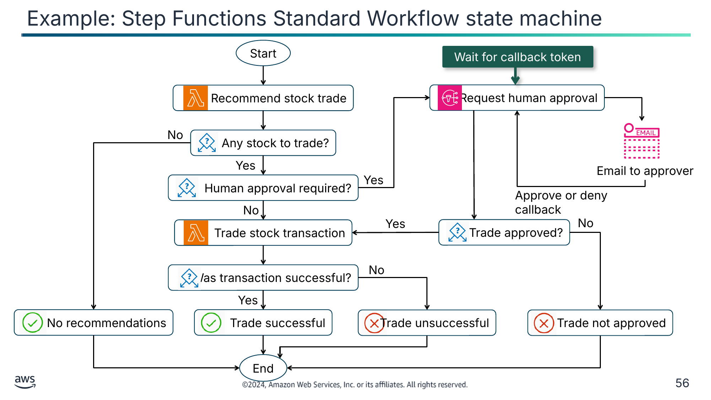

<details>
<summary>Текст зі схеми</summary>

Start (Початок)

Wait for callback token (Очікування маркера зворотного виклику)

Recommend stock trade (Рекомендувати біржову угоду)

Request human approval (Запит схвалення людиною)

No (Ні)

Any stock to trade? (Чи є акції для торгівлі?)

Yes (Так)

Yes

Email to approver (Лист схвалювачу)

Human approval required? (Потрібне схвалення людиною?)

Approve or deny callback (Зворотний виклик «схвалити чи відхилити»)

No

No

Trade stock transaction (Виконати біржову транзакцію)

Yes

Trade approved? (Угоду схвалено?)

Was transaction successful? (Транзакція успішна?)

No

Yes

No recommendations (Немає рекомендацій)

Trade successful (Угода успішна)

Trade unsuccessful (Угода невдала)

Trade not approved (Угоду не схвалено)

End (Кінець)

</details>

> **Нотатки:**
>
> |Номер слайда 56  
> |Нотатки для інструктора  
> |  
> |Нотатки для студента  
> Це приклад кінцевого автомата Step Functions для біржової угоди. Перше завдання, що виконується, — функція Lambda, що повертає ідентифікатор біржової компанії, кількість акцій, поточну ціну акції та загальну суму угоди. Вона передається до першого стану choice, що перевіряє, чи є рекомендована біржова угода. Якщо ні, кінцевий автомат переходить до стану success і завершується.  
>
> Якщо є рекомендована угода, то керування передається до стану choice «Потрібне схвалення людиною». Правило стану choice може перевіряти, чи загальна сума угоди перевищує ліміт, як-от 100,00 долара.  
>
> Якщо так, виконання продовжується до завдання «Запит схвалення людиною», що викликає Amazon Simple Notification Service (Amazon SNS), щоб запитати схвалення, надіславши електронного листа схвалювачу з маркером завдання. Коли схвалювач схвалює чи відхиляє запит, зворотним викликом є маркер, а відповідь повертається до стану завдання «Запит схвалення людиною». Воно передає результат до стану choice «Угоду схвалено?». Якщо не схвалено, керування передається до стану fail «Угоду не схвалено», і виконання завершується.  
>
> Якщо угоду було схвалено, то керування передається до стану завдання Lambda «Виконати біржову транзакцію». Воно повертає результат транзакції й передає керування до стану choice «Транзакція успішна?». Якщо ні, то керування передається до стану fail «Угода невдала», і виконання завершується. Якщо транзакція була успішною, то керування передається до стану «Угода успішна», і виконання завершується.

---

## Слайд 57: Ключові висновки: оркестрація мікросервісних робочих процесів за допомогою AWS Step Functions

- AWS Step Functions — це безсерверний сервіс оркестрації для керування робочими процесами між кількома сервісами AWS.
- Кінцевий автомат (робочий процес) — це ряд станів (кроків), керованих подіями.
- Кінцевий автомат Step Functions — це колекція станів, визначених в Amazon States Language.
- Стани можна групувати на робочі стани, стани переходу та стани зупинки.
- Стан task може викликати сервіс AWS чи запитувати активність, розміщену на будь-якому обчислювальному сервісі з HTTP-з’єднанням.

> **Нотатки:**
>
> |Номер слайда 57  
> |Нотатки для інструктора  
> |  
> |Нотатки для студента

---

## Слайд 58: Розширення безсерверних архітектур за допомогою Amazon API Gateway

Побудова безсерверних архітектур і мікросервісів

> **Нотатки:**
>
> |Номер слайда 58  
> |Нотатки для інструктора  
> |  
> |Нотатки для студента  
> Цей розділ розглядає розширення безсерверних архітектур за допомогою Amazon API Gateway та декомпозицію монолітного застосунку на мікросервіси.

---

## Слайд 59: Переваги API

Стандартизація обміну даними застосунків

Захист мікросервісів

Монетизація API та відстеження статистики

- З’єднуйте програмні застосунки, написані різними мовами, стандартизованим способом.
- Приховуйте складність реалізації.

- Обирайте, чи вимагати авторизацію.
- Перевіряйте формати запитів.
- Обмежуйте (throttle) кількість запитів.
- Обмежуйте доступ до ресурсів.

- Відстежуйте використання клієнтом для цілей виставлення рахунків.
- Надавайте статистику використання для кожного клієнта.

> **Нотатки:**
>
> |Номер слайда 59  
> |Нотатки для інструктора  
> |  
> |Нотатки для студента  
> Раніше в цьому модулі ви дізналися, що мікросервіси обмінюються даними через чітко визначені API. Тож чому API вважаються найкращою практикою для мікросервісів?  
>
> API діють як міст чи посередник для з’єднання застосунків, написаних різними мовами з різними форматами типів даних. API зазвичай надає документацію про те, як використовувати API, і про потреби клієнтського застосунку для правильного форматування запиту API. Перевага в тому, що клієнтському застосунку, який робить запит, не потрібно розуміти складність чи технічні подробиці реалізації мікросервісу.  
>
> Мікросервіс спроєктовано для швидкого запуску й масштабування. Тому хороша практика — захищати мікросервіс від зловмисників. API може впроваджувати механізми авторизації, щоб забезпечити, що лише автентифіковані застосунки звертаються до мікросервісу. Крім того, API може перевіряти формат запиту клієнта й повертати помилку, якщо формат неправильний. API також можна налаштувати на обмеження кількості запитів API, якщо є обмеження ресурсів мікросервісу. API також може обмежувати доступ до ресурсів мікросервісу, щоб дозволити лише обмежені дії над ресурсом.  
>
> API також — зручне місце для збору точок даних використання клієнтами для аналізу того, як використовуються мікросервіси. За потреби використання можна перетворити на монетизацію, оскільки клієнт із привілейованим використанням може платити за пріоритетне використання.

---

## Слайд 60: Amazon API Gateway

- Надає можливість створювати, публікувати та підтримувати API REST, HTTP і WebSocket
- Налаштовуване керування трафіком, авторизація та контроль доступу до ресурсів
- Надає доступ до сервісів AWS і публічно доступних кінцевих точок
- Розміщує кілька версій і стадій API застосунку
- Встановлює плани використання клієнтами для монетизації та контролю API
- Може кешувати поширені відповіді

API Gateway

> **Нотатки:**
>
> |Номер слайда 60  
> |Нотатки для інструктора  
> |  
> |Нотатки для студента  
> Amazon API Gateway — це повністю кероване обслуговування, що дає змогу створювати, публікувати, підтримувати, відстежувати та захищати API у будь-якому масштабі. Його можна використовувати для створення API Representational State Transfer (RESTful) та WebSocket, що діють як точка входу для застосунків, щоб вони могли отримувати доступ до бекенд-ресурсів. Можна будувати API RESTful, використовуючи і API HTTP, і API REST в Amazon API Gateway. Застосунки потім можуть отримувати доступ до даних, бізнес-логіки чи функціональності з ваших бекенд-сервісів. Бекенд-сервіси можуть бути застосунками, що працюють на Amazon Elastic Compute Cloud (Amazon EC2), кодом, що працює на AWS Lambda чи Amazon Elastic Container Service (Amazon ECS), приватними застосунками у віртуальній приватній хмарі (VPC) чи локально та публічно доступними кінцевими точками. Також можна інтегрувати API Gateway безпосередньо з деякими сервісами AWS, як-от надсилання даних безпосередньо до потоку Amazon Kinesis, робочих процесів AWS Step Functions чи бази даних Amazon DynamoDB.  
>
> API Gateway обробляє всі завдання, пов’язані з прийманням і обробкою до сотень тисяч одночасних запитів API. API Gateway має функції для обробки керування трафіком, авторизації та контролю доступу, моніторингу та керування версіями API. API Gateway інтегровано з Amazon Cognito для авторизації та дозволяє плагіни функцій Lambda для користувацьких рішень авторизації.  
>
> API Gateway можна використовувати для розміщення кількох версій і стадій для різних середовищ розробки та продуктивних середовищ ваших API. Плани використання допомагають оголошувати плани для сторонніх розробників, що обмежують доступ лише певними API, визначають обмеження (throttling) і ліміти квот запитів та пов’язують їх із ключами API. Також можна витягувати дані про використання на основі окремого ключа API для аналізу використання API та генерування розрахункових документів. Наприклад, можна створити план, що дозволяє лише 1000 запитів на день і максимум 5 запитів на секунду (RPS).  
>
> Можна ввімкнути кешування API в Amazon API Gateway для кешування відповідей вашої кінцевої точки. З кешуванням можна зменшити кількість викликів до вашої кінцевої точки й також покращити затримку запитів до вашого API.

---

## Слайд 61: Вибір типу API

API REST (REST APIs)

API HTTP (HTTP APIs)

API WebSocket (WebSocket APIs)

- Колекція маршрутів і методів
- Для застосунків, що потребують функцій керування API, як-от плани використання, перевірка корисного навантаження, кінцеві точки приватних API та політики ресурсів
- Підтримує спільне використання ресурсів між походженнями (CORS)
- Безстановий

- Колекція маршрутів і методів
- Для мікросервісів
- Нижча затримка й нижча вартість, ніж в API REST
- Підтримує CORS
- Безстановий

- Колекція маршрутів WebSocket
- Для застосунків реального часу
- Встановлює сеанс між клієнтом і бекенд-сервісами
- Функції керування API — перевірка схеми корисного навантаження та перетворення даних
- Станний

> **Нотатки:**
>
> |Номер слайда 61  
> |Нотатки для інструктора  
> |  
> |Нотатки для студента  
> Amazon API Gateway пропонує два варіанти створення API RESTful, а саме API HTTP та REST, і варіант створення API WebSocket. Вибір типу API, найбільш придатного для вашого застосунку, залежить від потрібної вам поведінки API.  
>
> API RESTful корисні в хмарних застосунках, оскільки їхні виклики безстанові. Якщо щось виходить з ладу, безстанові компоненти можуть плавно перерозгортатися й масштабуватися для розміщення змін навантаження. API RESTful складаються з колекції маршрутів і методів для ресурсів застосунку. Методи — це дієслова HTTP, як-от GET, POST, PUT, PATCH і DELETE, що відповідають діям створення, читання, оновлення та видалення даних (CRUD). Наприклад, запит із методом POST і шляхом /class-roster з інформацією про студента як параметрами додасть студента до списку класу. Метод GET зі шляхом /class-roster поверне всіх студентів, зареєстрованих на клас.  
>   
> API REST API Gateway пропонують функціональність проксі API та широкий набір функцій керування API в єдиному рішенні. API REST використовують плани використання, що виділяють ключі API клієнтам для відстеження використання API з метою виставлення рахунків і контролю лімітів використання за допомогою обмеження (throttling). Також можна перевіряти вхідні запити за схемою корисного навантаження запиту й виконувати обмежені перетворення даних для відповідності форматам бекенд-даних. API REST дозволяють приватні кінцеві точки API для API Gateway, що доступні лише з приватної підмережі у VPC клієнта. Можна використовувати політики ресурсів API Gateway, щоб дозволити вашому API безпечно викликатися користувачами із зазначеного акаунта AWS, зазначених діапазонів IP-адрес джерела чи блоків CIDR або зазначених VPC у будь-якому акаунті. Тож API REST API Gateway особливо підходять, коли вам потрібен широкий набір функцій керування API.  
>
> API HTTP оптимізовано для побудови API безсерверних робочих навантажень, що проксіюють до функцій AWS Lambda чи бекендів HTTP. Вони легкі й забезпечують покращену продуктивність порівняно з API REST із нижчою затримкою. API HTTP також забезпечують кращу цінову точку, ніж API REST, оскільки вони не пропонують функціональності керування API. Це робить API HTTP придатними для впровадження мікросервісів за допомогою функцій Lambda та контейнерів Amazon ECS, що потребують відповідей із низькою затримкою.  
>
> API WebSocket підтримують постійне з’єднання між підключеними клієнтами для уможливлення обміну повідомленнями в реальному часі. В API WebSocket клієнт і сервер можуть надсилати повідомлення одне одному будь-коли. Бекенд-сервери можуть легко проштовхувати дані до підключених користувачів і пристроїв, уникаючи потреби впроваджувати складні механізми опитування. Наприклад, можна побудувати безсерверний застосунок за допомогою API WebSocket API Gateway та AWS Lambda для надсилання й отримання повідомлень від окремих користувачів чи груп користувачів у чаті в тому самому домені.  
>
> І API REST, і API HTTP підтримують спільне використання ресурсів між походженнями (CORS). CORS зазвичай потрібен для побудови вебзастосунків, що звертаються до API, розміщених в іншому домені чи походженні. Можна ввімкнути CORS, щоб дозволити запити до вашого API від вебзастосунку, розміщеного в іншому домені.

---

## Слайд 62: Інтеграції бекенду API Gateway

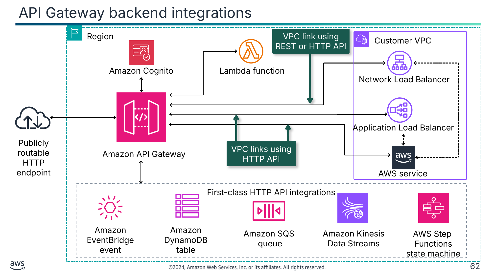

<details>
<summary>Текст зі схеми</summary>

Region (Регіон)

VPC link using REST or HTTP API (Посилання VPC за допомогою API REST чи HTTP)

Customer VPC (VPC клієнта)

Amazon Cognito

Lambda function (Функція Lambda)

Network Load Balancer

Publicly routable HTTP endpoint (Публічно маршрутизована кінцева точка HTTP)

Application Load Balancer

Amazon API Gateway

VPC links using HTTP API (Посилання VPC за допомогою API HTTP)

AWS service (Сервіс AWS)

First-class HTTP API integrations (Першокласні інтеграції API HTTP)

Amazon EventBridge event (Подія Amazon EventBridge)

Amazon DynamoDB table (Таблиця Amazon DynamoDB)

Amazon SQS

 queue (Черга Amazon SQS)

Amazon Kinesis  
Data Streams

AWS Step

Functions

state machine (Кінцевий автомат AWS Step Functions)

</details>

> **Нотатки:**
>
> |Номер слайда 62  
> |Нотатки для інструктора  
> |  
> |Нотатки для студента  
> Оскільки API Gateway призначено діяти як міст між застосунками, він підтримує багато інтеграцій бекенду. Як ви дізналися в розділі про мікросервіси цього модуля, API Gateway та AWS Lambda можуть функціонувати як мікросервіс, використовуючи Amazon Cognito для авторизації мікросервісу.  
>
> Інтеграція HTTP-проксі дає змогу з’єднати маршрут API з публічно маршрутизованою кінцевою точкою HTTP. З цим типом інтеграції API Gateway передає весь запит і відповідь між фронтендом і бекендом. Щоб створити інтеграцію HTTP-проксі, надайте URL-адресу публічно маршрутизованої кінцевої точки HTTP.  
>
> Можна інтегрувати ваш API HTTP із сервісами AWS за допомогою першокласних інтеграцій (first-class integrations). Першокласна інтеграція з’єднує маршрут API HTTP з API сервісу AWS. Коли клієнт викликає маршрут, що підтримується першокласною інтеграцією, API Gateway викликає API сервісу AWS за вас. Наприклад, можна використовувати першокласні інтеграції для надсилання повідомлення до черги Amazon Simple Queue Service (Amazon SQS) чи для запуску кінцевого автомата AWS Step Functions.  
>
> Якщо ваше рішення застосунку використовує сервіси AWS чи балансувальники навантаження у вашій VPC, Amazon API Gateway можна налаштувати з посиланням VPC (VPC link). Для API REST посилання VPC надає доступ до Network Load Balancer у VPC. Для API HTTP посилання VPC може надавати доступ до Network Load Balancer, Application Load Balancer та інших сервісів AWS у VPC, як-от екземпляри Amazon EC2 і контейнери Amazon ECS.

---

## Слайд 63: Вправа: декомпозиція монолітного застосунку за допомогою AWS API Gateway (Decomposing a Monolithic Application with AWS API Gateway)

Оберіть відповідний API Amazon API Gateway і сервіс чи сервіси AWS, щоб розділити монолітний застосунок онлайн-покупок на сервіси. Компоненти монолітного застосунку покупок такі:

- Кошик покупок
- Платежі
- Доставка


> **Нотатки:**
>
> |Номер слайда 63  
> |Нотатки для інструктора  
> |Зверніться до всього модуля, щоб скерувати студентів у проєктуванні трьох сервісів, як докладно описано на наступних слайдах. Студенти мають вирішити між функцією AWS Lambda та сховищем даних, контейнером Amazon ECS зі сховищем даних чи робочим процесом AWS Step Functions для кожного мікросервісу. Виділіть 15–30 хвилин на обговорення, а потім надайте розв’язання. Розв’язання буде лише одним із багатьох способів спроєктувати рішення.  
> |  
> |Нотатки для студента  
> Це вправа під керівництвом інструктора для обговорення різних варіантів декомпозиції монолітного застосунку онлайн-покупок на мікросервіси.

---

## Слайд 64: Декомпозиція монолітного застосунку на мікросервіси чи робочі процеси за допомогою API Gateway

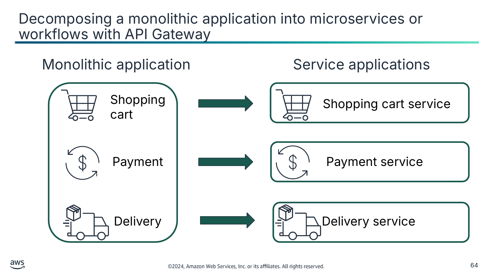

Monolithic application (Монолітний застосунок)

Service applications (Застосунки-сервіси)

Shopping

cart (Кошик покупок)

Shopping cart service (Сервіс кошика покупок)

Payment (Платіж)

Payment service (Сервіс платежів)

Delivery (Доставка)

Delivery service (Сервіс доставки)

> **Нотатки:**
>
> |Номер слайда 64  
> |Нотатки для інструктора  
> |  
> |Нотатки для студента  
> Функціональність модулів монолітного застосунку така:  
>
> Кошик покупок: онлайн-клієнт додає, вилучає чи оновлює кількість товарів у кошику покупок з потрібним часом відповіді в одиниці секунд.  
> Платежі: онлайн-клієнт завершує кошик покупок і сплачує за кількість товарів у кошику. Платіжну систему слід перенести як є з локального рішення з мінімальними змінами коду й конфігурації.  
> Доставка: коли платіж успішний, товари з кошика покупок мають бути доставлені клієнту. Цей процес може тривати до 5 днів, і клієнта слід сповістити, коли доставку виконано.  
>
> Зверніться до сторінки інтеграцій бекенду API Gateway, щоб обрати відповідний API API Gateway і сервіси AWS для кожного мікросервісу чи робочого процесу.

---

## Слайд 65: Розв’язання: мікросервіс кошика покупок

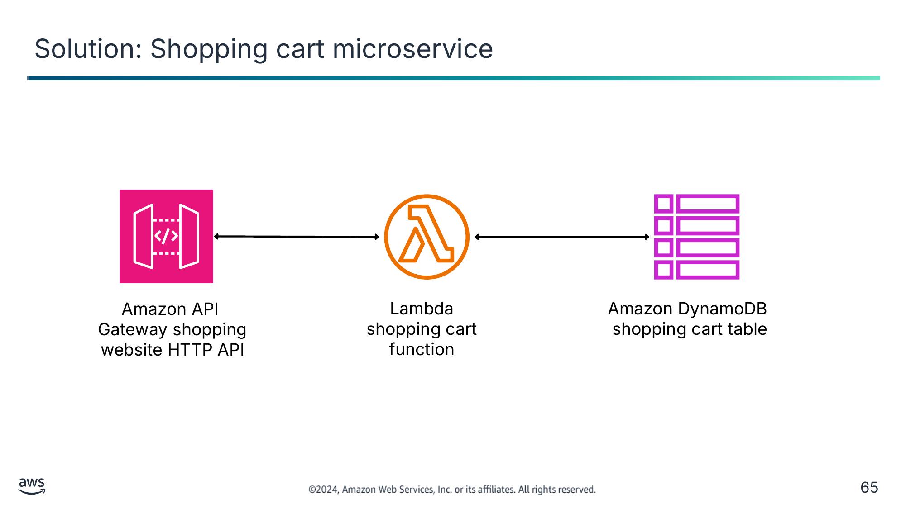

<details>
<summary>Текст зі схеми</summary>

Amazon API

Gateway shopping website HTTP API (API HTTP вебсайту покупок Amazon API Gateway)

Lambda shopping cart function (Функція Lambda кошика покупок)

Amazon DynamoDB

shopping cart table (Таблиця кошика покупок Amazon DynamoDB)

</details>

> **Нотатки:**
>
> |Номер слайда 65  
> |Нотатки для інструктора  
> |  
> |Нотатки для студента  
> Для цього розв’язання було обрано API HTTP Amazon API Gateway для забезпечення інтеграції функції AWS Lambda та контейнера Amazon ECS.  
>
> Сервіс кошика покупок складається з малих транзакцій у мілісекундах. Використовуйте сервіс API HTTP вебсайту покупок Amazon API Gateway для маршрутизації запитів кошика покупок до функції AWS Lambda кошика покупок. Транзакції кошика покупок зберігаються в таблиці кошика покупок Amazon DynamoDB. Це розв’язання задовольнить вимогу до продуктивності — час відповіді в одиниці секунд.

---

## Слайд 66: Розв’язання: мікросервіс платежів

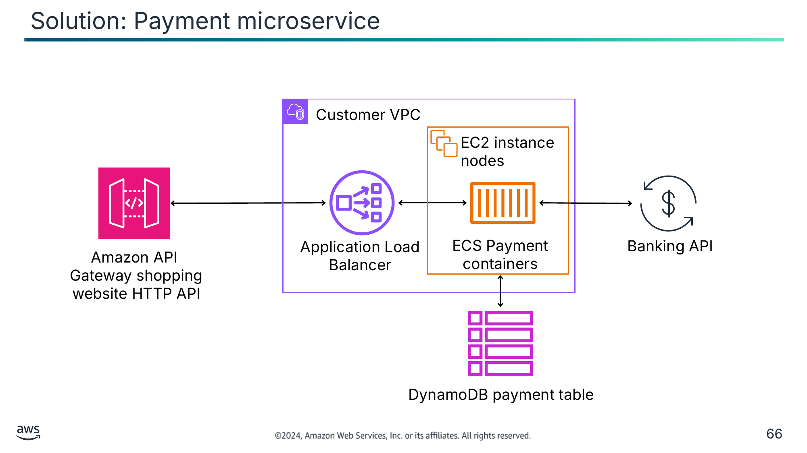

<details>
<summary>Текст зі схеми</summary>

Customer VPC (VPC клієнта)

EC2 instance nodes (Вузли-екземпляри EC2)

Application Load

Balancer

ECS Payment containers (Контейнери платежів ECS)

Banking API (Банківський API)

Amazon API

Gateway shopping website HTTP API

DynamoDB payment table (Таблиця платежів DynamoDB)

</details>

> **Нотатки:**
>
> |Номер слайда 66  
> |Нотатки для інструктора  
> |  
> |Нотатки для студента  
> Оскільки платіжну систему перенесено з локального середовища з мінімальними змінами коду й конфігурації, її перенесення в контейнери платежів ECS було б придатним розв’язанням. Для розподілу платіжних транзакцій Application Load Balancer отримує платіжні запити від API HTTP вебсайту покупок API Gateway. Application Load Balancer розподіляє транзакції між контейнерами, що використовують публічно доступний банківський API для авторизації платежів. Контейнери зберігають платежі в таблиці платежів DynamoDB.

---

## Слайд 67: Розв’язання: сервіс робочого процесу доставки

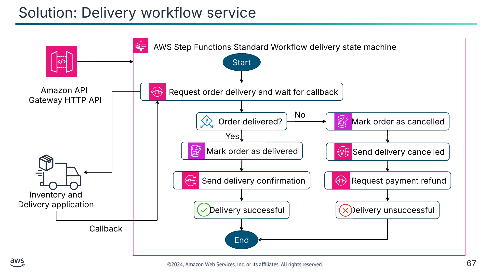

<details>
<summary>Текст зі схеми</summary>

AWS Step Functions Standard Workflow delivery state machine (Кінцевий автомат доставки робочого процесу AWS Step Functions Standard)

Start (Початок)

Amazon API

Gateway HTTP API

Request order delivery and wait for callback (Запит доставки замовлення й очікування зворотного виклику)

No (Ні)

Order delivered? (Замовлення доставлено?)

Mark order as cancelled (Позначити замовлення як скасоване)

Yes (Так)

Mark order as delivered (Позначити замовлення як доставлене)

Send delivery cancelled (Надіслати сповіщення про скасування доставки)

Send delivery confirmation (Надіслати підтвердження доставки)

Request payment refund (Запит повернення платежу)

Inventory and Delivery application (Застосунок інвентаризації та доставки)

Delivery successful (Доставка успішна)

Delivery unsuccessful (Доставка невдала)

Callback (Зворотний виклик)

End (Кінець)

</details>

> **Нотатки:**
>
> |Номер слайда 67  
> |Нотатки для інструктора  
> |  
> |Нотатки для студента  
> Оскільки доставка — це процес, що може тривати кілька днів, це не мікросервіс, і краще підійшов би сервіс тривалого робочого процесу.  
>
> Після успішного платежу API HTTP Amazon API Gateway отримує виклик доставки й пересилає запит до кінцевого автомата доставки робочого процесу AWS Step Functions Standard. Кінцевий автомат поміщає запит доставки в чергу доставки Amazon SQS і призупиняє кінцевий автомат. API інвентаризації та доставки опитує чергу й підбирає запит доставки. Після доставки API інвентаризації та доставки виконує зворотний виклик кінцевого автомата доставки. Керування передається до стану choice «Замовлення доставлено». Якщо замовлення було доставлено, кінцевий автомат доставки оновлює таблицю доставки DynamoDB зі статусом «доставлено» й надсилає сповіщення електронною поштою клієнту за допомогою Amazon Simple Notification Service (Amazon SNS). Кінцевий автомат завершується з виконанням, позначеним як успішне.  
>
> Якщо замовлення не було доставлено, кінцевий автомат доставки оновлює таблицю доставки DynamoDB зі статусом «скасовано» й надсилає клієнту електронного листа про скасування за допомогою Amazon SNS. Наступний стан поміщає запит на повернення платежу в чергу повернень Amazon SQS, і кінцевий автомат завершується з виконанням, позначеним як невдале.  
>
> Зверніть увагу, що це лише загальне розв’язання, і існує багато різних життєздатних розв’язань залежно від фактичного масштабу й потужності, що потрібні.

---

## Слайд 68: Ключові висновки: розширення безсерверних архітектур за допомогою Amazon API Gateway

- Amazon API Gateway надає можливість створювати, публікувати та підтримувати API застосунків.
- Він надає доступ до сервісів AWS і публічно доступних кінцевих точок.
- Використовуйте API REST, коли потрібні повне керування та контроль API.
- Використовуйте API HTTP, коли потрібні нижча затримка й нижча вартість, ніж в API REST.
- Використовуйте API WebSocket для застосунків реального часу, що потребують активного сеансу.

> **Нотатки:**
>
> |Номер слайда 68  
> |Нотатки для інструктора  
> |  
> |Нотатки для студента

---

## Слайд 69: Покрокова лабораторна робота: розбиття монолітного застосунку Node.js на мікросервіси (Breaking a Monolithic Node.js Application into Microservices, Microservices lab)

> **Нотатки:**
>
> |Номер слайда 69  
> |Нотатки для інструктора  
> |  
> |Нотатки для студента  
> Це необов’язкова лабораторна робота. Наступні слайди підсумовують, що ви робитимете в лабораторній роботі, а докладні інструкції ви знайдете в лабораторному середовищі.

---

## Слайд 70: Завдання лабораторної роботи «Мікросервіси»:

- У цій лабораторній роботі ви виконаєте таке:
  - Мігруєте монолітний застосунок Node.js для запуску в контейнері Docker.
  - Виконаєте рефакторинг застосунку Node.js із монолітного проєкту на архітектуру мікросервісів.
  - Розгорнете контейнеризований мікросервісний застосунок Node.js в Amazon ECS.
- Відкрийте ваше лабораторне середовище, щоб розпочати лабораторну роботу та дізнатися додаткові подробиці про завдання, які ви виконуватимете.


> **Нотатки:**
>
> |Номер слайда 70  
> |Нотатки для інструктора  
> |  
> |Нотатки для студента  
> Отримайте доступ до лабораторного середовища через ваш онлайн-курс, щоб дізнатися додаткові подробиці та виконати лабораторну роботу.

---

## Слайд 71: Підсумки лабораторної роботи «Мікросервіси»

- Як ви розгорнули контейнеризований монолітний застосунок у середовищі виконання Amazon ECS?
- Що ви дізналися про визначення завдань (task definitions) у цій лабораторній роботі?

> **Нотатки:**
>
> |Номер слайда 71  
> |Нотатки для інструктора  
> |Відповідні архітектурні схеми «до» та «після» включено до інструкцій кожної лабораторної роботи. Вам може бути корисно відкрити схеми лабораторної роботи під час підбиття підсумків цієї лабораторної роботи.  
> |  
> |Запропоновані відповіді на запитання 1: як ви розгорнули контейнеризований монолітний застосунок у середовищі виконання Amazon ECS?  
> |  
> |Ви використовуєте Amazon ECS для створення керованого кластера екземплярів EC2, на якому розгортається образ контейнера вашого застосунку. Кластер налаштовано як цільову групу Application Load Balancer для забезпечення відмовостійкого перемикання та масштабованості.  
> |  
> |Запропоновані відповіді на запитання 2: що ви дізналися про визначення завдань у цій лабораторній роботі?  
> |  
> |Визначення завдання — це список налаштувань конфігурації того, як запускати контейнер Docker в Amazon ECS. Деякі приклади інформації, яку визначення завдання надає Amazon ECS, включають таке:  
> |Який образ контейнера запускати  
> |Скільки ЦП і пам’яті потрібно контейнеру  
> |На яких портах контейнер прослуховує трафік  
> |  
> |Нотатки для студента  
> Ваш інструктор може розглянути ці запитання з вами, або ви можете розглянути їх самостійно. Скористайтеся цією нагодою, щоб поглибити своє мислення щодо завдань, які ви виконували під час лабораторної роботи.

---

## Слайд 72: Застосування принципів AWS Well-Architected Framework до мікросервісів і безсерверних архітектур

Побудова безсерверних архітектур і мікросервісів

> **Нотатки:**
>
> |Номер слайда 72  
> |Нотатки для інструктора  
> |  
> |Нотатки для студента  
> Цей розділ розглядає, як застосовувати принципи AWS Well-Architected Framework до безсерверних архітектур, зокрема мікросервісів.

---

## Слайд 73: AWS Well-Architected Serverless Applications Lens


> **Нотатки:**
>
> |Номер слайда 73  
> |Нотатки для інструктора  
> |Решта слайдів у цьому розділі подають приклади, що підкреслюють, як матеріал цього модуля узгоджується з найкращими практиками Well-Architected Framework. За бажанням ви можете попросити студентів відвідати вебсайт Well-Architected Framework і знайти найкращі практики, які, на їхню думку, пов’язані з матеріалом, поданим у цьому модулі, використовуючи цей розділ як відправну точку.  
> |  
> |Нотатки для студента  
> AWS Well-Architected Framework має шість опор, і кожна опора включає найкращі практики та набір запитань, які слід враховувати під час проєктування хмарних рішень. Цей розділ виділяє кілька найкращих практик з опор, найактуальніших для цього модуля. Повний набір найкращих практик за опорами знайдіть на вебсайті Well-Architected Framework. Посилання надано в розділі ресурсів вмісту вашого онлайн-курсу.  
>
> AWS надає спеціалізований Serverless Applications Lens для AWS Well-Architected Framework, що охоплює поширені сценарії безсерверних застосунків і визначає ключові елементи для забезпечення того, щоб ваші робочі навантаження були спроєктовані за найкращими практиками. Докладніше див. посилання Serverless Applications Lens – AWS Well-Architected Framework у розділі ресурсів вмісту.

---

## Слайд 74: Підхід найкращих практик: керування збоями


**Найкращі практики**

Використовуйте механізм черги недоставлених повідомлень, щоб зберігати, досліджувати й повторювати невдалі транзакції.

Відкочуйте невдалі транзакції.

> **Нотатки:**
>
> |Номер слайда 74  
> |Нотатки для інструктора  
> |  
> |Нотатки для студента  
> Певні частини безсерверного застосунку диктуються асинхронними викликами різних компонентів у стилі, керованому подіями, як-от за шаблоном «публікація та підписка» й іншими шаблонами. Коли асинхронні виклики не вдаються, їх слід перехоплювати й повторювати, коли це можливо. Інакше може відбутися втрата даних, що призведе до погіршення досвіду клієнта.  
>
> Механізм черги недоставлених повідомлень: використовуйте механізм черги недоставлених повідомлень, щоб зберігати, досліджувати й повторювати невдалі транзакції. AWS Lambda дозволяє надсилати невдалі транзакції до виділеної черги недоставлених повідомлень Amazon Simple Queue Service (Amazon SQS) для кожної функції окремо.  
> Amazon Kinesis Data Streams та Amazon DynamoDB Streams повторюють спробу для всього пакета елементів. Повторювані помилки блокують обробку відповідного шарда, доки помилку не буде розв’язано чи термін дії елементів не спливе. В AWS Lambda можна налаштувати елементи керування повторними спробами під час обробки записів даних і ефективно вилучати «отруйні» повідомлення (poison-pill) з пакета, надсилаючи його метадані до черги недоставлених повідомлень Amazon SQS для подальшого аналізу.  
>
> Відкат невдалих транзакцій: для синхронних частин, що ґрунтуються на транзакціях і залежать від певних гарантій та вимог, відкат невдалих транзакцій можна досягти за допомогою кінцевих автоматів AWS Step Functions, що роз’єднають і спростять логіку вашого застосунку.  
>
> У цьому модулі ви дізналися про низку сервісів AWS, що підтримують ці найкращі практики, зокрема AWS Lambda та Amazon API Gateway.

---

## Слайд 75: Підхід найкращих практик: керування ідентичністю та доступом


**Найкращі практики**

Контролюйте доступ до вашого безсерверного API.

Контролюйте доступ до вашого безсерверного застосунку.

> **Нотатки:**
>
> |Номер слайда 75  
> |Нотатки для інструктора  
> |  
> |Нотатки для студента  
> API часто стають ціллю зловмисників через операції, які вони можуть виконувати, і цінні дані, які вони можуть отримати. Існують різні найкращі практики безпеки для захисту від цих атак.  
>
> Контролюйте доступ до вашого безсерверного API: з погляду автентифікації та авторизації існують механізми авторизації виклику API в API Gateway, як-от пули користувачів Amazon Cognito, авторизатор Lambda API Gateway та політики ресурсів API Gateway. Важливо розуміти, чи впроваджено будь-який із цих механізмів і як.  
>
> Керуйте межами безпеки вашого безсерверного застосунку: з функціями Lambda рекомендується дотримуватися доступу з найменшими привілеями та дозволяти лише доступ, потрібний для виконання певної операції. Прикріплення ролі з більшою кількістю дозволів, ніж потрібно, може відкрити ваші системи для зловживань. У контексті безпеки наявність менших функцій, що виконують вузькі дії, сприяє кращій архітектурі безсерверного застосунку за стандартами Well-Architected.  
>
> У цьому модулі ви дізналися про низку сервісів AWS, що підтримують ці найкращі практики, зокрема AWS Lambda, Amazon Cognito та API Gateway.

---

## Слайд 76: Підхід найкращих практик: захист даних


**Найкраща практика**

Шифруйте дані під час передавання та в стані спокою.

Упроваджуйте безпеку застосунку у вашому робочому навантаженні.

> **Нотатки:**
>
> |Номер слайда 76  
> |Нотатки для інструктора  
> |  
> |Нотатки для студента  
> Некоректні чи перехоплені вхідні дані можуть використовуватися як вектор атаки, що може дати доступ до системи чи спричинити збій. Чутливі дані слід захищати завжди на всіх можливих рівнях, як докладно обговорюється в AWS Well-Architected Framework. Рекомендації цього технічного документа все ще застосовуються тут.  
>
> Шифруйте дані під час передавання та в стані спокою: щодо API Gateway чутливі дані слід або шифрувати на стороні клієнта, перш ніж вони потраплять у запит HTTP, або надсилати як корисне навантаження в запиті HTTP POST. Це також включає шифрування будь-яких заголовків, що можуть містити чутливі дані, перед виконанням певного запиту. Щодо функцій Lambda чи будь-яких інтеграцій, з якими може бути налаштовано API Gateway, чутливі дані слід шифрувати перед будь-якою обробкою чи маніпуляцією даними. Це запобігатиме витоку даних, якщо такі дані потраплять у постійне сховище чи стандартний вивід, що передається потоком і зберігається Amazon CloudWatch Logs.  
> Функції Lambda мають зберігати зашифровані дані в Amazon DynamoDB, Amazon OpenSearch Service чи Amazon Simple Storage Service (Amazon S3) разом із шифруванням у стані спокою. Наполегливо радять не надсилати, не журналювати й не зберігати незашифровані чутливі дані як частину шляху запиту HTTP чи рядків запиту або у стандартному виводі функції Lambda.  
>
> Упроваджуйте безпеку застосунку у вашому робочому навантаженні: перевіряйте та очищуйте вхідні події й виконуйте огляд безпеки коду, як ви зазвичай робили б для небезсерверних застосунків. Для API Gateway налаштуйте базову перевірку запитів як перший крок, щоб переконатися, що запит відповідає налаштованій моделі запиту JSON-схеми та будь-яким обов’язковим параметрам в URL, рядку запиту чи заголовках. Глибоку перевірку, специфічну для застосунку, слід впровадити, чи то як окрему функцію Lambda, бібліотеку, фреймворк чи сервіс.  
>
> У цьому модулі ви дізналися про низку сервісів AWS, що підтримують ці найкращі практики, зокрема AWS Lambda та API Gateway.

---

## Слайд 77: Підхід найкращих практик: вибір


**Найкраща практика**

Оптимізуйте продуктивність вашого безсерверного застосунку.

> **Нотатки:**
>
> |Номер слайда 77  
> |Нотатки для інструктора  
> |  
> |Нотатки для студента  
> Оскільки компоненти безсерверного застосунку масштабуються з різною швидкістю, важливо забезпечити оптимальну продуктивність, тестуючи застосунок різними способами. Виконуйте тести продуктивності вашого безсерверного застосунку зі сталими й пульсуючими (burst) швидкостями. Використовуючи результат, спробуйте налаштувати одиниці потужності та модель розгортання й виконайте навантажувальне тестування після змін, щоб допомогти обрати найкращу конфігурацію.  
>
> Оптимізуйте продуктивність вашого безсерверного застосунку: з Amazon API Gateway можна використовувати периферійні кінцеві точки для географічно розосереджених клієнтів. Використовуйте регіональні кінцеві точки для регіональних клієнтів і коли використовуються інші сервіси AWS у тому самому регіоні. З AWS Lambda можна тестувати різні налаштування пам’яті, оскільки ЦП, мережа та IOPS сховища виділяються пропорційно. З AWS Step Functions слід протестувати робочі процеси Standard та Express і подивитися на швидкості на секунду для швидкості запуску виконання та швидкості переходу станів.  
>
> У цьому модулі ви дізналися про низку сервісів AWS, що підтримують цю найкращу практику, зокрема AWS Lambda, API Gateway та Step Functions.

---

## Слайд 78: Підхід найкращих практик: економічно ефективні ресурси


**Найкраща практика**

Оптимізуйте вартість застосунку.

> **Нотатки:**
>
> |Номер слайда 78  
> |Нотатки для інструктора  
> |  
> |Нотатки для студента  
> Безсерверними архітектурами легше керувати з погляду правильного виділення ресурсів. Завдяки моделі ціноутворення «платіть за цінність» і масштабуванню залежно від попиту безсерверність ефективно зменшує зусилля планування потужностей.  
>
> Оптимізуйте вартість застосунку: оскільки Lambda пропорційно виділяє ЦП, мережу та IOPS сховища на основі пам’яті, чим швидше ініціювання, тим дешевша й цінніша ваша функція завдяки приростовому виміру тарифікації в 1 мс.

---

## Слайд 79: Підхід найкращих практик: оптимізація з часом


**Найкраща практика**

Використовуйте прямі інтеграції сервісів AWS.

> **Нотатки:**
>
> |Номер слайда 79  
> |Нотатки для інструктора  
> |  
> |Нотатки для студента  
> Сервіси AWS, як-от Amazon EventBridge, Amazon API Gateway, AWS Step Functions і AWS Lambda, можуть разом інтегруватися майже з усіма сервісами AWS. Складання безсерверної архітектури потребує ретельного планування, щоб забезпечити, що ви обрали лише потрібні сервіси.  
>
> Використовуйте прямі інтеграції сервісів AWS: якщо ваша функція Lambda не виконує користувацької логіки під час інтеграції з іншими сервісами AWS, цілком імовірно, що вона може бути непотрібною. API Gateway, Step Functions, EventBridge та призначення Lambda (destinations) можуть безпосередньо інтегруватися з рядом сервісів і надавати вам більше цінності та менше операційних накладних витрат.  
>
> Наприклад, можна впровадити приймання даних потоку кліків за допомогою клієнта, що використовує API Gateway для запуску функції Lambda, яка поміщає запит у потік Amazon Kinesis Data Firehose для доставки до бакета Amazon S3. Економічно ефективнішим рішенням було б безпосередньо помістити дані потоку кліків у потік Amazon Kinesis Data Firehose від клієнта. Таким чином економляться витрати API Gateway та функції Lambda.  
>
> У цьому модулі ви дізналися про низку сервісів AWS, що підтримують цю найкращу практику, зокрема API Gateway та Step Functions.

---

## Слайд 80: Ключові висновки: застосування AWS Well-Architected Framework до безсерверної архітектури

- Використовуйте механізм черги недоставлених повідомлень, щоб зберігати, досліджувати й повторювати невдалі транзакції.
- Відкочуйте невдалі транзакції.
- Контролюйте доступ до вашого безсерверного API.
- Контролюйте доступ до вашого безсерверного застосунку.
- Шифруйте дані під час передавання та в стані спокою.
- Упроваджуйте безпеку застосунку у вашому робочому навантаженні.
- Оптимізуйте продуктивність вашого безсерверного застосунку.
- Оптимізуйте вартість застосунку.
- Використовуйте прямі інтеграції сервісів AWS, де вони доступні.

> **Нотатки:**
>
> |Номер слайда 80  
> |Нотатки для інструктора  
> |Це не вичерпний перелік найкращих практик, охоплених найкращими практиками AWS Well-Architected. Це ключові висновки для пояснення найкращих практик, розглянутих у модулі.  
> |  
> |Нотатки для студента

---

## Слайд 81: Лабораторна робота кафе: упровадження безсерверної архітектури для кафе (Implementing a Serverless Architecture for the Café, Serverless Café lab)

> **Нотатки:**
>
> |Номер слайда 81  
> |Нотатки для інструктора  
> |  
> |Нотатки для студента  
> Зараз ви виконаєте лабораторну роботу. Наступні слайди підсумовують, що ви робитимете в лабораторній роботі, а докладні інструкції ви знайдете в лабораторному середовищі.

---

## Слайд 82: Еволюція архітектури кафе: версія 7

| Версія архітектури (Architecture Version) | Бізнес-причина оновлення (Business reason for update) | Технічні вимоги / оновлення архітектури (Technical requirements/ architecture update) |
|---|---|---|
| V1 | Статичний вебсайт для малого бізнесу. | Розмістити вебсайт на Amazon S3. |
| V2 | Додати онлайн-замовлення. | Розгорнути вебзастосунок і базу даних на Amazon EC2. |
| V3 | Зменшити зусилля на обслуговування бази даних і захист її даних. | Розділити рівні вебу та бази даних. Перенести базу даних в Amazon RDS у приватній підмережі. |
| V4 | Підвищити безпеку вебзастосунку. | Використати функції Amazon VPC для налаштування та захисту публічних і приватних підмереж. |
| V5 | Забезпечити, щоб вебсайт міг витримати очікуване зростання трафіку, залишаючись високодоступним і стійким до збоїв. | Додати балансувальник навантаження, впровадити автоматичне масштабування екземплярів EC2 і розподілити екземпляри обчислень і баз даних між 2 зонами доступності. |
| V6 | Послідовно розгортати, керувати та оновлювати ресурси кафе в регіонах. | Побудувати шаблон CloudFormation під контролем версій для розгортання мережевого рівня та рівня застосунку. Розгорнути стек CloudFormation в іншому регіоні. |
| V7 | Покращити продуктивність і зменшити витрати, підтримуючи вимоги звітування. | Розгорнути функції Lambda, що підключаються до бази даних Amazon RDS і генерують звіт за розкладом. |

> **Нотатки:**
>
> |Нотатки для інструктора  
> |У цій лабораторній роботі кафе студенти почнуть із… і оновлять до….  
> |Поділіться файлом architectures.svg або покажіть його й виділіть розділи архітектури, які буде змінено чи додано в цій лабораторній роботі.  
> |  
> |Нотатки для студента  
> Френк (Frank) і Марта (Martha) хочуть отримувати щоденні звіти електронною поштою про всі замовлення, зроблені на вебсайті. Френк хоче прогнозувати попит, щоб випікати правильну кількість десертів надалі (зменшуючи відходи). Марта хоче виявляти будь-які закономірності в бізнесі кафе (аналітика). Наразі Софія (Sofía) налаштувала завдання cron на екземплярі вебсервера, що надсилає ці щоденні електронні листи зі звітами про замовлення Френку й Марті. Однак завдання cron ресурсомістке й знижує продуктивність вебсервера.  
>   
> Олівія (Olivia) радить Софії та Нікілу (Nikhil), що завдання звітування, не критичні для бізнесу, слід тримати окремо. Софія та Нікіл хочуть додатково роз’єднати архітектуру й перенести завдання cron у кероване безсерверне середовище, що добре масштабуватиметься й зменшить витрати.

---

## Слайд 83: Завдання лабораторної роботи «Безсерверне кафе»

- У цій лабораторній роботі ви виконаєте таке:
  - Упровадите безсерверну архітектуру для генерування щоденного звіту про продажі.
- Відкрийте ваше лабораторне середовище, щоб розпочати лабораторну роботу та дізнатися додаткові подробиці про завдання, які ви виконуватимете.


> **Нотатки:**
>
> |Номер слайда 83  
> |Нотатки для інструктора  
> |  
> |Нотатки для студента  
> Отримайте доступ до лабораторного середовища через ваш онлайн-курс, щоб дізнатися додаткові подробиці та виконати лабораторну роботу.

---

## Слайд 84: Підсумки лабораторної роботи «Безсерверне кафе»

- Коли ви створювали функцію Lambda DataExtractor, як ви налаштували її на вилучення даних із бази даних Amazon RDS?
- Що ви зробили, щоб налаштувати функцію salesAnalysisReport на щоденний запуск у вказаний час?

> **Нотатки:**
>
> |Номер слайда 84  
> |Нотатки для інструктора  
> |Архітектурну схему для цієї лабораторної роботи включено до файлу CafeLabDiagrams.svg, що входить до каталогу файлів викладача. Поділіться цим файлом зі студентами, щоб вони могли наближати й віддаляти кожну фазу архітектури для повнішої картини під час підбиття підсумків лабораторної роботи.  
> |  
> |Запропоновані відповіді на запитання 1: коли ви створювали функцію Lambda DataExtractor, як ви налаштували її на вилучення даних із бази даних Amazon RDS?  
> |  
> |Щоб дати функції Lambda доступ до екземпляра бази даних RDS, ви оновили групу безпеки бази даних правилом, що дозволяє з’єднання від функції Lambda. Щоб уможливити цей обмін даними, ви створили групу безпеки для функції Lambda й додали її як вхідне правило до групи безпеки екземпляра БД RDS. Це дало функції Lambda DataExtractor змогу вилучати дані про продажі кафе з бази даних Amazon RDS.  
> |  
> |Запропоновані відповіді на запитання 2: що ви зробили, щоб налаштувати функцію salesAnalysisReport на щоденний запуск у вказаний час?  
> |  
> |Ви використали EventBridge для створення нового правила, що вказує, що функція Lambda salesAnalysisReport має запускатися щодня у певний час.  
> |  
> |EventBridge забезпечує доступ у реальному часі до змін даних у сервісах AWS, ваших власних застосунках і застосунках «програмне забезпечення як послуга» (SaaS) без написання коду.  
> |  
> |Нотатки для студента  
> Ваш інструктор може розглянути ці запитання з вами, або ви можете розглянути їх самостійно. Скористайтеся цією нагодою, щоб поглибити своє мислення щодо завдань, які ви виконували під час лабораторної роботи.

---

## Слайд 85: Підсумки модуля

Побудова безсерверних архітектур і мікросервісів

> **Нотатки:**
>
> |Номер слайда 85  
> |Нотатки для інструктора  
> |  
> |Нотатки для студента  
> Цей розділ підсумовує те, що ви дізналися, і завершує модуль.

---

## Слайд 86: Резюме модуля

Цей модуль підготував вас до такого:

- Визначати безсерверні архітектури.
- Визначати характеристики мікросервісів.
- Проєктувати безсерверне рішення за допомогою AWS Lambda.
- Визначати, як контейнери використовуються в AWS.
- Описувати типи робочих процесів, що підтримує AWS Step Functions.
- Описувати поширену архітектуру для Amazon API Gateway.
- Використовувати принципи AWS Well-Architected Framework під час побудови безсерверних архітектур.

> **Нотатки:**
>
> |Номер слайда 86  
> |Нотатки для інструктора  
> |  
> |Нотатки для студента

---

## Слайд 87: Міркування щодо кафе

- Обговоріть, як лабораторна робота кафе в цьому модулі відповіла на ключові запитання та рішення, подані на початку цього модуля для бізнесу кафе.


---

## Слайд 88: Перевірка знань модуля

- Перевірка знань проводиться онлайн у вашому курсі.
- Перевірка знань включає 10 запитань на основі матеріалу, поданого на слайдах і в нотатках до слайдів.
- Ви можете повторно проходити перевірку знань стільки разів, скільки захочете.

> **Нотатки:**
>
> |Номер слайда 88  
> |Нотатки для інструктора  
> |  
> |Нотатки для студента  
> Скористайтеся своїм онлайн-курсом, щоб отримати доступ до перевірки знань для цього модуля.

---

## Слайд 89: Зразок запитання іспиту

Яке використання Amazon Elastic Container Service (Amazon ECS) найефективніше під час рефакторингу монолітного застосунку на використання архітектури мікросервісів?

Визначте ключові слова та фрази, перш ніж продовжувати.

Ось ключові слова та фрази:

- Amazon ECS
- Рефакторинг монолітного застосунку
- Архітектура мікросервісів

> **Нотатки:**
>
> |Номер слайда 89  
> |Нотатки для інструктора  
> |Розділ із ключовими словами налаштовано з анімацією для розкриття за клацанням.  
> |  
> |Нотатки для студента  
> Запитання просить розглянути рішення з погляду Amazon ECS і зосереджується на розбитті монолітного застосунку на архітектуру мікросервісів.

---

## Слайд 90: Зразок запитання іспиту: варіанти відповідей

Яке використання Amazon Elastic Container Service (**Amazon ECS**) найефективніше під час **рефакторингу монолітного** застосунку на використання **архітектури мікросервісів**?

**Варіант**

**Відповідь**

**A**

Створити сервіси, що кожен надає окрему функцію застосунку, і запустити кілька сервісів в одному контейнері, яким керує Amazon ECS.

**B**

Перенести застосунок на новий образ і запустити його в контейнері, яким керує Amazon ECS.

**C**

Виконати рефакторинг застосунку й централізувати спільні функції, щоб створити менший обсяг коду.

**D**

Створити сервіси, що кожен надає окрему функцію застосунку, і запустити кожен сервіс в окремому контейнері, яким керує Amazon ECS.

> **Нотатки:**
>
> |Номер слайда 90  
> |Нотатки для інструктора  
> |  
> |Нотатки для студента  
> Використайте ключові слова, які ви визначили на попередньому слайді, і розгляньте кожен із можливих варіантів відповіді, щоб визначити, який із них найкраще відповідає запитанню.

---

## Слайд 91: Зразок запитання іспиту: відповідь

Правильна відповідь — D.

**Варіант**

**Відповідь**

**D**

Створити сервіси, що кожен надає окрему функцію застосунку, і запустити кожен сервіс в окремому контейнері, яким керує Amazon ECS.

> **Нотатки:**
>
> |Номер слайда 91  
> |Нотатки для інструктора  
> |  
> |Нотатки для студента  
> Варіант A (створити кілька сервісів в одному контейнері) не використовує повною мірою переваг архітектури мікросервісів.  
>
> Варіант B (перенести застосунок на новий образ) — не найкращий вибір. Просте перенесення застосунку в контейнер не призведе до рефакторингу й не скористається перевагами архітектури мікросервісів.  
>
> Варіант C (виконати рефакторинг і централізувати спільні функції) не відповідає найкращим практикам мікросервісів. Архітектури мікросервісів децентралізують код. Рефакторинг монолітного застосунку на менший набір централізованих функцій не досягає мети його розбиття на окремі, незалежні сервіси.  
>
> Варіант D (створити сервіси для окремих функцій і запустити кожен у контейнері) — найкращий вибір. Перший крок до переходу на архітектуру мікросервісів — розбити монолітні застосунки на сервіси, що кожен надає спеціалізованішу функцію.

---

## Слайд 92: Дякуємо

Виправлення, відгуки чи інші запитання?

Зв’яжіться з нами за адресою [https://support.aws.amazon.com/#/contacts/aws-academy](https://support.aws.amazon.com/#/contacts/aws-academy).

> **Нотатки:**
>
> |Номер слайда 92  
> |Нотатки для інструктора  
> |  
> |Нотатки для студента  
> На цьому цей модуль завершено. Сторінка ресурсів вмісту вашого курсу містить посилання на додаткові ресурси, пов’язані з цим модулем.
