## Слайд 1: Data Engineering Patterns

AWS Academy Cloud Architecting

> **Нотатки:**
>
> |Instructor notes  
> |  
> |Student notes

---

## Слайд 2: Introduction

Data Engineering Patterns

> **Нотатки:**
>
> |Instructor notes  
> |  
> |Student notes  
> This introduction section describes the content of this module.

---

## Слайд 3: Module objectives

- This module prepares you to do the following:
  - Use the AWS Well-Architected Framework to generalize the type of architecture that is required to suit common use cases for data ingestion (batch and stream).
  - Select a data ingestion pattern appropriate to characteristics of the data (velocity, volume, and variety).
  - Select the appropriate AWS services to ingest and store data for a given use case.
  - Select the appropriate AWS services to optimize data processing and transformation requirements for a given use case.
  - Identify when to use different types of AWS data analytics and visualization services based on a given use case.

> **Нотатки:**
>
> |Slide number 3  
> |Instructor notes  
> |  
> |Student notes

---

## Слайд 4: Module overview

**Presentation sections**

- Data characteristics
- Data pipelines
- AWS tools to ingest data
- Processing batch data
- Processing real-time data
- Storage in the data pipeline
- Parallel processing in the data pipeline
- Analysis and visualization
- Applying the AWS Well-Architected Framework principles to data pipelines

**Activities**

- Choosing Data Storage for a Bank Application
- Data Pipeline Architecture

**Knowledge checks**

- 10-question knowledge check
- Sample exam question

> **Нотатки:**
>
> |Slide number 4  
> |Instructor notes  
> |Each module has an introduction, content sections, and a wrap-up. The wrap-up for this module contains a sample exam question for you to review with the students.  
> |  
> |Student notes  
> The objectives of this module are presented across multiple sections. You will also participate in activities related to choosing the right architecture for a use case. The module wraps up with a sample exam question and an online knowledge check that covers the presented material.

---

## Слайд 5: As a cloud architect designing a data architecture:

- I need to evaluate the characteristics of available data so that I can choose components that suit the data and the desired business outcomes.
- I need to think about how to store, organize, and access the data to get the most value for the business.


> **Нотатки:**
>
> |Slide number 5  
> |Instructor notes: This slide presents key considerations regarding overarching design that should guide decision-making for this layer of a cloud architecture. Emphasize how a cloud architect must always start with the business case and work backward to choose the best components for that use case. Also remind students that the decisions are likely to evolve over time as needs change or are better understood to optimize cost and performance. At the end of the module, there is an optional discussion included in the wrap-up section to prompt the students to consider these factors in the context of the café scenario.  
> |  
> |Student notes  
> This slide asks you to take the perspective of a cloud architect as you think about how to approach cloud network design. Keep these considerations in mind as you progress through this module, remembering that the cloud architect should work backward from the business need to design the best architecture for a specific use case. As you progress through the module, consider the café scenario presented in the course as an example business need, and think about how you would address these needs for the fictional café business.

---

## Слайд 6: Data characteristics

Data Engineering Patterns

> **Нотатки:**
>
> |Slide number 6  
> |Instructor notes  
> |  
> |Student notes  
> This section explains how the characteristics of data impact decisions related to designing data pipelines.

---

## Слайд 7: Data characteristics that drive infrastructure decisions

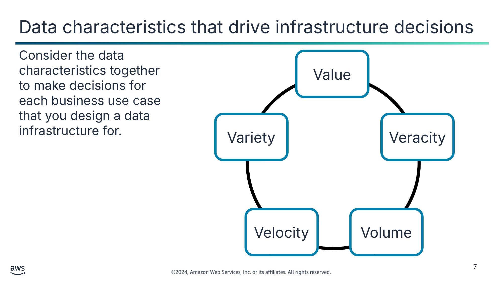

Consider the data characteristics together to make decisions for each business use case that you design a data infrastructure for.

<details>
<summary>Текст зі схеми</summary>

Value

````````````````````=`

Variety

Veracity

Velocity

Volume

</details>

> **Нотатки:**
>
> |Slide number 7  
> |Instructor notes  
> |  
> |Student notes  
> The five Vs of data characteristics are value, veracity, volume, velocity, and variety. They are shown in a circle because they each impact decision-making. Making decisions about the infrastructure is not done in a linear way.

---

## Слайд 8: Five Vs of data

| Data Characteristics | Scope | Questions to Consider |
|---|---|---|
| Value | How processed data can provide insight into a business problem | What insights can be gained from the data? |
| Veracity | How to protect and strengthen the integrity of data | How accurate, precise, and trusted is the data? |
| Volume | How much data you need to process | How long do you need to keep the data? What are the access patterns? |
| Velocity | How quickly data enters and moves through your pipeline | • How frequently is data generated?<br>• How quickly does the data need to be acted on? |
| Variety | How many data sources and data types you work with | What is the format and type of the data? What sources does the data come from? |

> **Нотатки:**
>
> |Slide number 8  
> |Instructor notes  
> |This is the compact version of the five Vs of data. For more explanation and examples of each data characteristic, refer to the slides in the Appendix section at the end of this slide deck.  
> |  
> |Student notes  
> Each of the five characteristics of data refers to a specific aspect of data that impacts the infrastructure design:  
> Value is about ensuring that you are getting the most out of the data that you have collected. Value is also about ensuring that there is business value in the outputs from collecting, storing, and processing data.  
> Veracity is about the accuracy and trustworthiness of the data. These elements are important because they are the foundation of the analysis that you do to make decisions. Consider where your data is coming from and how its integrity can be protected as it goes through the data pipeline.  
> The volume of data impacts the infrastructure of getting the data into the pipeline, processing the data, and keeping it. How you choose to store your data depends on how often you want to access and process your data.  
> The amount of data and the pace of data drive design choices. The combination of volume and velocity has a direct impact on how your pipeline needs to be architected.  
> Different data types will lend themselves to certain types of processing and analysis. This will impact how the data gets into the pipeline and the process to prepare it for analysis.  
>
> Consider these points as you evaluate the characteristics of data:  
> Have the end user in mind as you design the infrastructure and make decisions.  
> Value depends on veracity because without good data you could make bad business decisions.  
> Understand the duration of keeping the data and the access frequency to weigh the cost and benefits of storage.  
> Volume and velocity together drive the expected throughput and scaling requirements of your pipeline. For use cases with equally high volume, the velocity of the arrival of the data and the speed with which the data must be processed will impact the pipeline infrastructure you design.  
> Combining datasets can enrich analysis but can also complicate processing.

---

## Слайд 9: Three-pronged strategy to build data infrastructures

Modernize

Unify

Innovate

Move to a cloud-based infrastructure and purpose-built services to reduce undifferentiated lifting.

Create a single source of truth for data, and make the data available across the organization.

Apply artificial intelligence and machine learning (AI/ML) to find new insights in the data.

> **Нотатки:**
>
> |Slide number 9  
> |Instructor notes  
> |  
> |Student notes  
> Now that you are familiar with the data characteristics needed to make business and infrastructure decisions, consider the overall approach for dealing with data.  
>
> The approach for organizations that want to become data driven is to modernize, unify, and innovate with their data infrastructures:  
> Modernizing is about moving to cloud-based infrastructures and purpose-built services to reduce administrative and operational effort. This will increase agility and reduce undifferentiated lifting.  
> Unifying is about creating a single source of truth for data and making the data available across the organization. This unifies the best elements of both data lakes and purpose-built data stores.  
> Innovating is about looking for new ways to find value in the data—specifically, applying artificial intelligence and machine learning (AI/ML) to find new insights. With AI/ML, you can innovate new experiences and reimagine old processes.

---

## Слайд 10: A solution for a modern data architecture

Centralized location to access data and run analytics and AI/ML applications.

- Integrates a data lake, a data warehouse, and other purpose-built data stores
- Supports unified access, permissions, authorization, and seamless data movement
- Provides access to all of the data to make better decisions with agility


Data lake

> **Нотатки:**
>
> |Slide number 10  
> |Instructor notes  
> |  
> |Student notes  
> Problem: Organizations want to capture all of their data to derive value from it as quickly as possible. To efficiently analyze all of the data that is spread across the data lake and other data stores, businesses often move data in and out of the data lake and between these data stores. This data movement can get complex and messy as the data grows in these data stores.  
>
> Solution: The goal of the modern data architecture is to store data in a centralized location and make it available to all consumers to perform analytics and run AI/ML applications. A modern data architecture integrates a data lake, a data warehouse, and other purpose-built data stores while enabling unified governance and seamless data movement. It isn't restricted by separate data silos. This way, organizations can store their data in a data lake and use purpose-built data stores that work with the data lake. This approach provides access to all of the data to make better decisions with agility.  
>
> The concept to remember is that the modern data architecture integrates a data lake, a data warehouse, and other purpose-built data stores while enabling unified governance and seamless data movement to help an organization get the most value from its data.

---

## Слайд 11: Key takeaways: Data characteristics

- Five data characteristics are value, veracity, volume, velocity, and variety.
- Consider the data characteristics together to make decisions about the infrastructure design for each business use case.
- Value and veracity impact accurate insights that the business needs. Volume and velocity *together* drive the expected throughput and scaling requirements of your pipeline.
- The goal of the modern data architecture is to store data in a centralized location and make it available to all consumers to perform analytics and run AI/ML applications.

> **Нотатки:**
>
> |Slide number 11  
> |Instructor notes  
> |  
> |Student notes  
> Here are a few key points to summarize this section:  
> Consider the value, veracity, volume, velocity, and variety of your data as you make infrastructure design decisions for each business use case.  
> Value and veracity are about making sure you have accurate data that leads to insights that meet business requirements.  
> The amount of data (volume), the pace of data (velocity), and the types of data (variety) drive pipeline design choices.

---

## Слайд 12: Data pipelines

Data Engineering Patterns

> **Нотатки:**
>
> |Slide number 12  
> |Instructor notes  
> |  
> |Student notes  
> This section provides an overview of data pipelines and explains four ingestion patterns.

---

## Слайд 13: Elements of a data pipeline

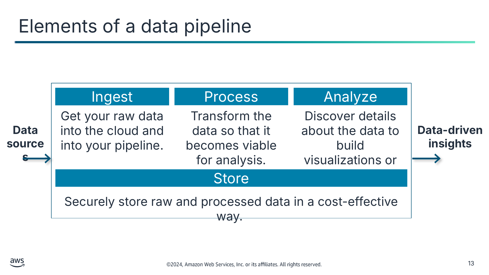

<details>
<summary>Текст зі схеми</summary>

Ingest

Process

Analyze

Get your raw data into the cloud and into your pipeline.

Transform the data so that it becomes viable for analysis.

Discover details about the data to build visualizations or predictions.

**Data sources**

**Data-driven insights**

Store

Securely store raw and processed data in a cost-effective way.

</details>

> **Нотатки:**
>
> |Slide number 13  
> |Instructor notes  
> |This is the high-level pipeline that shows storage as part of all three layers of data ingestion, processing, and analysis.  
> |  
> |Student notes  
> At the most basic level, any data pipeline infrastructure must be able to bring data in, store it, and provide the means to work with the data to derive insights. These elements are ingestion, storage, processing, and analysis of data.  
>
> Data is processed iteratively to evaluate and improve upon results. A linear pipeline is a simplified version of this iterative process.  
>   
> Looking at the pipeline from the perspective of the data that travels through it, the pipeline must support the ability to discover details about the data and how it fits (or doesn't fit) your intended outcomes.  
>
> For each use case, start with the end in mind (the business problem) and build the data pipeline that supports it. The characteristics of your data and the business problem that you are addressing will determine the elements of the pipeline and iterative process.  
>
> Ingestion is the process of extracting data from its source and loading it into a data pipeline to be stored or analyzed. Data ingestion involves copying data from a source data store to a target data store.

---

## Слайд 14: Homogeneous ingestion pattern

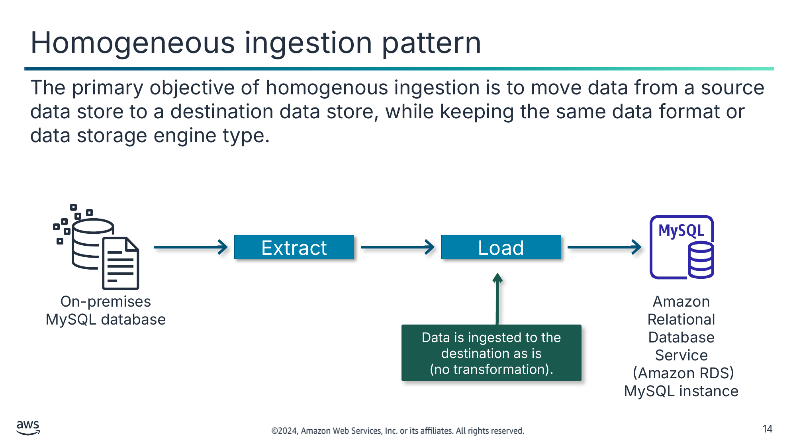

The primary objective of homogenous ingestion is to move data from a source data store to a destination data store, while keeping the same data format or data storage engine type.

<details>
<summary>Текст зі схеми</summary>

On-premises

MySQL database

Amazon Relational Database Service  
 (Amazon RDS)

MySQL instance

Extract

Load

Data is ingested to the destination as is  
(no transformation).

</details>

> **Нотатки:**
>
> |Slide number 14  
> |Instructor notes  
> |The slide titled “Transforming data during ingestion” lists four ways data could be transformed as it is made viable for analysis. It is located in the Appendix section of this module.  
> |  
> |Student notes  
> When data is ingested in as-is format, the classification is homogeneous.  
>
> The slide shows a data migration process in which data is extracted from an on-premises NoSQL database and loaded onto an Amazon Relational Database Service (Amazon RDS) MySQL database. This data is ingested as is without any transformation.  
>
> Another use case for homogeneous ingestion is populating a landing area where all of the original copies of the ingested data are kept. In this case, raw text files need to be stored without necessarily having to be transformed in any way.  
>
> Raw data can be inconsistent, imprecise, and repetitive. The data being ingested might need to be transformed to extract high-quality data.  
>   
> Data will almost always be transformed as it moves through the pipeline. This transformation involves converting and structuring the data in a way that matches the schema of the target location.

---

## Слайд 15: Heterogeneous ingestion patterns

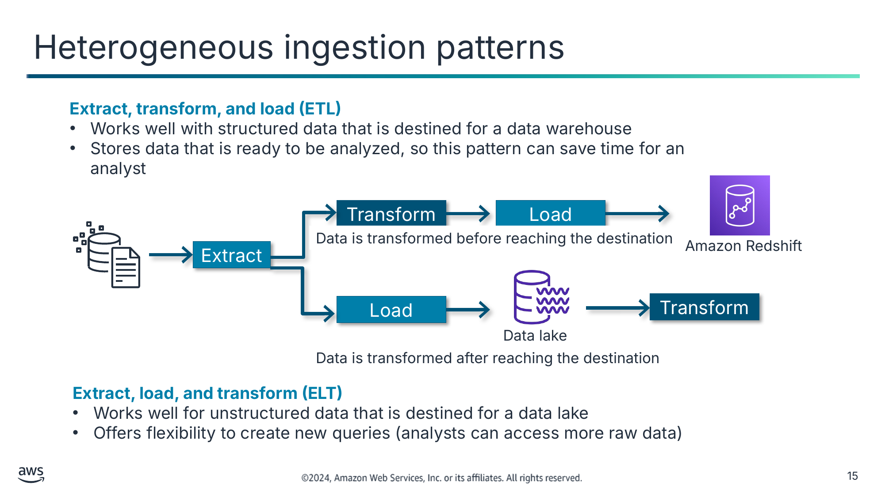

**Extract, transform, and load (ETL)**

- Works well with structured data that is destined for a data warehouse
- Stores data that is ready to be analyzed, so this pattern can save time for an analyst

**Extract, load, and transform (ELT)**

- Works well for unstructured data that is destined for a data lake
- Offers flexibility to create new queries (analysts can access more raw data)

<details>
<summary>Текст зі схеми</summary>

Transform

Load

Data is transformed before reaching the destination

Extract

Amazon Redshift

Transform

Load

Data lake

Data is transformed after reaching the destination

</details>

> **Нотатки:**
>
> |Slide number 15  
> |Instructor notes  
> |  
> |Student notes  
> The following are the steps in an extract, transform, and load (ETL) pipeline:  
> Extract structured data.  
> Transform the data into a format that matches the destination.  
> Load the data into structured storage for defined analytics.  
>
> The following are the steps in an extract, load, and transform (ELT) pipeline:  
> Extract unstructured or structured data.  
> Load the data into the storage destination in the format that is as close as possible to the raw form.  
> Transform the data as needed for analytics scenarios.  
>
> Throughout this module, you will see multiple use cases with heterogenous ingestion and processing patterns.

---

## Слайд 16: Batch and streaming processing patterns

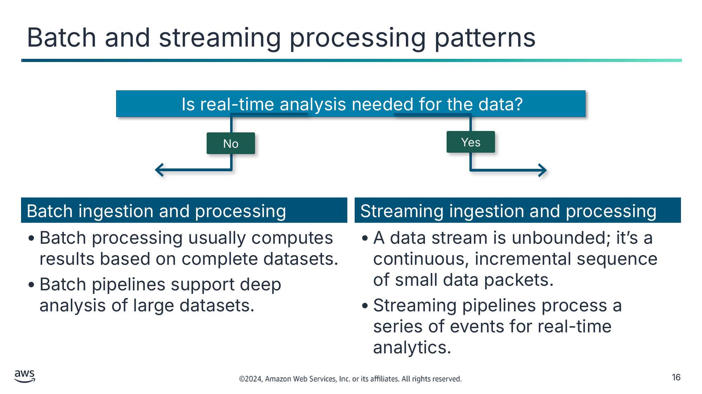

Batch ingestion and processing

Streaming ingestion and processing

- Batch processing usually computes results based on complete datasets.
- Batch pipelines support deep analysis of large datasets.

- A data stream is unbounded; it’s a continuous, incremental sequence of small data packets.
- Streaming pipelines process a series of events for real-time analytics.

<details>
<summary>Текст зі схеми</summary>

Is real-time analysis needed for the data?

No

Yes

</details>

> **Нотатки:**
>
> |Slide number 16  
> |Instructor notes  
> |The focus is on the use case and business need when determining whether to choose batch or streaming ingestion patterns.  
> |  
> |Student notes  
> In batch pipelines, every command is run on the entire batch of data. This could be run on demand, on a schedule, or based on an event.  
>
> In streaming pipelines, streaming data is generated continuously by thousands of data sources simultaneously. As new data arrives, metrics or reports are incrementally updated.

---

## Слайд 17: Comparison of batch and streaming processing patterns

| Features | Batch Processing | Streaming Processing |
|---|---|---|
| Data Processing Cycles | Processing pipelines run infrequently and typically during off-peak hours | Processing pipelines run continuously |
| Compute Requirements | Requires high computing power | Requires low computing power and reliable, low-latency network connections |
| Use Case | Sales transaction data is analyzed overnight, and reports are sent to branches in the morning. | When providing a product recommendation, data must be analyzed immediately. |

> **Нотатки:**
>
> |Slide number 17  
> |Instructor notes  
> |  
> |Student notes  
> This module will cover batch and streaming ingestion in detail later.

---

## Слайд 18: Key takeaways: Data pipelines

- A data pipeline includes layers to ingest, store, process, and analyze data.
- Data ingestion is the process of extracting data from its source and loading it into a data pipeline to be stored or analyzed.
- In homogenous ingestion, data doesn’t need to be transformed because the source and destination match. When transformation is needed, heterogenous ingestion can involve ETL or ELT patterns.
- If the data needs to be analyzed in near real time, consider streaming ingestion methods instead of batch ingestion.

> **Нотатки:**
>
> |Slide number 18  
> |Instructor notes  
> |  
> |Student notes  
> Here are a few key points to summarize this section:  
> A data pipeline has layers to ingest, store, process, and analyze data.  
> Data ingestion involves extracting and loading the data.  
> Homogenous ingestion does not include transformation.  
> Heterogenous ingestion does includes transformation, which could be before (ETL) or after (ELT) loading.  
> Streaming ingestion is suitable for real-time data analysis.

---

## Слайд 19: AWS tools to ingest data

Data Engineering Patterns

> **Нотатки:**
>
> |Slide number 19  
> |Instructor notes  
> |  
> |Student notes  
> This section describes the function of four AWS tools for ingesting data.

---

## Слайд 20: Ingestion layer of the data pipeline

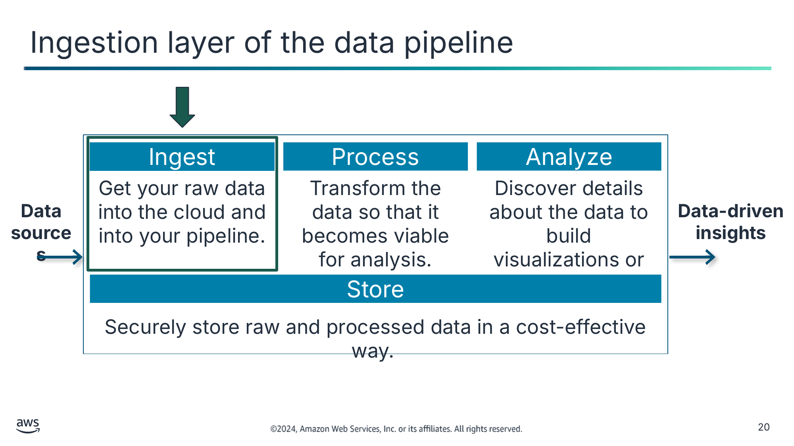

<details>
<summary>Текст зі схеми</summary>

Ingest

Process

Analyze

Get your raw data into the cloud and into your pipeline.

Transform the data so that it becomes viable for analysis.

Discover details about the data to build visualizations or predictions.

**Data sources**

**Data-driven insights**

Store

Securely store raw and processed data in a cost-effective way.

</details>

> **Нотатки:**
>
> |Slide number 20  
> |Instructor notes  
> |This is the high-level pipeline that shows storage as part of all three layers of data ingestion, processing, and analysis.  
> |  
> |Student notes  
> Ingestion is the process of extracting data from its source and loading it into a data pipeline to be stored or analyzed. Data ingestion involves copying data from a source data store to a target data store.  
>   
> AWS tools for ingesting data are related to the ingestion layer of the data pipeline.

---

## Слайд 21: Matching ingestion services to data sources

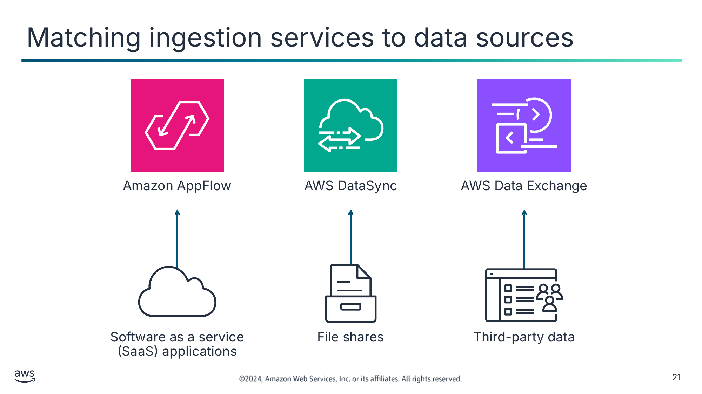

<details>
<summary>Текст зі схеми</summary>

Amazon AppFlow

AWS DataSync

AWS Data Exchange

Software as a service (SaaS) applications

File shares

Third-party data

</details>

> **Нотатки:**
>
> |Slide number 21  
> |Instructor notes  
> |  
> |Student notes  
> AWS tools for ingesting are purpose-built services that can be organized based on source types. These services include the following:  
> Amazon AppFlow can ingest from software as a service (SaaS) applications such as Salesforce or Zendesk.  
> AWS DataSync can ingest from file shares.  
> AWS Data Exchange can provide a streamlined experience to access third-party data.

---

## Слайд 22: Amazon AppFlow

- Provides the ability to transfer data between SaaS applications and AWS services
- Offers reuse of available service integrations with available Amazon AppFlow APIs
- Provides data transformation capabilities

Amazon AppFlow

> **Нотатки:**
>
> |Slide number 22  
> |Instructor notes  
> |  
> |Student notes  
> Companies rely on SaaS services for mission-critical workflows, and they face challenges when collecting data from a growing environment of services into a centralized location.  
>
> Amazon AppFlow automates data flows between SaaS and AWS services. This automation gives businesses the ability to derive insight from that data.  
>
> It can take months for a developer to build and manage a connector. With Amazon AppFlow, you can integrate applications immediately instead of spending months building and managing connectors to integrate applications.  
>
> Amazon AppFlow provides data transformation capabilities, such as filtering, masking, validating, partitioning, aggregating, and data cataloging.  
>
> Sources of data for SaaS applications include Salesforce, SAP, Google Analytics, Facebook Ads, Zendesk, and ServiceNow. AWS service destinations include Amazon Simple Storage Service (Amazon S3) and Amazon Redshift.

---

## Слайд 23: AWS DataSync

- Is a fully managed data migration service
- Simplifies, automates, and accelerates copying file and object data to and from AWS storage services
- Is optimized for speed
- Includes encryption and integrity validation
- Preserves metadata when moving data

DataSync

> **Нотатки:**
>
> |Slide number 23  
> |Instructor notes  
> |In the Appendix section, the slide titled “AWS DataSync: Transfer between on-premises and AWS” provides the architecture diagram of a use case in which researchers have data on an on-premises server and need to access the data in the AWS cloud for archiving and analytics.  
> |  
> |Student notes  
> With DataSync, you can move large amounts of data to and from on-premises data centers to the AWS Cloud. You can also move data between Amazon S3, Amazon Elastic File System (Amazon EFS), and Amazon FSx.  
>
> You can schedule replication tasks to synchronize data between the source and destination on an hourly, daily, or weekly basis.  
>
> The data transfer includes encryption and integrity validation to help ensure that data arrives securely, intact, and ready to use.

---

## Слайд 24: AWS Data Exchange

- Provides customers with a way to find, subscribe to, and use third-party data in the cloud
- Bridges the gap between providers and subscribers who exchange data by supporting data delivery through files, tables, and APIs
- Simplifies finding, preparing, and using data in the cloud

AWS Data Exchange

> **Нотатки:**
>
> |Slide number 24  
> |Instructor notes  
> |  
> |Student notes  
> AWS Data Exchange simplifies and streamlines data exchange. AWS Data Exchange helps businesses find the data they’re searching for using a comprehensive catalog. Custom and private products are available for situations when customers want data that’s not in the public catalog.  
>
> AWS Data Exchange bridges the gap between providers and subscribers who exchange data by supporting data. This helps customers lower costs, become more agile, and innovate faster. It supports data delivery through files, tables, and APIs so that customers can start using the data they want in production as soon as they license it without spending months building data ingestion pipelines to get it there.  
>
> The following are some use cases of how businesses use AWS Data Exchange to get third-party data in order to enhance their analytics solutions:  
> Pharmaceutical companies use life expectancy benchmarks to research new drugs.  
> Retailers leverage weather data to anticipate customer needs and optimize inventory planning.  
> Restaurants subscribe to location data to identify places to expand.

---

## Слайд 25: Key takeaways: AWS tools to ingest data

- To ingest data, consider purpose-built tools that will reduce undifferentiated lifting.
- Amazon AppFlow can ingest from SaaS applications, such as Salesforce and Zendesk.
- DataSync can ingest from file shares.
- AWS Data Exchange provides customers with a way to find, subscribe to, and use third-party data in the cloud.

> **Нотатки:**
>
> |Slide number 25  
> |Instructor notes  
> |  
> |Student notes

---

## Слайд 26: Processing batch data

Data Engineering Patterns

> **Нотатки:**
>
> |Slide number 26  
> |Instructor notes  
> |  
> |Student notes  
> This section describes how AWS Glue assists in batch ingestion and processing. It also describes how AWS Glue transforms data.

---

## Слайд 27: Processing layer of the data pipeline

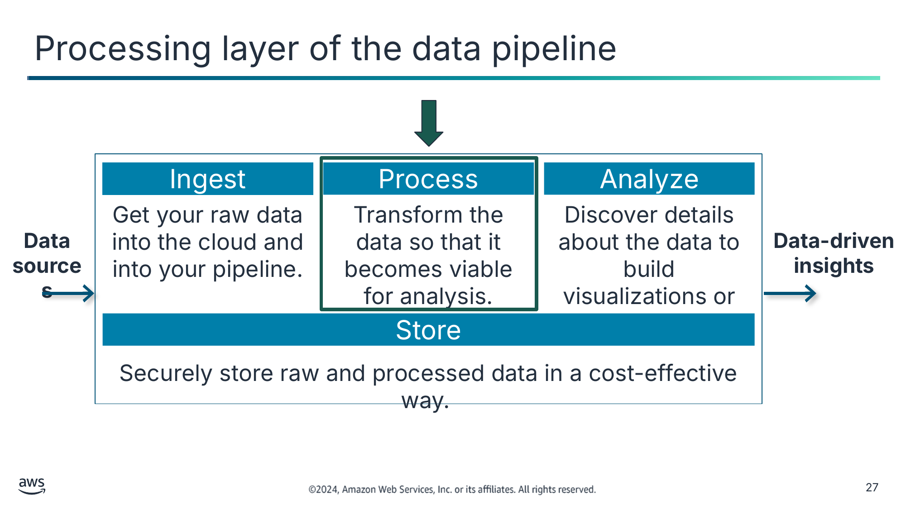

<details>
<summary>Текст зі схеми</summary>

Ingest

Process

Analyze

Get your raw data into the cloud and into your pipeline.

Transform the data so that it becomes viable for analysis.

Discover details about the data to build visualizations or predictions.

**Data sources**

**Data-driven insights**

Store

Securely store raw and processed data in a cost-effective way.

</details>

> **Нотатки:**
>
> |Slide number 27  
> |Instructor notes  
> |This is the high-level pipeline that shows storage as part of all three layers of data ingestion, processing, and analysis.  
> |  
> |Student notes  
> After ingestion, data is processed and transformed in the data pipeline. This section discusses batch processing.

---

## Слайд 28: Batch ingestion and processing

Consider a banking system that receives financial transactions throughout the day.

The system collects and processes all the financial transactions at the end of each day to provide reports to stakeholders and third-party systems.

Periodically complete high-volume, repetitive data jobs

Compute-intensive tasks are processed in batches, often in off-peak times

Used for daily and weekly reporting

> **Нотатки:**
>
> |Slide number 28  
> |Instructor notes  
> |  
> |Student notes  
> To understand batch ingestion and processing, consider a banking system that receives financial transactions throughout the day. Instead of processing every transaction as it occurs, the system collects all the financial transactions at the end of each day to provide reports to stakeholders or third-party systems.  
>
> Concepts of batch processing are apparent in this use case.  
>
> Companies use batch processing because it makes repetitive tasks more efficient to run, and it uses processing power more cost-effectively.  
>
> Certain data processing tasks, such as backing up, filtering, and sorting, can be compute intensive and inefficient to run on individual data records.  
>
> Instead, data systems process such tasks in batches, often during off-peak times when computing resources are more commonly available, such as at the end of the day or overnight.

---

## Слайд 29: When to consider batch processing

- For reporting purposes
- When dealing with large datasets
- When the analytics use case is focused more on aggregating or transforming data and less on real-time analysis of data


> **Нотатки:**
>
> |Slide number 29  
> |Instructor notes  
> |  
> |Student notes  
> One use case of batch ingestion and processing is the medical research field. Analysis of large amounts of data is a common requirement in the field of research. There is no need for real-time analysis.  
>
> AWS customers can apply batch processing in data analytics applications such as computational chemistry, clinical modeling, molecular dynamics, and genomic sequencing testing and analysis.

---

## Слайд 30: AWS Glue

- Is a data integration service that helps automate and perform ETL tasks as part of ingesting data into a pipeline
- Provides the ability to read and write data from multiple systems and databases
- Simplifies batch and streaming ingestion

AWS Glue

> **Нотатки:**
>
> |Slide number 30  
> |Instructor notes  
> |Only some of the features of AWS Glue are covered in this section.  
> |  
> |Student notes  
> AWS Glue is a data integration service that helps you to automate and perform ETL tasks as part of ingesting data into your batch or streaming pipeline.  
>
> You can consider AWS Glue as a multi-purpose tool with many different capabilities for data integration. With AWS Glue, AWS customers can read and write data from multiple systems and databases.  
>
> AWS Glue integrates with Amazon S3, Amazon DynamoDB, Amazon Redshift, Amazon RDS, and Amazon DocumentDB (with MongoDB compatibility).

---

## Слайд 31: AWS Glue components

ETL jobs

AWS Glue Data Catalog

AWS Glue DataBrew

AWS Glue Data Quality

- Data transformation jobs

- Data discovery and organization

- No-code service to prepare and clean data

- Data quality assessment

> **Нотатки:**
>
> |Slide number 31  
> |Instructor notes  
> |  
> |Student notes  
> The AWS Glue Data Catalog stores metadata about datasets, including schema information about data sources and targets of your ETL jobs. Data Catalog does not store any datasets.  
>
> For a given dataset, AWS customers can store its table definition and physical location, add business-relevant attributes, and track how this data has changed over time.  
>   
> With AWS Glue ETL, you can create or edit jobs for data transformation. AWS Glue ETL has a visual interface (AWS Glue Studio) from which you can author, run, and monitor AWS Glue ETL jobs without coding.  
>
> AWS Glue Streaming ETL processing capabilities speed up the availability of your stream data for analysis.  
>
> With AWS Glue DataBrew, you can clean and normalize data with a visual interface. DataBrew collects a set of descriptive metadata to refer to the data.  
>
> You can choose from more than 250 prebuilt transformations to automate data preparation tasks such as filtering anomalies, converting data to standard formats, and correcting invalid values, all without the need to write any code.  
>   
> AWS Glue Data Quality assesses a dataset to compute statistics, recommends quality rules, monitors, and sends alerts when it detects that quality has deteriorated. This helps identify missing, stale, or bad data before it impacts your business.

---

## Слайд 32: AWS Glue is a data integration service to build modern data architectures

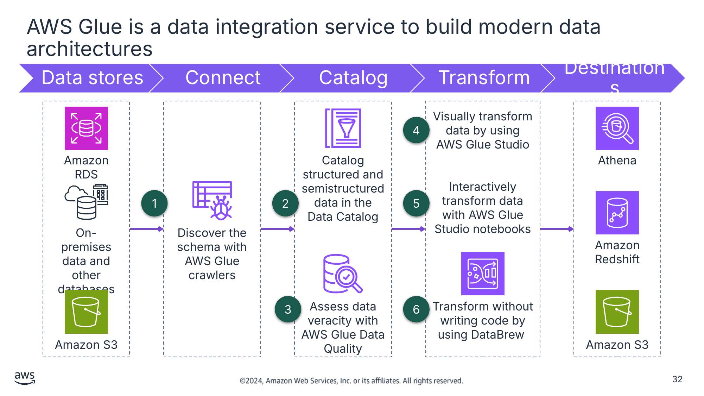

<details>
<summary>Текст зі схеми</summary>

Amazon RDS

On-premises data and other databases

Amazon S3

Discover the schema with AWS Glue crawlers

Catalog structured and semistructured data in the Data Catalog

Assess data veracity with AWS Glue Data Quality

Visually transform data by using AWS Glue Studio

Interactively transform data with AWS Glue Studio notebooks

Transform without writing code by using DataBrew

Athena

Amazon Redshift

Amazon S3

4

1

2

5

3

6

</details>

> **Нотатки:**
>
> |Slide number 32  
> |Instructor notes  
> |  
> |Student notes  
> AWS Glue crawlers run on your data stores, derive a schema from them, and populate the Data Catalog. The crawler creates or updates one or more Data Catalog database tables in the data catalog. Crawlers can run on many data stores, including Amazon S3, and many relational databases, including Amazon RDS.  
> The structured or semistructured data now has a schema. Having this schema makes it possible to access the data efficiently. When table definitions are added to the Data Catalog, they are available for ETL and are also readily available for querying in Amazon Athena, Amazon EMR, and Amazon Redshift Spectrum. An AWS Glue user can have a common view of data residing in each of these services. When AWS Glue starts to catalog the data, it will find data type discrepancies and provide notifications.  
> AWS Glue Data Quality automatically computes statistics, recommends quality rules, monitors data, and alerts you when it detects that the quality does not match the quality rule set. This feature helps identify missing, stale, or bad data before it impacts the business decisions.  
> With the scripts that the Data Catalog generates, you can use the visual AWS Glue console interface to write your scripts and author jobs. AWS Glue Studio provides a graphical interface to author ETL jobs. The visual interface helps users who don’t have a lot of coding experience to design jobs and accelerates the process for users who do have coding experience.  
> With AWS Glue Studio job notebooks, you can interactively author ETL jobs in a notebook interface based on Jupyter notebooks. AWS Glue Studio job notebooks require minimal setup and can be automatically converted into AWS Glue data integration jobs.  
> DataBrew is a visual data preparation tool to prepare data with an interactive, point-and-click visual interface without writing code. With DataBrew, you can visualize, clean, and normalize large amounts of data.

---

## Слайд 33: Gaming use case for a batch ETL pipeline

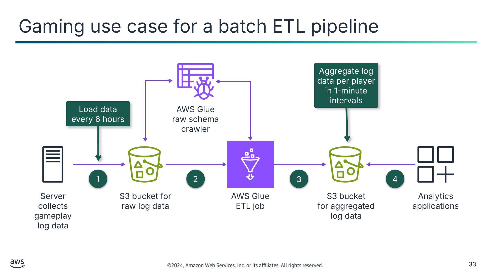

<details>
<summary>Текст зі схеми</summary>

Aggregate log data per player in 1-minute intervals

Load data every 6 hours

AWS Glue raw schema crawler

1

2

3

4

Server collects gameplay log data

S3 bucket for raw log data

AWS Glue ETL job

S3 bucket  
for aggregated log data

Analytics applications

</details>

> **Нотатки:**
>
> |Slide number 33  
> |Instructor notes  
> |  
> |Student notes  
> A gaming company produces a few gigabytes of user play data on a daily basis. This data might include details such as average session length, number of in-game purchases, and days since each player last played.  
>
> The company wants to use metrics from user profiles to predict the length of play sessions:  
> The game server that collects the user-generated data from the software pushes the data into an S3 bucket once every 6 hours.  
> AWS Glue raw schema crawlers run on the player logs and provide AWS Glue ETL with the data catalog.  
> Every 6 hours, when data gets loaded into the raw log data bucket, an AWS Glue job runs. The AWS Glue ETL job aggregates log data per player into 1-minute intervals.  
> The transformed data is available from the aggregated S3 bucket for multiple analytics applications to access.

---

## Слайд 34: AWS Glue as a data transformation service

.csv

.parquet

Convert .csv to .parquet

- Is the most common format to store tabular data
- Isn’t efficient to store or manipulate large amounts of data (more than 15 GBs)

- Stores data in a columnar fashion
- Is optimized for storage
- Is suitable for parallel processing

- Speeds up analytics workloads
- Over time, saves storage space, cost, and time

> **Нотатки:**
>
> |Slide number 34  
> |Instructor notes  
> |  
> |Student notes  
> AWS Glue is also a data transformation service. You can run an ETL job with AWS Glue ETL to transform the format of your data.  
>
> A common need when dealing with large data files is to convert the format from .csv (comma-separated values) to Apache Parquet to read and store efficiently.  
>
> The Parquet format is built to support efficient compression and encoding schemes. It can speed up your analytics workloads because it stores data in a columnar fashion. It is suitable for parallel processing because files can be split into separate chunks.

---

## Слайд 35: Advanced transformation using AWS Glue

Transforming data to detect and remove personally identifiable information (PII) before analysis

Scan data that has sensitive information

Detect PII entities (such as a passport number)

Remediate the data

> **Нотатки:**
>
> |Slide number 35  
> |Instructor notes  
> |  
> |Student notes  
> Another example of transformation that is supported by AWS Glue and DataBrew is the detection and removal of sensitive or personally identifiable information (PII).  
>
> With AWS Glue PII detection, you scan your data. When entities such as passport number or Social Security number are detected, you can either mask the data or store the result of the detect for further inspection.  
>
> For more information, see AWS Glue Studio on the content resources page of your online course.

---

## Слайд 36: Key takeaways: Processing batch data

- Batch ingestion and processing make high-volume, repetitive tasks more efficient to run.
- AWS Glue provides functionality for schema identification, data cataloging, data preparation and cleaning, ETL job authoring, and data quality assessment.
- Use AWS Glue when an analytics use case doesn’t require real-time aggregation or transformation of data.

> **Нотатки:**
>
> |Slide number 36  
> |Instructor notes  
> |  
> |Student notes

---

## Слайд 37: Processing real-time data

Data Engineering Patterns

> **Нотатки:**
>
> |Slide number 37  
> |Instructor notes  
> |  
> |Student notes  
> This section describes the streaming pipeline workflow and services related to handling real-time data.

---

## Слайд 38: Real-time processing layer of the data pipeline

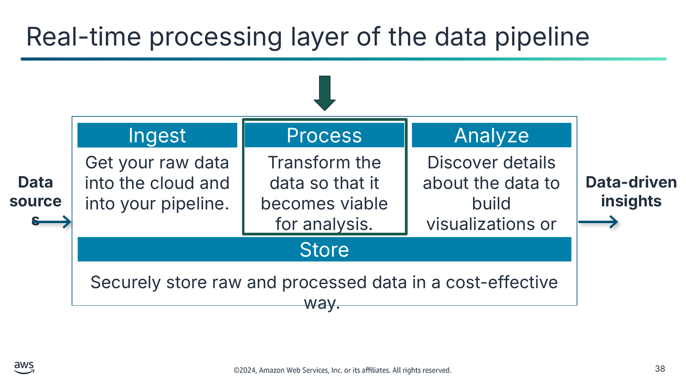

<details>
<summary>Текст зі схеми</summary>

Ingest

Process

Analyze

Get your raw data into the cloud and into your pipeline.

Transform the data so that it becomes viable for analysis.

Discover details about the data to build visualizations or predictions.

**Data sources**

**Data-driven insights**

Store

Securely store raw and processed data in a cost-effective way.

</details>

> **Нотатки:**
>
> |Slide number 38  
> |Instructor notes  
> |This is the high-level pipeline that shows storage as part of all three layers of data ingestion, processing, and analysis.  
> |  
> |Student notes  
> After ingestion, data is processed and transformed in the data pipeline. Data processing in real time is discussed in this section.

---

## Слайд 39: Streaming data

Streaming data is emitted at high volume in a continuous, incremental manner with the goal of low-latency processing.

An online gaming company collects streaming data about player-game interactions and feeds the data into its gaming platform. The data gets analyzed in real time and the company offers incentives and dynamic experiences to engage players.

> **Нотатки:**
>
> |Slide number 39  
> |Instructor notes  
> |  
> |Student notes  
> The processing of streaming data is beneficial in most scenarios where new, dynamic data is generated on a continual basis. It applies to most of the industry segments and big data use cases. Companies generally begin with less complex applications, such as collecting system logs, and rudimentary processing, such as rolling min-max computations. Then, these applications evolve to more sophisticated near real-time processing.  
>
> For example, businesses can track changes in public sentiment on their brands and products by continually analyzing social media streams and can respond in a timely fashion as needed.

---

## Слайд 40: Streaming pipeline workflow and concepts

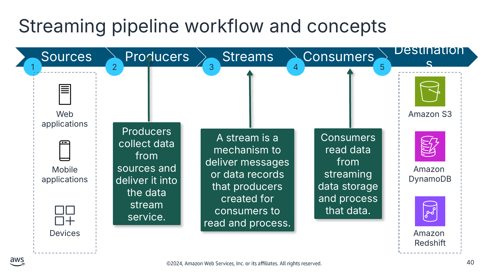

<details>
<summary>Текст зі схеми</summary>

1

2

3

4

5

Web applications

Amazon S3

Producers collect data from sources and deliver it into the data stream service.

A stream is a mechanism to deliver messages or data records that producers created for consumers to read and process.

Consumers read data from streaming data storage and process that data.

Mobile applications

Amazon  
DynamoDB

Devices

Amazon  
Redshift

</details>

> **Нотатки:**
>
> |Slide number 40  
> |Instructor notes  
> |  
> |Student notes  
> These are the elements of a streaming pipeline in which data is consumed in near real time and given to the consumer:  
> The streaming data can come from multiple sources.  
> Producers collect data from sources and deliver it into the data stream service.  
> A stream is a mechanism to deliver messages or data records created by producers to be read and processed by consumers.  
> Consumers read data from streaming data storage and process that data.  
> The data can go to multiple destinations.

---

## Слайд 41: AWS streaming services

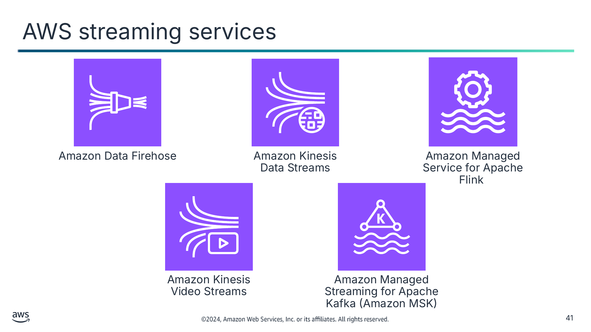

Amazon Data Firehose

Amazon Kinesis  
Data Streams

Amazon Managed Service for Apache Flink

Amazon Kinesis  
Video Streams

Amazon Managed Streaming for Apache Kafka (Amazon MSK)

> **Нотатки:**
>
> |Slide number 41  
> |Instructor notes  
> |  
> |Student notes  
> Amazon Kinesis Data Streams collects and ingests large streams of data records in real time.  
>
> Amazon Data Firehose delivers near real-time streaming data to supported destinations.  
>
> Amazon Managed Service for Apache Flink is a serverless service to query and analyze streaming data in real time.  
>
> Amazon Kinesis Video Streams securely streams video from connected devices to AWS for analytics and other processing.  
>
> Amazon Managed Streaming for Apache Kafka (Amazon MSK) is a fully managed Apache Kafka service that can be deployed in a VPC.

---

## Слайд 42: Amazon Data Firehose

- Captures and transforms streaming data in near real time
- Is used to deliver data to common storage and analytics destinations
- Delivers data to the storage destination by using micro batch cycles
- Can convert the input data format from JSON to Parquet before storing the data
- Doesn't require coding to use this service

Firehose

> **Нотатки:**
>
> |Slide number 42  
> |Instructor notes  
> |  
> |Student notes  
> Some of the destinations are Amazon S3, Amazon Redshift, Amazon OpenSearch Service, and any custom HTTP endpoint or HTTP endpoints owned by supported third-party service providers.  
>
> For micro batch cycles, a server waits for a short duration of time (milliseconds up to several seconds) before initiating a batch operation. Micro batching makes sense when a quicker response time than batch processing is required, but you can wait for a short duration. It’s not as quick as streaming. This approach balances latency and throughput.  
>
> Firehose can convert the format of your input data from JSON to Apache Parquet before storing the data in Amazon S3. Parquet and ORC (Optimized Row Columnar) are columnar data formats that save space and make faster queries possible compared to row-oriented formats such as JSON.

---

## Слайд 43: Streaming pipeline workflow using Firehose

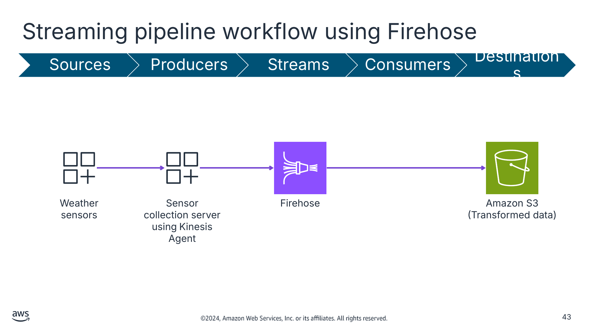

<details>
<summary>Текст зі схеми</summary>

Firehose

Amazon S3  
(Transformed data)

Weather sensors

Sensor collection server using Kinesis Agent

</details>

> **Нотатки:**
>
> |Slide number 43  
> |Instructor notes  
> |Firehose is introduced here.  
> |  
> |Student notes  
> An example use case is to collect and ingest weather data from Internet of Things (IoT) sensors and satellite databases by using Kinesis Data Streams. Then transform the data by using Firehose and store the data in Amazon S3.  
>
> In this use case, the goal was to deliver the weather data to an S3 bucket, and Firehose simplified this process.  
>   
> Firehose features near real-time processing capabilities. It loads new data into the storage destination within 60 seconds after the data is sent to the service.  
>
> For faster processing capabilities, you can use Kinesis Data Streams.

---

## Слайд 44: Amazon Kinesis Data Streams

- Ingests stream log and event data
- Provides temporary storage for streaming data (up to 365 days)
- Is used for real-time delivery, within 60 seconds
- Provides the ability for multiple consumers to replay stream data at the same time
- Uses the Kinesis Producer Library (KPL) and Kinesis Consumer Library (KCL) to connect with Kinesis Streams

Kinesis Data Streams

> **Нотатки:**
>
> |Slide number 44  
> |Instructor notes  
> |  
> |Student notes

---

## Слайд 45: Producers and consumers in a streaming pipeline

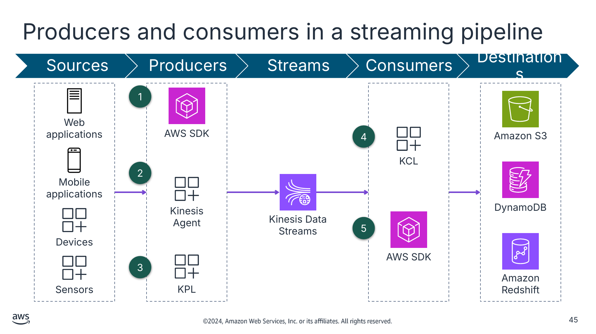

<details>
<summary>Текст зі схеми</summary>

1

Web applications

AWS SDK

4

Amazon S3

KCL

2

Mobile applications

DynamoDB

Kinesis Agent

Kinesis Data  
Streams

5

Devices

3

AWS SDK

Amazon  
Redshift

Sensors

KPL

</details>

> **Нотатки:**
>
> |Slide number 45  
> |Instructor notes  
> |This slide explains producers and consumers.  
> |  
> |Student notes  
> To benefit from the faster processing capabilities of Kinesis Data Streams, producers and consumers are needed in the streaming pipeline.  
>
> Producers write data into the stream. There are several ways to send data to Kinesis Data Streams. Having multiple methods provides flexibility in the designs of your solutions.  
> You can write code by using the AWS SDK, which supports multiple popular languages.  
> You can use Amazon Kinesis Agent, a tool for sending data to Kinesis Data Streams.  
> The Kinesis Producer Library (KPL) enhances the data ingestion capabilities covered in the AWS Kinesis Data Streams API. KPL simplifies the retry, batching, and optimization of writes to a Kinesis data stream.  
>
> To read and process data from Kinesis Data Streams, you need to create a consumer application:  
> You can use the Kinesis Client Library (KCL). KCL helps to consume and process data from a Kinesis data stream by taking care of complex tasks associated with distributed processing. For example, the KCL can automatically load balance record processing across many instances, give the user the ability to checkpoint records that are already processed, and handle instance failures. With the KCL, you can focus on writing your record-processing logic.  
> You can also use AWS Kinesis SDKs to read from a Kinesis data stream to provide a finer level of control. This is suitable for experienced developers to use.

---

## Слайд 46: Streaming pipeline workflow using Kinesis Data Streams

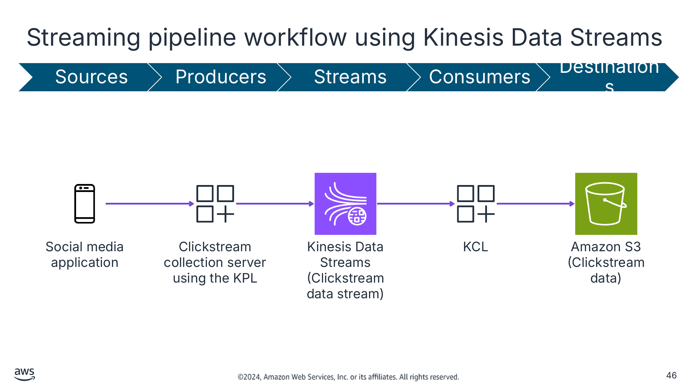

<details>
<summary>Текст зі схеми</summary>

Social media application

Clickstream collection server using the KPL

Kinesis Data Streams  
(Clickstream  
data stream)

KCL

Amazon S3

(Clickstream data)

</details>

> **Нотатки:**
>
> |Slide number 46  
> |Instructor notes  
> | This slide introduces Kinesis Data Streams.  
> |  
> |Student notes  
> Kinesis Data Streams is a service that ingests and provides temporary storage for streaming data. It can capture stream log and event data, run real-time analytics, and build event-driven applications.  
>   
> An example use case is to collect clickstream data from social media, stream it, hold it in temporary storage, and then put it into permanent storage.  
> Sources: The data is from a social media mobile application.  
> Producers: A producer application collects data from the mobile applications and delivers it into the data stream service.  
> Streams: Kinesis Data Streams is a service that ingests and stores streaming data.  
> Consumers: A consumer application reads data from the streaming data storage and processes that data for downstream usage.  
> Destination: The data goes to persistent storage in this use case.

---

## Слайд 47: Amazon Managed Service for Apache Flink

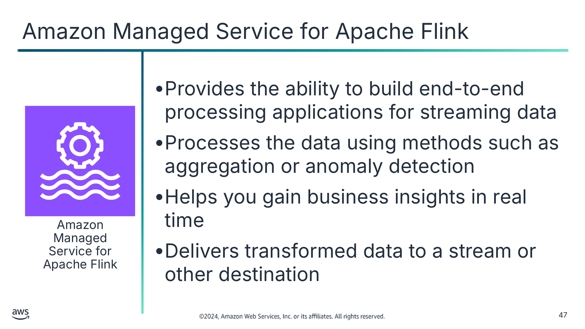

- Provides the ability to build end-to-end processing applications for streaming data
- Processes the data using methods such as aggregation or anomaly detection
- Helps you gain business insights in real time
- Delivers transformed data to a stream or other destination

Amazon Managed Service for Apache Flink

> **Нотатки:**
>
> |Slide number 47  
> |Instructor notes  
> |  
> |Student notes  
> Amazon Managed Service for Apache Flink continually reads and analyzes data from a connected streaming source in real time. It is used to process data and gets insights in seconds or minutes rather than waiting days or even weeks. With Kinesis Data analytics, you can quickly build end-to-end stream processing applications for log analytics, clickstream analytics, IoT, ad tech, gaming, and more.  
>
> Amazon Managed Service for Apache Flink takes care of everything required to run streaming applications and scales automatically to match the volume and throughput of incoming data. The most common use cases are streaming ETL, continuous metric generation, responsive real-time analytics, and interactive querying of data streams.

---

## Слайд 48: Processing data with Amazon Managed Service for Apache Flink

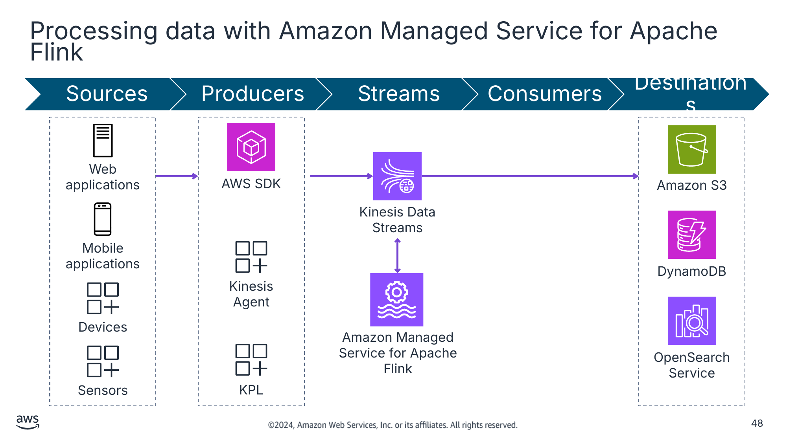

<details>
<summary>Текст зі схеми</summary>

Web applications

AWS SDK

Amazon S3

Kinesis Data  
Streams

Mobile applications

DynamoDB

Kinesis Agent

Devices

Amazon Managed Service for Apache Flink

OpenSearch Service

Sensors

KPL

</details>

> **Нотатки:**
>
> |Slide number 48  
> |Instructor notes  
> |This slide introduces Amazon Managed Service for Apache Flink.  
> |  
> |Student notes  
> Amazon Managed Service for Apache Flink is a serverless service that you can use to transform and analyze streaming data and respond to anomalies in real time.  
>
> You can process data streams in real time with SQL or Apache Flink without having to learn new programming languages or processing frameworks.  
>
> In addition to Kinesis Data Streams and Firehose, other ingestion services can collect and process streaming data in real time based on specific use cases.

---

## Слайд 49: Amazon Kinesis Video Streams

- Securely streams video from connected devices to AWS for analytics, ML, playback, and other processing
- Automatically provisions and elastically scales all the infrastructure that is needed to ingest streaming video data from millions of devices
- Durably stores, encrypts, and indexes video data in your streams and provides access to your data through API operations

Kinesis Video Streams

> **Нотатки:**
>
> |Slide number 49  
> |Instructor notes  
> |  
> |Student notes  
> This fully managed AWS service can capture massive amounts of live video data from millions of sources, including smartphones, security cameras, webcams, and cameras embedded in cars, drones, and other sources.

---

## Слайд 50: Amazon Managed Streaming for Apache Kafka (Amazon MSK)

- Is a fully managed Apache Kafka service
- Reduces operational overhead
- Can be deployed with existing Apache Kafka tools
- Works with existing AWS integrations

Amazon MSK

> **Нотатки:**
>
> |Slide number 50  
> |Instructor notes  
> |  
> |Student notes  
> If the current streaming solution is an on-premises Kafka cluster migrated to the cloud, Amazon MSK helps you reduce the operational overhead of running Apache Kafka and Kafka Connect clusters. You can use applications and tools built for Apache Kafka without any code changes by using Amazon MSK. You can deploy production-ready applications by using native AWS integrations, and you can connect other applications by using the Kafka APIs with Amazon MSK.  
>   
> If you want to use open source solutions and reduce licensing costs and are already familiar with Apache Kafka, Amazon MSK would be ideal. Serverless options are also available.  
>   
> Amazon MSK requires more set up and engineering than Kinesis streaming services. For example, you would have to do the work to fit Amazon MSK into your custom processes.

---

## Слайд 51: Streaming clickstream data in a café scenario

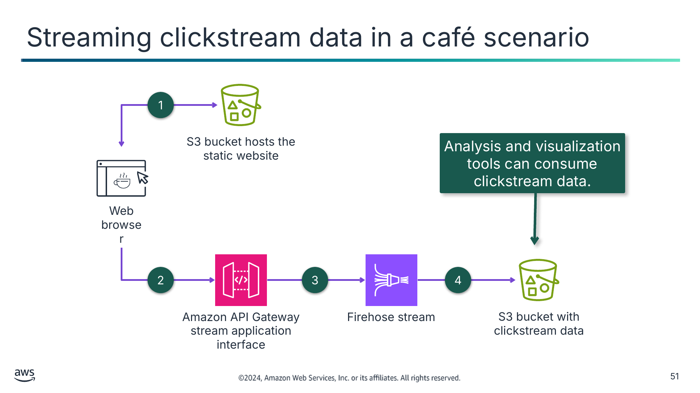

<details>
<summary>Текст зі схеми</summary>

1

S3 bucket hosts the static website

Analysis and visualization tools can consume clickstream data.

Web browser

2

3

4

Amazon API Gateway stream application interface

Firehose stream

S3 bucket with clickstream data

</details>

> **Нотатки:**
>
> |Slide number 51  
> |Instructor notes  
> |  
> |Student notes  
> The café owners want to evaluate clickstream data to determine when their users are browsing and clicking on the café menu. To do this, they do not need subsecond delivery time for the ingestion and analysis.  
>
> The use case of the café scenario is what determined the selection of Kinesis Data Firehose. There are connectors for the source (Amazon API Gateway) and the destination (Amazon S3) for Firehose. Operationally, Kinesis Data Firehose is the simplest service to use:  
> A static website hosted on Amazon S3 returns the café menu page.  
> The website browser sends the clickstream data to API Gateway.  
> Firehose ingests the clickstream data.  
> The clickstream data goes to an S3 bucket. From there, analysis and visualization tools can access this data.

---

## Слайд 52: Medical devices using Kinesis Data Streams and Amazon Managed Service for Apache Flink

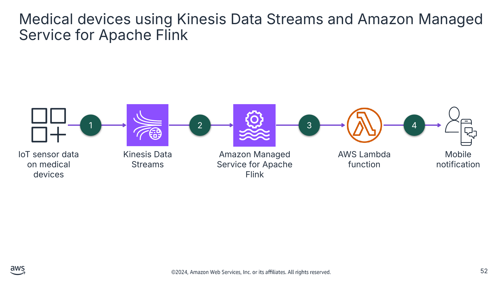

<details>
<summary>Текст зі схеми</summary>

1

2

3

4

IoT sensor data on medical devices

Kinesis Data  
Streams

Amazon Managed Service for Apache Flink

AWS Lambda function

Mobile notification

</details>

> **Нотатки:**
>
> |Slide number 52  
> |Instructor notes  
> |  
> |Student notes  
> In this use case, medical devices are being used to monitor patients. Sensor data from these devices is used to determine the devices’ functional accuracy. If there is too much or not enough data, the anomaly will be identified and the medical professional will be notified in near real time. Timing is critical in this use case, which is why Kinesis Data Streams is used. Any fluctuation should be reported in milliseconds:  
> Kinesis Data Streams ingests IoT sensor data.  
> The data goes to Amazon Managed Service for Apache Flink, which does the anomaly detection.  
> If an anomaly is detected, an AWS Lambda function is initiated.  
> The Lambda function sends a mobile notification to the medical professional to evaluate the medical device.

---

## Слайд 53: Comparison of streaming ingestion services

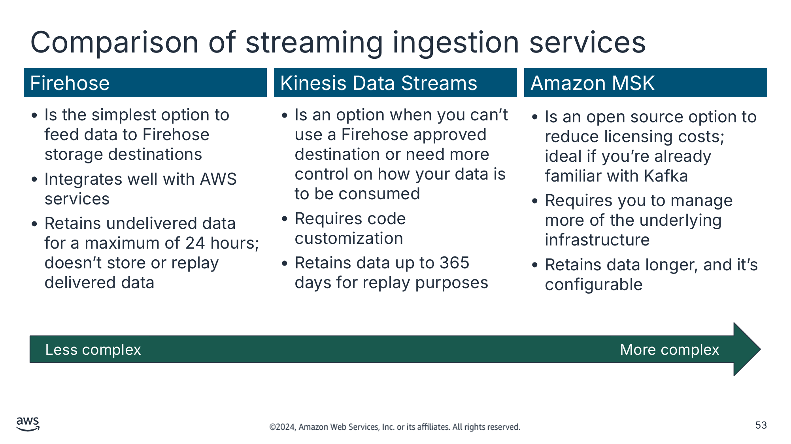

Firehose

Kinesis Data Streams

Amazon MSK

- Is the simplest option to feed data to Firehose storage destinations
- Integrates well with AWS services
- Retains undelivered data for a maximum of 24 hours; doesn’t store or replay delivered data

- Is an option when you can’t use a Firehose approved destination or need more control on how your data is to be consumed
- Requires code customization
- Retains data up to 365 days for replay purposes

- Is an open source option to reduce licensing costs; ideal if you’re already familiar with Kafka
- Requires you to manage more of the underlying infrastructure
- Retains data longer, and it’s configurable

<details>
<summary>Текст зі схеми</summary>

Less complex

More complex

</details>

> **Нотатки:**
>
> |Slide number 53  
> |Instructor notes  
> |  
> |Student notes  
> The business use case, the amount of engineering effort required, and the length of the retaining period are some of the factors to consider as you select a streaming ingestion service.  
>
> Firehose is the least complex, and Amazon MSK is the most complex of the three services listed:  
> Firehose is the simplest option to feed data into Firehose storage destinations, such as Amazon S3. If you can’t use a Firehose approved destination or need more control over how your data is to be consumed, Kinesis Data Streams would be a suitable option. If you want to use open source solutions and reduce licensing costs and are already familiar with Apache Kafka, Amazon MSK would be ideal. Serverless options are also available.  
> Firehose integrates well with AWS services, and you can take a plug-and-play approach. Kinesis Data Streams is a bit more complex because it requires code customization (for example, KCL or KPL). Amazon MSK requires more setup and engineering. For example, you would have to do the work to fit Amazon MSK into your custom processes.  
> In terms of data retention, Firehose does not store delivered data. Undelivered data is retained for a maximum of 24 hours. By default, Kinesis Data Streams retains data for 24 hours in a Kinesis data stream. This period can be extended up to 365 days. Amazon MSK retains data for a longer duration, and it is configurable.

---

## Слайд 54: Key takeaways: Processing real-time data

- The Amazon Kinesis family provides fully managed data ingestion services:
  - Firehose delivers near real-time streaming data to certain destinations. It provides short-lived retention of delivered data but lacks replay support.
  - Kinesis Data Streams collects and ingests large streams of data records in near real time. It offers the best low-latency data streaming properties but requires some configuration.
  - Kinesis Video Streams securely streams video from connected devices to AWS for analytics and other processing.
- Amazon Managed Service for Apache Flink analyzes streaming data.
- Amazon MSK is a fully managed Apache Kafka service that you can deploy in a virtual private cloud (VPC).

> **Нотатки:**
>
> |Slide number 54  
> |Instructor notes  
> |  
> |Student notes  
> For ingestion services based on the use case requirements by stream, select the Amazon Kinesis family and characteristics of the data.

---

## Слайд 55: Storage in the data pipeline

Data Engineering Patterns

> **Нотатки:**
>
> |Slide number 55  
> |Instructor notes  
> |  
> |Student notes  
> This section discusses storage options commonly used in a data analytics pipeline.

---

## Слайд 56: Storage layer in the data pipeline

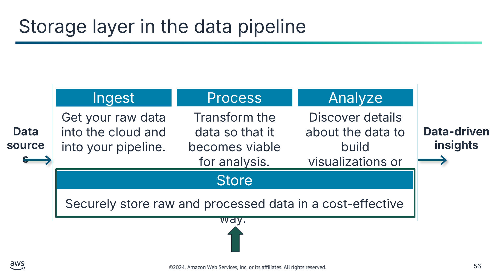

<details>
<summary>Текст зі схеми</summary>

Ingest

Process

Analyze

Get your raw data into the cloud and into your pipeline.

Transform the data so that it becomes viable for analysis.

Discover details about the data to build visualizations or predictions.

**Data sources**

**Data-driven insights**

Store

Securely store raw and processed data in a cost-effective way.

</details>

> **Нотатки:**
>
> |Slide number 56  
> |Instructor notes  
> |This is the high-level pipeline that shows storage as part of all three layers of data ingestion, processing, and analysis.  
> |  
> |Student notes  
> Throughout the data pipeline, data is being stored securely. This section discusses concepts and services related to storage in the pipeline.

---

## Слайд 57: Storage in a modern data architecture

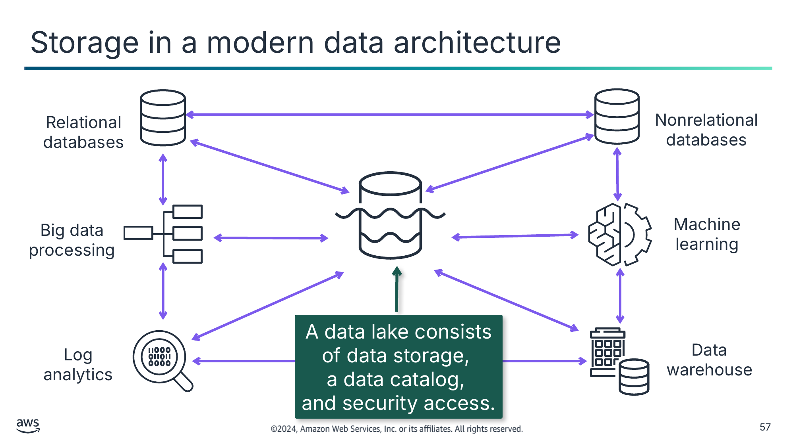

A data lake consists of data storage,  
a data catalog,  
and security access.

<details>
<summary>Текст зі схеми</summary>

Relational databases

Nonrelational databases

Big data processing

Machine learning

Log analytics

Data warehouse

</details>

> **Нотатки:**
>
> |Slide number 57  
> |Instructor notes  
> |Note to students that all the items that are listed on this slide are elements of a modern data architecture built around the centralized concept of a data lake. The arrows depict data movement. Nonrelational databases can also be called NoSQL databases. Big data processing refers to large datasets processed in parallel.  
> |  
> |Student notes  
> Image description: The image consists of a data lake at the center of the diagram surrounded by elements for analytics processing. The elements are relational databases, nonrelational databases, big data processing, machine learning, log analytics, and data warehouse. The arrows depict data movement. End description.  
>
> Organizations want to capture all of their data to derive value from it as quickly as possible. A modern data architecture isn't restricted by separate data silos. This makes it possible for all the organization’s data to be available to users for analysis by using their preferred data analytics tool of choice. A modern data architecture will give you the best of both data lakes and purpose-built data stores. The goal of this architecture is to control data access to the data lake and ensure minimum and efficient data movement when analysis takes place.  
>
> Data lake storage and security is at the core of a modern data architecture. A data lake is a centralized repository that you can use to store all your structured and unstructured data at any scale. This architecture provides a low-cost storage solution for any amount of data by using open standards-based data formats. You can store your data as-is without having to first structure the data. The data lake allows import and export of data or data query results to relational databases, nonrelational databases, data warehouse databases, machine learning models, and big data parallel processing services as required. These services can also share data.  
>
> Note that nonrelational databases can also be called NoSQL databases, and big data processing refers to large datasets processed in parallel.  
>
> The following are data movement types:  
> Inside-out data movement happens when a service such as big data processing or machine learning needs a portion of the data in the data lake. The data is copied, moved, or filtered by a query from the data lake to the service. For example, clickstream data from web applications is collected directly in a data lake, and a portion of that data can be moved to a log analytics service for trend analysis.  
> Outside-in data movement happens when a data analytics solution requires the data to be in the data lake for processing. This type of analytics solution usually means that the data should form part of a bigger dataset. The data is copied, moved, or filtered by a query to the data lake from a database source.  
> If a service other than the data lake has a direct integration with another service, it is possible to move, copy, or query data between these services directly.

---

## Слайд 58: AWS modern data architecture

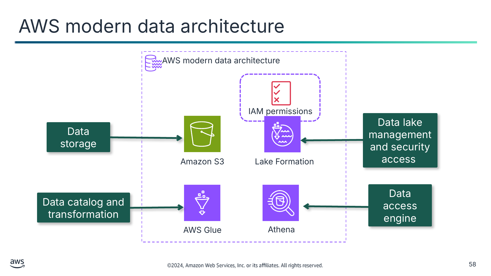

Data lake management and security access

Data storage

Data access engine

Data catalog and transformation

<details>
<summary>Текст зі схеми</summary>

AWS modern data architecture

IAM permissions

Amazon S3

Lake Formation

AWS Glue

Athena

</details>

> **Нотатки:**
>
> |Slide number 58  
> |Instructor notes  
> |  
> |Student notes  
> Image description: The image consists of a data lake architecture with Amazon S3, AWS Lake Formation including AWS Identity and Access Management (IAM) permissions, AWS Glue, and Athena as components. End description.  
>
> In the AWS Cloud, a data lake is implemented with a collection of AWS services working together to provide data lake functionality.  
>
> The management component of the data lake is Lake Formation. It gives you the ability to configure and manage your data lake from a central console. Here you can discover data sources, store data by  using Amazon S3, and create AWS Glue transformation jobs with the aid of the Data Catalog. The Data Catalog contains the data schemas used to read data from the data lake. IAM security access permissions are also configured in Lake Formation to allow user access and analytics service access.  
>
> Athena is a SQL query engine and provides a way for analytics and visualization applications to run SQL queries against data in the data lake.

---

## Слайд 59: AWS data lake solution

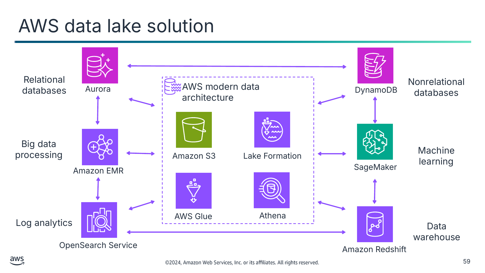

<details>
<summary>Текст зі схеми</summary>

Relational databases

Nonrelational databases

Aurora

AWS modern data architecture

 DynamoDB

Amazon S3

Lake Formation

Machine learning

Amazon EMR

 SageMaker

AWS Glue

Athena

Log analytics

Data warehouse

OpenSearch Service

Amazon Redshift

Big data processing

</details>

> **Нотатки:**
>
> |Slide number 59  
> |Instructor notes  
> |The arrows depict data movement.  
> |  
> |Student notes  
> Image description: The image consists of a data lake architecture with Amazon S3, Lake Formation, AWS Glue, and Athena as components. The elements in the note description surround the data lake. End description.  
>
> The arrows depict data movement. Here are some examples of other AWS services that play a role in an AWS modern data architecture:  
> Amazon Aurora and Amazon RDS store relational, normalized data.  
> DynamoDB is a NoSQL database that stores key-value data.  
> Amazon EMR transforms or aggregates big datasets in parallel.  
> Amazon SageMaker trains models to recognize patterns on datasets.  
> OpenSearch Service stores data indexed for fast retrieval.  
> Amazon Redshift as a data warehouse database stores historical data. A SQL query is split up to run in parallel to provide results of datasets spanning long time periods such as 20 years.

---

## Слайд 60: Activity: Choosing Data Storage for a Bank Application

Banking applications produce the following:

- Customer data
  - Individual customer financial transactions
- Log data
  - User activity logs for fraud analysis
  - Application error logs


> **Нотатки:**
>
> |Slide number 60  
> |Instructor notes  
> |This activity is a group discussion. The next slide presents the questions for discussion, and the following slide provides the solutions. It is recommended that students try and match the storage options themselves before the solution is discussed in the next slide.  
> |  
> |Student notes  
> This is an instructor-led activity that discusses the various options for choosing data storage for a banking application.

---

## Слайд 61: Use case: Storage options for bank application data

Individual financial  
transactions for customers

Total amount of daily financial transactions for customers

Amazon Redshift

Amazon S3

User activity logs  
for fraud analysis

Amazon

DynamoDB

Error logs for bank applications

Amazon OpenSearch

Service

Amazon Aurora

> **Нотатки:**
>
> |Slide number 61  
> |Instructor notes  
> |  
> |Student notes  
> Let's say you work on a data engineering team for an enterprise-sized bank that has been around for about 20 years. Your bank has a banking website for customers where they can apply for accounts and complete online transactions to manage their accounts. The bank customers also have debit and credit cards to buy items or withdraw money in physical locations.  
>
> The bank has multiple applications that produce different types of data. Bank customers have bank profiles with bank accounts. They produce a financial transaction every time they deposit or withdraw money from their bank account. In addition, bank customers can buy merchandise online or in physical locations.  
>   
> The bank applications also produce logs for user activity and application errors. The bank wants to migrate their applications to the AWS Cloud.  
>
> Looking at a data lake architecture, which AWS storage services would be appropriate for the different types of data? Your choices are Amazon Redshift, Amazon S3, OpenSearch Service, DynamoDB, and Aurora.  
>
> The following are the data types:  
> Individual customer financial transactions  
> Daily customer financial transaction total amount  
> User activity logs for fraud analysis  
> Application error logs

---

## Слайд 62: Bank application data storage options solution

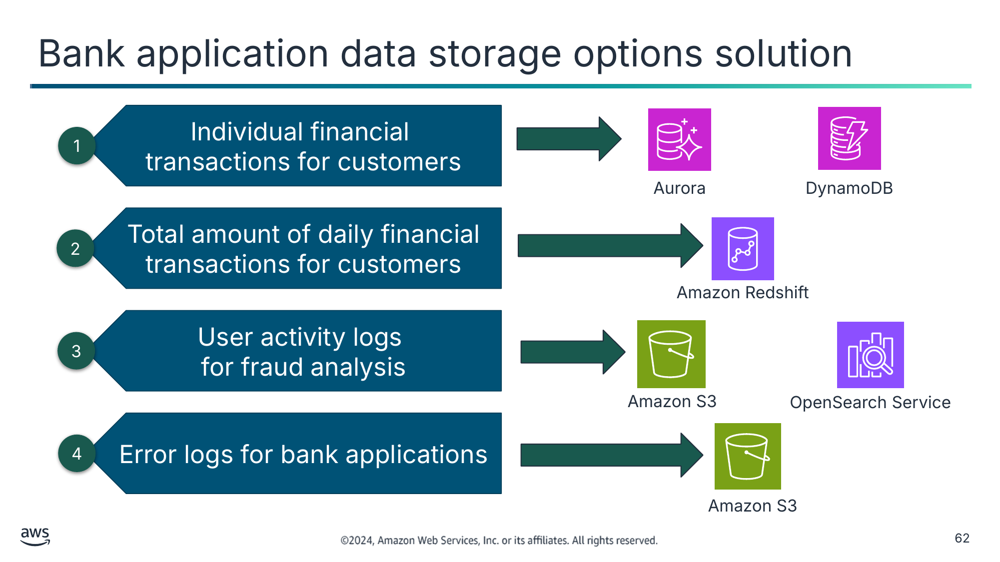

<details>
<summary>Текст зі схеми</summary>

Individual financial  
transactions for customers

1

Aurora

DynamoDB

Total amount of daily financial transactions for customers

2

Amazon Redshift

User activity logs  
for fraud analysis

3

Amazon S3

OpenSearch Service

Error logs for bank applications

4

Amazon S3

</details>

> **Нотатки:**
>
> |Slide number 62  
> |Instructor notes  
> |  
> |Student notes  
> To store individual customer financial transactions, you need a service that is optimized for small record writes, has 24/7 availability, and can be used concurrently by thousands to millions of customers. This is called online transaction processing (OLTP), and transactions are typically stored as a row in a table. Relational or NoSQL databases are ideal for OLTP transaction storage. In this use case, Aurora and DynamoDB are suitable for individual customer financial transactions.  
> To store the total amount of daily financial transactions for customers, you need to calculate the daily total per customer and store it in a data warehouse. Reports over a span of years can be created from the daily totals to predict spending patterns. This is called online analytical processing (OLAP), and data is typically stored in columnar tables for fast SQL query retrieval. In this use case, Amazon Redshift is appropriate for daily customer financial transaction total amount.  
> To store user activity logs for fraud analysis, it could be a good idea to put the logs in an application made to analyze logs. As an alternative, the logs can be analyzed in the data lake itself by using SQL query tools that connect to the data in the data lake. In this use case, user activity logs for fraud analysis can either be stored in the data lake by using Amazon S3 or OpenSearch Service for an indexed solution.  
> To store application error logs, the simplest architecture would be to use data lake storage by using Amazon S3.

---

## Слайд 63: Comparison of a data warehouse and a data lake

| Features | Data Warehouse | Data Lake |
|---|---|---|
| Data Sources | Business applications and databases | Internet of Things (IoT) devices, websites, mobile apps, social media, and business applications |
| Schema | Structured schema on write | Unstructured schema on read |
| Price | Higher-cost storage | Low-cost storage |
| Data Quality | Curated, processed, or aggregated data as the central version of truth | Raw (unprocessed data of transactional events) or transformed (processed data) |
| Analytics Use Case | Batch reporting, business intelligence, and visualizations | Logs, data discovery, and profiling |

> **Нотатки:**
>
> |Slide number 63  
> |Instructor notes  
> |  
> |Student notes  
> A data warehouse is a database optimized to analyze relational data coming from transactional systems and line of business applications. The data structure, and schema are defined in advance to optimize for fast SQL queries, where the results are typically used for operational reporting and analysis. Data is cleaned, enriched, and transformed so it can act as the “single source of truth” that users can trust.  
>
> A data lake is different, because it stores relational data from line of business applications, and non-relational data from mobile apps, IoT devices, and social media. The structure of the data or schema is not defined when data is captured. This means you can store all of your data without careful design or the need to know what questions you might need answers for in the future. Different types of analytics on your data like SQL queries, big data analytics, full text search, real-time analytics, and machine learning can be used to uncover insights.  
>
> For data warehouses, when data is written, the schema must be known; this is referred to as the schema-on-write approach. For data lakes, writing data does not need a schema, but reading does need a schema.

---

## Слайд 64: Cost and querying time determines data storage

Amazon S3

Amazon Redshift Spectrum

Amazon Redshift

- Lower cost data lake
- Less efficient for querying

- Reduces data warehouse cost
- Provides querying on S3 buckets without moving data into the warehouse

- Higher cost
- Efficient querying across large datasets

**Storage cost**

> **Нотатки:**
>
> |Slide number 64  
> |Instructor notes  
> |  
> |Student notes  
> For data analytics applications that consume structured and unstructured data, the storage service that you select depends on the structure of the data, how the data will be consumed, and the cost and availability of the data.  
> Analytics applications require large-scale, affordable, highly available, and secure data access. These requirements are met with a modern data lake architecture built on Amazon S3. Compared to other AWS storage services, Amazon S3 tends to be the most cost efficient choice for AWS customers. Analytics applications that want to read data from Amazon S3 need to take into account the length of time it will take to actually access the data. Amazon S3 provides a way for unstructured data to be stored in data partitions. If daily logs are stored in a separate folder, then data queries that use a date will be efficient because only the applicable folders are accessed. The query scope is limited to a subset of a company’s available data.  
> On the other hand, a service like Amazon Redshift is generally more expensive because it is a cluster of instances that makes up a data warehouse. Although a query will have access to all the organization’s data, query times will be efficient over large datasets spanning long time periods.  
> AWS customers can get the best of both worlds by using Redshift Spectrum to run queries against S3 buckets without moving the data to Amazon Redshift. This option will reduce cost because no data movement is necessary.  
>
> Consider the budget and time constraints when accessing the data. The goal is to maximize value and minimize cost.

---

## Слайд 65: Data retention time determines data storage

**General purpose**

**Infrequent access**

**Archive**

S3 Standard

S3 Standard-Infrequent Access

S3 Glacier Instant Retrieval

**Unknown or changing access**

Amazon S3

S3 Glacier Flexible Retrieval

S3 Intelligent-Tiering

S3 One Zone-Infrequent Access

S3 Glacier Deep Archive

> **Нотатки:**
>
> |Slide number 65  
> |Instructor notes  
> |  
> |Student notes  
> Relational databases are sensitive to the amount of data that they can contain before performance degrades. It is a common practice to archive data out of a relational database into a more cost-efficient storage option. Storage classes are purpose-built for varying access patterns at corresponding costs.  
>
> By using Amazon S3 storage classes, you can choose how to store data based on access needs and cost considerations. Analytics and ML workloads require large quantities of data, and you want to ensure that you store that data in the most cost-effective manner as possible. For known data usage patterns, use standard or infrequent access as required. For unknown usage patterns, use intelligent tiering to provide a way for AWS to classify data as standard or infrequent access.  
>
> For more information, see Amazon S3 storage classes on the content resources page of your online course.

---

## Слайд 66: Data origin and shape determine data storage

Data origin

**Business applications (OLTP)**

**Analytics applications (OLAP)**

Data shape

Structured and semistructured data

Real-time streaming of data

Unstructured and raw data

Processed and aggregated data

Data storage

**RDMS or NoSQL**

**Stream**

**Data lake**

**Data warehouse**

After the data is stored at the OLTP level, the data is processed or moved to the OLAP level.

> **Нотатки:**
>
> |Slide number 66  
> |Instructor notes  
> |  
> |Student notes  
> Business applications produce OLTP and streaming data records. Data is stored in a relational database management system (RDMS) for structured data and a NoSQL database for semistructured data. Real-time streaming of business application data can be stored inside a streaming service or moved to object storage for unstructured data.  
>
> After the data is stored at the business application level, the data is processed or moved to a data analytics location. Unstructured and raw data is suited for object storage, and processed and aggregated data should reside in a data warehouse. You can see that the shape (structured or unstructured) plays an important role in where the data is stored.  
>
> The following are some AWS storage solutions:  
> Amazon Aurora for an RDMS  
> Amazon DynamoDB for a NoSQL database  
> Amazon Kinesis, Amazon S3, and Amazon MSK for a streaming storage system  
> Amazon S3 for a data lake  
> Amazon Redshift for a data warehouse

---

## Слайд 67: Key takeaways: Storage in the data pipeline

- A modern data architecture is built on a data lake as a central component with analytics and storage services as its peripheral components.
- A data lake architecture consists of data storage, a data catalog, data access security, and data transformation tools.
- A data warehouse has a schema-on-write approach, and a data lake has a schema-on-read approach.
- Design data storage by considering data origin, data shape, cost, query scope, and data retention periods.

> **Нотатки:**
>
> |Slide number 67  
> |Instructor notes  
> |  
> |Student notes

---

## Слайд 68: Parallel processing in the data pipeline

Data Engineering Patterns

> **Нотатки:**
>
> |Slide number 68  
> |Instructor notes  
> |  
> |Student notes  
> This section discusses big data parallel processing in the data pipeline.

---

## Слайд 69: Big data workflow for parallel processing

Split large dataset into smaller parts.

Process parts in parallel.

Results are aggregated.

> **Нотатки:**
>
> |Slide number 69  
> |Instructor notes  
> |  
> |Student notes  
> A big data workflow can be described in three steps:  
> Parallel processing is a computing technique that breaks up the processing of large datasets into smaller parts.  
> Each part then processes a portion of the dataset separately at the same time.  
> The result of each part is then aggregated into the final output.  
>
> This technique was developed because single servers did not have enough memory and storage available to handle the processing of a large dataset. Instead, a cluster of servers containing hundreds or thousands of servers processes the large dataset with parallel processing. One example of processing a big dataset is to count all the words in all the books in a digital library that contains 1 million books. The library books will be processed in 10 batches of 100,000 books each with a result list of the number of occurrences of each word. The aggregation function will collate the 10 batches into one result list with the total number of occurrences of each word in the digital library.  
>
> A benefit of parallel processing is solving large problems in a shorter period of time. By running the components of a problem concurrently, the total duration is greatly reduced. For example, to process 1,000 log files for 1 minute each, it takes over 16 hours to complete if sequentially processed. When processed in parallel, the same task takes only 1 minute.

---

## Слайд 70: Amazon EMR

- Amazon EMR handles cluster infrastructure management.
- Amazon EMR includes many Apache Hadoop applications, such as Hadoop MapReduce and Apache Spark.
- Amazon EMR can be deployed on Amazon Elastic Compute Cloud (Amazon EC2) instances, Amazon Elastic Kubernetes Service (Amazon EKS), or AWS Outposts.
- Amazon EMR Serverless supports a serverless cluster.

Amazon EMR

> **Нотатки:**
>
> |Slide number 70  
> |Instructor notes  
> |Managing big data processing on a server cluster requires specific applications that can manage distributed processing. Frameworks were developed to solve distributed, parallel processing for batch, streaming, and ML. |One of these frameworks is Apache Hadoop. Apache Hadoop consists of a connected collection of applications to manage data processing, data management, cluster resource management, data access, and data |storage. Two of the data processing frameworks of Apache Hadoop are Hadoop MapReduce and Apache Spark. You can use either of these frameworks to run a parallel workflow for big data.  
> |  
> |The Appendix section includes slides showing an Amazon EMR cluster architecture on Amazon Elastic Compute Cloud (Amazon EC2) and the Amazon EMR workflow.  
> |  
> |Student notes  
> Amazon EMR takes care of infrastructure provisioning, cluster setup, configuration, and tuning.  
>
> An EMR cluster can be deployed on Amazon Elastic Compute Cloud (Amazon EC2) instances in a VPC subnet in a single Availability Zone (AZ). For Multi-AZ deployments, you can pass the workload job to an existing Amazon Elastic Kubernetes Service (Amazon EKS) cluster. Amazon EMR is available to run on premises on AWS Outposts. If cluster management control is unfeasible, use Amazon EMR Serverless to run data transformation jobs in a serverless environment.

---

## Слайд 71: Choosing a parallel processing solution

| Requirement | Amazon EMR | EMR Serverless | AWS Glue |
|---|---|---|---|
| Manage and Control Clusters | Yes | No | No |
| Lift and Shift Legacy Apache Hadoop or Spark Applications to AWS | Yes | No | No |
| Develop New Cloud Applications for Batch Data Processing | No | Yes | Yes |
| Has Pay-Per-Job Price Model | No | Yes | Yes |
| Run Only Apache Spark Jobs | No | No | Yes |

> **Нотатки:**
>
> |Slide number 71  
> |Instructor notes  
> |  
> |Student notes  
> Choose between Amazon EMR, EMR Serverless, and AWS Glue to implement a batch ETL solution on AWS. If an organization prefers to have full control of its clusters or wants to move legacy Apache Hadoop applications to AWS without making code changes, Amazon EMR would be a good solution.  
>
> To develop AWS native cloud applications for batch data processing, or if a pay-per-job model is preferred, choose between EMR Serverless and AWS Glue. If a development team has some Hadoop MapReduce or Apache Spark experience, EMR Serverless would be a good choice.  
>
> If a team is new to data analytics or prefers to run only Apache Spark jobs, then AWS Glue would be a good choice.

---

## Слайд 72: Curating data with Amazon EMR

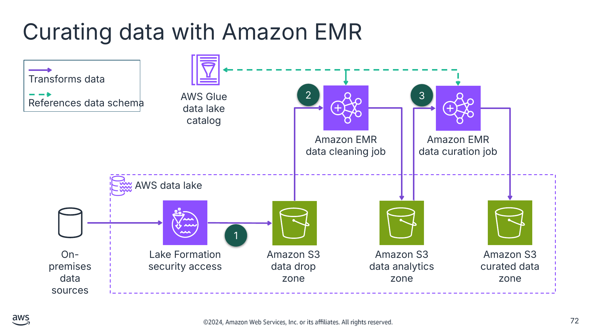

<details>
<summary>Текст зі схеми</summary>

Transforms data

References data schema

AWS Glue  
data lake catalog

2

3

Amazon EMR data cleaning job

Amazon EMR data curation job

AWS data lake

1

On-premises data sources

Lake Formation security access

Amazon S3 data drop zone

Amazon S3 data analytics zone

Amazon S3 curated data zone

</details>

> **Нотатки:**
>
> |Slide number 72  
> |Instructor notes  
> |  
> |Student notes  
> It is a best practice to split up a data lake into different zones depending on the quality of the data. Here is an example of a three-step workflow to provide cleaned and curated data for an organization:  
> Data is transferred from multiple on-premises data sources to the AWS data lake into the designated Amazon S3 data drop zone. Lake Formation is used as security access to the data lake.  
> The Amazon EMR data cleaning job copies the data from the data drop zone. It runs the processing steps needed to clean the data and copies the result set to the data analytics zone. Analytics applications can now consume the data.  
> The Amazon EMR data curation job copies the data from the data analytics zone. It runs the processing steps needed to curate the data and copies the result set to the curated data zone. Users who need curated data can now access the curated data for visualization and analysis.

---

## Слайд 73: Key takeaways: Parallel processing in the data pipeline

- Big data parallel processing is a computing technique that breaks up the processing of large datasets into smaller parts.
- EMR clusters can use Hadoop MapReduce or Apache Spark frameworks to process data in parallel.
- Choose Amazon EMR to manage clusters.
- Choose EMR Serverless or AWS Glue for serverless solutions.

> **Нотатки:**
>
> |Slide number 73  
> |Instructor notes  
> |  
> |Student notes

---

## Слайд 74: Analysis and visualization

Data Engineering Patterns

> **Нотатки:**
>
> |Slide number 74  
> |Instructor notes  
> |  
> |Student notes  
> This section discusses the choice of analysis and visualization tools.

---

## Слайд 75: Analysis and visualization layer of the data pipeline

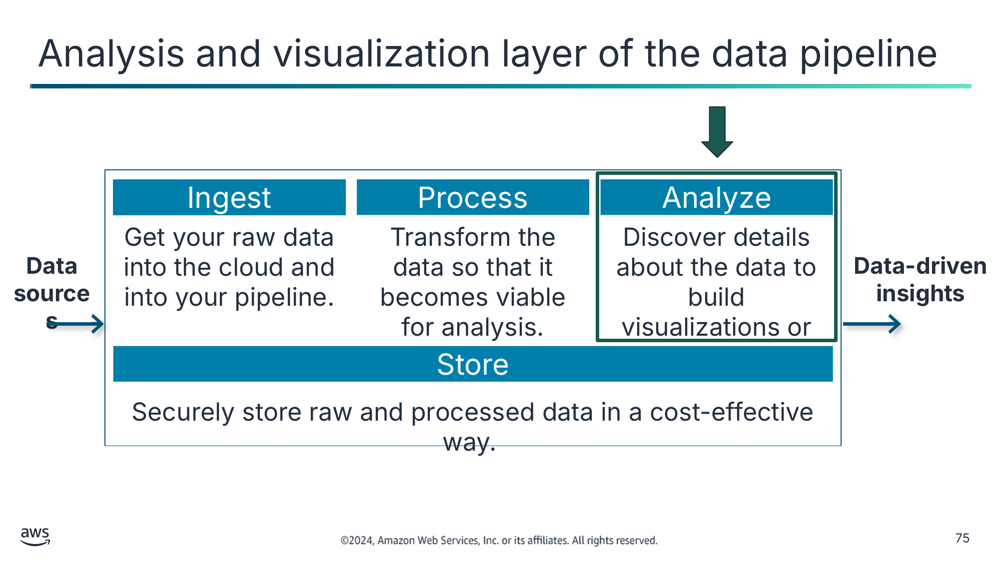

<details>
<summary>Текст зі схеми</summary>

Ingest

Process

Analyze

Get your raw data into the cloud and into your pipeline.

Transform the data so that it becomes viable for analysis.

Discover details about the data to build visualizations or predictions.

**Data sources**

**Data-driven insights**

Store

Securely store raw and processed data in a cost-effective way.

</details>

> **Нотатки:**
>
> |Slide number 75  
> |Instructor notes  
> |This is the high-level pipeline that shows storage as part of all three layers of data ingestion, processing, and analysis.  
> |  
> |Student notes  
> After ingestion and processing, the data is ready for consumption. This section discusses data analysis and visualization.

---

## Слайд 76: Choosing consumption tools for the data pipeline

I want to use SQL queries to interactively search through customer application activity files in a data lake to solve a one-off customer problem.

I want to design an interactive data dashboard with charts and graphs to share with stakeholders.

I want to use a real-time application monitoring dashboard.

Business analyst

Data scientist

DevOps engineer

> **Нотатки:**
>
> |Slide number 76  
> |Instructor notes  
> |  
> |Student notes  
> After data has been stored and curated in various data stores, there are many tools to choose from to analyze and visualize the data. Depending on the use case, different AWS analysis services are available to fulfill the specific analysis requirement.  
>
> Consider the following use cases, and think about which AWS service can be used to implement it:  
> A business analyst wants to design an interactive data dashboard with charts and graphs to share with business stakeholders.  
> A data engineer wants to use SQL queries to interactively search through files related to customer application activity in a data lake to solve a one-time customer problem.  
> A DevOps engineer wants to build a real-time application-monitoring dashboard.  
>
> Depending on the use case and the data consumption task, implement the principle of least privilege by giving only enough access for systems to do the job. Identify the minimum privileges that each user or system requires, and only allow the permissions that they need. For example, if a business analyst requests to read an Amazon Redshift table from an analytics workload, only give the read permission for the table using Amazon Redshift user privilege controls.

---

## Слайд 77: Design dashboards with QuickSight

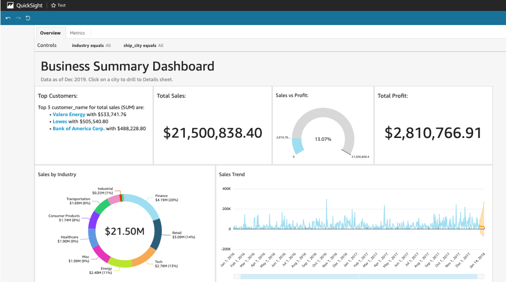

Amazon QuickSight

> **Нотатки:**
>
> |Slide number 77  
> |Instructor notes  
> |For the day-to-day needs of a business analyst, the AWS analysis service most frequently used is Amazon QuickSight.  
> |  
> |Student notes  
> Amazon QuickSight is a business intelligence (BI) tool that organizations can use to scale their business analytics capabilities to hundreds of thousands of users. It delivers fast and responsive visualizations by using a robust in-memory engine (SPICE).  
>
> In QuickSight, a data dashboard is a collection of charts, graphs, and insights. It's like a digital newspaper that's all about the data that you're interested in with the ability to interact with the dashboard.  
>
> You can share dashboards with stakeholders by publishing the dashboard or sharing a link to the published dashboard. Alternatively, a dashboard can be imbedded in a customer web or mobile application. A dashboard can be sent as a report on a schedule through email with the QuickSight Enterprise edition.  
>
> You can connect QuickSight to AWS data sources, including Amazon RDS, Aurora, Amazon Redshift, Athena, and Amazon S3. You can also upload Excel spreadsheets or flat files (CSV, TSV, CLF, and ELF); connect to on-premises databases such as SQL Server, MySQL, and PostgreSQL; and import data from SaaS applications such as Salesforce.  
>
> When designing a dashboard, a business analyst can select data, and the QuickSight feature AutoGraph will automatically choose the right type of graph or chart suitable for the data. You can even search data by using natural language with the QuickSight Q search bar and return the resulting data as a visualization.

---

## Слайд 78: One-time SQL queries with Athena SQL

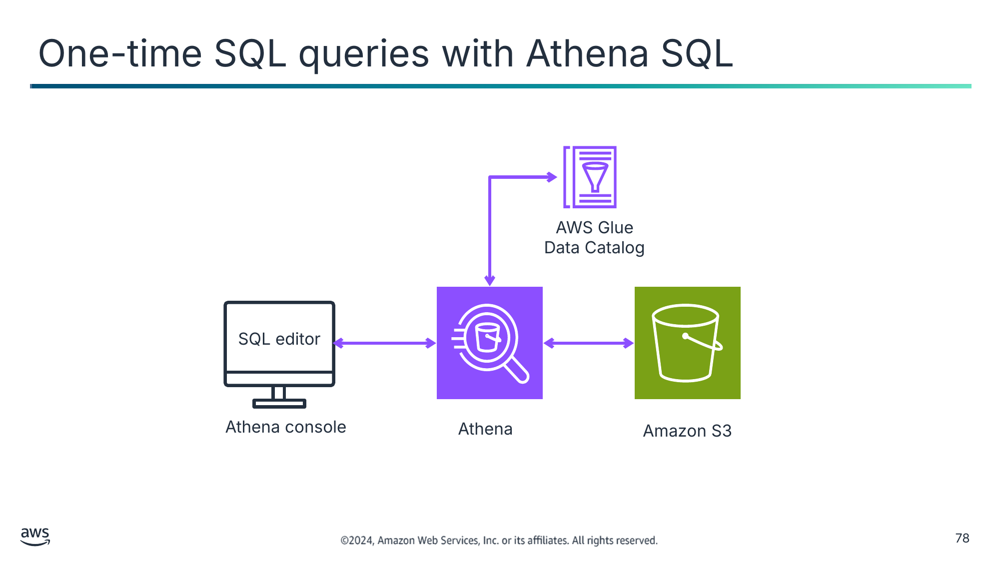

<details>
<summary>Текст зі схеми</summary>

AWS Glue  
Data Catalog

SQL editor

Athena console

Athena

Amazon S3

</details>

> **Нотатки:**
>
> |Slide number 78  
> |Instructor notes  
> |A data engineer or data scientist would most likely run one-time SQL queries with Amazon Athena SQL.  
> |  
> |Student notes  
> Image description: Athena console SQL editor connecting to the Athena service to run queries. Athena uses Data Catalog for data metadata and connects to Amazon S3 as a data source for queries. End description.  
>
> Athena SQL is a data query engine and data schema metadata store with the ability to query unstructured and structured data stored in other services by using SQL queries. Athena is built on Trino and Apache Presto and works with various standard data formats, including CSV, JSON, Apache ORC, Apache Parquet, and Apache Avro. You can analyze data directly in Amazon S3 by using standard SQL.  
>
> Athena integrates with Data Catalog for unstructured data reads, which offers a persistent metadata store for your data in Amazon S3. This gives you the ability to create table schemas and query data in Athena based on a central metadata store available throughout your AWS account.  
>
> Athena provides data source connectors to connect with data sources. You can connect to AWS data sources such as Amazon RDS databases, DynamoDB, Amazon MSK, OpenSearch Service, and Amazon Redshift. It is also possible to access on-premises data sources such as SAP HANA and Db2. You can use Athena to access other cloud data lakes such as Azure Data Lake Storage. This means that you can run federated queries or construct views from multiple data sources.  
>
> Athena is serverless, so there is no infrastructure to set up or manage. It uses a pay-per-query model, which is more suited to one-time SQL queries. You can connect BI analysis and visualization tools like QuickSight to Athena by using Java Database Connectivity (JDBC) and Open Database Connectivity (ODBC) drivers.  
>
> Athena for Apache Spark is another feature of Athena. It gives you the ability to use Apache Spark to process big data parallel workloads. This is very similar to AWS Glue for Apache Spark and Amazon EMR ETL jobs.

---

## Слайд 79: Visualizing clickstream data for the café scenario

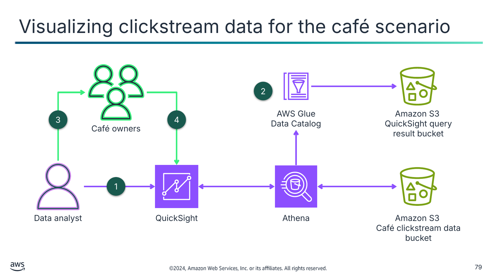

<details>
<summary>Текст зі схеми</summary>

2

3

4

AWS Glue  
Data Catalog

Amazon S3

QuickSight query

result bucket

Café owners

1

Data analyst

QuickSight

Athena

Amazon S3

Café clickstream data bucket

</details>

> **Нотатки:**
>
> |Slide number 79  
> |Instructor notes  
> |A data analyst or data scientist would most likely visualize user clickstream activity.  
> |  
> |Student notes  
> The café owners require a data analyst to build a dashboard report on clickstream activity of website users. The report should be shared with a URL link:  
> The data analyst uses QuickSight to configure security permissions for Athena and the café clickstream bucket as data sources. The data analyst builds the dashboard.  
> Using Data Catalog, Athena saves all the queries generated by QuickSight for the dashboard in the QuickSight query result bucket.  
> Upon completion, the data analyst publishes the dashboard and sends the URL link to the café owners.  
> The café owners use the URL link to view the dashboard.

---

## Слайд 80: Real-time application dashboard with OpenSearch Dashboards

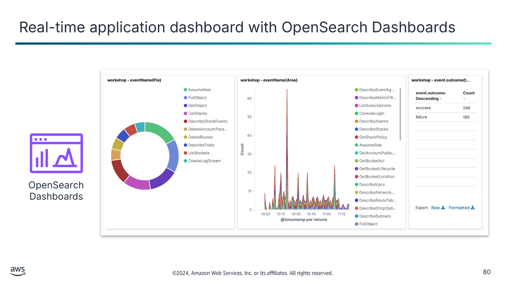

OpenSearch Dashboards

> **Нотатки:**
>
> |Slide number 80  
> |Instructor notes  
> |For the day to day needs of a DevOps engineer, the AWS analysis service most frequently used is OpenSearch Service.  
> |  
> |Student notes  
> Image description: An example of the OpenSearch Service dashboard including a donut chart with the number of events, area chart for event timelines, and number of success and failed events. End description.  
>
> OpenSearch Service is a managed serverless service to implement Apache OpenSearch use cases such as interactive log analytics, real-time application monitoring, and website searches. It is a data storage option that indexes uploaded data in a domain to provide a way for the search and analysis of data. OpenSearch Service provides an installation of OpenSearch dashboards with every OpenSearch Service domain.  
>
> You can proactively monitor your application data in OpenSearch Service with alerting and anomaly detection. Set up alerts to receive notifications when your data exceeds certain thresholds. Anomaly detection uses ML to automatically detect any outliers in your streaming data. You can pair anomaly detection with alerting to ensure that you're notified as soon as an anomaly is detected.  
>
> Multi-AZ with Standby is a deployment option for OpenSearch Service that provides high-availability and consistent performance for business-critical workloads. With Multi-AZ with Standby, OpenSearch Service managed clusters are resilient to infrastructure failures such as node drops or a single Availability Zone failure. Multi-AZ with Standby provides the added benefit of simplifying cluster configuration and management by enforcing best practices and reducing complexity.

---

## Слайд 81: Key takeaways: Analysis and visualization

- QuickSight is a business intelligence tool to visualize data by using publishable dashboards.
- Athena SQL is a data query engine and data schema metadata store with the ability to query data stored in other services by using SQL queries.
- With Athena for Apache Spark, you can use Apache Spark to process parallel workloads of big data.
- OpenSearch Service indexes uploaded data to facilitate search and analysis of data.

> **Нотатки:**
>
> |Slide number 81  
> |Instructor notes  
> |  
> |Student notes

---

## Слайд 82: Activity: Data Pipeline Architecture

- You are a cloud architect and are assigned to an organization that provides weather data for data analysts.
- Provide an architectural solution for the data pipeline and explain it by using an architecture diagram that you create for a given scenario.


> **Нотатки:**
>
> |Slide number 82  
> |Instructor notes  
> |The goal of this activity is to construct a data pipeline by using AWS services for a weather data use case. A student and an instructor solution worksheet is provided.  
> |  
> |Student notes  
> This is an instructor-led activity with a student worksheet to be completed.

---

## Слайд 83: Applying the AWS Well-Architected Framework principles to data pipelines

Data Engineering Patterns

> **Нотатки:**
>
> |Slide number 83  
> |Instructor notes  
> |  
> |Student notes

---

## Слайд 84: Review process for the Data Analytics Lens

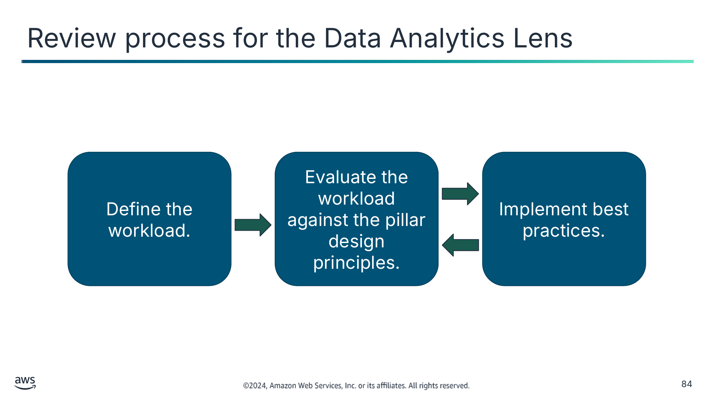

<details>
<summary>Текст зі схеми</summary>

Define the workload.

Evaluate the workload against the pillar design principles.

Implement best practices.

</details>

> **Нотатки:**
>
> |Slide number 84  
> |Instructor notes  
> |  
> |Student notes  
> The AWS Well-Architected Data Analytics Lens is a collection of customer-proven best practices for designing well-architected analytics workloads. The Data Analytics Lens contains insights that AWS has gathered from real-world case studies. This provides a way for IT architects and developers to evaluate an analytics workload and implement best practices provided by the lens without needing to become subject matter experts.  
> Define the workload: A workload identifies a set of components that together deliver business value. The workload is usually the level of detail that business and technology leaders communicate about. Examples of workloads are marketing websites, e-commerce websites, the back-ends for a mobile app, analytic platforms, etc.  
> Evaluate the workload against the pillar design principles: To evaluate an analytics workload, prioritize the pillars in order of importance, and identify the most important design principles to implement for each pillar.  
> Implement best practices: Proceed to implement those best practices. The process continues with regular evaluations to add as many best practices as possible.  
>
> The tools and techniques you've learned about in the other sections of this module align to the AWS Well-Architected Framework pillars. In practice, you need to continually evaluate whether your solution is the best fit for your analytics workload.  
>
> For more information, see Data Analytics Lens on the content resources page of your online course.

---

## Слайд 85: Well-Architected Framework best practices for data analytics


> **Нотатки:**
>
> |Slide number 85  
> |Instructor notes  
> |Although there are six AWS Well-Architected Framework pillars, this section focusses on the four pillars dealing with the best practices related to data engineering that are covered in this module. The best practices that are covered are not an exhaustive list.  
> |  
> |Student notes  
> The AWS Well-Architected Framework supplies best practices for workload design, operation, and maintenance. It helps you understand the pros and cons of the decisions that you make while building workloads on AWS. It is a set of foundational questions that help you to understand if a specific architecture aligns well with cloud best practices.  
>
> The next few slides highlight some of the best practices for evaluating whether your solution is the best fit for your analytics workload by using the security, performance efficiency, cost optimization, and reliability pillars. Some of these may seem familiar because they were covered earlier in the module.

---

## Слайд 86: Best practice approach: Control access to the workload infrastructure


**Best practice**

Implement polices of least privilege for source and downstream systems.

> **Нотатки:**
>
> |Slide number 86  
> |Instructor notes  
> |  
> |Student notes  
> The security pillar encompasses the protection of data, systems, and assets to take advantage of cloud technologies to improve your security. Analytics environments change based on the evolving requirements of data processing and data distribution. Ensuring that the environment is accessible with the least permissions necessary is essential to delivering a secure platform.  
>
> The principle of least privilege works by giving only enough access for systems to do their job. The system’s actions on the data should determine the permissions, and granting permissions to other systems should not be permitted. This module mentions various roles that access data for analysis and visualization. Identify the minimum privileges that each user requires, and grant each user only the permissions that they need. For example, if a business analyst requests to read an Amazon Redshift table from an analytics workload, give only the read permission for the table by using Amazon Redshift user privilege controls.  
>
> For more information, see Security Pillar - AWS Well-Architected Framework on the content resources page of your online course.

---

## Слайд 87: Best practice approach: Choose the best-performing compute solution


**Best practice**

Identify analytics solutions that best suit your technical challenges.

> **Нотатки:**
>
> |Slide number 87  
> |Instructor notes  
> |  
> |Student notes  
> The performance efficiency pillar focuses on the efficient use of resources to meet requirements as demand changes and technologies evolve. AWS has multiple analytics processing services that are built for specific purposes. This module discusses some of these services, including Amazon Redshift for data warehousing, Kinesis for streaming data, and QuickSight for data visualization. Applications and services are designed to overcome specific challenges. It’s essential that your organization identify the right tool for the right job to meet your business and technical requirements. For example, in this module, a use case of visualizing clickstream data from café users was shown by using QuickSight and Athena.  
>
> For more information, see Performance Efficiency Pillar - AWS Well-Architected Framework on the content resources page of your online course.

---

## Слайд 88: Best practice approach: Manage cost over time


**Best practices**

Remove unused data and infrastructure.

Reduce overprovisioning infrastructure.

> **Нотатки:**
>
> |Slide number 88  
> |Instructor notes  
> |  
> |Student notes  
> The cost optimization pillar includes the continual process of refinement and improvement of a system over its entire lifecycle to optimize cost. To ensure that you always have the most cost-efficient workload, periodically review your workload to discover opportunities to implement new services, features, and components. It is common for analytics workloads to have an ever-growing number of users and exponential growth of data volume. Implement a standardized process across your organization to identify and remove unused resources, such as unused data and infrastructure.  
> Remove unused data and infrastructure: Delete data that is out of its retention period or not needed anymore. Data that is past its retention period should be deleted to reduce unnecessary storage costs. Identify data through the metadata catalog that is outside its retention period. If data is stored in Amazon S3, use Amazon S3 lifecycle configurations to set the data to expire automatically. Recall from the data storage section of this module how the data retention period impacts storage choices.  
> Reduce infrastructure overprovisioning: Workload resource utilization can change over time, especially as data grows or after process optimization has occurred. Data that is infrequently used can be moved from a data warehouse into a data lake. From there, the data can be queried in place or joined with data in the warehouse. Use services such as Amazon Redshift Spectrum to query and join data in the Amazon S3 data lake, or use Athena to query data at rest in Amazon S3. Recall from the data warehouse and data lake comparison in this module how balancing cost and querying time impacts data storage decisions.  
>
> For more information, see Cost Optimization Pillar - AWS Well-Architected Framework on the content resources page of your online course.

---

## Слайд 89: Best practice approach: Design resilience for analytics workloads


**Best practice**

Understand the business requirements of analytics and ETL jobs.

> **Нотатки:**
>
> |Slide number 89  
> |Instructor notes  
> |  
> |Student notes  
> The reliability pillar encompasses the ability of a workload to perform its intended function correctly and consistently when it’s expected to. One way to design resilience for analytics workloads is to understand the business requirements and how these requirements relate to patterns for moving data. The section of this module on heterogeneous ingestion patterns of the data pipelines addresses this topic.  
>
> There are three common design patterns when moving data from source systems to a target data store:  
> The first pattern is ETL, which transforms the data before it is loaded into the target data source.  
> The second pattern is ELT, which loads the data into the central data repository (such as a data lake or data warehouse).  
> The third pattern is ETLT, which is a hybrid of the previous two patterns. This pattern performs a transform to meet entry quality criteria, loads data into the data storage, and later transforms the data when needed.  
>
> For more information, see Reliability Pillar - AWS Well-Architected Framework on the content resources page of your online course.

---

## Слайд 90: Key takeaways: Applying the AWS Well-Architected Framework to data pipelines

- Implementing the Data Analytics Lens is a continual process with regular evaluations to add as many best practices as possible to an analytics workload.
- Prioritize the pillars in order of importance, and identify the most important design principles to implement.

> **Нотатки:**
>
> |Slide number 90  
> |Instructor notes  
> |  
> |Student notes

---

## Слайд 91: Module wrap-up

Data Engineering Patterns

> **Нотатки:**
>
> |Slide number 91  
> |Instructor notes  
> |  
> |Student notes  
> This section summarizes what you have learned and brings the module to a close.

---

## Слайд 92: Module summary

This module prepared you to do the following:

- Use the Well-Architected Framework to generalize the type of architecture that is required to suit common use cases for data ingestion (batch and stream).
- Select a data ingestion pattern that is appropriate to the characteristics of the data (velocity, volume, and variety).
- Select the appropriate AWS services to ingest and store data for a given use case.
- Select the appropriate AWS services to optimize data processing and transformation requirements for a given use case.
- Identify when to use different types of AWS data analytics and visualization services based on a given use case.

> **Нотатки:**
>
> |Slide number 92  
> |Instructor notes  
> |  
> |Student notes

---

## Слайд 93: Considerations for the café

Discuss how you, as a cloud architect, might advise the café based on the key concerns for cloud architecting presented at the start of this module.


> **Нотатки:**
>
> |Optional: Ask the students to address how they might apply the knowledge they learned in this module to the café business. Emphasize how architectural decisions are specific to the use case and business need. Also emphasize that there is no single answer and that the architecture should evolve over time.  
> |  
> |Student notes  
> Use the café business as an example to apply what you’ve learned in this module to building a cloud architecture.

---

## Слайд 94: Module knowledge check

- The knowledge check is delivered online within your course.
- The knowledge check includes 10 questions based on material presented on the slides and in the slide notes.
- You can retake the knowledge check as many times as you like.

> **Нотатки:**
>
> |Slide number 94  
> |Instructor notes  
> |  
> |Student notes  
> Use your online course to access the knowledge check for this module.

---

## Слайд 95: Sample exam question

A data engineer needs to analyze and visualize a lot of streaming data from user activity logs in real time. Which single service would provide this capability?

Identify the key words and phrases before continuing.

The following are the key words and phrases:

- Analyze and visualize
- Streaming data logs
- Real time
- Single service

> **Нотатки:**
>
> |Slide number 95  
> |Instructor notes  
> |The key words section is animated to be revealed with a click.  
> |  
> |Student notes  
> The question notes that the data engineer needs a solution for analyzing and visualizing streaming log data and that the analysis needs to occur in real time. Also, there is a requirement to use a single AWS service.

---

## Слайд 96: Sample exam question: Response choices

A data engineer needs to **analyze and visualize** a lot of **streaming data** from **user activity logs** in real time. Which single service would provide this capability?

**Choice**

**Response**

**A**

Amazon OpenSearch Service

**B**

Amazon Athena

**C**

Amazon QuickSight

**D**

Amazon Redshift

> **Нотатки:**
>
> |Slide number 96  
> |Instructor notes  
> |  
> |Student notes  
> Use the key words that you identified on the previous slide, and review each of the possible responses to determine which one best addresses the question.

---

## Слайд 97: Sample exam question: Answer

The answer is A.

**Choice**

**Response**

**A**

Amazon OpenSearch Service

> **Нотатки:**
>
> |Slide number 97  
> |Instructor notes  
> |  
> |Student notes  
> Choice B (Amazon Athena) is incorrect because although Athena provides interactive analysis by using SQL, it does not have visualization capabilities.  
>
> Choice C (Amazon QuickSight) is incorrect because QuickSight can provide the visualization capabilities, but an additional service would be needed to ingest data.  
>
> Choice D (Amazon Redshift) is incorrect because Amazon Redshift is a data warehouse service and is not used for real-time data analysis and visualization.  
>   
> Choice A (Amazon OpenSearch Service) is the best choice. OpenSearch Service is the single solution that meets the requirements. OpenSearch Service can analyze large volumes of streaming data and server logs, and OpenSearch Dashboards provides visualizations.

---

## Слайд 98: Thank you

Corrections, feedback, or other questions?

Contact us at [https://support.aws.amazon.com/#/contacts/aws-academy](https://support.aws.amazon.com/#/contacts/aws-academy).

> **Нотатки:**
>
> |Slide number 98  
> |Instructor notes  
> |  
> |Student notes  
> The Content Resources page of your course includes links to additional resources that are related to this module.

---

## Слайд 99: Appendix

Data Engineering Patterns

> **Нотатки:**
>
> |Slide number 99  
> |Instructor notes  
> |This appendix includes additional slides that might be useful if you want to spend more time on the related topics. They are included in the student guide. Each topic heading in the appendix is matched to a section title where the related topics are discussed.  
> |  
> |Student notes

---

## Слайд 100: Appendix: Data characteristics

- Value of data
- Veracity of data
- Volume of data
- Velocity of data
- Variety of data

> **Нотатки:**
>
> |Slide number 100  
> |Instructor notes  
> |  
> |Student notes

---

## Слайд 101: Appendix: Value of data

Scope

Ask

Consider

- Value is about how an organization can use processed data to gain insight to a business problem or solve it.

- What insights can you gain from the data?
- How should you process the data to get the answers that you need?

- Keep the end user in mind as you design the infrastructure and make decisions.

> **Нотатки:**
>
> |Slide number 101  
> |Instructor notes  
> |  
> |Student notes  
> Value is about ensuring that you are getting the most out of the data that you have collected. Value is also about ensuring that there is business value in the outputs from all that collecting, storing, and processing.  
>
> Working backward and knowing what insights need to be derived from the data show how the value of data drives infrastructure decisions. Consider the café scenario in which clickstream data of menus will provide insight into customer behavior and purchasing outcomes. The value of this data lies in its potential to inform business decisions and improve the customer experience. To leverage this data effectively, the company needs infrastructure that supports real-time analytics.

---

## Слайд 102: Appendix: Veracity of data

Scope

Ask

Consider

- Veracity is about understanding the full lifecycle of your data and knowing how to protect and strengthen the integrity of your data.

- How accurate, precise, and trusted is the data?

- Value rests on veracity because without good data, you could make bad business decisions.

> **Нотатки:**
>
> |Slide number 102  
> |Instructor notes  
> |  
> |Student notes  
> Consider where your data is coming from and how its integrity can be protected as it goes through the data pipeline.  
>   
> The accuracy and trustworthiness of the data are important because they are the foundation of the analysis that you do to make decisions.  
>
> Data inconsistencies and inaccuracies need to be addressed and accounted for to ensure consistent and reliable data capture. The value of the insights depend on accurate data. Consider a healthcare organization that aims to improve patient care and treatment outcomes by implementing a data-driven approach. The organization collects data from electronic health records, medical devices, patient surveys, and clinical trials. However, they encounter challenges regarding the veracity of some of the collected data, such as data inconsistencies and inaccuracies while capturing data from multiple systems.

---

## Слайд 103: Appendix: Volume of data

Scope

Ask

Consider

- Volume is about how much data you need to process.

- How big is the dataset?
- How much new data is generated?
- How long do you need to keep the data?
- How often do you need to access the data?

- Understand the duration of keeping the data and the access frequency to weigh the cost and benefits of storage.

> **Нотатки:**
>
> |Slide number 103  
> |Instructor notes  
> |  
> |Student notes  
> The volume of data impacts the infrastructure of getting the data into the pipeline, processing the data, and keeping it.  
>
> Depending on how often you want to access and process the data, you can make decisions about storing it.  
>
> Consider a social media platform that initially had a data infrastructure that was designed to handle a moderate amount of user-generated content. However, due to its growing user base and increased activity, the platform is now facing a significant increase in the volume of data that exceeds the capacity of its existing infrastructure. This leads to delays, data loss, and overall poor system performance. In this use case, the social media company needs to make a change in infrastructure to effectively handle the increased data volume.

---

## Слайд 104: Appendix: Velocity of data

Scope

Ask

Consider

- Velocity is about how quickly data enters and moves through your pipeline.

- How frequently is data generated?
- How quickly does the data need to be acted upon?
- Can your pipeline handle sudden bursts of data?

- Volume and velocity together drive the expected throughput and scaling requirements of your pipeline.

> **Нотатки:**
>
> |Slide number 104  
> |Instructor notes  
> |  
> |Student notes  
> The amount of data and the pace of data drive design choices.  
>
> For use cases with equally high volume, the velocity of the arrival of the data and the speed with which the data must be processed will impact the pipeline infrastructure you design.  
>
> The combination of volume and velocity has a direct impact on how your pipeline needs to be architected. Can your pipeline handle sudden bursts of data (for example, gaming data during peak times)?  
>
> Consider a smart city project that has the goal of optimizing traffic flow. Sensors gather real-time traffic data from across the city. The high velocity of generated data makes it possible to identify traffic hotspots and respond quickly to accidents. The infrastructure needs to be able to support data processing at this scale. In this use case, the speed of data and the need to process the data to respond to traffic hotspots and accidents impact infrastructure decisions.

---

## Слайд 105: Appendix: Variety of data

Scope

Ask

Consider

- Variety is about the different types of data and the number of diverse data sources you deal with.

- What is the format of the data?
- What is the data type? Is it structured, semistructured, or unstructured?
- How many different sources does the data come from?

- Combining datasets can enrich analysis but can also complicate processing.

> **Нотатки:**
>
> |Slide number 105  
> |Instructor notes  
> |The slide titled Data types shows the three types of data, with the easier-to-use data types on the y-axis (structured data) and more flexible data types on the x-axis (unstructured data). It is located in the Appendix section of this module.  
> |  
> |Student notes  
> Different data types will lend themselves to certain types of processing and analysis. This will impact how the data gets into the pipeline and the process to prepare it for analysis.  
>
> There are three general types of data: structured, semistructured, and unstructured. Structured data is stored in a tabular format, such as records in a traditional relational database. Semistructured data has a self-describing structure and recognizable elements, but it doesn't have the rigid schema constraints of structured data. For example, a .json or .xml file is semistructured. Unstructured data doesn't have a predefined structure. This makes it very flexible but more difficult to query.  
>
> Consider a retail company that initially had a data infrastructure designed to handle structured transactional data from its physical stores. As the company expanded its online presence, it attempted to incorporate unstructured data sources, such as customer reviews, social media comments, and images. The existing infrastructure struggles to ingest and process the diverse data types effectively. Only collecting data is not enough to gain actionable insights. The data must be properly ingested, processed, and analyzed. In this use case, the existing pipeline should change to account for the unstructured data that the company is now collecting.

---

## Слайд 106: Appendix: Data pipelines

- Transforming data during ingestion

> **Нотатки:**
>
> |Slide number 106  
> |Instructor notes  
> |  
> |Student notes

---

## Слайд 107: Appendix: Transforming data during ingestion

- Raw data can be inconsistent, imprecise, and repetitive. Data will almost always be transformed as it moves through the pipeline.
- You might need to prepare the data before it's viable for analysis:
  - Clean or normalize the data.
  - Modify the format to support a specific analysis tool.
  - Augment the dataset by filling in gaps or enrich it with additional information.
  - Add metadata to categorize and catalog data.

> **Нотатки:**
>
> |Slide number 107  
> |Instructor notes  
> |  
> |Student notes  
> The data being ingested might need to be transformed to extract high-quality data. This involves converting and structuring it in a way that matches the schema of the target location.

---

## Слайд 108: Appendix: AWS tools to ingest data

- AWS DataSync: Transfer between on premises and AWS

> **Нотатки:**
>
> |Slide number 108  
> |Instructor notes  
> |  
> |Student notes

---

## Слайд 109: AWS DataSync: Transfer between on premises and AWS

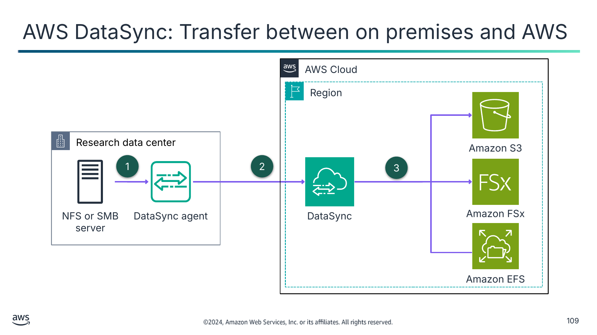

<details>
<summary>Текст зі схеми</summary>

AWS Cloud

Region

Research data center

Amazon S3

1

2

3

NFS or SMB server

DataSync agent

DataSync

Amazon FSx

Amazon EFS

</details>

> **Нотатки:**
>
> |Slide number 109  
> |Instructor notes  
> |  
> |Student notes  
> In this use case, researchers have data on an on-premises server and need to access the data in the AWS Cloud for archiving and analytics. They need to synchronize their data from the on-premises center to AWS on a daily basis:  
> DataSync uses an agent to transfer data from your on-premises storage. When deployed, the agent acts as an extension of the DataSync service and is managed seamlessly by AWS.  
> A one-time setup is needed for the agent to read data from your source storage. After setup completes, you can create as many transfer tasks as you need, connecting between your on-premises storage and storage in AWS.  
> Configure a source destination for your data transfer. The data can be transferred to all storage classes of Amazon S3, all file systems of Amazon FSx, and Amazon EFS.  
> After transferring the data into any of the storage services, you can use DataSync again to transfer data between Amazon S3, Amazon FSx, and Amazon EFS.

---

## Слайд 110: Appendix: Processing real-time data

- EMR cluster architecture on Amazon EC2
- Amazon EMR workflow

> **Нотатки:**
>
> |Slide number 110  
> |Instructor notes  
> |  
> |Student notes

---

## Слайд 111: EMR cluster architecture on Amazon EC2

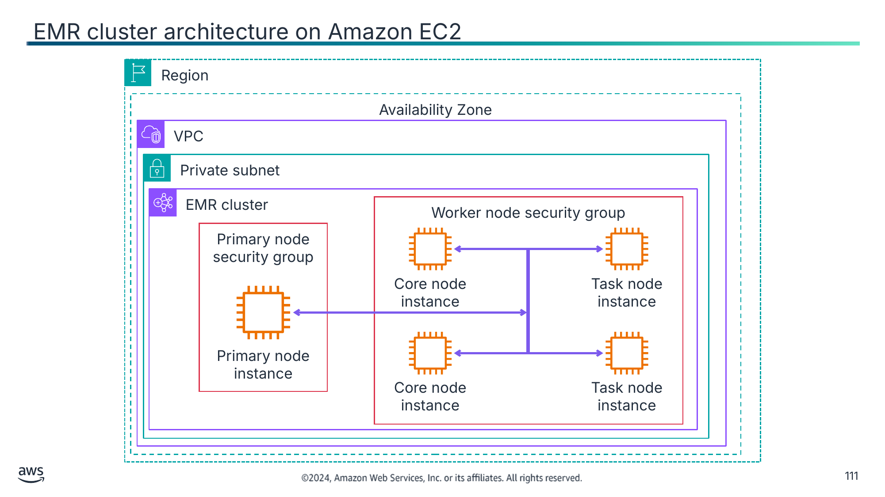

<details>
<summary>Текст зі схеми</summary>

Region

Availability Zone

VPC

Private subnet

EMR cluster

Worker node security group

Primary node security group

Core node

instance

Task node

instance

Primary node

instance

Core node

instance

Task node

instance

</details>

> **Нотатки:**
>
> |Slide number 111  
> |Instructor notes  
> |  
> |Student notes  
> Image description: An EMR cluster is deployed in a private subnet in a VPC in a single AZ in an AWS Region. The cluster primary node instance belongs to the primary node security group. The cluster core and task node instances belong to the worker node security group. End description.  
>
> An EMR cluster is a collection of EC2 instances. Each instance in the cluster is called a node. Within the cluster, each node has a role referred to as the node type.  
>
> The primary node instance manages the cluster by running software components to coordinate the distribution of data and tasks among other nodes for processing. The primary node tracks the status of tasks and monitors the health of the cluster. Every cluster has a primary node, and it's possible to create a single-node cluster with only the primary node.  
>
> EMR cluster worker nodes have two different types. A core node is an instance with software components that runs tasks and stores data in the HDFS on a cluster. Multinode clusters have at least one core node. A task node is a node with software components that only runs tasks and does not store data in HDFS. Task nodes are optional.  
>
> It is important to note that the primary node has a separate security group with different access rules than the worker node security group.  
>
> The cluster lifecycle can be long running or transient. Transient means that after processing the data, the cluster is shut down. This is usually done to save cost. When the cluster is shut down, the cluster storage is also terminated. It is important to save processed data in external storage when using transient clusters.

---

## Слайд 112: Amazon EMR workflow

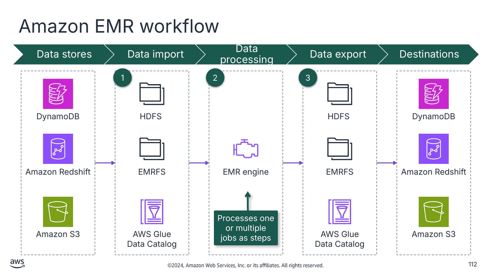

<details>
<summary>Текст зі схеми</summary>

1

2

3

DynamoDB

HDFS

HDFS

DynamoDB

Amazon Redshift

EMRFS

EMR engine

EMRFS

Amazon Redshift

Processes one or multiple jobs as steps

Amazon S3

AWS Glue  
Data Catalog

AWS Glue  
Data Catalog

Amazon S3

</details>

> **Нотатки:**
>
> |Slide number 112  
> |Instructor notes  
> |  
> |Student notes  
> For Amazon EMR to process data, the data must be copied from data stores to the EMR cluster data storage. Some AWS services such as DynamoDB, Amazon Redshift, and Amazon S3 provide direct integrations with Amazon EMR.  
>
> The Amazon EMR workflow consists of the following three numbered steps: Amazon EMR storage, data processing, and export data.  
>
> The Amazon EMR workflow includes the following three main steps:  
> Data import: For Amazon EMR to process data, the data must be copied to the EMR cluster data storage. Two types of storage commonly used are HDFS developed by Apache and the EMR File System (EMRFS) developed by AWS. A data catalog is used with HDFS and EMRFS to facilitate unstructured data reads. AWS recommends using the Data Catalog because it is stored externally to the EMR cluster. EMRFS is an implementation of HDFS that all EMR clusters use for reading and writing regular files from Amazon EMR directly to Amazon S3. EMRFS provides the convenience of storing persistent data in Amazon S3 for use with Hadoop while also providing features such as data encryption.  
> Data processing: To submit a processing job (or workload), a processing step is added to the EMR cluster. The processing step includes the framework specification (Hadoop MapReduce or Apache Spark) and the code script written in Python, Scala, or PySpark. A step can be added during EMR cluster creation or after creation on a long-running cluster. Steps can also be added by workflow applications such as AWS Step Functions to construct an automated data-processing pipeline. The Amazon EMR engine runs the step and reports the job duration, and success or failure metrics.  
> Data export: After processing is complete, the resulting dataset is persisted in either the long-running EMR cluster or exported to an AWS destination. Common destinations are S3 buckets used for data lake storage and Amazon Redshift as a data warehouse.
