## Слайд 1: Шаблони інженерії даних (Data Engineering Patterns)

AWS Academy Cloud Architecting

> **Нотатки:**
>
> |Нотатки для інструктора  
> |  
> |Нотатки для студента

---

## Слайд 2: Вступ

Шаблони інженерії даних

> **Нотатки:**
>
> |Нотатки для інструктора  
> |  
> |Нотатки для студента  
> Цей вступний розділ описує вміст модуля.

---

## Слайд 3: Цілі модуля

- Цей модуль готує вас до такого:
  - Використовувати AWS Well-Architected Framework для узагальнення типу архітектури, потрібної для відповіді поширеним сценаріям використання приймання даних (пакетного й потокового).
  - Обирати шаблон приймання даних (data ingestion), що відповідає характеристикам даних (швидкості, обсягу та різноманітності).
  - Обирати відповідні сервіси AWS для приймання й зберігання даних для заданого сценарію використання.
  - Обирати відповідні сервіси AWS для оптимізації вимог до обробки та перетворення даних для заданого сценарію використання.
  - Визначати, коли використовувати різні типи сервісів аналітики й візуалізації даних AWS на основі заданого сценарію використання.

> **Нотатки:**
>
> |Номер слайда 3  
> |Нотатки для інструктора  
> |  
> |Нотатки для студента

---

## Слайд 4: Огляд модуля

**Розділи презентації**

- Характеристики даних
- Конвеєри даних
- Інструменти AWS для приймання даних
- Обробка пакетних даних
- Обробка даних у реальному часі
- Зберігання в конвеєрі даних
- Паралельна обробка в конвеєрі даних
- Аналіз і візуалізація
- Застосування принципів AWS Well-Architected Framework до конвеєрів даних

**Вправи**

- Вибір сховища даних для банківського застосунку (Choosing Data Storage for a Bank Application)
- Архітектура конвеєра даних (Data Pipeline Architecture)

**Перевірки знань**

- 10-запитальна перевірка знань
- Зразок запитання іспиту

> **Нотатки:**
>
> |Номер слайда 4  
> |Нотатки для інструктора  
> |Кожен модуль має вступ, розділи з вмістом і підсумок. Підсумок цього модуля містить зразок запитання іспиту для розбору зі студентами.  
> |  
> |Нотатки для студента  
> Цілі цього модуля розкриваються в кількох розділах. Ви також візьмете участь у вправах, пов’язаних із вибором правильної архітектури для сценарію використання. Модуль завершується зразком запитання іспиту та онлайн-перевіркою знань, що охоплює викладений матеріал.

---

## Слайд 5: Як хмарний архітектор, що проєктує архітектуру даних:

- Мені потрібно оцінити характеристики наявних даних, щоб я міг обрати компоненти, що підходять до даних і бажаних бізнес-результатів.
- Мені потрібно подумати, як зберігати, організовувати дані та отримувати до них доступ, щоб отримати від них максимальну користь для бізнесу.


> **Нотатки:**
>
> |Номер слайда 5  
> |Нотатки для інструктора  
> |Нотатки для інструктора: цей слайд подає ключові міркування щодо загального проєктування, що мають спрямовувати ухвалення рішень для цього рівня хмарної архітектури. Підкресліть, що хмарний архітектор завжди має починати з бізнес-кейсу й рухатися у зворотному напрямку, щоб обрати найкращі компоненти для цього сценарію використання. Також нагадайте студентам, що рішення, імовірно, еволюціонуватимуть з часом, у міру зміни чи кращого розуміння потреб, для оптимізації вартості та продуктивності. Наприкінці модуля в підсумковому розділі включено необов’язкове обговорення, що спонукає студентів розглянути ці чинники в контексті сценарію з кафе.  
> |  
> |Нотатки для студента  
> Цей слайд просить вас прийняти перспективу хмарного архітектора, коли ви думаєте про те, як підходити до проєктування хмарної мережі. Тримайте ці міркування в голові, просуваючись цим модулем, пам’ятаючи, що хмарний архітектор має працювати у зворотному напрямку від бізнес-потреби, щоб спроєктувати найкращу архітектуру для конкретного сценарію використання. Просуваючись модулем, розглядайте сценарій з кафе, поданий у курсі, як приклад бізнес-потреби й думайте про те, як би ви відповіли на ці потреби для вигаданого бізнесу кафе.

---

## Слайд 6: Характеристики даних

Шаблони інженерії даних

> **Нотатки:**
>
> |Номер слайда 6  
> |Нотатки для інструктора  
> |  
> |Нотатки для студента  
> Цей розділ пояснює, як характеристики даних впливають на рішення, пов’язані з проєктуванням конвеєрів даних.

---

## Слайд 7: Характеристики даних, що визначають рішення щодо інфраструктури

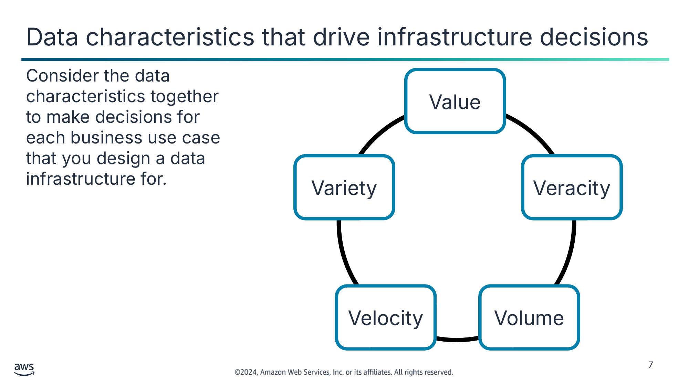

Розглядайте характеристики даних разом, щоб ухвалювати рішення для кожного бізнес-сценарію, для якого ви проєктуєте інфраструктуру даних.

<details>
<summary>Текст зі схеми</summary>

Value (Цінність)

````````````````````=`

Variety (Різноманітність)

Veracity (Достовірність)

Velocity (Швидкість)

Volume (Обсяг)

</details>

> **Нотатки:**
>
> |Номер слайда 7  
> |Нотатки для інструктора  
> |  
> |Нотатки для студента  
> П’ять V характеристик даних — це цінність (value), достовірність (veracity), обсяг (volume), швидкість (velocity) і різноманітність (variety). Їх показано в колі, оскільки кожна впливає на ухвалення рішень. Ухвалення рішень щодо інфраструктури відбувається не лінійно.

---

## Слайд 8: П’ять V даних (five Vs of data)

| Характеристики даних (Data Characteristics) | Сфера (Scope) | Запитання для розгляду (Questions to Consider) |
|---|---|---|
| Цінність (Value) | Як оброблені дані можуть дати розуміння бізнес-проблеми | Яке розуміння можна отримати з даних? |
| Достовірність (Veracity) | Як захистити й посилити цілісність даних | Наскільки точні, прецизійні та довірені дані? |
| Обсяг (Volume) | Скільки даних потрібно обробити | Як довго потрібно зберігати дані? Які шаблони доступу? |
| Швидкість (Velocity) | Як швидко дані надходять і рухаються вашим конвеєром | • Як часто генеруються дані?<br>• Як швидко потрібно реагувати на дані? |
| Різноманітність (Variety) | Скільки джерел даних і типів даних ви використовуєте | Який формат і тип даних? З яких джерел надходять дані? |

> **Нотатки:**
>
> |Номер слайда 8  
> |Нотатки для інструктора  
> |Це стисла версія п’яти V даних. Докладніші пояснення та приклади кожної характеристики даних див. на слайдах у розділі «Додаток» наприкінці цієї презентації.  
> |  
> |Нотатки для студента  
> Кожна з п’яти характеристик даних стосується певного аспекту даних, що впливає на проєкт інфраструктури:  
> Цінність стосується забезпечення того, щоб ви отримували максимум зі зібраних даних. Цінність також стосується забезпечення того, щоб результати збирання, зберігання й обробки даних мали бізнес-цінність.  
> Достовірність стосується точності та надійності даних. Ці елементи важливі, оскільки вони є основою аналізу, який ви виконуєте для ухвалення рішень. Розгляньте, звідки надходять ваші дані і як можна захистити їхню цілісність, коли вони проходять конвеєром даних.  
> Обсяг даних впливає на інфраструктуру введення даних у конвеєр, обробки даних і їх зберігання. Те, як ви обираєте зберігати дані, залежить від того, як часто ви хочете звертатися до даних і обробляти їх.  
> Кількість даних і темп даних визначають вибір проєкту. Поєднання обсягу та швидкості безпосередньо впливає на те, як потрібно спроєктувати ваш конвеєр.  
> Різні типи даних піддаються певним типам обробки й аналізу. Це впливатиме на те, як дані потрапляють у конвеєр, і на процес їх підготовки до аналізу.  
>
> Враховуйте ці пункти, оцінюючи характеристики даних:  
> Тримайте в голові кінцевого користувача, проєктуючи інфраструктуру та ухвалюючи рішення.  
> Цінність залежить від достовірності, оскільки без хороших даних можна ухвалити погані бізнес-рішення.  
> Розумійте тривалість зберігання даних і частоту доступу, щоб зважити вартість і переваги зберігання.  
> Обсяг і швидкість разом визначають очікувану пропускну здатність і вимоги до масштабування вашого конвеєра. Для сценаріїв із однаково великим обсягом швидкість надходження даних і швидкість, з якою дані потрібно обробити, впливатимуть на інфраструктуру конвеєра, яку ви проєктуєте.  
> Поєднання наборів даних може збагатити аналіз, але також може ускладнити обробку.

---

## Слайд 9: Триетапна стратегія побудови інфраструктур даних

Модернізуйте (Modernize)

Об’єднуйте (Unify)

Впроваджуйте інновації (Innovate)

Перейдіть на хмарну інфраструктуру та спеціалізовані сервіси (purpose-built), щоб зменшити непродуктивну рутинну роботу.

Створіть єдине джерело істини для даних і зробіть дані доступними в усій організації.

Застосовуйте штучний інтелект і машинне навчання (AI/ML), щоб знаходити нові висновки в даних.

> **Нотатки:**
>
> |Номер слайда 9  
> |Нотатки для інструктора  
> |  
> |Нотатки для студента  
> Тепер, коли ви знайомі з характеристиками даних, потрібними для ухвалення бізнес- та інфраструктурних рішень, розгляньте загальний підхід до роботи з даними.  
>
> Підхід для організацій, що хочуть стати керованими даними (data driven), — модернізувати, об’єднувати та впроваджувати інновації зі своїми інфраструктурами даних:  
> Модернізація — це перехід на хмарні інфраструктури та спеціалізовані сервіси, щоб зменшити адміністративні й операційні зусилля. Це підвищить гнучкість і зменшить непродуктивну рутинну роботу (undifferentiated lifting).  
> Об’єднання — це створення єдиного джерела істини для даних і забезпечення доступності даних у всій організації. Це поєднує найкращі елементи і озер даних, і спеціалізованих сховищ даних.  
> Інновації — це пошук нових способів знайти цінність у даних, зокрема застосування штучного інтелекту й машинного навчання (AI/ML) для пошуку нових висновків. За допомогою AI/ML можна впроваджувати інновації в досвід користувачів і переосмислювати старі процеси.

---

## Слайд 10: Рішення для сучасної архітектури даних (modern data architecture)

Централізоване розташування для доступу до даних і запуску застосунків аналітики та AI/ML.

- Інтегрує озеро даних (data lake), сховище даних (data warehouse) та інші спеціалізовані сховища даних
- Підтримує єдиний доступ, дозволи, авторизацію та безшовне переміщення даних
- Надає доступ до всіх даних для ухвалення кращих рішень зі швидкістю


Озеро даних (Data lake)

> **Нотатки:**
>
> |Номер слайда 10  
> |Нотатки для інструктора  
> |  
> |Нотатки для студента  
> Проблема: організації хочуть захоплювати всі свої дані, щоб якомога швидше отримувати з них цінність. Щоб ефективно аналізувати всі дані, розподілені між озером даних та іншими сховищами даних, бізнес часто переміщує дані в озеро даних і з нього та між цими сховищами даних. Це переміщення даних може стати складним і безладним у міру зростання даних у цих сховищах.  
>
> Розв’язання: мета сучасної архітектури даних — зберігати дані в централізованому розташуванні й робити їх доступними для всіх споживачів для виконання аналітики та запуску застосунків AI/ML. Сучасна архітектура даних інтегрує озеро даних, сховище даних та інші спеціалізовані сховища даних, уможливлюючи єдине управління (governance) і безшовне переміщення даних. Вона не обмежена окремими силосами даних. Таким чином організації можуть зберігати свої дані в озері даних і використовувати спеціалізовані сховища даних, що працюють з озером даних. Цей підхід надає доступ до всіх даних для ухвалення кращих рішень зі швидкістю.  
>
> Концепція, яку слід запам’ятати: сучасна архітектура даних інтегрує озеро даних, сховище даних та інші спеціалізовані сховища даних, уможливлюючи єдине управління та безшовне переміщення даних, щоб допомогти організації отримати максимум цінності зі своїх даних.

---

## Слайд 11: Ключові висновки: характеристики даних

- П’ять характеристик даних — це цінність, достовірність, обсяг, швидкість і різноманітність.
- Розглядайте характеристики даних разом, щоб ухвалювати рішення щодо проєкту інфраструктури для кожного бізнес-сценарію.
- Цінність і достовірність впливають на точні висновки, потрібні бізнесу. Обсяг і швидкість *разом* визначають очікувану пропускну здатність і вимоги до масштабування вашого конвеєра.
- Мета сучасної архітектури даних — зберігати дані в централізованому розташуванні й робити їх доступними для всіх споживачів для виконання аналітики та запуску застосунків AI/ML.

> **Нотатки:**
>
> |Номер слайда 11  
> |Нотатки для інструктора  
> |  
> |Нотатки для студента  
> Ось кілька ключових моментів, що підсумовують цей розділ:  
> Враховуйте цінність, достовірність, обсяг, швидкість і різноманітність ваших даних, ухвалюючи рішення щодо проєкту інфраструктури для кожного бізнес-сценарію.  
> Цінність і достовірність стосуються забезпечення точних даних, що ведуть до висновків, які відповідають бізнес-вимогам.  
> Кількість даних (обсяг), темп даних (швидкість) і типи даних (різноманітність) визначають вибір проєкту конвеєра.

---

## Слайд 12: Конвеєри даних (data pipelines)

Шаблони інженерії даних

> **Нотатки:**
>
> |Номер слайда 12  
> |Нотатки для інструктора  
> |  
> |Нотатки для студента  
> Цей розділ надає огляд конвеєрів даних і пояснює чотири шаблони приймання.

---

## Слайд 13: Елементи конвеєра даних

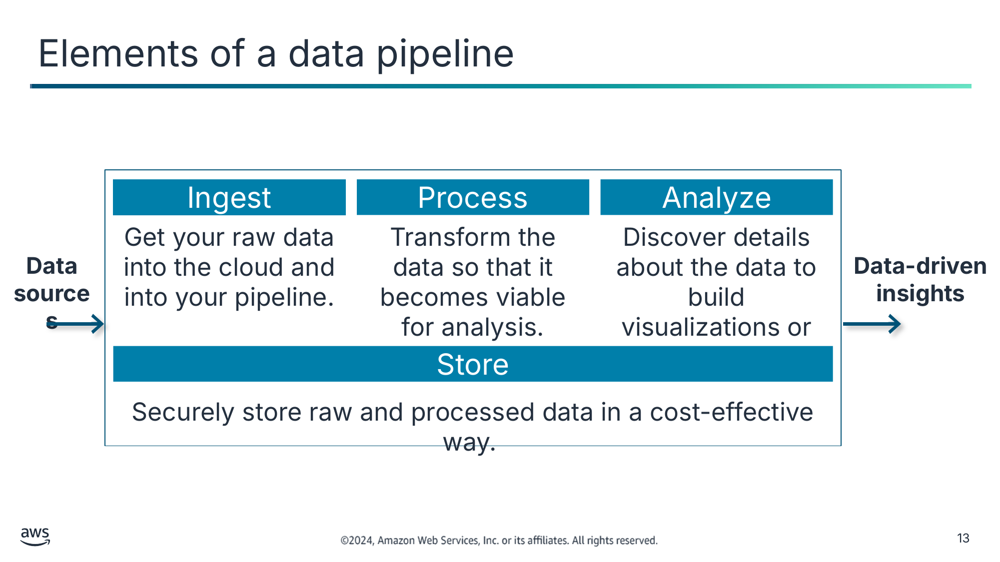

<details>
<summary>Текст зі схеми</summary>

Ingest (Прийняти)

Process (Обробити)

Analyze (Проаналізувати)

Get your raw data into the cloud and into your pipeline. (Помістіть ваші сирі дані в хмару та у ваш конвеєр.)

Transform the data so that it becomes viable for analysis. (Перетворіть дані так, щоб вони стали придатними для аналізу.)

Discover details about the data to build visualizations or predictions. (Виявте подробиці про дані для побудови візуалізацій чи прогнозів.)

**Data sources** (**Джерела даних**)

**Data-driven insights** (**Висновки, керовані даними**)

Store (Зберігати)

Securely store raw and processed data in a cost-effective way. (Безпечно зберігайте сирі й оброблені дані економічно ефективним способом.)

</details>

> **Нотатки:**
>
> |Номер слайда 13  
> |Нотатки для інструктора  
> |Це високорівневий конвеєр, що показує зберігання як частину всіх трьох рівнів приймання, обробки й аналізу даних.  
> |  
> |Нотатки для студента  
> На найпростішому рівні будь-яка інфраструктура конвеєра даних має вміти приймати дані, зберігати їх і надавати засоби роботи з даними для отримання висновків. Ці елементи — приймання, зберігання, обробка й аналіз даних.  
>
> Дані обробляються ітеративно для оцінювання й покращення результатів. Лінійний конвеєр — це спрощена версія цього ітеративного процесу.  
>   
> Дивлячись на конвеєр із погляду даних, що ним рухаються, конвеєр має підтримувати здатність виявляти подробиці про дані та те, як вони відповідають (чи не відповідають) вашим цільовим результатам.  
>
> Для кожного сценарію використання починайте з кінцевої мети (бізнес-проблеми) й будуйте конвеєр даних, що її підтримує. Характеристики ваших даних і бізнес-проблема, яку ви розв’язуєте, визначатимуть елементи конвеєра та ітеративний процес.  
>
> Приймання (ingestion) — це процес вилучення даних із джерела й завантаження їх у конвеєр даних для зберігання чи аналізу. Приймання даних передбачає копіювання даних із вихідного сховища даних до цільового сховища даних.

---

## Слайд 14: Шаблон однорідного приймання (homogeneous ingestion pattern)

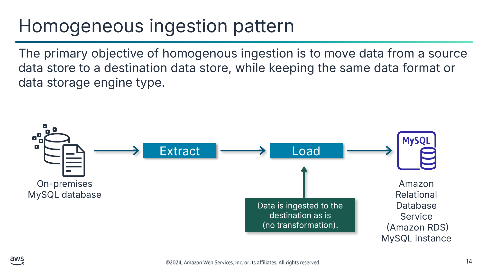

Основна мета однорідного приймання — перемістити дані з вихідного сховища даних до цільового сховища даних, зберігаючи той самий формат даних чи тип рушія зберігання даних.

<details>
<summary>Текст зі схеми</summary>

On-premises

MySQL database (Локальна база даних MySQL)

Amazon Relational Database Service  
 (Amazon RDS)

MySQL instance (Екземпляр MySQL)

Extract (Вилучення)

Load (Завантаження)

Data is ingested to the destination as is  
(no transformation). (Дані приймаються до призначення як є (без перетворення).)

</details>

> **Нотатки:**
>
> |Номер слайда 14  
> |Нотатки для інструктора  
> |Слайд «Transforming data during ingestion» перелічує чотири способи, у які дані можуть перетворюватися, коли їх роблять придатними для аналізу. Він розташований у розділі «Додаток» цього модуля.  
> |  
> |Нотатки для студента  
> Коли дані приймаються у форматі «як є», класифікація — однорідна (homogeneous).  
>
> Слайд показує процес міграції даних, у якому дані вилучаються з локальної бази даних NoSQL і завантажуються в базу даних Amazon Relational Database Service (Amazon RDS) MySQL. Ці дані приймаються як є без жодного перетворення.  
>
> Ще один сценарій використання однорідного приймання — наповнення області посадки (landing area), де зберігаються всі оригінальні копії прийнятих даних. У цьому випадку сирі текстові файли потрібно зберігати, не обов’язково перетворюючи їх жодним чином.  
>
> Сирі дані можуть бути неузгодженими, неточними та повторюваними. Дані, що приймаються, можливо, потрібно перетворити для вилучення високоякісних даних.  
>   
> Дані майже завжди будуть перетворюватися під час проходження конвеєром. Це перетворення передбачає конвертацію та структурування даних способом, що відповідає схемі цільового розташування.

---

## Слайд 15: Шаблони різнорідного приймання (heterogeneous ingestion patterns)

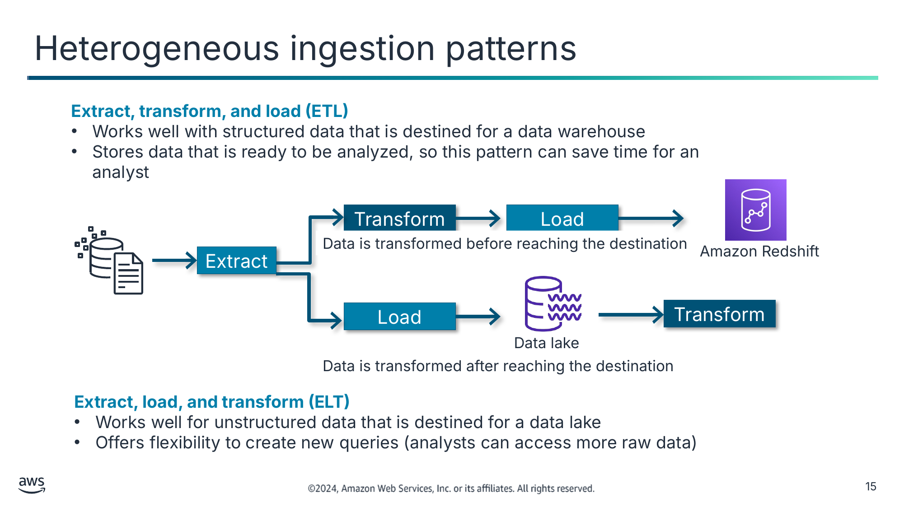

**Вилучення, перетворення й завантаження (extract, transform, and load, ETL)**

- Добре працює зі структурованими даними, призначеними для сховища даних
- Зберігає дані, готові до аналізу, тож цей шаблон може заощадити час аналітику

**Вилучення, завантаження й перетворення (extract, load, and transform, ELT)**

- Добре працює для неструктурованих даних, призначених для озера даних
- Пропонує гнучкість створення нових запитів (аналітики можуть отримувати доступ до більшої кількості сирих даних)

<details>
<summary>Текст зі схеми</summary>

Transform (Перетворення)

Load (Завантаження)

Data is transformed before reaching the destination (Дані перетворюються до досягнення призначення)

Extract (Вилучення)

Amazon Redshift

Transform

Load

Data lake (Озеро даних)

Data is transformed after reaching the destination (Дані перетворюються після досягнення призначення)

</details>

> **Нотатки:**
>
> |Номер слайда 15  
> |Нотатки для інструктора  
> |  
> |Нотатки для студента  
> Нижче наведено кроки в конвеєрі вилучення, перетворення й завантаження (ETL):  
> Вилучити структуровані дані.  
> Перетворити дані на формат, що відповідає призначенню.  
> Завантажити дані у структуроване сховище для визначеної аналітики.  
>
> Нижче наведено кроки в конвеєрі вилучення, завантаження й перетворення (ELT):  
> Вилучити неструктуровані чи структуровані дані.  
> Завантажити дані в місце зберігання у форматі, максимально наближеному до сирого вигляду.  
> Перетворити дані за потреби для сценаріїв аналітики.  
>
> Протягом цього модуля ви побачите кілька сценаріїв використання з різнорідними шаблонами приймання й обробки.

---

## Слайд 16: Шаблони пакетної та потокової обробки (batch and streaming processing patterns)

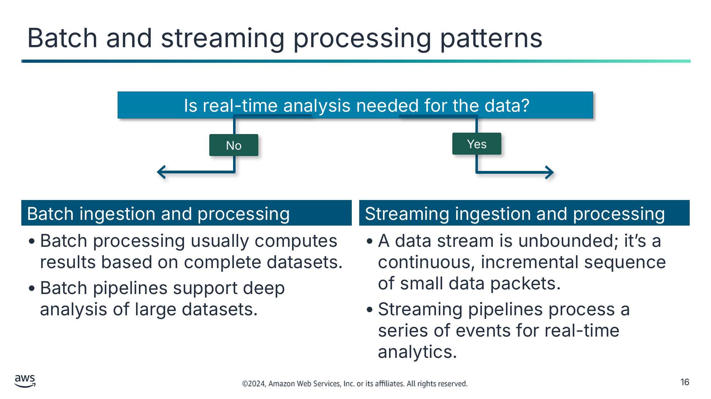

Пакетне приймання та обробка (Batch ingestion and processing)

Потокове приймання та обробка (Streaming ingestion and processing)

- Пакетна обробка зазвичай обчислює результати на основі повних наборів даних.
- Пакетні конвеєри підтримують глибокий аналіз великих наборів даних.

- Потік даних безмежний; це безперервна, поступова послідовність малих пакетів даних.
- Потокові конвеєри обробляють ряд подій для аналітики в реальному часі.

<details>
<summary>Текст зі схеми</summary>

Is real-time analysis needed for the data? (Чи потрібен аналіз даних у реальному часі?)

No (Ні)

Yes (Так)

</details>

> **Нотатки:**
>
> |Номер слайда 16  
> |Нотатки для інструктора  
> |Основна увага — на сценарії використання та бізнес-потребі під час визначення, обрати шаблони пакетного чи потокового приймання.  
> |  
> |Нотатки для студента  
> У пакетних конвеєрах кожна команда виконується над усім пакетом даних. Це може виконуватися за запитом, за розкладом чи на основі події.  
>
> У потокових конвеєрах потокові дані генеруються безперервно тисячами джерел даних одночасно. У міру надходження нових даних метрики чи звіти оновлюються поступово.

---

## Слайд 17: Порівняння шаблонів пакетної та потокової обробки

| Функції (Features) | Пакетна обробка (Batch Processing) | Потокова обробка (Streaming Processing) |
|---|---|---|
| Цикли обробки даних (Data Processing Cycles) | Конвеєри обробки працюють рідко й зазвичай у непіковий час | Конвеєри обробки працюють безперервно |
| Обчислювальні вимоги (Compute Requirements) | Потребує великої обчислювальної потужності | Потребує малої обчислювальної потужності та надійних мережевих з’єднань із низькою затримкою |
| Сценарій використання (Use Case) | Дані транзакцій продажів аналізуються вночі, а звіти надсилаються до філій уранці. | Під час надання рекомендації продукту дані потрібно проаналізувати негайно. |

> **Нотатки:**
>
> |Номер слайда 17  
> |Нотатки для інструктора  
> |  
> |Нотатки для студента  
> Цей модуль пізніше докладно охопить пакетне та потокове приймання.

---

## Слайд 18: Ключові висновки: конвеєри даних

- Конвеєр даних включає рівні для приймання, зберігання, обробки й аналізу даних.
- Приймання даних — це процес вилучення даних із джерела й завантаження їх у конвеєр даних для зберігання чи аналізу.
- В однорідному прийманні дані не потрібно перетворювати, оскільки джерело й призначення збігаються. Коли перетворення потрібне, різнорідне приймання може включати шаблони ETL чи ELT.
- Якщо дані потрібно аналізувати майже в реальному часі, розгляньте методи потокового приймання замість пакетного.

> **Нотатки:**
>
> |Номер слайда 18  
> |Нотатки для інструктора  
> |  
> |Нотатки для студента  
> Ось кілька ключових моментів, що підсумовують цей розділ:  
> Конвеєр даних має рівні для приймання, зберігання, обробки й аналізу даних.  
> Приймання даних передбачає вилучення й завантаження даних.  
> Однорідне приймання не включає перетворення.  
> Різнорідне приймання включає перетворення, що може відбуватися до (ETL) чи після (ELT) завантаження.  
> Потокове приймання придатне для аналізу даних у реальному часі.

---

## Слайд 19: Інструменти AWS для приймання даних

Шаблони інженерії даних

> **Нотатки:**
>
> |Номер слайда 19  
> |Нотатки для інструктора  
> |  
> |Нотатки для студента  
> Цей розділ описує функцію чотирьох інструментів AWS для приймання даних.

---

## Слайд 20: Рівень приймання конвеєра даних

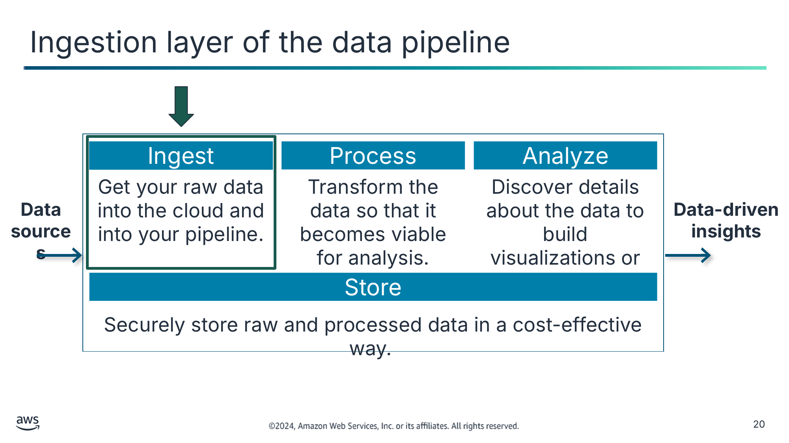

<details>
<summary>Текст зі схеми</summary>

Ingest (Прийняти)

Process (Обробити)

Analyze (Проаналізувати)

Get your raw data into the cloud and into your pipeline. (Помістіть ваші сирі дані в хмару та у ваш конвеєр.)

Transform the data so that it becomes viable for analysis. (Перетворіть дані так, щоб вони стали придатними для аналізу.)

Discover details about the data to build visualizations or predictions. (Виявте подробиці про дані для побудови візуалізацій чи прогнозів.)

**Data sources** (**Джерела даних**)

**Data-driven insights** (**Висновки, керовані даними**)

Store (Зберігати)

Securely store raw and processed data in a cost-effective way. (Безпечно зберігайте сирі й оброблені дані економічно ефективним способом.)

</details>

> **Нотатки:**
>
> |Номер слайда 20  
> |Нотатки для інструктора  
> |Це високорівневий конвеєр, що показує зберігання як частину всіх трьох рівнів приймання, обробки й аналізу даних.  
> |  
> |Нотатки для студента  
> Приймання — це процес вилучення даних із джерела й завантаження їх у конвеєр даних для зберігання чи аналізу. Приймання даних передбачає копіювання даних із вихідного сховища даних до цільового сховища даних.  
>   
> Інструменти AWS для приймання даних стосуються рівня приймання конвеєра даних.

---

## Слайд 21: Зіставлення сервісів приймання з джерелами даних

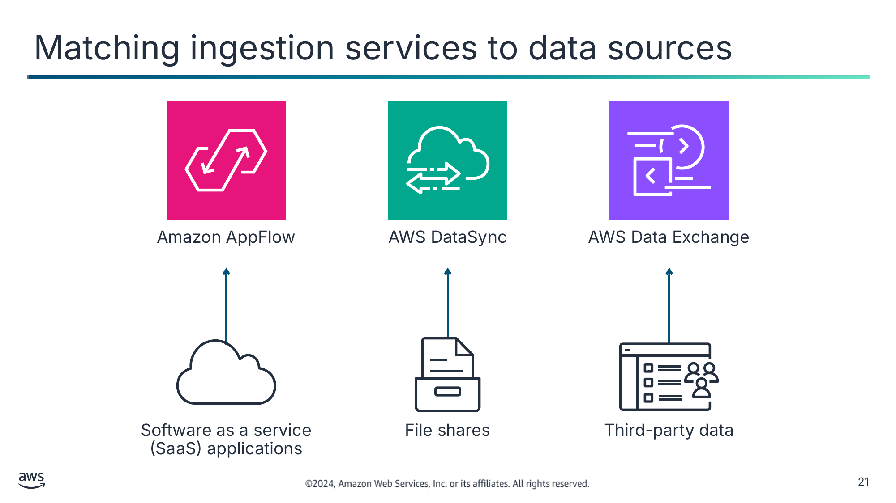

<details>
<summary>Текст зі схеми</summary>

Amazon AppFlow

AWS DataSync

AWS Data Exchange

Software as a service (SaaS) applications (Застосунки «програмне забезпечення як послуга» (SaaS))

File shares (Файлові спільні ресурси)

Third-party data (Дані третіх сторін)

</details>

> **Нотатки:**
>
> |Номер слайда 21  
> |Нотатки для інструктора  
> |  
> |Нотатки для студента  
> Інструменти AWS для приймання — це спеціалізовані сервіси (purpose-built), які можна організувати за типами джерел. Ці сервіси включають такі:  
> Amazon AppFlow може приймати дані із застосунків «програмне забезпечення як послуга» (SaaS), як-от Salesforce чи Zendesk.  
> AWS DataSync може приймати дані з файлових спільних ресурсів.  
> AWS Data Exchange може забезпечити спрощений досвід доступу до даних третіх сторін.

---

## Слайд 22: Amazon AppFlow

- Надає можливість передавати дані між застосунками SaaS і сервісами AWS
- Пропонує повторне використання наявних інтеграцій сервісів із доступними API Amazon AppFlow
- Надає можливості перетворення даних

Amazon AppFlow

> **Нотатки:**
>
> |Номер слайда 22  
> |Нотатки для інструктора  
> |  
> |Нотатки для студента  
> Компанії спираються на сервіси SaaS для критично важливих для місії робочих процесів і стикаються з викликами під час збору даних зі зростаючого середовища сервісів у централізоване розташування.  
>
> Amazon AppFlow автоматизує потоки даних між SaaS і сервісами AWS. Ця автоматизація дає бізнесу змогу отримувати висновки з цих даних.  
>
> Розробнику може знадобитися кілька місяців, щоб побудувати конектор і керувати ним. З Amazon AppFlow можна інтегрувати застосунки негайно замість того, щоб витрачати місяці на побудову конекторів і керування ними для інтеграції застосунків.  
>
> Amazon AppFlow надає можливості перетворення даних, як-от фільтрування, маскування, перевірка, партиціонування, агрегування та каталогізація даних.  
>
> Джерела даних для застосунків SaaS включають Salesforce, SAP, Google Analytics, Facebook Ads, Zendesk і ServiceNow. Призначення — сервіси AWS — включають Amazon Simple Storage Service (Amazon S3) і Amazon Redshift.

---

## Слайд 23: AWS DataSync

- Є повністю керованим сервісом міграції даних
- Спрощує, автоматизує та прискорює копіювання файлових даних та об’єктних даних до сервісів зберігання AWS і з них
- Оптимізований для швидкості
- Включає шифрування та перевірку цілісності
- Зберігає метадані під час переміщення даних

DataSync

> **Нотатки:**
>
> |Номер слайда 23  
> |Нотатки для інструктора  
> |У розділі «Додаток» слайд під назвою «AWS DataSync: Transfer between on-premises and AWS» надає архітектурну схему сценарію використання, у якому дослідники мають дані на локальному сервері й потребують доступу до даних у хмарі AWS для архівування та аналітики.  
> |  
> |Нотатки для студента  
> З DataSync можна переміщувати великі обсяги даних між локальними центрами обробки даних і хмарою AWS. Також можна переміщувати дані між Amazon S3, Amazon Elastic File System (Amazon EFS) та Amazon FSx.  
>
> Можна планувати завдання реплікації для синхронізації даних між джерелом і призначенням щогодини, щодня чи щотижня.  
>
> Передавання даних включає шифрування та перевірку цілісності, щоб допомогти забезпечити, що дані надходять безпечно, цілими й готовими до використання.

---

## Слайд 24: AWS Data Exchange

- Надає клієнтам спосіб знаходити дані третіх сторін у хмарі, підписуватися на них і використовувати їх
- Долає розрив між постачальниками та підписниками, що обмінюються даними, підтримуючи доставку даних через файли, таблиці та API
- Спрощує пошук, підготовку й використання даних у хмарі

AWS Data Exchange

> **Нотатки:**
>
> |Номер слайда 24  
> |Нотатки для інструктора  
> |  
> |Нотатки для студента  
> AWS Data Exchange спрощує й оптимізує обмін даними. AWS Data Exchange допомагає бізнесу знаходити дані, які він шукає, за допомогою всеосяжного каталогу. Користувацькі та приватні продукти доступні для ситуацій, коли клієнти хочуть даних, яких немає в публічному каталозі.  
>
> AWS Data Exchange долає розрив між постачальниками та підписниками, що обмінюються даними, підтримуючи дані. Це допомагає клієнтам знизити витрати, стати гнучкішими й швидше впроваджувати інновації. Він підтримує доставку даних через файли, таблиці та API, щоб клієнти могли почати використовувати потрібні їм дані в продуктивному середовищі одразу після ліцензування, не витрачаючи місяців на побудову конвеєрів приймання даних для доставки їх туди.  
>
> Нижче наведено деякі сценарії використання того, як бізнес використовує AWS Data Exchange для отримання даних третіх сторін з метою покращення своїх рішень аналітики:  
> Фармацевтичні компанії використовують еталони очікуваної тривалості життя для дослідження нових ліків.  
> Роздрібні торговці використовують дані про погоду, щоб передбачати потреби клієнтів і оптимізувати планування запасів.  
> Ресторани підписуються на дані про розташування, щоб визначати місця для розширення.

---

## Слайд 25: Ключові висновки: інструменти AWS для приймання даних

- Для приймання даних розгляньте спеціалізовані інструменти (purpose-built), що зменшать непродуктивну рутинну роботу.
- Amazon AppFlow може приймати дані із застосунків SaaS, як-от Salesforce і Zendesk.
- DataSync може приймати дані з файлових спільних ресурсів.
- AWS Data Exchange надає клієнтам спосіб знаходити дані третіх сторін у хмарі, підписуватися на них і використовувати їх.

> **Нотатки:**
>
> |Номер слайда 25  
> |Нотатки для інструктора  
> |  
> |Нотатки для студента

---

## Слайд 26: Обробка пакетних даних

Шаблони інженерії даних

> **Нотатки:**
>
> |Номер слайда 26  
> |Нотатки для інструктора  
> |  
> |Нотатки для студента  
> Цей розділ описує, як AWS Glue допомагає в пакетному прийманні та обробці. Він також описує, як AWS Glue перетворює дані.

---

## Слайд 27: Рівень обробки конвеєра даних

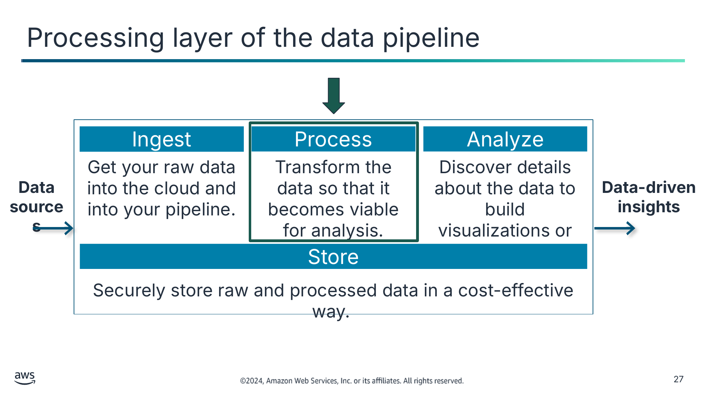

<details>
<summary>Текст зі схеми</summary>

Ingest (Прийняти)

Process (Обробити)

Analyze (Проаналізувати)

Get your raw data into the cloud and into your pipeline. (Помістіть ваші сирі дані в хмару та у ваш конвеєр.)

Transform the data so that it becomes viable for analysis. (Перетворіть дані так, щоб вони стали придатними для аналізу.)

Discover details about the data to build visualizations or predictions. (Виявте подробиці про дані для побудови візуалізацій чи прогнозів.)

**Data sources** (**Джерела даних**)

**Data-driven insights** (**Висновки, керовані даними**)

Store (Зберігати)

Securely store raw and processed data in a cost-effective way. (Безпечно зберігайте сирі й оброблені дані економічно ефективним способом.)

</details>

> **Нотатки:**
>
> |Номер слайда 27  
> |Нотатки для інструктора  
> |Це високорівневий конвеєр, що показує зберігання як частину всіх трьох рівнів приймання, обробки й аналізу даних.  
> |  
> |Нотатки для студента  
> Після приймання дані обробляються й перетворюються в конвеєрі даних. Цей розділ обговорює пакетну обробку.

---

## Слайд 28: Пакетне приймання та обробка

Розгляньте банківську систему, що отримує фінансові транзакції протягом дня.

Система збирає й обробляє всі фінансові транзакції наприкінці кожного дня, щоб надавати звіти зацікавленим сторонам і стороннім системам.

Періодично виконує повторювані завдання з даними великого обсягу

Обчислювально інтенсивні завдання обробляються пакетами, часто в непіковий час

Використовується для щоденного й щотижневого звітування

> **Нотатки:**
>
> |Номер слайда 28  
> |Нотатки для інструктора  
> |  
> |Нотатки для студента  
> Щоб зрозуміти пакетне приймання та обробку, розгляньте банківську систему, що отримує фінансові транзакції протягом дня. Замість обробки кожної транзакції в момент її виникнення система збирає всі фінансові транзакції наприкінці кожного дня, щоб надавати звіти зацікавленим сторонам чи стороннім системам.  
>
> Концепції пакетної обробки очевидні в цьому сценарії використання.  
>
> Компанії використовують пакетну обробку, оскільки вона робить виконання повторюваних завдань ефективнішим і економніше використовує обчислювальну потужність.  
>
> Певні завдання обробки даних, як-от резервне копіювання, фільтрування й сортування, можуть бути обчислювально інтенсивними та неефективними для виконання над окремими записами даних.  
>
> Натомість системи даних обробляють такі завдання пакетами, часто в непіковий час, коли обчислювальні ресурси частіше доступні, як-от наприкінці дня чи вночі.

---

## Слайд 29: Коли розглядати пакетну обробку

- Для цілей звітування
- Під час роботи з великими наборами даних
- Коли сценарій використання аналітики більше зосереджений на агрегуванні чи перетворенні даних і менше — на аналізі даних у реальному часі


> **Нотатки:**
>
> |Номер слайда 29  
> |Нотатки для інструктора  
> |  
> |Нотатки для студента  
> Один зі сценаріїв використання пакетного приймання та обробки — галузь медичних досліджень. Аналіз великих обсягів даних — поширена вимога в галузі досліджень. Аналіз у реальному часі не потрібен.  
>
> Клієнти AWS можуть застосовувати пакетну обробку в застосунках аналітики даних, як-от обчислювальна хімія, клінічне моделювання, молекулярна динаміка, а також тестування й аналіз секвенування геному.

---

## Слайд 30: AWS Glue

- Є сервісом інтеграції даних, що допомагає автоматизувати й виконувати завдання ETL як частину приймання даних у конвеєр
- Надає можливість читати й записувати дані з кількох систем і баз даних
- Спрощує пакетне та потокове приймання

AWS Glue

> **Нотатки:**
>
> |Номер слайда 30  
> |Нотатки для інструктора  
> |У цьому розділі охоплено лише деякі функції AWS Glue.  
> |  
> |Нотатки для студента  
> AWS Glue — це сервіс інтеграції даних, що допомагає автоматизувати й виконувати завдання ETL як частину приймання даних у ваш пакетний чи потоковий конвеєр.  
>
> AWS Glue можна розглядати як багатоцільовий інструмент із багатьма різними можливостями для інтеграції даних. З AWS Glue клієнти AWS можуть читати й записувати дані з кількох систем і баз даних.  
>
> AWS Glue інтегрується з Amazon S3, Amazon DynamoDB, Amazon Redshift, Amazon RDS та Amazon DocumentDB (із сумісністю з MongoDB).

---

## Слайд 31: Компоненти AWS Glue (AWS Glue components)

Завдання ETL (ETL jobs)

AWS Glue Data Catalog

AWS Glue DataBrew

AWS Glue Data Quality

- Завдання перетворення даних

- Виявлення й організація даних

- Сервіс без коду для підготовки та очищення даних

- Оцінювання якості даних

> **Нотатки:**
>
> |Номер слайда 31  
> |Нотатки для інструктора  
> |  
> |Нотатки для студента  
> AWS Glue Data Catalog зберігає метадані про набори даних, зокрема інформацію про схему джерел і цілей даних ваших завдань ETL. Data Catalog не зберігає жодних наборів даних.  
>
> Для заданого набору даних клієнти AWS можуть зберігати визначення його таблиці та фізичне розташування, додавати релевантні для бізнесу атрибути й відстежувати, як ці дані змінювалися з часом.  
>   
> За допомогою AWS Glue ETL можна створювати чи редагувати завдання для перетворення даних. AWS Glue ETL має візуальний інтерфейс (AWS Glue Studio), з якого можна створювати, запускати й відстежувати завдання AWS Glue ETL без кодування.  
>
> Можливості потокової обробки AWS Glue Streaming ETL пришвидшують доступність ваших потокових даних для аналізу.  
>
> З AWS Glue DataBrew можна очищувати й нормалізувати дані за допомогою візуального інтерфейсу. DataBrew збирає набір описових метаданих для посилання на дані.  
>
> Можна обирати з понад 250 попередньо побудованих перетворень для автоматизації завдань підготовки даних, як-от фільтрування аномалій, конвертація даних у стандартні формати та виправлення недійсних значень, усе без потреби писати код.  
>   
> AWS Glue Data Quality оцінює набір даних для обчислення статистики, рекомендує правила якості, відстежує й надсилає сповіщення, коли виявляє погіршення якості. Це допомагає виявляти відсутні, застарілі чи погані дані до того, як вони вплинуть на ваш бізнес.

---

## Слайд 32: AWS Glue — це сервіс інтеграції даних для побудови сучасних архітектур даних

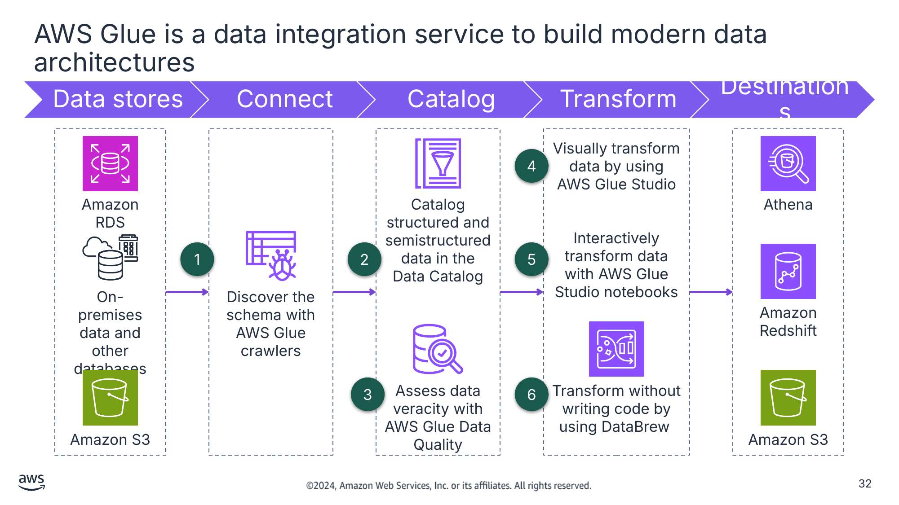

<details>
<summary>Текст зі схеми</summary>

Amazon RDS

On-premises data and other databases (Локальні дані та інші бази даних)

Amazon S3

Discover the schema with AWS Glue crawlers (Виявлення схеми за допомогою сканерів AWS Glue)

Catalog structured and semistructured data in the Data Catalog (Каталогізація структурованих і напівструктурованих даних у Data Catalog)

Assess data veracity with AWS Glue Data Quality (Оцінювання достовірності даних за допомогою AWS Glue Data Quality)

Visually transform data by using AWS Glue Studio (Візуальне перетворення даних за допомогою AWS Glue Studio)

Interactively transform data with AWS Glue Studio notebooks (Інтерактивне перетворення даних за допомогою блокнотів AWS Glue Studio)

Transform without writing code by using DataBrew (Перетворення без написання коду за допомогою DataBrew)

Athena

Amazon Redshift

Amazon S3

4

1

2

5

3

6

</details>

> **Нотатки:**
>
> |Номер слайда 32  
> |Нотатки для інструктора  
> |  
> |Нотатки для студента  
> Сканери AWS Glue (crawlers) працюють над вашими сховищами даних, виводять із них схему й наповнюють Data Catalog. Сканер створює чи оновлює одну або кілька таблиць бази даних Data Catalog у каталозі даних. Сканери можуть працювати над багатьма сховищами даних, зокрема Amazon S3, і багатьма реляційними базами даних, зокрема Amazon RDS.  
> Структуровані чи напівструктуровані дані тепер мають схему. Наявність цієї схеми уможливлює ефективний доступ до даних. Коли визначення таблиць додаються до Data Catalog, вони доступні для ETL, а також легко доступні для запитів в Amazon Athena, Amazon EMR та Amazon Redshift Spectrum. Користувач AWS Glue може мати спільний вигляд даних, що перебувають у кожному з цих сервісів. Коли AWS Glue починає каталогізувати дані, він виявить розбіжності типів даних і надішле сповіщення.  
> AWS Glue Data Quality автоматично обчислює статистику, рекомендує правила якості, відстежує дані й сповіщає, коли виявляє, що якість не відповідає набору правил якості. Ця функція допомагає виявляти відсутні, застарілі чи погані дані до того, як вони вплинуть на бізнес-рішення.  
> За допомогою скриптів, що генерує Data Catalog, можна використовувати візуальний інтерфейс консолі AWS Glue для написання ваших скриптів і створення завдань. AWS Glue Studio надає графічний інтерфейс для створення завдань ETL. Візуальний інтерфейс допомагає користувачам, що не мають великого досвіду кодування, проєктувати завдання й прискорює процес для користувачів, що мають досвід кодування.  
> З блокнотами завдань AWS Glue Studio (job notebooks) можна інтерактивно створювати завдання ETL в інтерфейсі блокнота на основі блокнотів Jupyter. Блокноти завдань AWS Glue Studio потребують мінімального налаштування й можуть автоматично перетворюватися на завдання інтеграції даних AWS Glue.  
> DataBrew — це інструмент візуальної підготовки даних для підготовки даних за допомогою інтерактивного візуального інтерфейсу «вказати й клацнути» без написання коду. З DataBrew можна візуалізувати, очищувати й нормалізувати великі обсяги даних.

---

## Слайд 33: Сценарій використання в іграх для пакетного конвеєра ETL

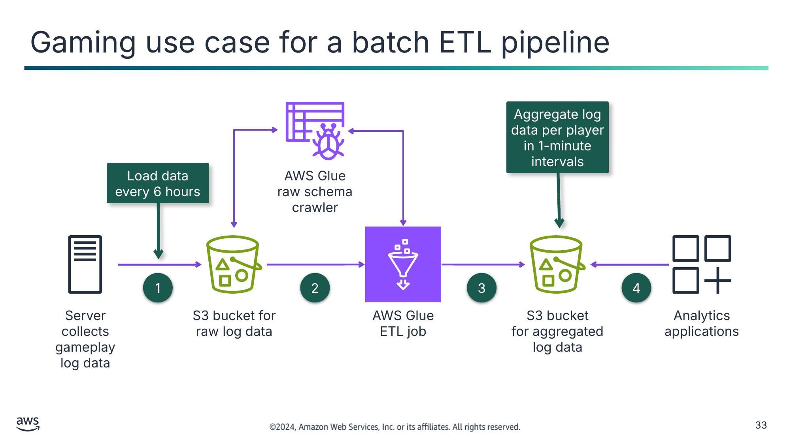

<details>
<summary>Текст зі схеми</summary>

Aggregate log data per player in 1-minute intervals (Агрегувати дані журналу для кожного гравця з інтервалами в 1 хвилину)

Load data every 6 hours (Завантажувати дані кожні 6 годин)

AWS Glue raw schema crawler (Сканер сирої схеми AWS Glue)

1

2

3

4

Server collects gameplay log data (Сервер збирає дані журналу ігрового процесу)

S3 bucket for raw log data (Бакет S3 для сирих даних журналу)

AWS Glue ETL job (Завдання AWS Glue ETL)

S3 bucket  
for aggregated log data (Бакет S3 для агрегованих даних журналу)

Analytics applications (Застосунки аналітики)

</details>

> **Нотатки:**
>
> |Номер слайда 33  
> |Нотатки для інструктора  
> |  
> |Нотатки для студента  
> Ігрова компанія щодня генерує кілька гігабайтів даних про ігри користувачів. Ці дані можуть включати такі подробиці, як середня тривалість сеансу, кількість внутрішньоігрових покупок і кількість днів із часу останньої гри кожного гравця.  
>
> Компанія хоче використовувати метрики з профілів користувачів для прогнозування тривалості ігрових сеансів:  
> Ігровий сервер, що збирає дані, згенеровані користувачами, з програмного забезпечення, проштовхує дані до бакета S3 раз на 6 годин.  
> Сканери сирої схеми AWS Glue працюють над журналами гравців і надають AWS Glue ETL каталог даних.  
> Кожні 6 годин, коли дані завантажуються в бакет сирих даних журналу, запускається завдання AWS Glue. Завдання AWS Glue ETL агрегує дані журналу для кожного гравця в інтервали по 1 хвилині.  
> Перетворені дані доступні з бакета агрегованих даних S3 для доступу кількох застосунків аналітики.

---

## Слайд 34: AWS Glue як сервіс перетворення даних

.csv

.parquet

Конвертація .csv у .parquet

- Є найпоширенішим форматом зберігання табличних даних
- Неефективний для зберігання чи обробки великих обсягів даних (понад 15 ГБ)

- Зберігає дані по стовпцях (columnar)
- Оптимізований для зберігання
- Придатний для паралельної обробки

- Пришвидшує робочі навантаження аналітики
- З часом заощаджує місце зберігання, кошти й час

> **Нотатки:**
>
> |Номер слайда 34  
> |Нотатки для інструктора  
> |  
> |Нотатки для студента  
> AWS Glue — це також сервіс перетворення даних. Можна виконати завдання ETL за допомогою AWS Glue ETL, щоб перетворити формат ваших даних.  
>
> Поширена потреба під час роботи з великими файлами даних — конвертувати формат з .csv (значення, розділені комами) на Apache Parquet для ефективного читання та зберігання.  
>
> Формат Parquet побудовано для підтримки ефективного стиснення й схем кодування. Він може пришвидшити ваші робочі навантаження аналітики, оскільки зберігає дані по стовпцях. Він придатний для паралельної обробки, оскільки файли можна розділяти на окремі фрагменти.

---

## Слайд 35: Розширене перетворення за допомогою AWS Glue

Перетворення даних для виявлення й вилучення персональних ідентифікаційних даних (PII) перед аналізом

Скануйте дані, що мають чутливу інформацію

Виявляйте сутності PII (як-от номер паспорта)

Виправляйте дані (remediate)

> **Нотатки:**
>
> |Номер слайда 35  
> |Нотатки для інструктора  
> |  
> |Нотатки для студента  
> Ще один приклад перетворення, що підтримується AWS Glue і DataBrew, — виявлення та вилучення чутливих чи персональних ідентифікаційних даних (PII).  
>
> З виявленням PII AWS Glue ви скануєте свої дані. Коли виявляються сутності, як-от номер паспорта чи номер соціального страхування, можна або замаскувати дані, або зберегти результат виявлення для подальшої перевірки.  
>
> Докладніше див. AWS Glue Studio на сторінці ресурсів вмісту вашого онлайн-курсу.

---

## Слайд 36: Ключові висновки: обробка пакетних даних

- Пакетне приймання та обробка роблять виконання великих за обсягом повторюваних завдань ефективнішим.
- AWS Glue надає функціональність для визначення схеми, каталогізації даних, підготовки й очищення даних, створення завдань ETL та оцінювання якості даних.
- Використовуйте AWS Glue, коли сценарій використання аналітики не потребує агрегування чи перетворення даних у реальному часі.

> **Нотатки:**
>
> |Номер слайда 36  
> |Нотатки для інструктора  
> |  
> |Нотатки для студента

---

## Слайд 37: Обробка даних у реальному часі

Шаблони інженерії даних

> **Нотатки:**
>
> |Номер слайда 37  
> |Нотатки для інструктора  
> |  
> |Нотатки для студента  
> Цей розділ описує робочий процес потокового конвеєра та сервіси, пов’язані з обробкою даних у реальному часі.

---

## Слайд 38: Рівень обробки в реальному часі конвеєра даних

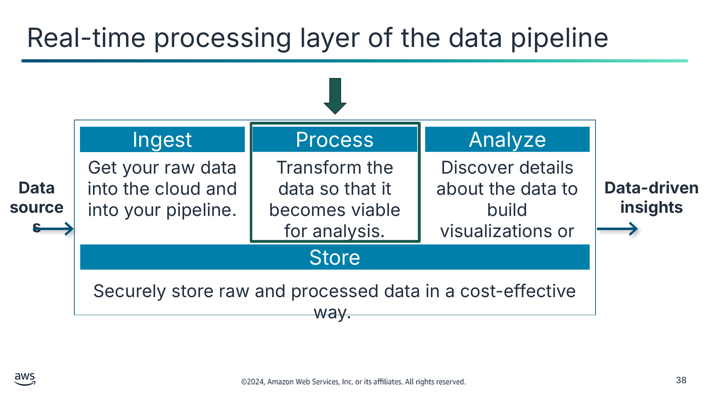

<details>
<summary>Текст зі схеми</summary>

Ingest (Прийняти)

Process (Обробити)

Analyze (Проаналізувати)

Get your raw data into the cloud and into your pipeline. (Помістіть ваші сирі дані в хмару та у ваш конвеєр.)

Transform the data so that it becomes viable for analysis. (Перетворіть дані так, щоб вони стали придатними для аналізу.)

Discover details about the data to build visualizations or predictions. (Виявте подробиці про дані для побудови візуалізацій чи прогнозів.)

**Data sources** (**Джерела даних**)

**Data-driven insights** (**Висновки, керовані даними**)

Store (Зберігати)

Securely store raw and processed data in a cost-effective way. (Безпечно зберігайте сирі й оброблені дані економічно ефективним способом.)

</details>

> **Нотатки:**
>
> |Номер слайда 38  
> |Нотатки для інструктора  
> |Це високорівневий конвеєр, що показує зберігання як частину всіх трьох рівнів приймання, обробки й аналізу даних.  
> |  
> |Нотатки для студента  
> Після приймання дані обробляються й перетворюються в конвеєрі даних. Обробка даних у реальному часі обговорюється в цьому розділі.

---

## Слайд 39: Потокові дані (streaming data)

Потокові дані випускаються у великому обсязі безперервно й поступово з метою обробки з низькою затримкою.

Ігрова онлайн-компанія збирає потокові дані про взаємодії гравців із грою й подає дані на свою ігрову платформу. Дані аналізуються в реальному часі, і компанія пропонує стимули та динамічний досвід, щоб залучати гравців.

> **Нотатки:**
>
> |Номер слайда 39  
> |Нотатки для інструктора  
> |  
> |Нотатки для студента  
> Обробка потокових даних корисна в більшості сценаріїв, де нові, динамічні дані генеруються безперервно. Вона застосовується до більшості галузевих сегментів і сценаріїв використання великих даних. Компанії зазвичай починають із менш складних застосунків, як-от збирання системних журналів, і елементарної обробки, як-от обчислення ковзних мінімумів-максимумів. Потім ці застосунки еволюціонують до складнішої обробки майже в реальному часі.  
>
> Наприклад, бізнес може відстежувати зміни публічних настроїв щодо своїх брендів і продуктів, безперервно аналізуючи потоки соціальних мереж, і своєчасно реагувати за потреби.

---

## Слайд 40: Робочий процес потокового конвеєра та концепції

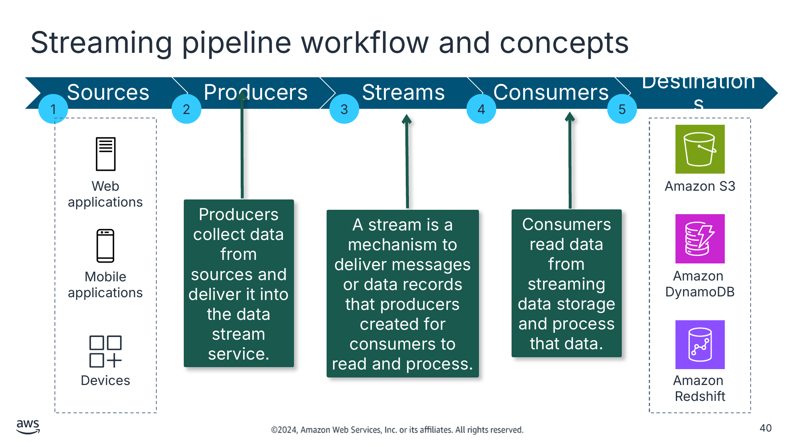

<details>
<summary>Текст зі схеми</summary>

1

2

3

4

5

Web applications (Вебзастосунки)

Amazon S3

Producers collect data from sources and deliver it into the data stream service. (Виробники збирають дані з джерел і доставляють їх до сервісу потоку даних.)

A stream is a mechanism to deliver messages or data records that producers created for consumers to read and process. (Потік — це механізм доставки повідомлень чи записів даних, створених виробниками, для читання й обробки споживачами.)

Consumers read data from streaming data storage and process that data. (Споживачі читають дані зі сховища потокових даних і обробляють ці дані.)

Mobile applications (Мобільні застосунки)

Amazon  
DynamoDB

Devices (Пристрої)

Amazon  
Redshift

</details>

> **Нотатки:**
>
> |Номер слайда 40  
> |Нотатки для інструктора  
> |  
> |Нотатки для студента  
> Ось елементи потокового конвеєра, у якому дані споживаються майже в реальному часі й передаються споживачу:  
> Потокові дані можуть надходити з кількох джерел.  
> Виробники збирають дані з джерел і доставляють їх до сервісу потоку даних.  
> Потік (stream) — це механізм доставки повідомлень чи записів даних, створених виробниками, для читання й обробки споживачами.  
> Споживачі читають дані зі сховища потокових даних і обробляють ці дані.  
> Дані можуть надходити до кількох призначень.

---

## Слайд 41: Сервіси потокової передачі AWS

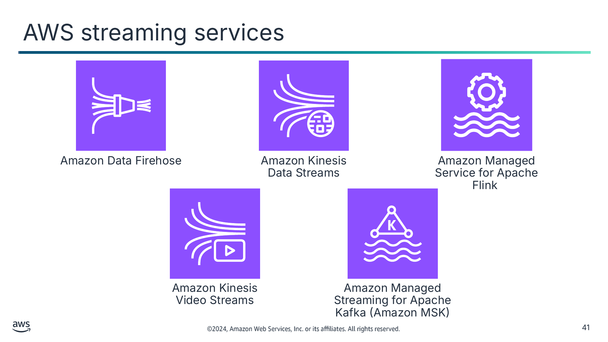

Amazon Data Firehose

Amazon Kinesis  
Data Streams

Amazon Managed Service for Apache Flink

Amazon Kinesis  
Video Streams

Amazon Managed Streaming for Apache Kafka (Amazon MSK)

> **Нотатки:**
>
> |Номер слайда 41  
> |Нотатки для інструктора  
> |  
> |Нотатки для студента  
> Amazon Kinesis Data Streams збирає та приймає великі потоки записів даних у реальному часі.  
>
> Amazon Data Firehose доставляє потокові дані майже в реальному часі до підтримуваних призначень.  
>
> Amazon Managed Service for Apache Flink — це безсерверний сервіс для запитів і аналізу потокових даних у реальному часі.  
>
> Amazon Kinesis Video Streams безпечно передає відео з підключених пристроїв до AWS для аналітики та іншої обробки.  
>
> Amazon Managed Streaming for Apache Kafka (Amazon MSK) — це повністю керований сервіс Apache Kafka, що можна розгортати у VPC.

---

## Слайд 42: Amazon Data Firehose

- Захоплює й перетворює потокові дані майже в реальному часі
- Використовується для доставки даних до поширених призначень зберігання та аналітики
- Доставляє дані до призначення зберігання за допомогою циклів мікропакетів (micro batch)
- Може конвертувати формат вхідних даних із JSON у Parquet перед зберіганням даних
- Не потребує кодування для використання цього сервісу

Firehose

> **Нотатки:**
>
> |Номер слайда 42  
> |Нотатки для інструктора  
> |  
> |Нотатки для студента  
> Деякі з призначень — Amazon S3, Amazon Redshift, Amazon OpenSearch Service та будь-яка користувацька кінцева точка HTTP чи кінцеві точки HTTP, що належать підтримуваним сторонніми постачальникам сервісів.  
>
> Для циклів мікропакетів сервер чекає короткий проміжок часу (мілісекунди до кількох секунд), перш ніж ініціювати пакетну операцію. Мікропакетування має сенс, коли потрібен швидший час відповіді, ніж за пакетної обробки, але можна почекати короткий проміжок часу. Це не так швидко, як потокова передача. Цей підхід балансує затримку та пропускну здатність.  
>
> Firehose може конвертувати формат ваших вхідних даних із JSON в Apache Parquet перед зберіганням даних в Amazon S3. Parquet і ORC (Optimized Row Columnar) — це стовпцеві формати даних, що заощаджують місце й уможливлюють швидші запити порівняно з рядково-орієнтованими форматами, як-от JSON.

---

## Слайд 43: Робочий процес потокового конвеєра з Firehose

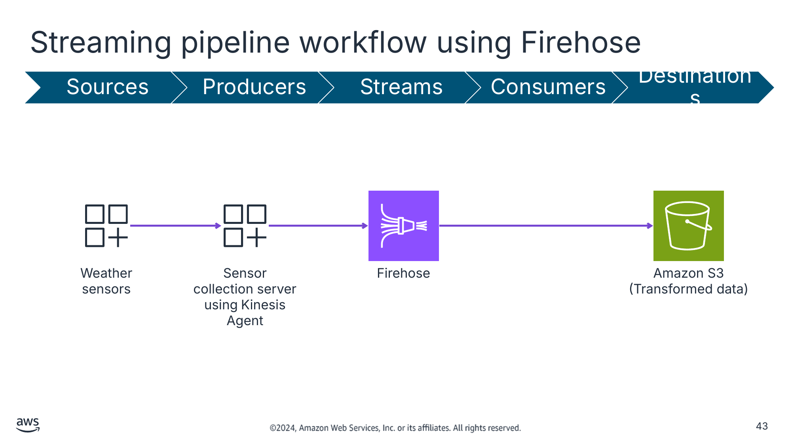

<details>
<summary>Текст зі схеми</summary>

Firehose

Amazon S3  
(Transformed data) (Перетворені дані)

Weather sensors (Датчики погоди)

Sensor collection server using Kinesis Agent (Сервер збору даних датчиків, що використовує Kinesis Agent)

</details>

> **Нотатки:**
>
> |Номер слайда 43  
> |Нотатки для інструктора  
> |Тут представлено Firehose.  
> |  
> |Нотатки для студента  
> Приклад сценарію використання — збір і приймання даних про погоду з датчиків Інтернету речей (IoT) і супутникових баз даних за допомогою Kinesis Data Streams. Потім перетворення даних за допомогою Firehose і зберігання даних в Amazon S3.  
>
> У цьому сценарії використання метою було доставити дані про погоду до бакета S3, і Firehose спростив цей процес.  
>   
> Firehose має можливості обробки майже в реальному часі. Він завантажує нові дані до призначення зберігання протягом 60 секунд після надсилання даних до сервісу.  
>
> Для швидших можливостей обробки можна використовувати Kinesis Data Streams.

---

## Слайд 44: Amazon Kinesis Data Streams

- Приймає потокові дані журналів і подій
- Забезпечує тимчасове зберігання потокових даних (до 365 днів)
- Використовується для доставки в реальному часі, протягом 60 секунд
- Надає можливість кільком споживачам одночасно повторно відтворювати потокові дані
- Використовує Kinesis Producer Library (KPL) і Kinesis Consumer Library (KCL) для підключення до Kinesis Streams

Kinesis Data Streams

> **Нотатки:**
>
> |Номер слайда 44  
> |Нотатки для інструктора  
> |  
> |Нотатки для студента

---

## Слайд 45: Виробники та споживачі в потоковому конвеєрі

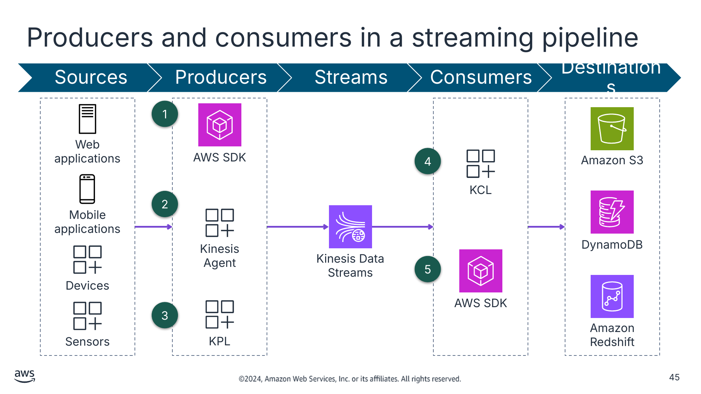

<details>
<summary>Текст зі схеми</summary>

1

Web applications (Вебзастосунки)

AWS SDK

4

Amazon S3

KCL

2

Mobile applications (Мобільні застосунки)

DynamoDB

Kinesis Agent

Kinesis Data  
Streams

5

Devices (Пристрої)

3

AWS SDK

Amazon  
Redshift

Sensors (Датчики)

KPL

</details>

> **Нотатки:**
>
> |Номер слайда 45  
> |Нотатки для інструктора  
> |Цей слайд пояснює виробників і споживачів.  
> |  
> |Нотатки для студента  
> Щоб скористатися швидшими можливостями обробки Kinesis Data Streams, у потоковому конвеєрі потрібні виробники та споживачі.  
>
> Виробники записують дані в потік. Існує кілька способів надсилання даних до Kinesis Data Streams. Наявність кількох методів забезпечує гнучкість у проєктах ваших рішень.  
> Можна писати код за допомогою AWS SDK, що підтримує кілька популярних мов.  
> Можна використовувати Amazon Kinesis Agent — інструмент для надсилання даних до Kinesis Data Streams.  
> Kinesis Producer Library (KPL) покращує можливості приймання даних, охоплені API AWS Kinesis Data Streams. KPL спрощує повторні спроби, пакетування й оптимізацію записів у потік даних Kinesis.  
>
> Щоб читати й обробляти дані з Kinesis Data Streams, потрібно створити застосунок-споживач:  
> Можна використовувати Kinesis Client Library (KCL). KCL допомагає споживати й обробляти дані з потоку даних Kinesis, беручи на себе складні завдання, пов’язані з розподіленою обробкою. Наприклад, KCL може автоматично балансувати навантаження обробки записів між багатьма екземплярами, давати користувачу змогу створювати контрольні точки для вже оброблених записів і обробляти збої екземплярів. З KCL можна зосередитися на написанні логіки обробки записів.  
> Також можна використовувати AWS Kinesis SDK для читання з потоку даних Kinesis, щоб забезпечити детальніший рівень контролю. Це придатне для використання досвідченими розробниками.

---

## Слайд 46: Робочий процес потокового конвеєра з Kinesis Data Streams

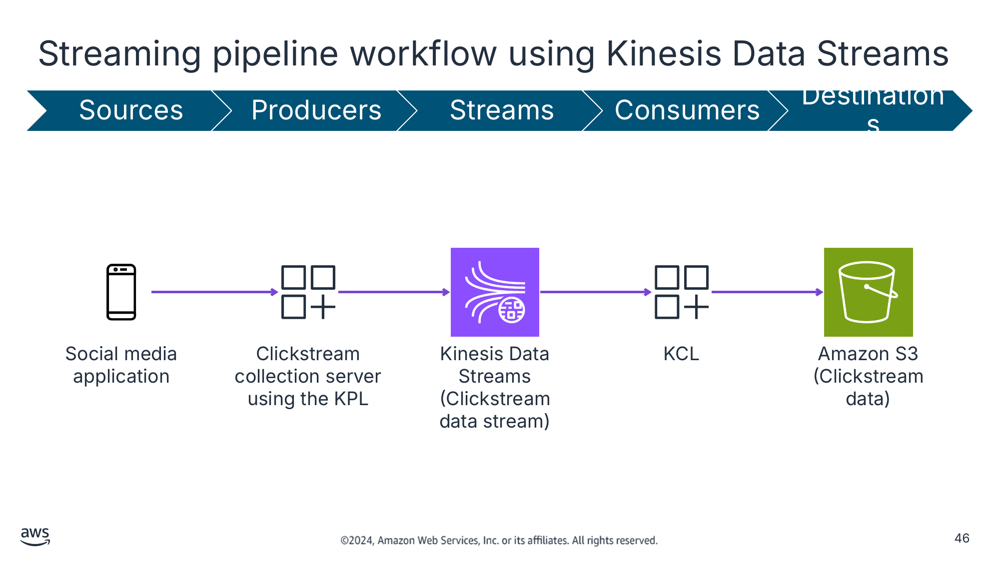

<details>
<summary>Текст зі схеми</summary>

Social media application (Застосунок соціальної мережі)

Clickstream collection server using the KPL (Сервер збору потоку кліків, що використовує KPL)

Kinesis Data Streams  
(Clickstream  
data stream) (Потік даних потоку кліків)

KCL

Amazon S3

(Clickstream data) (Дані потоку кліків)

</details>

> **Нотатки:**
>
> |Номер слайда 46  
> |Нотатки для інструктора  
> | Цей слайд представляє Kinesis Data Streams.  
> |  
> |Нотатки для студента  
> Kinesis Data Streams — це сервіс, що приймає й забезпечує тимчасове зберігання потокових даних. Він може захоплювати потокові дані журналів і подій, виконувати аналітику в реальному часі та будувати застосунки, керовані подіями.  
>   
> Приклад сценарію використання — збір даних потоку кліків із соціальної мережі, передавання їх потоком, зберігання в тимчасовому сховищі, а потім розміщення в постійному сховищі.  
> Джерела: дані надходять із мобільного застосунку соціальної мережі.  
> Виробники: застосунок-виробник збирає дані з мобільних застосунків і доставляє їх до сервісу потоку даних.  
> Потоки: Kinesis Data Streams — це сервіс, що приймає й зберігає потокові дані.  
> Споживачі: застосунок-споживач читає дані зі сховища потокових даних і обробляє ці дані для подальшого використання.  
> Призначення: у цьому сценарії використання дані надходять до постійного сховища.

---

## Слайд 47: Amazon Managed Service for Apache Flink

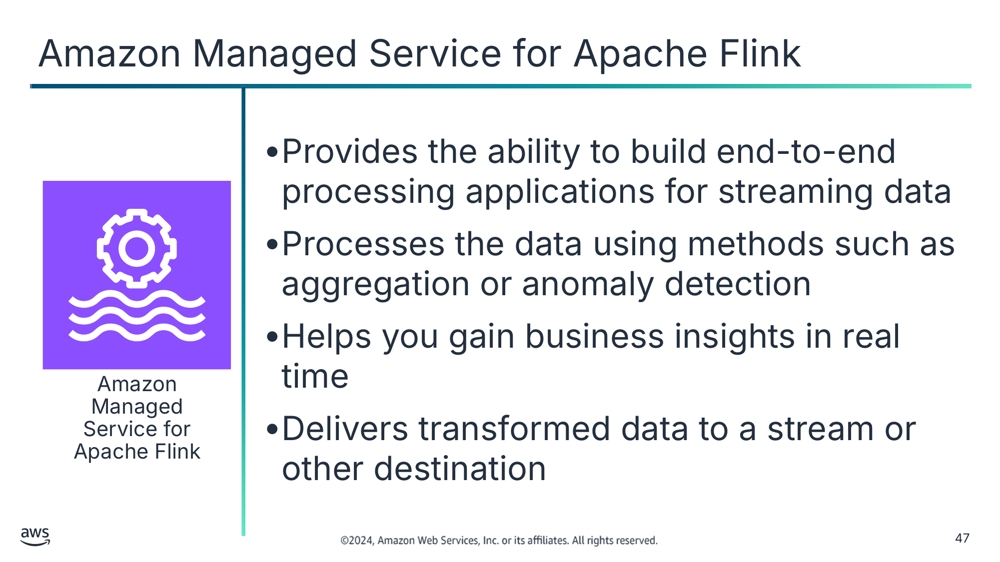

- Надає можливість будувати наскрізні застосунки обробки потокових даних
- Обробляє дані за допомогою методів, як-от агрегування чи виявлення аномалій
- Допомагає отримувати бізнес-висновки в реальному часі
- Доставляє перетворені дані до потоку чи іншого призначення

Amazon Managed Service for Apache Flink

> **Нотатки:**
>
> |Номер слайда 47  
> |Нотатки для інструктора  
> |  
> |Нотатки для студента  
> Amazon Managed Service for Apache Flink безперервно читає й аналізує дані з підключеного потокового джерела в реальному часі. Він використовується для обробки даних і отримання висновків за секунди чи хвилини замість очікування днів чи навіть тижнів. З Kinesis Data Analytics можна швидко будувати наскрізні застосунки потокової обробки для аналітики журналів, аналітики потоку кліків, IoT, рекламних технологій, ігор тощо.  
>
> Amazon Managed Service for Apache Flink дбає про все, що потрібно для запуску потокових застосунків, і автоматично масштабується відповідно до обсягу й пропускної здатності вхідних даних. Найпоширеніші сценарії використання — потоковий ETL, безперервне генерування метрик, чутлива аналітика в реальному часі та інтерактивні запити до потоків даних.

---

## Слайд 48: Обробка даних за допомогою Amazon Managed Service for Apache Flink

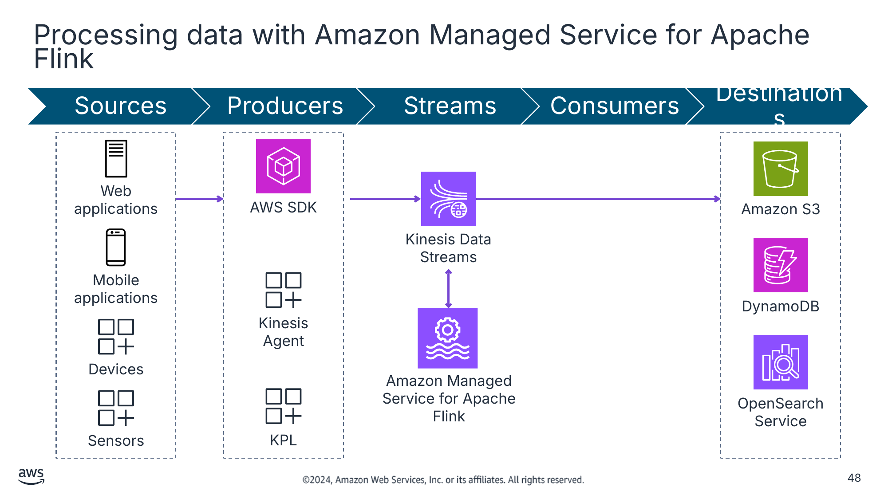

<details>
<summary>Текст зі схеми</summary>

Web applications (Вебзастосунки)

AWS SDK

Amazon S3

Kinesis Data  
Streams

Mobile applications (Мобільні застосунки)

DynamoDB

Kinesis Agent

Devices (Пристрої)

Amazon Managed Service for Apache Flink

OpenSearch Service

Sensors (Датчики)

KPL

</details>

> **Нотатки:**
>
> |Номер слайда 48  
> |Нотатки для інструктора  
> |Цей слайд представляє Amazon Managed Service for Apache Flink.  
> |  
> |Нотатки для студента  
> Amazon Managed Service for Apache Flink — це безсерверний сервіс, який можна використовувати для перетворення й аналізу потокових даних і реагування на аномалії в реальному часі.  
>
> Можна обробляти потоки даних у реальному часі за допомогою SQL чи Apache Flink без потреби вивчати нові мови програмування чи фреймворки обробки.  
>
> На додачу до Kinesis Data Streams і Firehose інші сервіси приймання можуть збирати й обробляти потокові дані в реальному часі залежно від конкретних сценаріїв використання.

---

## Слайд 49: Amazon Kinesis Video Streams

- Безпечно передає відео з підключених пристроїв до AWS для аналітики, ML, відтворення та іншої обробки
- Автоматично розгортає й еластично масштабує всю інфраструктуру, потрібну для приймання потокових відеоданих від мільйонів пристроїв
- Довговічно зберігає, шифрує й індексує відеодані у ваших потоках і надає доступ до ваших даних через операції API

Kinesis Video Streams

> **Нотатки:**
>
> |Номер слайда 49  
> |Нотатки для інструктора  
> |  
> |Нотатки для студента  
> Цей повністю кероване обслуговування AWS може захоплювати величезні обсяги живих відеоданих із мільйонів джерел, зокрема смартфонів, камер безпеки, вебкамер і камер, вбудованих в автомобілі, дрони та інші джерела.

---

## Слайд 50: Amazon Managed Streaming for Apache Kafka (Amazon MSK)

- Є повністю керованим сервісом Apache Kafka
- Зменшує операційні накладні витрати
- Може розгортатися з наявними інструментами Apache Kafka
- Працює з наявними інтеграціями AWS

Amazon MSK

> **Нотатки:**
>
> |Номер слайда 50  
> |Нотатки для інструктора  
> |  
> |Нотатки для студента  
> Якщо поточне рішення потокової передачі — це локальний кластер Kafka, перенесений у хмару, Amazon MSK допомагає зменшити операційні накладні витрати на запуск кластерів Apache Kafka і Kafka Connect. За допомогою Amazon MSK можна використовувати застосунки та інструменти, побудовані для Apache Kafka, без змін коду. Можна розгортати застосунки, готові до продуктивного середовища, за допомогою нативних інтеграцій AWS, і можна підключати інші застосунки за допомогою API Kafka з Amazon MSK.  
>   
> Якщо ви хочете використовувати рішення з відкритим кодом і зменшити витрати на ліцензування та вже знайомі з Apache Kafka, Amazon MSK був би ідеальним. Безсерверні варіанти також доступні.  
>   
> Amazon MSK потребує більше налаштування й інженерних зусиль, ніж сервіси потокової передачі Kinesis. Наприклад, вам доведеться виконати роботу з вписування Amazon MSK у ваші користувацькі процеси.

---

## Слайд 51: Потокова передача даних потоку кліків (clickstream) у сценарії кафе

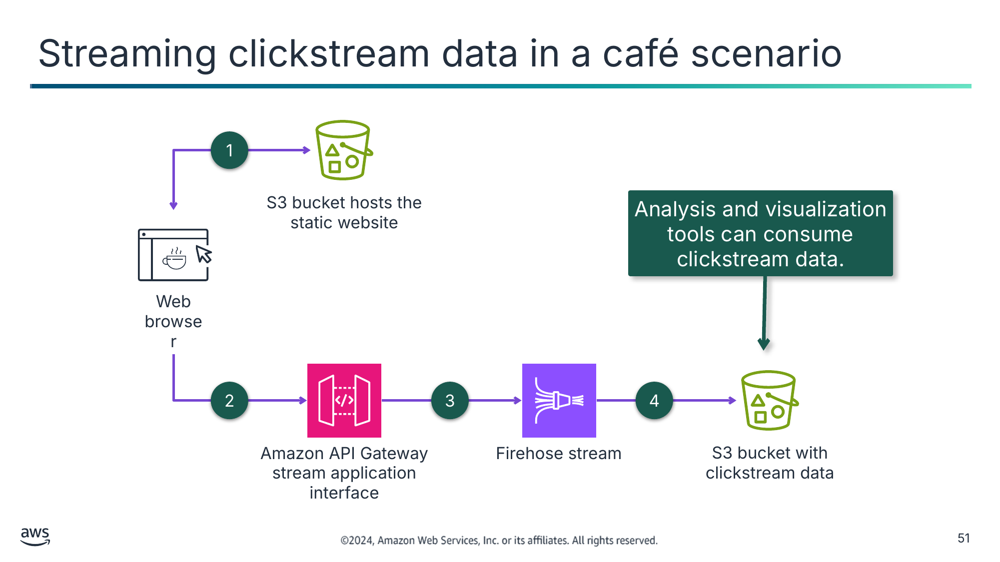

<details>
<summary>Текст зі схеми</summary>

1

S3 bucket hosts the static website (Бакет S3 розміщує статичний вебсайт)

Analysis and visualization tools can consume clickstream data. (Інструменти аналізу й візуалізації можуть споживати дані потоку кліків.)

Web browser (Вебпереглядач)

2

3

4

Amazon API Gateway stream application interface (Інтерфейс застосунку потоку Amazon API Gateway)

Firehose stream (Потік Firehose)

S3 bucket with clickstream data (Бакет S3 з даними потоку кліків)

</details>

> **Нотатки:**
>
> |Номер слайда 51  
> |Нотатки для інструктора  
> |  
> |Нотатки для студента  
> Власники кафе хочуть оцінити дані потоку кліків, щоб визначити, коли їхні користувачі переглядають меню кафе й клацають по ньому. Для цього їм не потрібен час доставки менше секунди для приймання та аналізу.  
>
> Сценарій використання кафе визначив вибір Kinesis Data Firehose. Для Firehose є конектори для джерела (Amazon API Gateway) і призначення (Amazon S3). З операційного погляду Kinesis Data Firehose — найпростіший у використанні сервіс:  
> Статичний вебсайт, розміщений на Amazon S3, повертає сторінку меню кафе.  
> Браузер вебсайту надсилає дані потоку кліків до API Gateway.  
> Firehose приймає дані потоку кліків.  
> Дані потоку кліків надходять до бакета S3. Звідти інструменти аналізу й візуалізації можуть отримувати доступ до цих даних.

---

## Слайд 52: Медичні пристрої з використанням Kinesis Data Streams та Amazon Managed Service for Apache Flink

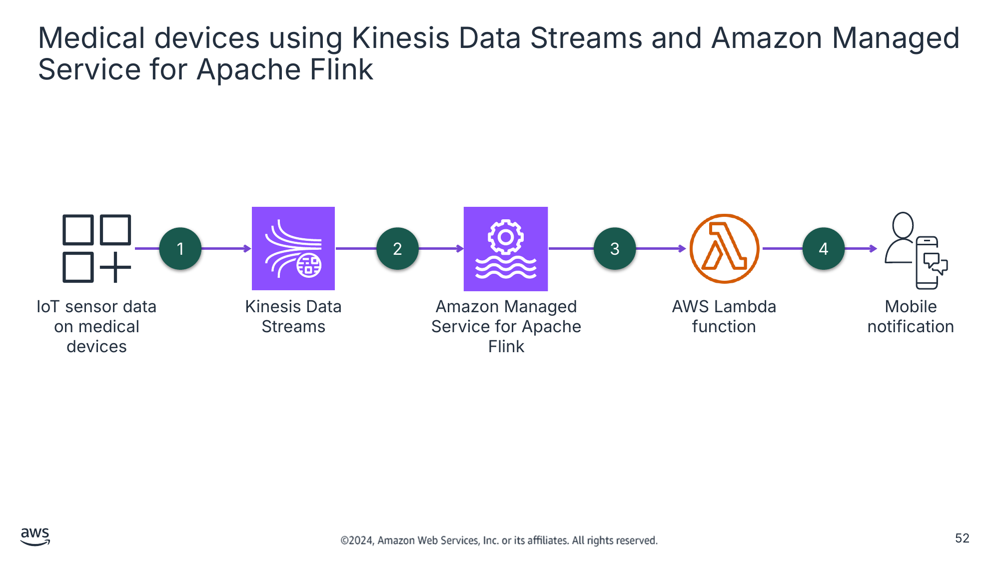

<details>
<summary>Текст зі схеми</summary>

1

2

3

4

IoT sensor data on medical devices (Дані датчиків IoT на медичних пристроях)

Kinesis Data  
Streams

Amazon Managed Service for Apache Flink

AWS Lambda function (Функція AWS Lambda)

Mobile notification (Мобільне сповіщення)

</details>

> **Нотатки:**
>
> |Номер слайда 52  
> |Нотатки для інструктора  
> |  
> |Нотатки для студента  
> У цьому сценарії використання медичні пристрої використовуються для моніторингу пацієнтів. Дані датчиків із цих пристроїв використовуються для визначення функціональної точності пристроїв. Якщо даних забагато чи замало, аномалію буде виявлено, і медичного працівника буде сповіщено майже в реальному часі. Час критичний у цьому сценарії використання, тому використовується Kinesis Data Streams. Будь-які коливання мають повідомлятися за мілісекунди:  
> Kinesis Data Streams приймає дані датчиків IoT.  
> Дані надходять до Amazon Managed Service for Apache Flink, що виконує виявлення аномалій.  
> Якщо виявлено аномалію, ініціюється функція AWS Lambda.  
> Функція Lambda надсилає мобільне сповіщення медичному працівнику для оцінки медичного пристрою.

---

## Слайд 53: Порівняння сервісів потокового приймання

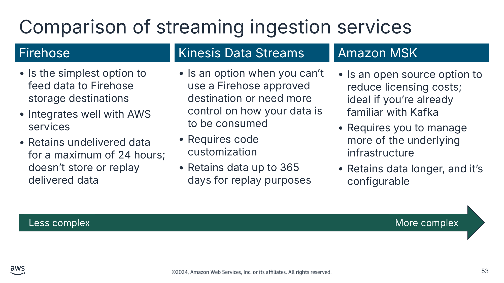

Firehose

Kinesis Data Streams

Amazon MSK

- Є найпростішим варіантом подачі даних до призначень зберігання Firehose
- Добре інтегрується із сервісами AWS
- Зберігає недоставлені дані щонайбільше 24 години; не зберігає й не відтворює доставлені дані

- Є варіантом, коли не можна використати схвалене призначення Firehose або потрібно більше контролю над тим, як споживатимуться ваші дані
- Потребує користувацького кодування
- Зберігає дані до 365 днів для цілей повторного відтворення

- Є варіантом із відкритим кодом для зменшення витрат на ліцензування; ідеальний, якщо ви вже знайомі з Kafka
- Вимагає від вас керувати більшою частиною базової інфраструктури
- Зберігає дані довше, і це настроюється

<details>
<summary>Текст зі схеми</summary>

Less complex (Менш складний)

More complex (Складніший)

</details>

> **Нотатки:**
>
> |Номер слайда 53  
> |Нотатки для інструктора  
> |  
> |Нотатки для студента  
> Бізнес-сценарій використання, обсяг потрібних інженерних зусиль і тривалість періоду зберігання — деякі з чинників, які слід враховувати під час вибору сервісу потокового приймання.  
>
> Firehose — найменш складний, а Amazon MSK — найскладніший із трьох перелічених сервісів:  
> Firehose — найпростіший варіант подачі даних до призначень зберігання Firehose, як-от Amazon S3. Якщо не можна використати схвалене призначення Firehose або потрібно більше контролю над тим, як споживатимуться ваші дані, Kinesis Data Streams був би придатним варіантом. Якщо ви хочете використовувати рішення з відкритим кодом і зменшити витрати на ліцензування та вже знайомі з Apache Kafka, Amazon MSK був би ідеальним. Безсерверні варіанти також доступні.  
> Firehose добре інтегрується із сервісами AWS, і можна застосувати підхід «підключи й працюй» (plug-and-play). Kinesis Data Streams трохи складніший, оскільки потребує користувацького кодування (наприклад, KCL чи KPL). Amazon MSK потребує більше налаштування й інженерних зусиль. Наприклад, вам доведеться виконати роботу з вписування Amazon MSK у ваші користувацькі процеси.  
> Щодо зберігання даних, Firehose не зберігає доставлені дані. Недоставлені дані зберігаються щонайбільше 24 години. За замовчуванням Kinesis Data Streams зберігає дані 24 години в потоці даних Kinesis. Цей період можна продовжити до 365 днів. Amazon MSK зберігає дані довше, і це настроюється.

---

## Слайд 54: Ключові висновки: обробка даних у реальному часі

- Сімейство Amazon Kinesis надає повністю керовані сервіси приймання даних:
  - Firehose доставляє потокові дані майже в реальному часі до певних призначень. Він забезпечує короткочасне зберігання доставлених даних, але не підтримує повторного відтворення.
  - Kinesis Data Streams збирає й приймає великі потоки записів даних майже в реальному часі. Він пропонує найкращі властивості потокової передачі даних із низькою затримкою, але потребує певного налаштування.
  - Kinesis Video Streams безпечно передає відео з підключених пристроїв до AWS для аналітики та іншої обробки.
- Amazon Managed Service for Apache Flink аналізує потокові дані.
- Amazon MSK — це повністю керований сервіс Apache Kafka, який можна розгортати у віртуальній приватній хмарі (VPC).

> **Нотатки:**
>
> |Номер слайда 54  
> |Нотатки для інструктора  
> |  
> |Нотатки для студента  
> Для сервісів приймання на основі вимог сценарію використання за потоком оберіть сімейство Amazon Kinesis і характеристики даних.

---

## Слайд 55: Зберігання в конвеєрі даних

Шаблони інженерії даних

> **Нотатки:**
>
> |Номер слайда 55  
> |Нотатки для інструктора  
> |  
> |Нотатки для студента  
> Цей розділ обговорює варіанти зберігання, що зазвичай використовуються в конвеєрі аналітики даних.

---

## Слайд 56: Рівень зберігання в конвеєрі даних

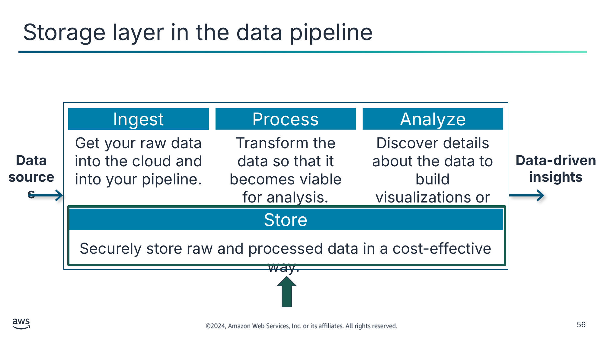

<details>
<summary>Текст зі схеми</summary>

Ingest (Прийняти)

Process (Обробити)

Analyze (Проаналізувати)

Get your raw data into the cloud and into your pipeline. (Помістіть ваші сирі дані в хмару та у ваш конвеєр.)

Transform the data so that it becomes viable for analysis. (Перетворіть дані так, щоб вони стали придатними для аналізу.)

Discover details about the data to build visualizations or predictions. (Виявте подробиці про дані для побудови візуалізацій чи прогнозів.)

**Data sources** (**Джерела даних**)

**Data-driven insights** (**Висновки, керовані даними**)

Store (Зберігати)

Securely store raw and processed data in a cost-effective way. (Безпечно зберігайте сирі й оброблені дані економічно ефективним способом.)

</details>

> **Нотатки:**
>
> |Номер слайда 56  
> |Нотатки для інструктора  
> |Це високорівневий конвеєр, що показує зберігання як частину всіх трьох рівнів приймання, обробки й аналізу даних.  
> |  
> |Нотатки для студента  
> Протягом усього конвеєра даних дані безпечно зберігаються. Цей розділ обговорює концепції та сервіси, пов’язані зі зберіганням у конвеєрі.

---

## Слайд 57: Зберігання в сучасній архітектурі даних

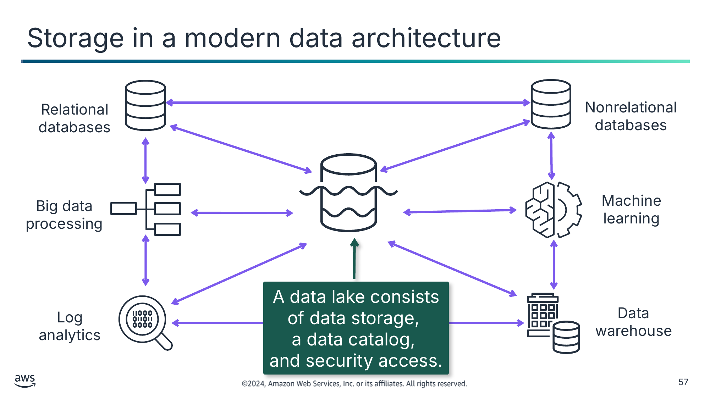

Озеро даних складається зі сховища даних,  
каталогу даних  
і доступу безпеки.

<details>
<summary>Текст зі схеми</summary>

Relational databases (Реляційні бази даних)

Nonrelational databases (Нереляційні бази даних)

Big data processing (Обробка великих даних)

Machine learning (Машинне навчання)

Log analytics (Аналітика журналів)

Data warehouse (Сховище даних)

</details>

> **Нотатки:**
>
> |Номер слайда 57  
> |Нотатки для інструктора  
> |Зверніть увагу студентів, що всі елементи, перелічені на цьому слайді, — елементи сучасної архітектури даних, побудованої навколо централізованої концепції озера даних. Стрілки показують переміщення даних. Нереляційні бази даних також можна називати базами даних NoSQL. Обробка великих даних стосується великих наборів даних, оброблюваних паралельно.  
> |  
> |Нотатки для студента  
> Опис зображення: зображення складається з озера даних у центрі діаграми, оточеного елементами для обробки аналітики. Елементи — реляційні бази даних, нереляційні бази даних, обробка великих даних, машинне навчання, аналітика журналів і сховище даних. Стрілки показують переміщення даних. Кінець опису.  
>
> Організації хочуть захоплювати всі свої дані, щоб якомога швидше отримувати з них цінність. Сучасна архітектура даних не обмежена окремими силосами даних. Це дає змогу зробити всі дані організації доступними користувачам для аналізу за допомогою їхнього бажаного інструмента аналітики даних. Сучасна архітектура даних дасть вам найкраще і з озер даних, і зі спеціалізованих сховищ даних. Мета цієї архітектури — контролювати доступ до даних в озері даних і забезпечувати мінімальне й ефективне переміщення даних під час аналізу.  
>
> Зберігання й безпека озера даних — основа сучасної архітектури даних. Озеро даних — це централізований репозиторій, у якому можна зберігати всі ваші структуровані й неструктуровані дані в будь-якому масштабі. Ця архітектура забезпечує недороге рішення для зберігання будь-якого обсягу даних із використанням відкритих форматів даних на основі стандартів. Дані можна зберігати як є, не структуруючи їх спочатку. Озеро даних дозволяє імпорт і експорт даних чи результатів запитів до реляційних баз даних, нереляційних баз даних, баз даних сховищ даних, моделей машинного навчання й сервісів паралельної обробки великих даних за потреби. Ці сервіси також можуть ділитися даними.  
>
> Зверніть увагу, що нереляційні бази даних також можна називати базами даних NoSQL, а обробка великих даних стосується великих наборів даних, оброблюваних паралельно.  
>
> Нижче наведено типи переміщення даних:  
> Переміщення даних зсередини назовні (inside-out) відбувається, коли сервісу, як-от обробка великих даних чи машинне навчання, потрібна частина даних в озері даних. Дані копіюються, переміщуються чи фільтруються запитом з озера даних до сервісу. Наприклад, дані потоку кліків із вебзастосунків збираються безпосередньо в озері даних, і частину цих даних можна перемістити до сервісу аналітики журналів для аналізу тенденцій.  
> Переміщення даних ззовні досередини (outside-in) відбувається, коли рішення аналітики даних вимагає, щоб дані були в озері даних для обробки. Цей тип рішення аналітики зазвичай означає, що дані мають бути частиною більшого набору даних. Дані копіюються, переміщуються чи фільтруються запитом до озера даних із джерела бази даних.  
> Якщо сервіс, відмінний від озера даних, має пряму інтеграцію з іншим сервісом, можливо переміщувати, копіювати чи запитувати дані між цими сервісами безпосередньо.

---

## Слайд 58: Сучасна архітектура даних AWS (AWS modern data architecture)

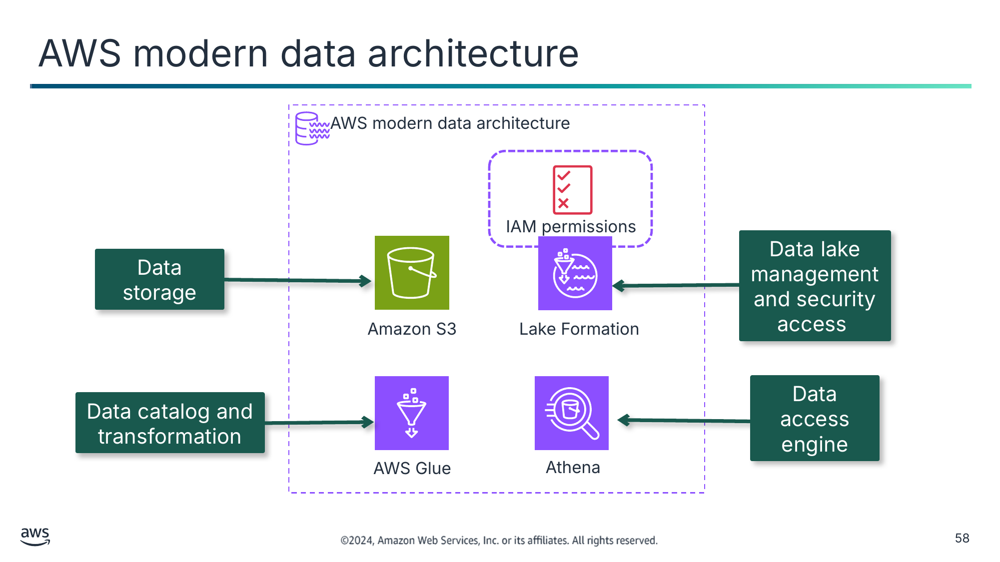

Data lake management and security access (Керування озером даних і доступ безпеки)

Data storage (Зберігання даних)

Data access engine (Рушій доступу до даних)

Data catalog and transformation (Каталог даних і перетворення)

<details>
<summary>Текст зі схеми</summary>

AWS modern data architecture (Сучасна архітектура даних AWS)

IAM permissions (Дозволи IAM)

Amazon S3

Lake Formation

AWS Glue

Athena

</details>

> **Нотатки:**
>
> |Номер слайда 58  
> |Нотатки для інструктора  
> |  
> |Нотатки для студента  
> Опис зображення: зображення складається з архітектури озера даних, компонентами якої є Amazon S3, AWS Lake Formation, зокрема дозволи AWS Identity and Access Management (IAM), AWS Glue та Athena. Кінець опису.  
>
> У хмарі AWS озеро даних реалізується за допомогою колекції сервісів AWS, що працюють разом для забезпечення функціональності озера даних.  
>
> Компонент керування озером даних — Lake Formation. Він дає вам змогу налаштовувати й керувати вашим озером даних із єдиної консолі. Тут можна виявляти джерела даних, зберігати дані за допомогою Amazon S3 та створювати завдання перетворення AWS Glue за допомогою Data Catalog. Data Catalog містить схеми даних, що використовуються для читання даних з озера даних. Дозволи доступу безпеки IAM також налаштовуються в Lake Formation, щоб дозволити доступ користувачів і сервісів аналітики.  
>
> Athena — це рушій запитів SQL, що надає застосункам аналітики та візуалізації спосіб виконувати запити SQL до даних в озері даних.

---

## Слайд 59: Рішення озера даних AWS (AWS data lake solution)

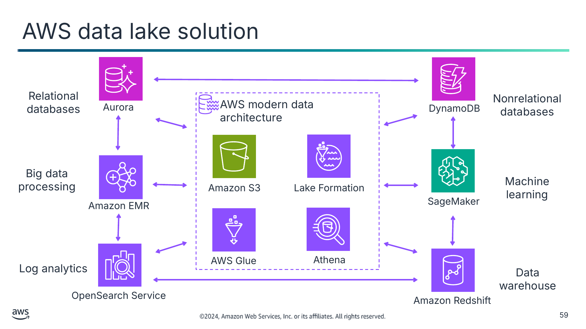

<details>
<summary>Текст зі схеми</summary>

Relational databases (Реляційні бази даних)

Nonrelational databases (Нереляційні бази даних)

Aurora

AWS modern data architecture (Сучасна архітектура даних AWS)

 DynamoDB

Amazon S3

Lake Formation

Machine learning (Машинне навчання)

Amazon EMR

 SageMaker

AWS Glue

Athena

Log analytics (Аналітика журналів)

Data warehouse (Сховище даних)

OpenSearch Service

Amazon Redshift

Big data processing (Обробка великих даних)

</details>

> **Нотатки:**
>
> |Номер слайда 59  
> |Нотатки для інструктора  
> |Стрілки показують переміщення даних.  
> |  
> |Нотатки для студента  
> Опис зображення: зображення складається з архітектури озера даних, компонентами якої є Amazon S3, Lake Formation, AWS Glue та Athena. Елементи, описані в нотатках, оточують озеро даних. Кінець опису.  
>
> Стрілки показують переміщення даних. Ось кілька прикладів інших сервісів AWS, що відіграють роль у сучасній архітектурі даних AWS:  
> Amazon Aurora та Amazon RDS зберігають реляційні, нормалізовані дані.  
> DynamoDB — це база даних NoSQL, що зберігає дані «ключ-значення».  
> Amazon EMR паралельно перетворює чи агрегує великі набори даних.  
> Amazon SageMaker навчає моделі розпізнавати шаблони в наборах даних.  
> OpenSearch Service зберігає дані, індексовані для швидкого отримання.  
> Amazon Redshift як база даних сховища даних зберігає історичні дані. Запит SQL розділяється для паралельного виконання, щоб надавати результати наборів даних, що охоплюють тривалі періоди часу, як-от 20 років.

---

## Слайд 60: Вправа: вибір сховища даних для банківського застосунку (Choosing Data Storage for a Bank Application)

Банківські застосунки створюють таке:

- Дані клієнтів
  - Окремі фінансові транзакції клієнтів
- Дані журналів
  - Журнали активності користувачів для аналізу шахрайства
  - Журнали помилок застосунків


> **Нотатки:**
>
> |Номер слайда 60  
> |Нотатки для інструктора  
> |Ця вправа — групове обговорення. Наступний слайд подає запитання для обговорення, а слайд після нього надає розв’язання. Рекомендується, щоб студенти самі спробували підібрати варіанти сховищ, перш ніж розв’язання буде обговорено на наступному слайді.  
> |  
> |Нотатки для студента  
> Це вправа під керівництвом інструктора, що обговорює різні варіанти вибору сховища даних для банківського застосунку.

---

## Слайд 61: Сценарій використання: варіанти зберігання даних банківського застосунку

Окремі фінансові  
транзакції клієнтів

Загальна сума щоденних фінансових транзакцій клієнтів

Amazon Redshift

Amazon S3

Журнали активності користувачів  
для аналізу шахрайства

Amazon

DynamoDB

Журнали помилок банківських застосунків

Amazon OpenSearch

Service

Amazon Aurora

> **Нотатки:**
>
> |Номер слайда 61  
> |Нотатки для інструктора  
> |  
> |Нотатки для студента  
> Припустімо, ви працюєте в команді інженерії даних банку розміру підприємства, що існує близько 20 років. У вашого банку є банківський вебсайт для клієнтів, де вони можуть подавати заявки на рахунки та виконувати онлайн-транзакції для керування своїми рахунками. Клієнти банку також мають дебетові та кредитні картки для купівлі товарів чи зняття грошей у фізичних локаціях.  
>
> Банк має кілька застосунків, що створюють різні типи даних. Клієнти банку мають банківські профілі з банківськими рахунками. Вони створюють фінансову транзакцію щоразу, коли вносять чи знімають гроші зі свого банківського рахунку. Крім того, клієнти банку можуть купувати товари онлайн чи у фізичних локаціях.  
>   
> Банківські застосунки також створюють журнали активності користувачів і помилок застосунків. Банк хоче мігрувати свої застосунки в хмару AWS.  
>
> Дивлячись на архітектуру озера даних, які сервіси зберігання AWS були б доречними для різних типів даних? Ваші варіанти — Amazon Redshift, Amazon S3, OpenSearch Service, DynamoDB та Aurora.  
>
> Ось типи даних:  
> Окремі фінансові транзакції клієнтів  
> Загальна сума щоденних фінансових транзакцій клієнтів  
> Журнали активності користувачів для аналізу шахрайства  
> Журнали помилок застосунків

---

## Слайд 62: Розв’язання: варіанти зберігання даних банківського застосунку

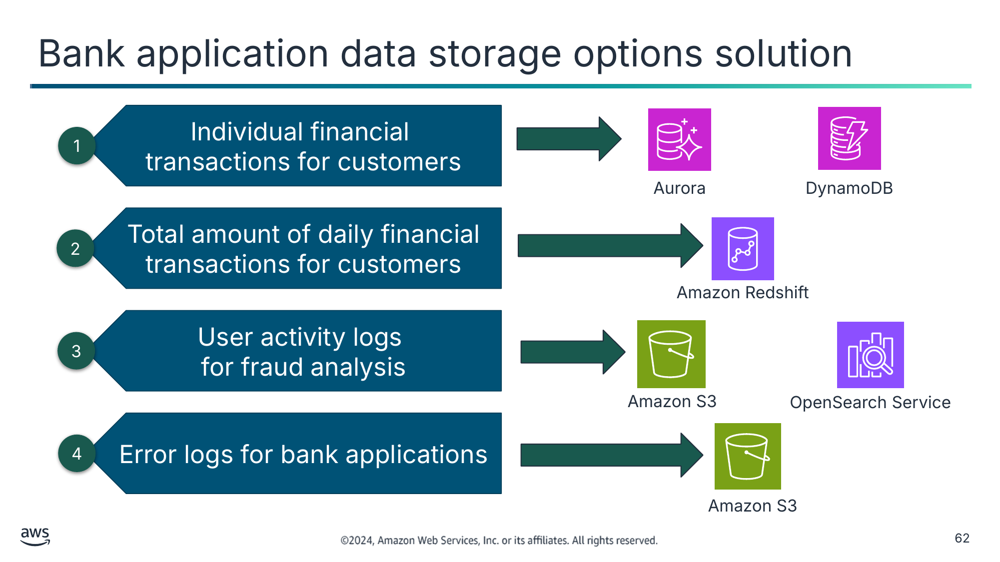

<details>
<summary>Текст зі схеми</summary>

Individual financial  
transactions for customers (Окремі фінансові транзакції клієнтів)

1

Aurora

DynamoDB

Total amount of daily financial transactions for customers (Загальна сума щоденних фінансових транзакцій клієнтів)

2

Amazon Redshift

User activity logs  
for fraud analysis (Журнали активності користувачів для аналізу шахрайства)

3

Amazon S3

OpenSearch Service

Error logs for bank applications (Журнали помилок банківських застосунків)

4

Amazon S3

</details>

> **Нотатки:**
>
> |Номер слайда 62  
> |Нотатки для інструктора  
> |  
> |Нотатки для студента  
> Щоб зберігати окремі фінансові транзакції клієнтів, потрібен сервіс, оптимізований для запису малих записів, що має доступність 24/7 і може одночасно використовуватися тисячами чи мільйонами клієнтів. Це називається оперативною обробкою транзакцій (OLTP), і транзакції зазвичай зберігаються як рядок у таблиці. Реляційні бази даних чи бази даних NoSQL ідеальні для зберігання транзакцій OLTP. У цьому сценарії використання Aurora та DynamoDB придатні для окремих фінансових транзакцій клієнтів.  
> Щоб зберігати загальну суму щоденних фінансових транзакцій клієнтів, потрібно обчислити щоденну суму для кожного клієнта й зберегти її в сховищі даних. На основі щоденних сум можна створювати звіти за період у роки для прогнозування шаблонів витрат. Це називається оперативною аналітичною обробкою (OLAP), і дані зазвичай зберігаються в стовпцевих таблицях для швидкого отримання запитами SQL. У цьому сценарії використання Amazon Redshift доречний для щоденної загальної суми фінансових транзакцій клієнтів.  
> Щоб зберігати журнали активності користувачів для аналізу шахрайства, може бути гарною ідеєю помістити журнали в застосунок, створений для аналізу журналів. Як альтернативу журнали можна аналізувати в самому озері даних за допомогою інструментів запитів SQL, що підключаються до даних в озері даних. У цьому сценарії використання журнали активності користувачів для аналізу шахрайства можна зберігати або в озері даних за допомогою Amazon S3, або в OpenSearch Service для індексованого рішення.  
> Щоб зберігати журнали помилок застосунків, найпростіша архітектура — використання сховища озера даних за допомогою Amazon S3.

---

## Слайд 63: Порівняння сховища даних і озера даних

| Функції (Features) | Сховище даних (Data Warehouse) | Озеро даних (Data Lake) |
|---|---|---|
| Джерела даних (Data Sources) | Бізнес-застосунки та бази даних | Пристрої Інтернету речей (IoT), вебсайти, мобільні застосунки, соціальні мережі та бізнес-застосунки |
| Схема (Schema) | Структурована схема під час запису (schema on write) | Неструктурована схема під час читання (schema on read) |
| Ціна (Price) | Дорожче сховище | Недороге сховище |
| Якість даних (Data Quality) | Курировані (curated), оброблені чи агреговані дані як центральна версія істини | Сирі (необроблені дані транзакційних подій) або перетворені (оброблені дані) |
| Сценарій використання аналітики (Analytics Use Case) | Пакетне звітування, бізнес-аналітика та візуалізації | Журнали, виявлення даних і профілювання |

> **Нотатки:**
>
> |Номер слайда 63  
> |Нотатки для інструктора  
> |  
> |Нотатки для студента  
> Сховище даних — це база даних, оптимізована для аналізу реляційних даних, що надходять із транзакційних систем і бізнес-застосунків. Структуру даних і схему визначено заздалегідь для оптимізації швидких запитів SQL, результати яких зазвичай використовуються для операційного звітування й аналізу. Дані очищуються, збагачуються й перетворюються, щоб вони могли діяти як «єдине джерело істини», якому користувачі можуть довіряти.  
>
> Озеро даних відрізняється, оскільки воно зберігає реляційні дані з бізнес-застосунків і нереляційні дані з мобільних застосунків, пристроїв IoT і соціальних мереж. Структура даних чи схема не визначається під час захоплення даних. Це означає, що можна зберігати всі ваші дані без ретельного проєктування чи потреби знати, на які запитання вам можуть знадобитися відповіді в майбутньому. Різні типи аналітики ваших даних, як-от запити SQL, аналітика великих даних, повнотекстовий пошук, аналітика в реальному часі та машинне навчання, можна використовувати для виявлення висновків.  
>
> Для сховищ даних під час запису даних схема має бути відомою; це називається підходом «схема під час запису» (schema-on-write). Для озер даних запис даних не потребує схеми, але читання потребує схеми.

---

## Слайд 64: Вартість і час виконання запитів визначають зберігання даних

Amazon S3

Amazon Redshift Spectrum

Amazon Redshift

- Дешевше озеро даних
- Менш ефективне для запитів

- Зменшує вартість сховища даних
- Забезпечує запити до бакетів S3 без переміщення даних у сховище

- Дорожче
- Ефективні запити до великих наборів даних

**Вартість зберігання**

> **Нотатки:**
>
> |Номер слайда 64  
> |Нотатки для інструктора  
> |  
> |Нотатки для студента  
> Для застосунків аналітики даних, що споживають структуровані й неструктуровані дані, сервіс зберігання, який ви обираєте, залежить від структури даних, способу споживання даних, а також вартості й доступності даних.  
> Застосунки аналітики потребують масштабного, доступного за ціною, високодоступного й безпечного доступу до даних. Ці вимоги виконуються сучасною архітектурою озера даних, побудованою на Amazon S3. Порівняно з іншими сервісами зберігання AWS, Amazon S3 зазвичай є найекономічнішим вибором для клієнтів AWS. Застосунки аналітики, що хочуть читати дані з Amazon S3, мають враховувати тривалість часу, потрібного для фактичного доступу до даних. Amazon S3 надає спосіб зберігати неструктуровані дані в партиціях даних. Якщо щоденні журнали зберігаються в окремій папці, то запити даних, що використовують дату, будуть ефективними, оскільки доступ надається лише до відповідних папок. Область запиту обмежена підмножиною даних, доступних компанії.  
> З іншого боку, сервіс, як-от Amazon Redshift, зазвичай дорожчий, оскільки це кластер екземплярів, що становить сховище даних. Хоча запит матиме доступ до всіх даних організації, час виконання запитів буде ефективним для великих наборів даних, що охоплюють тривалі періоди часу.  
> Клієнти AWS можуть отримати найкраще з обох світів, використовуючи Redshift Spectrum для виконання запитів до бакетів S3 без переміщення даних в Amazon Redshift. Цей варіант зменшить вартість, оскільки переміщення даних не потрібне.  
>
> Враховуйте бюджет і часові обмеження під час доступу до даних. Мета — максимізувати цінність і мінімізувати вартість.

---

## Слайд 65: Час зберігання даних визначає зберігання даних

**Загального призначення (General purpose)**

**Нечастий доступ (Infrequent access)**

**Архів (Archive)**

S3 Standard

S3 Standard-Infrequent Access

S3 Glacier Instant Retrieval

**Невідомий чи змінний доступ (Unknown or changing access)**

Amazon S3

S3 Glacier Flexible Retrieval

S3 Intelligent-Tiering

S3 One Zone-Infrequent Access

S3 Glacier Deep Archive

> **Нотатки:**
>
> |Номер слайда 65  
> |Нотатки для інструктора  
> |  
> |Нотатки для студента  
> Реляційні бази даних чутливі до обсягу даних, який вони можуть містити, перш ніж продуктивність погіршиться. Поширена практика — архівувати дані з реляційної бази даних у економічніший варіант зберігання. Класи зберігання (storage classes) спроєктовано для різних шаблонів доступу з відповідною вартістю.  
>
> Використовуючи класи зберігання Amazon S3, можна обирати, як зберігати дані, на основі потреб доступу та міркувань вартості. Робочі навантаження аналітики та ML потребують великої кількості даних, і ви хочете забезпечити зберігання цих даних якомога економічнішим способом. Для відомих шаблонів використання даних використовуйте стандартний чи нечастий доступ за потреби. Для невідомих шаблонів використання застосовуйте інтелектуальне розшарування (intelligent tiering), щоб AWS класифікував дані як стандартні чи з нечастим доступом.  
>
> Докладніше див. класи зберігання Amazon S3 на сторінці ресурсів вмісту вашого онлайн-курсу.

---

## Слайд 66: Походження та форма даних визначають зберігання даних

Походження даних (Data origin)

**Бізнес-застосунки (OLTP)**

**Застосунки аналітики (OLAP)**

Форма даних (Data shape)

Структуровані й напівструктуровані дані

Потокова передача даних у реальному часі

Неструктуровані й сирі дані

Оброблені й агреговані дані

Сховище даних (Data storage)

**RDMS або NoSQL**

**Потік (Stream)**

**Озеро даних (Data lake)**

**Сховище даних (Data warehouse)**

Після того як дані збережено на рівні OLTP, дані обробляються або переміщуються на рівень OLAP.

> **Нотатки:**
>
> |Номер слайда 66  
> |Нотатки для інструктора  
> |  
> |Нотатки для студента  
> Бізнес-застосунки створюють записи даних OLTP і потокові записи даних. Дані зберігаються в системі керування реляційними базами даних (RDMS) для структурованих даних і базі даних NoSQL для напівструктурованих даних. Потокову передачу даних бізнес-застосунків у реальному часі можна зберігати всередині сервісу потокової передачі або переміщувати в об’єктне сховище для неструктурованих даних.  
>
> Після того як дані збережено на рівні бізнес-застосунку, дані обробляються або переміщуються до розташування аналітики даних. Неструктуровані й сирі дані підходять для об’єктного сховища, а оброблені й агреговані дані мають перебувати в сховищі даних. Видно, що форма (структурована чи неструктурована) відіграє важливу роль у тому, де зберігаються дані.  
>
> Ось деякі рішення зберігання AWS:  
> Amazon Aurora для RDMS  
> Amazon DynamoDB для бази даних NoSQL  
> Amazon Kinesis, Amazon S3 та Amazon MSK для системи потокового зберігання  
> Amazon S3 для озера даних  
> Amazon Redshift для сховища даних

---

## Слайд 67: Ключові висновки: зберігання в конвеєрі даних

- Сучасна архітектура даних будується на озері даних як центральному компоненті з сервісами аналітики та зберігання як периферійними компонентами.
- Архітектура озера даних складається зі сховища даних, каталогу даних, безпеки доступу до даних та інструментів перетворення даних.
- Сховище даних має підхід «схема під час запису» (schema-on-write), а озеро даних — підхід «схема під час читання» (schema-on-read).
- Проєктуйте зберігання даних, враховуючи походження даних, форму даних, вартість, область запиту та періоди зберігання даних.

> **Нотатки:**
>
> |Номер слайда 67  
> |Нотатки для інструктора  
> |  
> |Нотатки для студента

---

## Слайд 68: Паралельна обробка в конвеєрі даних

Шаблони інженерії даних

> **Нотатки:**
>
> |Номер слайда 68  
> |Нотатки для інструктора  
> |  
> |Нотатки для студента  
> Цей розділ обговорює паралельну обробку великих даних у конвеєрі даних.

---

## Слайд 69: Робочий процес великих даних для паралельної обробки

Розділіть великий набір даних на менші частини.

Обробляйте частини паралельно.

Результати агрегуються.

> **Нотатки:**
>
> |Номер слайда 69  
> |Нотатки для інструктора  
> |  
> |Нотатки для студента  
> Робочий процес великих даних можна описати трьома кроками:  
> Паралельна обробка — це обчислювальна методика, що розбиває обробку великих наборів даних на менші частини.  
> Кожна частина потім обробляє частину набору даних окремо одночасно.  
> Результат кожної частини потім агрегується в остаточний вихід.  
>
> Цю методику розроблено, оскільки в окремих серверів не вистачало пам’яті та сховища для обробки великого набору даних. Натомість кластер серверів, що містить сотні чи тисячі серверів, обробляє великий набір даних паралельною обробкою. Один приклад обробки великого набору даних — підрахунок усіх слів у всіх книжках цифрової бібліотеки, що містить 1 мільйон книжок. Книжки бібліотеки оброблятимуться в 10 пакетах по 100 000 книжок кожен із результуючим списком кількості входжень кожного слова. Функція агрегування об’єднає 10 пакетів в один результуючий список із загальною кількістю входжень кожного слова в цифровій бібліотеці.  
>
> Перевага паралельної обробки — розв’язання великих проблем за коротший період часу. Виконуючи компоненти проблеми одночасно, загальна тривалість значно скорочується. Наприклад, щоб обробити 1000 файлів журналів по 1 хвилині кожен, потрібно понад 16 годин, якщо обробляти послідовно. За паралельної обробки те саме завдання займає лише 1 хвилину.

---

## Слайд 70: Amazon EMR

- Amazon EMR виконує керування інфраструктурою кластера.
- Amazon EMR включає багато застосунків Apache Hadoop, як-от Hadoop MapReduce та Apache Spark.
- Amazon EMR можна розгортати на екземплярах Amazon Elastic Compute Cloud (Amazon EC2), в Amazon Elastic Kubernetes Service (Amazon EKS) або на AWS Outposts.
- Amazon EMR Serverless підтримує безсерверний кластер.

Amazon EMR

> **Нотатки:**
>
> |Номер слайда 70  
> |Нотатки для інструктора  
> |Керування обробкою великих даних на кластері серверів потребує спеціальних застосунків, що вміють керувати розподіленою обробкою. Було розроблено фреймворки для розв’язання розподіленої паралельної обробки для пакетної, потокової обробки та ML. |Один із цих фреймворків — Apache Hadoop. Apache Hadoop складається з пов’язаної колекції застосунків для керування обробкою даних, керування даними, керування ресурсами кластера, доступу до даних і |зберігання даних. Два з фреймворків обробки даних Apache Hadoop — Hadoop MapReduce і Apache Spark. Можна використовувати будь-який із цих фреймворків для запуску паралельного робочого процесу для великих даних.  
> |  
> |Розділ «Додаток» включає слайди, що показують архітектуру кластера Amazon EMR на Amazon Elastic Compute Cloud (Amazon EC2) і робочий процес Amazon EMR.  
> |  
> |Нотатки для студента  
> Amazon EMR дбає про розгортання інфраструктури, налаштування кластера, конфігурацію та тонке налаштування.  
>
> Кластер EMR можна розгорнути на екземплярах Amazon Elastic Compute Cloud (Amazon EC2) у підмережі VPC в єдиній зоні доступності (AZ). Для розгортань Multi-AZ можна передати завдання робочого навантаження наявному кластеру Amazon Elastic Kubernetes Service (Amazon EKS). Amazon EMR доступний для запуску локально на AWS Outposts. Якщо керування кластером недоцільне, використовуйте Amazon EMR Serverless для запуску завдань перетворення даних у безсерверному середовищі.

---

## Слайд 71: Вибір рішення для паралельної обробки

| Вимога (Requirement) | Amazon EMR | EMR Serverless | AWS Glue |
|---|---|---|---|
| Керування кластерами та контроль над ними | Так (Yes) | Ні (No) | Ні |
| Перенесення «як є» (lift and shift) застарілих застосунків Apache Hadoop чи Spark до AWS | Так | Ні | Ні |
| Розробка нових хмарних застосунків для пакетної обробки даних | Ні | Так | Так |
| Має модель ціноутворення «плата за завдання» | Ні | Так | Так |
| Запуск лише завдань Apache Spark | Ні | Ні | Так |

> **Нотатки:**
>
> |Номер слайда 71  
> |Нотатки для інструктора  
> |  
> |Нотатки для студента  
> Оберіть між Amazon EMR, EMR Serverless та AWS Glue для впровадження рішення пакетного ETL в AWS. Якщо організація надає перевагу повному контролю над своїми кластерами або хоче перенести застарілі застосунки Apache Hadoop до AWS без змін коду, Amazon EMR був би хорошим рішенням.  
>
> Щоб розробити нативні хмарні застосунки AWS для пакетної обробки даних, або якщо бажана модель «плата за завдання», оберіть між EMR Serverless та AWS Glue. Якщо команда розробки має певний досвід Hadoop MapReduce чи Apache Spark, EMR Serverless був би хорошим вибором.  
>
> Якщо команда нова в аналітиці даних або надає перевагу запуску лише завдань Apache Spark, то AWS Glue був би хорошим вибором.

---

## Слайд 72: Курація даних за допомогою Amazon EMR

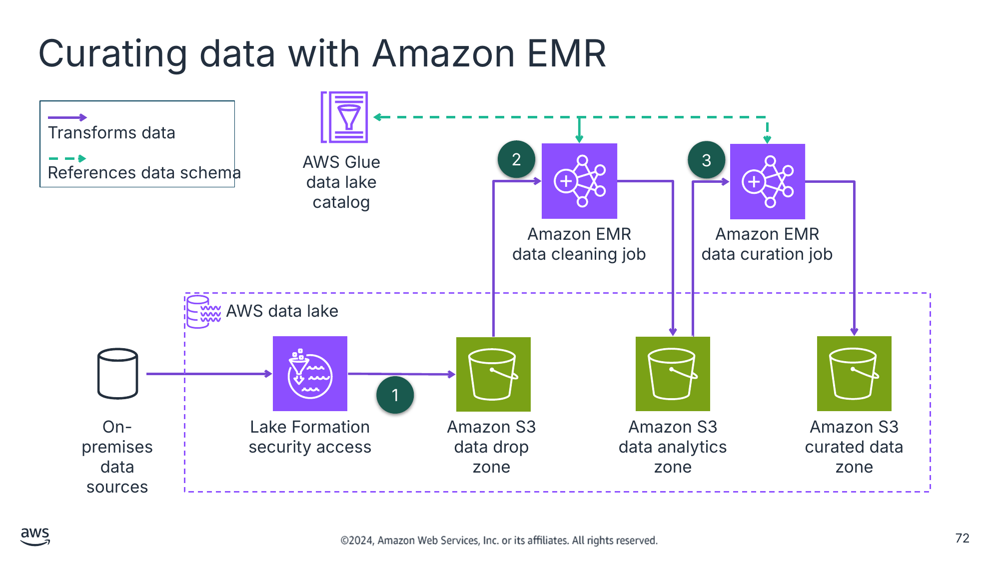

<details>
<summary>Текст зі схеми</summary>

Transforms data (Перетворює дані)

References data schema (Посилається на схему даних)

AWS Glue  
data lake catalog (Каталог озера даних AWS Glue)

2

3

Amazon EMR data cleaning job (Завдання очищення даних Amazon EMR)

Amazon EMR data curation job (Завдання курації даних Amazon EMR)

AWS data lake (Озеро даних AWS)

1

On-premises data sources (Локальні джерела даних)

Lake Formation security access (Доступ безпеки Lake Formation)

Amazon S3 data drop zone (Зона скидання даних Amazon S3)

Amazon S3 data analytics zone (Зона аналітики даних Amazon S3)

Amazon S3 curated data zone (Зона курованих даних Amazon S3)

</details>

> **Нотатки:**
>
> |Номер слайда 72  
> |Нотатки для інструктора  
> |  
> |Нотатки для студента  
> Найкраща практика — розділяти озеро даних на різні зони залежно від якості даних. Ось приклад триетапного робочого процесу для надання очищених і курованих даних для організації:  
> Дані передаються з кількох локальних джерел даних до озера даних AWS у призначену зону скидання даних Amazon S3. Lake Formation використовується як безпека доступу до озера даних.  
> Завдання очищення даних Amazon EMR копіює дані із зони скидання даних. Воно виконує кроки обробки, потрібні для очищення даних, і копіює набір результатів до зони аналітики даних. Застосунки аналітики тепер можуть споживати дані.  
> Завдання курації даних Amazon EMR копіює дані із зони аналітики даних. Воно виконує кроки обробки, потрібні для курації даних, і копіює набір результатів до зони курованих даних. Користувачі, яким потрібні куровані дані, тепер можуть отримувати доступ до курованих даних для візуалізації та аналізу.

---

## Слайд 73: Ключові висновки: паралельна обробка в конвеєрі даних

- Паралельна обробка великих даних — це обчислювальна методика, що розбиває обробку великих наборів даних на менші частини.
- Кластери EMR можуть використовувати фреймворки Hadoop MapReduce чи Apache Spark для паралельної обробки даних.
- Обирайте Amazon EMR для керування кластерами.
- Обирайте EMR Serverless чи AWS Glue для безсерверних рішень.

> **Нотатки:**
>
> |Номер слайда 73  
> |Нотатки для інструктора  
> |  
> |Нотатки для студента

---

## Слайд 74: Аналіз і візуалізація

Шаблони інженерії даних

> **Нотатки:**
>
> |Номер слайда 74  
> |Нотатки для інструктора  
> |  
> |Нотатки для студента  
> Цей розділ обговорює вибір інструментів аналізу й візуалізації.

---

## Слайд 75: Рівень аналізу та візуалізації конвеєра даних

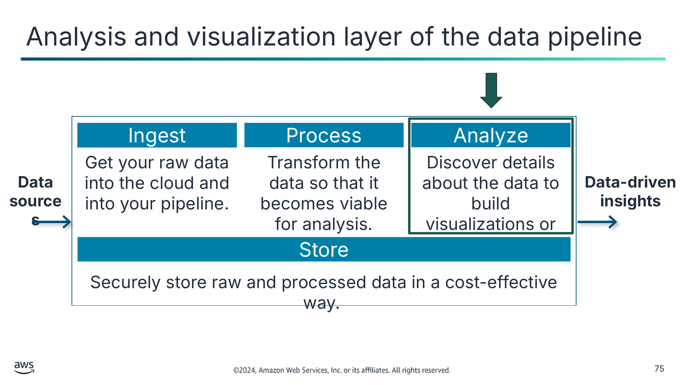

<details>
<summary>Текст зі схеми</summary>

Ingest (Прийняти)

Process (Обробити)

Analyze (Проаналізувати)

Get your raw data into the cloud and into your pipeline. (Помістіть ваші сирі дані в хмару та у ваш конвеєр.)

Transform the data so that it becomes viable for analysis. (Перетворіть дані так, щоб вони стали придатними для аналізу.)

Discover details about the data to build visualizations or predictions. (Виявте подробиці про дані для побудови візуалізацій чи прогнозів.)

**Data sources** (**Джерела даних**)

**Data-driven insights** (**Висновки, керовані даними**)

Store (Зберігати)

Securely store raw and processed data in a cost-effective way. (Безпечно зберігайте сирі й оброблені дані економічно ефективним способом.)

</details>

> **Нотатки:**
>
> |Номер слайда 75  
> |Нотатки для інструктора  
> |Це високорівневий конвеєр, що показує зберігання як частину всіх трьох рівнів приймання, обробки й аналізу даних.  
> |  
> |Нотатки для студента  
> Після приймання та обробки дані готові до споживання. Цей розділ обговорює аналіз і візуалізацію даних.

---

## Слайд 76: Вибір інструментів споживання для конвеєра даних

Я хочу використовувати запити SQL для інтерактивного пошуку у файлах активності клієнтського застосунку в озері даних, щоб розв’язати одноразову проблему клієнта.

Я хочу спроєктувати інтерактивну панель даних із діаграмами та графіками, щоб поділитися із зацікавленими сторонами.

Я хочу використовувати панель моніторингу застосунків у реальному часі.

Бізнес-аналітик (Business analyst)

Фахівець із даних (Data scientist)

Інженер DevOps (DevOps engineer)

> **Нотатки:**
>
> |Номер слайда 76  
> |Нотатки для інструктора  
> |  
> |Нотатки для студента  
> Після того як дані збережено й курировано в різних сховищах даних, є багато інструментів на вибір для аналізу та візуалізації даних. Залежно від сценарію використання доступні різні сервіси аналізу AWS для виконання конкретної вимоги аналізу.  
>
> Розгляньте такі сценарії використання й подумайте, який сервіс AWS можна використати для їх впровадження:  
> Бізнес-аналітик хоче спроєктувати інтерактивну панель даних із діаграмами та графіками, щоб поділитися із бізнес-зацікавленими сторонами.  
> Інженер даних хоче використовувати запити SQL для інтерактивного пошуку у файлах, пов’язаних з активністю клієнтського застосунку в озері даних, щоб розв’язати одноразову проблему клієнта.  
> Інженер DevOps хоче побудувати панель моніторингу застосунків у реальному часі.  
>
> Залежно від сценарію використання та завдання споживання даних, впровадьте принцип найменших привілеїв, надаючи лише достатній доступ для виконання системами своєї роботи. Визначте мінімальні привілеї, потрібні кожному користувачу чи системі, і дозволяйте лише ті дозволи, які їм потрібні. Наприклад, якщо бізнес-аналітик запитує читання таблиці Amazon Redshift із робочого навантаження аналітики, надайте лише дозвіл на читання таблиці за допомогою елементів керування привілеями користувачів Amazon Redshift.

---

## Слайд 77: Проєктування панелей за допомогою QuickSight

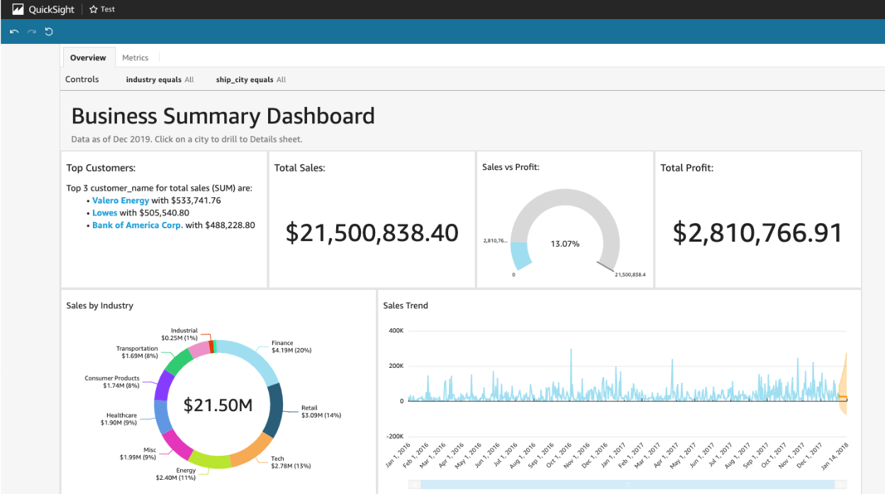

Amazon QuickSight

> **Нотатки:**
>
> |Номер слайда 77  
> |Нотатки для інструктора  
> |Для повсякденних потреб бізнес-аналітика сервіс аналізу AWS, що використовується найчастіше, — Amazon QuickSight.  
> |  
> |Нотатки для студента  
> Amazon QuickSight — це інструмент бізнес-аналітики (BI), який організації можуть використовувати для масштабування своїх можливостей бізнес-аналітики до сотень тисяч користувачів. Він забезпечує швидкі й чутливі візуалізації за допомогою надійного рушія в пам’яті (SPICE).  
>
> У QuickSight панель даних (dashboard) — це колекція діаграм, графіків і висновків. Це як цифрова газета про дані, що вас цікавлять, із можливістю взаємодіяти з панеллю.  
>
> Можна ділитися панелями із зацікавленими сторонами, публікуючи панель або ділячись посиланням на опубліковану панель. Як варіант, панель можна вбудувати у вебзастосунок чи мобільний застосунок клієнта. Панель можна надсилати як звіт за розкладом електронною поштою з QuickSight Enterprise edition.  
>
> Можна підключити QuickSight до джерел даних AWS, зокрема Amazon RDS, Aurora, Amazon Redshift, Athena та Amazon S3. Також можна завантажувати електронні таблиці Excel або плоскі файли (CSV, TSV, CLF та ELF); підключатися до локальних баз даних, як-от SQL Server, MySQL і PostgreSQL; та імпортувати дані із застосунків SaaS, як-от Salesforce.  
>
> Під час проєктування панелі бізнес-аналітик може вибрати дані, а функція QuickSight AutoGraph автоматично обере правильний тип графіка чи діаграми, придатний для даних. Можна навіть шукати дані природною мовою за допомогою рядка пошуку QuickSight Q і повертати отримані дані як візуалізацію.

---

## Слайд 78: Одноразові запити SQL за допомогою Athena SQL

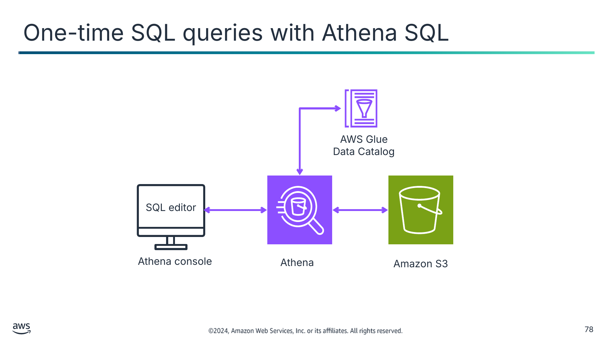

<details>
<summary>Текст зі схеми</summary>

AWS Glue  
Data Catalog

SQL editor (Редактор SQL)

Athena console (Консоль Athena)

Athena

Amazon S3

</details>

> **Нотатки:**
>
> |Номер слайда 78  
> |Нотатки для інструктора  
> |Інженер даних чи фахівець із даних найімовірніше виконуватиме одноразові запити SQL за допомогою Amazon Athena SQL.  
> |  
> |Нотатки для студента  
> Опис зображення: редактор SQL консолі Athena підключається до сервісу Athena для виконання запитів. Athena використовує Data Catalog для метаданих даних і підключається до Amazon S3 як джерела даних для запитів. Кінець опису.  
>
> Athena SQL — це рушій запитів до даних і сховище метаданих схем даних із можливістю виконувати запити до неструктурованих і структурованих даних, що зберігаються в інших сервісах, за допомогою запитів SQL. Athena побудована на Trino та Apache Presto і працює з різними стандартними форматами даних, зокрема CSV, JSON, Apache ORC, Apache Parquet та Apache Avro. Можна аналізувати дані безпосередньо в Amazon S3 за допомогою стандартного SQL.  
>
> Athena інтегрується з Data Catalog для читання неструктурованих даних, що пропонує постійне сховище метаданих для ваших даних в Amazon S3. Це дає вам змогу створювати схеми таблиць і виконувати запити до даних в Athena на основі центрального сховища метаданих, доступного в усьому вашому акаунті AWS.  
>
> Athena надає конектори джерел даних для підключення до джерел даних. Можна підключатися до джерел даних AWS, як-от бази даних Amazon RDS, DynamoDB, Amazon MSK, OpenSearch Service та Amazon Redshift. Також можливий доступ до локальних джерел даних, як-от SAP HANA та Db2. Athena можна використовувати для доступу до інших хмарних озер даних, як-от Azure Data Lake Storage. Це означає, що можна виконувати федеративні запити чи будувати подання з кількох джерел даних.  
>
> Athena безсерверна, тож немає інфраструктури для налаштування чи керування. Вона використовує модель «плата за запит», що більше підходить для одноразових запитів SQL. Можна підключати інструменти BI-аналізу та візуалізації, як-от QuickSight, до Athena за допомогою драйверів Java Database Connectivity (JDBC) і Open Database Connectivity (ODBC).  
>
> Athena для Apache Spark — це ще одна функція Athena. Вона дає змогу використовувати Apache Spark для обробки паралельних робочих навантажень великих даних. Це дуже подібно до AWS Glue для Apache Spark та завдань ETL Amazon EMR.

---

## Слайд 79: Візуалізація даних потоку кліків для сценарію кафе

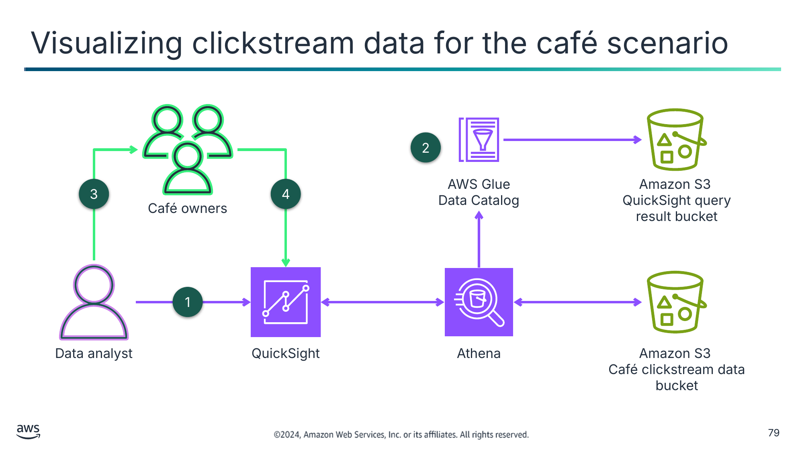

<details>
<summary>Текст зі схеми</summary>

2

3

4

AWS Glue  
Data Catalog

Amazon S3

QuickSight query

result bucket (Бакет результатів запитів QuickSight)

Café owners (Власники кафе)

1

Data analyst (Аналітик даних)

QuickSight

Athena

Amazon S3

Café clickstream data bucket (Бакет даних потоку кліків кафе)

</details>

> **Нотатки:**
>
> |Номер слайда 79  
> |Нотатки для інструктора  
> |Аналітик даних чи фахівець із даних найімовірніше візуалізуватиме активність потоку кліків користувачів.  
> |  
> |Нотатки для студента  
> Власникам кафе потрібен аналітик даних, щоб побудувати звіт-панель про активність потоку кліків користувачів вебсайту. Звіт слід поділити за допомогою посилання URL:  
> Аналітик даних використовує QuickSight для налаштування дозволів безпеки для Athena та бакета потоку кліків кафе як джерел даних. Аналітик даних будує панель.  
> Використовуючи Data Catalog, Athena зберігає всі запити, згенеровані QuickSight для панелі, в бакеті результатів запитів QuickSight.  
> Після завершення аналітик даних публікує панель і надсилає посилання URL власникам кафе.  
> Власники кафе використовують посилання URL для перегляду панелі.

---

## Слайд 80: Панель застосунку в реальному часі за допомогою OpenSearch Dashboards

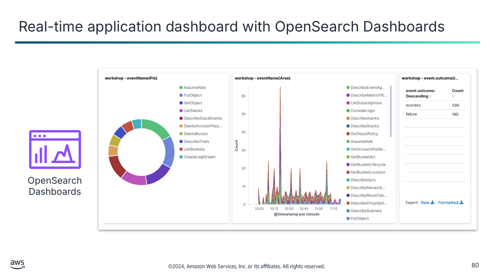

OpenSearch Dashboards

> **Нотатки:**
>
> |Номер слайда 80  
> |Нотатки для інструктора  
> |Для повсякденних потреб інженера DevOps сервіс аналізу AWS, що використовується найчастіше, — OpenSearch Service.  
> |  
> |Нотатки для студента  
> Опис зображення: приклад панелі OpenSearch Service, що включає кільцеву діаграму з кількістю подій, діаграму з областями для часових ліній подій і кількість успішних і невдалих подій. Кінець опису.  
>
> OpenSearch Service — це кероване безсерверне обслуговування для впровадження сценаріїв використання Apache OpenSearch, як-от інтерактивна аналітика журналів, моніторинг застосунків у реальному часі та пошук по вебсайтах. Це варіант зберігання даних, що індексує завантажені дані в домені, щоб забезпечити спосіб пошуку й аналізу даних. OpenSearch Service надає встановлення панелей OpenSearch (OpenSearch dashboards) з кожним доменом OpenSearch Service.  
>
> Можна проактивно відстежувати дані вашого застосунку в OpenSearch Service за допомогою сповіщень і виявлення аномалій. Налаштуйте сповіщення для отримання повідомлень, коли ваші дані перевищують певні порогові значення. Виявлення аномалій використовує ML для автоматичного виявлення будь-яких викидів у ваших потокових даних. Можна поєднати виявлення аномалій зі сповіщеннями, щоб гарантувати, що вас сповістять одразу після виявлення аномалії.  
>
> Multi-AZ with Standby — це варіант розгортання OpenSearch Service, що забезпечує високу доступність і стабільну продуктивність для критично важливих для бізнесу робочих навантажень. З Multi-AZ with Standby керовані кластери OpenSearch Service стійкі до збоїв інфраструктури, як-от відключення вузла чи збій окремої зони доступності. Multi-AZ with Standby надає додаткову перевагу спрощення конфігурації й керування кластером шляхом примусового застосування найкращих практик і зменшення складності.

---

## Слайд 81: Ключові висновки: аналіз і візуалізація

- QuickSight — це інструмент бізнес-аналітики для візуалізації даних за допомогою публікованих панелей.
- Athena SQL — це рушій запитів до даних і сховище метаданих схем даних із можливістю виконувати запити до даних, що зберігаються в інших сервісах, за допомогою запитів SQL.
- З Athena для Apache Spark можна використовувати Apache Spark для обробки паралельних робочих навантажень великих даних.
- OpenSearch Service індексує завантажені дані для полегшення пошуку й аналізу даних.

> **Нотатки:**
>
> |Номер слайда 81  
> |Нотатки для інструктора  
> |  
> |Нотатки для студента

---

## Слайд 82: Вправа: архітектура конвеєра даних (Data Pipeline Architecture)

- Ви — хмарний архітектор, призначений до організації, що надає дані про погоду для аналітиків даних.
- Надайте архітектурне рішення для конвеєра даних і поясніть його за допомогою архітектурної діаграми, яку ви створите для заданого сценарію.


> **Нотатки:**
>
> |Номер слайда 82  
> |Нотатки для інструктора  
> |Мета цієї вправи — побудувати конвеєр даних за допомогою сервісів AWS для сценарію використання даних про погоду. Надається аркуш завдань для студентів і аркуш розв’язання для інструктора.  
> |  
> |Нотатки для студента  
> Це вправа під керівництвом інструктора із заповненням аркуша завдань для студента.

---

## Слайд 83: Застосування принципів AWS Well-Architected Framework до конвеєрів даних

Шаблони інженерії даних

> **Нотатки:**
>
> |Номер слайда 83  
> |Нотатки для інструктора  
> |  
> |Нотатки для студента

---

## Слайд 84: Процес перегляду для Data Analytics Lens

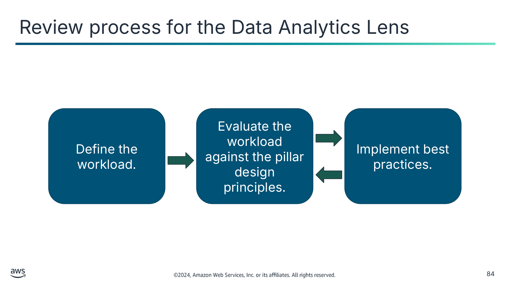

<details>
<summary>Текст зі схеми</summary>

Define the workload. (Визначте робоче навантаження.)

Evaluate the workload against the pillar design principles. (Оцініть робоче навантаження за принципами проєктування опор.)

Implement best practices. (Впровадьте найкращі практики.)

</details>

> **Нотатки:**
>
> |Номер слайда 84  
> |Нотатки для інструктора  
> |  
> |Нотатки для студента  
> AWS Well-Architected Data Analytics Lens — це колекція перевірених клієнтами найкращих практик для проєктування добре спроєктованих (well-architected) робочих навантажень аналітики. Data Analytics Lens містить висновки, які AWS зібрав зі справжніх кейсів. Це надає ІТ-архітекторам і розробникам спосіб оцінити робоче навантаження аналітики й упровадити найкращі практики, надані lens, не потребуючи стати експертами в предметній галузі.  
> Визначте робоче навантаження: робоче навантаження ідентифікує набір компонентів, що разом надають бізнес-цінність. Робоче навантаження — це зазвичай рівень деталізації, про який спілкуються бізнес- та технологічні лідери. Приклади робочих навантажень — маркетингові вебсайти, вебсайти електронної комерції, бекенди мобільного застосунку, аналітичні платформи тощо.  
> Оцініть робоче навантаження за принципами проєктування опор: щоб оцінити робоче навантаження аналітики, пріоритезуйте опори за важливістю й визначте найважливіші принципи проєктування для впровадження для кожної опори.  
> Упровадьте найкращі практики: переходьте до впровадження цих найкращих практик. Процес продовжується регулярними оцінюваннями для додавання якомога більше найкращих практик.  
>
> Інструменти й методики, про які ви дізналися в інших розділах цього модуля, узгоджуються з опорами AWS Well-Architected Framework. На практиці потрібно постійно оцінювати, чи ваше рішення найкраще відповідає вашому робочому навантаженню аналітики.  
>
> Докладніше див. Data Analytics Lens на сторінці ресурсів вмісту вашого онлайн-курсу.

---

## Слайд 85: Найкращі практики Well-Architected Framework для аналітики даних


> **Нотатки:**
>
> |Номер слайда 85  
> |Нотатки для інструктора  
> |Хоча AWS Well-Architected Framework має шість опор, цей розділ зосереджений на чотирьох опорах, що стосуються найкращих практик, пов’язаних з інженерією даних, які розглядаються в цьому модулі. Охоплені найкращі практики не є вичерпним переліком.  
> |  
> |Нотатки для студента  
> AWS Well-Architected Framework надає найкращі практики для проєктування, експлуатації та підтримки робочих навантажень. Він допомагає зрозуміти плюси й мінуси рішень, які ви ухвалюєте під час побудови робочих навантажень в AWS. Це набір основоположних запитань, що допомагають зрозуміти, чи конкретна архітектура добре узгоджується з найкращими практиками хмари.  
>
> Наступні кілька слайдів виділяють деякі найкращі практики для оцінювання того, чи ваше рішення найкраще відповідає вашому робочому навантаженню аналітики, за допомогою опор безпеки, ефективності продуктивності, оптимізації витрат і надійності. Деякі з них можуть здаватися знайомими, оскільки вони розглядалися раніше в модулі.

---

## Слайд 86: Підхід найкращих практик: контролюйте доступ до інфраструктури робочого навантаження


**Найкраща практика**

Упровадьте політики найменших привілеїв для вихідних і нижчих за потоком систем.

> **Нотатки:**
>
> |Номер слайда 86  
> |Нотатки для інструктора  
> |  
> |Нотатки для студента  
> Опора безпеки охоплює захист даних, систем і активів, щоб скористатися хмарними технологіями для покращення вашого стану безпеки. Середовища аналітики змінюються залежно від еволюціонуючих вимог до обробки та розповсюдження даних. Забезпечення доступності середовища з найменшими необхідними дозволами є важливим для надання безпечної платформи.  
>
> Принцип найменших привілеїв працює, надаючи лише достатній доступ для виконання системами своєї роботи. Дії системи над даними мають визначати дозволи, а надання дозволів іншим системам не слід допускати. Цей модуль згадує різні ролі, що звертаються до даних для аналізу й візуалізації. Визначте мінімальні привілеї, потрібні кожному користувачу, і надавайте кожному користувачу лише ті дозволи, які йому потрібні. Наприклад, якщо бізнес-аналітик запитує читання таблиці Amazon Redshift із робочого навантаження аналітики, надайте лише дозвіл на читання таблиці за допомогою елементів керування привілеями користувачів Amazon Redshift.  
>
> Докладніше див. Security Pillar - AWS Well-Architected Framework на сторінці ресурсів вмісту вашого онлайн-курсу.

---

## Слайд 87: Підхід найкращих практик: оберіть обчислювальне рішення з найкращою продуктивністю


**Найкраща практика**

Визначте рішення аналітики, що найкраще відповідають вашим технічним викликам.

> **Нотатки:**
>
> |Номер слайда 87  
> |Нотатки для інструктора  
> |  
> |Нотатки для студента  
> Опора ефективності продуктивності зосереджена на ефективному використанні ресурсів для задоволення вимог у міру зміни попиту й еволюції технологій. AWS має кілька сервісів обробки аналітики, побудованих для конкретних цілей. Цей модуль обговорює деякі з цих сервісів, зокрема Amazon Redshift для сховищ даних, Kinesis для потокових даних і QuickSight для візуалізації даних. Застосунки й сервіси спроєктовано для подолання конкретних викликів. Важливо, щоб ваша організація визначила правильний інструмент для правильного завдання для виконання ваших бізнес- і технічних вимог. Наприклад, у цьому модулі було показано сценарій візуалізації даних потоку кліків користувачів кафе за допомогою QuickSight та Athena.  
>
> Докладніше див. Performance Efficiency Pillar - AWS Well-Architected Framework на сторінці ресурсів вмісту вашого онлайн-курсу.

---

## Слайд 88: Підхід найкращих практик: керуйте витратами з часом


**Найкращі практики**

Вилучайте невикористані дані та інфраструктуру.

Зменшуйте надмірне виділення інфраструктури.

> **Нотатки:**
>
> |Номер слайда 88  
> |Нотатки для інструктора  
> |  
> |Нотатки для студента  
> Опора оптимізації витрат включає безперервний процес уточнення й покращення системи протягом усього її життєвого циклу для оптимізації витрат. Щоб завжди мати найекономічніше робоче навантаження, періодично переглядайте своє робоче навантаження для виявлення можливостей упровадити нові сервіси, функції та компоненти. Для робочих навантажень аналітики типово мати дедалі більшу кількість користувачів і експоненційне зростання обсягу даних. Упровадьте стандартизований процес у вашій організації для виявлення та вилучення невикористаних ресурсів, як-от невикористані дані та інфраструктура.  
> Вилучайте невикористані дані та інфраструктуру: видаляйте дані, термін зберігання яких минув або які більше не потрібні. Дані, термін зберігання яких минув, слід видаляти, щоб зменшити непотрібні витрати на зберігання. Визначайте через каталог метаданих дані, що перебувають поза періодом зберігання. Якщо дані зберігаються в Amazon S3, використовуйте конфігурації життєвого циклу Amazon S3, щоб налаштувати автоматичне завершення терміну дії даних. Пригадайте з розділу про зберігання даних цього модуля, як період зберігання даних впливає на вибір сховища.  
> Зменшуйте надмірне виділення інфраструктури: використання ресурсів робочого навантаження може змінюватися з часом, особливо в міру зростання даних чи після оптимізації процесу. Дані, що використовуються нечасто, можна перемістити зі сховища даних в озеро даних. Звідти дані можна запитувати на місці або поєднувати з даними у сховищі. Використовуйте сервіси, як-от Amazon Redshift Spectrum, для запитів і об’єднання даних в озері даних Amazon S3, або використовуйте Athena для запитів до даних у стані спокою в Amazon S3. Пригадайте з порівняння сховища даних і озера даних у цьому модулі, як баланс вартості та часу виконання запитів впливає на рішення щодо зберігання даних.  
>
> Докладніше див. Cost Optimization Pillar - AWS Well-Architected Framework на сторінці ресурсів вмісту вашого онлайн-курсу.

---

## Слайд 89: Підхід найкращих практик: проєктуйте стійкість для робочих навантажень аналітики


**Найкраща практика**

Розумійте бізнес-вимоги до аналітики та завдань ETL.

> **Нотатки:**
>
> |Номер слайда 89  
> |Нотатки для інструктора  
> |  
> |Нотатки для студента  
> Опора надійності охоплює здатність робочого навантаження виконувати свою призначену функцію правильно та стабільно, коли від нього цього очікують. Один зі способів спроєктувати стійкість для робочих навантажень аналітики — зрозуміти бізнес-вимоги та те, як ці вимоги пов’язані з шаблонами переміщення даних. Розділ цього модуля про шаблони різнорідного приймання конвеєрів даних розглядає цю тему.  
>
> Є три поширені шаблони проєктування під час переміщення даних із вихідних систем до цільового сховища даних:  
> Перший шаблон — ETL, що перетворює дані до їх завантаження в цільове джерело даних.  
> Другий шаблон — ELT, що завантажує дані в центральний репозиторій даних (як-от озеро даних чи сховище даних).  
> Третій шаблон — ETLT, що є гібридом двох попередніх шаблонів. Цей шаблон виконує перетворення для відповідності критеріям якості входу, завантажує дані у сховище даних і пізніше перетворює дані за потреби.  
>
> Докладніше див. Reliability Pillar - AWS Well-Architected Framework на сторінці ресурсів вмісту вашого онлайн-курсу.

---

## Слайд 90: Ключові висновки: застосування AWS Well-Architected Framework до конвеєрів даних

- Упровадження Data Analytics Lens — це безперервний процес із регулярними оцінюваннями для додавання якомога більше найкращих практик до робочого навантаження аналітики.
- Пріоритезуйте опори за важливістю й визначте найважливіші принципи проєктування для впровадження.

> **Нотатки:**
>
> |Номер слайда 90  
> |Нотатки для інструктора  
> |  
> |Нотатки для студента

---

## Слайд 91: Підсумки модуля

Шаблони інженерії даних

> **Нотатки:**
>
> |Номер слайда 91  
> |Нотатки для інструктора  
> |  
> |Нотатки для студента  
> Цей розділ підсумовує те, що ви дізналися, і завершує модуль.

---

## Слайд 92: Резюме модуля

Цей модуль підготував вас до такого:

- Використовувати Well-Architected Framework для узагальнення типу архітектури, потрібної для відповіді поширеним сценаріям використання приймання даних (пакетного й потокового).
- Обирати шаблон приймання даних, що відповідає характеристикам даних (швидкості, обсягу та різноманітності).
- Обирати відповідні сервіси AWS для приймання й зберігання даних для заданого сценарію використання.
- Обирати відповідні сервіси AWS для оптимізації вимог до обробки та перетворення даних для заданого сценарію використання.
- Визначати, коли використовувати різні типи сервісів аналітики й візуалізації даних AWS на основі заданого сценарію використання.

> **Нотатки:**
>
> |Номер слайда 92  
> |Нотатки для інструктора  
> |  
> |Нотатки для студента

---

## Слайд 93: Міркування щодо кафе

Обговоріть, як ви, як хмарний архітектор, могли б порадити кафе на основі ключових занепокоєнь щодо проєктування хмарної архітектури, поданих на початку цього модуля.


> **Нотатки:**
>
> |Необов’язково: попросіть студентів розповісти, як вони могли б застосувати знання, здобуті в цьому модулі, до бізнесу кафе. Підкресліть, що архітектурні рішення специфічні для сценарію використання та бізнес-потреби. Також підкресліть, що немає єдиної відповіді й що архітектура має еволюціонувати з часом.  
> |  
> |Нотатки для студента  
> Використайте бізнес кафе як приклад, щоб застосувати те, що ви дізналися в цьому модулі, до побудови хмарної архітектури.

---

## Слайд 94: Перевірка знань модуля

- Перевірка знань проводиться онлайн у вашому курсі.
- Перевірка знань включає 10 запитань на основі матеріалу, поданого на слайдах і в нотатках до слайдів.
- Ви можете повторно проходити перевірку знань стільки разів, скільки захочете.

> **Нотатки:**
>
> |Номер слайда 94  
> |Нотатки для інструктора  
> |  
> |Нотатки для студента  
> Скористайтеся своїм онлайн-курсом, щоб отримати доступ до перевірки знань для цього модуля.

---

## Слайд 95: Зразок запитання іспиту

Інженеру даних потрібно в реальному часі проаналізувати й візуалізувати велику кількість потокових даних із журналів активності користувачів. Який єдиний сервіс забезпечить цю можливість?

Визначте ключові слова та фрази, перш ніж продовжувати.

Ось ключові слова та фрази:

- Аналіз і візуалізація
- Журнали потокових даних
- Реальний час
- Єдиний сервіс

> **Нотатки:**
>
> |Номер слайда 95  
> |Нотатки для інструктора  
> |Розділ із ключовими словами налаштовано з анімацією для розкриття за клацанням.  
> |  
> |Нотатки для студента  
> Запитання зазначає, що інженеру даних потрібне рішення для аналізу й візуалізації потокових даних журналів і що аналіз має відбуватися в реальному часі. Також є вимога використовувати єдиний сервіс AWS.

---

## Слайд 96: Зразок запитання іспиту: варіанти відповідей

Інженеру даних потрібно в реальному часі **проаналізувати й візуалізувати** велику кількість **потокових даних** із **журналів активності користувачів**. Який єдиний сервіс забезпечить цю можливість?

**Варіант**

**Відповідь**

**A**

Amazon OpenSearch Service

**B**

Amazon Athena

**C**

Amazon QuickSight

**D**

Amazon Redshift

> **Нотатки:**
>
> |Номер слайда 96  
> |Нотатки для інструктора  
> |  
> |Нотатки для студента  
> Використайте ключові слова, які ви визначили на попередньому слайді, і розгляньте кожен із можливих варіантів відповіді, щоб визначити, який із них найкраще відповідає запитанню.

---

## Слайд 97: Зразок запитання іспиту: відповідь

Правильна відповідь — A.

**Варіант**

**Відповідь**

**A**

Amazon OpenSearch Service

> **Нотатки:**
>
> |Номер слайда 97  
> |Нотатки для інструктора  
> |  
> |Нотатки для студента  
> Варіант B (Amazon Athena) неправильний, оскільки хоча Athena забезпечує інтерактивний аналіз за допомогою SQL, вона не має можливостей візуалізації.  
>
> Варіант C (Amazon QuickSight) неправильний, оскільки QuickSight може надавати можливості візуалізації, але для приймання даних був би потрібен додатковий сервіс.  
>
> Варіант D (Amazon Redshift) неправильний, оскільки Amazon Redshift — це сервіс сховища даних і не використовується для аналізу й візуалізації даних у реальному часі.  
>   
> Варіант A (Amazon OpenSearch Service) — найкращий вибір. OpenSearch Service — єдине рішення, що відповідає вимогам. OpenSearch Service може аналізувати великі обсяги потокових даних і журналів серверів, а OpenSearch Dashboards надає візуалізації.

---

## Слайд 98: Дякуємо

Виправлення, відгуки чи інші запитання?

Зв’яжіться з нами за адресою [https://support.aws.amazon.com/#/contacts/aws-academy](https://support.aws.amazon.com/#/contacts/aws-academy).

> **Нотатки:**
>
> |Номер слайда 98  
> |Нотатки для інструктора  
> |  
> |Нотатки для студента  
> Сторінка ресурсів вмісту вашого курсу містить посилання на додаткові ресурси, пов’язані з цим модулем.

---

## Слайд 99: Додаток (Appendix)

Шаблони інженерії даних

> **Нотатки:**
>
> |Номер слайда 99  
> |Нотатки для інструктора  
> |Цей додаток містить додаткові слайди, що можуть бути корисними, якщо ви хочете приділити більше часу пов’язаним темам. Вони включені до посібника студента. Кожен заголовок теми в додатку зіставлений із назвою розділу, де обговорюються пов’язані теми.  
> |  
> |Нотатки для студента

---

## Слайд 100: Додаток: характеристики даних

- Цінність даних
- Достовірність даних
- Обсяг даних
- Швидкість даних
- Різноманітність даних

> **Нотатки:**
>
> |Номер слайда 100  
> |Нотатки для інструктора  
> |  
> |Нотатки для студента

---

## Слайд 101: Додаток: цінність даних

Сфера (Scope)

Запитання (Ask)

Враховуйте (Consider)

- Цінність стосується того, як організація може використати оброблені дані, щоб отримати розуміння бізнес-проблеми чи розв’язати її.

- Яке розуміння можна отримати з даних?
- Як слід обробити дані, щоб отримати потрібні вам відповіді?

- Тримайте в голові кінцевого користувача, проєктуючи інфраструктуру й ухвалюючи рішення.

> **Нотатки:**
>
> |Номер слайда 101  
> |Нотатки для інструктора  
> |  
> |Нотатки для студента  
> Цінність стосується забезпечення того, щоб ви отримували максимум зі зібраних даних. Цінність також стосується забезпечення того, щоб результати всього цього збирання, зберігання й обробки мали бізнес-цінність.  
>
> Робота у зворотному напрямку й знання того, які висновки потрібно отримати з даних, показують, як цінність даних визначає рішення щодо інфраструктури. Розгляньте сценарій з кафе, у якому дані потоку кліків меню дадуть розуміння поведінки клієнтів і результатів покупок. Цінність цих даних полягає в їхньому потенціалі інформувати бізнес-рішення й покращувати досвід клієнтів. Щоб ефективно використовувати ці дані, компанії потрібна інфраструктура, що підтримує аналітику в реальному часі.

---

## Слайд 102: Додаток: достовірність даних

Сфера (Scope)

Запитання (Ask)

Враховуйте (Consider)

- Достовірність стосується розуміння повного життєвого циклу ваших даних і знання того, як захистити й посилити цілісність ваших даних.

- Наскільки точні, прецизійні та довірені дані?

- Цінність спирається на достовірність, оскільки без хороших даних можна ухвалити погані бізнес-рішення.

> **Нотатки:**
>
> |Номер слайда 102  
> |Нотатки для інструктора  
> |  
> |Нотатки для студента  
> Розгляньте, звідки надходять ваші дані і як можна захистити їхню цілісність, коли вони проходять конвеєром даних.  
>   
> Точність і надійність даних важливі, оскільки вони є основою аналізу, який ви виконуєте для ухвалення рішень.  
>
> Непослідовності й неточності даних потрібно усувати й ураховувати, щоб забезпечити послідовне й надійне захоплення даних. Цінність висновків залежить від точних даних. Розгляньте організацію охорони здоров’я, що прагне покращити догляд за пацієнтами й результати лікування, впроваджуючи підхід, керований даними. Організація збирає дані з електронних медичних карток, медичних пристроїв, опитувань пацієнтів і клінічних випробувань. Однак вона стикається з викликами щодо достовірності деяких зібраних даних, як-от непослідовності й неточності даних під час захоплення даних із кількох систем.

---

## Слайд 103: Додаток: обсяг даних

Сфера (Scope)

Запитання (Ask)

Враховуйте (Consider)

- Обсяг стосується того, скільки даних потрібно обробити.

- Якого розміру набір даних?
- Скільки нових даних генерується?
- Як довго потрібно зберігати дані?
- Як часто потрібно звертатися до даних?

- Розумійте тривалість зберігання даних і частоту доступу, щоб зважити вартість і переваги зберігання.

> **Нотатки:**
>
> |Номер слайда 103  
> |Нотатки для інструктора  
> |  
> |Нотатки для студента  
> Обсяг даних впливає на інфраструктуру введення даних у конвеєр, обробки даних і їх зберігання.  
>
> Залежно від того, як часто ви хочете звертатися до даних і обробляти їх, можна ухвалювати рішення щодо їх зберігання.  
>
> Розгляньте платформу соціальних мереж, що спочатку мала інфраструктуру даних, спроєктовану для обробки помірного обсягу контенту, створеного користувачами. Однак через зростання бази користувачів і збільшення активності платформа тепер стикається зі значним збільшенням обсягу даних, що перевищує потужність її наявної інфраструктури. Це призводить до затримок, втрати даних і загальної поганої продуктивності системи. У цьому сценарії використання компанії соціальних мереж потрібно змінити інфраструктуру, щоб ефективно обробляти збільшений обсяг даних.

---

## Слайд 104: Додаток: швидкість даних

Сфера (Scope)

Запитання (Ask)

Враховуйте (Consider)

- Швидкість стосується того, як швидко дані надходять і рухаються вашим конвеєром.

- Як часто генеруються дані?
- Як швидко потрібно реагувати на дані?
- Чи може ваш конвеєр обробляти раптові сплески даних?

- Обсяг і швидкість разом визначають очікувану пропускну здатність і вимоги до масштабування вашого конвеєра.

> **Нотатки:**
>
> |Номер слайда 104  
> |Нотатки для інструктора  
> |  
> |Нотатки для студента  
> Кількість даних і темп даних визначають вибір проєкту.  
>
> Для сценаріїв із однаково великим обсягом швидкість надходження даних і швидкість, з якою дані потрібно обробити, впливатимуть на інфраструктуру конвеєра, яку ви проєктуєте.  
>
> Поєднання обсягу та швидкості безпосередньо впливає на те, як потрібно спроєктувати ваш конвеєр. Чи може ваш конвеєр обробляти раптові сплески даних (наприклад, ігрові дані в піковий час)?  
>
> Розгляньте проєкт розумного міста, метою якого є оптимізація транспортного потоку. Датчики збирають дані про дорожній рух по всьому місту в реальному часі. Висока швидкість згенерованих даних дає змогу виявляти затори й швидко реагувати на аварії. Інфраструктура має вміти підтримувати обробку даних у такому масштабі. У цьому сценарії використання швидкість даних і потреба обробляти дані для реагування на затори й аварії впливають на рішення щодо інфраструктури.

---

## Слайд 105: Додаток: різноманітність даних

Сфера (Scope)

Запитання (Ask)

Враховуйте (Consider)

- Різноманітність стосується різних типів даних і кількості різних джерел даних, з якими ви працюєте.

- Який формат даних?
- Який тип даних? Структуровані, напівструктуровані чи неструктуровані?
- З скількох різних джерел надходять дані?

- Поєднання наборів даних може збагатити аналіз, але також може ускладнити обробку.

> **Нотатки:**
>
> |Номер слайда 105  
> |Нотатки для інструктора  
> |Слайд «Data types» показує три типи даних, де легші у використанні типи даних — на осі y (структуровані дані), а гнучкіші типи даних — на осі x (неструктуровані дані). Він розташований у розділі «Додаток» цього модуля.  
> |  
> |Нотатки для студента  
> Різні типи даних піддаються певним типам обробки й аналізу. Це впливатиме на те, як дані потрапляють у конвеєр, і на процес їх підготовки до аналізу.  
>
> Існують три загальні типи даних: структуровані, напівструктуровані та неструктуровані. Структуровані дані зберігаються в табличному форматі, як-от записи в традиційній реляційній базі даних. Напівструктуровані дані мають структуру, що сама себе описує, і впізнавані елементи, але не мають жорстких обмежень схеми структурованих даних. Наприклад, файл .json чи .xml — напівструктурований. Неструктуровані дані не мають наперед визначеної структури. Це робить їх дуже гнучкими, але складнішими для запитів.  
>
> Розгляньте роздрібну компанію, що спочатку мала інфраструктуру даних, спроєктовану для обробки структурованих транзакційних даних зі своїх фізичних магазинів. У міру розширення своєї онлайн-присутності компанія спробувала включити неструктуровані джерела даних, як-от відгуки клієнтів, коментарі в соціальних мережах і зображення. Наявна інфраструктура намагається ефективно приймати й обробляти різноманітні типи даних. Недостатньо лише збирати дані, щоб отримати придатні до дій висновки. Дані потрібно належним чином приймати, обробляти й аналізувати. У цьому сценарії використання наявний конвеєр має змінитися з урахуванням неструктурованих даних, які компанія тепер збирає.

---

## Слайд 106: Додаток: конвеєри даних

- Перетворення даних під час приймання

> **Нотатки:**
>
> |Номер слайда 106  
> |Нотатки для інструктора  
> |  
> |Нотатки для студента

---

## Слайд 107: Додаток: перетворення даних під час приймання

- Сирі дані можуть бути неузгодженими, неточними та повторюваними. Дані майже завжди будуть перетворюватися під час проходження конвеєром.
- Можливо, вам потрібно підготувати дані, перш ніж вони стануть придатними для аналізу:
  - Очистити чи нормалізувати дані.
  - Змінити формат для підтримки певного інструмента аналізу.
  - Доповнити набір даних, заповнивши прогалини, або збагатити його додатковою інформацією.
  - Додати метадані для категоризації та каталогізації даних.

> **Нотатки:**
>
> |Номер слайда 107  
> |Нотатки для інструктора  
> |  
> |Нотатки для студента  
> Дані, що приймаються, можливо, потрібно перетворити для вилучення високоякісних даних. Це передбачає конвертацію та структурування їх способом, що відповідає схемі цільового розташування.

---

## Слайд 108: Додаток: інструменти AWS для приймання даних

- AWS DataSync: передавання між локальним середовищем і AWS

> **Нотатки:**
>
> |Номер слайда 108  
> |Нотатки для інструктора  
> |  
> |Нотатки для студента

---

## Слайд 109: AWS DataSync: передавання між локальним середовищем і AWS

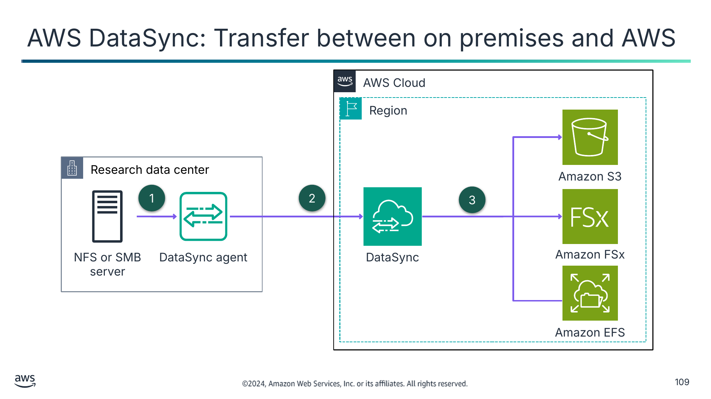

<details>
<summary>Текст зі схеми</summary>

AWS Cloud

Region (Регіон)

Research data center (Центр обробки даних досліджень)

Amazon S3

1

2

3

NFS or SMB server (Сервер NFS чи SMB)

DataSync agent (Агент DataSync)

DataSync

Amazon FSx

Amazon EFS

</details>

> **Нотатки:**
>
> |Номер слайда 109  
> |Нотатки для інструктора  
> |  
> |Нотатки для студента  
> У цьому сценарії використання дослідники мають дані на локальному сервері й потребують доступу до даних у хмарі AWS для архівування та аналітики. Їм потрібно щодня синхронізувати свої дані з локального центру до AWS:  
> DataSync використовує агента для передавання даних із вашого локального сховища. Після розгортання агент діє як розширення сервісу DataSync і безшовно керується AWS.  
> Для агента потрібне одноразове налаштування для читання даних із вашого вихідного сховища. Після завершення налаштування можна створити стільки завдань передавання, скільки потрібно, з’єднуючи ваше локальне сховище та сховище в AWS.  
> Налаштуйте вихідне призначення для передавання даних. Дані можна передавати до всіх класів зберігання Amazon S3, усіх файлових систем Amazon FSx та Amazon EFS.  
> Після передавання даних до будь-якого зі сервісів зберігання можна знову використовувати DataSync для передавання даних між Amazon S3, Amazon FSx та Amazon EFS.

---

## Слайд 110: Додаток: обробка даних у реальному часі

- Архітектура кластера EMR на Amazon EC2
- Робочий процес Amazon EMR

> **Нотатки:**
>
> |Номер слайда 110  
> |Нотатки для інструктора  
> |  
> |Нотатки для студента

---

## Слайд 111: Архітектура кластера EMR на Amazon EC2

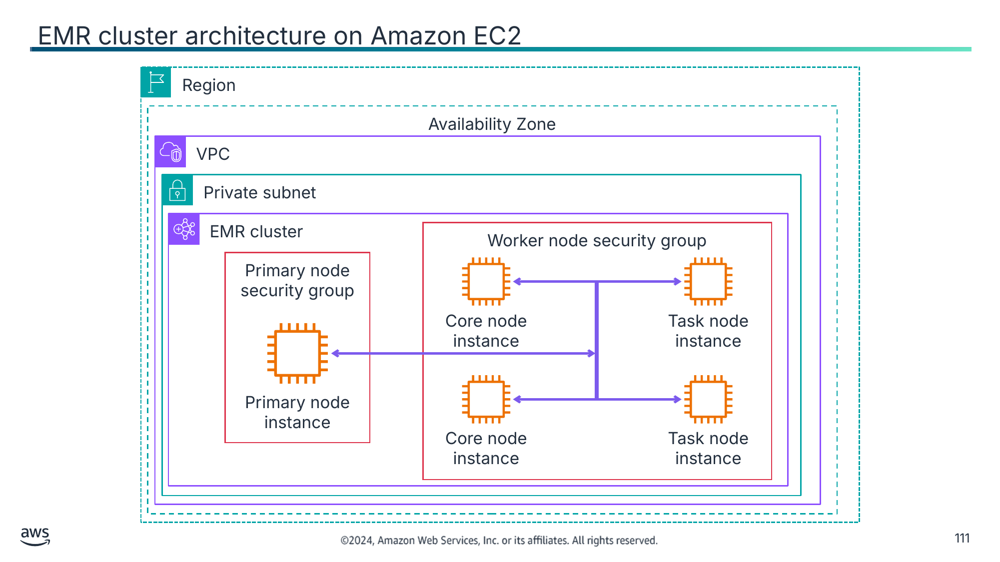

<details>
<summary>Текст зі схеми</summary>

Region (Регіон)

Availability Zone (Зона доступності)

VPC

Private subnet (Приватна підмережа)

EMR cluster (Кластер EMR)

Worker node security group (Група безпеки робочих вузлів)

Primary node security group (Група безпеки основного вузла)

Core node

instance (Екземпляр основного робочого вузла)

Task node

instance (Екземпляр вузла завдань)

Primary node

instance (Екземпляр основного вузла)

Core node

instance

Task node

instance

</details>

> **Нотатки:**
>
> |Номер слайда 111  
> |Нотатки для інструктора  
> |  
> |Нотатки для студента  
> Опис зображення: кластер EMR розгорнуто в приватній підмережі у VPC в єдиній AZ у регіоні AWS. Екземпляр основного вузла кластера належить до групи безпеки основного вузла. Екземпляри вузлів core і task кластера належать до групи безпеки робочих вузлів. Кінець опису.  
>
> Кластер EMR — це колекція екземплярів EC2. Кожен екземпляр у кластері називається вузлом. У межах кластера кожен вузол має роль, що називається типом вузла.  
>
> Екземпляр основного вузла (primary node) керує кластером, запускаючи програмні компоненти для координації розподілу даних і завдань між іншими вузлами для обробки. Основний вузол відстежує статус завдань і стан кластера. Кожен кластер має основний вузол, і можливо створити кластер із єдиним вузлом, що має лише основний вузол.  
>
> Робочі вузли кластера EMR бувають двох різних типів. Вузол core (core node) — це екземпляр із програмними компонентами, що виконує завдання й зберігає дані в HDFS на кластері. Багатовузлові кластери мають щонайменше один вузол core. Вузол task (task node) — це вузол із програмними компонентами, що лише виконує завдання й не зберігає даних у HDFS. Вузли task необов’язкові.  
>
> Важливо зазначити, що основний вузол має окрему групу безпеки з іншими правилами доступу, ніж група безпеки робочих вузлів.  
>
> Життєвий цикл кластера може бути тривалим або тимчасовим (transient). Тимчасовий означає, що після обробки даних кластер вимикається. Це зазвичай робиться для економії коштів. Коли кластер вимикається, сховище кластера також завершується. Важливо зберігати оброблені дані в зовнішньому сховищі під час використання тимчасових кластерів.

---

## Слайд 112: Робочий процес Amazon EMR

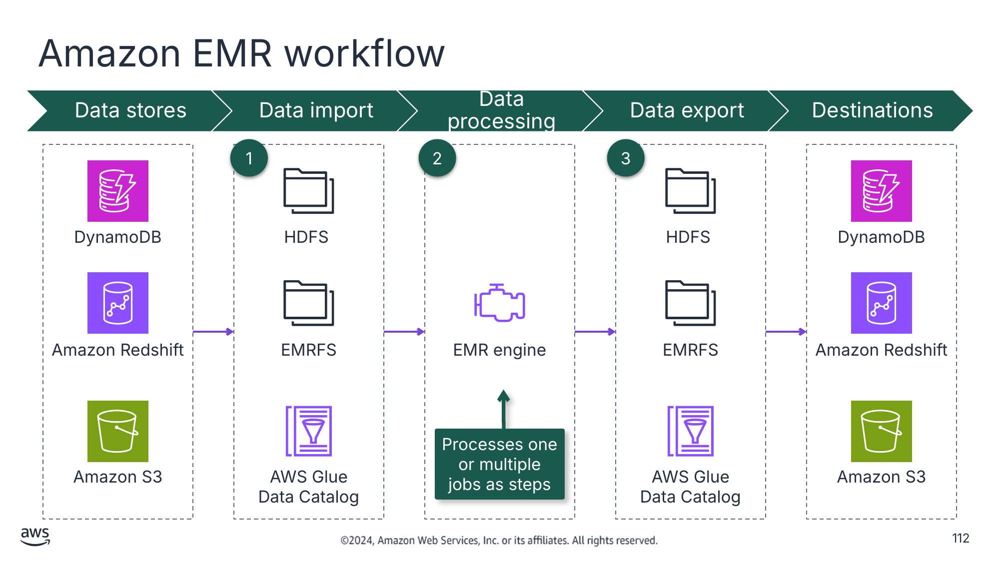

<details>
<summary>Текст зі схеми</summary>

1

2

3

DynamoDB

HDFS

HDFS

DynamoDB

Amazon Redshift

EMRFS

EMR engine (Рушій EMR)

EMRFS

Amazon Redshift

Processes one or multiple jobs as steps (Обробляє одне чи кілька завдань як кроки)

Amazon S3

AWS Glue  
Data Catalog

AWS Glue  
Data Catalog

Amazon S3

</details>

> **Нотатки:**
>
> |Номер слайда 112  
> |Нотатки для інструктора  
> |  
> |Нотатки для студента  
> Щоб Amazon EMR міг обробляти дані, дані потрібно скопіювати із сховищ даних до сховища даних кластера EMR. Деякі сервіси AWS, як-от DynamoDB, Amazon Redshift та Amazon S3, надають прямі інтеграції з Amazon EMR.  
>
> Робочий процес Amazon EMR складається з таких трьох пронумерованих кроків: сховище Amazon EMR, обробка даних і експорт даних.  
>
> Робочий процес Amazon EMR включає такі три основні кроки:  
> Імпорт даних: щоб Amazon EMR міг обробляти дані, дані потрібно скопіювати до сховища даних кластера EMR. Два типи сховищ, що зазвичай використовуються, — HDFS, розроблений Apache, і файлова система EMR (EMR File System, EMRFS), розроблена AWS. Каталог даних використовується з HDFS та EMRFS для полегшення читання неструктурованих даних. AWS рекомендує використовувати Data Catalog, оскільки він зберігається ззовні кластера EMR. EMRFS — це реалізація HDFS, яку використовують усі кластери EMR для читання й запису звичайних файлів з Amazon EMR безпосередньо в Amazon S3. EMRFS забезпечує зручність зберігання постійних даних в Amazon S3 для використання з Hadoop, водночас надаючи такі функції, як шифрування даних.  
> Обробка даних: щоб надіслати завдання обробки (або робоче навантаження), до кластера EMR додається крок обробки. Крок обробки включає специфікацію фреймворка (Hadoop MapReduce чи Apache Spark) і скрипт коду, написаний на Python, Scala чи PySpark. Крок можна додати під час створення кластера EMR або після створення на довготривалому кластері. Кроки також можуть додаватися застосунками робочих процесів, як-от AWS Step Functions, для побудови автоматизованого конвеєра обробки даних. Рушій Amazon EMR виконує крок і повідомляє тривалість завдання та метрики успіху чи невдачі.  
> Експорт даних: після завершення обробки результуючий набір даних зберігається або в довготривалому кластері EMR, або експортується до призначення AWS. Поширені призначення — бакети S3, що використовуються для зберігання озера даних, і Amazon Redshift як сховище даних.
