## Слайд 1: Planning for Disaster

AWS Academy Cloud Architecting

> **Нотатки:**
>
> |Instructor notes  
> |  
> |Student notes  
> Welcome to the Planning for Disaster module. This module introduces considerations and strategies for disaster recovery (DR) planning.

---

## Слайд 2: Introduction

Planning for Disaster

> **Нотатки:**
>
> |Instructor notes  
> |  
> |Student notes  
> This introduction section describes the content of this module.

---

## Слайд 3: Module objectives

This module prepares you to do the following:

- Identify strategies for disaster planning, including recovery point objective (RPO) and recovery time objective (RTO) based on business requirements.
- Identify disaster planning for Amazon Web Services (AWS) service categories.
- Describe common patterns for backup and disaster recovery (DR) and how to implement them.
- Use the AWS Well-Architected Framework principles when designing a disaster recovery plan.

> **Нотатки:**
>
> |Slide number 3  
> |Instructor notes  
> |  
> |Student notes

---

## Слайд 4: Module overview

**Presentation sections**

- Disaster planning strategies
- AWS disaster recovery planning
- Disaster recovery patterns
- Applying AWS Well-Architected Framework principles to disaster planning

**Knowledge checks**

- 10-question knowledge check
- Sample exam question

> **Нотатки:**
>
> |Slide number 4  
> |Instructor notes  
> |Each module in the course has an introduction, content sections, and a wrap-up. The wrap-up for this module contains a sample exam question for you to review with the students.  
> |  
> |Student notes  
> The objectives of this module are presented across multiple sections.  
>
> The module wraps up with a 10-question knowledge check delivered in the online course and a sample exam question to discuss in class. The lab in this module is described on the next slide.

---

## Слайд 5: Hands-on labs in this module

Guided lab

- Configuring Hybrid Storage and Migrating Data with AWS Storage Gateway S3 File Gateway

> **Нотатки:**
>
> |Slide number 5  
> |Instructor notes  
> |This module includes a guided lab. This lab provides step-by-step instructions and is a stand-alone lab. It does not depend on the café scenario or related architecture. An introduction to the lab is included in the lab section of this module.  
> |  
> |Student notes  
> This module includes the guided lab listed. Additional information about this lab is included in the student guide where the lab takes place, and detailed instructions are provided in the lab environment.

---

## Слайд 6: As a cloud architect planning for disasters:

- I need to design architectures that mitigate the risk of disaster, and also support timely recovery from disasters when they occur, so that I can help to minimize the impact of disasters on the business.
- I need to consider the organization's business needs so I can apply disaster recovery patterns that balance cost, data loss, and recovery time.

> **Нотатки:**
>
> |Slide number 6  
> |Instructor notes  
> |This slide presents key overarching design considerations that should guide decision making for this layer of a cloud architecture. Emphasize how a cloud architect must always start with the business case and work backward to choose the best components for that use case. Also, remind students that design decisions will probably evolve over time to optimize cost and performance as needs change or are better understood. At the end of the module, there is an optional discussion included in the wrap-up section to prompt the students to consider these factors in the context of the café scenario.  
> |  
> |Student notes  
> This slide asks you to take the perspective of a cloud architect as you think about how to approach planning disasters. As you progress through this module, remember that the cloud architect should work backward from the business need to design the best architecture for a specific use case. Consider the café scenario presented in the course as an example business need. Think about how you would address this need for the fictional café business.  
>
> The starting point when designing for outages and disaster recovery is to understand the customer's perspective. Which aspects of their business do they consider critical, nominally important, or nonessential. Based on this context, an architect can apply the concepts explained in this module. These concepts apply regardless of whether the environment is in the process of migration, fully cloud-based, or in a hybrid configuration.

---

## Слайд 7: Disaster planning strategies

Planning for Disaster

> **Нотатки:**
>
> |Slide number 7  
> |Instructor notes  
> |  
> |Student notes  
> This section provides an overview of disaster planning strategies. It also discuses how to evaluate your system to establish a recovery point objective (RPO) and recovery time objective (RTO) to produce a business continuity plan.

---

## Слайд 8: Failures can occur at any scale

Small-scale events

Large-scale events

Global events

A server stops responding.

Multiple resources across an Availability Zone are unavailable.

Failure is widespread and impacts a large number of users and systems.

> **Нотатки:**
>
> |Slide number 8  
> |Instructor notes  
> |Failures can be categorized multiple ways. Categorizing failure based on the disaster event is depicted on the slide. The student notes prompt thinking about the impact of these events on the business.  
> |  
> |Student notes  
> Vice President (VP) and Chief Technology Officer (CTO) at Amazon, Werner Vogels, has famously stated on more than one occasion that, "Everything fails, all the time." His pronouncement has continued to influence cloud computing architectural design for many years because it speaks to a truism.  
>
> Failure should not be thought of as an unlikely aberration. Instead, it should be assumed that failures, both large and small, can—and will—occur. How do you prepare for these events?  
>
> A failure can be categorized as one of the following three types:  
> A small-scale event – For example, a single server stops responding or goes offline.  
> A large-scale event – Here, multiple resources are affected, perhaps even across Availability Zones within an AWS Region.  
> A global scale event – Here, the failure is widespread, and it affects a large number of users and systems.  
>
> Consider the size of the failure along with the impact it has. For example, if the single server that goes offline is the main or only server hosting customer records, it cannot be categorized as a small-scale event. Likewise, consider an array of servers that serve as read-only replicas for data accessed once a day. If this array ceases to function, it does not meet the essential criteria for a large-scale event.  
>
> To minimize the impact of a disaster, organizations must invest time and resources to plan and prepare, train employees, and document and update processes. The amount of investment for disaster planning for a particular system can vary dramatically, depending on the cost of a potential outage.

---

## Слайд 9: Avoiding and planning for disaster

Fault tolerance

Backup

Disaster recovery

Minimize how often your applications and data become unavailable.

Make sure you have a backup plan for handling data in case of a disaster.

Recover your data and get your applications back online after a disaster.

> **Нотатки:**
>
> |Slide number 9  
> |Instructor notes  
> |Fault tolerant systems can withstand failure of individual or multiple components, but the system continues to function without interruption (albeit typically at a lesser capacity) despite the failure. Highly available systems, however, can quickly recover or come back online (preferably without intervention needed) after individual or multiple components fail. Although the two concepts are similar, they are not the same. They should not be interchanged with each other.  
> |  
> |Student notes  
> Disasters are events that can lead to failures on a small, large, or global scale. Architects should design architectures to avoid disasters and, at the same time, implement plans to recover from them when they occur. Architects do this in three primary ways as follows:  
> Fault tolerance provides redundancy when it can withstand failure of an individual or multiple components (for example, hard disks, servers, or network connectivity). Production systems typically have defined uptime requirements.  
> Backup is critical to protecting data and ensuring business continuity. However, it can be a challenge to implement. The pace at which data is generated is growing exponentially. Meanwhile, the density and durability of local disks are not experiencing the same growth rate. Even so, it is essential to keep your critical data backed up in case of a disaster.  
> Disaster recovery is about preparing for and recovering from a disaster. A disaster is any event that has a negative impact on a company’s business continuity or finances. Such events include hardware or software failure, a network outage, a power outage, or physical damage to a building (like fire or flooding). The cause can be human error or some other significant event. Disaster recovery is a set of policies and procedures used for the recovery of vital technology infrastructure and systems after any disaster.

---

## Слайд 10: Factors that influence disaster planning strategies

Time dependency

Data loss

Geographic location

Cost

How quickly does this need to be remedied to avoid business impact?

What is the amount of data you are OK with losing?

What is the type of data you are OK with losing?

Does this impact multiple AWS Regions?

Do different Regions require different measurements of how quickly the must recover and how much data loss is OK?

Does the cost represent the correct level considering business impact and risk?

> **Нотатки:**
>
> |Slide number 10  
> |Instructor notes  
> |The following examples can help explain each influencing factor to students:  
> |Time dependency: The speed at which a disaster needs to be remedied when impacting a 9–5 business compared to a 24/7 business is different.  
> |Data loss: Losing tax records from 10 years ago compared to losing certified birth records changes disaster planning strategies.  
> |Geographic location: Whether a business operates on a national or global level impacts the type of disaster planning the organization considers.  
> |Cost: Consider how much it costs for earthquake-proof planning based on the risk factors related to whether such a disaster poses a threat to the business.  
> |  
> |Student notes  
> Designing your disaster recovery strategies is dependent on the business's evaluation of which level of failure the business can tolerate. Four key factors the business needs to consider are as follows:  
> How quickly the business needs to recover  
> How much data loss the business can tolerate  
> Whether there are different needs for different locations  
> How to balance the cost of being prepared with the risk factors posed to the business  
>
> The customer works with the cloud architect to define what the data is and how much data loss (if any) is acceptable in a disaster recovery scenario. For example, would there be catastrophic consequences if customer records from 10 years ago were not recoverable? If the records relate to customers who account for only a small amount of present-day revenue, losing them would probably be tolerable. However, if the records relate to customers who represent a significant amount of ongoing revenue, losing them would not be acceptable.  
>
> Even though it takes time to develop and implement a full disaster recovery plan, this should not stop you from taking the first steps. Start with basics and work your way up. For example, as a first step, create backups of data storage, databases, and critical servers. Then, work to set measures for each of the four factors discussed here and incrementally improve the business’s ability to limit the impact of disasters.

---

## Слайд 11: Determining RPO

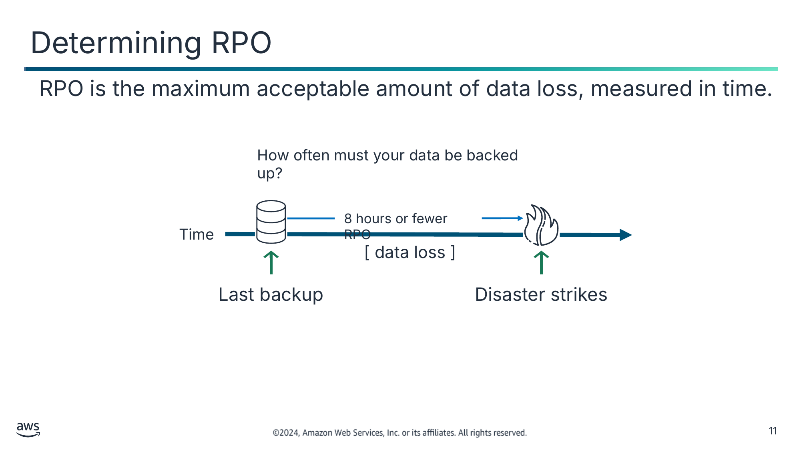

RPO is the maximum acceptable amount of data loss, measured in time.

Текст зі схеми

How often must your data be backed up?

8 hours or fewer RPO

Time

[ data loss ]

Last backup

Disaster strikes

> **Нотатки:**
>
> |Slide number 11  
> |Instructor notes  
> |  
> |Student notes  
> Image description: Timeline depicting that a disaster occurs 8 hours after the last backup. The data loss in this example is anything generated between the last backup and the time of the disaster 8 hours later. This represents an RPO of 8 hours. End description.  
>
> The Recovery point objective (RPO) is the maximum acceptable amount of data loss after an unplanned data-loss incident. It is expressed as an amount of time.

---

## Слайд 12: Example: Determining RPO

Determine that a loss of a maximum of 800 records is acceptable for your application.

Use existing patterns to determine that no more than 100 records are created an hour.

Calculate that an RPO of 8 hours (8*100 records) is acceptable.

Based on this information, if a disaster occurred at 10 p.m., the system should be able to recover all data that was in the system before 2 p.m.

> **Нотатки:**
>
> |Slide number 12  
> |Instructor notes  
> |This example is related to a genealogy company that is digitizing old records of local courthouses. There are millions of records in queue to be digitized. The business determined that a loss of a maximum of 800 records, for which they have the source files, is acceptable.  
> |  
> |Student notes  
> Here is a more detailed overview of calculating the RPO. Suppose you determine that the data your application generates is important but not critical, so losing 800 records would be acceptable. You further calculate that even during peak times, no more than 100 records are created in an hour.  
>
> In this scenario, you decide that an RPO of 8 hours is sufficient to meet your needs. If you implement a disaster recovery plan that meets this RPO, you will do data backups at least every 8 hours. Then, if a disaster occurs at 10 p.m., the system should be able to recover all data that was in the system before 2 p.m.

---

## Слайд 13: Determining RTO

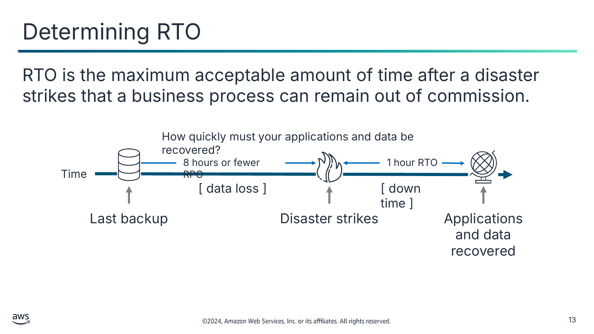

RTO is the maximum acceptable amount of time after a disaster strikes that a business process can remain out of commission.

Текст зі схеми

How quickly must your applications and data be recovered?

8 hours or fewer RPO

Time

[ data loss ]

Last backup

Disaster strikes

1 hour RTO

[ down time ]

Applications and data recovered

> **Нотатки:**
>
> |Slide number 13  
> |Instructor notes  
> |  
> |Student notes  
> Image description: Timeline depicting that a disaster occurs 8 hours or fewer from the last backup. Timeline also shows it will take 1 hour after a disruption to recover the data from the last backup. This sets the RTO in this situation at 1 hour. End description.  
>
> Another important measure of a disaster recovery plan is to define the recovery time objective (RTO). RTO is the time that it takes after a disruption to restore your applications and recover your data. Suppose the disaster occurs at 10 p.m., and the RTO is 1 hour. In this scenario, the DR process should restore the business process to the acceptable service level by 11 p.m.  
>
> A company typically decides on acceptable RPO and RTO, and it bases its decision on the financial impact to the business when systems are unavailable. The company determines financial impact by considering many factors. These factors include loss of business and damage to its reputation because of downtime and the lack of systems availability.  
>
> IT organizations then plan solutions to provide cost-effective system recovery. The solutions are based on the RPO in the timeline and the service level that the RTO establishes.

---

## Слайд 14: Example: Determining RTO

Determine that a ticketing service for a local music venue can be restored within 2 hours.

The business calculates that after 2 hours of an outage, it will begin to lose revenue from lost sales.

Calculate that an RTO of 2 hours is acceptable.

Based on this information, if a disaster occurred at 9 p.m., the system should be returned to service before 11 p.m.

> **Нотатки:**
>
> |Slide number 14  
> |Instructor notes  
> |This example is related to a ticketing business. Tickets go on sale at a certain time, and customers are used to this pattern. The company wants to the minimize reputational risk in the event of an outage. In this example of ticketing for a local music venue, 2 hours is the determined acceptable recovery time objective (RTO).  
> |  
> |Student notes  
> Here is a more detailed look at calculating the RTO. In this example, a disaster occurs at 9 p.m. It was determined that it will take 2 hours after a disruption to recover the data from the last backup. In this scenario, the DR process should restore the business process to the acceptable service level by 11 p.m.

---

## Слайд 15: Preparing a BCP

A business continuity plan (BCP) is a system of prevention and recovery from potential threats to a company.

A BCP consists of the following:

- Business impact analysis
- Risk assessment
- Disaster recovery plan
- Evaluated and determined RPO and RTO

> **Нотатки:**
>
> |Slide number 15  
> |Instructor notes  
> |You can reference the blog post “The Importance of IT Business Continuity Planning for Small and Medium Businesses” for this topic. It provides an explanation of conducting a business impact analysis, defining key recovery elements of disaster recovery (DR) plans, and implementing plans based on impact analysis. The bulleted lists and guiding questions will help students contextualize what a business continuity plan (BCP) consists of for small and medium businesses. The link to the blog post is in the course resource document.  
> |  
> |Student notes  
> Your disaster recovery plan should be a subset of your organization’s business continuity plan (BCP). Maintaining aggressive disaster recovery targets is pointless if a workload’s objectives cannot be achieved due to the disaster impact on business elements external to your workload. For example, an earthquake might prevent you from transporting products purchased on your ecommerce application. Even if effective DR keeps your workload functioning, your BCP needs to accommodate transportation needs. Your DR strategy should be based on business requirements, priorities, and context.  
>
> Organizations of all sizes, large and small, often have a BCP. A typical part of the BCP is to provide for IT service continuity, including IT disaster recovery planning.  
>
> One of the most important measures of a disaster recovery plan is to define your RPO. To calculate RPO, first determine how much data loss is acceptable according to your BCP. Then, figure out how quickly that data loss might occur as a time measurement.  
>
> It is also important to note that the BCP is a living document. The BCP should be constantly evaluated and adjusted based on the needs of the business and the resources required to meet deadlines.

---

## Слайд 16: Key takeaways: Disaster planning strategies

- Failures can occur at any time and on a small, large, or global scale.
- A disaster recovery plan will help limit business and customer impact when a disaster occurs.
- RPO is the maximum acceptable amount of data loss after an unplanned data-loss incident.
- RTO is the amount of time an application, system, and process can be down without causing significant damage to the business.
- A BCP is a system of prevention and recovery from potential threats to a company that includes RPO and RTO.

> **Нотатки:**
>
> |Slide number 16  
> |Instructor notes  
> |  
> |Student notes

---

## Слайд 17: AWS disaster recovery planning

Planning for Disaster

> **Нотатки:**
>
> |Slide number 17  
> |Instructor notes  
> |  
> |Student notes  
> This section provides an overview of disaster recovery planning for Amazon Web Services (AWS) service categories.

---

## Слайд 18: DR plans span more than one Region

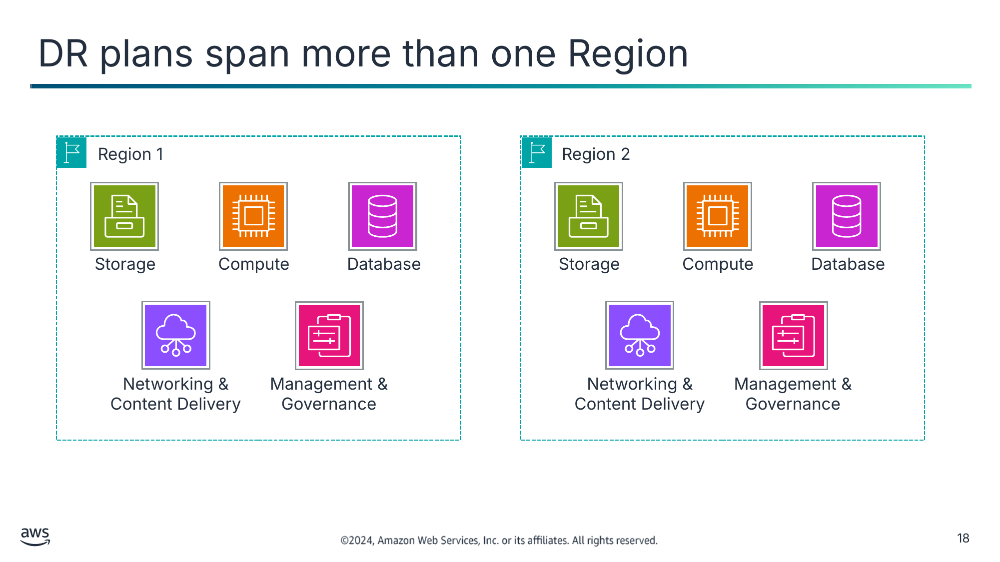

Текст зі схеми

Region 1

Storage

Compute

Database

Networking &  
Content Delivery

Management & Governance

Region 2

Storage

Compute

Database

Networking &  
Content Delivery

Management & Governance

> **Нотатки:**
>
> |Slide number 18  
> |Instructor notes  
> |The slides in this section cover storage, compute, networking, database, and deployment orchestration services.  
> |  
> |The blog post “Creating a Multi-Region Application with AWS Services – Part 1, Compute, Networking, and Security” provides an example of services across two AWS Regions. Security, identity, and compliance services are the first considerations when building a multi-Region application. Next, virtual private cloud (VPC) connectivity and content delivery are added. Finally, Amazon Machine Image (AMI) and Amazon Elastic Block Store (Amazon EBS) snapshot copy across Regions. The blog post explains how to bring these services together to build a multi-Region application. For more information, see the blog post link in resource document.  
> |  
> |Student notes  
> Image description: A layout of the five service categories within two Regions. The image depicts how the disaster recovery aspects are shared across two Regions to ensure that data is available regardless of localized disasters in one Region.  
> End description.  
>
> To properly scope your disaster recovery planning, you must think about your use of AWS holistically. Most organizations use a combination of services that can be broadly categorized as encompassing the following five service categories:  
> Storage, such as Amazon Simple Storage Service (Amazon S3)  
> Compute, such as Amazon Elastic Compute Cloud (Amazon EC2)  
> Database, such as Amazon Relational Database Service (Amazon RDS)  
> Networking & Content Delivery, such as Amazon Virtual Private Cloud (Amazon VPC)  
> Deployment orchestration services within Management & Governance, such as AWS CloudFormation  
>
> If a disaster occurs, your RPO and RTO will guide your backup and restore plans and procedures across each of these service areas. They will also probably affect your production deployment architecture.  
>
> It is important to remember that although it’s unlikely for a Region to be unavailable, it is in the realm of possibility. If some large-scale event affects a Region—for instance, a meteor strike—would your data still be available? Would your applications still be accessible? AWS provides multiple Regions around the world. Thus, you can choose the most appropriate location for your disaster recovery site in addition to the site where your system is fully deployed.

---

## Слайд 19: Storage and backup building blocks

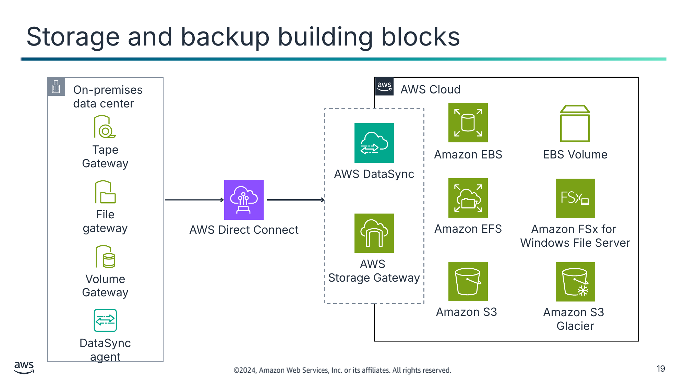

Текст зі схеми

On-premises data center

AWS Cloud

Tape

Gateway

Amazon EBS

EBS Volume

AWS DataSync

File

gateway

AWS Direct Connect

Amazon EFS

Amazon FSx for  
Windows File Server

AWS  
Storage Gateway

Volume

Gateway

Amazon S3

Amazon S3  
Glacier

DataSync

agent

> **Нотатки:**
>
> |Slide number 19  
> |Instructor notes  
> |The slide is related to storage services and DR plans spanning more than one Region.  
> |  
> |Student notes  
> Image description: AWS Cloud architecture services for data storage and the corporate data center services that transfer data to the cloud. End description.  
>
> The diagram depicts the following data storage in the cloud services:  
> Amazon Elastic Block Store (Amazon EBS)  
> Amazon Elastic File System (Amazon EFS)  
> Amazon S3  
> Amazon Simple Storage Service Glacier (Amazon S3 Glacier)  
>
> To start your disaster planning in detail, review the data storage layer (postponing the discussion of the database layer for the moment). Your AWS Cloud storage can consist of a combination of block storage, file system storage, and object storage. Meanwhile, your organization might also use AWS services that connect the on-premises data center to the AWS Cloud. In the next few slides, you will learn about high-level best practices for each of these three areas.  
>
> One service that you might be less familiar with is AWS DataSync. DataSync provides movement of large amounts of data online between on-premises storage and Amazon S3, Amazon EFS, or Amazon FSx. It supports scripted copy jobs and scheduled data transfers from on-premises Network File System (NFS) and Server Message Block (SMB) storage. It can also optionally use AWS Direct Connect links.

---

## Слайд 20: Configuring Cross-Region Replication

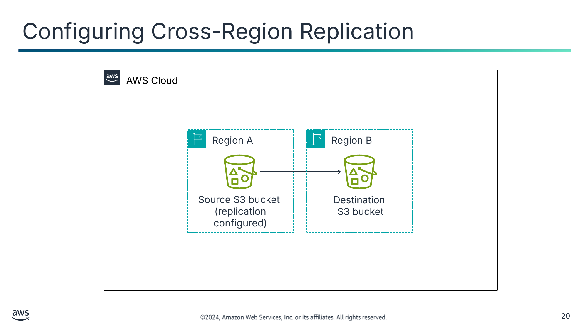

Текст зі схеми

AWS Cloud

Region A

Region B

Source S3 bucket

(replication configured)

Destination

S3 bucket

> **Нотатки:**
>
> |Slide number 20  
> |Instructor notes  
> |This slide is related to storage services and DR plans spanning more than one Region. A one-way replication from Region A to Region B is depicted on the slide.  
> |  
> |Remind students that replication is not the same as a substitution for backups. For example, replicas offer no protection in the event of data corruption, especially of the source.  
> |  
> |Student notes  
> Image description: A diagram of AWS Cloud services. The image depicts services gathering data from an existing replicated source S3 bucket in Region A, and then sending it to a destination S3 bucket in Region B. End description.  
>
> For many organizations, the bulk of their data that is stored on AWS is in Amazon S3, which provides object storage.  
>
> Recall that S3 buckets exist in a specific Region. You choose the Region when you create the bucket. Amazon S3 provides 11 nines (99.999999999 percent) of durability for the following storage classes:  
> S3 Standard  
> S3 Standard-Infrequent Access (S3 Standard-IA)  
> S3 One Zone-Infrequent Access (S3 One Zone-IA)  
> Amazon Simple Storage Service (Amazon S3 Glacier)  
>
> S3 Standard, S3 Standard-IA, and Amazon S3 Glacier are all designed to sustain data if an entire Amazon S3 Availability Zone loss occurs. They provide this stability by automatically storing your objects across a minimum of three Availability Zones, each separated miles apart across a single Region.  
>
> For critical applications and data scenarios where you want a higher level of data security, it is a best practice to configure S3 Cross-Region Replication (CRR). To do this, you add a replication configuration to your source bucket. The minimum configuration must indicate the destination bucket where you want Amazon S3 to replicate all objects or a subset of all objects. It must also include an AWS Identity and Access Management (IAM) role that grants Amazon S3 permissions to copy the objects to the destination bucket.  
>
> Copied objects retain their metadata. The destination bucket can belong to another storage class. For example, the contents of an S3 Standard bucket might be replicated to an Amazon S3 Glacier bucket if it is not needed immediately. You can assign different ownership to the objects in the destination bucket. You can also use S3 Replication Time Control (S3 RTC) to replicate your data across different Regions in a predictable time frame. S3 RTC replicates 4 nines (99.99 percent) of new objects stored in Amazon S3 within 15 minutes, backed by a service-level agreement (SLA).

---

## Слайд 21: EBS volume snapshots

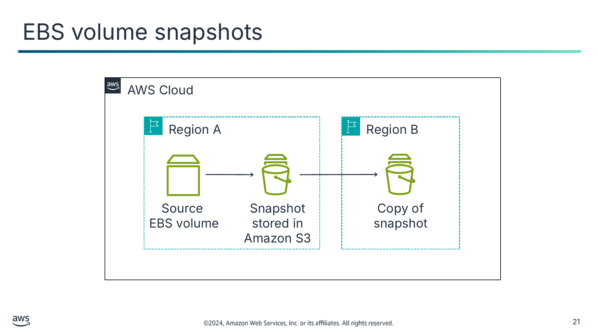

Текст зі схеми

AWS Cloud

Region A

Region B

Source

EBS volume

Snapshot stored in Amazon S3

Copy of snapshot

> **Нотатки:**
>
> |Slide number 21  
> |Instructor notes  
> |The slide is related to storage services and DR plans spanning more than one Region.  
> |  
> |AWS provides different snapshot technologies to help customers meet their data protection and recovery needs. Amazon Relational Database Service (Amazon RDS) makes it possible to create automated or manual database snapshots of your database instances. Amazon FSx for NetApp ONTAP provides fully managed file storage with NetApp snapshot capabilities. These snapshot technologies provide for incremental backups of block storage volumes, databases, and in-memory caches in AWS. This slide focuses on Amazon EBS, which you can use to take point-in-time snapshots of Amazon EBS volumes and recreate volumes from those snapshots.  
> |  
> |Student notes  
> Image description: A diagram of AWS Cloud services. The image depicts services gathering data from a source EBS volume in Region A that contains incremental backups on an Amazon S3 snapshot. Amazon S3 sends a copy of the snapshot to the destination S3 bucket in Region B. End description.  
>
> Regarding block storage, you can back up the data that is on EBS volumes to Amazon S3 by taking point-in-time snapshots. Snapshots are incremental backups, which means they save only the blocks on the device that have changed since your most recent snapshot. This architecture minimizes the time required to create the snapshot, and it saves on storage costs by not duplicating data.  
>
> Each snapshot contains all the information needed to restore your data (from the moment when the snapshot was taken) to a new EBS volume. When you create an EBS volume that is based on a snapshot, the new volume begins as an exact replica of the original volume. This original volume is used to create the snapshot. The replicated volume loads data in the background so you can use it immediately. If you access data that has not been loaded yet, the volume immediately downloads the requested data from Amazon S3. Then, it continues to load the rest of the volume's data in the background.  
>
> Amazon EBS volumes provide off-instance storage that persists independently from the life of an instance and is replicated across multiple servers in an Availability Zone. Volumes prevent the loss of data from the failure of any single component. After you create a snapshot, it finishes copying to Amazon S3 (when the snapshot status is completed). Then, you can copy it from one Region to another or within the same Region.  
>
> You can use Amazon Data Lifecycle Manager to automate the creation, retention, and deletion of snapshots that back up your EBS volumes. Automating snapshot management helps you do the following:  
> Protect valuable data by enforcing a regular backup schedule.  
> Retain backups as required by auditors or internal compliance.  
> Reduce storage costs by deleting outdated backups  
>
> You cannot create snapshots of EC2 instance store volumes. However, if you must back up data from an instance store, you can create a new EBS volume and format it. Then, mount the new volume to the EC2 instance guest operating system (OS) and copy the data on your instance store volume to the EBS volume. Recall that instance store volumes provide temporary block-level storage that works well for information that changes frequently, such as buffers, caches, and scratch data. You might find that you must back up data from an instance store. If so, you might want to rethink why you are storing that data on an instance store volume in the first place.

---

## Слайд 22: File system replication

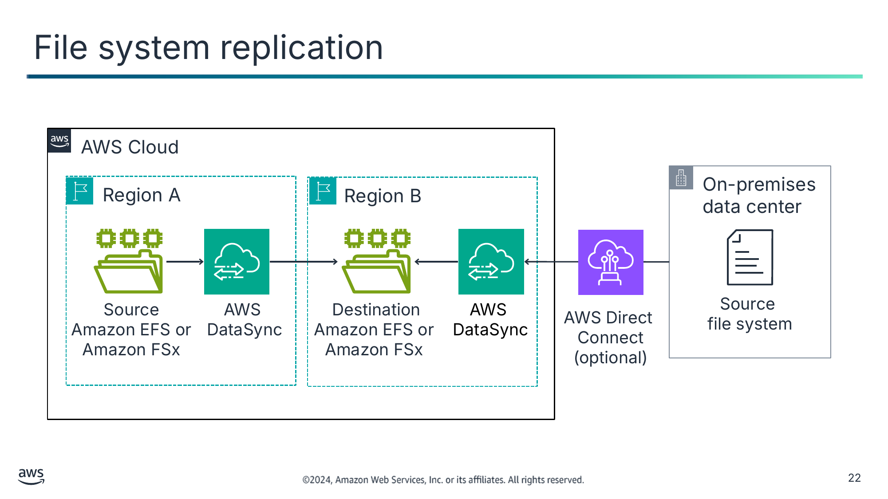

Текст зі схеми

AWS Cloud

On-premises  
data center

Region A

Region B

Source

Amazon EFS or  
Amazon FSx

AWS  
DataSync

Destination Amazon EFS or  
Amazon FSx

AWS  
DataSync

Source

file system

AWS Direct  
Connect (optional)

> **Нотатки:**
>
> |Slide number 22  
> |Instructor notes  
> |This is the final slide related to storage services and DR plans spanning more than one Region.  
> |  
> |Student notes  
> Image description: A diagram of AWS Cloud services. The image depicts services gathering data from a source file system in Region A through DataSync. The services then sends it to a destination Amazon FSx or EFS file system in Region B. The diagram also depicts an option to use AWS Direct Connect to pull data from an additional source file system. End description.  
>
> Businesses need access to their files. Replicating your file storage is a best practice that ensures that you continue to have access to your files.  
>
> DataSync makes data move faster between two Amazon EFS or Amazon FSx for Windows File Server file systems or between on-premises storage and AWS file storage. You can use DataSync to transfer datasets over AWS Direct Connect or the internet. Use the service for one-time data migrations or ongoing workflows for data protection and recovery.  
>
> FSx for Windows File Server takes daily automatic backups of your file systems, and you can use it to take more backups at any point. Amazon FSx stores the backups in Amazon S3. By default, daily backups are created automatically during your file system's 30-minute backup window. The daily backup retention period that is specified for your file system determines the number of days that your daily automatic backups are kept. (This number is 7 days by default.)  
>
> Like most Amazon S3 storage classes replicate data across Availability Zones, so do Amazon EFS and FSx for Windows File Server file systems. Your disaster recovery requirements might specify that you need a multi-Region recovery solution. If so, it is a best practice to replicate your Amazon EFS and FSx for Windows File Server file systems to a second Region. You can use DataSync to get this replication. To make file transfer between two EFS file systems more convenient by using DataSync, you can use the AWS DataSync In-Cloud QuickStart and Scheduler.  
>
> You can learn about how to use AWS Backup to manage EBS volume backups and to automate backups of EFS file systems. For more information, see “Scheduling Automated Backups Using Amazon EFS and AWS Backup” in the AWS Storage Blog.

---

## Слайд 23: Recovering compute infrastructure

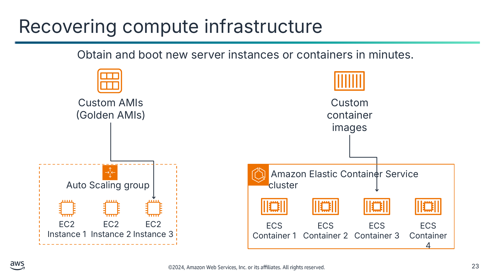

Obtain and boot new server instances or containers in minutes.

Текст зі схеми

Custom AMIs (Golden AMIs)

Custom container images

Auto Scaling group

 Amazon Elastic Container Service cluster

EC2 Instance 1

EC2 Instance 2

EC2 Instance 3

ECS Container 1

ECS Container 2

ECS Container 3

ECS Container 4

> **Нотатки:**
>
> |Slide number 23  
> |Instructor notes  
> |The slide is related to compute services and DR plans spanning more than one Region.  
> |  
> |Student notes  
> You can arrange for automatic recovery of an EC2 instance when a system status check of the underlying hardware fails. The instance is rebooted (on new hardware, if necessary)—but it retains its instance ID, IP addresses, EBS volume attachments, and other configuration details. For a complete recovery, make sure that the instance is configured to automatically start up any services or applications as part of its initialization process.  
>
> Amazon Machine Images (AMIs) are preconfigured with operating systems, and some preconfigured AMIs might also include application stacks. You can also configure your own custom AMIs. In the context of disaster recovery, AWS recommends that you configure and identify your own AMIs so they launch as part of your recovery procedure. Such AMIs should be preconfigured with your operating system of choice in addition to the appropriate pieces of the application stack. A golden AMI refers to an AMI that is preconfigured with all necessary applications and services to perform its designated function.  
>
> You could use a golden AMI with the most updated code, but that requires a new AMI on every code push and complicates DevOps. As system configurations don’t change as often as the codebase, it is often easier to create the AMI and use a user data script to pull the latest code and configuration from the code repository when you deploy.

---

## Слайд 24: Harnessing EventBridge for regional failover

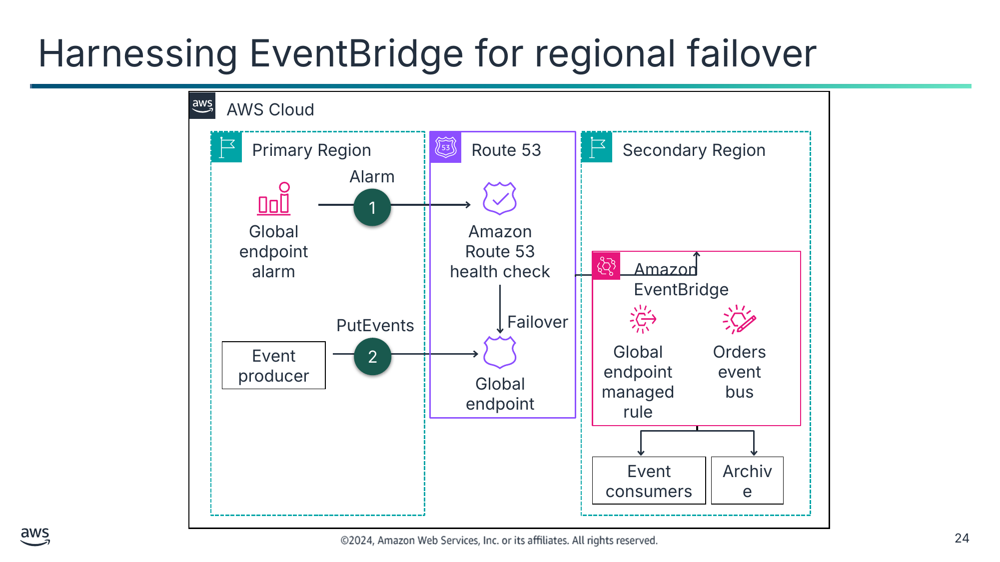

AWS Cloud

Текст зі схеми

Primary Region

Route 53

Secondary Region

Alarm

1

Global endpoint alarm

Amazon Route 53 health check

Amazon EventBridge

PutEvents

Failover

Event producer

2

Global endpoint managed rule

Orders event bus

Global endpoint

Event consumers

Archive

> **Нотатки:**
>
> |Slide number 24  
> |Instructor notes  
> |The slide is related to networking and content delivery services and DR plans spanning more than one Region.  
> |The AWS blog “Introducing global endpoints for Amazon EventBridge” illustrate how global endpoints reroute events being delivered from the event bus in the primary Region to the event bus in the secondary Region when CloudWatch alarms trigger the failover of the Route 53 health check. A link is provided in the content resources section of your online course.  
> |  
> |Student notes  
> Image description: The diagram shows how global endpoints reroute events from the primary event bus to the secondary event bus. This rerouting occurs when CloudWatch alarms invoke Route 53 health check failover. End description.  
>
> This event flow can be interrupted if there is a service disruption. In this scenario, event producers in the primary Region cannot PutEvents to their event bus, and event replication to the secondary Region is impacted.  
>
> To put more resiliency around multi-Region architectures, you can now use global endpoints. Global endpoints solve these issues by introducing two core service capabilities as follows:  
> A global endpoint is a managed Route 53 DNS endpoint. It routes events to the event buses in either Region, depending on the health of the service in the primary Region.  
> There is an Amazon EventBridge metric called IngestionToInvocationStartLatency. This metric measures the time to invoke the first target after an event is ingested.exposes the time to process events from the point at which they are ingested by EventBridge to the point the first invocation of a target in your rules is made. This is a service-level metric measured across all your rules and provides an indication of the health of the EventBridge service. Any extended periods of high latency over 30 seconds might indicate a service disruption.

---

## Слайд 25: Designing for resiliency and recovery

Route 53

ELB

Amazon VPN

AWS Direct Connect

- Provides DNS-based load balancing
- Provides basic failover between endpoints or S3 websites

- Provides traffic distribution
- Makes disaster recovery implementation straightforward

Provides secure access to your on-premises network resources from your Amazon VPC through a VPN connection

Provides the dedicated network connection for fast, consistent data transfer between on-premises and AWS

> **Нотатки:**
>
> |Slide number 25  
> |Instructor notes  
> |The slide is related to networking and content delivery services and DR plans spanning more than one Region.  
> |  
> |Student notes  
> When you work to recover from a disaster, you will probably need to modify network settings to fail your system over to another site. AWS offers several services and features you can use to manage and modify network settings, a few of which are highlighted next.  
>
> Route 53 provides load balancing and network routing capabilities that you can use to distribute network traffic. It also provides the ability to fail over between multiple endpoints and even to a static website that is hosted in Amazon S3.  
>
> The Elastic Load Balancing (ELB) service automatically distributes incoming application traffic across multiple EC2 instances. You can use it to achieve fault tolerance in your applications by providing the load balancing capacity that is needed in response to incoming application traffic. You can pre-allocate a load balancer so that its DNS name is already known, which can make implementation of your DR plan more straightforward.  
>
> You can use Amazon VPN to extend an existing on-premises network topology to the cloud. This extension can be especially appropriate when you recover enterprise applications that might be hosted on an internal network.  
>
> Finally, AWS Direct Connect makes the set up of a dedicated network connection from an on-premises data center to AWS more efficient. Using AWS Direct Connect can reduce network costs, increase bandwidth throughput, and provide a more consistent network experience than internet-based connections.

---

## Слайд 26: Supporting database recovery

Amazon RDS

DynamoDB

- Save a snapshot in a separate Region.
- Use read replicas and Multi-AZ deployments.
- Retain automated backups.

- Back up entire tables.
- Use point-in-time-recovery to restore tables.
- Create backups.
- Use global tables to build a multi-Region, multi-active database.

> **Нотатки:**
>
> |Slide number 26  
> |Instructor notes  
> |The slide is related to database services and DR plans spanning more than one Region.  
> |  
> |Student notes  
> AWS provides many database services. Some key features of Amazon RDS and Amazon DynamoDB that are relevant to disaster recovery scenarios are explained next.  
>
> Consider using Amazon RDS in the DR preparation phase to store a copy of your critical data in a database that is already running. Then, use Amazon RDS in the DR recovery phase to run your production database.  
>
> If you implement a multi-Region DR plan, Amazon RDS gives you the ability to store snapshot data that was captured from one Region to another Region. You can share a manual snapshot with up to 20 other AWS accounts.  
>
> By combining read replicas with Multi-AZ deployments, you can build a resilient disaster recovery strategy and make your database engine upgrade process more straightforward. By using Amazon RDS read replicas, you can create one or more read-only copies of your database instance. You can create these copies in the same Region or in a different Region. Updates to the source database are then asynchronously copied to your read replicas. Read replicas can be promoted to become a stand-alone database instance when needed.  
>
> Use DynamoDB in the preparation phase to copy data to DynamoDB in another Region or to Amazon S3. During the recovery phase of DR, you can scale up in minutes. DynamoDB global tables replicate your DynamoDB tables automatically across your choice of Regions. DynamoDB global tables make it possible for your applications to stay highly available, even if there is a disaster at the Region level.

---

## Слайд 27: Replicating and redeploying environments

CloudFormation

OpsWorks

- Use templates to quickly deploy collections of resources as needed.
- Duplicate production environments in a new Region or virtual private cloud (VPC) in minutes.

- Manage and deploy applications across fleets.

> **Нотатки:**
>
> |Slide number 27  
> |Instructor notes  
> |The slide is related to deployment orchestration services in Management & Governance services and DR plans spanning more than one Region.  
> |  
> |Student notes  
> When you use automation services, you can quickly replicate or redeploy environments.  
>
> With AWS CloudFormation, you can model and deploy your entire infrastructure in a text file. This template can become the single source of truth for your infrastructure. When you use CloudFormation to manage your entire infrastructure, it also becomes a powerful tool in your disaster recovery planning toolkit. You can use it to duplicate complex production environments in minutes, for example, to a new Region or a new virtual private cloud (VPC).  
>
> CloudFormation provisions your resources in a repeatable manner, which makes it possible for you to build and rebuild your infrastructure and applications. You are not required to perform manual actions or write custom scripts.  
>
> If you use AWS Elastic Beanstalk to host your applications, you can upload an updated application source bundle and deploy it to your Elastic Beanstalk environment. Alternatively, you can redeploy a previously uploaded version of an application. Remember, CloudFormation is only related to the configuration of resources. It does not address data that might be associated with the resources. However, Elastic Beanstalk is for the application, not the data.  
>
> Finally, AWS OpsWorks is an application management service that provides configuration management and automation to deploy and operate applications of all types and sizes. You can define your environment as a series of layers, and configure each layer as a tier of your application. OpsWorks has automatic host replacement, so if you have an instance failure, it is automatically replaced. You can use OpsWorks in the DR preparation phase to template your environment and combine it with CloudFormation in the DR recovery phase.

---

## Слайд 28: Key takeaways: AWS disaster recovery planning

- Use features such as CRR, EBS volume snapshots, and Amazon RDS snapshots to protect data.
- Use networking features, such as Route 53 failover and ELB, to improve application availability.
- Use automation services, such as CloudFormation, as part of your DR strategy to quickly deploy duplicate environments when needed.
- Use EventBridge to use global endpoints to automatically restore data and failover to functioning servers.

> **Нотатки:**
>
> |Slide number 28  
> |Instructor notes  
> |  
> |Student notes

---

## Слайд 29: Disaster recovery patterns

Planning for Disaster

> **Нотатки:**
>
> |Slide number 29  
> |Instructor notes  
> |  
> |Student notes  
> This section provides an overview of disaster recovery patterns.

---

## Слайд 30: Common disaster recovery patterns on AWS

Backup and restore

Pilot light

Warm standby

Multi-site

Each pattern is suited to a different combination of RPO, RTO, and cost-effectiveness.

> **Нотатки:**
>
> |Slide number 30  
> |Instructor notes  
> |These are the four disaster recovery patterns that are covered in this section. Each pattern has an architecture diagram and implementation tips (for the preparation phase and in case of disaster).  
> |  
> |The differences of the patterns are in the recovery point objective (RPO), recovery time objective (RTO), and cost-effectiveness they provide. The selection depends on the business use case.  
> |  
> |Student notes  
> To minimize the impact of a disaster, organizations must invest time and resources to plan and prepare to deal with and recover from disasters. The amount of investment for disaster planning for a particular system can vary.  
>
> Recall that the recovery point objective (RPO) is the maximum acceptable amount of data loss after an unplanned data-loss incident, expressed as an amount of time. Previously, you learned that the recovery time objective (RTO) is the maximum acceptable amount of time after disaster strikes that a business process can remain out of commission. For different combinations of recovery point objective (RPO), recovery time objective (RTO), and cost-effectiveness, organizations often use four common disaster recovery patterns. They are backup and restore, pilot light, warm standby, and multi-site.  
>
> As you will discover in this section, each pattern is well-suited to different requirements. Some of the patterns provide a faster RPO and faster RTO but cost more to maintain.

---

## Слайд 31: Backup and restore pattern

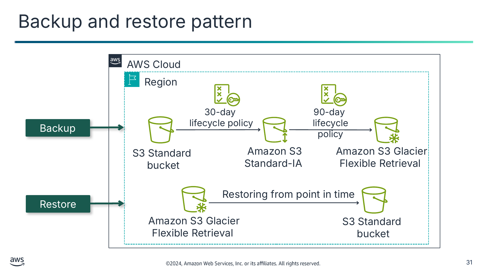

Backup

Restore

Текст зі схеми

AWS Cloud

Region

30-day

lifecycle policy

90-day

lifecycle policy

S3 Standard

bucket

Amazon S3 Standard-IA

Amazon S3 Glacier Flexible Retrieval

Restoring from point in time

Amazon S3 Glacier Flexible Retrieval

S3 Standard  
bucket

> **Нотатки:**
>
> |Slide number 31  
> |Instructor notes  
> |  
> |Student notes  
> Image description: The top diagram shows the backup process using a lifecycle policy. The bottom diagram shows the restore process from a point in time.  
> End description.  
>
> The first disaster recovery approach is the backup and restore pattern. Backup and restore is a suitable approach for mitigating against data loss or corruption. This approach can also be used to mitigate against a regional disaster by replicating data to other AWS Regions, or to mitigate lack of redundancy for workloads deployed to a single Availability Zone. In most traditional environments, data is backed up and sent offsite regularly. If you use this method, it can take a long time to restore your system when a disaster occurs.  
>
> Amazon S3 provides a conveniently accessible destination for backup data that might be needed quickly to perform a restore. Transferring data to and from Amazon S3 is typically done through the network and is therefore accessible from any location. In the example backup scenario, data is copied from an S3 bucket every 30 days.  
>
> DataSync or Amazon S3 Transfer Acceleration can optionally be used as part of this configuration to automate or increase the speed of data transfer. Then, an S3 lifecycle configuration that is applied to the bucket later moves the backup data to less-expensive Amazon S3 storage classes every 90 days. The backup data moves to Amazon S3 Glacier Flexible Retrieval or Amazon S3 Standard-IA, which saves on cost as the data ages and is not frequently accessed.  
>
> In the example restore scenario, the on-premises data might be temporarily or permanently lost. Then, the backup data can be downloaded from Amazon S3 back to the on-premises servers. If your corporate data center remains offline, you can further ensure the ability to restore your data to your servers. You can have Amazon EC2 servers that are ready to go in a VPC in your designated disaster recovery Region. This Region can connect to the S3 bucket that contains your backup application data. It can read that data, and perhaps temporarily host your applications while you work to restore your data center.

---

## Слайд 32: AWS Storage Gateway backup and restore pattern

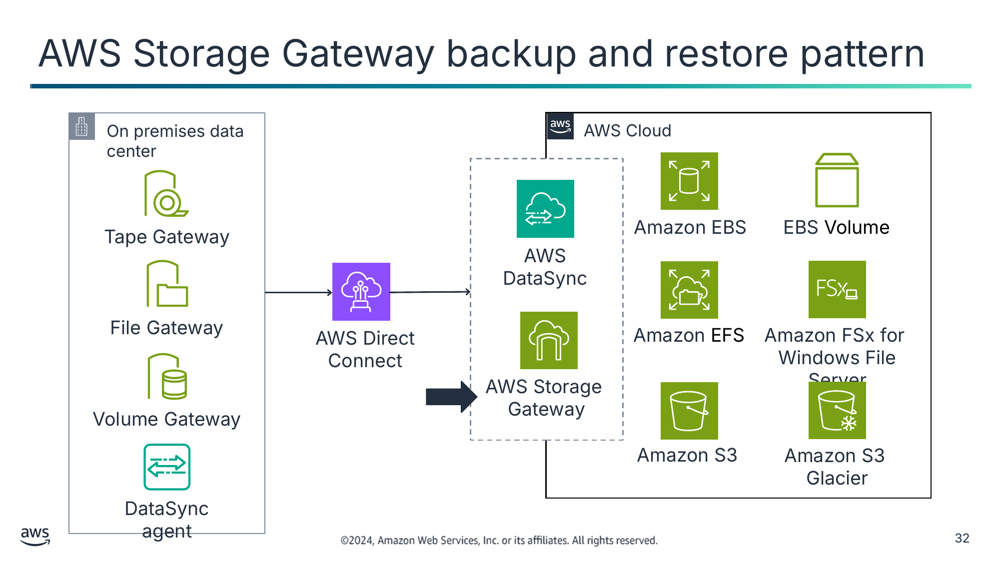

Текст зі схеми

On premises data center

AWS Cloud

Tape Gateway

Amazon EBS

EBS Volume

AWS DataSync

File Gateway

AWS Direct Connect

Amazon EFS

Amazon FSx for  
Windows File Server

AWS Storage  
Gateway

Volume Gateway

Amazon S3

Amazon S3  
Glacier

DataSync agent

> **Нотатки:**
>
> |Slide number 32  
> |Instructor notes  
> |  
> |Student notes  
> Image description: AWS Cloud architecture services for data storage and the corporate data center services that transfer data to the cloud. End description.  
>
> As part of the backup and restore pattern, you might find that it makes sense to use AWS Storage Gateway.  
>
> AWS Storage Gateway is a hybrid storage service that enables your on-premises applications to use AWS Cloud storage. You can use the service for backup and archiving, disaster recovery, cloud data processing, storage tiering, and migration.  
>
> Your applications connect to the service through a virtual machine (VM) or hardware gateway appliance by using standard storage protocols. These protocols include NFS, SMB, virtual tape library (VTL), and Internet Small Computer System Interface (iSCSI). The gateway connects to AWS storage services, such as Amazon S3, Amazon S3 Glacier, and Amazon EBS, which provide storage for files, volumes, and virtual tapes. The service includes an optimized data transfer mechanism. It provides bandwidth management, automated network resilience, and efficient data transfer, in addition to a local cache for low-latency on-premises access to your most active data.  
>
> With a file gateway, you store and retrieve objects (by using the NFS or SMB protocol) in Amazon S3. You use a local cache for low-latency access to your most recently used data. When your files are transferred to Amazon S3, they are stored as objects and can be accessed through an NFS mount point.  
>
> The Storage Gateway volume interface presents your applications with block storage disk volumes that can be accessed by using the iSCSI protocol. Data on these volumes is backed up as point-in-time Amazon EBS snapshots, which enables you to access it through Amazon EC2, if needed.  
>
> The Storage Gateway tape interface presents the Storage Gateway to your existing backup application as a virtual tape library. This library consists of a virtual media changer and virtual tape drives. You can continue to use your existing backup applications while you write to a collection of virtual tapes. Each virtual tape is stored in Amazon S3. When you no longer require access to data on virtual tapes, your backup application archives it from the virtual tape library into Amazon S3 Glacier.

---

## Слайд 33: Implementing backup and restore

Preparation phase

In case of disaster

- Create backups of current systems.
- Store backups in Amazon S3.
- Document procedure to restore from backups.

- Retrieve backups from Amazon S3.
- Restore required infrastructure.
- Restore system from backup.
- Route traffic to the new system.

> **Нотатки:**
>
> |Slide number 33  
> |Instructor notes  
> |The blog post Disaster Recovery (DR) Architecture on AWS, Part II: Backup and Restore with Rapid Recovery has architecture diagrams showing how AWS Backup is used in this DR pattern. This resource expands on the concept of getting the most out of backup and restore. This is done by detecting the impact of the disaster; restoring infrastructure, data, and re-integrating them; and re-routing requests to the recovery Region.  
> |  
> |Student notes  
> If you implement the backup and restore disaster recovery pattern, the key steps that you should complete during the preparation phase are to create backups of current systems, store the backups in Amazon S3, and document the procedure to restore from backups. You should know which AMI to use (and build as needed), how to restore system from backups, how to route traffic to the new system, and how to configure the deployment.  
>
> If you implement this pattern, the key steps to complete in case of disaster are to retrieve backups from Amazon S3, start the required infrastructure, restore the system from backups, and route traffic to the new system (adjust DNS records accordingly). Rebuilding the infrastructure includes creating resources like EC2 instances in addition to the Amazon VPC, subnets, and security groups needed.  
>
> For restoring infrastructure, you should use AWS resources created by an AWS CloudFormation stack to restore infrastructure consistently across Regions. To create the EC2 instances your workload needs, use AMIs to incorporate the required operating system and packages. In some cases, you will need to re-integrate your infrastructure and data.

---

## Слайд 34: Pilot light pattern

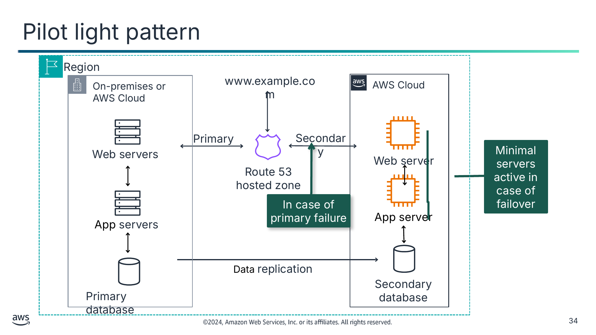

Текст зі схеми

Region

On-premises or AWS Cloud

www.example.com

AWS Cloud

Primary

Secondary

Web servers

Web

server

Minimal servers active in case of failover

Web server

Route 53

hosted zone

Web

server

In case of primary failure

App server

App servers

Data replication

Secondary database

Primary database

> **Нотатки:**
>
> |Slide number 34  
> |Instructor notes  
> |  
> |Student notes  
> Image description: This diagram illustrated how Pilot light will use Route 53 health checks to failover to a minimal amount of servers in case of primary health check failure. End description.  
>
> The second disaster recovery approach is the pilot light pattern.  
>
> Pilot light describes a disaster recovery pattern where a minimal backup version of your environment is always running. The pilot light analogy comes from a gas heater: a small flame (or the pilot light) is always on, even when the heater is off. The pilot light can quickly ignite the entire furnace to heat a house. In the example pattern, the pilot light is the secondary database that is always running. The main drawback to pilot light is that the secondary cannot handle the entire load of the primary and will need to scale quickly to handle traffic.  
>
> The pilot light scenario is similar to the backup-and-restore scenario. However, recovery time is typically faster because the core pieces of the system are already running and are continually kept up to date. When the time comes for recovery, you can rapidly provision a full production environment around the critical core.  
>
> Infrastructure elements for the pilot light itself typically include your database servers. This grouping is the critical core of the system (the pilot light). All other infrastructure pieces can quickly be provisioned around it to restore the complete system. To provision the rest of the infrastructure, you typically bundle preconfigured servers as AMIs that are ready to be started at a moment’s notice. (Or they might be instances that are in a stopped state.) When recovery begins, these instances start quickly with their pre-defined role, which enables them to connect to the database.  
>
> This pattern is relatively inexpensive to implement. Regularly changing data must be replicated to the pilot light, the small core around which the full environment starts in the recovery phase. Your less frequently updated data, such as operating systems and applications, can be periodically updated and stored as AMIs.  
>
> Suppose that disaster strikes, and your primary application goes offline. In this case, you can quickly commission the compute resources to run the application or to orchestrate the failover to pilot light resources in AWS. In this example, the secondary database stores critical data. If there is a disaster, the new web server and app server start up and connect to the secondary database. Route 53 is configured to then route traffic to the new web server.  
>
> The primary environment can exist in an on-premises data center, or in another Region or Availability Zone on AWS. Alternatively, two Regions could be used for this architecture as opposed to on-premises and Cloud environments. Either way, you can use the pilot light pattern to meet your RTO.

---

## Слайд 35: Implementing pilot light pattern

Preparation phase

In case of disaster

- Configure EC2 instances to replicate servers.
- Create and maintain Amazon Machine Images (AMIs) of key servers where fast recovery is needed.
- Regularly run, test, and update these servers.

- Bring up resources around the replicated core dataset.
- Then scale the system as needed to handle current production traffic.
- Switch over to the new system.

> **Нотатки:**
>
> |Slide number 35  
> |Instructor notes  
> |With this model it is imperative to test this configuration regularly and often. Otherwise, if the source has changed, then the skeleton pilot light configuration might not be as functional as anticipated. It might even fail outright, depending on the type of changes not configured into the pilot light side.  
> |  
> |Student notes  
> If you implement the pilot light disaster recovery pattern, there are key steps that you should complete during the preparation phase. These are configuring the EC2 instances, ensuring that all the supporting custom software packages are available, and creating and maintaining essential AMIs where fast recovery is required. Because a minimal backup version of your environment is always running, you should regularly run and test servers, and apply software updates and configuration updates. Consider automating the provisioning of AWS resources.  
>
> With the pilot light disaster recovery pattern, your core infrastructure is available, and you always have the option to quickly provision a full-scale production environment by switching on and scaling out your application servers. If you implement the pilot light pattern, the key steps to complete in case of disaster are to automatically bring up resources around the replicated core dataset. Then scale the system as needed to handle current production traffic.  
>
> Finally, switch over to the new system by adjusting the DNS records to point to the backup deployment. Failover redirects traffic from the primary Region (where you have determined the workload can no longer run) to the secondary Region. With Route 53, you can set up both your primary Region and secondary Region endpoints under one domain name. Then choose a routing policy that determines which endpoint receives traffic for that domain name.

---

## Слайд 36: Warm standby pattern

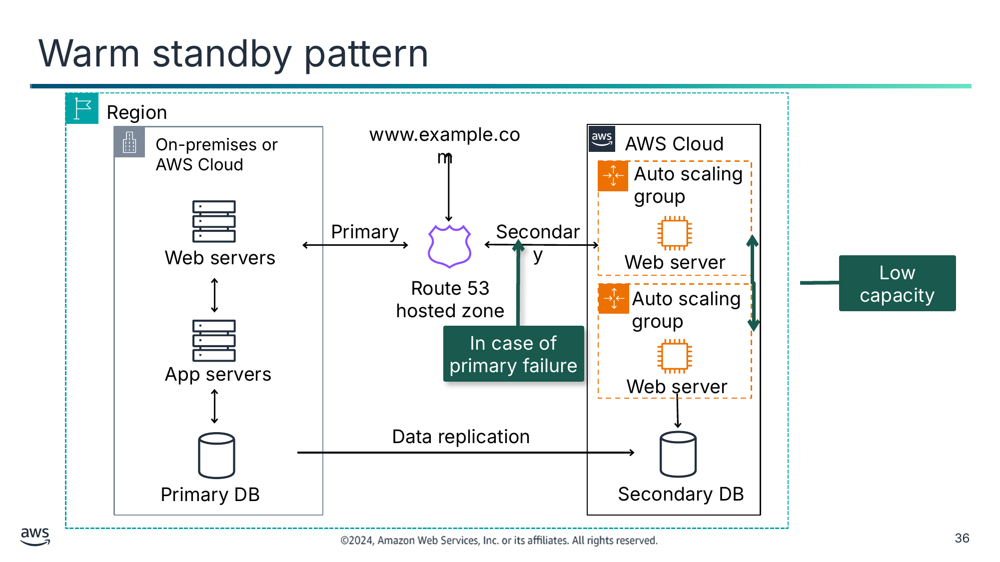

Текст зі схеми

Region

www.example.com

Auto scaling group

Primary

Secondary

Web servers

Web server

Route 53

hosted zone

Auto scaling group

In case of primary failure

App servers

Web server

Data replication

Low capacity

On-premises or AWS Cloud

Primary DB

Secondary DB

AWS Cloud

> **Нотатки:**
>
> |Slide number 36  
> |Instructor notes  
> |Similar to the pilot light option, the key to this working as expected is frequent testing to ensure that all key changes from the source are addressed on the warm standby counterparts.  
> |  
> |Student notes  
> The third disaster recovery approach is the warm standby pattern. The warm standby pattern is like the pilot light, but more resources are already running. The term warm standby describes a disaster recovery scenario where a scaled-down version of a fully functional environment is always running in the cloud. The warm standby solution extends the pilot light elements and preparation. It further decreases the recovery time because some services are always running. By identifying your business-critical systems, you can fully duplicate these systems and have them always on.  
>
> These servers can be running on a minimum-sized fleet of EC2 instances with the smallest sizes possible. This solution is not yet scaled to take a full production load, but it is fully functional. Though it exists for DR purposes, you can also use it for non-production work, such as testing, quality assurance, and internal use.  
>
> In the example, two systems are running. The main system might be running in an on-premises data center or an AWS Region, and a low-capacity system is running on AWS. Use Route 53 to distribute requests between the main system and the backup system. Alternatively, two AWS Regions could be used for this architecture as opposed to on-premises and Cloud environments.  
>
> Software licensing is an issue that can surface while you create backup sites. Look into the software licensing that you have to determine whether your current license contracts support your DR plans. Upgrade your licenses or adjust in other ways, as necessary.  
>
> In a disaster, if the primary environment is unavailable, Route 53 switches over to the secondary system. The secondary system can then quickly begin to scale up to handle the production load. You can produce this increase by adding more EC2 instances to the load balancer. Alternatively, you can resize the small capacity servers to run on larger EC2 instance types. Horizontal scaling (creating more EC2 instances) is preferred over vertical scaling (increasing the size of existing instances).

---

## Слайд 37: Implementing warm standby pattern

Preparation phase

In case of disaster

- Is similar to pilot light
- Has all necessary components running 24/7, but not scaled for production traffic
- Need to conduct continuous testing on component

- Failover most critical production load immediately
- Scale the system further to handle all production load (automatically)

> **Нотатки:**
>
> |Slide number 37  
> |Instructor notes  
> |The blog post “Disaster Recovery (DR) Architecture on AWS, Part III: Pilot Light and Warm Standby” explains the similarities and differences between the pilot light and warm standby patterns. This resource expands on the concept that successful recovery depends on detection of the disaster event, restoration of the workload in the recovery Region, and failover to send traffic to the recovery Region.  
> |  
> |Student notes  
> If you implement the warm standby disaster recovery pattern, the preparation phase is important. The key steps that you should complete during the preparation phase are similar to the steps that you complete for the pilot light pattern. The most notable difference is that all the necessary components should be left running 24/7, but not scaled for production traffic.  As a best practice, conduct continuous testing. Because warm standby deploys a functional stack to the recovery Region, this makes it more convenient to test Region readiness using synthetic transactions. You might also trickle a statistical subset of production traffic to the DR site. Thus, you can verify that it functions for users and systems as seamlessly as the primary system.  
>
> With the warm standby pattern, in case of disaster, the key steps to complete are to immediately fail over the most critical production load and adjust DNS records to point to AWS. If primary and secondary health checks are set up, and warm standby is set up, Route 53 with handle the failover. Failover routing will automatically send traffic to the recovery Region if the primary is unhealthy based on health checks you configure. Automatically scale the system further to handle all production load.

---

## Слайд 38: Multi-site pattern

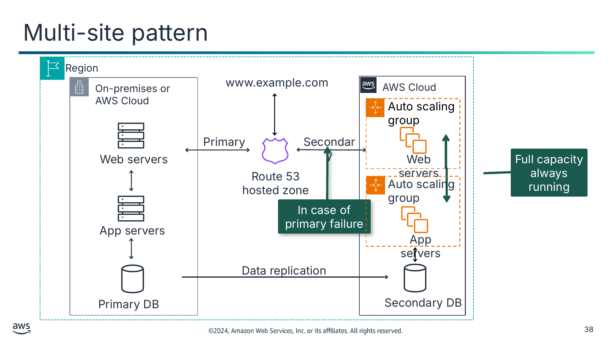

Текст зі схеми

Region

www.example.com

Auto scaling group

Primary

Secondary

Web servers

Web servers

Full capacity always running

Route 53

hosted zone

Auto scaling group

In case of primary failure

App servers

App servers

Data replication

On-premises or AWS Cloud

Primary DB

Secondary DB

AWS Cloud

> **Нотатки:**
>
> |Slide number 38  
> |Instructor notes  
> |  
> |Student notes  
> Image description: This diagram illustrates how Pilot light will use Route 53 health checks to failover to a complete duplicate secondary facility in case of emergency.  
> End description.  
>
> The fourth and final disaster recovery approach is the multi-site pattern. With this pattern, you have a fully functional system that runs in a second Region. It runs at the same time as the on-premises systems or the systems that run in a different Region. Alternatively, two Regions could be used for this architecture as opposed to on-premises and Cloud environments.  
>
> A multi-site solution runs in an active-active configuration. The data replication method that you employ is determined from the recovery point that you choose. Because both sites can support the full production capacity, you might choose to use a DNS service that supports weighted routing. An example is Route 53, which routes production traffic to both sites that deliver the same application or service. In this scenario, a proportion of traffic goes to your infrastructure in AWS, and the remainder goes to your on-site infrastructure. (Or if the two environments exist in separate Regions, the traffic is proportioned between these two Regions.)  
>
> In the example, two systems are running. The main system is running in an on-premises data center, and a full-capacity system is running on AWS. You can adjust the DNS weighting and send all the traffic to the cloud environment. The capacity of the deployment on the cloud can then be rapidly increased to handle the full production load as needed. You can use Amazon EC2 Auto Scaling to automate this process. You might need some application logic to detect the failure of the primary database services and cut over to the parallel already-running database services.  
>
> The cost of this scenario is determined from the volume of production traffic during normal operation. In the recovery phase, you pay for only what you use for the duration that the DR environment is needed at full scale. You can further reduce cost by purchasing Amazon EC2 Reserved Instances for your always-on AWS servers.

---

## Слайд 39: Implementing multi-site pattern

Preparation phase

In case of disaster

- Similar to warm standby
- Configured for full scaling in or scaling out for production load
- Consider licensing cost of complete duplicate system

Immediately failover all production load

> **Нотатки:**
>
> |Slide number 39  
> |Instructor notes  
> |In the blog “Disaster Recovery (DR) Architecture on AWS, Part IV: Multi-site Active/Active,” read/write patterns are explained. Examples of read local/write local and read local/write global patterns are given using Amazon DynamoDB global tables and Amazon Aurora global tables.  
> |  
> |Student notes  
> If you are implementing the multi-site disaster recovery pattern, the key steps to complete during the preparation phase are similar to the warm standby pattern. You must configure the backup deployment for full scaling in and out of the production load. You should have the servers running and ready to receive traffic. Route 53 offers multiple routing policies. For geolocation routing, you configure which Region a request goes to, based on the origin location of the request. For latency routing, AWS automatically sends requests to the Region that provides the shortest round-trip time.  
>
> Your data governance strategy helps inform which routing policy to use. With geolocation routing, you can distribute requests in a deterministic way. You can keep data for certain users within a specific Region, or you can control where write operations are routed to prevent contention. If optimizing for performance is your top priority, then latency routing is a good choice.  
>
> With the multi-site pattern, in case of disaster, you only need to complete one key step. That step is to immediately fail over all of the production load to the backup site. The multi-site pattern potentially has the least downtime of all. However, it does have more costs that are associated with it, because an entire duplicate system must be created at the secondary site. Consider the licensing cost of a complete duplicate system for the multi-site pattern.

---

## Слайд 40: Summary of common DR patterns

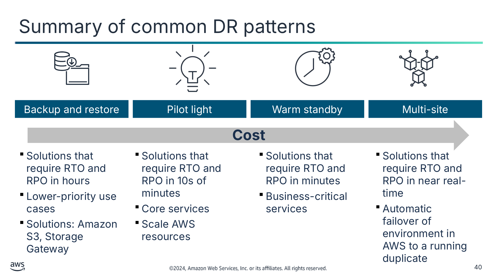

Backup and restore

Pilot light

Warm standby

Multi-site

- Solutions that require RTO and RPO in hours
- Lower-priority use cases
- Solutions: Amazon S3, Storage Gateway

- Solutions that require RTO and RPO in 10s of minutes
- Core services
- Scale AWS resources

- Solutions that require RTO and RPO in minutes
- Business-critical services

- Solutions that require RTO and RPO in near real-time
- Automatic failover of environment in AWS to a running duplicate

Текст зі схеми

**Cost**

> **Нотатки:**
>
> |Slide number 40  
> |Instructor notes  
> |The “Disaster Recovery Options in the Cloud” section of a DR whitepaper provides interesting points to consider for each pattern. For more information, see the link on the content resources page of your online course.  
> |  
> |Student notes  
> Image description: This chart shows how recovery time objective will reduce as cost increases based on which recovery platform is used.  
> End description.  
>
> To summarize, each of the four DR patterns offers a different combination of benefits. The arrow shows cost increasing from the backup and restore DR pattern to the multisite DR pattern, and RTO increasing from the multisite DR pattern to the backup and restore DR pattern.  
>
> The backup and restore pattern typically can be accomplished at the lowest cost, but it has a longer RTO. As a result, your systems are likely to be restored more slowly than with the other options.  
> The warm standby and multi-site patterns support a much faster RTO, but it is costly to have extra servers that are always running.  
>
> With AWS, you can cost-effectively operate each of these DR strategies. It’s important to realize that these patterns are only examples of possible approaches, and variations and combinations of these patterns are possible. If your application runs on AWS, then you can use multiple Regions, and the same DR strategies still apply.

---

## Слайд 41: Practice Game Day exercises

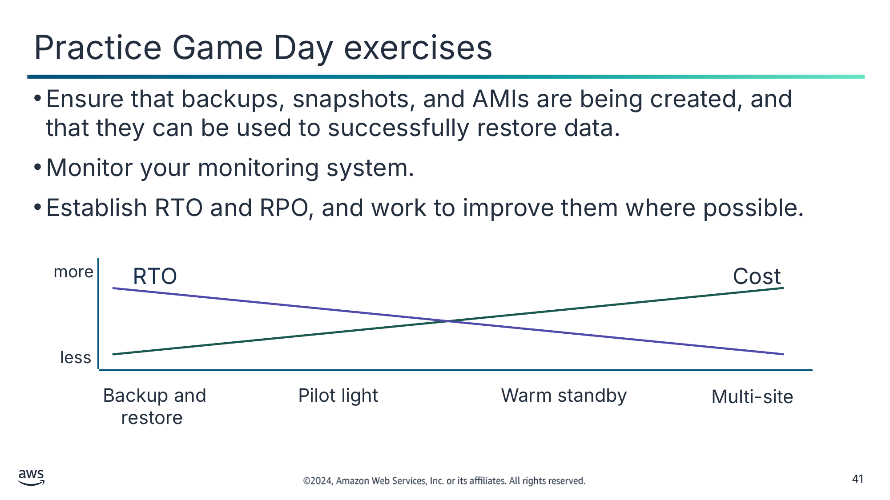

- Ensure that backups, snapshots, and AMIs are being created, and that they can be used to successfully restore data.
- Monitor your monitoring system.
- Establish RTO and RPO, and work to improve them where possible.

Текст зі схеми

more

RTO

Cost

less

Backup and restore

Pilot light

Warm standby

Multi-site

> **Нотатки:**
>
> |Slide number 41  
> |Instructor notes  
> |  
> |Student notes  
> Image description: This chart shows how recovery time objective will reduce as cost increases based on which recovery platform is used.  
> End description.  
>
> It is a best practice to consistently exercise your DR solution so you can ensure that it works as intended.  
>
> Practice Game Day exercises, these exercises test scenarios when critical systems go offline—or even entire Regions. What if an entire fleet crashes?  
>
> Ensure that backups, snapshots, and AMIs are being created, and that they can be used to successfully restore data. Be sure to monitor your monitoring system.  
>
> Test your response procedures to ensure they are effective and that teams are familiar with how to put them into practice. Set up regular Game Days to test workload and team responses to simulated events.

---

## Слайд 42: Key takeaways: Disaster recovery patterns

- Common disaster recovery patterns on AWS include backup and restore, pilot light, warm standby, and multi-site.
- Backup and restore is the most cost-effective approach. However, it has the highest RTO.
- Multi-site provides the fastest RTO. However, it costs the most because it provides a fully running production-ready duplicate.
- Storage Gateway provides three interfaces—File Gateway, Volume Gateway, and Tape Gateway—for data backup and recovery between on-premises and the AWS Cloud.

> **Нотатки:**
>
> |Slide number 42  
> |Instructor notes  
> |  
> |Student notes  
> Some key takeaways from this section of the module include the following:  
> Common disaster recovery patterns on AWS include backup and restore, pilot light, warm standby, and multi-site.  
> Backup and restore is the most cost-effective approach, but it has the highest RTO.  
> Multi-site provides the fastest RTO, but it costs the most because it provides a fully running production-ready duplicate.  
> AWS Storage Gateway provides three interfaces—File Gateway, Volume Gateway, and Tape Gateway—for data backup and recovery between on-premises and the AWS Cloud.

---

## Слайд 43: Guided lab: Configuring Hybrid Storage and Migrating Data with AWS Storage Gateway S3 File Gateway (AWS Storage Gateway lab)

> **Нотатки:**
>
> |Slide number 43  
> |Instructor notes  
> |  
> |Student notes  
> You will now complete a lab. The next slides summarize what you will do in the lab, and you will find the detailed instructions in the lab environment.

---

## Слайд 44: AWS Storage Gateway lab tasks

- In this lab, you perform the following main tasks:
  - Configure an S3 File Gateway with an NFS file share and attach it to a Linux instance.
  - Migrate a set of data from the Linux instance to an S3 bucket.
  - Create and configure a primary S3 bucket to migrate on-premises server data to AWS.
  - Create and configure a secondary S3 bucket to use for cross-Region replication.
  - Create an S3 lifecycle policy to automatically manage data in a bucket.

> **Нотатки:**
>
> |Slide number 44  
> |Instructor notes  
> |  
> |Student notes  
> Access the lab environment through your online course to get additional details and complete the lab.

---

## Слайд 45: Debrief: AWS Storage Gateway lab

- Which configuration do you need to enable in the source bucket and the destination bucket for cross-Region replication to work?
- How did you choose the correct AMI to use for the File Gateway appliance?

> **Нотатки:**
>
> |Slide number 45  
> |Instructor notes  
> |Relevant before and after architectural diagrams are included in the lab instructions for each lab. You might find it helpful to pull the lab diagrams up as part of debriefing this lab.  
> |Suggested responses for question 1: Which configuration do you need to enable in the source bucket and the destination bucket for cross-Region replication to work?  
> |  
> |For cross-Region replication to work, you must enable versioning in both the source and the destination buckets. Versioning effects costs. Therefore, it is recommended to have a lifecycle policy in place for versioned files.  
> |  
> |Suggested responses for question 2: How did you choose the correct AMI to use for the File Gateway appliance?  
> |  
> |When you chose Amazon EC2 in the Create gateway wizard, the correct AMI that must be used for the File Gateway appliance is chosen for you.  
> |  
> |Student notes  
> Your instructor might review these questions with you, or you might review them on your own. Use this opportunity to extend your thinking about the tasks that you performed during the lab.

---

## Слайд 46: Applying AWS Well-Architected Framework principles to disaster planning

Planning for Disaster

> **Нотатки:**
>
> |Slide number 46  
> |Instructor notes  
> |  
> |Student notes  
> This section connects well-architected best practices to concepts related to disaster planning and recovery.

---

## Слайд 47: Well-Architected Framework best practices for planning for disasters

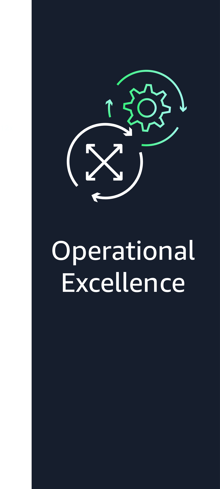

> **Нотатки:**
>
> |Instructor notes  
> |The remaining slides in this section present examples that highlight how the material in this module aligns to the AWS Well-Architected Framework best practices. Optionally, you might ask students to visit the AWS Well-Architected Framework website and find the best practices that they think connect to the material that is presented in this module. They can use this section as a starting point.  
> |  
> |Student notes  
> The AWS Well-Architected Framework has six pillars, and each pillar includes best practices and a set of questions that you should consider when you architect cloud solutions. This section highlights a few best practices from the pillars that are most relevant to this module. This includes Reliability, Operational Excellence, and Security.

---

## Слайд 48: Best practice approach: Failure management–plan for disaster recovery

**Best practices**

Define recovery objectives for downtime and data loss.

Use defined recovery strategies to meet the recovery objectives.

Test disaster recovery implementation to validate the implementation.

> **Нотатки:**
>
> |Slide number 48  
> |Instructor notes  
> |  
> |Student notes  
> As a cloud architect, you need to understand how to create an architecture that supports your organization's system of prevention and recovery from potential threats. Building resilient workloads helps prepare for any event that prevents a workload or system from fulfilling its business objectives in its primary location. Failure management is one of the steps you must take to implement resiliency; planning for disaster recovery is one part of failure management.  
>
> Having backups and redundant workload components in place is the start of your DR strategy. RTO and RPO are your objectives for restoration of your workload. Set these based on business needs. Implement a strategy to meet these objectives, considering locations and function of workload resources and data. The probability of disruption and cost of recovery are also key factors that help to inform the business value of providing disaster recovery for a workload.  
>
> Define recovery objectives for downtime and data loss: Every workload has an assigned RTO and RPO, defined based on business impact. For the given workload, you must understand the impact of downtime and lost data on your business. The impact generally grows larger with greater downtime or data loss, but the shape of this growth can differ based on the workload type.  
>
> For example, you might be able to tolerate downtime for up to an hour with little impact, but after that, impact quickly rises. Impact to business manifests in many forms, including monetary cost (such as lost revenue), customer trust (and impact to reputation), operational issues (such as missing payroll or decreased productivity), and regulatory risk. RTO and RPO are used as one of the primary considerations for selection of a disaster recovery strategy implementation for the workload. Additional considerations in picking a DR strategy are cost constraints, workload dependencies, and operational requirements.  
>
> Use defined recovery strategies to meet the recovery objectives: Define a DR strategy that meets your workload's recovery objectives. Choose a strategy such as backup and restore, pilot light, warm standby, or multi-site. Choosing a DR strategy is a trade-off between reducing downtime and data loss (RTO and RPO) and the cost and complexity of implementing the strategy.  
>
> With all strategies, you must also mitigate against a data disaster. Continuously replicated data may not protect against corruption unless you also version or snapshot your data. You must also back up the replicated data in the recovery site to create point-in-time backups in addition to the replicas.  
>
> Test disaster recovery implementation to validate the implementation: Regularly test failover to your recovery site to verify that it operates properly and that RTO and RPO are met. The only error recovery that works is the path you test frequently.  
>
> In this module, you’ve learned about topics that support these best practices, including the following:  
> The elements related to avoiding and planning for disaster  
> Factors that influence disaster planning strategies including RTO and RPO  
> Common disaster recovery patterns such as backup and restore, pilot light, warm standby, and multi-site  
>
> For more information, see Plan for Disaster Recovery (DR) in the AWS Well-Architected Framework documentation which is linked in your course resources.

---

## Слайд 49: Best practice approach: Operate–manage workload and operations events

**Best practice**

Define a customer communication plan

for outages.

> **Нотатки:**
>
> |Slide number 49  
> |Instructor notes  
> |  
> |Student notes  
> The Operational Excellence pillar includes the ability to support development and run workloads effectively, gain insight into your operations, and to continuously improve supporting processes and procedures to deliver business value. One of the operating best practices can be framed as this question: How do you manage workload and operations events? Answering this question will help you prepare and validate procedures for responding to events to minimize their disruption to your workload.  
>
> Define a customer communication plan for outages: Define and test a communication plan for system outages that you can rely on to keep your customers and stakeholders informed during outages. Communicate directly with your users both when the services they use are impacted and when services return to normal.  
>
> As an example, when the workload is impaired, Any Company Retail sends out an email notification to their users. The email describes what business functionality is impaired and provides a realistic estimate of when service will be restored. In addition, they have a status page that shows real-time information about the health of their workload. The communication plan is tested in a development environment twice per year to validate that it is effective.  
>
> In this module, you’ve learned about preparing for when a disaster occurs, which supports this best practice, including the following:  
> Your organization’s BCP includes your disaster recovery plan and the logistics of disaster recovery.  
> Use various AWS services and resource to design for resiliency and recovery.  
>
> For more information, see the operational excellence pillar section in the AWS Well-Architected Framework documentation. This is linked in your course resources.

---

## Слайд 50: Best practice approach: Identity and access management–permissions management

**Best practice**

Establish an emergency access process.

> **Нотатки:**
>
> |Slide number 50  
> |Instructor notes  
> |  
> |Student notes  
> To use AWS services, users and applications need access to resources in your AWS accounts. Identity and access management considerations need to be made while preparing for disasters.  
>
> Establish emergency access process: Create a process that provides emergency access to your workloads in the unlikely event of an issue with your centralized identity provider. Design processes for different failure modes that might result in an emergency event. For example, under normal circumstances, your workforce users federate to the cloud using a centralized identity provider to manage their workloads. However, if your centralized identity provider fails, or the configuration for federation in the cloud is modified, then your workforce users might not be able to federate into the cloud.  
>
> An emergency access process gives authorized administrators access your cloud resources through alternate means to fix issues with your federation configuration or your workloads. By having well-documented and well-tested emergency access processes, you can reduce the time taken by your users to respond to and resolve an emergency event. This can result in less downtime and higher availability of the services you provide to your customers.  
>   
> In this module, you've learned about opportunities to establish and test emergency processes, which support this best practice, including the following:  
> Consistently exercise your disaster recovery solution so you can ensure that it works as intended through Practice Game Day exercises.  
> Conduct continuous testing on all components related to disaster recovery.  
>
> For more information, see the security pillar section in the Well-Architected Framework which is linked in your course resources.

---

## Слайд 51: Key takeaways: Applying AWS Well-Architected Framework principles to disaster planning

- Define recovery objectives for downtime and data loss based on business requirements.
- Use defined recovery strategies to meet the recovery objectives based on business requirements.
- Test disaster recovery implementation to validate the implementation.
- Define a customer communication plan for outages.
- Establish an emergency access process.

> **Нотатки:**
>
> |Slide number 51  
> |Instructor notes  
> |  
> |Student notes

---

## Слайд 52: Module wrap-up

Planning for Disaster

> **Нотатки:**
>
> |Slide number 52  
> |Instructor notes  
> |  
> |Student notes  
> This section summarizes what you have learned and brings the module to a close.

---

## Слайд 53: Module summary

This module prepared you to do the following:

- Identify strategies for disaster planning, including RPO and RTO based on business requirements.
- Identify disaster planning for AWS service categories.
- Describe common patterns for backup and disaster recovery and how to implement them.
- Use the AWS Well-Architected Framework principles when designing a disaster recovery plan.

> **Нотатки:**
>
> |Slide number 53  
> |Instructor notes  
> |  
> |Student notes

---

## Слайд 54: Considerations for the cafe

- Discuss how you, as a cloud architect, might advise the café, based on the key cloud architect concerns presented at the start of this module.

---

## Слайд 55: Module knowledge check

- The knowledge check is delivered online within your course.
- The knowledge check includes 10 questions based on material presented on the slides and in the slide notes.
- You can retake the knowledge check as many times as you like.

> **Нотатки:**
>
> |Slide number 55  
> |Instructor notes  
> |  
> |Student notes  
> Use your online course to access the knowledge check for this module.

---

## Слайд 56: Sample exam question

A solutions architect must create a disaster recovery (DR) solution for a company's business-critical applications. The maximum acceptable amount of data loss is 7 minutes. The DR solution also requires the deployment of a completely functional version of the applications to handle the majority of traffic immediately, and then scale up to full capacity over time. Which disaster recovery pattern would provide the most cost-effective solution?

Identify the key words and phrases before continuing.

The following are the key words and phrases:

- Business-critical
- Functional version of the applications
- Handle the majority of traffic immediately
- Cost-effective

> **Нотатки:**
>
> |Slide number 56  
> |Instructor notes  
> |The key words section is animated to be revealed on click.  
> |  
> |Student notes

---

## Слайд 57: Sample exam question: Response choices

A solutions architect must create a disaster recovery (DR) solution for a company's **business-critical** applications. The maximum acceptable amount of data loss is 7 minutes. The DR solution also requires the deployment of a completely **functional version of the applications** **to handle the majority of traffic immediately**, and then scale up to full capacity over time. Which disaster recovery pattern would provide the most **cost-effective** solution?

**Choice**

**Response**

**A**

Backup and restore

**B**

Pilot light

**C**

Warm standby

**D**

Multi-site

> **Нотатки:**
>
> |Slide number 57  
> |Instructor notes  
> |  
> |Student notes  
> Use the key words and phrases that you identified on the previous slide, and review each of the possible responses to determine which one best addresses the question.

---

## Слайд 58: Sample exam question: Answer

The answer is  C.

**Choice**

**Response**

**C**

Warm standby

> **Нотатки:**
>
> |Slide number 58  
> |Instructor notes  
> |  
> |Student notes  
> Choice A (Backup and restore) could not restore to handle the required traffic fast enough. Backup and restore is not a suitable solution for business-critical applications.  
>
> Choice B (Pilot light) would only handle a small amount of traffic before actively scaling up. Because the instances are idle, it would not be able to handle the majority of traffic immediately.  
>   
> Choice D (Multi-site) would meet the recovery point objective (RPO) requirement within moments. The services are already running at full capacity within that time. However, this solution costs more than is necessary to meet the company's requirements.  
>   
> The correct answer is C: Warm standby. This solution meets the requirement for an RPO of 7 minutes. The instances run at a low capacity and can scale within minutes. The cost related to this disaster recovery pattern is less than multi-site.

---

## Слайд 59: Thank you

Corrections, feedback, or other questions?

Contact us at [https://support.aws.amazon.com/#/contacts/aws-academy](https://support.aws.amazon.com/#/contacts/aws-academy).

> **Нотатки:**
>
> |Slide number 59  
> |Instructor notes  
> |  
> |Student notes  
> That concludes this module. The content resources page of your course includes links to additional resources that are related to this module.
