## Слайд 1: Планування на випадок катастрофи (Planning for Disaster)

AWS Academy Cloud Architecting

> **Нотатки:**
>
> |Нотатки для інструктора  
> |  
> |Нотатки для студента  
> Вітаємо в модулі «Планування на випадок катастрофи». Цей модуль знайомить із міркуваннями та стратегіями планування аварійного відновлення (disaster recovery, DR).

---

## Слайд 2: Вступ

Планування на випадок катастрофи

> **Нотатки:**
>
> |Нотатки для інструктора  
> |  
> |Нотатки для студента  
> Цей вступний розділ описує вміст модуля.

---

## Слайд 3: Цілі модуля

Цей модуль готує вас до такого:

- Визначати стратегії планування на випадок катастрофи, зокрема цільову точку відновлення (recovery point objective, RPO) і цільовий час відновлення (recovery time objective, RTO) на основі бізнес-вимог.
- Визначати планування на випадок катастрофи для категорій сервісів Amazon Web Services (AWS).
- Описувати поширені шаблони резервного копіювання й аварійного відновлення (DR) та способи їх впровадження.
- Використовувати принципи AWS Well-Architected Framework під час проєктування плану аварійного відновлення.

> **Нотатки:**
>
> |Номер слайда 3  
> |Нотатки для інструктора  
> |  
> |Нотатки для студента

---

## Слайд 4: Огляд модуля

**Розділи презентації**

- Стратегії планування на випадок катастрофи
- Планування аварійного відновлення в AWS
- Шаблони аварійного відновлення
- Застосування принципів AWS Well-Architected Framework до планування на випадок катастрофи

**Перевірки знань**

- 10-запитальна перевірка знань
- Зразок запитання іспиту

> **Нотатки:**
>
> |Номер слайда 4  
> |Нотатки для інструктора  
> |Кожен модуль курсу має вступ, розділи з вмістом і підсумок. Підсумок цього модуля містить зразок запитання іспиту для розбору зі студентами.  
> |  
> |Нотатки для студента  
> Цілі цього модуля розкриваються в кількох розділах.  
>
> Модуль завершується 10-запитальною перевіркою знань, що проводиться в онлайн-курсі, та зразком запитання іспиту для обговорення в класі. Лабораторну роботу цього модуля описано на наступному слайді.

---

## Слайд 5: Практичні лабораторні роботи в цьому модулі

Покрокова лабораторна робота (Guided lab)

- Налаштування гібридного сховища та міграція даних за допомогою AWS Storage Gateway S3 File Gateway (Configuring Hybrid Storage and Migrating Data with AWS Storage Gateway S3 File Gateway)

> **Нотатки:**
>
> |Номер слайда 5  
> |Нотатки для інструктора  
> |Цей модуль містить покрокову лабораторну роботу. Ця лабораторна робота надає інструкції крок за кроком і є самодостатньою. Вона не залежить від сценарію з кафе чи пов’язаної архітектури. Вступ до лабораторної роботи включено до розділу лабораторної роботи в межах модуля.  
> |  
> |Нотатки для студента  
> Цей модуль містить зазначену покрокову лабораторну роботу. Додаткова інформація про цю лабораторну роботу міститься в посібнику студента там, де вона виконується, а докладні інструкції надаються в лабораторному середовищі.

---

## Слайд 6: Як хмарний архітектор, що планує на випадок катастроф:

- Мені потрібно проєктувати архітектури, що пом’якшують ризик катастрофи, а також підтримують своєчасне відновлення після катастроф, коли вони трапляються, щоб допомогти мінімізувати вплив катастроф на бізнес.
- Мені потрібно враховувати бізнес-потреби організації, щоб застосовувати шаблони аварійного відновлення, що балансують вартість, втрату даних і час відновлення.

> **Нотатки:**
>
> |Номер слайда 6  
> |Нотатки для інструктора  
> |Цей слайд подає ключові наскрізні міркування проєктування, що мають спрямовувати ухвалення рішень для цього рівня хмарної архітектури. Підкресліть, що хмарний архітектор завжди має починати з бізнес-кейсу й рухатися у зворотному напрямку, щоб обрати найкращі компоненти для цього сценарію використання. Також нагадайте студентам, що рішення щодо проєкту, імовірно, еволюціонуватимуть з часом для оптимізації вартості та продуктивності, у міру зміни чи кращого розуміння потреб. Наприкінці модуля в підсумковому розділі включено необов’язкове обговорення, що спонукає студентів розглянути ці чинники в контексті сценарію з кафе.  
> |  
> |Нотатки для студента  
> Цей слайд просить вас прийняти перспективу хмарного архітектора, коли ви думаєте про те, як підходити до планування катастроф. Просуваючись цим модулем, пам’ятайте, що хмарний архітектор має працювати у зворотному напрямку від бізнес-потреби, щоб спроєктувати найкращу архітектуру для конкретного сценарію використання. Розглядайте сценарій з кафе, поданий у курсі, як приклад бізнес-потреби. Подумайте, як би ви відповіли на цю потребу для вигаданого бізнесу кафе.  
>
> Відправна точка під час проєктування на випадок збоїв і аварійного відновлення — зрозуміти перспективу клієнта. Які аспекти свого бізнесу він вважає критичними, номінально важливими чи несуттєвими. На основі цього контексту архітектор може застосовувати концепції, пояснені в цьому модулі. Ці концепції застосовні незалежно від того, чи середовище перебуває в процесі міграції, повністю хмарне чи в гібридній конфігурації.

---

## Слайд 7: Стратегії планування на випадок катастрофи

Планування на випадок катастрофи

> **Нотатки:**
>
> |Номер слайда 7  
> |Нотатки для інструктора  
> |  
> |Нотатки для студента  
> Цей розділ надає огляд стратегій планування на випадок катастрофи. Він також обговорює, як оцінювати вашу систему для встановлення цільової точки відновлення (RPO) і цільового часу відновлення (RTO), щоб створити план безперервності бізнесу.

---

## Слайд 8: Збої можуть траплятися в будь-якому масштабі

Події малого масштабу (Small-scale events)

Події великого масштабу (Large-scale events)

Глобальні події (Global events)

Сервер перестає відповідати.

Кілька ресурсів у зоні доступності недоступні.

Збій поширений і впливає на велику кількість користувачів і систем.

> **Нотатки:**
>
> |Номер слайда 8  
> |Нотатки для інструктора  
> |Збої можна категоризувати кількома способами. Категоризацію збоїв на основі події катастрофи зображено на слайді. Нотатки для студента спонукають подумати про вплив цих подій на бізнес.  
> |  
> |Нотатки для студента  
> Віцепрезидент (VP) і технічний директор (CTO) Amazon Вернер Фогельс (Werner Vogels) відомо заявляв не раз: «Усе виходить з ладу, увесь час» («Everything fails, all the time»). Це його твердження продовжує впливати на проєктування архітектури хмарних обчислень протягом багатьох років, оскільки воно відповідає істині.  
>
> Збій не слід вважати малоймовірною аберацією. Натомість слід припускати, що збої, великі й малі, можуть — і будуть — траплятися. Як підготуватися до цих подій?  
>
> Збій можна класифікувати як один із таких трьох типів:  
> Подія малого масштабу — наприклад, один сервер перестає відповідати чи переходить у режим офлайн.  
> Подія великого масштабу — тут уражено кілька ресурсів, можливо, навіть у різних зонах доступності в регіоні AWS.  
> Подія глобального масштабу — тут збій поширений і впливає на велику кількість користувачів і систем.  
>
> Розглядайте розмір збою разом із його впливом. Наприклад, якщо єдиний сервер, що переходить в режим офлайн, — це основний чи єдиний сервер, що розміщує записи клієнтів, його не можна класифікувати як подію малого масштабу. Так само розгляньте масив серверів, що слугують репліками лише для читання для даних, до яких звертаються раз на день. Якщо цей масив припиняє функціонувати, він не відповідає суттєвим критеріям події великого масштабу.  
>
> Щоб мінімізувати вплив катастрофи, організації мають інвестувати час і ресурси в планування та підготовку, навчання працівників, документування й оновлення процесів. Обсяг інвестицій у планування на випадок катастрофи для певної системи може сильно відрізнятися залежно від вартості потенційного простою.

---

## Слайд 9: Запобігання катастрофі та планування на випадок катастрофи

Відмовостійкість (Fault tolerance)

Резервне копіювання (Backup)

Аварійне відновлення (Disaster recovery)

Мінімізуйте, як часто ваші застосунки та дані стають недоступними.

Переконайтеся, що у вас є резервний план обробки даних на випадок катастрофи.

Відновіть ваші дані й поверніть ваші застосунки в роботу після катастрофи.

> **Нотатки:**
>
> |Номер слайда 9  
> |Нотатки для інструктора  
> |Відмовостійкі системи можуть витримувати відмову окремого чи кількох компонентів, але система продовжує функціонувати без перебоїв (хоча зазвичай із меншою потужністю) попри відмову. Високодоступні системи, однак, можуть швидко відновлюватися чи повертатися в роботу (бажано без потреби втручання) після відмови окремого чи кількох компонентів. Хоча ці дві концепції подібні, вони не однакові. Їх не слід використовувати як взаємозамінні.  
> |  
> |Нотатки для студента  
> Катастрофи — це події, що можуть призвести до збоїв у малому, великому чи глобальному масштабі. Архітектори мають проєктувати архітектури так, щоб уникати катастроф, і водночас упроваджувати плани відновлення після них, коли вони трапляються. Архітектори роблять це трьома основними способами:  
> Відмовостійкість (fault tolerance) забезпечує надлишковість, коли вона може витримувати відмову окремого чи кількох компонентів (наприклад, жорстких дисків, серверів чи мережевого підключення). Продуктивні системи зазвичай мають визначені вимоги до часу безвідмовної роботи.  
> Резервне копіювання (backup) критично важливе для захисту даних і забезпечення безперервності бізнесу. Однак його може бути складно впровадити. Темп, з яким генеруються дані, зростає експоненційно. Тим часом щільність і довговічність локальних дисків не зростають із такою самою швидкістю. Попри це, важливо зберігати резервні копії ваших критичних даних на випадок катастрофи.  
> Аварійне відновлення (disaster recovery) — це підготовка до катастрофи та відновлення після неї. Катастрофа — це будь-яка подія, що негативно впливає на безперервність бізнесу чи фінанси компанії. Такі події включають апаратний чи програмний збій, мережевий збій, відключення електроенергії або фізичне пошкодження будівлі (як-от пожежа чи затоплення). Причиною може бути людська помилка чи інша значна подія. Аварійне відновлення — це набір політик і процедур, що використовуються для відновлення життєво важливої технологічної інфраструктури та систем після будь-якої катастрофи.

---

## Слайд 10: Чинники, що впливають на стратегії планування на випадок катастрофи

Залежність від часу (Time dependency)

Втрата даних (Data loss)

Географічне розташування (Geographic location)

Вартість (Cost)

Як швидко це потрібно усунути, щоб уникнути впливу на бізнес?

Яким обсягом даних ви готові пожертвувати?

Яким типом даних ви готові пожертвувати?

Чи це впливає на кілька регіонів AWS?

Чи потребують різні регіони різних вимірювань того, як швидко потрібно відновитися й яка втрата даних припустима?

Чи відображає вартість правильний рівень з урахуванням впливу на бізнес і ризику?

> **Нотатки:**
>
> |Номер слайда 10  
> |Нотатки для інструктора  
> |Наведені нижче приклади можуть допомогти пояснити студентам кожен чинник впливу:  
> |Залежність від часу: швидкість, з якою потрібно усунути катастрофу, що впливає на бізнес із графіком 9–17, відрізняється порівняно з бізнесом 24/7.  
> |Втрата даних: втрата податкових записів 10-річної давності порівняно з втратою засвідчених свідоцтв про народження змінює стратегії планування на випадок катастрофи.  
> |Географічне розташування: чи бізнес працює на національному, чи на глобальному рівні, впливає на тип планування на випадок катастрофи, який розглядає організація.  
> |Вартість: розгляньте, скільки коштує планування захисту від землетрусу на основі факторів ризику, пов’язаних із тим, чи така катастрофа становить загрозу для бізнесу.  
> |  
> |Нотатки для студента  
> Проєктування ваших стратегій аварійного відновлення залежить від оцінки бізнесом того, який рівень збою бізнес може витримати. Чотири ключові чинники, які потрібно розглянути бізнесу, такі:  
> Як швидко бізнесу потрібно відновитися  
> Яку втрату даних може витримати бізнес  
> Чи є різні потреби для різних розташувань  
> Як збалансувати вартість готовності з факторами ризику, що становлять загрозу для бізнесу  
>
> Клієнт працює з хмарним архітектором, щоб визначити, що таке дані й яка втрата даних (якщо така є) прийнятна в сценарії аварійного відновлення. Наприклад, чи були б катастрофічні наслідки, якби записи клієнтів 10-річної давності не можна було відновити? Якщо записи стосуються клієнтів, що становлять лише невелику частку нинішнього доходу, їх втрата, імовірно, була б прийнятною. Однак якщо записи стосуються клієнтів, що становлять значну частину поточного доходу, їх втрата була б неприйнятною.  
>
> Хоча розроблення та впровадження повного плану аварійного відновлення потребує часу, це не повинно зупиняти вас від перших кроків. Починайте з основ і підіймайтеся вище. Наприклад, як перший крок створіть резервні копії сховищ даних, баз даних і критичних серверів. Потім працюйте над встановленням заходів для кожного з чотирьох обговорених тут чинників і поступово покращуйте здатність бізнесу обмежувати вплив катастроф.

---

## Слайд 11: Визначення RPO

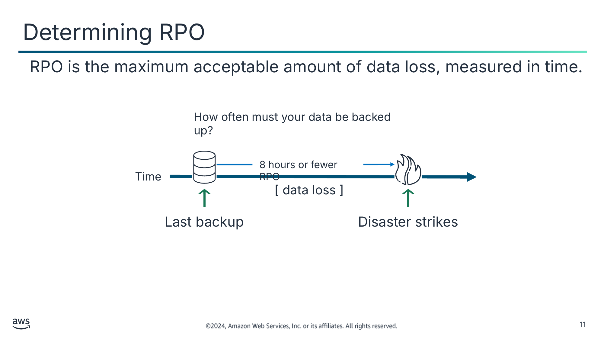

RPO — це максимально прийнятний обсяг втрати даних, виміряний у часі.

Текст зі схеми

How often must your data be backed up? (Як часто потрібно створювати резервні копії ваших даних?)

8 hours or fewer RPO (RPO 8 годин або менше)

Time (Час)

[ data loss ] ([ втрата даних ])

Last backup (Остання резервна копія)

Disaster strikes (Настає катастрофа)

> **Нотатки:**
>
> |Номер слайда 11  
> |Нотатки для інструктора  
> |  
> |Нотатки для студента  
> Опис зображення: часова лінія, що показує, що катастрофа відбувається через 8 годин після останньої резервної копії. Втрата даних у цьому прикладі — це все, що було згенеровано між останньою резервною копією та моментом катастрофи 8 годин потому. Це становить RPO 8 годин. Кінець опису.  
>
> Цільова точка відновлення (recovery point objective, RPO) — це максимально прийнятний обсяг втрати даних після непланового інциденту втрати даних. Вона виражається як проміжок часу.

---

## Слайд 12: Приклад: визначення RPO

Визначте, що втрата максимум 800 записів прийнятна для вашого застосунку.

Використайте наявні шаблони, щоб визначити, що створюється не більше 100 записів на годину.

Обчисліть, що RPO 8 годин (8*100 записів) прийнятний.

На основі цієї інформації, якщо катастрофа відбулася о 22:00, система має вміти відновити всі дані, що були в системі до 14:00.

> **Нотатки:**
>
> |Номер слайда 12  
> |Нотатки для інструктора  
> |Цей приклад стосується генеалогічної компанії, що оцифровує старі записи місцевих судів. У черзі на оцифрування — мільйони записів. Бізнес визначив, що втрата максимум 800 записів, для яких у нього є вихідні файли, прийнятна.  
> |  
> |Нотатки для студента  
> Ось докладніший огляд обчислення RPO. Припустімо, ви визначили, що дані, які генерує ваш застосунок, важливі, але не критичні, тож втрата 800 записів була б прийнятною. Ви також обчислили, що навіть у пікові періоди створюється не більше 100 записів на годину.  
>
> У цьому сценарії ви вирішуєте, що RPO 8 годин достатній для задоволення ваших потреб. Якщо ви впроваджуєте план аварійного відновлення, що відповідає цьому RPO, ви створюватимете резервні копії даних принаймні кожні 8 годин. Тоді, якщо катастрофа відбулася о 22:00, система має вміти відновити всі дані, що були в системі до 14:00.

---

## Слайд 13: Визначення RTO

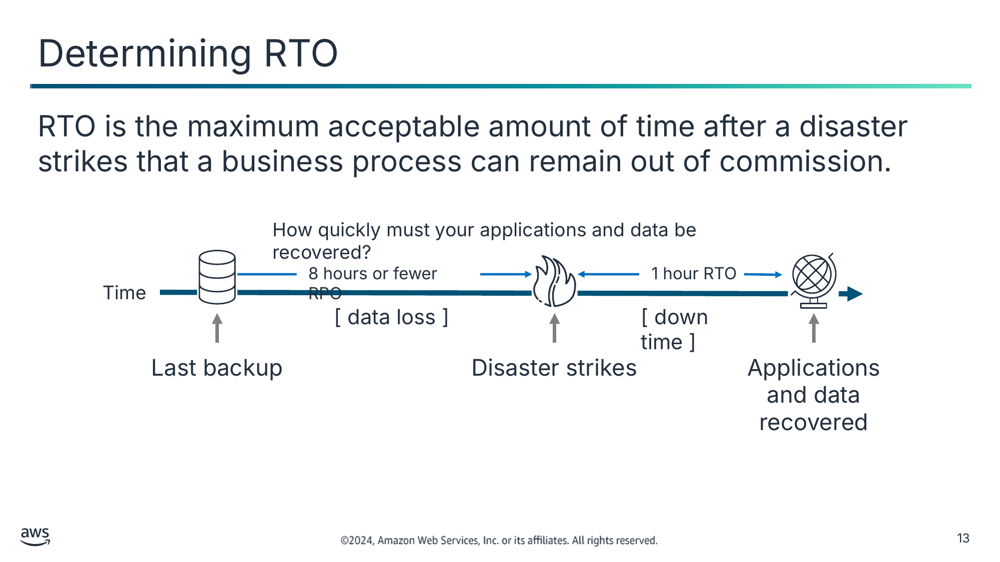

RTO — це максимально прийнятний проміжок часу після катастрофи, протягом якого бізнес-процес може залишатися виведеним з ладу.

Текст зі схеми

How quickly must your applications and data be recovered? (Як швидко мають бути відновлені ваші застосунки та дані?)

8 hours or fewer RPO (RPO 8 годин або менше)

Time (Час)

[ data loss ] ([ втрата даних ])

Last backup (Остання резервна копія)

Disaster strikes (Настає катастрофа)

1 hour RTO (RTO 1 година)

[ down time ] ([ простій ])

Applications and data recovered (Застосунки та дані відновлено)

> **Нотатки:**
>
> |Номер слайда 13  
> |Нотатки для інструктора  
> |  
> |Нотатки для студента  
> Опис зображення: часова лінія, що показує, що катастрофа відбувається через 8 годин або менше після останньої резервної копії. Часова лінія також показує, що після збою знадобиться 1 година, щоб відновити дані з останньої резервної копії. Це встановлює RTO в цій ситуації на рівні 1 години. Кінець опису.  
>
> Ще одна важлива міра плану аварійного відновлення — визначити цільовий час відновлення (recovery time objective, RTO). RTO — це час, який потрібен після збою для відновлення ваших застосунків і даних. Припустімо, катастрофа відбувається о 22:00, а RTO становить 1 годину. У цьому сценарії процес DR має відновити бізнес-процес до прийнятного рівня сервісу до 23:00.  
>
> Компанія зазвичай вирішує, які RPO та RTO прийнятні, і ґрунтує своє рішення на фінансовому впливі на бізнес, коли системи недоступні. Компанія визначає фінансовий вплив, враховуючи багато чинників. Ці чинники включають втрату бізнесу та шкоду репутації через простій і відсутність доступності систем.  
>
> ІТ-організації потім планують рішення для забезпечення економічно ефективного відновлення системи. Рішення ґрунтуються на RPO на часовій лінії та рівні сервісу, що встановлює RTO.

---

## Слайд 14: Приклад: визначення RTO

Визначте, що сервіс продажу квитків для місцевого музичного майданчика можна відновити протягом 2 годин.

Бізнес обчислює, що після 2 годин простою він почне втрачати дохід від втрачених продажів.

Обчисліть, що RTO 2 години прийнятний.

На основі цієї інформації, якщо катастрофа відбулася о 21:00, систему слід повернути в роботу до 23:00.

> **Нотатки:**
>
> |Номер слайда 14  
> |Нотатки для інструктора  
> |Цей приклад стосується бізнесу з продажу квитків. Квитки надходять у продаж у певний час, і клієнти звикли до цього шаблону. Компанія хоче мінімізувати репутаційний ризик у разі простою. У цьому прикладі продажу квитків для місцевого музичного майданчика визначений прийнятний цільовий час відновлення (RTO) — 2 години.  
> |  
> |Нотатки для студента  
> Ось докладніший погляд на обчислення RTO. У цьому прикладі катастрофа відбувається о 21:00. Було визначено, що після збою знадобиться 2 години, щоб відновити дані з останньої резервної копії. У цьому сценарії процес DR має відновити бізнес-процес до прийнятного рівня сервісу до 23:00.

---

## Слайд 15: Підготовка BCP

План безперервності бізнесу (business continuity plan, BCP) — це система запобігання потенційним загрозам для компанії та відновлення після них.

BCP складається з такого:

- Аналіз впливу на бізнес
- Оцінка ризиків
- План аварійного відновлення
- Оцінені й визначені RPO та RTO

> **Нотатки:**
>
> |Номер слайда 15  
> |Нотатки для інструктора  
> |Для цієї теми можна послатися на допис у блозі «The Importance of IT Business Continuity Planning for Small and Medium Businesses». Він надає пояснення проведення аналізу впливу на бізнес, визначення ключових елементів відновлення планів аварійного відновлення (DR) та впровадження планів на основі аналізу впливу. Марковані списки та навідні запитання допоможуть студентам контекстуалізувати, з чого складається план безперервності бізнесу (BCP) для малого та середнього бізнесу. Посилання на допис у блозі є в документі ресурсів курсу.  
> |  
> |Нотатки для студента  
> Ваш план аварійного відновлення має бути підмножиною плану безперервності бізнесу (BCP) вашої організації. Дотримуватися агресивних цілей аварійного відновлення безглуздо, якщо цілі робочого навантаження неможливо досягти через вплив катастрофи на бізнес-елементи, зовнішні для вашого робочого навантаження. Наприклад, землетрус може завадити вам транспортувати товари, придбані у вашому застосунку електронної комерції. Навіть якщо ефективне DR підтримує функціонування вашого робочого навантаження, ваш BCP має враховувати транспортні потреби. Ваша стратегія DR має ґрунтуватися на бізнес-вимогах, пріоритетах і контексті.  
>
> Організації будь-якого розміру, великі й малі, часто мають BCP. Типова частина BCP — забезпечення безперервності ІТ-сервісів, зокрема планування ІТ-аварійного відновлення.  
>
> Одна з найважливіших мір плану аварійного відновлення — визначити ваш RPO. Щоб обчислити RPO, спершу визначте, яка втрата даних прийнятна згідно з вашим BCP. Потім з’ясуйте, як швидко ця втрата даних може відбутися, як часове вимірювання.  
>
> Також важливо зазначити, що BCP — це «живий» документ. BCP слід постійно оцінювати й коригувати на основі потреб бізнесу та ресурсів, потрібних для дотримання строків.

---

## Слайд 16: Ключові висновки: стратегії планування на випадок катастрофи

- Збої можуть траплятися будь-коли й у малому, великому чи глобальному масштабі.
- План аварійного відновлення допоможе обмежити вплив на бізнес і клієнтів, коли трапляється катастрофа.
- RPO — це максимально прийнятний обсяг втрати даних після непланового інциденту втрати даних.
- RTO — це проміжок часу, протягом якого застосунок, система та процес можуть бути недоступними без заподіяння значної шкоди бізнесу.
- BCP — це система запобігання потенційним загрозам для компанії та відновлення після них, що включає RPO та RTO.

> **Нотатки:**
>
> |Номер слайда 16  
> |Нотатки для інструктора  
> |  
> |Нотатки для студента

---

## Слайд 17: Планування аварійного відновлення в AWS

Планування на випадок катастрофи

> **Нотатки:**
>
> |Номер слайда 17  
> |Нотатки для інструктора  
> |  
> |Нотатки для студента  
> Цей розділ надає огляд планування аварійного відновлення для категорій сервісів Amazon Web Services (AWS).

---

## Слайд 18: Плани DR охоплюють більше одного регіону

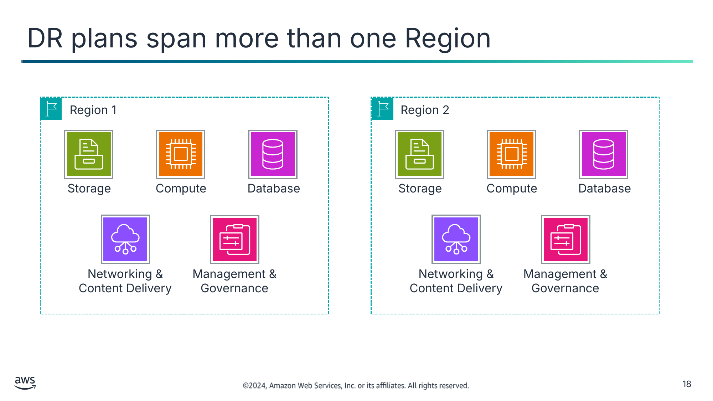

Текст зі схеми

Region 1 (Регіон 1)

Storage (Зберігання)

Compute (Обчислення)

Database (База даних)

Networking &  
Content Delivery (Мережа та доставка контенту)

Management & Governance (Керування та управління)

Region 2 (Регіон 2)

Storage

Compute

Database

Networking &  
Content Delivery

Management & Governance

> **Нотатки:**
>
> |Номер слайда 18  
> |Нотатки для інструктора  
> |Слайди в цьому розділі охоплюють сервіси зберігання, обчислень, мереж, баз даних і оркестрації розгортання.  
> |  
> |Допис у блозі «Creating a Multi-Region Application with AWS Services – Part 1, Compute, Networking, and Security» надає приклад сервісів у двох регіонах AWS. Сервіси безпеки, ідентичності та відповідності — перші міркування під час побудови мультирегіонального застосунку. Далі додаються підключення віртуальної приватної хмари (VPC) і доставка контенту. Нарешті, копіювання образів Amazon Machine Image (AMI) і знімків Amazon Elastic Block Store (Amazon EBS) між регіонами. Допис у блозі пояснює, як зібрати ці сервіси разом для побудови мультирегіонального застосунку. Докладніше див. посилання на допис у блозі в документі ресурсів.  
> |  
> |Нотатки для студента  
> Опис зображення: схема п’яти категорій сервісів у двох регіонах. Зображення показує, як аспекти аварійного відновлення розподіляються між двома регіонами, щоб забезпечити доступність даних незалежно від локалізованих катастроф в одному регіоні.  
> Кінець опису.  
>
> Щоб правильно окреслити область вашого планування аварійного відновлення, потрібно мислити про використання AWS цілісно. Більшість організацій використовують комбінацію сервісів, що їх можна загалом класифікувати як такі, що охоплюють такі п’ять категорій сервісів:  
> Зберігання, як-от Amazon Simple Storage Service (Amazon S3)  
> Обчислення, як-от Amazon Elastic Compute Cloud (Amazon EC2)  
> База даних, як-от Amazon Relational Database Service (Amazon RDS)  
> Мережа та доставка контенту, як-от Amazon Virtual Private Cloud (Amazon VPC)  
> Сервіси оркестрації розгортання в категорії «Керування та управління», як-от AWS CloudFormation  
>
> Якщо трапляється катастрофа, ваші RPO та RTO спрямовуватимуть ваші плани й процедури резервного копіювання та відновлення в кожній із цих галузей сервісів. Вони також, імовірно, впливатимуть на архітектуру вашого продуктивного розгортання.  
>
> Важливо пам’ятати, що хоча недоступність регіону малоймовірна, вона перебуває в межах можливого. Якби якась подія великого масштабу вплинула на регіон — наприклад, падіння метеорита, — чи ваші дані все одно були б доступні? Чи ваші застосунки все одно були б доступними? AWS надає кілька регіонів по всьому світу. Тож можна обрати найбільш доречне розташування для вашого майданчика аварійного відновлення на додачу до майданчика, де ваша система повністю розгорнута.

---

## Слайд 19: Будівельні блоки зберігання та резервного копіювання

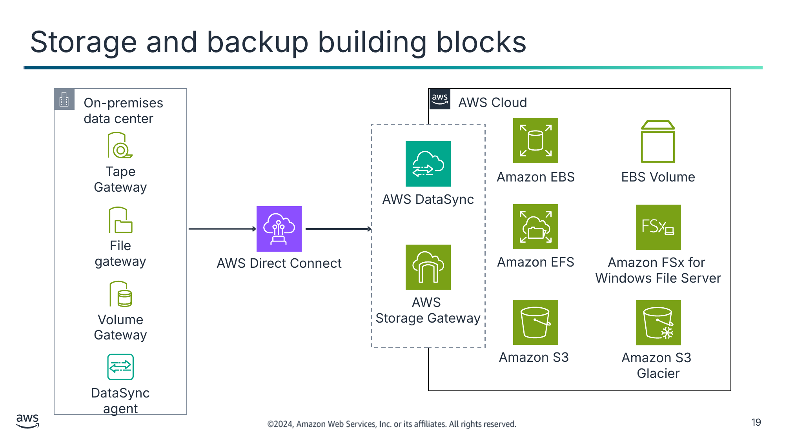

Текст зі схеми

On-premises data center (Локальний центр обробки даних)

AWS Cloud

Tape

Gateway

Amazon EBS

EBS Volume (Том EBS)

AWS DataSync

File

gateway

AWS Direct Connect

Amazon EFS

Amazon FSx for  
Windows File Server

AWS  
Storage Gateway

Volume

Gateway

Amazon S3

Amazon S3  
Glacier

DataSync

agent

> **Нотатки:**
>
> |Номер слайда 19  
> |Нотатки для інструктора  
> |Слайд стосується сервісів зберігання та планів DR, що охоплюють більше одного регіону.  
> |  
> |Нотатки для студента  
> Опис зображення: сервіси архітектури хмари AWS для зберігання даних і сервіси корпоративного центру обробки даних, що передають дані в хмару. Кінець опису.  
>
> Діаграма показує такі сервіси зберігання даних у хмарі:  
> Amazon Elastic Block Store (Amazon EBS)  
> Amazon Elastic File System (Amazon EFS)  
> Amazon S3  
> Amazon Simple Storage Service Glacier (Amazon S3 Glacier)  
>
> Щоб розпочати ваше планування катастроф докладно, перегляньте рівень зберігання даних (відклавши на мить обговорення рівня баз даних). Ваше хмарне сховище AWS може складатися з комбінації блочного сховища, сховища файлової системи та об’єктного сховища. Тим часом ваша організація також може використовувати сервіси AWS, що з’єднують локальний центр обробки даних із хмарою AWS. На наступних кількох слайдах ви дізнаєтеся про високорівневі найкращі практики для кожної з цих трьох галузей.  
>
> Один сервіс, з яким ви можете бути менш знайомі, — AWS DataSync. DataSync забезпечує переміщення великих обсягів даних онлайн між локальним сховищем і Amazon S3, Amazon EFS чи Amazon FSx. Він підтримує скриптові завдання копіювання та заплановані передавання даних із локального сховища Network File System (NFS) і Server Message Block (SMB). Він також може за бажанням використовувати канали AWS Direct Connect.

---

## Слайд 20: Налаштування міжрегіональної реплікації (Cross-Region Replication)

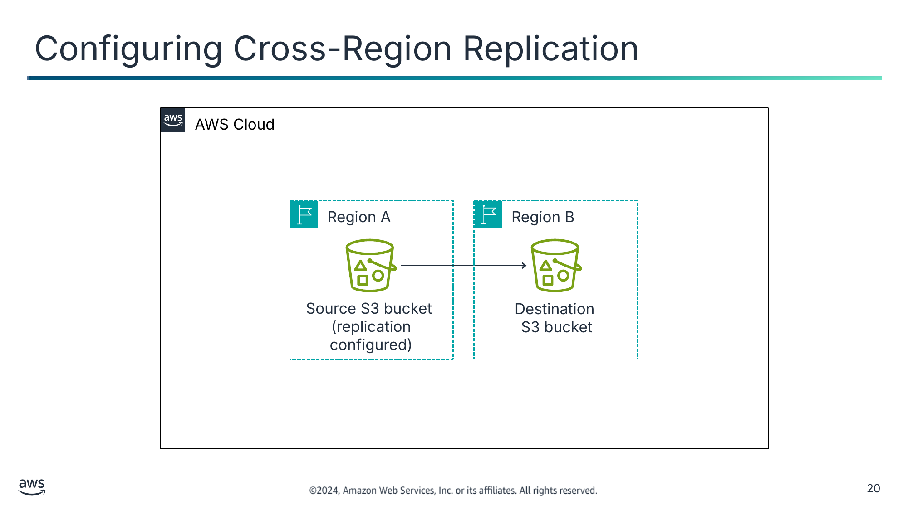

Текст зі схеми

AWS Cloud

Region A (Регіон A)

Region B (Регіон B)

Source S3 bucket

(replication configured) (Вихідний бакет S3 (реплікацію налаштовано))

Destination

S3 bucket (Бакет S3 призначення)

> **Нотатки:**
>
> |Номер слайда 20  
> |Нотатки для інструктора  
> |Цей слайд стосується сервісів зберігання та планів DR, що охоплюють більше одного регіону. На слайді зображено односторонню реплікацію з регіону A до регіону B.  
> |  
> |Нагадайте студентам, що реплікація — це не те саме, що заміна резервних копій. Наприклад, репліки не надають захисту в разі пошкодження даних, особливо джерела.  
> |  
> |Нотатки для студента  
> Опис зображення: схема сервісів хмари AWS. Зображення показує сервіси, що збирають дані з наявного реплікованого вихідного бакета S3 в регіоні A, а потім надсилають їх до бакета S3 призначення в регіоні B. Кінець опису.  
>
> Для багатьох організацій основна частина їхніх даних, що зберігаються в AWS, перебуває в Amazon S3, що забезпечує об’єктне сховище.  
>
> Пригадайте, що бакети S3 існують у певному регіоні. Ви обираєте регіон, коли створюєте бакет. Amazon S3 забезпечує 11 дев’яток (99,999999999 відсотка) довговічності для таких класів зберігання:  
> S3 Standard  
> S3 Standard-Infrequent Access (S3 Standard-IA)  
> S3 One Zone-Infrequent Access (S3 One Zone-IA)  
> Amazon Simple Storage Service (Amazon S3 Glacier)  
>
> S3 Standard, S3 Standard-IA та Amazon S3 Glacier — усі розроблені для збереження даних у разі втрати цілої зони доступності Amazon S3. Вони забезпечують цю стабільність, автоматично зберігаючи ваші об’єкти як мінімум у трьох зонах доступності, кожна з яких віддалена на милі в межах одного регіону.  
>
> Для критичних застосунків і сценаріїв даних, де ви хочете вищого рівня безпеки даних, найкраща практика — налаштувати міжрегіональну реплікацію S3 (Cross-Region Replication, CRR). Для цього ви додаєте конфігурацію реплікації до вашого вихідного бакета. Мінімальна конфігурація має вказувати бакет призначення, до якого ви хочете, щоб Amazon S3 реплікував усі об’єкти чи підмножину всіх об’єктів. Вона також має включати роль AWS Identity and Access Management (IAM), що надає Amazon S3 дозволи на копіювання об’єктів до бакета призначення.  
>
> Скопійовані об’єкти зберігають свої метадані. Бакет призначення може належати до іншого класу зберігання. Наприклад, вміст бакета S3 Standard може реплікуватися до бакета Amazon S3 Glacier, якщо він не потрібен негайно. Об’єктам у бакеті призначення можна призначити іншу власність. Також можна використовувати S3 Replication Time Control (S3 RTC) для реплікації ваших даних між різними регіонами в передбачуваний часовий проміжок. S3 RTC реплікує 4 дев’ятки (99,99 відсотка) нових об’єктів, що зберігаються в Amazon S3, протягом 15 хвилин, що підкріплено угодою про рівень обслуговування (SLA).

---

## Слайд 21: Знімки томів EBS (EBS volume snapshots)

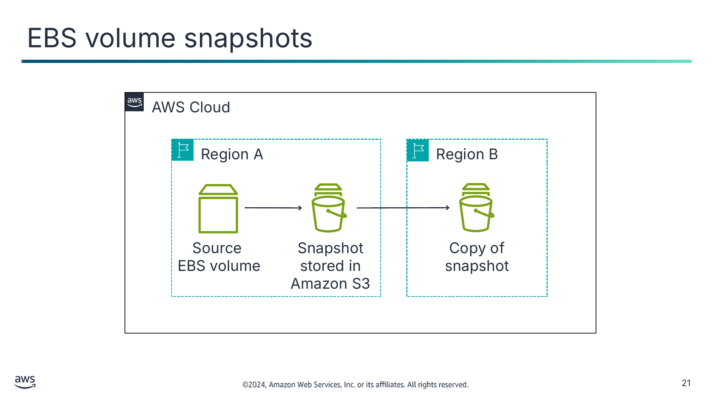

Текст зі схеми

AWS Cloud

Region A (Регіон A)

Region B (Регіон B)

Source

EBS volume (Вихідний том EBS)

Snapshot stored in Amazon S3 (Знімок, збережений в Amazon S3)

Copy of snapshot (Копія знімка)

> **Нотатки:**
>
> |Номер слайда 21  
> |Нотатки для інструктора  
> |Слайд стосується сервісів зберігання та планів DR, що охоплюють більше одного регіону.  
> |  
> |AWS надає різні технології знімків, щоб допомогти клієнтам задовольнити їхні потреби в захисті та відновленні даних. Amazon Relational Database Service (Amazon RDS) дає змогу створювати автоматичні чи ручні знімки баз даних ваших екземплярів баз даних. Amazon FSx for NetApp ONTAP надає повністю кероване файлове сховище з можливостями знімків NetApp. Ці технології знімків забезпечують інкрементні резервні копії блокових томів сховища, баз даних і кешів у пам’яті в AWS. Цей слайд зосереджений на Amazon EBS, який можна використовувати для створення знімків томів Amazon EBS на певний момент часу та відтворення томів із цих знімків.  
> |  
> |Нотатки для студента  
> Опис зображення: схема сервісів хмари AWS. Зображення показує сервіси, що збирають дані з вихідного тому EBS в регіоні A, який містить інкрементні резервні копії на знімку Amazon S3. Amazon S3 надсилає копію знімка до бакета S3 призначення в регіоні B. Кінець опису.  
>
> Щодо блочного сховища, можна створювати резервні копії даних, що перебувають на томах EBS, в Amazon S3, роблячи знімки на певний момент часу. Знімки — це інкрементні резервні копії, що означає, що вони зберігають лише блоки на пристрої, що змінилися з моменту вашого останнього знімка. Ця архітектура мінімізує час, потрібний для створення знімка, і заощаджує на витратах на зберігання, не дублюючи дані.  
>
> Кожен знімок містить усю інформацію, потрібну для відновлення ваших даних (з моменту створення знімка) на новий том EBS. Коли ви створюєте том EBS на основі знімка, новий том починається як точна репліка оригінального тому. Цей оригінальний том використовується для створення знімка. Реплікований том завантажує дані у фоновому режимі, тож його можна використовувати негайно. Якщо ви звертаєтеся до даних, які ще не завантажено, том негайно завантажує запитувані дані з Amazon S3. Потім він продовжує завантажувати решту даних тому у фоновому режимі.  
>
> Томи Amazon EBS забезпечують сховище поза екземпляром, що зберігається незалежно від життя екземпляра та реплікується між кількома серверами в зоні доступності. Томи запобігають втраті даних від відмови будь-якого окремого компонента. Після створення знімка він завершує копіювання в Amazon S3 (коли статус знімка — completed). Потім його можна скопіювати з одного регіону в інший чи в межах того самого регіону.  
>
> Можна використовувати Amazon Data Lifecycle Manager для автоматизації створення, зберігання та видалення знімків, що створюють резервні копії ваших томів EBS. Автоматизація керування знімками допомагає виконати таке:  
> Захистити цінні дані, примусово дотримуючись регулярного розкладу резервного копіювання.  
> Зберігати резервні копії, як того вимагають аудитори чи внутрішня відповідність.  
> Зменшити витрати на зберігання, видаляючи застарілі резервні копії  
>
> Не можна створювати знімки томів сховища екземпляра EC2 (instance store). Однак якщо потрібно створити резервну копію даних зі сховища екземпляра, можна створити новий том EBS і відформатувати його. Потім змонтуйте новий том до гостьової операційної системи (ОС) екземпляра EC2 і скопіюйте дані з тому сховища екземпляра на том EBS. Пригадайте, що томи сховища екземпляра забезпечують тимчасове блочне сховище, що добре підходить для інформації, яка часто змінюється, як-от буфери, кеші й тимчасові дані (scratch data). Ви можете виявити, що потрібно створити резервну копію даних зі сховища екземпляра. Якщо так, можливо, варто переосмислити, навіщо ви взагалі зберігаєте ці дані на томі сховища екземпляра.

---

## Слайд 22: Реплікація файлової системи

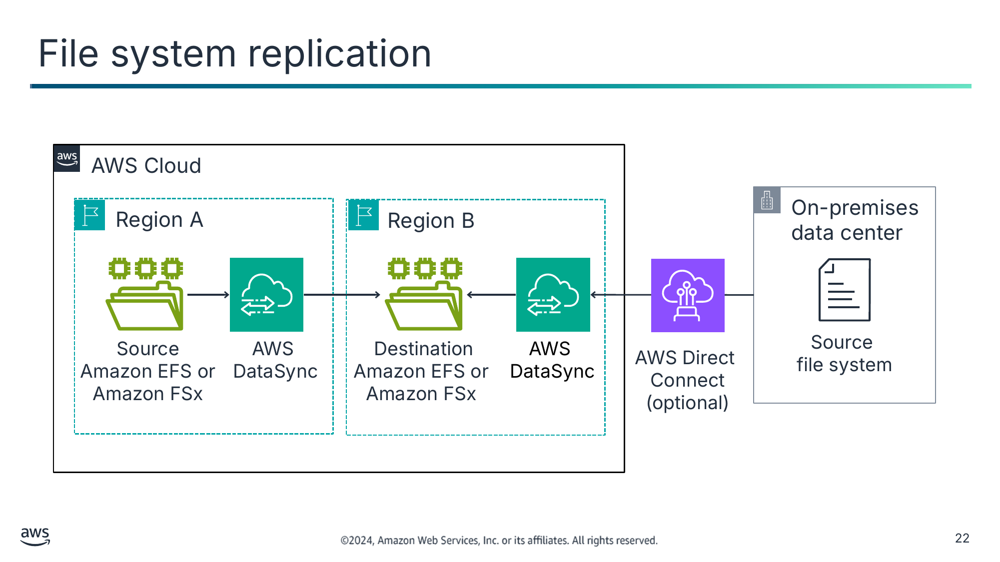

Текст зі схеми

AWS Cloud

On-premises  
data center (Локальний центр обробки даних)

Region A (Регіон A)

Region B (Регіон B)

Source

Amazon EFS or  
Amazon FSx (Вихідний Amazon EFS чи Amazon FSx)

AWS  
DataSync

Destination Amazon EFS or  
Amazon FSx (Amazon EFS чи Amazon FSx призначення)

AWS  
DataSync

Source

file system (Вихідна файлова система)

AWS Direct  
Connect (optional) (AWS Direct Connect (необов’язково))

> **Нотатки:**
>
> |Номер слайда 22  
> |Нотатки для інструктора  
> |Це останній слайд, що стосується сервісів зберігання та планів DR, що охоплюють більше одного регіону.  
> |  
> |Нотатки для студента  
> Опис зображення: схема сервісів хмари AWS. Зображення показує сервіси, що збирають дані з вихідної файлової системи в регіоні A через DataSync. Потім сервіси надсилають їх до файлової системи Amazon FSx чи EFS призначення в регіоні B. Діаграма також показує варіант використання AWS Direct Connect для витягування даних із додаткової вихідної файлової системи. Кінець опису.  
>
> Бізнесу потрібен доступ до його файлів. Реплікація вашого файлового сховища — найкраща практика, що гарантує, що ви й надалі матимете доступ до своїх файлів.  
>
> DataSync пришвидшує переміщення даних між двома файловими системами Amazon EFS чи Amazon FSx for Windows File Server або між локальним сховищем і файловим сховищем AWS. DataSync можна використовувати для передавання наборів даних через AWS Direct Connect чи інтернет. Використовуйте сервіс для одноразових міграцій даних чи поточних робочих процесів для захисту та відновлення даних.  
>
> FSx for Windows File Server щодня автоматично створює резервні копії ваших файлових систем, і його можна використовувати для створення додаткових резервних копій у будь-який момент. Amazon FSx зберігає резервні копії в Amazon S3. За замовчуванням щоденні резервні копії створюються автоматично під час 30-хвилинного вікна резервного копіювання вашої файлової системи. Період зберігання щоденних резервних копій, указаний для вашої файлової системи, визначає кількість днів, протягом яких зберігаються ваші щоденні автоматичні резервні копії. (За замовчуванням це 7 днів.)  
>
> Так само, як більшість класів зберігання Amazon S3 реплікують дані між зонами доступності, це роблять і файлові системи Amazon EFS та FSx for Windows File Server. Ваші вимоги до аварійного відновлення можуть вказувати, що вам потрібне мультирегіональне рішення відновлення. Якщо так, найкраща практика — реплікувати ваші файлові системи Amazon EFS та FSx for Windows File Server до другого регіону. Для цієї реплікації можна використовувати DataSync. Щоб зробити передавання файлів між двома файловими системами EFS за допомогою DataSync зручнішим, можна використовувати AWS DataSync In-Cloud QuickStart and Scheduler.  
>
> Можна дізнатися, як використовувати AWS Backup для керування резервними копіями томів EBS і автоматизації резервного копіювання файлових систем EFS. Докладніше див. «Scheduling Automated Backups Using Amazon EFS and AWS Backup» у блозі AWS Storage Blog.

---

## Слайд 23: Відновлення обчислювальної інфраструктури

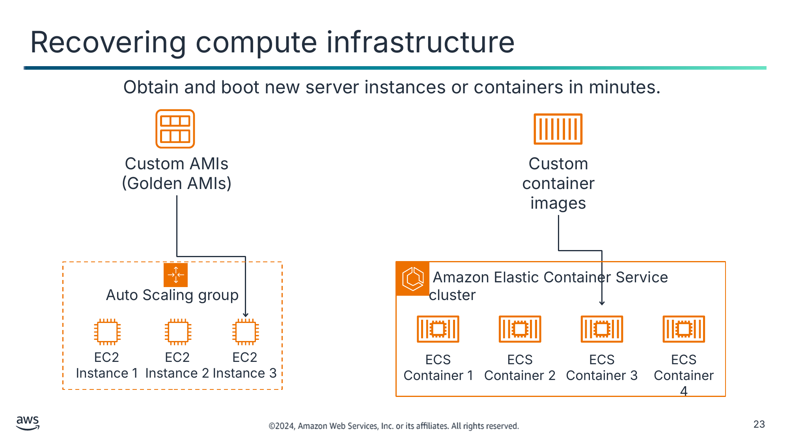

Отримуйте й запускайте нові екземпляри серверів чи контейнери за лічені хвилини.

Текст зі схеми

Custom AMIs (Golden AMIs) (Користувацькі AMI («золоті» AMI))

Custom container images (Користувацькі образи контейнерів)

Auto Scaling group (Група Auto Scaling)

 Amazon Elastic Container Service cluster (Кластер Amazon Elastic Container Service)

EC2 Instance 1 (Екземпляр EC2 1)

EC2 Instance 2

EC2 Instance 3

ECS Container 1 (Контейнер ECS 1)

ECS Container 2

ECS Container 3

ECS Container 4

> **Нотатки:**
>
> |Номер слайда 23  
> |Нотатки для інструктора  
> |Слайд стосується обчислювальних сервісів та планів DR, що охоплюють більше одного регіону.  
> |  
> |Нотатки для студента  
> Можна налаштувати автоматичне відновлення екземпляра EC2, коли перевірка стану системи базового апаратного забезпечення не проходить. Екземпляр перезавантажується (на новому апаратному забезпеченні, якщо потрібно), але зберігає свій ідентифікатор екземпляра, IP-адреси, приєднання томів EBS та інші подробиці конфігурації. Для повного відновлення переконайтеся, що екземпляр налаштовано на автоматичний запуск будь-яких сервісів чи застосунків як частини процесу його ініціалізації.  
>
> Образи Amazon Machine Images (AMI) попередньо налаштовані з операційними системами, а деякі попередньо налаштовані AMI також можуть включати стеки застосунків. Також можна налаштувати власні користувацькі AMI. У контексті аварійного відновлення AWS рекомендує налаштувати й ідентифікувати власні AMI, щоб вони запускалися як частина вашої процедури відновлення. Такі AMI мають бути попередньо налаштовані з операційною системою на ваш вибір на додачу до відповідних частин стека застосунку. «Золотий» AMI (golden AMI) — це AMI, попередньо налаштований з усіма потрібними застосунками та сервісами для виконання призначеної функції.  
>
> Можна використовувати «золотий» AMI з найновішим кодом, але це потребує нового AMI з кожною публікацією коду й ускладнює DevOps. Оскільки конфігурації системи змінюються не так часто, як кодова база, часто простіше створити AMI і використати скрипт даних користувача (user data) для витягування найновішого коду та конфігурації з репозиторію коду під час розгортання.

---

## Слайд 24: Використання EventBridge для регіонального відмовостійкого перемикання (regional failover)

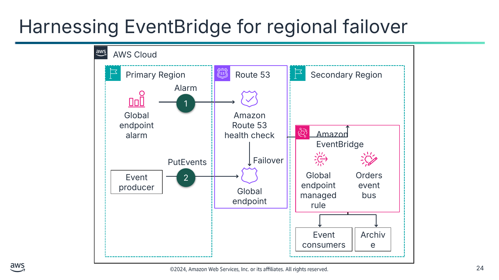

AWS Cloud

Текст зі схеми

Primary Region (Основний регіон)

Route 53

Secondary Region (Вторинний регіон)

Alarm (Сигнал)

1

Global endpoint alarm (Сигнал глобальної кінцевої точки)

Amazon Route 53 health check (Перевірка стану Amazon Route 53)

Amazon EventBridge

PutEvents

Failover (Відмовостійке перемикання)

Event producer (Виробник подій)

2

Global endpoint managed rule (Кероване правило глобальної кінцевої точки)

Orders event bus (Шина подій замовлень)

Global endpoint (Глобальна кінцева точка)

Event consumers (Споживачі подій)

Archive (Архів)

> **Нотатки:**
>
> |Номер слайда 24  
> |Нотатки для інструктора  
> |Слайд стосується мережевих сервісів і доставки контенту та планів DR, що охоплюють більше одного регіону.  
> |Блог AWS «Introducing global endpoints for Amazon EventBridge» ілюструє, як глобальні кінцеві точки перенаправляють події, що доставляються з шини подій в основному регіоні, до шини подій у вторинному регіоні, коли сигнали CloudWatch запускають відмовостійке перемикання перевірки стану Route 53. Посилання надано в розділі ресурсів вмісту вашого онлайн-курсу.  
> |  
> |Нотатки для студента  
> Опис зображення: діаграма показує, як глобальні кінцеві точки перенаправляють події з основної шини подій до вторинної шини подій. Це перенаправлення відбувається, коли сигнали CloudWatch викликають відмовостійке перемикання перевірки стану Route 53. Кінець опису.  
>
> Цей потік подій може бути перерваний у разі збою сервісу. У цьому сценарії виробники подій в основному регіоні не можуть виконати PutEvents до своєї шини подій, і реплікація подій до вторинного регіону порушується.  
>
> Щоб додати більше стійкості мультирегіональним архітектурам, тепер можна використовувати глобальні кінцеві точки. Глобальні кінцеві точки розв’язують ці проблеми, запроваджуючи дві основні можливості сервісу:  
> Глобальна кінцева точка — це керована кінцева точка DNS Route 53. Вона маршрутизує події до шин подій у будь-якому з регіонів залежно від стану сервісу в основному регіоні.  
> Є метрика Amazon EventBridge під назвою IngestionToInvocationStartLatency. Ця метрика вимірює час до виклику першої цілі після приймання події. Вона показує час обробки подій від моменту, коли їх приймає EventBridge, до моменту першого виклику цілі у ваших правилах. Це метрика рівня сервісу, що вимірюється за всіма вашими правилами та дає індикацію стану сервісу EventBridge. Будь-які тривалі періоди високої затримки понад 30 секунд можуть указувати на збій сервісу.

---

## Слайд 25: Проєктування стійкості та відновлення

Route 53

ELB

Amazon VPN

AWS Direct Connect

- Забезпечує балансування навантаження на основі DNS
- Забезпечує базове відмовостійке перемикання між кінцевими точками чи вебсайтами S3

- Забезпечує розподіл трафіку
- Робить впровадження аварійного відновлення простим

Забезпечує безпечний доступ до ваших локальних мережевих ресурсів із вашої Amazon VPC через з’єднання VPN

Забезпечує виділене мережеве з’єднання для швидкого, стабільного передавання даних між локальним середовищем і AWS

> **Нотатки:**
>
> |Номер слайда 25  
> |Нотатки для інструктора  
> |Слайд стосується мережевих сервісів і доставки контенту та планів DR, що охоплюють більше одного регіону.  
> |  
> |Нотатки для студента  
> Коли ви працюєте над відновленням після катастрофи, вам, імовірно, знадобиться змінити мережеві налаштування, щоб виконати відмовостійке перемикання вашої системи на інший майданчик. AWS пропонує кілька сервісів і функцій, які можна використовувати для керування мережевими налаштуваннями та їх зміни, деякі з яких виділено нижче.  
>
> Route 53 забезпечує балансування навантаження та можливості мережевої маршрутизації, які можна використовувати для розподілу мережевого трафіку. Він також дає змогу виконувати відмовостійке перемикання між кількома кінцевими точками й навіть на статичний вебсайт, розміщений в Amazon S3.  
>
> Сервіс Elastic Load Balancing (ELB) автоматично розподіляє вхідний трафік застосунку між кількома екземплярами EC2. Його можна використовувати для досягнення відмовостійкості у ваших застосунках, забезпечуючи потужність балансування навантаження, потрібну у відповідь на вхідний трафік застосунку. Можна заздалегідь виділити балансувальник навантаження, щоб його DNS-ім’я було вже відоме, що може зробити впровадження вашого плану DR простішим.  
>
> Amazon VPN можна використовувати для розширення наявної топології локальної мережі до хмари. Це розширення може бути особливо доречним, коли ви відновлюєте корпоративні застосунки, що можуть розміщуватися у внутрішній мережі.  
>
> Нарешті, AWS Direct Connect робить налаштування виділеного мережевого з’єднання з локального центру обробки даних до AWS ефективнішим. Використання AWS Direct Connect може зменшити мережеві витрати, збільшити пропускну здатність мережі й забезпечити стабільніший мережевий досвід, ніж з’єднання через інтернет.

---

## Слайд 26: Підтримка відновлення баз даних

Amazon RDS

DynamoDB

- Зберігайте знімок в окремому регіоні.
- Використовуйте репліки для читання та розгортання Multi-AZ.
- Зберігайте автоматичні резервні копії.

- Створюйте резервні копії цілих таблиць.
- Використовуйте відновлення на певний момент часу (point-in-time recovery) для відновлення таблиць.
- Створюйте резервні копії.
- Використовуйте глобальні таблиці для побудови мультирегіональної, мультиактивної бази даних.

> **Нотатки:**
>
> |Номер слайда 26  
> |Нотатки для інструктора  
> |Слайд стосується сервісів баз даних та планів DR, що охоплюють більше одного регіону.  
> |  
> |Нотатки для студента  
> AWS надає багато сервісів баз даних. Деякі ключові функції Amazon RDS та Amazon DynamoDB, що стосуються сценаріїв аварійного відновлення, пояснюються нижче.  
>
> Розгляньте використання Amazon RDS на етапі підготовки DR для зберігання копії ваших критичних даних у базі даних, що вже працює. Потім використовуйте Amazon RDS на етапі відновлення DR для запуску вашої продуктивної бази даних.  
>
> Якщо ви впроваджуєте мультирегіональний план DR, Amazon RDS дає вам змогу зберігати дані знімка, захопленого в одному регіоні, в іншому регіоні. Ручним знімком можна поділитися з до 20 інших акаунтів AWS.  
>
> Поєднуючи репліки для читання з розгортаннями Multi-AZ, можна побудувати стійку стратегію аварійного відновлення й зробити процес оновлення рушія бази даних простішим. Використовуючи репліки для читання Amazon RDS, можна створити одну чи кілька копій вашого екземпляра бази даних лише для читання. Ці копії можна створювати в тому самому регіоні чи в іншому регіоні. Оновлення вихідної бази даних потім асинхронно копіюються до ваших реплік для читання. Репліки для читання можна підвищити до самостійного екземпляра бази даних за потреби.  
>
> Використовуйте DynamoDB на етапі підготовки для копіювання даних до DynamoDB в іншому регіоні чи в Amazon S3. Під час етапу відновлення DR можна масштабуватися вгору за лічені хвилини. Глобальні таблиці DynamoDB автоматично реплікують ваші таблиці DynamoDB між регіонами на ваш вибір. Глобальні таблиці DynamoDB дають вашим застосункам змогу залишатися високодоступними, навіть якщо відбувається катастрофа на рівні регіону.

---

## Слайд 27: Реплікація та повторне розгортання середовищ

CloudFormation

OpsWorks

- Використовуйте шаблони для швидкого розгортання колекцій ресурсів за потреби.
- Дублюйте продуктивні середовища в новому регіоні чи віртуальній приватній хмарі (VPC) за лічені хвилини.

- Керуйте застосунками й розгортайте їх у парках.

> **Нотатки:**
>
> |Номер слайда 27  
> |Нотатки для інструктора  
> |Слайд стосується сервісів оркестрації розгортання в сервісах «Керування та управління» та планів DR, що охоплюють більше одного регіону.  
> |  
> |Нотатки для студента  
> Коли ви використовуєте сервіси автоматизації, ви можете швидко реплікувати чи повторно розгортати середовища.  
>
> З AWS CloudFormation можна змоделювати та розгорнути всю вашу інфраструктуру в текстовому файлі. Цей шаблон може стати єдиним джерелом істини для вашої інфраструктури. Коли ви використовуєте CloudFormation для керування всією вашою інфраструктурою, він також стає потужним інструментом у вашому наборі планування аварійного відновлення. Його можна використовувати для дублювання складних продуктивних середовищ за лічені хвилини, наприклад, у новий регіон чи нову віртуальну приватну хмару (VPC).  
>
> CloudFormation розгортає ваші ресурси повторюваним способом, що дає вам змогу будувати й перебудовувати вашу інфраструктуру та застосунки. Вам не потрібно виконувати ручні дії чи писати користувацькі скрипти.  
>
> Якщо ви використовуєте AWS Elastic Beanstalk для розміщення ваших застосунків, можна завантажити оновлений пакет джерела застосунку й розгорнути його в середовищі Elastic Beanstalk. Як варіант, можна повторно розгорнути раніше завантажену версію застосунку. Пам’ятайте, CloudFormation стосується лише конфігурації ресурсів. Він не стосується даних, що можуть бути пов’язані з ресурсами. Однак Elastic Beanstalk призначений для застосунку, а не для даних.  
>
> Нарешті, AWS OpsWorks — це сервіс керування застосунками, що забезпечує керування конфігурацією та автоматизацію для розгортання й експлуатації застосунків усіх типів і розмірів. Можна визначити своє середовище як ряд рівнів (layers) і налаштувати кожен рівень як ярус вашого застосунку. OpsWorks має автоматичну заміну хостів, тож якщо виникає збій екземпляра, його автоматично замінюють. OpsWorks можна використовувати на етапі підготовки DR для створення шаблона вашого середовища й поєднувати з CloudFormation на етапі відновлення DR.

---

## Слайд 28: Ключові висновки: планування аварійного відновлення в AWS

- Використовуйте такі функції, як CRR, знімки томів EBS і знімки Amazon RDS, для захисту даних.
- Використовуйте мережеві функції, як-от відмовостійке перемикання Route 53 і ELB, для покращення доступності застосунку.
- Використовуйте сервіси автоматизації, як-от CloudFormation, як частину вашої стратегії DR для швидкого розгортання дублікатів середовищ за потреби.
- Використовуйте EventBridge, щоб застосовувати глобальні кінцеві точки для автоматичного відновлення даних і відмовостійкого перемикання на працездатні сервери.

> **Нотатки:**
>
> |Номер слайда 28  
> |Нотатки для інструктора  
> |  
> |Нотатки для студента

---

## Слайд 29: Шаблони аварійного відновлення

Планування на випадок катастрофи

> **Нотатки:**
>
> |Номер слайда 29  
> |Нотатки для інструктора  
> |  
> |Нотатки для студента  
> Цей розділ надає огляд шаблонів аварійного відновлення.

---

## Слайд 30: Поширені шаблони аварійного відновлення в AWS

Резервне копіювання та відновлення (Backup and restore)

Пілотне світло (Pilot light)

Тепле резервування (Warm standby)

Мультисайтовий (Multi-site)

Кожен шаблон підходить до різної комбінації RPO, RTO та економічної ефективності.

> **Нотатки:**
>
> |Номер слайда 30  
> |Нотатки для інструктора  
> |Це чотири шаблони аварійного відновлення, що розглядаються в цьому розділі. Кожен шаблон має архітектурну діаграму та поради щодо впровадження (для етапу підготовки та на випадок катастрофи).  
> |  
> |Відмінності шаблонів — у цільовій точці відновлення (RPO), цільовому часі відновлення (RTO) та економічній ефективності, які вони забезпечують. Вибір залежить від бізнес-сценарію використання.  
> |  
> |Нотатки для студента  
> Щоб мінімізувати вплив катастрофи, організації мають інвестувати час і ресурси в планування та підготовку до подолання катастроф і відновлення після них. Обсяг інвестицій у планування на випадок катастрофи для певної системи може відрізнятися.  
>
> Пригадайте, що цільова точка відновлення (RPO) — це максимально прийнятний обсяг втрати даних після непланового інциденту втрати даних, виражений як проміжок часу. Раніше ви дізналися, що цільовий час відновлення (RTO) — це максимально прийнятний проміжок часу після катастрофи, протягом якого бізнес-процес може залишатися виведеним з ладу. Для різних комбінацій цільової точки відновлення (RPO), цільового часу відновлення (RTO) та економічної ефективності організації часто використовують чотири поширені шаблони аварійного відновлення. Це резервне копіювання та відновлення (backup and restore), «пілотне світло» (pilot light), «тепле резервування» (warm standby) і мультисайтовий (multi-site).  
>
> Як ви дізнаєтеся в цьому розділі, кожен шаблон добре підходить до різних вимог. Деякі шаблони забезпечують швидший RPO і швидший RTO, але коштують більше в підтримці.

---

## Слайд 31: Шаблон резервного копіювання та відновлення (backup and restore)

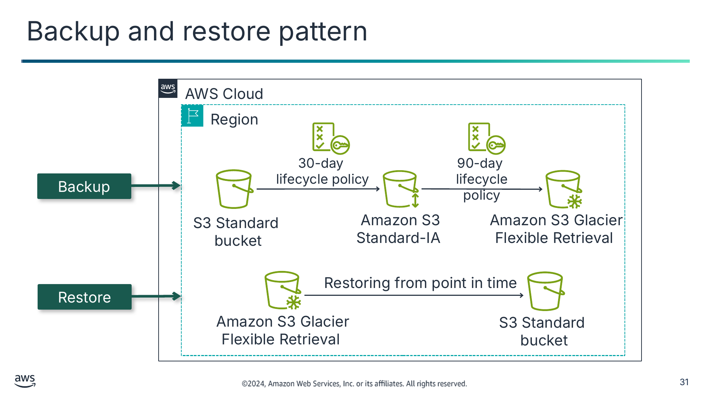

Резервне копіювання (Backup)

Відновлення (Restore)

Текст зі схеми

AWS Cloud

Region (Регіон)

30-day

lifecycle policy (30-денна політика життєвого циклу)

90-day

lifecycle policy (90-денна політика життєвого циклу)

S3 Standard

bucket

Amazon S3 Standard-IA

Amazon S3 Glacier Flexible Retrieval

Restoring from point in time (Відновлення з певного моменту часу)

Amazon S3 Glacier Flexible Retrieval

S3 Standard  
bucket

> **Нотатки:**
>
> |Номер слайда 31  
> |Нотатки для інструктора  
> |  
> |Нотатки для студента  
> Опис зображення: верхня діаграма показує процес резервного копіювання за допомогою політики життєвого циклу. Нижня діаграма показує процес відновлення з певного моменту часу.  
> Кінець опису.  
>
> Перший підхід до аварійного відновлення — шаблон резервного копіювання та відновлення. Резервне копіювання та відновлення — придатний підхід для пом’якшення втрати чи пошкодження даних. Цей підхід також можна використовувати для пом’якшення регіональної катастрофи шляхом реплікації даних до інших регіонів AWS або для пом’якшення відсутності надлишковості для робочих навантажень, розгорнутих в єдиній зоні доступності. У більшості традиційних середовищ дані регулярно копіюються й надсилаються за межі майданчика. Якщо ви використовуєте цей метод, відновлення вашої системи після катастрофи може тривати довго.  
>
> Amazon S3 забезпечує зручно доступне призначення для резервних даних, що можуть швидко знадобитися для виконання відновлення. Передавання даних до Amazon S3 і з нього зазвичай виконується через мережу й тому доступне з будь-якого розташування. У прикладі сценарію резервного копіювання дані копіюються з бакета S3 кожні 30 днів.  
>
> DataSync чи Amazon S3 Transfer Acceleration можна за бажанням використовувати як частину цієї конфігурації для автоматизації чи збільшення швидкості передавання даних. Потім конфігурація життєвого циклу S3, застосована до бакета, пізніше переміщує резервні дані до дешевших класів зберігання Amazon S3 кожні 90 днів. Резервні дані переміщуються до Amazon S3 Glacier Flexible Retrieval чи Amazon S3 Standard-IA, що заощаджує кошти в міру старіння даних і нечастого доступу до них.  
>
> У прикладі сценарію відновлення локальні дані можуть бути тимчасово чи постійно втрачені. Тоді резервні дані можна завантажити з Amazon S3 назад на локальні сервери. Якщо ваш корпоративний центр обробки даних залишається в режимі офлайн, можна додатково забезпечити здатність відновити ваші дані на ваші сервери. Можна мати сервери Amazon EC2, готові до роботи, у VPC у вашому призначеному регіоні аварійного відновлення. Цей регіон може підключатися до бакета S3, що містить ваші резервні дані застосунку. Він може читати ці дані й, можливо, тимчасово розміщувати ваші застосунки, поки ви працюєте над відновленням вашого центру обробки даних.

---

## Слайд 32: Шаблон резервного копіювання та відновлення з AWS Storage Gateway

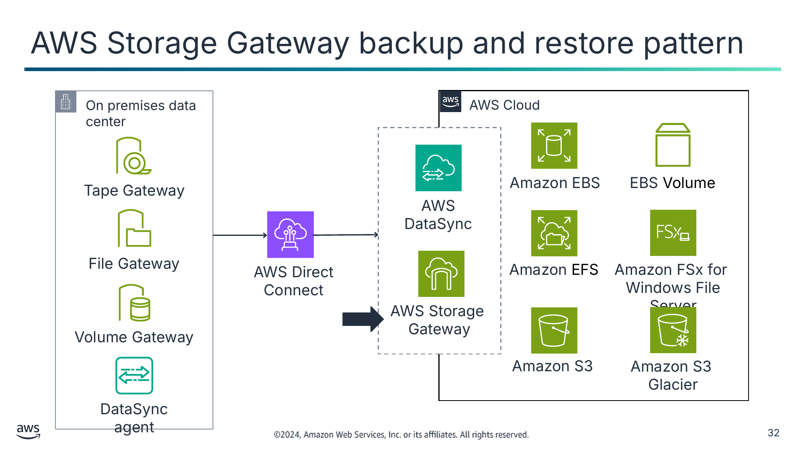

Текст зі схеми

On premises data center (Локальний центр обробки даних)

AWS Cloud

Tape Gateway

Amazon EBS

EBS Volume (Том EBS)

AWS DataSync

File Gateway

AWS Direct Connect

Amazon EFS

Amazon FSx for  
Windows File Server

AWS Storage  
Gateway

Volume Gateway

Amazon S3

Amazon S3  
Glacier

DataSync agent

> **Нотатки:**
>
> |Номер слайда 32  
> |Нотатки для інструктора  
> |  
> |Нотатки для студента  
> Опис зображення: сервіси архітектури хмари AWS для зберігання даних і сервіси корпоративного центру обробки даних, що передають дані в хмару. Кінець опису.  
>
> Як частину шаблону резервного копіювання та відновлення, можливо, ви вважатимете доцільним використовувати AWS Storage Gateway.  
>
> AWS Storage Gateway — це сервіс гібридного сховища, що дає вашим локальним застосункам змогу використовувати сховище хмари AWS. Сервіс можна використовувати для резервного копіювання й архівування, аварійного відновлення, обробки даних у хмарі, розшарування сховища (storage tiering) і міграції.  
>
> Ваші застосунки підключаються до сервісу через віртуальну машину (VM) чи апаратний пристрій-шлюз за допомогою стандартних протоколів зберігання. Ці протоколи включають NFS, SMB, віртуальну стрічкову бібліотеку (VTL) та Internet Small Computer System Interface (iSCSI). Шлюз підключається до сервісів зберігання AWS, як-от Amazon S3, Amazon S3 Glacier та Amazon EBS, що забезпечують сховище для файлів, томів і віртуальних стрічок. Сервіс включає оптимізований механізм передавання даних. Він забезпечує керування пропускною здатністю, автоматизовану мережеву стійкість і ефективне передавання даних, на додачу до локального кешу для доступу з низькою затримкою до ваших найактивніших даних у локальному середовищі.  
>
> З шлюзом файлів (file gateway) ви зберігаєте й отримуєте об’єкти (за допомогою протоколу NFS чи SMB) в Amazon S3. Ви використовуєте локальний кеш для доступу з низькою затримкою до ваших останніх використовуваних даних. Коли ваші файли передаються до Amazon S3, вони зберігаються як об’єкти й до них можна звертатися через точку монтування NFS.  
>
> Інтерфейс томів Storage Gateway подає вашим застосункам блокові дискові томи, до яких можна звертатися за допомогою протоколу iSCSI. Дані на цих томах резервно копіюються як знімки Amazon EBS на певний момент часу, що дає вам змогу звертатися до них через Amazon EC2 за потреби.  
>
> Інтерфейс стрічок Storage Gateway подає Storage Gateway вашому наявному застосунку резервного копіювання як віртуальну стрічкову бібліотеку. Ця бібліотека складається з віртуального змінювача носіїв і віртуальних стрічкових накопичувачів. Ви можете й надалі використовувати свої наявні застосунки резервного копіювання, записуючи на колекцію віртуальних стрічок. Кожна віртуальна стрічка зберігається в Amazon S3. Коли вам більше не потрібен доступ до даних на віртуальних стрічках, ваш застосунок резервного копіювання архівує їх із віртуальної стрічкової бібліотеки в Amazon S3 Glacier.

---

## Слайд 33: Впровадження резервного копіювання та відновлення

Етап підготовки (Preparation phase)

У разі катастрофи (In case of disaster)

- Створіть резервні копії поточних систем.
- Зберігайте резервні копії в Amazon S3.
- Задокументуйте процедуру відновлення з резервних копій.

- Отримайте резервні копії з Amazon S3.
- Відновіть потрібну інфраструктуру.
- Відновіть систему з резервної копії.
- Спрямуйте трафік до нової системи.

> **Нотатки:**
>
> |Номер слайда 33  
> |Нотатки для інструктора  
> |Допис у блозі Disaster Recovery (DR) Architecture on AWS, Part II: Backup and Restore with Rapid Recovery містить архітектурні діаграми, що показують, як AWS Backup використовується в цьому шаблоні DR. Цей ресурс розширює концепцію максимального використання резервного копіювання та відновлення. Це робиться шляхом виявлення впливу катастрофи; відновлення інфраструктури, даних і повторної їх інтеграції; та перенаправлення запитів до регіону відновлення.  
> |  
> |Нотатки для студента  
> Якщо ви впроваджуєте шаблон аварійного відновлення «резервне копіювання та відновлення», ключові кроки, які слід виконати на етапі підготовки, — створити резервні копії поточних систем, зберігати резервні копії в Amazon S3 і задокументувати процедуру відновлення з резервних копій. Ви маєте знати, який AMI використовувати (і будувати за потреби), як відновити систему з резервних копій, як спрямувати трафік до нової системи та як налаштувати розгортання.  
>
> Якщо ви впроваджуєте цей шаблон, ключові кроки, які слід виконати у разі катастрофи, — отримати резервні копії з Amazon S3, запустити потрібну інфраструктуру, відновити систему з резервних копій і спрямувати трафік до нової системи (відповідно скоригувавши записи DNS). Перебудова інфраструктури включає створення ресурсів, як-от екземпляри EC2, на додачу до потрібних Amazon VPC, підмереж і груп безпеки.  
>
> Для відновлення інфраструктури слід використовувати ресурси AWS, створені стеком AWS CloudFormation, щоб відновити інфраструктуру узгоджено між регіонами. Щоб створити екземпляри EC2, потрібні вашому робочому навантаженню, використовуйте AMI для включення потрібної операційної системи та пакетів. У деяких випадках вам потрібно буде повторно інтегрувати вашу інфраструктуру й дані.

---

## Слайд 34: Шаблон «пілотне світло» (pilot light)

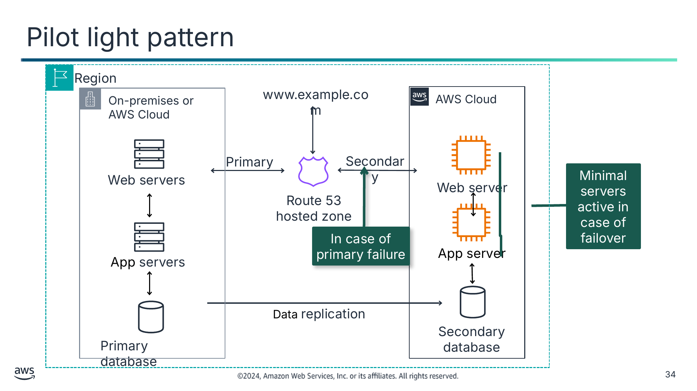

Текст зі схеми

Region (Регіон)

On-premises or AWS Cloud (Локально або хмара AWS)

www.example.com

AWS Cloud

Primary (Основний)

Secondary (Вторинний)

Web servers (Вебсервери)

Web

server

Minimal servers active in case of failover (Мінімум серверів активні на випадок відмовостійкого перемикання)

Web server

Route 53

hosted zone (Розміщена зона Route 53)

Web

server

In case of primary failure (У разі відмови основного)

App server (Сервер застосунку)

App servers

Data replication (Реплікація даних)

Secondary database (Вторинна база даних)

Primary database (Основна база даних)

> **Нотатки:**
>
> |Номер слайда 34  
> |Нотатки для інструктора  
> |  
> |Нотатки для студента  
> Опис зображення: ця діаграма ілюструє, як «пілотне світло» використовуватиме перевірки стану Route 53 для відмовостійкого перемикання на мінімальну кількість серверів у разі відмови перевірки стану основного. Кінець опису.  
>
> Другий підхід до аварійного відновлення — шаблон «пілотне світло» (pilot light).  
>
> «Пілотне світло» описує шаблон аварійного відновлення, де мінімальна резервна версія вашого середовища завжди працює. Аналогія з пілотним світлом походить від газового нагрівача: маленький вогник (пілотне світло) завжди горить, навіть коли нагрівач вимкнений. Пілотне світло може швидко запалити цілу піч для обігріву будинку. У прикладі шаблону пілотне світло — це вторинна база даних, що завжди працює. Основний недолік «пілотного світла» в тому, що вторинна не може витримати все навантаження основної й потребуватиме швидкого масштабування для обробки трафіку.  
>
> Сценарій «пілотного світла» подібний до сценарію резервного копіювання та відновлення. Однак час відновлення зазвичай швидший, оскільки основні частини системи вже працюють і постійно підтримуються актуальними. Коли настає час відновлення, можна швидко розгорнути повне продуктивне середовище навколо критичного ядра.  
>
> Елементи інфраструктури для самого пілотного світла зазвичай включають ваші сервери баз даних. Ця група — критичне ядро системи (пілотне світло). Усі інші елементи інфраструктури можна швидко розгорнути навколо нього для відновлення повної системи. Щоб розгорнути решту інфраструктури, ви зазвичай пакуєте попередньо налаштовані сервери як AMI, готові до запуску в будь-яку мить. (Або це можуть бути екземпляри в зупиненому стані.) Коли починається відновлення, ці екземпляри швидко запускаються зі своєю наперед визначеною роллю, що дає їм змогу підключатися до бази даних.  
>
> Цей шаблон відносно недорогий у впровадженні. Дані, що регулярно змінюються, мають реплікуватися до пілотного світла — малого ядра, навколо якого повне середовище запускається на етапі відновлення. Ваші дані, що оновлюються рідше, як-от операційні системи й застосунки, можна періодично оновлювати та зберігати як AMI.  
>
> Припустімо, настає катастрофа, і ваш основний застосунок переходить в режим офлайн. У цьому разі можна швидко ввести в експлуатацію обчислювальні ресурси для запуску застосунку чи оркестрації відмовостійкого перемикання на ресурси «пілотного світла» в AWS. У цьому прикладі вторинна база даних зберігає критичні дані. Якщо трапляється катастрофа, новий вебсервер і сервер застосунку запускаються й підключаються до вторинної бази даних. Route 53 налаштовано, щоб потім маршрутизувати трафік до нового вебсервера.  
>
> Основне середовище може існувати в локальному центрі обробки даних або в іншому регіоні чи зоні доступності в AWS. Як варіант, для цієї архітектури можна використати два регіони замість локального та хмарного середовищ. У будь-якому разі можна використовувати шаблон «пілотне світло» для досягнення вашого RTO.

---

## Слайд 35: Впровадження шаблону «пілотне світло»

Етап підготовки (Preparation phase)

У разі катастрофи (In case of disaster)

- Налаштуйте екземпляри EC2 для реплікації серверів.
- Створюйте й підтримуйте образи Amazon Machine Images (AMI) ключових серверів, де потрібне швидке відновлення.
- Регулярно запускайте, тестуйте й оновлюйте ці сервери.

- Розгорніть ресурси навколо реплікованого основного набору даних.
- Потім масштабуйте систему за потреби для обробки поточного продуктивного трафіку.
- Перейдіть на нову систему.

> **Нотатки:**
>
> |Номер слайда 35  
> |Нотатки для інструктора  
> |З цією моделлю необхідно регулярно й часто тестувати цю конфігурацію. Інакше, якщо джерело змінилося, каркасна конфігурація «пілотного світла» може бути не такою функціональною, як очікувалося. Вона може навіть повністю вийти з ладу залежно від типу змін, не налаштованих на стороні «пілотного світла».  
> |  
> |Нотатки для студента  
> Якщо ви впроваджуєте шаблон аварійного відновлення «пілотне світло», є ключові кроки, які слід виконати на етапі підготовки. Це налаштування екземплярів EC2, забезпечення доступності всіх допоміжних користувацьких програмних пакетів та створення й підтримка ключових AMI, де потрібне швидке відновлення. Оскільки мінімальна резервна версія вашого середовища завжди працює, слід регулярно запускати й тестувати сервери та застосовувати оновлення програмного забезпечення й конфігурації. Розгляньте автоматизацію розгортання ресурсів AWS.  
>
> З шаблоном аварійного відновлення «пілотне світло» ваша основна інфраструктура доступна, і ви завжди маєте змогу швидко розгорнути повномасштабне продуктивне середовище, вмикаючи й масштабуючи назовні ваші сервери застосунків. Якщо ви впроваджуєте шаблон «пілотне світло», ключові кроки, які слід виконати у разі катастрофи, — автоматично розгорнути ресурси навколо реплікованого основного набору даних. Потім масштабувати систему за потреби для обробки поточного продуктивного трафіку.  
>
> Нарешті, перейдіть на нову систему, скоригувавши записи DNS так, щоб вони вказували на резервне розгортання. Відмовостійке перемикання перенаправляє трафік з основного регіону (де ви визначили, що робоче навантаження більше не може працювати) до вторинного регіону. З Route 53 можна налаштувати кінцеві точки і основного, і вторинного регіону під одним доменним ім’ям. Потім оберіть політику маршрутизації, що визначає, яка кінцева точка отримує трафік для цього доменного імені.

---

## Слайд 36: Шаблон «тепле резервування» (warm standby)

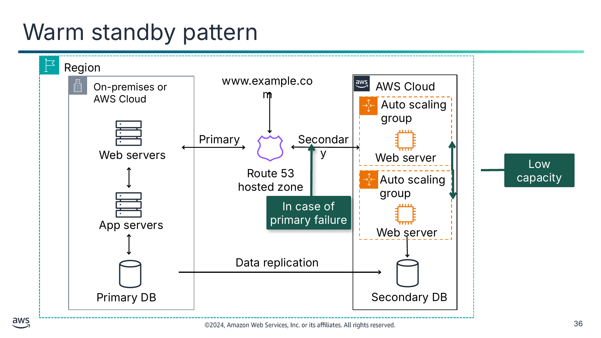

Текст зі схеми

Region (Регіон)

www.example.com

Auto scaling group (Група Auto Scaling)

Primary (Основний)

Secondary (Вторинний)

Web servers (Вебсервери)

Web server

Route 53

hosted zone (Розміщена зона Route 53)

Auto scaling group

In case of primary failure (У разі відмови основного)

App servers (Сервери застосунку)

Web server

Data replication (Реплікація даних)

Low capacity (Мала потужність)

On-premises or AWS Cloud (Локально або хмара AWS)

Primary DB (Основна БД)

Secondary DB (Вторинна БД)

AWS Cloud

> **Нотатки:**
>
> |Номер слайда 36  
> |Нотатки для інструктора  
> |Подібно до варіанта «пілотне світло», ключ до того, щоб це працювало як очікується, — часте тестування, щоб усі ключові зміни з джерела було враховано в аналогах «теплого резервування».  
> |  
> |Нотатки для студента  
> Третій підхід до аварійного відновлення — шаблон «тепле резервування» (warm standby). Шаблон «тепле резервування» подібний до «пілотного світла», але більше ресурсів уже працює. Термін «тепле резервування» описує сценарій аварійного відновлення, де зменшена версія повністю функціонального середовища завжди працює в хмарі. Рішення «тепле резервування» розширює елементи та підготовку «пілотного світла». Воно ще більше зменшує час відновлення, оскільки деякі сервіси завжди працюють. Визначивши ваші критично важливі для бізнесу системи, можна повністю дублювати ці системи й тримати їх постійно ввімкненими.  
>
> Ці сервери можуть працювати на парку екземплярів EC2 мінімального розміру з найменшими можливими розмірами. Це рішення ще не масштабоване для повного продуктивного навантаження, але воно повністю функціональне. Хоча воно існує для цілей DR, його також можна використовувати для непродуктивної роботи, як-от тестування, забезпечення якості та внутрішнього використання.  
>
> У прикладі працюють дві системи. Основна система може працювати в локальному центрі обробки даних чи регіоні AWS, а система малої потужності працює в AWS. Використовуйте Route 53 для розподілу запитів між основною системою та резервною системою. Як варіант, для цієї архітектури можна використати два регіони AWS замість локального та хмарного середовищ.  
>
> Ліцензування програмного забезпечення — проблема, що може виникнути під час створення резервних майданчиків. Вивчіть ліцензування програмного забезпечення, яке ви маєте, щоб визначити, чи ваші поточні ліцензійні договори підтримують ваші плани DR. Оновіть свої ліцензії чи скоригуйте іншими способами, як потрібно.  
>
> У разі катастрофи, якщо основне середовище недоступне, Route 53 переходить на вторинну систему. Вторинна система потім може швидко почати масштабуватися для обробки продуктивного навантаження. Це збільшення можна здійснити, додавши більше екземплярів EC2 до балансувальника навантаження. Як варіант, можна змінити розмір серверів малої потужності, щоб вони працювали на більших типах екземплярів EC2. Горизонтальне масштабування (створення більшої кількості екземплярів EC2) краще за вертикальне масштабування (збільшення розміру наявних екземплярів).

---

## Слайд 37: Впровадження шаблону «тепле резервування»

Етап підготовки (Preparation phase)

У разі катастрофи (In case of disaster)

- Подібний до «пілотного світла»
- Має всі потрібні компоненти, що працюють 24/7, але не масштабовані для продуктивного трафіку
- Потрібно проводити безперервне тестування компонентів

- Негайно перемкніть найкритичніше продуктивне навантаження
- Масштабуйте систему далі для обробки всього продуктивного навантаження (автоматично)

> **Нотатки:**
>
> |Номер слайда 37  
> |Нотатки для інструктора  
> |Допис у блозі «Disaster Recovery (DR) Architecture on AWS, Part III: Pilot Light and Warm Standby» пояснює подібності й відмінності між шаблонами «пілотне світло» та «тепле резервування». Цей ресурс розширює концепцію того, що успішне відновлення залежить від виявлення події катастрофи, відновлення робочого навантаження в регіоні відновлення та відмовостійкого перемикання для надсилання трафіку до регіону відновлення.  
> |  
> |Нотатки для студента  
> Якщо ви впроваджуєте шаблон аварійного відновлення «тепле резервування», етап підготовки важливий. Ключові кроки, які слід виконати на етапі підготовки, подібні до кроків, які ви виконуєте для шаблону «пілотне світло». Найпомітніша відмінність у тому, що всі потрібні компоненти слід залишати працювати 24/7, але не масштабованими для продуктивного трафіку.  Як найкраща практика, проводьте безперервне тестування. Оскільки «тепле резервування» розгортає функціональний стек у регіоні відновлення, це робить зручнішим тестування готовності регіону за допомогою синтетичних транзакцій. Також можна передавати «цівкою» статистичну підмножину продуктивного трафіку на майданчик DR. Таким чином можна перевірити, що він функціонує для користувачів і систем так само безшовно, як основна система.  
>
> З шаблоном «тепле резервування» у разі катастрофи ключові кроки, які слід виконати, — негайно виконати відмовостійке перемикання найкритичнішого продуктивного навантаження й скоригувати записи DNS так, щоб вони вказували на AWS. Якщо налаштовано перевірки стану основного та вторинного й налаштовано «тепле резервування», Route 53 обробить відмовостійке перемикання. Маршрутизація відмовостійкого перемикання автоматично надсилатиме трафік до регіону відновлення, якщо основний несправний за налаштованими вами перевірками стану. Автоматично масштабуйте систему далі для обробки всього продуктивного навантаження.

---

## Слайд 38: Мультисайтовий шаблон (multi-site pattern)

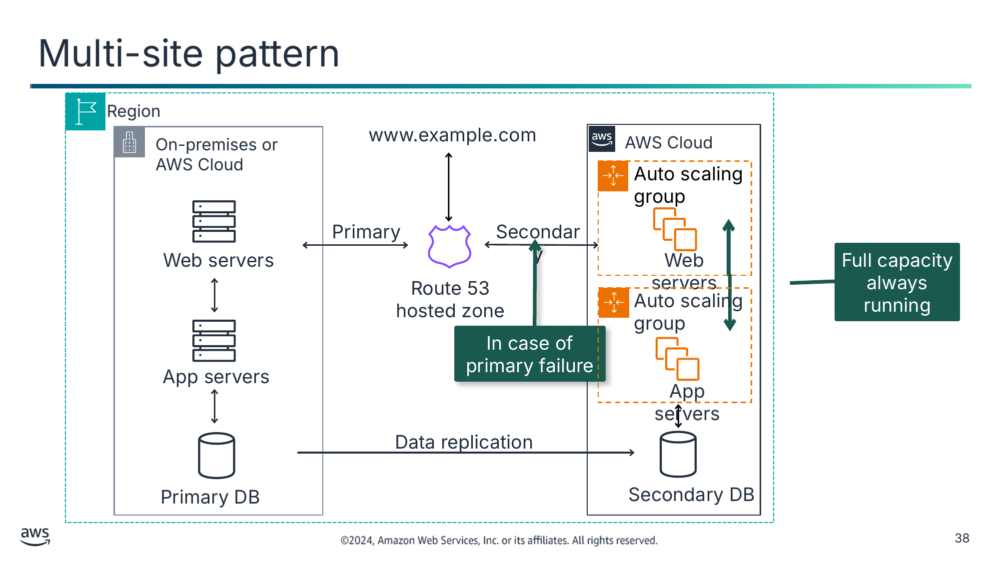

Текст зі схеми

Region (Регіон)

www.example.com

Auto scaling group (Група Auto Scaling)

Primary (Основний)

Secondary (Вторинний)

Web servers (Вебсервери)

Web servers

Full capacity always running (Повна потужність працює завжди)

Route 53

hosted zone (Розміщена зона Route 53)

Auto scaling group

In case of primary failure (У разі відмови основного)

App servers (Сервери застосунку)

App servers

Data replication (Реплікація даних)

On-premises or AWS Cloud (Локально або хмара AWS)

Primary DB (Основна БД)

Secondary DB (Вторинна БД)

AWS Cloud

> **Нотатки:**
>
> |Номер слайда 38  
> |Нотатки для інструктора  
> |  
> |Нотатки для студента  
> Опис зображення: ця діаграма ілюструє, як «пілотне світло» використовуватиме перевірки стану Route 53 для відмовостійкого перемикання на повний дублікат вторинного майданчика в разі надзвичайної ситуації.  
> Кінець опису.  
>
> Четвертий і останній підхід до аварійного відновлення — мультисайтовий шаблон. З цим шаблоном ви маєте повністю функціональну систему, що працює в другому регіоні. Вона працює водночас із локальними системами чи системами, що працюють в іншому регіоні. Як варіант, для цієї архітектури можна використати два регіони замість локального та хмарного середовищ.  
>
> Мультисайтове рішення працює в конфігурації «активний-активний». Метод реплікації даних, який ви застосовуєте, визначається обраною вами точкою відновлення. Оскільки обидва майданчики можуть підтримувати повну продуктивну потужність, ви можете вирішити використати сервіс DNS, що підтримує зважену маршрутизацію. Приклад — Route 53, що маршрутизує продуктивний трафік до обох майданчиків, які надають той самий застосунок чи сервіс. У цьому сценарії частка трафіку надходить до вашої інфраструктури в AWS, а решта — до вашої інфраструктури на майданчику. (Або якщо два середовища існують в окремих регіонах, трафік розподіляється між цими двома регіонами.)  
>
> У прикладі працюють дві системи. Основна система працює в локальному центрі обробки даних, а система повної потужності працює в AWS. Можна скоригувати ваги DNS і надіслати весь трафік до хмарного середовища. Потужність розгортання в хмарі потім можна швидко збільшити для обробки повного продуктивного навантаження за потреби. Можна використовувати Amazon EC2 Auto Scaling для автоматизації цього процесу. Вам може знадобитися певна логіка застосунку для виявлення відмови основних сервісів бази даних і переходу на паралельні, уже працюючі сервіси баз даних.  
>
> Вартість цього сценарію визначається обсягом продуктивного трафіку під час нормальної роботи. На етапі відновлення ви платите лише за те, що використовуєте протягом тривалості, коли середовище DR потрібне в повному масштабі. Можна ще більше зменшити вартість, придбавши зарезервовані екземпляри Amazon EC2 для ваших постійно ввімкнених серверів AWS.

---

## Слайд 39: Впровадження мультисайтового шаблону

Етап підготовки (Preparation phase)

У разі катастрофи (In case of disaster)

- Подібний до «теплого резервування»
- Налаштований для повного масштабування досередини чи назовні для продуктивного навантаження
- Враховуйте вартість ліцензування повного дубліката системи

Негайно перемкніть усе продуктивне навантаження

> **Нотатки:**
>
> |Номер слайда 39  
> |Нотатки для інструктора  
> |У блозі «Disaster Recovery (DR) Architecture on AWS, Part IV: Multi-site Active/Active» пояснюються шаблони читання/запису. Наведено приклади шаблонів «читати локально/писати локально» та «читати локально/писати глобально» за допомогою глобальних таблиць Amazon DynamoDB та глобальних таблиць Amazon Aurora.  
> |  
> |Нотатки для студента  
> Якщо ви впроваджуєте мультисайтовий шаблон аварійного відновлення, ключові кроки, які слід виконати на етапі підготовки, подібні до шаблону «тепле резервування». Ви маєте налаштувати резервне розгортання для повного масштабування досередини й назовні продуктивного навантаження. Ваші сервери мають працювати й бути готовими приймати трафік. Route 53 пропонує кілька політик маршрутизації. Для маршрутизації за геолокацією ви налаштовуєте, до якого регіону йде запит, на основі розташування походження запиту. Для маршрутизації за затримкою AWS автоматично надсилає запити до регіону, що забезпечує найкоротший час кругового обходу (round-trip time).  
>
> Ваша стратегія управління даними допомагає визначити, яку політику маршрутизації використовувати. З маршрутизацією за геолокацією можна розподіляти запити детермінованим способом. Можна зберігати дані певних користувачів у межах певного регіону або контролювати, куди маршрутизуються операції запису, щоб запобігти конкуренції. Якщо оптимізація продуктивності — ваш головний пріоритет, то маршрутизація за затримкою — хороший вибір.  
>
> З мультисайтовим шаблоном у разі катастрофи потрібно виконати лише один ключовий крок. Цей крок — негайно перемкнути все продуктивне навантаження на резервний майданчик. Мультисайтовий шаблон потенційно має найменший простій з усіх. Однак він має більше пов’язаних витрат, оскільки на вторинному майданчику потрібно створити цілий дублікат системи. Враховуйте вартість ліцензування повного дубліката системи для мультисайтового шаблону.

---

## Слайд 40: Підсумок поширених шаблонів DR

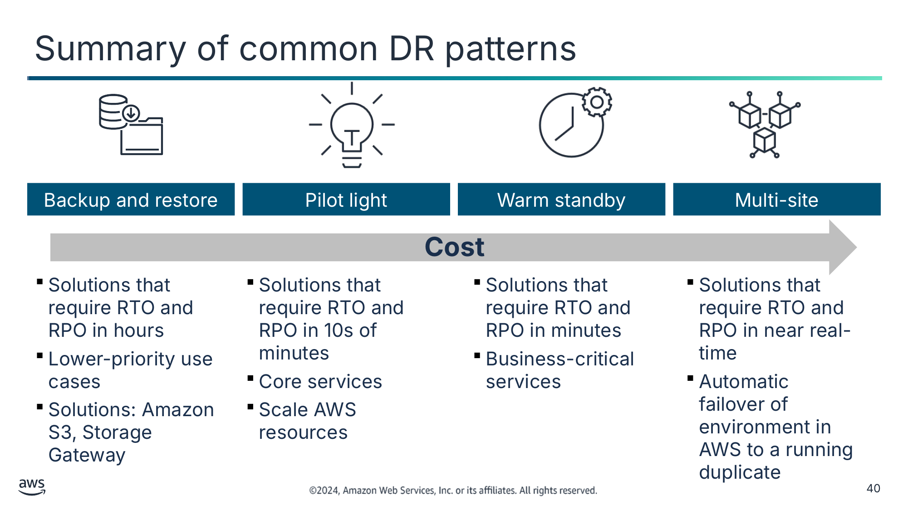

Резервне копіювання та відновлення (Backup and restore)

Пілотне світло (Pilot light)

Тепле резервування (Warm standby)

Мультисайтовий (Multi-site)

- Рішення, що потребують RTO та RPO в годинах
- Сценарії використання нижчого пріоритету
- Рішення: Amazon S3, Storage Gateway

- Рішення, що потребують RTO та RPO в десятках хвилин
- Основні сервіси
- Масштабування ресурсів AWS

- Рішення, що потребують RTO та RPO в хвилинах
- Критично важливі для бізнесу сервіси

- Рішення, що потребують RTO та RPO майже в реальному часі
- Автоматичне відмовостійке перемикання середовища в AWS на працюючий дублікат

Текст зі схеми

**Cost** (**Вартість**)

> **Нотатки:**
>
> |Номер слайда 40  
> |Нотатки для інструктора  
> |Розділ «Disaster Recovery Options in the Cloud» технічного документа про DR надає цікаві моменти для розгляду щодо кожного шаблону. Докладніше див. посилання на сторінці ресурсів вмісту вашого онлайн-курсу.  
> |  
> |Нотатки для студента  
> Опис зображення: ця діаграма показує, як цільовий час відновлення зменшуватиметься зі збільшенням вартості залежно від того, яку платформу відновлення використано.  
> Кінець опису.  
>
> Підсумовуючи, кожен із чотирьох шаблонів DR пропонує іншу комбінацію переваг. Стрілка показує, що вартість зростає від шаблону DR «резервне копіювання та відновлення» до мультисайтового шаблону DR, а RTO зростає від мультисайтового шаблону DR до шаблону DR «резервне копіювання та відновлення».  
>
> Шаблон «резервне копіювання та відновлення» зазвичай можна здійснити за найнижчу вартість, але він має довший RTO. У результаті ваші системи, імовірно, відновлюватимуться повільніше, ніж з іншими варіантами.  
> Шаблони «тепле резервування» та мультисайтовий підтримують значно швидший RTO, але мати додаткові сервери, що працюють завжди, дорого.  
>
> З AWS можна економічно ефективно експлуатувати кожну з цих стратегій DR. Важливо усвідомлювати, що ці шаблони — лише приклади можливих підходів, і варіації та комбінації цих шаблонів можливі. Якщо ваш застосунок працює в AWS, то можна використовувати кілька регіонів, і ті самі стратегії DR усе ще застосовуються.

---

## Слайд 41: Вправи «День гри» (Practice Game Day exercises)

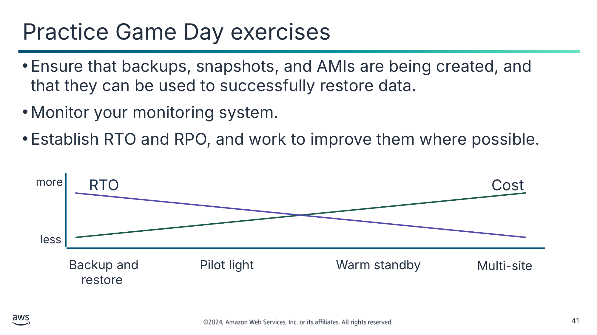

- Переконайтеся, що резервні копії, знімки й AMI створюються і що їх можна використати для успішного відновлення даних.
- Відстежуйте вашу систему моніторингу.
- Встановіть RTO та RPO і працюйте над їх покращенням, де це можливо.

Текст зі схеми

more (більше)

RTO

Cost (Вартість)

less (менше)

Backup and restore

Pilot light

Warm standby

Multi-site

> **Нотатки:**
>
> |Номер слайда 41  
> |Нотатки для інструктора  
> |  
> |Нотатки для студента  
> Опис зображення: ця діаграма показує, як цільовий час відновлення зменшуватиметься зі збільшенням вартості залежно від того, яку платформу відновлення використано.  
> Кінець опису.  
>
> Найкраща практика — постійно перевіряти ваше рішення DR, щоб гарантувати, що воно працює як задумано.  
>
> Практикуйте вправи «День гри» (Game Day) — ці вправи тестують сценарії, коли критичні системи переходять в режим офлайн або навіть цілі регіони. Що, якщо падає цілий парк?  
>
> Переконайтеся, що резервні копії, знімки й AMI створюються і що їх можна використати для успішного відновлення даних. Обов’язково відстежуйте вашу систему моніторингу.  
>
> Протестуйте ваші процедури реагування, щоб переконатися, що вони ефективні й що команди знайомі з тим, як застосовувати їх на практиці. Налаштуйте регулярні «Дні гри» для тестування реакцій робочого навантаження та команди на змодельовані події.

---

## Слайд 42: Ключові висновки: шаблони аварійного відновлення

- Поширені шаблони аварійного відновлення в AWS включають резервне копіювання та відновлення, «пілотне світло», «тепле резервування» та мультисайтовий.
- Резервне копіювання та відновлення — найекономічніший підхід. Однак він має найвищий RTO.
- Мультисайтовий шаблон забезпечує найшвидший RTO. Однак він коштує найбільше, оскільки надає повністю працюючий дублікат, готовий до продуктивного середовища.
- Storage Gateway надає три інтерфейси — File Gateway, Volume Gateway та Tape Gateway — для резервного копіювання й відновлення даних між локальним середовищем і хмарою AWS.

> **Нотатки:**
>
> |Номер слайда 42  
> |Нотатки для інструктора  
> |  
> |Нотатки для студента  
> Деякі ключові висновки з цього розділу модуля включають такі:  
> Поширені шаблони аварійного відновлення в AWS включають резервне копіювання та відновлення, «пілотне світло», «тепле резервування» та мультисайтовий.  
> Резервне копіювання та відновлення — найекономічніший підхід, але він має найвищий RTO.  
> Мультисайтовий шаблон забезпечує найшвидший RTO, але коштує найбільше, оскільки надає повністю працюючий дублікат, готовий до продуктивного середовища.  
> AWS Storage Gateway надає три інтерфейси — File Gateway, Volume Gateway та Tape Gateway — для резервного копіювання й відновлення даних між локальним середовищем і хмарою AWS.

---

## Слайд 43: Покрокова лабораторна робота: налаштування гібридного сховища та міграція даних за допомогою AWS Storage Gateway S3 File Gateway (Configuring Hybrid Storage and Migrating Data with AWS Storage Gateway S3 File Gateway, AWS Storage Gateway lab)

> **Нотатки:**
>
> |Номер слайда 43  
> |Нотатки для інструктора  
> |  
> |Нотатки для студента  
> Зараз ви виконаєте лабораторну роботу. Наступні слайди підсумовують, що ви робитимете в лабораторній роботі, а докладні інструкції ви знайдете в лабораторному середовищі.

---

## Слайд 44: Завдання лабораторної роботи «AWS Storage Gateway»

- У цій лабораторній роботі ви виконаєте такі основні завдання:
  - Налаштуєте S3 File Gateway із файловим спільним ресурсом NFS і приєднаєте його до екземпляра Linux.
  - Мігруєте набір даних із екземпляра Linux до бакета S3.
  - Створите й налаштуєте основний бакет S3 для міграції даних локального сервера до AWS.
  - Створите й налаштуєте вторинний бакет S3 для використання в міжрегіональній реплікації.
  - Створите політику життєвого циклу S3 для автоматичного керування даними в бакеті.

> **Нотатки:**
>
> |Номер слайда 44  
> |Нотатки для інструктора  
> |  
> |Нотатки для студента  
> Отримайте доступ до лабораторного середовища через ваш онлайн-курс, щоб дізнатися додаткові подробиці та виконати лабораторну роботу.

---

## Слайд 45: Підсумки лабораторної роботи «AWS Storage Gateway»

- Яку конфігурацію потрібно ввімкнути у вихідному бакеті та бакеті призначення, щоб міжрегіональна реплікація працювала?
- Як ви обрали правильний AMI для використання з пристроєм File Gateway?

> **Нотатки:**
>
> |Номер слайда 45  
> |Нотатки для інструктора  
> |Відповідні архітектурні схеми «до» та «після» включено до інструкцій кожної лабораторної роботи. Вам може бути корисно відкрити схеми лабораторної роботи під час підбиття підсумків цієї лабораторної роботи.  
> |Запропоновані відповіді на запитання 1: яку конфігурацію потрібно ввімкнути у вихідному бакеті та бакеті призначення, щоб міжрегіональна реплікація працювала?  
> |  
> |Щоб міжрегіональна реплікація працювала, потрібно ввімкнути керування версіями (versioning) і у вихідному бакеті, і в бакеті призначення. Керування версіями впливає на витрати. Тому рекомендується мати політику життєвого циклу для файлів із версіями.  
> |  
> |Запропоновані відповіді на запитання 2: як ви обрали правильний AMI для використання з пристроєм File Gateway?  
> |  
> |Коли ви обрали Amazon EC2 у майстрі створення шлюзу (Create gateway), правильний AMI, що має використовуватися для пристрою File Gateway, обирається за вас.  
> |  
> |Нотатки для студента  
> Ваш інструктор може розглянути ці запитання з вами, або ви можете розглянути їх самостійно. Скористайтеся цією нагодою, щоб поглибити своє мислення щодо завдань, які ви виконували під час лабораторної роботи.

---

## Слайд 46: Застосування принципів AWS Well-Architected Framework до планування на випадок катастрофи

Планування на випадок катастрофи

> **Нотатки:**
>
> |Номер слайда 46  
> |Нотатки для інструктора  
> |  
> |Нотатки для студента  
> Цей розділ пов’язує найкращі практики Well-Architected з концепціями, що стосуються планування катастроф і відновлення.

---

## Слайд 47: Найкращі практики Well-Architected Framework для планування на випадок катастроф

> **Нотатки:**
>
> |Нотатки для інструктора  
> |Решта слайдів у цьому розділі подають приклади, що підкреслюють, як матеріал цього модуля узгоджується з найкращими практиками AWS Well-Architected Framework. За бажанням ви можете попросити студентів відвідати вебсайт AWS Well-Architected Framework і знайти найкращі практики, які, на їхню думку, пов’язані з матеріалом, поданим у цьому модулі. Вони можуть використовувати цей розділ як відправну точку.  
> |  
> |Нотатки для студента  
> AWS Well-Architected Framework має шість опор, і кожна опора включає найкращі практики та набір запитань, які слід враховувати під час проєктування хмарних рішень. Цей розділ виділяє кілька найкращих практик з опор, найактуальніших для цього модуля. Це опори «Надійність», «Операційна досконалість» і «Безпека».

---

## Слайд 48: Підхід найкращих практик: керування збоями — плануйте аварійне відновлення

**Найкращі практики**

Визначте цілі відновлення щодо простою та втрати даних.

Використовуйте визначені стратегії відновлення для досягнення цілей відновлення.

Тестуйте впровадження аварійного відновлення для перевірки впровадження.

> **Нотатки:**
>
> |Номер слайда 48  
> |Нотатки для інструктора  
> |  
> |Нотатки для студента  
> Як хмарному архітектору, вам потрібно розуміти, як створити архітектуру, що підтримує систему запобігання потенційним загрозам і відновлення після них вашої організації. Побудова стійких робочих навантажень допомагає підготуватися до будь-якої події, що не дає робочому навантаженню чи системі виконувати свої бізнес-цілі в основному розташуванні. Керування збоями — один із кроків, які потрібно зробити для впровадження стійкості; планування аварійного відновлення — одна з частин керування збоями.  
>
> Наявність резервних копій і надлишкових компонентів робочого навантаження — початок вашої стратегії DR. RTO та RPO — ваші цілі відновлення вашого робочого навантаження. Встановлюйте їх на основі бізнес-потреб. Впровадьте стратегію для досягнення цих цілей, враховуючи розташування та функції ресурсів робочого навантаження й даних. Імовірність збою та вартість відновлення також є ключовими чинниками, що допомагають визначити бізнес-цінність забезпечення аварійного відновлення для робочого навантаження.  
>
> Визначте цілі відновлення щодо простою та втрати даних: кожне робоче навантаження має призначені RTO та RPO, визначені на основі впливу на бізнес. Для заданого робочого навантаження потрібно розуміти вплив простою й утрачених даних на ваш бізнес. Вплив загалом зростає з більшим простоєм чи втратою даних, але форма цього зростання може відрізнятися залежно від типу робочого навантаження.  
>
> Наприклад, ви можете витримати простій до години з невеликим впливом, але після цього вплив швидко зростає. Вплив на бізнес проявляється в багатьох формах, зокрема грошових витратах (як-от утрачений дохід), довірі клієнтів (і впливі на репутацію), операційних проблемах (як-от пропущена виплата заробітної плати чи зниження продуктивності) та регуляторному ризику. RTO та RPO використовуються як одне з основних міркувань для вибору реалізації стратегії аварійного відновлення для робочого навантаження. Додаткові міркування під час вибору стратегії DR — обмеження вартості, залежності робочого навантаження та операційні вимоги.  
>
> Використовуйте визначені стратегії відновлення для досягнення цілей відновлення: визначте стратегію DR, що відповідає цілям відновлення вашого робочого навантаження. Оберіть стратегію, як-от резервне копіювання та відновлення, «пілотне світло», «тепле резервування» чи мультисайтовий шаблон. Вибір стратегії DR — це компроміс між зменшенням простою та втрати даних (RTO та RPO) і вартістю та складністю впровадження стратегії.  
>
> З усіма стратегіями потрібно також пом’якшувати катастрофу даних. Безперервно реплікувані дані можуть не захистити від пошкодження, якщо ви також не ведете версії чи знімки ваших даних. Також потрібно створювати резервні копії реплікованих даних на майданчику відновлення, щоб створити резервні копії на певний момент часу на додачу до реплік.  
>
> Тестуйте впровадження аварійного відновлення для перевірки впровадження: регулярно тестуйте відмовостійке перемикання на ваш майданчик відновлення, щоб перевірити, що він працює належно та що RTO й RPO дотримуються. Єдине відновлення після помилок, що працює, — це шлях, який ви часто тестуєте.  
>
> У цьому модулі ви дізналися про теми, що підтримують ці найкращі практики, зокрема такі:  
> Елементи, пов’язані із запобіганням катастрофі та плануванням на випадок катастрофи  
> Чинники, що впливають на стратегії планування на випадок катастрофи, зокрема RTO та RPO  
> Поширені шаблони аварійного відновлення, як-от резервне копіювання та відновлення, «пілотне світло», «тепле резервування» та мультисайтовий  
>
> Докладніше див. Plan for Disaster Recovery (DR) у документації AWS Well-Architected Framework, на яку є посилання в ресурсах вашого курсу.

---

## Слайд 49: Підхід найкращих практик: експлуатація — керуйте подіями робочого навантаження та операцій

**Найкраща практика**

Визначте план комунікації з клієнтами

на випадок простоїв.

> **Нотатки:**
>
> |Номер слайда 49  
> |Нотатки для інструктора  
> |  
> |Нотатки для студента  
> Опора «Операційна досконалість» включає здатність підтримувати розробку та ефективно запускати робочі навантаження, отримувати розуміння ваших операцій і безперервно покращувати допоміжні процеси й процедури для надання бізнес-цінності. Одну з найкращих практик експлуатації можна сформулювати як запитання: як ви керуєте подіями робочого навантаження та операцій? Відповідь на це запитання допоможе підготувати й перевірити процедури реагування на події, щоб мінімізувати їх порушення для вашого робочого навантаження.  
>
> Визначте план комунікації з клієнтами на випадок простоїв: визначте й протестуйте план комунікації на випадок простоїв системи, на який можна покластися, щоб тримати ваших клієнтів і зацікавлені сторони поінформованими під час простоїв. Спілкуйтеся безпосередньо з вашими користувачами і коли сервіси, якими вони користуються, зазнають впливу, і коли сервіси повертаються до нормальної роботи.  
>
> Наприклад, коли робоче навантаження погіршене, Any Company Retail надсилає електронне сповіщення своїм користувачам. Лист описує, яка бізнес-функціональність погіршена, і надає реалістичну оцінку того, коли сервіс буде відновлено. Крім того, вони мають сторінку статусу, що показує інформацію в реальному часі про стан їхнього робочого навантаження. План комунікації тестується в середовищі розробки двічі на рік, щоб підтвердити його ефективність.  
>
> У цьому модулі ви дізналися про підготовку до катастрофи, що підтримує цю найкращу практику, зокрема таке:  
> BCP вашої організації включає ваш план аварійного відновлення та логістику аварійного відновлення.  
> Використовуйте різні сервіси й ресурси AWS для проєктування стійкості та відновлення.  
>
> Докладніше див. розділ про опору операційної досконалості в документації AWS Well-Architected Framework. Посилання є в ресурсах вашого курсу.

---

## Слайд 50: Підхід найкращих практик: керування ідентичністю та доступом — керування дозволами

**Найкраща практика**

Встановіть процес аварійного доступу.

> **Нотатки:**
>
> |Номер слайда 50  
> |Нотатки для інструктора  
> |  
> |Нотатки для студента  
> Щоб використовувати сервіси AWS, користувачам і застосункам потрібен доступ до ресурсів у ваших акаунтах AWS. Міркування щодо керування ідентичністю та доступом потрібно враховувати під час підготовки до катастроф.  
>
> Встановіть процес аварійного доступу: створіть процес, що забезпечує аварійний доступ до ваших робочих навантажень у малоймовірному разі проблеми з вашим централізованим постачальником ідентичності. Проєктуйте процеси для різних режимів збоїв, що можуть призвести до аварійної події. Наприклад, за нормальних обставин ваші користувачі робочої сили федеруються в хмару за допомогою централізованого постачальника ідентичності для керування своїми робочими навантаженнями. Однак якщо ваш централізований постачальник ідентичності виходить з ладу або конфігурацію федерації в хмарі змінено, ваші користувачі робочої сили можуть не мати змоги федеруватися в хмару.  
>
> Процес аварійного доступу надає авторизованим адміністраторам доступ до ваших хмарних ресурсів альтернативними засобами для виправлення проблем із вашою конфігурацією федерації чи вашими робочими навантаженнями. Маючи добре задокументовані й добре протестовані процеси аварійного доступу, можна скоротити час, який витрачають ваші користувачі на реагування на аварійну подію та її розв’язання. Це може призвести до меншого простою та вищої доступності сервісів, які ви надаєте своїм клієнтам.  
>   
> У цьому модулі ви дізналися про можливості встановлення й тестування аварійних процесів, що підтримують цю найкращу практику, зокрема таке:  
> Постійно перевіряйте ваше рішення аварійного відновлення, щоб гарантувати, що воно працює як задумано, за допомогою вправ «День гри».  
> Проводьте безперервне тестування всіх компонентів, пов’язаних з аварійним відновленням.  
>
> Докладніше див. розділ про опору безпеки в Well-Architected Framework, на який є посилання в ресурсах вашого курсу.

---

## Слайд 51: Ключові висновки: застосування принципів AWS Well-Architected Framework до планування на випадок катастрофи

- Визначте цілі відновлення щодо простою та втрати даних на основі бізнес-вимог.
- Використовуйте визначені стратегії відновлення для досягнення цілей відновлення на основі бізнес-вимог.
- Тестуйте впровадження аварійного відновлення для перевірки впровадження.
- Визначте план комунікації з клієнтами на випадок простоїв.
- Встановіть процес аварійного доступу.

> **Нотатки:**
>
> |Номер слайда 51  
> |Нотатки для інструктора  
> |  
> |Нотатки для студента

---

## Слайд 52: Підсумки модуля

Планування на випадок катастрофи

> **Нотатки:**
>
> |Номер слайда 52  
> |Нотатки для інструктора  
> |  
> |Нотатки для студента  
> Цей розділ підсумовує те, що ви дізналися, і завершує модуль.

---

## Слайд 53: Резюме модуля

Цей модуль підготував вас до такого:

- Визначати стратегії планування на випадок катастрофи, зокрема RPO та RTO на основі бізнес-вимог.
- Визначати планування на випадок катастрофи для категорій сервісів AWS.
- Описувати поширені шаблони резервного копіювання й аварійного відновлення та способи їх впровадження.
- Використовувати принципи AWS Well-Architected Framework під час проєктування плану аварійного відновлення.

> **Нотатки:**
>
> |Номер слайда 53  
> |Нотатки для інструктора  
> |  
> |Нотатки для студента

---

## Слайд 54: Міркування щодо кафе

- Обговоріть, як ви, як хмарний архітектор, могли б порадити кафе на основі ключових занепокоєнь хмарного архітектора, поданих на початку цього модуля.

---

## Слайд 55: Перевірка знань модуля

- Перевірка знань проводиться онлайн у вашому курсі.
- Перевірка знань включає 10 запитань на основі матеріалу, поданого на слайдах і в нотатках до слайдів.
- Ви можете повторно проходити перевірку знань стільки разів, скільки захочете.

> **Нотатки:**
>
> |Номер слайда 55  
> |Нотатки для інструктора  
> |  
> |Нотатки для студента  
> Скористайтеся своїм онлайн-курсом, щоб отримати доступ до перевірки знань для цього модуля.

---

## Слайд 56: Зразок запитання іспиту

Архітектор рішень має створити рішення аварійного відновлення (DR) для критично важливих для бізнесу застосунків компанії. Максимально прийнятний обсяг втрати даних — 7 хвилин. Рішення DR також вимагає розгортання повністю функціональної версії застосунків для негайної обробки більшості трафіку з подальшим масштабуванням до повної потужності з часом. Який шаблон аварійного відновлення забезпечить найекономічніше рішення?

Визначте ключові слова та фрази, перш ніж продовжувати.

Ось ключові слова та фрази:

- Критично важливі для бізнесу
- Функціональна версія застосунків
- Негайна обробка більшості трафіку
- Економічно ефективне

> **Нотатки:**
>
> |Номер слайда 56  
> |Нотатки для інструктора  
> |Розділ із ключовими словами налаштовано з анімацією для розкриття за клацанням.  
> |  
> |Нотатки для студента

---

## Слайд 57: Зразок запитання іспиту: варіанти відповідей

Архітектор рішень має створити рішення аварійного відновлення (DR) для **критично важливих для бізнесу** застосунків компанії. Максимально прийнятний обсяг втрати даних — 7 хвилин. Рішення DR також вимагає розгортання повністю **функціональної версії застосунків** **для негайної обробки більшості трафіку** з подальшим масштабуванням до повної потужності з часом. Який шаблон аварійного відновлення забезпечить найекономічніше рішення?

**Варіант**

**Відповідь**

**A**

Резервне копіювання та відновлення (Backup and restore)

**B**

Пілотне світло (Pilot light)

**C**

Тепле резервування (Warm standby)

**D**

Мультисайтовий (Multi-site)

> **Нотатки:**
>
> |Номер слайда 57  
> |Нотатки для інструктора  
> |  
> |Нотатки для студента  
> Використайте ключові слова та фрази, які ви визначили на попередньому слайді, і розгляньте кожен із можливих варіантів відповіді, щоб визначити, який із них найкраще відповідає запитанню.

---

## Слайд 58: Зразок запитання іспиту: відповідь

Правильна відповідь — C.

**Варіант**

**Відповідь**

**C**

Тепле резервування (Warm standby)

> **Нотатки:**
>
> |Номер слайда 58  
> |Нотатки для інструктора  
> |  
> |Нотатки для студента  
> Варіант A (резервне копіювання та відновлення) не зміг би відновитися для обробки потрібного трафіку достатньо швидко. Резервне копіювання та відновлення — непридатне рішення для критично важливих для бізнесу застосунків.  
>
> Варіант B («пілотне світло») обробляв би лише невелику кількість трафіку, перш ніж активно масштабуватися. Оскільки екземпляри простоюють, він не зміг би негайно обробити більшість трафіку.  
>   
> Варіант D (мультисайтовий) відповідав би вимозі цільової точки відновлення (RPO) за лічені миті. Сервіси вже працюють на повній потужності протягом цього часу. Однак це рішення коштує більше, ніж потрібно для виконання вимог компанії.  
>   
> Правильна відповідь — C: «тепле резервування». Це рішення відповідає вимозі RPO у 7 хвилин. Екземпляри працюють із малою потужністю й можуть масштабуватися за лічені хвилини. Вартість, пов’язана з цим шаблоном аварійного відновлення, менша, ніж у мультисайтового.

---

## Слайд 59: Дякуємо

Виправлення, відгуки чи інші запитання?

Зв’яжіться з нами за адресою [https://support.aws.amazon.com/#/contacts/aws-academy](https://support.aws.amazon.com/#/contacts/aws-academy).

> **Нотатки:**
>
> |Номер слайда 59  
> |Нотатки для інструктора  
> |  
> |Нотатки для студента  
> На цьому цей модуль завершено. Сторінка ресурсів вмісту вашого курсу містить посилання на додаткові ресурси, пов’язані з цим модулем.
